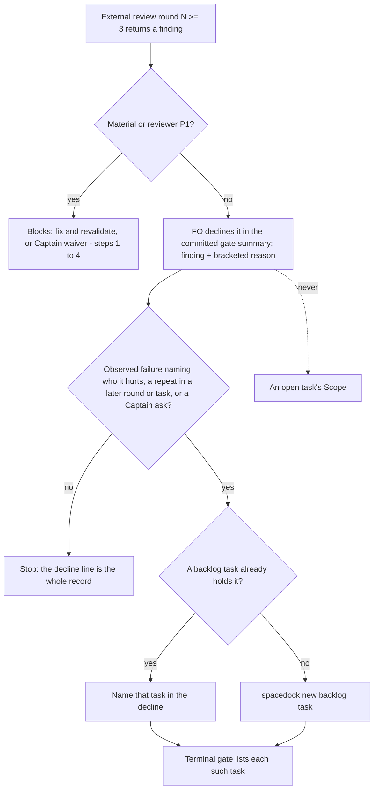

The README's review-finding rule that files every round-3 decline as a new backlog task is replaced: a declined finding keeps its bracketed reason in the gate summary, and becomes a task only when it meets the same bite-and-consumer bar as any other backlog task, or when a later round or task hits it again.

## Scope

- Source: the Captain 「可以，但是該怎樣紀錄合理的followup」 (chat, 2026-11-05), answering 「這張擱置，改開「刪掉第三輪婉拒要開待辦」的小任務，好嗎？」, at the batch 14 ideation gate of gate-summary-names-each-decline (held).
- Bite: of 20 archived follow-up tasks filed from declined findings in this workflow, 2 were built (followup-dispatch-records-checked, read-adr-reporting-rule-followup; each named an observed failure in real records) and 18 were closed together on 2026-10-20 (「照建議關掉 19 張。」), most as already done on main by other work; 11 more sit in backlog untouched since 2026-10-13 to 2026-10-23 (FO count over `_archive/*` and the backlog, 2026-11-05). Observers recorded 3 violations of the file-a-task rule in batches 12 and 13 (9 across all archives).
- Proposed bar (FO's answer to his question, for this task's backlog gate): a declined finding stays as `Declined: <finding> [<reason>]` in the gate summary (held since 2026-10-19 by delivery_gate.py); it becomes a task when (a) it names an observed failure, not a hypothetical one, and who is hurt, (b) a later review round or another task hits the same finding again (the README already names reuse of an existing task on a repeat), or (c) the Captain asks.
- Upstream first: README FO steps: review findings, step 5; delivery_gate.py decline parsing (bracket rule, count join); the observer's check of step 5.
- Non-goals: the three holds designed in gate-summary-names-each-decline; retiring the 11 open follow-up tasks (a separate question for the Captain).

- Batch 16: the Captain 「可以，就這樣」 (chat, 2026-11-06), answering 「這批做 2、3、4、5、9 這 5 張，可以嗎？」, which named this task.

## Budget
- One package PR; the workflow word budget does not rise.

## Stop condition
- README step 5 no longer requires a new backlog task for every round-3 decline and states the bar above; the observer no longer reports a decline without a task as a violation when its reason is written; a replay of the 3 batch 12 and 13 violations reads as compliant.

## FO alignment

Alignment: needed at backlog; the bar is his to accept.
Result: aligned at backlog: Batch 16 backlog gate, the Captain 「核准（建議）」 (host question dialog, 2026-11-06), answering 「決定：第 16 批這五張（跳過的 CI 不擋、Codex 只貼安全摘要時提醒、交付檢查的相對路徑、ADR 編號跨流程預留、婉拒只在出過事時開任務）都用 Pilot，照各自寫下的範圍、預算與停止條件進入構想嗎？核准即接受「婉拒只在出過事時開任務」任務裡寫的標準（指出真的錯並說得出誰受害、再次出現、或你要求）。要改哪張直接說。」, approved the outcome and bounds in this file.
Surfaces: none
Visible change: none
Release review: not needed: workflow maintenance, on no journey map.

## Design

**Press release.** From the next kc-dev-flow-2 release, when First Officer (FO) declines a finding from the third external-review round on, the decline line in the gate summary, naming the finding and a bracketed reason, is the whole record. FO files a backlog task only when the finding shows an observed failure and who it hurts, when a later round or another task hits it again (naming the task that already holds it, if one does), or when the Captain asks. The observer reads the same rule at archive, so a reasoned decline without a task is no longer reported as a violation, and a decline with a bite and no task still is.

**FAQ.**
- *What changes for FO?* One sentence of README step 5 (FO steps: review findings). No script output changes.
- *What does it not prove?* That a reason is a good one, or that FO judged a bite correctly. No check reads the bite before the merge ask; the observer reads it at archive.
- *What is lost?* The rule that a filed task's body carries the finding and decline reason (dropped to keep the word budget; `spacedock new` takes a body anyway, and the two built follow-ups each carried their finding).

### Chain check

- Spacedock 0.27.3 (plugin cache source): `declin` appears in `internal/gates` only in `round_test.go` and its fixture, and elsewhere in release-tag prompts and a comment; no gate or `new` code reads declines (grep 2026-11-06). Nothing to reuse or change.
- kc-dev-flow-2 at origin/main 0.35.0: the round-3 rule lives only in `references/sd/workflow.md` step 5, pinned by `scripts/test_sd_dispatch.py` (`ROUND_RULE`, `FIXES["follow-up-reason"]`). `delivery_gate.py` never required a receiving task: its decline rules are the bracketed reason and the count join (ADR 0025); its only round-3 text is the `DEFERRED` pattern `round-3 backlog`, which lists a line as a merge-ask `point:` and holds nothing. The observer (`skills/observer/SKILL.md`) checks "declines follow step 5 of review findings" against the README it is given and has no rule of its own; `observer_check.py` reads no declines.
- Siblings (read-only, `git grep origin/HEAD`, 2026-11-06): subspace-relay and qnow carry the same step 5 text in `docs/dev2/README.md` and `docs/dev2-poc/README.md`; no adopter has a different bar.
- Rulings: ADR 0010 (「E」, 2026-10-11) made every round-3 decline its own backlog task to keep declined behaviour out of open tasks' Scope; its Consequences say "Reopen if these tasks pile up unscheduled", which the Scope bite shows (11 untouched, 18 closed as done elsewhere). This design keeps 0010's no-Scope half and replaces its every-decline half; option F there ("close round-three declines without carrying them anywhere") differs, because the decline and its reason stay in the committed gate summary and a bite still makes a task. ADR 0025 (bracketed reason, held by `delivery_gate.py`) is the record this design relies on and is unchanged. Override lines: `_archive/codex-reader-reads-receipt-marker.md` records the Captain choosing a backlog task over FO's no-task recommendation; under this bar that is case (c), a Captain ask.

### Existing-code check

Use what exists: `delivery_gate.py` already enforces the whole record the new bar keeps (finding plus bracketed reason), and the observer already reads step 5 from the README. Observation that a change is needed: the three batch 12 and 13 observer reports (`_archive/fo-tries-what-it-asks-the-captain/observer.md` line 1, `_archive/model-roster-question-needs-both-families/observer.md` line 3, `_archive/rewritten-criteria-checked-against-captain-words/observer.md` line 9) each report a reasoned decline as a violation of "files it as a new backlog task". So the change is wording only: README step 5, its test pins, and the ADR.

### Change

1. `kc-dev-flow-2/references/sd/workflow.md` step 5, after "repair cycle:" (built by `decline-becomes-task-only-with-a-bite/ideation/candidate.py`):
   - Before (53 words): "FO declines it in the committed gate summary, naming the finding, and files it as a new backlog task with `spacedock new` whose body carries the finding and the decline reason, or names the backlog task that already holds it when a later round repeats it; it never enters an open task's Scope."
   - After (53 words): "FO declines it in the committed gate summary, naming the finding and its reason. Only an observed failure naming who it hurts, a repeat in a later round or task, or a Captain ask makes it a backlog task (`spacedock new`, or the one holding it); it never enters an open task's Scope."
   - "The terminal gate lists each such task." stays. README 5939 of 5939 words, no `WORKFLOW_BUDGET_STEPS` entry (lint-skills.py on a package copy, 2026-11-06).
2. `kc-dev-flow-2/scripts/test_sd_dispatch.py`: `ROUND_RULE`'s last phrase becomes "Only an observed failure naming who it hurts, a repeat in a later round or task, or a Captain ask makes it a backlog task"; `FIXES["follow-up-reason"]["need"]` replaces "names the backlog task that already holds it when a later round repeats it" and "whose body carries the finding and the decline reason" with "naming the finding and its reason" and "or the one holding it"; its first swap pattern becomes `, naming the finding and its reason\. Only an observed failure.*?The terminal gate lists each such task\.` with the same 0.10.1 replacement (`pins.py`: matches once on the candidate, 0 on base).
3. One new ADR, short title "A round-three declined finding becomes a backlog task only with a bite", no number until FO reserves one: Words 「核准（建議）」 with the batch 16 backlog gate question quoted in `## FO alignment`, plus the source 「可以，但是該怎樣紀錄合理的followup」 (2026-11-05); Options: this bar (chosen), keep ADR 0010's E, F (no carry); Consequences: a bite-less decline is found only by grepping gate summaries; reopen if a declined finding without a task is later hit and was not caught as a repeat. ADR 0010's Status becomes `Superseded by <new number>` (the `adr_lint.py` form; 0047 → 0050 is the precedent); no package file cites `docs/adr/0010`, so no pointer moves. The new ADR's `**Protects:**` names `kc-dev-flow-2/scripts/test_sd_dispatch.py` (its pointer comment `see docs/adr/<file>` sits beside `ROUND_RULE`, as ADR 0037's sits in `lint-skills.py`), never `references/sd/workflow.md`, so the README gains no pointer words; ADR 0010 has no `Protects:` line.
4. Unchanged: `delivery_gate.py` (including `DEFERRED`, which still lists any line saying "declined" as a merge-ask point), `skills/observer/SKILL.md`, `observer_check.py`. The adopted copy `docs/dev2/README.md` follows through FO's usual post-release workflow sync, not this PR.

### Words FO reads at each moment

Counted with `len(text.split())`, base origin/main 0.35.0, candidate from `candidate.py`:

| Moment | What FO reads | Base | Candidate |
| --- | --- | --- | --- |
| Startup and resume | workflow README | 5939 | 5939 |
| Declining a round-3+ finding | step 5 sentence | 53 | 53 |
| Same moment, what FO writes | decline line + one `spacedock new` task per decline | decline line + task | decline line; a task only on a bite |
| Validation gate prep and merge ask | `delivery_gate.py question` / `check` output | unchanged | unchanged (no code change) |
| After archive | observer report | 3 step-5 violation lines on the three replays (35 + 37 + 34 = 106 words) | 0 for those declines (rule-reading replay) |

### Batch overlap

| Task | Shared file, check or record | Effect |
| --- | --- | --- |
| gate-summary-names-each-decline (held) | its rule 3 / AC-3 in `delivery_gate.py` holds a round-3 decline that names no receiving task; cites README step 5 | contradicts this bar; see D2 |
| adr-required-statement (validation) | `references/sd/workflow.md` (§ Decision records), `test_sd_dispatch.py`, lint budget | different section and pins; textual rebase only; this change adds no budget step |
| merge-guard-stops-unasked-merges (held) | `references/sd/workflow.md` delivery text, budget | different lines; budget delta 0 here |
| archive-waits-for-observer-report (implementation) | `test_sd_dispatch.py` fixtures | different entries |
| captain-ruling-sources-checked (held), seed-check-requires-alignment-result | `test_sd_dispatch.py` | different pins |
| adr-reservation-crosses-workflows (batch 16), dispatch-carries-reserved-adr-number | the shared ADR number index (`docs/adr/`) | this task lands one ADR, so it takes a reserved number |
| fo-write-checks-parse-top-level | owns `declined_items` in `delivery_gate.py` | none; no `delivery_gate.py` edit here |
| delivery-check-passes-a-skipped-by-design-run, delivery-check-resolves-links-from-the-task, codex-security-only-prompts-code-review, comment-check-reaches-delivery-gate, step-back-answer-has-a-record-line (held), adoption-asks-which-extensions, picky-reviewers-may-run-on-gemini, adr-silent-undo-probe, journey-canvas-hosted-poc, journey-server-host-pilot, ops-inbox-r1-setup-and-isolation, pr-review-lite-value-pilot | none of the files above at the changed lines | none |

Recommended order: adr-required-statement first (it is in validation and edits the same README and test file), then this task, which must land before gate-summary-names-each-decline resumes.

## Acceptance criteria

Replays read state checkout `79af09021bcf` (`<state>`); `<cand>` is a `git archive` copy of origin/main `kc-dev-flow-2/` and `scripts/` with the candidate changes; tools are in `decline-becomes-task-only-with-a-bite/ideation/`.

**AC-1**: README step 5 carries the new sentence and the README stays within budget. Evidence: at the PR head, `python3 kc-dev-flow-2/scripts/lint-skills.py` exits 0 and prints `references/sd/workflow.md: 5939 of 5939 words` (or the current budget unchanged by this PR), and `git diff origin/main -- kc-dev-flow-2/scripts/lint-skills.py` adds no budget step. Falsifier: restoring the old sentence fails AC-2's pin "round rule missing from workflow.md".

**AC-2**: The wording pins follow the new rule. Evidence: `python3 kc-dev-flow-2/scripts/test_sd_dispatch.py --sd-plugin-root <spacedock plugin root>` exits 0; `python3 -B pins.py <cand>/kc-dev-flow-2` prints no missing pin and `proposed swap matches: 1`, and on a base copy prints the three new pins missing. Falsifier: deleting "Only an observed failure naming who it hurts" from the README makes the `ROUND_RULE` assertion fail.

**AC-3**: `delivery_gate.py` is unchanged and its decline rules pass the three batch 12 and 13 texts. Evidence: `git diff origin/main -- kc-dev-flow-2/scripts/delivery_gate.py` is empty; `python3 -B replay_gate.py <state> <cand>/kc-dev-flow-2/scripts` prints `decline problems none` for fo-tries-what-it-asks-the-captain (3 declined items), model-roster-question-needs-both-families (2) and rewritten-criteria-checked-against-captain-words (3). Falsifier: removing the bracket from one of those items prints `declined item has no reason`.

**AC-7**: Amended by Captain, amendment 1, replacing AC-4. Retain the primary A–D evidence: two fresh no-tools Sonnet candidate readings give A/B/C `ok` and D `violation` quoting the bite clause; the base reading gives A/B/C `violation`. Add synthetic record E, a below-P1, non-Material decline with no observed harm and no Captain ask, repeated in a later external round. Evidence: append E to candidate, base and bite-clause-deleted mutation prompts and retain all A–D readings beside it; run the candidate prompt twice and the mutation prompt twice with fresh no-tools Sonnet agents. Both candidate runs must read E `violation` quoting the repeat condition; both mutation runs must read E `ok`. Falsifier: deleting the bite clause removes the only rule requiring a task for E; D remains recorded but is not the falsifier.

**AC-5**: The observer itself no longer reports the decline. Evidence: dispatch `kc-dev-flow-2:observer` on `_archive/rewritten-criteria-checked-against-captain-words` with `RULES` set to the candidate README; its report has no `violation` line quoting step 5 for the Codex round 3 P2 decline, where the archived `observer.md` line 9 has one. Falsifier: the same run with the base README reports that violation again.

**AC-6**: The ruling is recorded and ADR 0010 is superseded. Evidence: one new ADR with the short title above, its Words line quoting 「核准（建議）」 and the bound question; ADR 0010's Status reads `Superseded by <that number>`; `python3 kc-dev-flow-2/scripts/adr_lint.py docs/adr --since <base>` exits 0. Falsifier: leaving 0010 `Accepted` leaves two accepted ADRs with opposite step 5 rules.

## Decisions for the Captain

**D1. Approving this design supersedes ADR 0010 (your 「E」, 2026-10-11: every round-three declined finding becomes its own backlog task).** Recommendation: supersede it with the new ADR; 0010's own reopen condition ("these tasks pile up unscheduled") is met, and its no-Scope half is kept. What gets worse: a declined finding with no bite lives only in an archived gate summary, so it is found by grep, not on the backlog board.

**D2. The held task gate-summary-names-each-decline proposes a check (its rule 3, AC-3) that holds a round-3 decline naming no receiving task; under this bar that check would hold the three compliant replays.** Recommendation: when that task resumes, FO strikes rule 3 and AC-3 rather than turning it into a bite check, following ADR 0027 D4 ("matching words cannot stop that class of error"): whether a reason shows an observed failure is a judgment. What gets worse: a decline with a bite and no task is caught only by the observer at archive, after the merge.

## Number guards

ADR: 0064

## Captain amendments

### Amendment 1 — 2026-11-07, chat
Captain: 「補一筆案例再跑（建議）」 (host question dialog, 2026-11-07)
Asked: 「「婉拒只在出過事才開任務」這張（PR #800）的反證失敗，Spacedock 不讓它進驗證。原因：第四筆案例的傷害本身就讓它成為『重大問題』，所以刪掉新句子後模型仍判違規，證明不了新句子必要。要怎麼處理？」 Option chosen: 「補一筆案例再跑（建議）」 — 「在反證裡加一筆『只有重複出現、沒有傷害』的案例，讓新句子成為唯一判準，再跑兩次 Sonnet。這會修改已核准的驗收條件，多一輪實作。」
Supersedes: AC-4

Superseded text:
**AC-4**: A fresh reader of the new step 5 reads the three replays as compliant and still asks for a task on a bite. Evidence: `observer-replay-candidate.prompt.md` given to a fresh Sonnet agent with no tools, at least twice: A, B, C `ok` and D `violation` quoting the bite clause in every run; `observer-replay-base.prompt.md` once: A, B, C `violation`. Falsifier: a candidate wording without the bite clause reads D `ok`.

## Stage Report: ideation

- DONE: Design the README review-finding step 5 change and the observer and /Users/kent/.claude/plugins/cache/kc-claude-plugins/kc-dev-flow-2/0.35.0/scripts/delivery_gate.py reading of declines under the approved bar, with replays of the three batch 12 and 13 violations reading as compliant and a decline with a bite still asking for a task
  `### Change`: one 53-for-53-word step 5 sentence, test pins, one ADR superseding 0010; delivery_gate.py and observer unchanged. Rule-reading replay (`ideation/replay-results.md`): base 3 of 3 violation; candidate 2 runs, A-C ok and bite case D violation in both. `replay_gate.py`: 0 decline problems on all three.
- DONE: A `### Batch overlap` section naming each file the design would change and each other batch task (delivery-check-passes-a-skipped-by-design-run, codex-security-only-prompts-code-review, delivery-check-resolves-links-from-the-task, adr-reservation-crosses-workflows) and live task of other sessions (adoption-asks-which-extensions, adr-silent-undo-probe, captain-ruling-sources-checked (held), comment-check-reaches-delivery-gate, dispatch-carries-reserved-adr-number, fo-write-checks-parse-top-level, gate-summary-names-each-decline (held), step-back-answer-has-a-record-line (held), merge-guard-stops-unasked-merges (held), journey-canvas-hosted-poc, picky-reviewers-may-run-on-gemini, seed-check-requires-alignment-result, archive-waits-for-observer-report, ops-inbox-r1-setup-and-isolation, pr-review-lite-value-pilot, adr-required-statement, journey-server-host-pilot (stalled, held or driven by other sessions; read only)) that changes the same file or check, so FO can order implementation
  Table of every named task; one conflict (gate-summary-names-each-decline rule 3, D2); order: adr-required-statement, this, then gate-summary resumes.
- DONE: The words FO reads at each lifecycle moment, before and after, per root learning.md "Measure the words FO reads at each moment, not one file's size"
  `### Words FO reads at each moment`: README 5939 → 5939, step 5 53 → 53, gate script output unchanged, observer report −106 words on the three replays; `lint-skills.py` on a candidate copy exit 0.
- DONE: Acceptance criteria with reproducible evidence clauses and falsifiers, and unresolved decisions for the Captain, each with a recommendation and what gets worse under it
  `## Acceptance criteria` AC-1 to AC-6, each with a command and a falsifier; D1 (supersede ADR 0010), D2 (strike the held task's rule 3). `design_surfaces.py check`: `design surfaces presentable`, exit 0.
- DONE: AC-1 evidence mapped — lint-skills.py on the candidate copy: exit 0, `5939 of 5939 words`; not yet verified at a PR head.
- DONE: AC-2 evidence mapped — `pins.py`: candidate no missing pins, swap matches 1; base three missing. `test_sd_dispatch.py` itself not yet run (needs the SD plugin root).
- DONE: AC-3 evidence mapped — `replay_gate.py` on candidate scripts: decline problems none for all three texts; falsifier not yet run.
- DONE: AC-4 evidence mapped — passed in ideation (`ideation/replay-results.md`, 1 base + 2 candidate Sonnet runs); falsifier not yet run.
- DONE: AC-5 evidence mapped — not yet verified; needs one observer dispatch at implementation or validation.
- DONE: AC-6 evidence mapped — not yet verified; the ADR is written at implementation with the number FO reserves.

### Summary

Step 5 is rewritten in the same 53 words: a round-3 decline keeps its finding and bracketed reason in the gate summary, and becomes a backlog task only on an observed failure naming who it hurts, a repeat, or a Captain ask. delivery_gate.py and the observer need no code change, because the gate already holds the reason and the observer reads step 5 from the README. A fresh-reader replay read the three batch 12/13 violations as compliant and still asked for a task on a bite case. The change reverses ADR 0010, so it lands a superseding ADR (D1), and it contradicts the held gate-summary-names-each-decline rule 3 (D2).

## Stage Report: implementation

- DONE: Implement the approved four-file design from origin/main, with D1 and D2 as recommended in the ideation gate
  Branch spacedock-ensign/decline-becomes-task-only-with-a-bite; base ba055b8a7a55a787ac989c4cef52d07dd75661ad; candidate ae7750375bc19e482f829edc9a041d95fb280693. Exactly workflow.md, test_sd_dispatch.py, ADR 0010 and new ADR 0064 changed; no version bump. D2 is recorded in 0064; FO removes the held task's rule 3 and AC-3 when it resumes.
- SKIPPED: One Draft PR (Conventional Commit title scoped to the plugin) in iamcxa/kc-claude-plugins
  no PR opened: no push grant; product branch not pushed. Prepared title/body: /tmp/impl-decline-becomes-task-only-with-a-bite-pr.md (durable copy implementation/pr.md); FO owns push and Draft PR creation.
- DONE: ADR 0064 records the ruling the design names, quoting the Captain's words from the task file and its gate records
  0064 quotes the source, backlog question/approval and ideation D1/D2 question/approval verbatim; ADR 0010 Status is Superseded by 0064. acceptance.py verifies both bound Asked lines against the task source; restoring 0010 Accepted leaves opposite accepted rulings (old-adr-accepted.log).
- DONE: AC-1 — new step 5 without a workflow word-budget rise
  implementation/lint.log: repository lint exit 0, 5939 of 5939 words; sentence 53 -> 53, lint-skills.py byte-unchanged. restore-old.log: restoring old step 5 trips the actual ROUND_RULE assertion, "round rule missing from workflow.md".
- DONE: AC-2 — updated wording pins and native dispatch checks
  pins-candidate.log: no gaps, proposed swap matches 1; pins-base.log: three proposed pins absent, swap 0. dispatch.log: native test_sd_dispatch.py exits 0 with SD plugin root 0.27.3; remove-clause.log: deleting the observed-failure phrase trips the same real assertion.
- DONE: AC-3 — delivery_gate.py unchanged and the three archived declines pass, with bracket falsifier
  At state 79af09021bcfdb30267aabbc4f2dc150ac05a6dd, gate-replays.json/replay-gate.log record 3/2/3 items and decline problems none; candidate script bytes equal base. remove-bracket.log: removing one archived reason's delimiters reports "declined item has no reason".
- DONE: AC-4 primary replay — two fresh Sonnet candidate runs and one base run, with no tools
  candidate-1 (4d4fd590), candidate-2 (f268bf99): A/B/C ok and D violation, quoting the bite clause; base (a8a297d3): A/B/C violation. sonnet-runs.json lists full ids, explicit claude/sonnet requests and each exact *.prompt.md/*.activity.json; each no-tools run has two activities only.
- FAILED: falsifier confounded — AC-4's bite-clause deletion does not make D ok
  Both 9ca06dfd-5258-48a8-ace6-321127ec95e8 and b434816c-ed04-4f53-9e37-1a765b30d89a still quote "A finding assessed Material, or labelled P1 by the reviewer, blocks in every round" and read D as violation. Exact mutated rule and quoted harm reason: implementation/falsifier-confounded.md; original prompts/results: missing-bite-{1,2}.*. FO message-4 routes this to the Captain; no substitute falsifier or product edit.
- DONE: AC-5 — actual observer replay with candidate/base README and the archived target task
  Full candidate 152377c2 and bounded candidate 97fc6186 have no step-5 violation for comment 4455001433; bounded base e7a1c1d7 reports that exact violation. FROM ea9904b30b9dcf2418a335e9ef91b715320d4557, TO 79af09021bcf. Initial base 089d77cc omitted the target check; its unedited report is retained and not counted as proof. sonnet-results.json verifies the contrast; all nine agents archived after recording.
- DONE: AC-6 and required lint/guard checks at the candidate
  adr-lint.log: --since ba055b8a7a55a787ac989c4cef52d07dd75661ad --require 0064 exits 0 (62 ADR files checked, 0 legacy); number-guards.log and design-surfaces.log exit 0. comment-ratio.log exits 0: 1 comment / 6 code lines, 16.7%; 5% maximum is not enforced below 20 added code lines.
- DONE: FO follow-ups message-1, message-3 and message-4 applied; message-2 withdrawn
  Fresh Paseo Claude/Sonnet only, read-only prompts, exact evidence and archived agents. Message-3 preserves the ADR 0047 supersession assertion by splitting its path: explicitly approved workaround for adr_lint's pointer-scan false positive, not a lint fix; native tests and ADR lint rerun green. Message-4's single independent mutation repeat is recorded above.
- DONE: Affected retained documents assessed and temporary/product additions mapped to the accepted goal
  doc-impact-disposition.json: ADR 0064 updated; kc-dev-flow-2/README.md unaffected (same test commands), references/sd/adoption.md unaffected (same graph/mod/split-root coverage), learning.md unaffected (historical pinning practice remains accurate). The four product files map to the rule, its pins and accepted supersession; no new runtime abstraction.
- DONE: Reproducible acceptance evidence and fresh-shell run
  implementation/acceptance.py and acceptance.sh export fresh base/candidate copies, clear caches, use python3 -B and exercise named falsifiers; tests.json and fresh-shell.log record 11 deterministic groups passing. verify-sonnet.py and acceptance-summary.json retain the separate failed AC-4 falsifier; no all-criteria-green claim.
- SKIPPED: Product push, PR opening, RoboRev and CI
  FO owns publication and exact-head review. roborev not run: FO runs RoboRev because the Codex sandbox cannot reach its daemon. CI not run; cost per PR not measured, CI files/triggers unchanged. Adopted docs/dev2/README.md sync and the held sibling task remain FO's later work.

### Summary

ADRs: 0010, 0064

Candidate ae7750375bc19e482f829edc9a041d95fb280693 implements the approved decline rule and decision supersession in four files; deterministic acceptance and the bounded observer contrast pass. AC-4's specified falsifier remains FAILED: falsifier confounded under both independent Sonnet runs, per FO message-4; the Captain must dispose of that evidence at the gate, and FO still owns publication, RoboRev and CI.

## Stage Report: implementation

Dated addendum: 2026-11-07 — Captain amendment 1, dispatch implementation-1-message-5.

- DONE: Implement the approved four-file design from origin/main, with D1 and D2 as recommended in the ideation gate
  Branch spacedock-ensign/decline-becomes-task-only-with-a-bite; base ba055b8a7a55a787ac989c4cef52d07dd75661ad; candidate ae7750375bc19e482f829edc9a041d95fb280693. Exactly workflow.md, test_sd_dispatch.py, ADR 0010 and new ADR 0064 changed; no version bump. D2 is recorded in 0064; FO removes the held task's rule 3 and AC-3 when it resumes.
- DONE: One Draft PR (Conventional Commit title scoped to the plugin) in iamcxa/kc-claude-plugins
  FO opened Draft PR #800 on ae7750375bc19e482f829edc9a041d95fb280693; amendment-1/pr-800.json verifies its open Draft state and unchanged head. The worker made no product push or PR edit in this addendum.
- DONE: ADR 0064 records the ruling the design names, quoting the Captain's words from the task file and its gate records
  0064 quotes the source, backlog question/approval and ideation D1/D2 question/approval verbatim; ADR 0010 Status is Superseded by 0064. acceptance.py verifies both bound Asked lines against the task source; restoring 0010 Accepted leaves opposite accepted rulings (old-adr-accepted.log).
- DONE: AC-1 — new step 5 without a workflow word-budget rise
  implementation/lint.log: repository lint exit 0, 5939 of 5939 words; sentence 53 -> 53, lint-skills.py byte-unchanged. restore-old.log: restoring old step 5 trips the actual ROUND_RULE assertion, "round rule missing from workflow.md".
- DONE: AC-2 — updated wording pins and native dispatch checks
  pins-candidate.log: no gaps, proposed swap matches 1; pins-base.log: three proposed pins absent, swap 0. dispatch.log: native test_sd_dispatch.py exits 0 with SD plugin root 0.27.3; remove-clause.log: deleting the observed-failure phrase trips the same real assertion.
- DONE: AC-3 — delivery_gate.py unchanged and the three archived declines pass, with bracket falsifier
  At state 79af09021bcfdb30267aabbc4f2dc150ac05a6dd, gate-replays.json/replay-gate.log record 3/2/3 items and decline problems none; candidate script bytes equal base. remove-bracket.log: removing one archived reason's delimiters reports "declined item has no reason".
- DONE: AC-7 retained primary replay (replacing AC-4 under Captain amendment 1) — two fresh Sonnet candidate runs and one base run, with no tools
  candidate-1 (4d4fd590), candidate-2 (f268bf99): A/B/C ok and D violation, quoting the bite clause; base (a8a297d3): A/B/C violation. sonnet-runs.json lists full ids, explicit claude/sonnet requests and each exact *.prompt.md/*.activity.json; each no-tools run has two activities only.
- DONE: AC-7 repeat-only falsifier — dated addendum 2026-11-07, Captain amendment 1
  Candidate a7762a1d-9cb1-4aab-bbef-7d9535268c33 and 118745d5-af27-4c44-aa2a-fccb16f1297f read E violation, quoting "a repeat in a later round or task"; mutation 9a6cdc05-a760-4808-9572-ce2e9f4d05be and 84cfab06-1464-4541-bdee-af8c2f629af0 read E ok. Exact prompts, full A-E readings, explicit Sonnet requests and archived-agent ids: implementation/amendment-1/sonnet-runs.json and results.json.
  E is explicitly synthetic, below P1 and non-Material, with no observed harm or Captain ask; only a later-round repeat requires its task. A/B/C stay ok and D stays violation in all four runs. The D-based confounded falsifier remains historical evidence and is superseded by this E-based result.
- DONE: AC-5 — actual observer replay with candidate/base README and the archived target task
  Full candidate 152377c2 and bounded candidate 97fc6186 have no step-5 violation for comment 4455001433; bounded base e7a1c1d7 reports that exact violation. FROM ea9904b30b9dcf2418a335e9ef91b715320d4557, TO 79af09021bcf. Initial base 089d77cc omitted the target check; its unedited report is retained and not counted as proof. sonnet-results.json verifies the contrast; all nine agents archived after recording.
- DONE: AC-6 and required lint/guard checks at the candidate
  adr-lint.log: --since ba055b8a7a55a787ac989c4cef52d07dd75661ad --require 0064 exits 0 (62 ADR files checked, 0 legacy); number-guards.log and design-surfaces.log exit 0. comment-ratio.log exits 0: 1 comment / 6 code lines, 16.7%; 5% maximum is not enforced below 20 added code lines.
- DONE: FO follow-ups message-1, message-3 and message-5 applied; message-2 withdrawn, message-4 superseded for the falsifier by amendment 1
  The original AC-4 block is moved verbatim under amendment 1 Superseded text and replaced by AC-7, retaining its primary A-D evidence. E is appended to candidate/base/mutation prompts; candidate and mutation each run twice with fresh no-tools claude/sonnet, and all four agents are archived. The base A-E prompt is prepared; its prior A-D base reading is retained, with no additional base model run requested.
- DONE: Affected retained documents assessed and temporary/product additions mapped to the accepted goal
  doc-impact-disposition.json: ADR 0064 updated; kc-dev-flow-2/README.md unaffected (same test commands), references/sd/adoption.md unaffected (same graph/mod/split-root coverage), learning.md unaffected (historical pinning practice remains accurate). The four product files map to the rule, its pins and accepted supersession; no new runtime abstraction.
- DONE: Reproducible acceptance evidence and current addendum verification
  Retained implementation/acceptance.py, acceptance.sh, tests.json and fresh-shell.log record 11 deterministic groups passing at unchanged product bytes. amendment-1/verify.py, verification.log and tests.json verify the verbatim criterion move, exact prompt extension, both candidate/mutation pairs and clean product/PR head. design-surfaces.log, comment-ratio.log and number-guards.log rerun exit 0; native product tests are not repeated for this state-only amendment.
- SKIPPED: Additional product changes/push, PR editing, RoboRev and CI execution by this worker
  Captain amendment 1 changes evidence only: product head/tree remain ae7750375bc19e482f829edc9a041d95fb280693 and clean. FO owns the existing PR, exact-head RoboRev and CI. roborev not run: worker sandbox cannot reach its daemon. CI cost per PR was not measured; CI files/triggers unchanged.

### Summary

ADRs: 0010, 0064

This complete report supersedes the earlier implementation report. The Captain-amended repeat-only falsifier passes twice in each direction, replacing the historical FAILED item with DONE; A-D readings and the old confounded evidence are retained. Product candidate ae7750375bc19e482f829edc9a041d95fb280693 and Draft PR #800 are unchanged; FO retains validation, review and delivery ownership.
