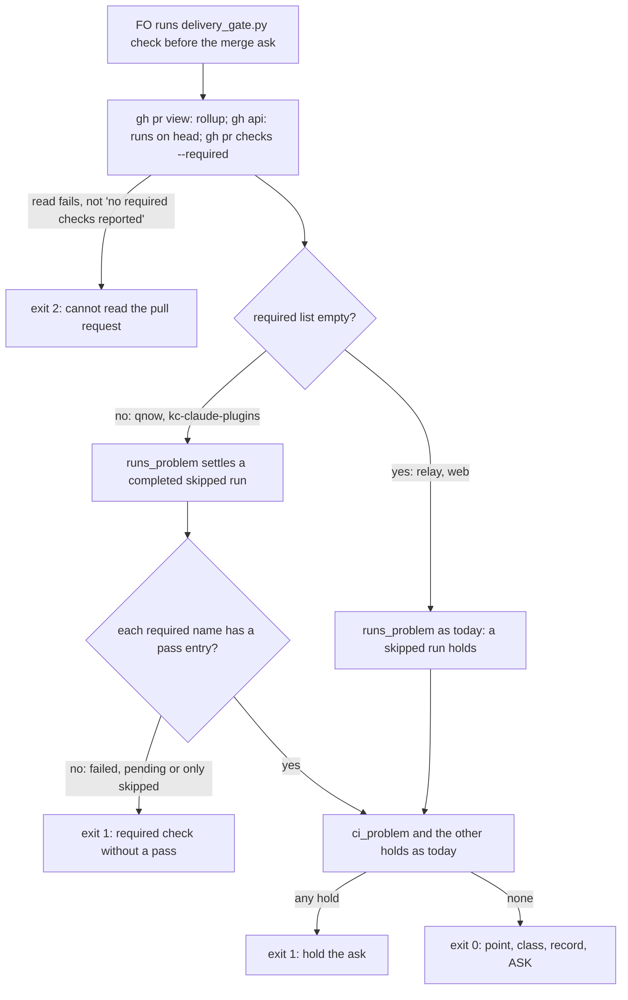

`delivery_gate.py check` treats a workflow run that its own conditions skip on purpose as no hold, while still holding a failed, pending or unexpectedly skipped required check.

## Scope

- Source: the Captain 「開」 (chat, 2026-11-06), answering 「要開這 4 張嗎？」 after fo-feedback round 005 (.notes/fo-feedback/round-005.md, closed 2026-11-06).
- Bite: qnow: check held #1338 on a by-design skipped "Release Gate" run, and the Captain waived it (「豁免release gate跳過，合併1338」); the qnow FO reports it holds every feature PR (round 005, operator report, not re-run here).
- Upstream first: kc-dev-flow-2 scripts/delivery_gate.py check ("a workflow run on the head is not completed and successful (a skipped run included)").
- Non-goals: changing which checks are required.

- Batch 16: the Captain 「可以，就這樣」 (chat, 2026-11-06), answering 「這批做 2、3、4、5、9 這 5 張，可以嗎？」, which named this task.

## Budget
- One package PR; the workflow word budget does not rise unless the design names a raise for the Captain.

## Stop condition
- A replay of the #1338 check passes the skipped Release Gate run; a required check that fails or stays pending still holds.

## FO alignment

Alignment: needed at ideation; the design choice is his to accept.
Result: aligned at backlog: Batch 16 backlog gate, the Captain 「核准（建議）」 (host question dialog, 2026-11-06), answering 「決定：第 16 批這五張（跳過的 CI 不擋、Codex 只貼安全摘要時提醒、交付檢查的相對路徑、ADR 編號跨流程預留、婉拒只在出過事時開任務）都用 Pilot，照各自寫下的範圍、預算與停止條件進入構想嗎？核准即接受「婉拒只在出過事時開任務」任務裡寫的標準（指出真的錯並說得出誰受害、再次出現、或你要求）。要改哪張直接說。」, approved the outcome and bounds in this file.
Surfaces: none
Visible change: none
Release review: not needed: workflow maintenance, on no journey map.

## Design

**Press line.** `delivery_gate.py check` no longer holds a merge ask because a whole workflow run was skipped by its own `if:` conditions, in a repository that tells GitHub which checks are required and where each of those checks has passed. A required check that failed, is still running, or was only ever skipped still holds. A repository that reports no required checks (relay, web) keeps today's hold on a skipped run.

**Why now.** On qnow, the `Release Gate` workflow runs on every pull request to `main`, and its entry job runs only for `release-please--` branches, so on a feature PR every job is skipped and the run concludes `skipped`. `runs_problem` holds any run that is not `completed`/`success`, so every qnow feature PR is held. Read 2026-11-06 with `gh api --paginate "repos/iamcxa/qnow/actions/runs?event=pull_request&per_page=100&created=>=2026-10-30"`: Release Gate ran 115 times on pull requests, 68 of them `skipped` (21 cancelled, 6 failure, 20 success). On #1338, #1342 and #1334 the only runs are `Release Gate=skipped` and `PR Checking=success`.

**Prior ruling.** #680 (delivery-gate-settles-skipped-checks, Captain decision D1 at its ideation gate, 2026-10-19) settled skipped and neutral check runs and kept `runs_problem` holding a skipped run, recording "no observed bite" (no adopter then had a skipped run). This task supplies that bite and keeps #680's choice where no required list exists. `git -C <state> grep -n 'Override:'` (2026-11-06) shows no past override about CI or skipped checks. ADR 0023 covers the merge question's wording, not CI shape. No ADR is needed: this is a bounded repair of an existing hold, as #680 was.

**Upstream first (checked 2026-11-06).** Spacedock 0.27.3: no check reads skipped runs or required checks. Its only `statusCheckRollup` reader is `internal/status/live_proof.go`, which has no skip or required logic. kc-dev-flow-2 0.35.0: `runs_problem` and `ci_problem` in `scripts/delivery_gate.py` are the owners; this repairs `runs_problem` and adds one reader rather than replacing either. Adopters (read-only): relay, qnow and web hold no copy of this logic, and qnow's `release-gate-rerun.mjs` has no skip rule. Third-party behaviour, from GitHub's own documentation (*Using conditions to control job execution*, fetched 2026-11-06): "A job that is skipped will report its status as "Success". It will not prevent a pull request from merging, even if it is a required check." The design is stricter than GitHub in one place. A required check whose only entries are skipped still holds. The enforcement point is `required_problem` and its test row (AC-3).

**Existing-code check.** Repair, not replace: `runs_problem` gains one condition, and one new reader supplies it. The observation that makes this change necessary: replaying #1338 through origin/main prints `1 of 2 workflow runs on this head are not finished and successful: 'Release Gate'` and exits 1, and that is the only hold (see Replay).

### Mechanism

1. `required_checks(repo, number)` runs `gh pr checks <N> --repo <repo> --required --json name,bucket`. If stdout is non-empty, it is parsed as JSON, whatever the exit code. If stdout is empty and stderr contains `no required checks reported`, the result is an empty list. This was verified on gh 2.103.0: relay #477 exits 1 with that text, and qnow #1338 and kc-claude-plugins #796 exit 0 with JSON. Any other result is a read failure and joins the existing exit-2 hold `cannot read the pull request`.
2. `required_problem(checks)`: a required check name with no entry whose `bucket` is `pass` holds with `required check without a pass on this head: <names>` and `next: hold the ask until each required check has passed on this head.` Names are grouped: #1338 reports `ci-gate` three times (PR Checking pass, Release Gate skipping, status context pass), so it passes.
3. `runs_problem(runs, settle_skipped)`: a `completed` run with conclusion `skipped` counts as settled only when `settle_skipped` is true, which `check` sets to whether the required list is non-empty. Every other rule is unchanged: pending, failure, cancelled, neutral and the rest still hold, and an older cancelled or skipped run superseded by a later run is still ignored.
4. The module docstring's Exit 1 sentence replaces "(a skipped run included)" with the rule above, and adds the required-check hold. No README, `workflow.md`, mod or skill text changes.

### FAQ

- *Why not settle every skipped run, like #680 did for check runs?* Relay and web report no required checks. A workflow wrongly skipped there would then pass beside any one success, and neither repository has a bite that asks for this (0 skipped runs at #680's reading). The replay row "repo reports no required checks" keeps exit 1.
- *Why not a README list of workflows that may be skipped?* It is a per-adopter list that drifts, and #680's design rejected it. The repository's required-check list already records which checks it means to have pass.
- *Why does the run list alone not suffice?* A run's jobs show that an `if:` was false, not whether it was meant to be false. Only the required-check list carries that intent.
- *What is not seen?* A required check GitHub never created (a workflow filtered out by path) may be missing from `gh pr checks --required`. That is not verified, and today's rollup has the same blind spot.

### Words FO reads at each moment

Printed output of `check` at the merge ask, words (`wc -w` in `ideation/replay.py`), origin/main then the prototype, 2026-11-06:

| Replay row (#1338 fixture) | origin/main | prototype |
| --- | --- | --- |
| #1338 as read | 56, exit 1 (Release Gate hold) | 84, exit 0 (normal ASK output) |
| pg-tests FAILURE | 87, exit 1 | 85, exit 1 |
| pg-tests pending | 87, exit 1 | 85, exit 1 |
| PR Checking wholly skipped, required ci-gate only skipped | 58, exit 1 | 49, exit 1 (required-check hold) |
| same, no required checks reported (relay/web shape) | 58, exit 1 | 58, exit 1 |
| Release Gate run failed | 56, exit 1 | 56, exit 1 |

The `question` command reads no CI: `ci_problem` and `runs_problem` are called only in `check`, so the validation gate wording is unchanged. Startup, dispatch, ideation and validation stages read no changed file. The FO-read files `workflow.md`, the README, `_mods` and skills are unchanged, so the word budget does not rise. The docstring grows by about 25 words; FO does not read it at any lifecycle moment, because `check` prints only its own lines.

### Replay (reproducible)

Files: `delivery-check-passes-a-skipped-by-design-run/ideation/` in the state checkout. These are a prototype, not the deliverable.
- `pr1338.json` is a reduced fixture of iamcxa/qnow#1338 (rollup names and conclusions, run names and conclusions, and the required list, without actors or emails), with the three `gh` commands that produced it.
- `prototype.diff` patches `delivery_gate.py` and adds a `pr checks` route to the test stub.
- `replay.py` runs the six rows above through the released test harness.

To reproduce: `git -C <kc-claude-plugins> archive origin/main kc-dev-flow-2/scripts | tar -x -C <dir>`; then `python3 -B replay.py <dir>/kc-dev-flow-2/scripts pr1338.json` for the base; then `cd <dir> && patch -p1 < prototype.diff` and run it again for the prototype.

Prototype test run (2026-11-06, `python3 -B -m unittest test_delivery_gate.PartialRollupTests test_delivery_gate.SettledChecksTests test_delivery_gate.HoldTests`): base 13 pass. With the patched stub, the prototype fails only `test_settling_a_check_adds_no_gh_call` (2 subtests), the intended reversal of #680's no-new-call pin (D1). `test_a_skipped_workflow_run_still_holds_beside_a_green_rollup` passes unchanged, because its stub reports no required checks. The full file (162 tests) on the same extraction: base 7 errors, prototype the same 7 errors plus those 2 subtests. The 7 come from `ReviewerDeclarationTests`, which need `extensions/copilot/copilot_review.py`, absent from a `scripts`-only extraction, so they are an artifact of the extraction, not of the change.

### Non-goals and profile

- This changes neither which checks a repository requires nor `ci_problem`'s settling of skipped check runs.
- Pilot holds: the change adds one read-only `gh` call and touches no credentials, production data or recurring operation.

### Needs decision

- **D1. Add one `gh` call (`gh pr checks --required`) to every `check` run, reversing #680's pinned "no new `gh` call".** Recommendation: yes. It is the only reader that can tell an intended skip from a wrong one without a per-adopter list. What gets worse: each merge ask makes one more network call. The check also depends on gh's stderr text `no required checks reported`, verified on gh 2.103.0 and pinned by a stub test; a gh change of that text holds relay and web with exit 2 rather than letting a PR through. The check also becomes stricter than GitHub when a required check was only skipped. If declined: settle a skipped run only beside a green run of another workflow. That needs no call, but has no "unexpectedly skipped" hold, and relay and web loosen with no bite.

### Batch overlap

This design changes `kc-dev-flow-2/scripts/delivery_gate.py` (docstring Exit 1 sentence, `runs_problem`, new `required_checks` and `required_problem`, the CI block of `check`) and `kc-dev-flow-2/scripts/test_delivery_gate.py` (`STUB_GH` gains a `pr checks` route; `SettledChecksTests.test_settling_a_check_adds_no_gh_call` `base_calls` gains a fourth call; new rows). There is no new test file, so `kc-dev-flow-2-tests.yml` is unchanged. There is no ADR and no README or `workflow.md` edit. Shared check: any task that adds a `gh` call to `check` collides on `base_calls`; none below states one.

| Task | Shared file, check or record | Effect |
| --- | --- | --- |
| delivery-check-resolves-links-from-the-task (batch 16) | `delivery_gate.py` `inspect_steps`/`captain_step_problems`, `test_delivery_gate.py` | same files, disjoint functions; rebase only |
| codex-security-only-prompts-code-review (batch 16) | none (no `delivery_gate` mention) | none |
| adr-reservation-crosses-workflows (batch 16) | `number_guards.task_facts`, which `delivery_gate.py` imports; signature kept | rerun this suite after it lands |
| decline-becomes-task-only-with-a-bite (batch 16) | may touch `delivery_gate.py` decline parsing | same file, disjoint function |
| comment-check-reaches-delivery-gate | `delivery_gate.py` `check` hold list and the same docstring Exit 1 sentence, `test_delivery_gate.py`; reads the existing files pages, no new call | textual conflict on the docstring sentence; rebase |
| fo-write-checks-parse-top-level | `delivery_gate.py` `declined_items`, `test_delivery_gate.py` | same files, disjoint; rebase |
| gate-summary-names-each-decline (held) | `delivery_gate.py` decline parsing, tests | same files, disjoint |
| merge-guard-stops-unasked-merges (held, in validation) | `delivery_gate.py` `ASK`/`ASK_UNQUOTED` text, tests | same files; changes the pass word count (84) above, not the rule |
| step-back-answer-has-a-record-line (held) | no `delivery_gate.py` edit; changes `next:` lines `check` forwards | changes printed words, not files |
| captain-ruling-sources-checked (held), archive-waits-for-observer-report, adoption-asks-which-extensions | `test_delivery_gate` used as a fixture only | none |
| adr-silent-undo-probe, dispatch-carries-reserved-adr-number, journey-canvas-hosted-poc, picky-reviewers-may-run-on-gemini, seed-check-requires-alignment-result, ops-inbox-r1-setup-and-isolation, pr-review-lite-value-pilot, adr-required-statement, journey-server-host-pilot | none | none |

Recommended order: merge-guard-stops-unasked-merges first (already in validation), then this task, then comment-check-reaches-delivery-gate, rebased on this task's docstring sentence. The other `delivery_gate.py` tasks are in any order, with a rebase.

## Acceptance criteria

**AC-1** The #1338 replay passes. Evidence: `python3 -B ideation/replay.py <candidate scripts dir> ideation/pr1338.json`, row "#1338 as read", exits 0 at the candidate and 1 at origin/main with the `'Release Gate'` hold. A unit test with a required list whose names all pass and a sole `skipped` run exits 0. Falsifier: dropping `"skipped"` from the settled set when `settle_skipped` is true turns the row and the test red.

**AC-2** A failed or pending required check still holds. Evidence: replay rows "pg-tests FAILURE" and "pg-tests pending" exit 1. Unit rows with a non-empty required list, where a run is `failure`, `cancelled`, `in_progress` or `neutral`, and a required entry has bucket `fail` or `pending`, each exit 1. Falsifier: adding `failure` to the settled run conclusions, or treating any bucket as passed, turns a row red.

**AC-3** An unexpectedly skipped required check holds. Evidence: replay row "PR Checking wholly skipped, required ci-gate only skipped" exits 1 and prints `required check without a pass on this head: 'ci-gate'`. A unit row whose required name has only `skipping` entries beside a green rollup exits 1. Falsifier: removing `required_problem`, or counting `skipping` as pass, turns both red.

**AC-4** A repository that reports no required checks keeps today's hold. Evidence: replay row "no required checks reported" exits 1 at the candidate. `test_a_skipped_workflow_run_still_holds_beside_a_green_rollup` passes unchanged, and the full `python3 -B -m unittest discover -s kc-dev-flow-2/scripts -p test_delivery_gate.py` passes. Falsifier: settling skipped runs unconditionally turns that test red.

**AC-5** The required-check read fails closed. Evidence: stub rows where `gh pr checks` exits non-zero with empty stdout and stderr other than `no required checks reported`, or prints unparsable stdout, each exit 2 with `cannot read the pull request`. Falsifier: treating any error as "no required checks" turns both rows red.

**AC-6** Exactly one `gh` call is added (D1). Evidence: `test_settling_a_check_adds_no_gh_call` (renamed to say one call is added) lists four calls, the fourth `pr checks 9 --repo o/r --required --json name,bucket`. Falsifier: removing the call or adding another turns it red.

**AC-7** The gh contract holds live, read-only, at validation. Evidence: dated output of `gh --version`. Then `gh pr checks <N> --repo spacedock-dev/subspace-relay --required --json name,bucket` exits 1 with `no required checks reported`; `gh pr checks 1338 --repo iamcxa/qnow --required --json name,bucket` exits 0 with JSON. One qnow or kc-claude-plugins PR read while a required check is pending or failed records its exit code and that stdout is JSON. Not yet verified: no such PR existed on 2026-11-06. Falsifier: empty stdout on that PR means mechanism step 1 holds with exit 2, and validation reports it.

**AC-8** No FO-read text changes and the merge-ask words are measured. Evidence: `git diff --stat origin/main...<head> -- kc-dev-flow-2/references kc-dev-flow-2/skills kc-dev-flow-2/extensions docs/dev2` is empty, and the replay word table above is reproduced at the candidate head. Falsifier: any FO-read file in the diff.

## Stage Report: ideation

- DONE: Design how /Users/kent/.claude/plugins/cache/kc-claude-plugins/kc-dev-flow-2/0.35.0/scripts/delivery_gate.py check tells a workflow run skipped by its own conditions on purpose from a failed, pending or unexpectedly skipped required check, with a replay of qnow #1338's skipped Release Gate (read-only from iamcxa/qnow) passing and a failing required check still held
  `## Design` § Mechanism: a skipped run settles only where `gh pr checks --required` lists checks; each required name needs a pass. Replay at the prototype: #1338 exits 0 (exit 1 at origin/main); pg-tests failure and pending exit 1; a required check that was only skipped exits 1.
- DONE: A `### Batch overlap` section naming each file the design would change and each other batch task and live task of other sessions that changes the same file or check, so FO can order implementation
  `### Batch overlap`: two files, every listed task, the shared `base_calls` check, and a Recommended order line (merge-guard, then this, then comment-check).
- DONE: The words FO reads at each lifecycle moment, before and after, per root learning.md "Measure the words FO reads at each moment, not one file's size"
  `### Words FO reads at each moment`: merge-ask output for 6 replay rows (#1338 56 then 84; failures 87 then 85; required-only-skip 58 then 49). `question` and every FO-read file are unchanged; no budget raise.
- DONE: Acceptance criteria with reproducible evidence clauses and falsifiers, and unresolved decisions for the Captain, each with a recommendation and what gets worse under it
  AC-1 to AC-8, each with evidence and a falsifier; D1 (one added `gh` call, which reverses #680's pin) recommends yes and states its costs.
- DONE: AC-1 (#1338 replay passes): prototype replay row exit 0, origin/main exit 1, 2026-11-06; the candidate's unit test is not yet written.
- DONE: AC-2 (failed or pending still holds): prototype replay rows exit 1; the candidate's unit rows are not yet written.
- DONE: AC-3 (only-skipped required holds): prototype replay row exit 1 with the `'ci-gate'` line; the unit row is not yet written.
- DONE: AC-4 (no required list keeps today's hold): prototype replay row exit 1; the existing skipped-run test passes on the prototype; the full suite on the candidate is not yet verified.
- DONE: AC-5 (read fails closed): not yet verified; designed in mechanism step 1.
- DONE: AC-6 (exactly one added call): prototype fails only `test_settling_a_check_adds_no_gh_call`, as D1 predicts; the renamed test is not yet written.
- DONE: AC-7 (live gh contract): exit 1 on relay #477 and exit 0 on qnow #1338 and kc-claude-plugins #796 verified on gh 2.103.0; pending or failed output not yet verified (no such PR on 2026-11-06).
- DONE: AC-8 (no FO-read text, words measured): base and prototype word table measured; the candidate's diff stat is not yet verified.
- DONE: design_surfaces check
  `python3 <package>/scripts/design_surfaces.py check` printed "design surfaces presentable", exit 0.

### Summary

The design repairs `runs_problem`. A whole workflow run skipped by its own conditions settles only in a repository that reports required checks to GitHub, and only when each of them has a pass. A new `required_problem` holds a required check that failed, is pending, or was only skipped. Relay and web, which report none, keep today's hold. The prototype and replay of qnow #1338 (a reduced fixture, script and diff under `ideation/`) pass #1338 and still hold every failing shape. One decision is left for the Captain, D1: adding the `gh pr checks --required` call, which reverses #680's "no new gh call" pin. No repository file, branch or commit was written.

## Stage Report: implementation

- DONE: Implement the approved design and acceptance criteria, D1 as recommended, only in the named functions and files.
  Candidate `1ca2625de0706e5494f73e010a394f8e5194b2a1`, branch `spacedock-ensign/delivery-check-passes-a-skipped-by-design-run`, based on fetched `origin/main` `ba055b8a7a55a787ac989c4cef52d07dd75661ad`; only `kc-dev-flow-2/scripts/delivery_gate.py` and `test_delivery_gate.py` changed. No versions or ADRs changed.
- SKIPPED: One Draft PR in iamcxa/kc-claude-plugins.
  No PR opened: no push grant. Product commit is local; FO owns branch push and Draft PR creation. The read-only all-state branch PR lookup returned `[]` before work.
- DONE: AC-1, the #1338 replay passes and a sole completed skipped run settles beside passed required names.
  `implementation/{base,candidate}-replay.log`: first row exit 1/0 respectively; `RequiredChecksTests.test_a_sole_completed_skipped_run_settles_when_required_names_have_a_pass` passes; removing skipped from settled conclusions makes its assertions fail.
- DONE: AC-2, failed or pending required checks and other unsuccessful workflow runs hold.
  Replay failure/pending rows exit 1; new tests reject failure/cancelled/neutral/in_progress runs despite passed required checks and reject fail/pending required buckets; adding failure to settled conclusions or accepting every bucket makes assertions fail.
- DONE: AC-3, an unexpectedly skipped required name holds.
  Replay prints `required check without a pass on this head: 'ci-gate'`, exit 1; the only-skipping unit row holds beside a green rollup; dropping required_problem or counting skipping as pass makes assertions fail.
- DONE: AC-4, repositories reporting no required checks retain the skipped-run hold.
  Replay no-required row exits 1; the unchanged skipped-workflow test passes; settling skipped unconditionally makes it fail. Full `python3 -B -m unittest discover -s kc-dev-flow-2/scripts -p test_delivery_gate.py`: 170 cases, exit 0, 1 existing skip.
- DONE: AC-5, required-check reads fail closed.
  Error/unparseable/invalid-shape rows exit 2 with `cannot read the pull request` and no saved ask; suppressing read errors or JSON parsing makes assertions fail. The empty-stdout exit-8 row also proves AC-7's counterexample holds with exit 2.
- DONE: AC-6, exactly one gh call is added (D1).
  Renamed `SettledChecksTests.test_required_check_read_adds_one_gh_call` pins four calls, ending `pr checks 9 --repo o/r --required --json name,bucket`; removing or duplicating the call makes assertions fail.
- DONE: AC-7, the gh contract holds live, read-only; validation must refresh it.
  `implementation/live-contract.json`, 2026-11-06 16:23 UTC, gh 2.103.0: relay #477 exit 1/no-required stderr; qnow #1338 exit 0/JSON; qnow #1316 has failed required ci-gate entries and exit 0/JSON. Nonzero JSON fail/pending buckets are also exercised by the stub tests.
- DONE: AC-8, no FO-read text changes and merge-ask words are measured.
  `fo-text-diff.log` is empty; candidate replay words are 84/85/85/49/58/56 against base 56/87/87/58/58/56. `AC-8-fo-text-mutation.log` rejects an altered workflow copy; exact product-file allowlist and unchanged workflow bytes pass.
- DONE: Every behavioral falsifier is run with python3 -B and cleared caches.
  `implementation/mutations.py` creates a fresh cache-free copy per mutation; all 10 mutants exit 1 through assertion failures, with no errors or caches. Fresh Bash `acceptance.sh` reruns replay exits/words, boundary tests, mutations and scope proof; exit 0 in `fresh-shell.log`.
- DONE: Repository lint-skills.py, package adr_lint.py, number_guards.py check, comment_ratio.py, and design_surfaces.py check.
  All exit 0; 61 ADRs checked, number guards no findings (migration checks skipped: no migrations-path), comment ratio 100 code/0 comment lines = 0.0% within 5%; repository lint reports workflow 5939/5939 words. Exact commands/package paths are in `implementation/README.md`.
- DONE: Run appropriate existing consumer checks and report what ran.
  `implementation/tests.json`: delivery 170, pr_watch 134, dispatch_records 115, validation_security 5, design_surfaces 213: 637 cases, no failures, 6 existing skips; the full package suite was not run.
- DONE: Affected-document dispositions from doc_impact.py.
  `docs/adr/0044-delivery-gate-summaries-carry-review-facts-with-legacy-call-compatibility.md`: unaffected, question/summary reviewer source boundaries unchanged; `docs/adr/0051-the-merge-ask-check-requires-the-round-count.md`: unaffected, round-count rule unchanged; `docs/adr/0062-a-gate-approval-grants-what-its-quoted-bound-question-says.md`: unaffected, approval binding and merge wording unchanged. `doc-verdicts.json` binds each read to base SHA and SHA-256.
- DONE: Commit locally, no push; PR title/body prepared for FO.
  Product tree clean at the candidate above; `/tmp/impl-delivery-check-passes-a-skipped-by-design-run-pr.md` holds the Conventional Commit title then body, also retained as `implementation/prepared-pr.md`. Shared state evidence/report committed path-scoped and synced separately.
- SKIPPED: RoboRev local review and hosted CI results.
  roborev not run: FO runs it after this report because the Codex sandbox cannot reach the local daemon. Hosted CI not run: product branch is not published; neither is claimed clean.
- DONE: CI cost measured or stated as not measured.
  CI cost per PR not measured; CI triggers unchanged. Approved D1 adds one read-only gh request per delivery check; no latency or billing claim is made.

### Summary

The approved Pilot repair settles completed skipped workflow runs where the required list is non-empty and each required name has a pass, while preserving failed/pending/unexpected-skip holds. The exact local candidate, reproducible evidence and prepared PR text are ready for FO; no product push, PR, ready, merge, review request or version bump was performed. Validation must refresh live evidence; publication, RoboRev and hosted CI remain FO-owned.

## Stage Report: validation

- DONE: Independent verdict on PR #797 head 1ca2625d against every acceptance criterion in the task file, re-running each evidence command and at least one falsifier per criterion yourself, and judging each limit the implementation report states
  PASSED at `1ca2625de0706e5494f73e010a394f8e5194b2a1`, base `ba055b8a7a55a787ac989c4cef52d07dd75661ad`; archive-only evidence and limit judgments: `validation/README.md`, `checks/results.json`, `identity.json`.
- DONE: Refresh AC-7's live gh contract read-only yourself (gh --version and the three named PRs) and state the date; concurrent edits to the same delivery gate script from the task delivery-check-resolves-links-from-the-task are not your candidate
  `validation/live-contract.json`, 2026-11-06 UTC / 2026-11-07 Asia/Taipei, gh 2.103.0: Relay #477 exit 1/no-required stderr; QNow #1338 exit 0/pass JSON; QNow #1316 exit 0/fail JSON. PR #797 still has the pinned head; sibling work excluded.
- DONE: A minimal acceptance script the Captain can run (three to six steps, exact commands, expected output), run by you exactly as written in a fresh bash shell, with its observed output; /Users/kent/.claude/plugins/cache/kc-claude-plugins/kc-dev-flow-2/0.35.0/scripts/adr_lint.py docs/adr --since <base> with its exit code; your verdict naming the head, with findings classified by the workflow's Review-finding disposition
  `validation/README.md` gives the exact five-step `acceptance.sh` command; run from its durable path with `bash --noprofile --norc`, exit 0 (`captain-fresh-shell.log`); declared-package ADR lint `--since ba055b8a7a55a787ac989c4cef52d07dd75661ad`: 61 records, exit 0.
- DONE: AC-1, intended skipped workflow passes.
  Base/candidate #1338 replay exits 1/0; sole-skipped-run unit test passes; removing skipped settlement fails its assertions (`checks/AC-1-reject-intended-skip.log`).
- DONE: AC-2, failed or pending checks and unsuccessful workflow runs hold.
  Both replay rows exit 1; failure/cancelled/neutral/in_progress and non-pass required buckets hold; admitting failure or every bucket is caught by assertion-failing mutants.
- DONE: AC-3, unexpectedly skipped required name holds.
  Replay exits 1 with `required check without a pass on this head: 'ci-gate'`; deleting required_problem or treating skipping as pass fails the focused test.
- DONE: AC-4, no-required repositories retain today's hold.
  Empty/no-required replay exits 1 and the unchanged legacy test passes; unconditional skipped settlement fails it.
- DONE: AC-5, the required-check read fails closed.
  Empty/malformed/invalid-shape reads exit 2 without an ask record; swallowing errors or JSON parsing fails assertions. Empty stdout with exit 8 also exercises AC-7's falsifier.
- DONE: AC-6, exactly one read-only gh call is added.
  The renamed test pins four calls ending `pr checks 9 --repo o/r --required --json name,bucket`; removal and duplication mutants both fail.
- DONE: AC-8, no FO-read text change and exact printed-word measurement.
  Two-file allowlist and empty FO-text diff pass; base words 56/87/87/58/58/56, candidate 84/85/85/49/58/56; an altered workflow export fails the actual scope-proof byte assertion.
- DONE: Consumer suites, proof sensitivity and retained-document checks.
  Five suites: delivery 170, pr_watch 134, dispatch_records 115, validation_security 5, design_surfaces 213; zero failures, six existing skips. Ten behavioral mutants caught; 14 acceptance-boundary tests pass. ADRs 0044/0051/0062 read and unchanged claims confirmed in `checks/doc-verdicts.json`.
- DONE: Workflow guards, comments and scope.
  lint-skills, number_guards, comment_ratio, design_surfaces and dispatch_records all exit 0; 0/100 comment/code lines (0.0%, maximum 5%); workflow 5939/5939 words; no reserved ADR/migration. Migration/ideation-only/full-host omissions are explicitly judged in the README.
- DONE: Goal sufficiency, minimal necessity and unchanged candidate.
  The replay reaches the accepted outcome and the mutants justify conditional settlement, required-name grouping, read failure handling and one call; SHA-256 identities match the archive and commit; assigned worktree remains clean.
- SKIPPED: Full local package suite, live merge ask and validator-run RoboRev.
  The five implementation suites were rerun; hosted #797 checks were only read (five SUCCESS, one SKIPPED deploy). RoboRev remains FO-owned; no native merge/adoption or local-review claim. CI cost per PR is unmeasured; triggers unchanged.
- DONE: Local state handoff and delivery limits.
  Only this task's validation evidence/report is committed with `spacedock state commit`; no push, PR comment, review request, ready action, merge, branch change or worktree creation/removal. FO retains the pending gate and delivery decision.

### Summary

PASSED at `1ca2625de0706e5494f73e010a394f8e5194b2a1` for the accepted Pilot scope. There are no Material, Needs decision or Polish findings; the full evidence, exact fresh-shell acceptance command and judged implementation limits are in `validation/README.md`. This validates the pinned candidate, not sibling integration or delivery authorization.

- F1 Deferred risk: GitHub may omit a required check it never created; no such live omission or observable harm was demonstrated. Released workflow: FO checking a path-filtered PR; affected boundary: the Design FAQ explicitly leaves this existing blind spot unverified. A supported live omitted obligation and otherwise passing gate would require reassessment against the protected requirement; no repair is requested here.
