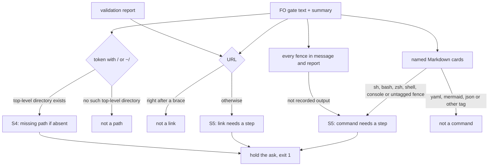

## Scope

- Source: the subspace-relay dev2 FO (Paseo 1671c3a9, 2026-11-08), relaying the Captain's 「草稿可以送，直接給dev2 fo」 (relayed, not a ruling here); draft at /tmp/fo-issues/kc-dev-flow-2-delivery-gate-false-positives.md. The backlog gate is the Captain's.
- Bite (relay FO's first-hand report, rechecked by it on 0.36.0, not re-run here): `delivery_gate.py question` refused complete gate texts on two of three subspace-relay validation gates on 2026-11-08 and on the 2026-11-06 llms-teaches-versions gate: site URL paths in code spans (`/llms.txt`, `/web/favicon.svg`, `/pair`) and an elided package path (`.../scripts/adr_lint.py`) as S4 missing files; an XML namespace URI in braces and a YAML block in a mentioned design file as S5 unrecorded commands. The FO passed only by rewriting a scratch copy and disclosing the override. Archived evidence: subspace-relay `_archive/pair-pages-favicon.md` and `_archive/signed-in-job-split.md`.
- Corroboration (this FO, 2026-11-08, 0.35.0): a YAML fence inside a chief-engineer report cited by path in a gate summary was flagged S5 for dispatch-build-writes-the-dispatch-record; FO cited the report by name instead.
- Upstream first: `absolute_paths` and `inspect_steps` in `kc-dev-flow-2/scripts/delivery_gate.py` and their tests.
- Proposed direction (relay FO's): S4 only for tokens under an existing filesystem root; S5 only for fences with a shell or empty info string, skipping data fences and URIs in braces.
- Non-goals: weakening S5 for real shell commands a validation report shows; changing what a Captain step records.

## Budget
- One package PR touching delivery_gate.py and its tests; workflow word budget unchanged.

## Stop condition
- Each of the five recorded inputs passes `delivery_gate.py question`, and a real shell fence or an existing absolute path still holds, each with a falsifier.

## FO alignment

Alignment: not needed; a gate-check false positive with recorded bites on two adopters.
Surfaces: none
Visible change: none
Release review: not needed: workflow maintenance, on no journey map.

## Design

### PRFAQ

**Proposition.** From the next kc-dev-flow-2 release, `delivery_gate.py question` and `steps` stop holding a complete gate text over a site URL path (`/llms.txt`), an elided package path (`.../scripts/adr_lint.py`), an XML namespace written `{http://…}local`, or a YAML block inside a design file or reviewer report the summary names. A shell fence the Captain would run, any fence in FO's own message, a link, and a missing file under a real top-level directory still hold the ask. FO no longer rewrites a scratch copy and discloses an override at the gate.

**FAQ.**
- *Does FO's message lose any check?* No. Every fence in the message and in the validation report stays a required step (the 2026-11-03 rule from fo-tries-what-it-asks-the-captain, commit 066b07471, guarded by `test_non_shell_fences_need_a_recorded_step_unless_they_match_observed`). Only Markdown files the check opens because a text names them (cards) narrow to shell or untagged fences.
- *Why not the relay FO's "shell or empty fences everywhere"?* That restores the tag list 066b07471 removed from the message as the RoboRev 1427 repair, so an unrecorded `python` or `node` step in the message would pass again. See D1.
- *Which path tokens still count?* An absolute or `~/` token whose top-level directory exists on the machine running the check (`/Users`, `/tmp`, `/private`, home). `/llms.txt`, `/web/…`, `/pair` and the `/scripts/…` tail of `.../scripts/…` have no such directory.
- *What gets worse?* A typo in the top-level directory (`/Usres/…`) passes S4, and so does a path whose top-level directory exists only on another machine. A `python` or `yaml` fence in a card that really is a step FO never recorded passes S5 (D1).

**Acceptance evidence plan.** Package tests embed the recorded strings below, cover each mechanism through `question` and `steps`, and each test fails under a named `variant_of` mutation. The fixture runner and its 0.36.0 and prototype logs are in `delivery-gate-ignores-url-paths-and-data-fences/ideation/`.

### Flow

### Chain checked

- **Spacedock 0.27.3:** owns gates and dispatch, not gate-text checks; nothing reads fences or paths in a question. No upstream mechanism to reuse.
- **kc-dev-flow-2 at origin/main (0.36.0, `.claude-plugin/plugin.json`):** `delivery_gate.py` is byte-identical to the 0.36.0 install (sha256 prefix `1ec361e1ac3cdec8`, 2026-11-09). `absolute_paths` feeds both S4 checks; `fenced_steps` feeds S5 commands for the message, the report and each card; `links` feeds S5 links. `git log -S` shows the fence-tag list existed until 066b07471 (2026-11-03), removed as the RoboRev 1427 repair with the message-fence test above. ADR 0054 rules that FO records steps and the script checks "form, paths and coverage"; it names no fence tags. `git -C <state> grep -n 'Override:'` has no line on paths, fences or this script.
- **Siblings (read-only):** subspace-relay's archived `pair-pages-favicon`, `llms-teaches-versions` and `signed-in-job-split` (copied to scratch, state paths rebased); the mermaid bite in `signed-in-job-split` passes on 0.36.0 (fixed by #799), as the relay draft says.

### Reproduction on 0.36.0 (2026-11-09)

`python3 -I ideation/fixtures.py <0.36.0 delivery_gate.py>` (`ideation/fixtures-base-0.36.0.log`); each input holds, each control behaves:

| Input (recorded text) | 0.36.0 |
| --- | --- |
| 1. `` `fix(relay): /llms.txt teaches agents` ``, `` `/web/favicon.svg` ``, `` `/pair` `` in the message | S4 ×3 |
| 2. `` `python3 .../scripts/adr_lint.py docs/adr --since a3f28ef6` `` | S4 `/scripts/adr_lint.py` |
| 3. `` `{http://www.w3.org/2000/svg}svg` `` | S5 `http://www.w3.org/2000/svg}svg` |
| 4. `design/built-review.md` with a `yaml` fence `design_review: adrs_read: - docs/adr/0064-…`, named in the message | S5 |
| 5. `review/chief-engineer-1.md` with a `yaml` fence `chief_engineer_advice: outcome: …`, named in the message | S5 |

The archived relay replays (`ideation/relay-replay-base-0.36.0.log`) hold on `/web/favicon.svg` and `/llms.txt` through `question`.

### What changes

One package PR, two files:

- `kc-dev-flow-2/scripts/delivery_gate.py`
  - **M1** `absolute_paths`: keep a token only when `Path(*path.parts[:2]).exists()` after `expanduser` (its top-level directory exists). Inputs 1 and 2.
  - **M2** `links`: drop a URL whose preceding character is `{`. Input 3. `URL` itself is unchanged, so `absolute_paths` still blanks the URL before path matching.
  - **M3** `fenced_steps(text, shell_only=False)` with `SHELL = {"", "sh", "bash", "zsh", "shell", "console"}` read from the first word of the info string; the card loop in `inspect_steps` calls `fenced_steps(card, shell_only=True)`; the message-and-report call is unchanged. Inputs 4 and 5. `sh run` reads as `sh`.
  - Docstring, `steps` usage: "(including fences in named Markdown files), missing absolute paths" becomes "(named Markdown files contribute shell or untagged fences; a URI right after `{` is not a link), missing absolute paths whose top-level directory exists" (25 to 38 words in that sentence).
- `kc-dev-flow-2/scripts/test_delivery_gate.py`: new cases in `CaptainStepsTests` and `QuestionTests` for AC-1..AC-5.

A scratch prototype of M1–M3 (`ideation/proto.diff`, 17 lines) passes all five inputs and eight controls (`ideation/fixtures-candidate.log`), and the unchanged `test_delivery_gate` suite passes, 176 tests, 1 skip (`ideation/candidate-test_delivery_gate.log`, 2026-11-09). That prototype is design evidence, not the candidate.

**Existing-code check.** The three functions already own these decisions; each change narrows one input to one existing function, no new check or file. Observation: the five holds above and FO's two scratch-copy overrides (relay gates 2026-11-06 and 2026-11-08).

**Not changed.** `workflow.md`, ADR 0054, Spacedock, S1–S3, the Observed-output rule, fences in the message and report, links in the message, report and FO-named cards.

### Seen in the replay, not in scope

- **A true positive kept.** `pair-pages-favicon/validation-1/acceptance.md` has an `sh` fence running the script at its state path, while Asked names the `/tmp` copy. Candidate still holds it (`ideation/relay-replay-candidate.log`), as the current rule intends.
- **The PR-body attribution link.** With `review/pr-body.md` named in a gate text, 0.36.0 holds on `https://claude.com/claude-code`; 0.35.0 did not open that file, because #799 now resolves card names from the task folder (`steps` on both versions, 2026-11-09). It is a link in an FO-named card, held by `test_report_only_cards_require_fences_and_fo_named_cards_also_require_links`. Returned as D2.

### Words FO reads at each moment

Counted with `wc -w` on script stdout, 2026-11-09; base is 0.36.0, candidate is the prototype.

| Moment | Base | Candidate |
| --- | --- | --- |
| Startup, idle on a PR, merged PR, archive | `workflow.md` unchanged; no script here | same |
| Validation gate preparation, `steps` over the five inputs | 299 (five holds) | 45 (five passes) |
| Validation gate preparation, `question` on one bite | 53 (hold) + scratch rewrite + 92 (pass on the copy) + a disclosure paragraph in the briefing | 92 (pass) |
| `delivery_gate.py --help` (no moment instructs it) | docstring sentence 25 | 38 (+13) |

### Decisions

**D1 (Captain): which fences in a named card count as steps.** Recommended: shell or untagged only in cards; every fence in the message and report stays a step. Alternatives: (a) the relay FO's shell-or-untagged everywhere, declined because it reverses the 066b07471 repair for the message; (b) a data-tag deny list in cards (`yaml`, `json`, `mermaid`, `xml`, `toml`, `csv`), which keeps `python` cards held but holds again on each new data tag. What gets worse under the recommendation: a card whose `python`, `node` or `yaml` fence is a real Captain step passes without a recorded step; the qnow card bite (an `sh` fence) stays held. No ADR: this narrows a script check inside ADR 0054's "form, paths and coverage"; the ruling lives in this task and the PR body.

**D2 (FO): the PR-body attribution link.** Recommended: a separate backlog task, since it changes the tested FO-named-card link rule, which is not one of the five inputs. What gets worse: until it lands, a gate text that names `review/pr-body.md` holds on 0.36.x; FO's workaround is to describe the PR body without its path or record the link as a step. The other option is a fourth mechanism here, which grows this PR past its Scope.

### Batch overlap

| Task | Shared file or check | Overlap |
| --- | --- | --- |
| merge-guard-stops-unasked-merges (validation, PR #794 open) | `delivery_gate.py` `ASK`/`ASK_UNQUOTED`, `test_delivery_gate.py` | same files, no shared function or test; textual rebase only |
| delivery-check-before-ask-is-provable (ideation) | `delivery_gate.py` `question()` plus a helper, `test_delivery_gate.py`, `workflow.md`, observer SKILL.md, a new ADR | same two files; it edits `question()`, this task edits `absolute_paths`, `links`, `fenced_steps` and one `inspect_steps` line; no shared function |
| validation-reads-pr-review-comments (ideation) | `skills/validation/principles.md` only | none |
| counts-name-the-run-that-produced-them (ideation, no design yet) | may touch `CLAIM_SOURCE` in `delivery_gate.py` | same file, different constant |
| adr-required-statement (validation) | `workflow.md`, `adoption.md`, `adr_lint.py` | none |
| journey-server-host-pilot (validation) | kc-journey-map server files | none |
| domain-note-reaches-worker-poc (backlog) | `scripts/kc-adr-copy-sync.sh` | none |
| ADR number sequence | this design lands no ADR | none |

Recommended order: any order; land after #794 if it merges first, and rebase `test_delivery_gate.py` on whichever of #794 or delivery-check-before-ask-is-provable lands first.

## Acceptance criteria

**AC-1** Site URL paths and an elided package path are not files. Evidence: a `CaptainStepsTests` case runs `steps` with a message holding `` `fix(relay): /llms.txt teaches agents` ``, `` `/web/favicon.svg` ``, `` `/pair` ``, `` `python3 .../scripts/adr_lint.py docs/adr --since a3f28ef6` `` and `/<generated absent top-level name>/x.txt`, and an Asked line holding `/llms.txt`; exit 0, no `S4`. The generated name (for example a uuid) keeps the test true on macOS and Ubuntu; the check reads the runner's own top-level directories by construction. Falsifier: `variant_of` removing ` and len(path.parts) > 1 and Path(*path.parts[:2]).exists()` fails it with `S4: missing path /llms.txt`.

**AC-2** A namespace URI right after a brace is not a link. Evidence: `` `{http://www.w3.org/2000/svg}svg` `` in the message and in the report passes `steps` and `question`, exit 0, no `S5`. Falsifier: `variant_of` removing ` if text[m.start() - 1:m.start()] != "{"` fails it with `S5: unrecorded command or link 'http://www.w3.org/2000/svg}svg'`.

**AC-3** Data fences in named cards are not commands. Evidence: `design/built-review.md` with a `yaml` fence `design_review:` / `adrs_read:` / `- docs/adr/0064-the-first-screen-leads-with-sign-in.md (Accepted)`, and `review/chief-engineer-1.md` with a `yaml` fence `chief_engineer_advice:` / `outcome: …`, each named in the summary, pass `question` (exit 0, `gate text complete`). Falsifier: `variant_of` replacing `fenced_steps(card, shell_only=True)` with `fenced_steps(card)` fails it with `S5`.

**AC-4** Real steps and missing files still hold. Evidence, each exit 1 with the line named: an `sh`, `sh run`, `bash` or untagged fence `printf unrecorded` in a named card (S5); a `yaml` fence in the message, plus the unchanged `test_non_shell_fences_need_a_recorded_step_unless_they_match_observed` (S5); `<tempdir>/missing.txt` in the message and in an Asked line (`message S4` and `step 1 S4`); `https://example.test/a` in the message, and `see http://www.w3.org/2000/svg` with no brace (S5). An existing absolute file passes. Falsifiers, each fails one hold: `fenced_steps(texts[0], shell_only=True)` for the message call (yaml message fence passes); `pass` for `paths.append(path)` (missing path passes); `and False` added to the brace condition (every link passes); `[]` for the card call (card `sh` fence passes).

**AC-5** The stop condition holds through `question`. Evidence: one `QuestionTests` case per mechanism with the AC-1 to AC-3 strings gives exit 0 and `gate text complete`; the same fixture with an unrecorded `sh` card fence or a missing `<tempdir>` path gives exit 1 and `Captain steps record fails`.

**AC-6** Nothing else moves. Evidence: `git diff --stat origin/main...<candidate> -- kc-dev-flow-2` names only `scripts/delivery_gate.py` and `scripts/test_delivery_gate.py`; `python3 -B -m unittest discover -s kc-dev-flow-2/scripts -p 'test_*.py'` exits 0; `python3 kc-dev-flow-2/scripts/lint-skills.py` exits 0 with the `workflow.md` count unchanged from base. Each falsifier in AC-1 to AC-4 is run with `python3 -B` and caches cleared.

## Stage Report: ideation

- DONE: Design the narrowing of the S4 (missing path) and S5 (unrecorded command or link) checks in kc-dev-flow-2/scripts/delivery_gate.py against the five recorded inputs in the task's Scope, keeping a real shell fence and an existing absolute path held; reproduce each input on 0.36.0 first. Batch overlap: name each file your design changes; siblings validation-reads-pr-review-comments, delivery-gate-ignores-url-paths-and-data-fences, delivery-check-before-ask-is-provable and counts-name-the-run-that-produced-them may touch kc-dev-flow-2/scripts/delivery_gate.py, so say the order you need relative to them.
  All five hold on 0.36.0 (`ideation/fixtures-base-0.36.0.log`, 2026-11-09); M1 (`absolute_paths` top-level directory), M2 (`links` brace), M3 (card fences shell-only) in `### What changes`; files: delivery_gate.py and test_delivery_gate.py; order free.
- DONE: A `### Batch overlap` section naming each file the design would change and each other batch task (validation-reads-pr-review-comments, delivery-gate-ignores-url-paths-and-data-fences, delivery-check-before-ask-is-provable, counts-name-the-run-that-produced-them, merge-guard-stops-unasked-merges) and live task of other sessions (adr-required-statement, journey-server-host-pilot, domain-note-reaches-worker-poc) that changes the same file or check, so FO can order implementation
  Table under `### Batch overlap`: same files as #794 and delivery-check-before-ask-is-provable, no shared function; `Recommended order:` line present.
- DONE: The words FO reads at each lifecycle moment, before and after, per root learning.md "Measure the words FO reads at each moment, not one file's size"
  `### Words FO reads at each moment`: `steps` 299 to 45 over the five inputs; `question` 53 + 92 + rewrite to 92; docstring +13 at `--help` only; workflow.md unchanged.
- DONE: Acceptance criteria with reproducible evidence clauses and falsifiers, and unresolved decisions for the Captain, each with a recommendation and what gets worse under it
  AC-1 to AC-6 with embedded strings and `variant_of` falsifiers; D1 (Captain, card fence tags) and D2 (FO, PR-body link) with recommendation and cost.
- DONE: AC-1 (URL and elided paths): not yet verified in the package; prototype passes inputs 1 and 2 and the M1 reversal brings back both S4 holds (`ideation/falsifiers-candidate.log`).
- DONE: AC-2 (brace URI): not yet verified in the package; prototype passes input 3, M2 reversal brings back the S5 hold, and a brace-free `http://www.w3.org/2000/svg` is still returned by `links`.
- DONE: AC-3 (card data fences): not yet verified in the package; prototype passes inputs 4 and 5 through `steps`, M3 reversal brings back both holds; the `question` route is future evidence.
- DONE: AC-4 (holds kept): not yet verified in the package; prototype keeps 8 controls held or passing as wanted, and each of the four over-narrowing mutations flips its control (`ideation/falsifiers-candidate.log`).
- DONE: AC-5 (`question` route): not yet verified; the relay replays through the same inspection hold only on the kept true positive and the D2 link on the prototype (`ideation/relay-replay-candidate.log`).
- DONE: AC-6 (nothing else moves): not yet verified; prototype passes the unchanged `test_delivery_gate` suite, 176 tests, 1 skip (`ideation/candidate-test_delivery_gate.log`); full discover and lint run at implementation.
- DONE: design_surfaces.py check
  `python3 <package>/scripts/design_surfaces.py check delivery-gate-ignores-url-paths-and-data-fences.md` printed "design surfaces presentable", exit 0 (2026-11-09).

### Summary

Reproduced all five inputs on 0.36.0 and designed three one-line narrowings; a scratch prototype passes them, keeps every control held and leaves the existing 176-test suite green. The design keeps the 2026-11-03 every-fence rule for FO's message and the report and narrows only named cards to shell or untagged fences (D1, Captain). The replay also found a new 0.36.0 hold on the PR-body attribution link, returned to FO as D2 rather than adopted.

## Stage Report: implementation

- DONE: Implement the approved design and acceptance criteria in the assigned worktree, only the files the design names.
  Candidate `6f2fe8f33de15cf4e9283bf9dfed185a5691ed57`, branch `spacedock-ensign/delivery-gate-ignores-url-paths-and-data-fences`, parent/base `e7c9381f2ae7f11bc715a6f11a3e000b9b807e1e` after `git fetch origin`; only delivery_gate.py and test_delivery_gate.py change (`implementation-1/candidate.json`).
- DONE: D1 as recommended; D2 is FO's; PR #794 stays held and is not a prerequisite.
  Applied the Captain's batch 18 「核准（建議）」 card-only fence rule; the message/report still check every fence, card links stay checked, and the candidate's parent is origin/main rather than #794.
- DONE: AC-1 Site URL paths and an elided package path are not files.
  `CaptainStepsTests.test_site_and_elided_paths_are_not_files_without_a_real_top_level_directory` passes the five tokens and Asked `/llms.txt`; removing the top-level-root predicate returns exit 1 with S4 (`implementation-1/mutation-observations.json`).
- DONE: AC-2 A namespace URI right after a brace is not a link.
  Steps and real-CLI question pass `{http://www.w3.org/2000/svg}svg` in message/report; removing the brace exclusion returns S5, and bare namespace URLs still hold (`implementation-1/mutations.log`, `discover.log`).
- DONE: AC-3 Data fences in named cards are not commands.
  `QuestionTests.test_question_accepts_named_yaml_cards_and_holds_real_steps_and_paths` passes both exact named YAML cards from the summary; replacing the card shell-only call with all fences returns S5 for each (`implementation-1/baseline-regressions.log`, `mutation-observations.json`).
- DONE: AC-4 Real steps and missing files still hold.
  Shell/untagged card fences, YAML message/report fences, ordinary links, and missing message/Asked paths hold; existing files pass. Message shell-only, dropping paths, dropping links and dropping card fences each break a hold; all seven named falsifiers ran with python3 -B after cache removal (`implementation-1/run_mutations.py`, `mutations.log`).
- DONE: AC-5 The stop condition holds through question.
  Real CLI cases for all three mechanisms print `gate text complete`; an unrecorded sh card or missing temp path exits 1 with `Captain steps record fails` (`QuestionTests.test_question_accepts*`, `implementation-1/discover.log`).
- DONE: AC-6 Nothing else moves; every acceptance criterion is green with its named evidence.
  python3 -B -m unittest discover -s kc-dev-flow-2/scripts -p 'test_*.py': 1032 tests, 7 skips, exit 0; five extension suites, real local dispatch/recovery and version parity exit 0; workflow bytes unchanged at 5931 words; diff names only the two approved files (`implementation-1/discover.log`, `extra-checks.json`, `workflow-parity.log`).
- DONE: kc-dev-flow-2/scripts/lint-skills.py, package adr_lint.py docs/adr --since <base>, package number_guards.py check, and package comment_ratio.py within its maximum.
  Repository lint exits 0; pinned 0.36.0 ADR lint checks 63 files, number guard at base e7c9381f2ae7/head 6f2fe8f33de1 has no findings after a fresh state fetch, and comment ratio is 0.0% (127 code/0 comment lines), maximum 5% (`implementation-1/*lint*.log`, `number-guards.log`, `comment-ratio.log`).
- DONE: design_surfaces.py check.
  Pinned 0.36.0 prints `design surfaces presentable`, exit 0 (`implementation-1/design-surfaces.log`); no design amendment or new decision record is needed.
- DONE: doc_impact.py disposition for docs/adr/0044-delivery-gate-summaries-carry-review-facts-with-legacy-call-compatibility.md.
  unaffected: optional separate-summary review-fact checks and legacy combined-input compatibility are unchanged; full regression suite passes (`implementation-1/doc-impact.json`).
- DONE: doc_impact.py disposition for docs/adr/0051-the-merge-ask-check-requires-the-round-count.md.
  unaffected: check's round-count rule is untouched; full regression suite passes (`implementation-1/doc-impact.json`).
- DONE: doc_impact.py disposition for docs/adr/0062-a-gate-approval-grants-what-its-quoted-bound-question-says.md.
  unaffected: ASK_FORM, ASK_UNQUOTED and bound-question authority are untouched; full regression suite passes (`implementation-1/doc-impact.json`).
- DONE: Commit locally, no product push; prepare Conventional Commit PR text for FO, without a version bump.
  Local candidate is committed and clean; first-line title `fix(kc-dev-flow-2): distinguish gate data from Captain steps`, body at `/tmp/impl-delivery-gate-ignores-url-paths-and-data-fences-pr.md` and `implementation-1/pr.md`; same-branch all-state PR lookup was empty.
- SKIPPED: One Draft PR in iamcxa/kc-claude-plugins; FO pushes, opens the Draft PR, runs RoboRev and reads CI.
  No PR opened: no push grant; this dispatch assigns those actions to FO. No product push, review request, comment, ready or merge was performed.
- SKIPPED: RoboRev and hosted CI; CI cost per PR measured or stated as not measured.
  RoboRev not run: FO owns local review; hosted CI not run: no PR opened. CI cost per PR not measured; CI configuration is unchanged. Local model-free dispatch used Spacedock binary 0.27.2 with plugin/mod root 0.27.3, not hosted CI proof.

### Summary

Implemented the three approved narrowings at the named candidate, with all acceptance checks and seven falsifiers exercised on 2026-11-09; local evidence and PR text are ready for FO. The accepted tradeoff remains: non-shell fences in named cards, including Python or Node, are not inferred as steps; publication, independent review and validation remain FO-owned.
