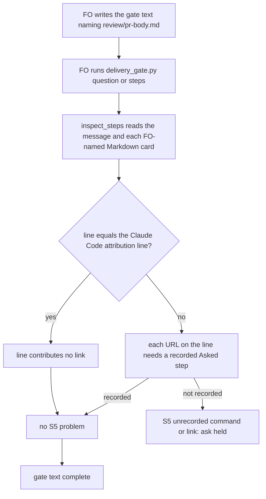

## Scope

- Source: FO's D2 disposition at the delivery-gate-ignores-url-paths-and-data-fences ideation (2026-11-09), whose recommendation was a separate backlog task; no Captain words yet; the backlog gate is his.
- Bite (that ideation worker's report, reproduced on 0.36.0, not re-run here): a gate text naming `review/pr-body.md` holds on 0.36.x under the FO-named-card link rule, on the PR body's attribution link; FO's workaround is to describe the PR body without its path or record the link as a step.
- Upstream first: the named-card link handling in `kc-dev-flow-2/scripts/delivery_gate.py` and its tests.
- Non-goals: the five inputs delivery-gate-ignores-url-paths-and-data-fences covers.

## Budget
- One package PR touching delivery_gate.py and its tests; workflow word budget unchanged.

## Stop condition
- A gate text naming the PR body passes without a recorded link step, and a real Captain link in a named card still holds, each with a falsifier.

## FO alignment

Alignment: not needed; a gate-check false positive found during batch 18 ideation.
Surfaces: none
Visible change: none
Release review: not needed: workflow maintenance, on no journey map.

## Design

**Press line.** When FO names the PR body (`review/pr-body.md`) in a gate text, `delivery_gate.py` no longer holds the ask on the body's closing attribution line, `🤖 Generated with [Claude Code](https://claude.com/claude-code)`; a link the Captain is asked to open in a named card still holds until FO records it as a step.

**FAQ.**
- What changes? `links()` blanks a line that equals, after whitespace is normalized, the one attribution line in an `ATTRIBUTION` set, before it finds URLs. One constant, one line in `links()`, one clause in the `steps` usage paragraph (`ideation/prototype.diff`, +3 −1).
- Why the line and not the URL or the file? The same URL on any other line still holds (case E: `Open https://claude.com/claude-code`), and so does the attribution line with anything else on it (case F). Exempting the whole PR body would also drop links the Captain may be asked to open there: 23 of 346 feature PR bodies carry another URL, among them a docs-site link (#776) and a workspace link (#511) (`ideation/pr-body-survey.txt`). That is D1.
- Why only one line in the set? It is the only form in 400 PR bodies: 264 of 346 feature bodies carry it and no other line contains `claude.com/claude-code` (`ideation/pr-body-survey.txt`). A Release PR has no task file, so no `question` or `steps` run names its body; adding the Release Please line now has no bite.
- Which routes? `links()` serves `inspect_steps`, which both `steps` and `question` (through `captain_step_problems`) call; `check` never calls it, so the merge ask is unchanged.
- What stays? Fences in the PR body: a shell or untagged fence in a named card still holds, as delivery-gate-ignores-url-paths-and-data-fences left it. A prose URL in the PR body still holds (case D); FO records it as a step or describes the body without its path.

### Reproduction on 0.37.0 and the prototype

Installed 0.37.0 `delivery_gate.py` is byte-identical to origin/main `6a495cb8` (`diff`, 2026-11-10). `delivery_gate.py steps` on a scratch task folder, base vs prototype, exit codes (`ideation/repro-matrix.log`; rerun with `ideation/repro.sh <kc-claude-plugins checkout> [ref]`, which builds both package trees from `git archive` and applies `ideation/prototype.diff` with `patch -p2`):

| Case | Named card or message | 0.37.0 | Prototype |
| --- | --- | --- | --- |
| A | PR body ending in the attribution line | 1, S5 on `claude.com/claude-code` | 0 |
| C | card `Open https://preview.example.test/owner` | 1 | 1, same link |
| D | PR body with a prose PR link and the attribution line | 1, both links | 1, PR link only |
| E | card `Open https://claude.com/claude-code` | 1 | 1 |
| F | attribution line followed by another link | 1, both | 1, both |
| G | attribution line with surrounding spaces | 1 | 0 |
| H | FO message `Open https://claude.com/claude-code` | 1 | 1 |

`question` route through the suite's `TaskFolderCaptainTests` fixture: PR-body case 1 → 0, Captain-link card 1 → 1 (`ideation/question-route-base.log`, `ideation/question-route-proto.log`). Full `test_delivery_gate.py` in a complete 0.37.0 package copy: 198 passed, 1 skipped on both base and prototype (`ideation/suite.txt`; a copy of `scripts/` alone fails 7 tests that load `extensions/copilot/copilot_review.py`).

Mutations the tests must catch: dropping the `links()` line flips A and G back to 1; matching the URL instead of the line flips E and H to 0; a substring match on the line flips F to 0 on the attribution URL.

### Upstream and existing code

- Spacedock 0.27.3: owns gate records, not Captain-step coverage; no equivalent check.
- kc-dev-flow-2 origin/main `6a495cb8` (0.37.0): the rule is `inspect_steps`'s `link_texts`, from 629cf7326 (#799, 2026-11-07), which resolves card names from the task folder and so opened `review/pr-body.md` (0.35.0 did not). Pinned by `test_report_only_cards_require_fences_and_fo_named_cards_also_require_links` and `test_named_card_prose_link_matches_asked_and_holds_when_unrecorded`; both stay unchanged. Repair in place; no replacement mechanism.
- Adopters: `git ls-files | grep -c delivery_gate` is 0 in subspace-relay, subspace-web and qnow (2026-11-10); no local copy.
- ADR 0054 (FO runs a step before asking the Captain): the rule covers steps the Captain is asked to run or look at; the attribution line is neither, so the change stays inside it. No `Override:` line in gate records concerns link coverage (`git grep 'Override:'`, 2026-11-10). No ADR lands.

### Words FO reads

| Moment | Before | After |
| --- | --- | --- |
| Startup (README, workflow.md) | unchanged | unchanged, 0 |
| `question` on a gate text naming the PR body | 60 words, exit 1: `Captain steps record fails: message S5: unrecorded command or link 'https://claude.com/claude-code'` and the `next: hold preparation` line | 97 words, exit 0: the ordinary pass output (`gate text complete` and `ASK_FORM`) |
| `question` with an unrecorded Captain link in a named card | 60 words, exit 1 | 60 words, exit 1, identical |
| Merge ask (`check`) | unchanged | unchanged (does not call `inspect_steps`) |
| `delivery_gate.py --help`, when read | 1214 words | 1225 words (+11) |

### Non-goals

The five inputs of delivery-gate-ignores-url-paths-and-data-fences; other URLs and fences in a PR body; other attribution forms; `check`.

### Decisions

**D1 (Captain): what the PR body stops contributing.** Recommended: only the exact Claude Code attribution line stops being a link; every other URL in a named PR body still needs a recorded step. What gets worse: a PR body with another URL (23 of 346 feature bodies so far) still holds, and FO records that link or describes the body without its path. The other option, exempting a file named `pr-body.md` from link coverage, clears those too but drops any link FO asks the Captain to open from the PR body, and relies on a file name no package rule fixes.

### Batch overlap

| Task | Shared file or check | Conflict |
| --- | --- | --- |
| issue-815-fo-record-gaps (batch 20) | `decision_ledger.py` and gate records; not `delivery_gate.py` | none |
| special-role-dispatch-records-built-by-script (batch 20) | its AC-10 requires no `delivery_gate.py` change in its own diff | none |
| amendment-checked-when-written (batch 20) | no `delivery_gate.py` mention | none |
| merge-guard-stops-unasked-merges (validation) | `delivery_gate.py`, `test_delivery_gate.py`: the `ASK`/`ASK_UNQUOTED` closing sentence | same files, different constants; textual merge only |
| comment-check-reaches-delivery-gate (ideation) | `delivery_gate.py check`, `test_delivery_gate.py` | same files, `check` route only; textual merge only |
| fo-write-checks-parse-top-level (ideation) | `delivery_gate.py` `declined_items`, `test_delivery_gate.py` | same files, different function; textual merge only |
| gate-summary-names-each-decline (ideation) | `delivery_gate.py` decline parsing and its docstring paragraph | same files; a different docstring paragraph from the `steps` one changed here |
| step-back-answer-has-a-record-line (ideation) | states `delivery_gate.py` unchanged | none |
| archive-waits-for-observer-report, validation-reads-pr-review-comments, adoption-asks-which-extensions, captain-ruling-sources-checked (each names `delivery_gate.py` only as unchanged or read) | none | none |
| adr-required-statement, journey-server-host-pilot, ops-inbox-r1-setup-and-isolation, pr-review-lite-value-pilot, adr-silent-undo-probe, dispatch-carries-reserved-adr-number, journey-canvas-hosted-poc, picky-reviewers-may-run-on-gemini, seed-check-requires-alignment-result | no `delivery_gate.py` or link-rule change | none |

Recommended order: any order; this change touches `links()`, one constant beside `SHELL` and one `steps` usage clause, none of which another task edits. Whichever lands second rebases its `test_delivery_gate.py` additions.

## Acceptance criteria

**AC-1** A `question` gate text and a `steps` message that name `review/pr-body.md`, whose only link is on the attribution line (also with surrounding spaces), exit 0 with no S5 line. Evidence: new tests in `test_delivery_gate.py` on both routes; falsifier: a `variant_of` that removes the `links()` line holds on `https://claude.com/claude-code`. Current: reproduced as exit 1 on 0.37.0 and 0 on the prototype (`ideation/repro-matrix.log` A and G, `ideation/question-route-*.log`).

**AC-2** A named card with an unrecorded Captain link still holds on that link on both routes, and passes once the link is a recorded step. Evidence: `test_named_card_prose_link_matches_asked_and_holds_when_unrecorded` and `test_report_only_cards_require_fences_and_fo_named_cards_also_require_links` pass unchanged. Current: case C exit 1 on both versions; both tests in the 198 passing on the prototype (`ideation/suite.txt`).

**AC-3** The attribution URL on any other line holds: in a named card (`Open https://claude.com/claude-code`), in FO's own message, and on the attribution line with another link after it (both links held). Evidence: new tests; falsifiers: a variant matching the URL instead of the line passes the first two, a substring line match passes the third. Current: cases E, H and F exit 1 on the prototype.

**AC-4** A PR body with the attribution line and one other URL holds on the other URL only. Evidence: a new test asserting the other URL in S5 and `claude.com/claude-code` absent. Current: case D on the prototype.

**AC-5** `test_delivery_gate.py` passes in full in a complete package tree, and the diff touches only `delivery_gate.py` and `test_delivery_gate.py`, with the `steps` usage paragraph naming the exemption as a bounded claim. Evidence: the suite run and `git diff --stat` at the candidate. Current: not yet verified at a candidate; the prototype passes 198, 1 skipped.

**AC-6** The words FO reads change only as `### Words FO reads` states: startup and `check` 0, the PR-body `question` hold replaced by the pass output, the Captain-link hold identical. Evidence: the same fixture run at the candidate. Current: measured on the prototype only.

## Stage Report: ideation

- DONE: Design how kc-dev-flow-2/scripts/delivery_gate.py stops holding a gate text that names the PR body (review/pr-body.md) on that body's attribution link while a real Captain link in a named card still holds, each with a falsifier reproduced on 0.37.0 first
  `## Design`: `links()` blanks the exact attribution line; 0.37.0 holds A/G and C, prototype passes A/G and holds C, D, E, F, H (`delivery-gate-pr-body-attribution-link/ideation/repro-matrix.log`, `question-route-*.log`).
- DONE: A `### Batch overlap` section naming each file the design would change and each other batch task (issue-815-fo-record-gaps, special-role-dispatch-records-built-by-script, amendment-checked-when-written, delivery-gate-pr-body-attribution-link) and live task of other sessions (adr-required-statement, journey-server-host-pilot, merge-guard-stops-unasked-merges, archive-waits-for-observer-report, ops-inbox-r1-setup-and-isolation, pr-review-lite-value-pilot, validation-reads-pr-review-comments, adoption-asks-which-extensions, adr-silent-undo-probe, captain-ruling-sources-checked, comment-check-reaches-delivery-gate, dispatch-carries-reserved-adr-number, fo-write-checks-parse-top-level, gate-summary-names-each-decline, journey-canvas-hosted-poc, picky-reviewers-may-run-on-gemini, seed-check-requires-alignment-result, step-back-answer-has-a-record-line (in flight or parked; read only)) that changes the same file or check, so FO can order implementation
  Four tasks share `delivery_gate.py`/`test_delivery_gate.py` in other functions; none edits `links()`; Recommended order: any.
- DONE: The words FO reads at each lifecycle moment, before and after, per root learning.md "Measure the words FO reads at each moment, not one file's size"
  `### Words FO reads`: startup and `check` 0; PR-body `question` 60-word hold becomes the 97-word pass output; Captain-link hold 60 = 60; `--help` +11.
- DONE: Acceptance criteria with reproducible evidence clauses and falsifiers, and unresolved decisions for the Captain, each with a recommendation and what gets worse under it
  AC-1 to AC-6, each with a falsifier; D1 (Captain) recommends the exact-line exemption, cost: 23 of 346 PR bodies with other URLs still hold.
- DONE: AC-1 (PR body with only the attribution link passes, both routes): prototype only; A and G exit 1 → 0, question route 1 → 0; not yet verified at a candidate.
- DONE: AC-2 (real Captain link in a named card still holds): case C exit 1 on both; the two pinning tests pass unchanged in the prototype run (198 passed, 1 skipped).
- DONE: AC-3 (the attribution URL on any other line holds): cases E, H, F exit 1 on the prototype; tests not yet written.
- DONE: AC-4 (other URL in the PR body holds alone): case D holds on the PR link only on the prototype; test not yet written.
- DONE: AC-5 (full suite, two-file diff, bounded docstring claim): not yet verified at a candidate; prototype `ideation/suite.txt` 198 passed both.
- DONE: AC-6 (words FO reads as tabled): measured on the prototype only (`ideation/question-route-*.log`); not yet verified at a candidate.
- DONE: `design_surfaces.py check`: "design surfaces presentable", exit 0 (Surfaces: none).

### Summary

Reproduced the hold on 0.37.0 (origin/main `6a495cb8`): a gate text naming `review/pr-body.md` holds on `https://claude.com/claude-code`, the only attribution form in 400 PR bodies. The design blanks that one exact line in `links()` (+3 −1, scratch prototype), so the same URL elsewhere, the line with anything else on it, and any real Captain link in a named card still hold; the 198-test suite stays green. D1 asks the Captain to confirm the line exemption over exempting the whole PR body file.

## Stage Report: implementation

- DONE: Implement the approved Design and Acceptance criteria; D1 exempts the exact Claude Code attribution line and only the two designed code files change.
  Candidate `2a72c89b9aa9d114e45aeb16b746b8ca9f747bb8`, branch `spacedock-ensign/delivery-gate-pr-body-attribution-link`, fetched base `6a495cb8c4055f9a6eba8a05419c2d2fad1a90f1`; clean code tree; `delivery_gate.py` +3/-1 and seven new tests, no version change.
- SKIPPED: One Draft PR in iamcxa/kc-claude-plugins.
  No PR opened: no push grant. FO owns product publication; title and body prepared at `/tmp/impl-delivery-gate-pr-body-attribution-link-pr.md`, retained as `implementation/pr.md` below.
- DONE: Every acceptance criterion green with the evidence each names; each falsifier shown failing by a mutation you run (python3 -B, caches cleared).
  All evidence paths below are in `delivery-gate-pr-body-attribution-link/implementation/`; `prove.py <code worktree>` clears the script cache and exercises `variant_of`, and `run-suite.py <code worktree>` records the full suite.
- DONE: AC-1 — attribution-only PR body passes `question` and `steps`, including surrounding and normalized internal whitespace, with no S5.
  `test_pr_body_attribution_line_needs_no_recorded_link_step` and its question counterpart; `no-line-exemption.log` records the removed-filter variant failing the regression assertions, S5 on the attribution URL (also reproduced before the fix in `baseline-regressions.log`).
- DONE: AC-2 — named Captain links hold on both routes and pass once recorded.
  Existing `test_named_card_prose_link_matches_asked_and_holds_when_unrecorded` and `test_report_only_cards_require_fences_and_fo_named_cards_also_require_links` unchanged; new `test_question_named_captain_link_holds_until_recorded` proves the question route's paired verdicts. `captain-link-question-{base,candidate}.log` are identical holds.
- DONE: AC-3 — attribution URL elsewhere and attribution plus other text/another link remain covered.
  `test_attribution_url_elsewhere_needs_a_recorded_link_step` and `test_attribution_line_with_more_text_keeps_its_links`; `url-wide-exemption.log` and `substring-exemption.log` show their assertions failing under the respective overbroad variants; `mutations.json` records all three mutations caught.
- DONE: AC-4 — PR body with attribution and another URL holds on the other URL alone.
  `test_pr_body_other_url_still_needs_a_recorded_link_step` asserts the preview URL in S5 and attribution URL absent; removing the exemption fails it in `no-line-exemption.log`.
- DONE: AC-5 — full suite in a complete package tree, exact two-file diff and bounded steps usage claim.
  `suite.log` / `tests.json`: 206 run, 205 passed, one existing skip requiring GATE_PRESENTATION_STATE for five committed validation replays; `git diff --name-only <base> HEAD` lists delivery_gate.py and test_delivery_gate.py; usage clause and ATTRIBUTION membership define the exemption.
- DONE: AC-6 — words FO reads change as designed; startup and merge-check behavior stay unchanged.
  `words.json`, saved question/help/check outputs and `prove.py`: attribution question 60-word exit 1 → 97-word exit 0, Captain-link hold 60 = 60 byte-identical, --help 1214 → 1225 (+11); startup documents byte-identical and merge-check function/output unchanged (fixture PR provider stub, not hosted proof).
- DONE: kc-dev-flow-2/scripts/lint-skills.py (repository copy CI runs), package adr_lint.py docs/adr --since <base>, number_guards.py check, and design_surfaces.py check exit 0.
  Logs: `lint-skills.log`, `adr-lint.log`, `number-guards.log`, `design-surfaces.log`; workflow 5931/5931 words. Number guard rerun with Git-metadata access after sandbox refused FETCH_HEAD; final run refreshed state refs without warning and reported no findings.
- DONE: comment_ratio.py within its maximum; commit locally, no product push; PR text written for FO; CI cost measured or stated as not measured.
  `comment-ratio.log`: code lines 93, comment lines 0, 0.0%, maximum 5% met at candidate; PR text as above. No CI workflow change; cost per PR not measured.
- DONE: doc_impact.py <base> <candidate>, each listed document disposition.
  `doc-impact.json` lists the following five ADRs; no new decision record: this bounded false-positive repair stays within ADR 0054 and approved task D1.
- DONE: docs/adr/0044-delivery-gate-summaries-carry-review-facts-with-legacy-call-compatibility.md — unaffected: optional summary input, reviewer placement and legacy call behavior unchanged.
- DONE: docs/adr/0051-the-merge-ask-check-requires-the-round-count.md — unaffected: round-count form and merge-check hold unchanged.
- DONE: docs/adr/0062-a-gate-approval-grants-what-its-quoted-bound-question-says.md — unaffected: bound-question approval comparison and merge authority unchanged.
- DONE: docs/adr/0071-the-merge-question-carries-its-delivery-check-record.md — unaffected: delivery-record matching and merge-naming question hold unchanged.
- DONE: docs/adr/0072-counts-cite-saved-output-and-learn-checks-referenced-evidence.md — unaffected: count scan/disclosure and learn reference checks unchanged.
- SKIPPED: FO pushes, opens the Draft PR, runs RoboRev and reads CI.
  Delegated checks not run, never claimed clean; independent validation and delivery remain FO-owned. Checked prior ideation, approved gate and named sibling tasks; sibling delivery-gate changes occupy other functions and were not modified.

### Summary

Implemented Pilot D1 at `2a72c89b9aa9d114e45aeb16b746b8ca9f747bb8`: `links()` drops a whitespace-normalized whole line only when it equals the single allowlisted Claude Code attribution. Both gate entrances pass the attribution-only PR body while ordinary links and attribution lines with extra content still hold; full local suite, three caught mutations and required checks pass. Product branch remains local; FO receives the prepared PR and owns publication, RoboRev, hosted CI and validation.

## Stage Report: implementation

- DONE: Implement the approved Design and Acceptance criteria; D1 exempts the exact Claude Code attribution line and only the two designed code files change.
  Candidate `2a72c89b9aa9d114e45aeb16b746b8ca9f747bb8`, branch `spacedock-ensign/delivery-gate-pr-body-attribution-link`, fetched base `6a495cb8c4055f9a6eba8a05419c2d2fad1a90f1`; clean code tree; `delivery_gate.py` +3/-1 and seven new tests, no version change.
- SKIPPED: One Draft PR in iamcxa/kc-claude-plugins.
  No PR opened: no push grant. FO owns product publication; title and body prepared at `/tmp/impl-delivery-gate-pr-body-attribution-link-pr.md`, retained as `implementation/pr.md` below.
- DONE: Every acceptance criterion green with the evidence each names; each falsifier shown failing by a mutation you run (python3 -B, caches cleared).
  All evidence paths below are in `delivery-gate-pr-body-attribution-link/implementation/`; `prove.py <code worktree>` clears the script cache and exercises `variant_of`, and `run-suite.py <code worktree>` records the full suite.
- DONE: AC-1 — attribution-only PR body passes `question` and `steps`, including surrounding and normalized internal whitespace, with no S5.
  `test_pr_body_attribution_line_needs_no_recorded_link_step` and its question counterpart; `no-line-exemption.log` records the removed-filter variant failing the regression assertions, S5 on the attribution URL (also reproduced before the fix in `baseline-regressions.log`).
- DONE: AC-2 — named Captain links hold on both routes and pass once recorded.
  Existing `test_named_card_prose_link_matches_asked_and_holds_when_unrecorded` and `test_report_only_cards_require_fences_and_fo_named_cards_also_require_links` unchanged; new `test_question_named_captain_link_holds_until_recorded` proves the question route's paired verdicts. `captain-link-question-{base,candidate}.log` are identical holds.
- DONE: AC-3 — attribution URL elsewhere and attribution plus other text/another link remain covered.
  `test_attribution_url_elsewhere_needs_a_recorded_link_step` and `test_attribution_line_with_more_text_keeps_its_links`; `url-wide-exemption.log` and `substring-exemption.log` show their assertions failing under the respective overbroad variants; `mutations.json` records all three mutations caught.
- DONE: AC-4 — PR body with attribution and another URL holds on the other URL alone.
  `test_pr_body_other_url_still_needs_a_recorded_link_step` asserts the preview URL in S5 and attribution URL absent; removing the exemption fails it in `no-line-exemption.log`.
- DONE: AC-5 — full suite in a complete package tree, exact two-file diff and bounded steps usage claim.
  `suite.log` / `tests.json`: 206 run, 205 passed, one existing skip requiring GATE_PRESENTATION_STATE for five committed validation replays; `git diff --name-only <base> HEAD` lists delivery_gate.py and test_delivery_gate.py; usage clause and ATTRIBUTION membership define the exemption.
- DONE: AC-6 — words FO reads change as designed; startup and merge-check behavior stay unchanged.
  `words.json`, saved question/help/check outputs and `prove.py`: attribution question 60-word exit 1 → 97-word exit 0, Captain-link hold 60 = 60 byte-identical, --help 1214 → 1225 (+11); startup documents byte-identical and merge-check function/output unchanged (fixture PR provider stub, not hosted proof).
- DONE: kc-dev-flow-2/scripts/lint-skills.py (repository copy CI runs), package adr_lint.py docs/adr --since <base>, number_guards.py check, and design_surfaces.py check exit 0.
  Logs: `lint-skills.log`, `adr-lint.log`, `number-guards.log`, `design-surfaces.log`; workflow 5931/5931 words. Number guard rerun with Git-metadata access after sandbox refused FETCH_HEAD; final run refreshed state refs without warning and reported no findings.
- DONE: comment_ratio.py within its maximum; commit locally, no product push; PR text written for FO; CI cost measured or stated as not measured.
  `comment-ratio.log`: code lines 93, comment lines 0, 0.0%, maximum 5% met at candidate; PR text as above. No CI workflow change; cost per PR not measured.
- DONE: doc_impact.py <base> <candidate>, each listed document disposition.
  `doc-impact.json` lists the following five ADRs; no new decision record: this bounded false-positive repair stays within ADR 0054 and approved task D1.
- DONE: docs/adr/0044-delivery-gate-summaries-carry-review-facts-with-legacy-call-compatibility.md — unaffected: optional summary input, reviewer placement and legacy call behavior unchanged.
- DONE: docs/adr/0051-the-merge-ask-check-requires-the-round-count.md — unaffected: round-count form and merge-check hold unchanged.
- DONE: docs/adr/0062-a-gate-approval-grants-what-its-quoted-bound-question-says.md — unaffected: bound-question approval comparison and merge authority unchanged.
- DONE: docs/adr/0071-the-merge-question-carries-its-delivery-check-record.md — unaffected: delivery-record matching and merge-naming question hold unchanged.
- DONE: docs/adr/0072-counts-cite-saved-output-and-learn-checks-referenced-evidence.md — unaffected: count scan/disclosure and learn reference checks unchanged.
- SKIPPED: FO pushes, opens the Draft PR, runs RoboRev and reads CI.
  Delegated checks not run, never claimed clean; independent validation and delivery remain FO-owned. Checked prior ideation, approved gate and named sibling tasks; sibling delivery-gate changes occupy other functions and were not modified.

- SKIPPED: Push the state branch so peers see the entity/report.
  Local state commit `a54536687` retains the report and 28 evidence files. Automatic approval review rejected the push to public iamcxa/kc-claude-plugins because internal reports, replay scripts and local paths require explicit user publication approval; no state push succeeded.

### Summary

This complete report supersedes the earlier implementation report. Pilot D1 is locally committed at `2a72c89b9aa9d114e45aeb16b746b8ca9f747bb8`, the full suite and three mutation checks pass, and the prepared PR is retained at the recorded paths. State publication is blocked by automatic approval review pending explicit user approval of the 29-file public payload; product publication, RoboRev, hosted CI and independent validation remain FO-owned.

## Stage Report: implementation

- DONE: Implement the approved Design and Acceptance criteria; D1 exempts the exact Claude Code attribution line and only the two designed code files change.
  Candidate `2a72c89b9aa9d114e45aeb16b746b8ca9f747bb8`, branch `spacedock-ensign/delivery-gate-pr-body-attribution-link`, fetched base `6a495cb8c4055f9a6eba8a05419c2d2fad1a90f1`; clean code tree; `delivery_gate.py` +3/-1 and seven new tests, no version change.
- DONE: One Draft PR in iamcxa/kc-claude-plugins.
  FO reports Draft PR https://github.com/iamcxa/kc-claude-plugins/pull/825 at candidate `2a72c89b9aa9d114e45aeb16b746b8ca9f747bb8` in `dispatch/implementation-1-message-1.md` (2026-11-10); task frontmatter names the same PR. Worker did not reopen or republish it; direct API read was unavailable.
- DONE: Every acceptance criterion green with the evidence each names; each falsifier shown failing by a mutation you run (python3 -B, caches cleared).
  All evidence paths below are in `delivery-gate-pr-body-attribution-link/implementation/`; `prove.py <code worktree>` clears the script cache and exercises `variant_of`, and `run-suite.py <code worktree>` records the full suite.
- DONE: AC-1 — attribution-only PR body passes `question` and `steps`, including surrounding and normalized internal whitespace, with no S5.
  `test_pr_body_attribution_line_needs_no_recorded_link_step` and its question counterpart; `no-line-exemption.log` records the removed-filter variant failing the regression assertions, S5 on the attribution URL (also reproduced before the fix in `baseline-regressions.log`).
- DONE: AC-2 — named Captain links hold on both routes and pass once recorded.
  Existing `test_named_card_prose_link_matches_asked_and_holds_when_unrecorded` and `test_report_only_cards_require_fences_and_fo_named_cards_also_require_links` unchanged; new `test_question_named_captain_link_holds_until_recorded` proves the question route's paired verdicts. `captain-link-question-{base,candidate}.log` are identical holds.
- DONE: AC-3 — attribution URL elsewhere and attribution plus other text/another link remain covered.
  `test_attribution_url_elsewhere_needs_a_recorded_link_step` and `test_attribution_line_with_more_text_keeps_its_links`; `url-wide-exemption.log` and `substring-exemption.log` show their assertions failing under the respective overbroad variants; `mutations.json` records all three mutations caught.
- DONE: AC-4 — PR body with attribution and another URL holds on the other URL alone.
  `test_pr_body_other_url_still_needs_a_recorded_link_step` asserts the preview URL in S5 and attribution URL absent; removing the exemption fails it in `no-line-exemption.log`.
- DONE: AC-5 — full suite in a complete package tree, exact two-file diff and bounded steps usage claim.
  `suite.log` / `tests.json`: 206 run, 205 passed, one existing skip requiring GATE_PRESENTATION_STATE for five committed validation replays; `git diff --name-only <base> HEAD` lists delivery_gate.py and test_delivery_gate.py; usage clause and ATTRIBUTION membership define the exemption.
- DONE: AC-6 — words FO reads change as designed; startup and merge-check behavior stay unchanged.
  `words.json`, saved question/help/check outputs and `prove.py`: attribution question 60-word exit 1 → 97-word exit 0, Captain-link hold 60 = 60 byte-identical, --help 1214 → 1225 (+11); startup documents byte-identical and merge-check function/output unchanged (fixture PR provider stub, not hosted proof).
- DONE: kc-dev-flow-2/scripts/lint-skills.py (repository copy CI runs), package adr_lint.py docs/adr --since <base>, number_guards.py check, and design_surfaces.py check exit 0.
  Logs: `lint-skills.log`, `adr-lint.log`, `number-guards.log`, `design-surfaces.log`; workflow 5931/5931 words. Number guard rerun with Git-metadata access after sandbox refused FETCH_HEAD; final run refreshed state refs without warning and reported no findings.
- DONE: comment_ratio.py within its maximum; commit locally, no product push; PR text written for FO; CI cost measured or stated as not measured.
  `comment-ratio.log`: code lines 93, comment lines 0, 0.0%, maximum 5% met at candidate; PR text as above. No CI workflow change; cost per PR not measured.
- DONE: doc_impact.py <base> <candidate>, each listed document disposition.
  `doc-impact.json` lists the following five ADRs; no new decision record: this bounded false-positive repair stays within ADR 0054 and approved task D1.
- DONE: docs/adr/0044-delivery-gate-summaries-carry-review-facts-with-legacy-call-compatibility.md — unaffected: optional summary input, reviewer placement and legacy call behavior unchanged.
  Reviewed the record against the unchanged optional --summary-file and reviewer paths in `delivery_gate.py`; `implementation/doc-impact.json` names this record. The candidate changes links() and its usage clause only.
- DONE: docs/adr/0051-the-merge-ask-check-requires-the-round-count.md — unaffected: round-count form and merge-check hold unchanged.
  Reviewed the record against unchanged summary_round_problems and check() round-count behavior; `implementation/doc-impact.json` names this record and `implementation/merge-check-{base,candidate}.log` retain the paired output.
- DONE: docs/adr/0062-a-gate-approval-grants-what-its-quoted-bound-question-says.md — unaffected: bound-question approval comparison and merge authority unchanged.
  Reviewed the record against unchanged ASK_FORM, ASK_UNQUOTED and approval comparison; `implementation/doc-impact.json` names this record and `implementation/merge-check-{base,candidate}.log` retain the paired output.
- DONE: docs/adr/0071-the-merge-question-carries-its-delivery-check-record.md — unaffected: delivery-record matching and merge-naming question hold unchanged.
  Reviewed the record against unchanged matching_delivery_record and the merge-naming question hold; `implementation/doc-impact.json` names this record and the complete suite retains those cases.
- DONE: docs/adr/0072-counts-cite-saved-output-and-learn-checks-referenced-evidence.md — unaffected: count scan/disclosure and learn reference checks unchanged.
  Reviewed the record against unchanged count_disclosure, count_tokens and learn reference behavior; `implementation/doc-impact.json` names this record. The candidate does not edit those functions or learning.py.
- DONE: FO published the product branch, opened the Draft PR and ran RoboRev.
  `dispatch/implementation-1-message-1.md` (2026-11-10) reports PR #825 at `2a72c89b9` and RoboRev clean; FO-reported evidence, not rerun by this worker.
- SKIPPED: Read hosted CI and perform independent validation.
  FO owns these remaining steps; this report repair reruns neither product checks nor delegated reviews, and makes no hosted-CI claim.

- DONE: FO published the previous state commits so peers see the entity/report.
  `dispatch/implementation-1-message-1.md` (2026-11-10) confirms FO published state commits `a54536687` and `c1abfd48e`; the prior publication hold is superseded. This report is committed using the assigned `spacedock state commit` command; if its push is refused, FO publishes it.
- DONE: Append one complete implementation report with an indented evidence line for every DONE or SKIPPED item; no product code change and no new product commit.
  The five document-impact items above now each carry their own evidence line; format checks below verify every item. Product worktree remains clean at `2a72c89b9aa9d114e45aeb16b746b8ca9f747bb8`; fresh comment_ratio.py reports code lines 93, comment lines 0, 0.0%, maximum 5% met.

### Summary

This complete report supersedes every earlier implementation report: each DONE or SKIPPED item now has its own indented evidence line, including all five document-impact items. The product candidate remains `2a72c89b9aa9d114e45aeb16b746b8ca9f747bb8`; FO reports the previous state commits published, Draft PR #825 opened and RoboRev clean, superseding the earlier publication hold. This follow-up changes the task report only; hosted CI and independent validation remain FO-owned.

## Stage Report: validation

- DONE: Independent verdict on PR #825 head 2a72c89b against every acceptance criterion in the task file, re-running each evidence command and at least one falsifier per criterion yourself, and judging each limit the implementation report states
  PASSED at `2a72c89b9aa9d114e45aeb16b746b8ca9f747bb8`, base `6a495cb8c4055f9a6eba8a05419c2d2fad1a90f1`; fresh archive-only checks and limitation judgments in `validation-1/README.md`, `validation-1/provenance.json`; no new Review-finding disposition findings.
- DONE: A minimal acceptance script the Captain can run (three to six steps, exact commands, expected output), run by you exactly as written in a fresh bash shell, with its observed output; /Users/kent/.claude/plugins/cache/kc-claude-plugins/kc-dev-flow-2/0.37.0/scripts/adr_lint.py docs/adr --since <base> with its exit code; your verdict naming the head, with findings classified by the workflow's Review-finding disposition
  `validation-1/README.md` gives the exact fresh-shell command; `validation-1/acceptance.sh` has four steps, observed exit 0 in `validation-1/acceptance.log`; ADR lint exit 0 in `validation-1/adr-lint.log`, also with required ADR numbers in `validation-1/adr-lint-required.log`; loaded skill resolves the same version under the Codex cache, per its package-root rule.
- DONE: AC-1 — attribution-only PR bodies pass both command routes with normalized whitespace and no S5.
  `validation-1/routes/cli-matrix.json` records real CLI base 1 → candidate 0; `validation-1/routes/question-removed-exemption.log` and `validation-1/no-line-exemption.log` restore the false hold when the filter is removed.
- DONE: AC-2 — named Captain links hold until recorded, on both command routes.
  `validation-1/routes/cli-matrix.json` records hold/recovery; the hold bytes match base, and `validation-1/routes/captain-link-mutation.log` catches removed link coverage using the unchanged existing assertion.
- DONE: AC-3 — the attribution URL elsewhere, or attribution with extra text/links, still holds.
  `validation-1/routes/cli-matrix.json` covers both routes; `validation-1/url-wide-exemption.log` and `validation-1/substring-exemption.log` show overbroad exemptions failing the regression assertions; steps output retains both appended links.
- DONE: AC-4 — a PR body with a separate real link holds on that link alone.
  `validation-1/routes/other-url-steps-candidate.log` and `validation-1/routes/other-url-question-candidate.log` omit the attribution URL; `validation-1/routes/baseline-regressions.log` detects the prior behavior.
- DONE: AC-5 — full suite, exact two-file scope and bounded usage wording.
  `validation-1/suite.log` / `validation-1/tests.json`: 206 run, 205 passed, one existing optional skip, exit 0; `validation-1/candidate.diff` limits the change to the approved files; `validation-1/acceptance.log` catches an extra-file scope counterexample.
- DONE: AC-6 — startup, question, help and merge-check observations match the accepted word changes.
  `validation-1/words.json`: attribution question 60 → 97 words, Captain-link hold 60/60 byte-identical, help 1214 → 1225; startup bytes and check() output unchanged; `validation-1/routes/output-drift-mutation.log` detects one added output word.
- DONE: Rerun implementation evidence commands and workflow checks at the candidate.
  `validation-1/checks.json` records lint-skills, ADR, comment ratio, document impact, design surfaces, dispatch records, role triggers and diff-check exit 0; `validation-1/number-guards-refreshed.log` is exit 0 without the initial sandbox refresh warning; no migration check applies.
- DONE: Verify every affected document carries a supported implementation disposition.
  `validation-1/doc-impact.log` lists ADR 0044, 0051, 0062, 0071 and 0072; `validation-1/README.md` independently confirms each unaffected reason against the unchanged governed behavior and complete suite.
- DONE: Assess goal sufficiency and minimal necessity on the same candidate.
  `validation-1/README.md`: real CLI runs exercise accepted behavior and recovery; removed-filter, URL-wide, substring and lost-link variants establish why the exact line filter and boundary tests are retained; no unrelated product surface changed.
- DONE: Verify hosted candidate identity and state while preserving delivery authority.
  `validation-1/pr.json` and `validation-1/required-checks.json` confirm the exact head on an open Draft PR and a nonempty all-passing required-check list; docs deploy is skipped in the wider rollup, not counted as a passed check.
- SKIPPED: Optional historical gate replays, independent RoboRev rerun, cross-family review, merge/publication and adopter installation.
  `validation-1/README.md` judges each limit: the suite's historical replay skip is inherited and unrelated; merge-check fixtures prove local behavior only; RoboRev remains FO-reported; author and validator share the OpenAI family; FO/Captain retain delivery and cleanup.

### Summary

PASSED: PR #825 at `2a72c89b9aa9d114e45aeb16b746b8ca9f747bb8` meets the accepted pilot outcome and all acceptance criteria, with no new Material, Deferred risk, Polish or Needs decision finding. The fresh-shell acceptance script and actual base/candidate CLI pairs support the verdict; evidence and limits are in `validation-1/README.md`. Product bytes remain unchanged; this report grants no gate, ready, merge, release or adoption authority, and no CI workflow changed (cost per PR not measured).
