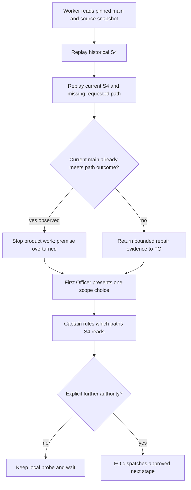

## Scope

- Source: the qnow dev2 FO, sent with the Captain's approval 「送出」 (2026-11-10), and FO's own case in batch 19 (a validation report citing evidence under a /tmp folder that macOS may clear).
- Bite: on qnow owner-vehicle-kept-after-name (adopted 0.35.0 scripts, run 2026-11-09 ~15:40 UTC), `delivery_gate.py question` and `check` printed `Captain steps record fails: message S4: missing path /tmp/ovk-val4-wt` and held, because inspect_steps runs the absolute-path existence check (S4) over the gate text plus the latest validation report, and the report's cleanup bullet says the validator removed that scratch worktree as told; `delivery_gate.py steps` on the record itself exited 0. The only pass is recreating the folder, which games the check. State: qnow spacedock-state/dev2 at 5e3a5110, `_archive/owner-vehicle-kept-after-name.md` last validation report and `owner-vehicle-kept-after-name/delivery-gate-text.md`.
- Suggested direction (qnow FO, not a ruling): exclude paths the report states were removed, or scope S4 to the gate text and the steps record.
- Non-goals: dropping S4 for the gate text or the steps record.
- Trial (2026-11-13): admitted by the Captain's 「五張都准，授權代記設計關卡（建議）」 (host question dialog, 2026-11-13) as one of five tasks run by hand under the trial route rules: one worker builds a working probe during ideation and continues into implementation, a different worker validates, at most 3 build rounds counted by hand; stop for the Captain on an overturned premise, spent budget, two rounds without progress or a second validation rejection, a change of scope or criterion, or a component boundary or Prod trigger.

## Budget
1 implementation and 2 validation cycles, in one package PR to delivery_gate.py and its tests.

## Stop condition
- The qnow input above passes S4 while a missing path the Captain is asked to run still holds.

## FO alignment

Alignment: needed at ideation; which paths S4 reads is the Captain's call.
Result: the Captain admitted this task into the route trial with 「五張都准，授權代記設計關卡（建議）」 (host question dialog, 2026-11-13); he has not yet ruled which paths the check reads, so FO does not record this task's ideation gate under the grant: the probe's result and the options go to him at that gate.
Surfaces: none
Visible change: none
Release review: not needed: workflow maintenance, on no journey map.

## Design

### PRFAQ

**結論：目前主線已達成本任務的路徑結果，建議停止產品修改，請 Captain 確認是否採納現行檢查範圍。** S4 是絕對路徑存在檢查；它目前讀提問全文及步驟紀錄的 `Asked:` 欄位。驗證報告仍供步驟與指令覆蓋檢查使用，但不再將報告中的刪除紀錄當成需要存在的路徑。

使用者是準備驗證提問與合併提問的 First Officer（FO，工作流協調者）。結果是清除驗證暫存物之後，仍能檢查真正要求 Captain 操作的路徑；這裡不新增刪除語句解析器、設定欄位、第三方服務、工作流關卡或長期維護責任。

### Before building

- **是否需要做，否則什麼會壞？** 原案例在舊版會誤擋，值得重播；但「目前主線仍需修改」這個前提已被探針推翻。當前主線重播的報告路徑誤擋為 0；真正提問中的缺路徑仍被擋下。故目前需要的是回報事實與裁定，不是另一份功能修補。
- **既有、上游與兄弟專案已有什麼？** 先讀 Spacedock 0.28.0 自己的 `skills/fo-gate-lifecycle/SKILL.md`、ensign 共用合約：它負責關卡、引用、報告與狀態，不定義 S4 的字串輸入；沒有修改上游的理由。再查本套件 `origin/main`、歷史與原生測試：`629cf732613494eb86ac96e0bf70a0d4f85b3bd4`（公開 PR #799）已分開提問與報告，既有 `TaskFolderCaptainTests.test_report_routes_do_not_hide_missing_message_or_asked_paths` 已保護這個範圍。最後唯讀查 Scope 指定的三個 adopter；3 個可讀，相關詞命中的檔案合計 3 份，未把相鄰專案的用法當成上游合約，也未從這項詞查詢推論全體沒有其他缺陷。公開檔案只保存 `ideation/adopter-counts.json` 的數量。
- **RFC 或公開標準？** 這不是新協定或可互通格式；本案依循既有接受的 ADR（架構決策紀錄）0054、0044、0071，沒有提出採納新的 RFC（公開技術提案）。未聲稱曾窮盡所有外部標準。
- **更小、更便宜的方式？** 採用目前主線已存在的分界，保留本機重播證據；不新增程式碼即可達到 Scope 的路徑結果。重建已刪除資料夾會掩蓋故障，不是修補。
- **是否跨元件邊界？** 沒有新增邊界。探針只呼叫既有套件函式及入口；Spacedock 的狀態與關卡合約維持原樣。GitHub 相關入口用套件既有替身，不存取或修改真實 PR 的狀態。
- **新事實寫哪裡？** 設計與判斷只寫本任務；數量、原生測試與圖放本任務 `ideation/`；探針原始碼只在本機 `poc/delivery-gate-s4-skips-removed-scratch`，不推送、不開 PR。沒有 Captain 新裁示，因此不寫新 ADR。

### Worth questions

- **Captain words served:** Scope 所引「五張都准，授權代記設計關卡（建議）」接受本任務的 outcome、Budget 與停止規則；這不是對 S4 讀取範圍的新裁示。
- **What breaks without each part:** 不重播會把舊版誤擋當成當前缺陷；不保留缺路徑反例，可能意外移除真正提問的保護。沒有其他產品範圍值得擴大。
- **Premise and cheap test:** 若當前主線已忽略報告路徑且仍拒絕要求操作的缺路徑，就不需要新功能；`probe_removed_scratch.py` 已測出此結果。因此觸發 premise overturned，並保留 Captain 對讀取範圍的決定權。

### Probe and evidence

- 原始主線與版本：`8125e6d516d32abbf79c6772de10cde2c20900a8`；`kc-dev-flow-2/.claude-plugin/plugin.json` 為 `0.39.1`，已包含 2026-11-12 的 merge-result 檢查。探針沒有移除或改寫該檢查。
- 本機探針：branch `poc/delivery-gate-s4-skips-removed-scratch`，commit `76961f1a3e370f7313112c124ca3d01ec19b406b`；工作樹位於 workflow checkout 的 `.worktrees/poc-delivery-gate-s4-skips-removed-scratch`。只新增一次性測量程式，產品檔案與原生測試維持原主線位元組。
- 原始案例：唯讀讀取 Scope 的固定 state commit `5e3a5110`。不複製其私有報告、步驟、裁示或輸出；`probe-counts.json` 只有數量。舊函式重播得到 2 個報告路徑誤擋，現行函式為 0，其他步驟問題亦為 0；未重建任何報告所指的已刪除路徑。
- 封存位移：原始提問所宣告的步驟紀錄已因封存搬移，直接重播另有 1 個合理的訊息路徑錯誤。首次執行的 exit 1 與 1 個失敗斷言保存在 `probe-counts-initial.json`；正式重播只把 `Captain steps:` 的紀錄指標改指向從同一固定來源抽出的暫存副本，沒有改動原報告或其已刪除路徑。這是隔離舊版 S4 缺陷的重播，不是真實封存提問現在仍可直接送出的聲明。
- 入口與反例：公開生成輸入的 `question` 與 `check` 均 exit 0；缺少提問路徑與缺少 `Asked:` 路徑均 exit 1。故意只把 S4 輸入改回含報告全文，會重新產生 1 個報告路徑誤擋；這個變異只存在記憶體，沒有修改產品。
- `ideation/native-tests.log`：既有兩組 Captain 路徑測試共 11 項通過。這不等於全套測試、真實 GitHub 檢查或交付驗收。
- 實際載入的 package workflow：`/Users/kent/.claude/plugins/cache/kc-claude-plugins/kc-dev-flow-2/0.39.1/references/sd/workflow.md`；SHA-256 `a884a1079841eeff80a0b3a27fecc21379562077ce8e783b70ccbce0cd5b6ca1`。設計對照來源是上述固定 origin/main，不把載入套件、workflow checkout 與主線混作同一版本。
- 相關 ADR 均於固定主線讀取且為 Accepted；0054 SHA-256 `23cee65f32c5b92f8ae06c39a8501c24002aec045b8ebca58e22ddc7ed4d0eb4`，0044 `9ca2c99453255fc4e90452f47baf2fdaf44a766b3888f50985445f86353ba132`，0071 `2f030ea33803ac78b9d5863848d73ab1cb4c5466aceb81d4c2e2097eaece0506`。它們分別保留執行紀錄、分離摘要相容性及合併提問綁定，沒有授權自訂新的範圍。

### Boundary and flow

既有輸入合約：`inspect_steps(record, message, folder, evidence)`；S4 讀 `message`（扣掉已紀錄的輸出區塊）及各步驟 `Asked:`。`evidence` 仍參與覆蓋檢查與文件內 shell/無語言區塊的步驟收集；不把 S4 的分界誤寫成「整份驗證報告都略過」。

圖的原始碼與已渲染結果是 `ideation/flow.mmd`、`flow.svg`、`flow.png`。已看圖比對工人先重播、FO 呈現、Captain 裁定、未獲後續授權就停止的順序、分支與權限，與本文相符；本機已快取 Mermaid CLI 11.17.1，沒有下載套件或新增線上資源。首次 sandbox 內啟動瀏覽器失敗，窄範圍授權後同圖本機渲染成功，非產品缺陷。

### Pilot bar and Stop condition

目前可證明「報告的已刪除暫存路徑不再誤擋」，不能宣稱未重定位的原封存輸入整體通過；它仍正確拒絕已搬移的步驟紀錄路徑。若 Captain 要求字面不改任何原始指標仍 exit 0，這是尚未達成的條件，不能藉重建目錄通過。本次歷史對照是 PR #799 前的函式，並未鑑定當時實際載入的 0.35.0 腳本位元組；沒有把對照當成該歷史現場的完整重現。Pilot 所需真實外部 PR 與下一次已採用套件的現場提問未驗證，本輪沒有新的持久資料或服務接縫。

### Captain decision

**Needs decision: 是否採納目前主線的 S4 範圍，並把本任務視為已被既有修補涵蓋？建議採納。**

- 採納現行範圍（建議）：只查提問與 `Asked:` 的絕對路徑；報告保留步驟覆蓋用途。沒有新程式、設定或維護負擔；代價是報告中單獨提到、卻沒有在提問或 `Asked:` 要求操作的壞路徑，不由 S4 阻擋。
- 解析「已刪除」敘述再逐路徑排除：可保留較廣的報告路徑掃描，但需定義語言、否定、相同路徑重用等規則；比現成分界複雜，且可能把 Captain 真的要用的路徑誤當可忽略。
- 保留舊版掃描：不用新設計，但 Scope 的暫存清理誤擋會繼續出現，不達任務結果。

未改寫原 Scope、Budget、Stop condition 或 FO alignment；沒有記錄設計關卡通過。這個選擇與前提已推翻皆超出 FO 的代記授權，交回 Captain。

### Words FO reads at each moment

本案不以減字為目標，也未改產品指示。已對固定主線與探針比較 workflow、FO mod、`pr_watch.py`、`delivery_gate.py` 四份受影響來源，均位元組相同；`ideation/lifecycle-counts.json` 的五個時點（startup、idle/open PR、idle/merged PR、after archive、merge ask）新增或刪除的操作文字，前後都是 0。這是各時點的變更量，不冒稱完整實際閱讀總量；實際 hook、擴充與 script 輸出的總字數未重新量測，亦沒有聲稱任何時點減字。故不存在移出某檔卻增加另一入口閱讀量的產品變更。

### Batch overlap

這輪可交付的產品變更清單為 none；本機探針檔為 `kc-dev-flow-2/scripts/probe_removed_scratch.py`，不進產品 PR。若 Captain 仍選擇功能修改，原預算允許的產品檔只有 `kc-dev-flow-2/scripts/delivery_gate.py` 與 `kc-dev-flow-2/scripts/test_delivery_gate.py`，需先有裁定再設計。

- `design-surfaces-task-dir-crash`：`design_surfaces.py`，無同檔；本設計會跑到它的檢查，採已載入 package 的版本。
- `new-work-checks-what-exists-first`：階段原則與查既有機制，無同檔；概念相關，本案已先查既有。
- `delivery-gate-s4-skips-removed-scratch`：本任務，沒有與其他工人共享探針檔。
- `observer-check-learn-only-when-listed`：`observer_check.py`，無同檔。
- `pr-watch-tasks-foreign-worktree`：`pr_watch.py`，無同檔。
- `dispatch-close-out-archives-evidence-and-removes-scratch`：公開 PR #854 為 OPEN，head `d4fe39e54dc7069b099d61c4b0e3fa2e5aecd8c6`；改 dispatch、pr_watch、scratch 及其測試，不改 delivery_gate；暫存生命週期概念相關，但本案不使用或修改該未合併 API。
- `held-and-closed-tasks-leave-the-design-queue`：公開 PR #856 為 OPEN，head `455846c6d30d4ab650c1c4503bc591722231586d`；改 pr_watch 及其測試，無同檔。
- `adoption-asks-which-extensions`：workflow、adoption 與相關檢查；無同檔，不重製其 workflow 文案。
- `adr-required-statement`：ADR lint、workflow/adoption 與相關測試，無同檔。
- `adr-silent-undo-probe`：ADR 行為測量情境，無同檔。
- `comment-check-reaches-delivery-gate`：若繼續功能修改，與本任務原預算的 delivery_gate 及其測試直接重疊；本輪不修改產品，因此當前沒有衝突。
- `journey-canvas-hosted-poc`：journey hosted 探索，無同檔。
- `journey-server-host-pilot`：目前 state checkout 未找到同名任務，未推論它已完成；無已知同檔，FO 須向持有者確認其狀態。
- `ops-inbox-r1-setup-and-isolation`：kc-ops-inbox 與其合約，無同檔。
- `pr-review-lite-value-pilot`：kc-pr-flow 的獨立實驗，無同檔。

Recommended order: 先交 Captain 裁定本任務是否由既有修補涵蓋；若採納，不排產品實作。若仍要求修改 delivery_gate，FO 先協調 `comment-check-reaches-delivery-gate`，並以包含 merge-result 檢查的當前主線重新派工；其他任務可各自繼續。

## Acceptance criteria

以下是本輪對既有結果的證據，不是新增規格或 Captain 已裁示的範圍。每項的 falsifier 都能使證據失敗。`WT` 是上文的探針工作樹；`EVIDENCE` 是本任務 folder 的 `ideation/`。`CASE_STATE` 必須由操作者指定為 Scope 所述來源的唯讀本機 state checkout，`CASE_STEM` 使用 Scope 指定的案例；私有來源不打包到公開 state，無權讀取者不能重跑原始案例。

**AC-1** 固定原始案例的已移除報告路徑不會再觸發 S4，且不重建那些路徑。Evidence command（從 `$WT` 執行）：`python3 -B kc-dev-flow-2/scripts/probe_removed_scratch.py --state-root "$CASE_STATE" --state-commit 5e3a5110 --case-stem "$CASE_STEM" --output "$EVIDENCE/probe-counts.json"`。已執行 exit 0；`ideation/probe-counts.json`：歷史報告路徑誤擋 2，目前 0，原始紀錄指標位移 1。Falsifier：把 S4 輸入換回含報告全文，已測變異誤擋 1；若沒有原始可讀來源，此項不得宣稱重新驗證。

**AC-2** 真正提問及 `Asked:` 中缺少的路徑仍阻擋。Evidence command：同 AC-1 的確切探針命令，該次執行同時測這兩個分支，整體 exit 0；輸出同 `ideation/probe-counts.json`，兩個入口結果均為 1，對應 S4 次數各 1。Falsifier：移除任一對應的路徑檢查，該分支斷言就失敗。

**AC-3** `question` 與 `check` 皆連到現行檢查，且原生報告覆蓋檢查不被關閉。Evidence commands：同 AC-1 的探針命令（整體 exit 0，公開生成案例的兩入口均 0）；以及從 `$WT/kc-dev-flow-2/scripts` 執行 `python3 -B -m unittest test_delivery_gate.TaskFolderCaptainTests test_delivery_gate.CaptainGateTests > "$EVIDENCE/native-tests.log" 2>&1`（exit 0，11 項通過）。Falsifier：令 `captain_step_problems` 忽略驗證報告，既有最新報告鏈接與具名文件步驟測試失敗。GitHub PR 與 role-call 事實在生成入口案例中使用既有替身，不據此宣稱外部服務已驗收。

**AC-4** 沒有產品變更、沒有推送探針、沒有開 PR，且私有重播只輸出數量。Evidence command：`git -C "$WT" diff --exit-code 8125e6d516d32abbf79c6772de10cde2c20900a8 HEAD -- kc-dev-flow-2/scripts/delivery_gate.py kc-dev-flow-2/scripts/test_delivery_gate.py kc-dev-flow-2/references/sd/workflow.md kc-dev-flow-2/references/sd/mods/kc-dev-flow-2.md kc-dev-flow-2/scripts/pr_watch.py > "$EVIDENCE/product-diff.log"`，exit 0；另已執行 `git -C "$WT" ls-remote origin refs/heads/poc/delivery-gate-s4-skips-removed-scratch`（exit 0）與 `gh pr list --repo iamcxa/kc-claude-plugins --state open --head poc/delivery-gate-s4-skips-removed-scratch --json number`（exit 0），以數量保存其結果。資料格式命令為 `python3 -c 'import json,sys; from pathlib import Path; names=["probe-counts.json","probe-counts-initial.json","adopter-counts.json","publication-counts.json"]; assert all(isinstance(v,(int,float)) and not isinstance(v,bool) for n in names for v in json.loads((Path(sys.argv[1])/n).read_text()).values())' "$EVIDENCE"`（exit 0）。發布與資料格式的檢查結果存於 `ideation/publication-counts.json`、`ideation/public-safety.json`。Falsifier：任一產品檔有差異就使 diff 非零；數量 JSON 混入來源字串，資料格式檢查失敗；遠端存在探針 ref 或 open PR，發布數量變成非零。

### Not provable now

- 真實原始封存提問在未重定位步驟紀錄時整體通過：實測仍有 1 個合理的紀錄路徑缺失；本輪不是修復私有 state 的授權。
- 真實合併 `check` 整體通過、 hosted CI 與原始 PR 當前可合併性：本輪沒有產品 PR；生成案例中的 GitHub 替身只證明入口接線。
- 三個 adopter 的全量現行任務都不再誤擋：只有 1 個固定原始案例及有界查詞的數量，不做全體推論。
- 各 lifecycle 的完整實際閱讀總字數：未重新採樣實際狀態與所有輸出；只證明五時點受影響的產品指示來源完全不變、差值 0。
- Captain 是否採納現行 S4 路徑範圍、是否允許收掉本任務：待人裁定；工人與 FO 均不替他裁定。

## Stage Report: ideation

- DONE: The Captain's trial for this task (his words are in the task's backlog gate record and Scope): this is build round 1 of at most 3, and you are the build worker who continues into implementation if the design gate passes. Before designing, answer in a few lines each, under a '### Before building' heading in the design: does this need doing at all and what breaks without it; what existing code, upstream or sibling repository already has it (what you checked, what you found); is there an RFC or public standard for it; is there a smaller or cheaper way to the same outcome; does it cross a boundary between components (if so write the boundary contract first and stop); where the new facts will be written once done. Then build a working throwaway probe of this task's outcome on a local branch poc/delivery-gate-s4-skips-removed-scratch in a worktree you create under the workflow checkout's .worktrees/ from origin/main, commit it locally, never push it and open no PR; run it against the real cases the task's Scope names and save what it showed in the task folder. Then write the design as what the probe showed, what it lacks to meet the Pilot bar and the task's Stop condition, and the acceptance criteria; record the branch name and commit in the design. For every acceptance criterion, run its evidence command once now on the probe and write beside it the exact command, its exit and the path of its saved output in the task folder; a criterion whose proof cannot be run now goes under a 'Not provable now' list with the reason. End the stage report with a '### Trial round 1' line giving: the premise tested and the goal check, your start and end time with the time source, the base and probe commits, the check command with its saved output and result, what blocked, and which of these fired or 'none': premise overturned; a decision only the Captain can make (scope, a criterion, a trade-off between approaches); a component boundary with no contract; production data or credentials, broad exposure, a migration, unattended recurring operation, a support duty or release and rollback ownership; a change outside the file and budget the task names
  Before building、固定主線探針、設計、驗收與停止判斷已寫；本機 probe commit 76961f1a3e370f7313112c124ca3d01ec19b406b。原始案例只存數量，前提被推翻，沒有產品修改。
- DONE: A `### Batch overlap` section naming each file the design would change and each other batch task (design-surfaces-task-dir-crash, new-work-checks-what-exists-first, delivery-gate-s4-skips-removed-scratch, observer-check-learn-only-when-listed, pr-watch-tasks-foreign-worktree) and live task of other sessions (dispatch-close-out-archives-evidence-and-removes-scratch (open PR #854), held-and-closed-tasks-leave-the-design-queue (open PR #856), adoption-asks-which-extensions, adr-required-statement, adr-silent-undo-probe, comment-check-reaches-delivery-gate, journey-canvas-hosted-poc, journey-server-host-pilot, ops-inbox-r1-setup-and-isolation, pr-review-lite-value-pilot (driven by other sessions or held; read only)) that changes the same file or check, so FO can order implementation
  指定任務逐項列出；若繼續功能修改，comment-check-reaches-delivery-gate 是直接同檔；兩個公開 PR 仍 OPEN；未找到的任務標為未知。
- SKIPPED: The words FO reads at each lifecycle moment, before and after, per root learning.md "Measure the words FO reads at each moment, not one file's size"
  未重新採樣完整實際總字數：本案不減字且已觸發停止。四份指示來源位元組相同，lifecycle-counts.json 的五個時點受影響文字前後均 0；總字數明示未量。
- DONE: Acceptance criteria with reproducible evidence clauses and falsifiers, and unresolved decisions for the Captain, each with a recommendation and what gets worse under it
  AC-1 至 AC-4 各有執行命令、exit、保存輸出與 falsifier；待 Captain 決定現行 S4 範圍，列出建議與代價。
- DONE: AC-1
  probe-counts.json：舊函式報告路徑誤擋 2，目前 0；僅重定位封存紀錄指標，變異恢復含報告的輸入即再誤擋；未重建暫存路徑。
- DONE: AC-2
  probe-counts.json：提問與 Asked 的缺路徑各 exit 1、各 S4 一次；刪除任一相應檢查會使斷言失敗。
- DONE: AC-3
  probe-counts.json：生成案例 question/check 各 exit 0；native-tests.log 11 項通過，能抓到忽略報告或錯誤解析 task folder 的改動；不是外部服務驗收。
- DONE: AC-4
  product-diff.log exit 0；publication-counts.json 遠端探針與 open PR 各 0；public-safety.json 的 4 份數量檔中非數量值 0。
- DONE: Run the recorded profile's design-surface check.
  python3 /Users/kent/.claude/plugins/cache/kc-claude-plugins/kc-dev-flow-2/0.39.1/scripts/design_surfaces.py check <本任務檔> exit 0，ideation/design-surfaces.log；圖已實際渲染並比對分支。

### Summary

本次固定主線的既有修補已排除驗證報告中被刪除的路徑；只有本機探針，沒有產品修補或 PR。原始未重定位的封存提問仍缺紀錄指標，沒有把受控重播當成原輸入或交付全通過；等 Captain 決定現行範圍，未代記關卡。

### Trial round 1

- Premise / goal check: 測「目前主線仍因報告中已移除暫存路徑誤擋」；固定來源受控重播推翻此前提，真正要求的缺路徑仍擋；未重定位的封存輸入整體通過尚未證明。
- Start / end: 2026-11-13 01:04:59 / 01:18:25 Asia/Taipei；clock.curr_time UTC 2026-11-12 17:04:59 / 17:18:25 加 08:00；end 是設計及證據工作時點，後續提交與清理另記。
- Base / probe: 8125e6d516d32abbf79c6772de10cde2c20900a8 / 76961f1a3e370f7313112c124ca3d01ec19b406b；本機 poc/delivery-gate-s4-skips-removed-scratch 保留、不推送。
- Check: python3 -B kc-dev-flow-2/scripts/probe_removed_scratch.py --state-root "$CASE_STATE" --state-commit 5e3a5110 --case-stem "$CASE_STEM" --output "$EVIDENCE/probe-counts.json"；exit 0，ideation/probe-run.log 與 probe-counts.json，11 斷言、0 失敗；首次 exit 1 另存 probe-counts-initial.json。
- Blocked: 未有 Captain 對讀取範圍的裁定；完整 lifecycle 實際總字數未量；無真實本任務產品 PR 的外部驗收。實際載入 package workflow SHA-256 a884a1079841eeff80a0b3a27fecc21379562077ce8e783b70ccbce0cd5b6ca1。
- Fired: premise overturned；a decision only the Captain can make（是否採納現行 S4 範圍與停止新修補）。其餘 boundary、Prod triggers、超出產品檔或預算的變更均 none；未進 implementation/validation cycle，未改任務狀態。

## Scratch cleanup

Evidence state commit: `10e586243`；在該提交後按以下精確路徑刪除並驗證不存在：

- `/tmp/delivery-s4-probe-run.log`
- `/tmp/delivery-s4-entity-read.json`
- `/tmp/delivery-s4-render.log`
- `/tmp/delivery-s4-render-authorized.log`
- `/tmp/delivery-s4-remote-ref.log`
- `/tmp/delivery-s4-prs.json`

探針 context manager 的隨機暫存目錄已於結束時精確刪除；先前隨機名稱未留存，不能列成完整名稱清單，已確認這輪兩個專用前綴殘留目錄數為 0。原生測試自己的 TemporaryDirectory 亦隨測試結束清理。派工檔由 FO 建立，不刪除；本機探針工作樹及分支保留。

## Closed

The Captain chose 「關掉，接受現行範圍（建議）」 (host question dialog, 2026-11-13), answering 「「合併檢查不該要求已刪除的暫存路徑」這張要不要直接關掉？我建議關掉。worker 重播原案例發現問題在 0.36.0 就修好了：現在只檢查「問你的文字」和「要你執行的步驟」裡的路徑，驗證報告裡提到的已刪暫存不再誤擋，要你執行卻不存在的路徑仍會擋。關掉等於接受現行檢查範圍，不再寫任何程式。」; closed with nothing built: the premise was overturned in trial round 1 (already fixed on main by PR #799, released in 0.36.0). The task stays at the ideation gate because Spacedock cannot archive a held task (spacedock-dev/spacedock#847); it is not work waiting.
