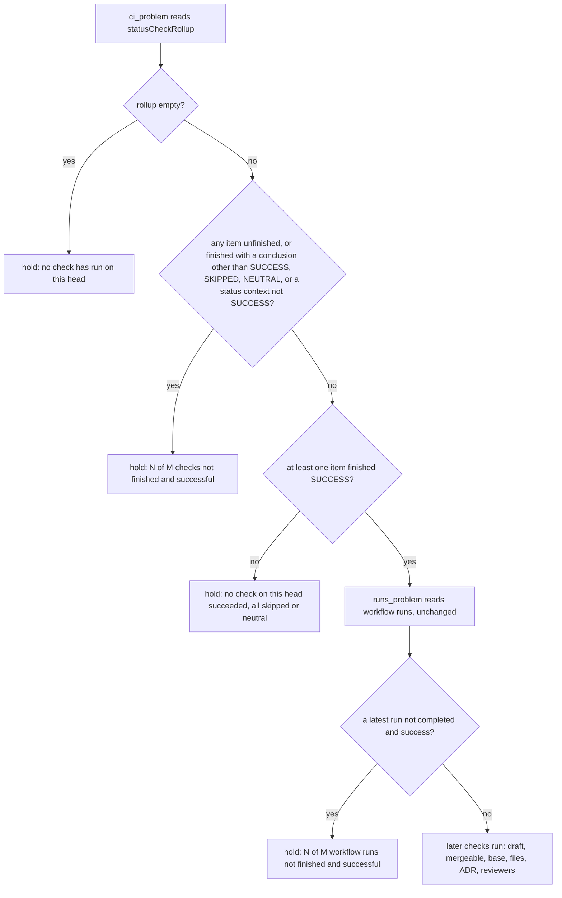

## Scope

- Source: issue iamcxa/kc-claude-plugins#677; the Captain asked that it be fixed before this release (「把 #677 排在這次發版之前修好」, 2026-10-19, chat).
- Bite: `delivery_gate.py check` (kc-dev-flow-2 0.25.0) holds every ask where a check run concludes SKIPPED or NEUTRAL, which its module docstring states as intended ("an empty rollup, SKIPPED and NEUTRAL included"). Observed three times on 2026-10-19, each ending in a Captain override:
  - spacedock-dev/subspace-relay#398 at 0b7b7c43 and #401 at 9ba2c31d: "6 of 18 checks on this head are not finished and successful: 'workflow' 'release-preflight' 'resolve-paired-web' 'paired-release' 'Header rules -'", while ci-gate, test, typecheck, lint, browser and the e2e jobs were green; the four jobs are skipped by relay's path classifier and checked by ci-gate both ways; Netlify's "Header rules" and "Pages changed" are NEUTRAL. Reported by the relay dev2 FO; #401's resolution carries an `Override:` line (「越過」).
  - spacedock-dev/subspace-web#150 at 93ba01e5 (mergeStateStatus CLEAN): "4 of 7 checks on this head are not finished and successful: 'resolve-release-relay' 'release-pair' 'Pages changed -' 'Redirect rules -'"; the release jobs run only on Release Please's PR and Netlify skips the two rule checks when nothing changes. Reported by the web dev2 FO; the Captain authorized the merge over the hold (「授權你合併 150」).
- Consumer: every adopter FO's merge ask (relay, web; this repository's own CI runs no skipped job today) and the Captain, who otherwise overrides each relay and web delivery.
- Upstream first: GitHub's own model of required checks (branch protection or rulesets, `gh pr view --json statusCheckRollup` fields, `mergeStateStatus`) and each adopter's aggregate job (relay's ci-gate) before the package judges CI meaning itself.
- Candidate directions to measure at ideation, not chosen: settle SKIPPED, and NEUTRAL on a check that is not required; consult only required checks; an adopter-declared list of checks that may skip.
- Non-goals: to be set at ideation.

## FO alignment

Alignment: not needed before ideation; the Captain asked for this fix before the release.
Release review: not needed: workflow maintenance, on no journey map.
Surfaces: none
Visible change: none
Reviewer: engineering-reviewer opus 2026-10-20 — does settling SKIPPED and NEUTRAL check runs, with the floor, let an unsafe head reach a carried merge, given that it reverses the SKIPPED or NEUTRAL clause of merge-gatekeeper AC-1 the Captain approved on 2026-10-17? Called by the special-role combination the Captain agreed (「同意這個組合」, 2026-10-20): a design that reverses an earlier Captain ruling calls the engineering-reviewer.

## Peers

- Peer: subspace-relay dev2 FO = Claude session 62aab0fa-e10d-40ce-a62c-07dcf7d48e04 (Captain named it); reports of #398 and #401 relayed through the Captain's chat, 2026-10-19.
- Peer: subspace-web dev2 FO = Paseo agent 295b873d-3038-42f3-9aae-1c3325e30e4d (envelope source-agent-id); report of #150, 2026-10-19, forwarded at the Captain's direction it quotes (「delivery_gate 直接轉給 plugin fo」).

## Design

### PRFAQ

**Headline.** An adopter PR whose CI skips jobs by design reaches the Captain as one merge ask, not as a hold he must override.

**What changes.** `delivery_gate.py check` treats a check run that finished SKIPPED or NEUTRAL as settled, the way GitHub does ("Successful check statuses are `success`, `skipped`, and `neutral`", GitHub Docs, troubleshooting required status checks, fetched 2026-10-19). Every other hold stays. One new hold keeps the old guard's purpose: a head on which no check succeeded (all skipped or neutral) is still held.

**FAQ.**
- *Why not wait for the adopter to name its gate job?* Nothing in the three observed holds needs a name. relay's `ci-gate` and web's `review-gate` already fail the run when a job that should run did not; the package would only re-state that in a README list that drifts when a job is added.
- *What does a skipped run mean?* A skipped job inside a workflow run that succeeded is the by-design case. A skipped workflow run means no job of it ran; `runs_problem` still holds that, unchanged.
- *Is a skipped test job now invisible?* Yes when an adopter has no fan-in job and a sibling job succeeded. See Limits.

### Chain checked (2026-10-19)

- **Spacedock** 0.27.0 cache source: no check-conclusion evaluation; the only SKIPPED hits are stage-report bullets (`internal/status/gate_extract.go`). Nothing to reuse.
- **kc-dev-flow-2**: `pr_watch.py` `checks()` already returns green for `[SUCCESS, SKIPPED]` and `test_pr_watch.py` pins it. `delivery_gate.py` `ci_problem` is the one reader that holds them, so the package's two readers of one rollup disagree. The hold was written deliberately: merge-gatekeeper AC-1 (approved at its ideation gate by the Captain on 2026-10-17, landed in PR #666 on 2026-10-19) says the check holds "when the check rollup is empty or holds a SKIPPED or NEUTRAL conclusion". Its real defence against a partial rollup arrived later as `runs_problem` (Codex P1 4307169171); the SKIPPED hold was never the thing that caught it.
- **Siblings**: relay `ci.yml` header says the repository is private on a plan without protected branches and `ci-gate` "can report but nothing enforces it. Enforcement is the merge mod's". web has no aggregate; `review-gate` is the one test job and `resolve-release-relay` and `release-pair` `need` it. Read as context for what the package may assume, not as a contract.
- **GitHub**: skipped by a conditional reports Success; a workflow skipped by path or branch filter creates no check and stays Pending; a job skipped because a prerequisite failed "may not block merging". The absent check is the existing partial-rollup limit, not widened here. The failed-prerequisite case stays held because the prerequisite's own FAILURE is in the rollup (replay row "failed + skipped").

### Measurement (read-only `gh`, 2026-10-19)

The three observed holds, rollup read with `gh pr view <N> --repo <R> --json state,headRefOid,mergeStateStatus,mergeable,statusCheckRollup` and the workflow runs with `gh api "repos/<R>/actions/runs?head_sha=<head>&per_page=100"`:

| PR (head) | rollup | not SUCCESS | workflow runs |
| --- | --- | --- | --- |
| relay#398 (0b7b7c43) | 18 | 4 SKIPPED jobs (`workflow`, `release-preflight`, `resolve-paired-web`, `paired-release`), 2 NEUTRAL (`Header rules`, `Pages changed`) | `ci` success |
| relay#401 (9ba2c31d) | 18 | the same six | `ci` success |
| web#150 (93ba01e5) | 7 | 2 SKIPPED (`resolve-release-relay`, `release-pair`), 2 NEUTRAL (`Pages changed`, `Redirect rules`) | `ci` success |

The base script's printed holds match the issue's text word for word ("6 of 18 ...", "4 of 7 ..."), so the replay reproduces the bite. All three PRs are MERGED now, so `mergeStateStatus` reads UNKNOWN; the Scope records CLEAN at the web#150 ask. Live open PR relay#399 (6a038fb5) reads `mergeStateStatus: CLEAN`, `mergeable: MERGEABLE` with 7 SUCCESS, 6 SKIPPED (including `browser` and `e2e-netlify-dev`) and 2 NEUTRAL, so GitHub itself calls that head clean. Open PR relay#402 (3bd565a8) reads `UNSTABLE` with 6 QUEUED and 1 IN_PROGRESS, so GitHub also reports an unfinished head without any branch protection.

Branch protection and rulesets cannot be read: `gh api repos/<R>/branches/main/protection`, `.../rulesets` and `.../rules/branches/main` return HTTP 403 "Upgrade to GitHub Pro" on both repositories (the organisation plan is `free`, private repositories). GraphQL `branchProtectionRule` is null and `isRequired(pullRequestNumber:)` is false on all 18 contexts of relay#398. Neither adopter has a required check, and the package has no way to learn one.

### The three candidates, measured

| Direction | On relay#398/#401, web#150 | What it lets through that the current hold catches | Cost |
| --- | --- | --- | --- |
| 1. Settle SKIPPED, and NEUTRAL on a check that is not required | passes all three. "Not required" is true of every check on both adopters (no protection), so the qualifier changes nothing there; on a repository with protection GitHub counts a required NEUTRAL or SKIPPED as passing too, so it would change nothing there either. The qualifier is dropped. | a job skipped by mistake (a bad `if:`) in a run whose other jobs succeeded, when the adopter has no fan-in job. Not reachable on relay (`ci-gate` fails a skip it did not expect) or web (the one test job skipping skips the whole run, which `runs_problem` holds). | none: no config, no new `gh` call |
| 2. Consult only required checks | the set is empty on both adopters. Read empty as "nothing to check" and a FAILURE passes; read it as "hold" and every ask holds, worse than today. | everything, including a failed check, on both adopters | a new read (protection API: 403 on both; or GraphQL `isRequired`) and a new branch for the empty set |
| 3. Adopter-declared list of checks that may skip | passes all three once relay lists 4 jobs and 2 Netlify names, web 2 jobs and 2 Netlify names. Netlify names carry the site (`Header rules - subspace-relay-staging`), so the list is per adopter and per site. | nothing the hold catches; it is stricter than 1: an unlisted skipped job still holds | a new README key in each adopter, and a new hold each time a job is added, the drift relay's own `ci-gate` header says a fan-in exists to avoid |

Recommendation: **direction 1, without the "not required" qualifier, plus a floor** (a head on which no check succeeded is held). Direction 3 is the escalation if an adopter with no fan-in job appears; it needs a trigger observed, not guessed.

### Existing-code check (bounded)

Use and repair what exists: `ci_problem` is a short function whose only caller is `check`; the change is its `ok` test and one floor (the prototype diff is 15 changed lines) and one docstring clause. `runs_problem`, `pr_runs`, the rollup read and every printed line other than the new floor line are untouched. No new `gh` call, no README key, no new printed line on a pass.

### Rule and prototype



Prototype, in a scratch copy of origin/main 5a951034 (not committed, not in any repository): `ci_problem` marks an item ok when it is a StatusContext with state SUCCESS, or a CheckRun that is COMPLETED with conclusion SUCCESS, SKIPPED or NEUTRAL; it counts as succeeded when SUCCESS; no succeeded item holds. The 56 tests of `test_delivery_gate.py` pass on base and on the prototype (`python3 -B -m unittest discover -s . -p test_delivery_gate.py`, 106 s and 116 s).

### Falsifier set

**Existing tests that must keep holding** (all 56 pass on the prototype): `HoldTests` rows `check not finished`, `check failed`, `one of two checks pending`, `status context pending`, `empty rollup`; `PartialRollupTests` (an in-progress run holds beside one green check; only a cancelled or skipped run replaced by a later run is ignored; `only run cancelled` holds); `test_a_ready_green_mergeable_pr_on_the_trunk_passes`. The rows `check skipped` and `check neutral` are one lone check each and stay held by the floor, so no existing row is deleted or inverted.

**Mutations, each run on the prototype** (`python3 -B`): deleting the floor turns `check skipped` and `check neutral` red (2 subtests). Adding FAILURE to the settled set leaves `HoldTests` green, because the floor then holds a lone failure for its own reason; only the replay row "failed check" (one SUCCESS beside one FAILURE) goes red. So that row must become a test row, or the failure branch has no guard.

**Replay verdicts** (exit code, base then prototype, through the test module's stub harness fed the stored `gh` output; 1 = hold):

| Case | base | prototype |
| --- | --- | --- |
| relay#398, relay#401, web#150 (real rollup and runs) | 1 | 0 |
| relay#399 live, CLEAN, 6 SKIPPED and 2 NEUTRAL | 1 | 0 |
| relay#402 live, UNSTABLE, queued and in-progress | 1 | 1 |
| ask-1 of number-guards-readme-shrink (PR #670 at 7e47e870), ask-1 of fo-write-checks (#671 at 13ceb00d), ask-1..3 of captain-question-load (#675 at ccc84a78): the six committed `merge/ask-N.json` records, one real rollup per PR (5 SUCCESS each) | 0 | 0 |
| SUCCESS + SKIPPED + NEUTRAL | 1 | 0 |
| one job SKIPPED, run success, deploy status SUCCESS | 1 | 0 |
| empty rollup; one PENDING, QUEUED or IN_PROGRESS beside a success | 1 | 1 |
| SUCCESS + FAILURE; FAILURE + SKIPPED; CANCELLED; TIMED_OUT; STARTUP_FAILURE; ACTION_REQUIRED; STALE; a status context PENDING or FAILURE | 1 | 1 |
| lone SKIPPED; lone NEUTRAL; SKIPPED + NEUTRAL only | 1 | 1 (floor) |
| only a green status context | 0 | 0 |
| every job skipped so the run is skipped, deploy status SUCCESS (the web fork-PR shape: `review-gate` has `if: ... head.repo.full_name == github.repository`) | 1 | 1 (`runs_problem`) |
| a run `skipped`, `failure` or `cancelled` next to a green run | 1 | 1 |

The six committed records are only passing asks on this repository, so the replay shows no regression there; it cannot show a hold that was wrongly lifted, which the synthetic rows do. Records exist only for exit 0, so no record shows a SKIPPED hold; the three adopter PRs are the only observed instances.

### Words FO reads at each lifecycle moment

Counted as `len(line.split())` over every printed line, in the test harness (head 40c714a6, a `docs/notes.md` change), base origin/main 5a951034 against the prototype.

| Moment | Base | Candidate |
| --- | --- | --- |
| startup | `docs/dev2/README.md`, `references/sd/workflow.md`, mods: no sentence about check conclusions | identical: no FO-read sentence changed |
| idle on an open PR | same | same |
| idle on a merged PR | same | same |
| after the archive | same | same |
| merge ask, this repository (all SUCCESS) | 44 printed words (pass) | 44 |
| merge ask, relay or web with skipped or NEUTRAL checks | 33 words (relay#398, #401) or 34 (web#150): a hold, then the Captain's override | 44: the ordinary pass print, no override |
| merge ask, a head where every check skipped | 13 words for a lone check ("1 of 1 checks on this head are not finished and successful: 'a'") | at most 13 for the floor line |

Nothing FO reads at the first four moments changes. At the merge ask on relay or web the printed words rise by 10 to 11 because a pass prints the head line, `class:`, `record:` and `next:` and a hold prints two lines; no instruction text is added and the override exchange disappears. The README says "Required CI is green only when its test jobs have finished on the PR head" (`docs/dev2/README.md`, not in `references/sd/workflow.md`: a pre-existing difference this design does not touch).

### Batch overlap

Against chat-only-evidence-observer-blind (PR #679, open, head 59fc3d12, also edits `delivery_gate.py`):
- `delivery_gate.py` code: #679 adds `CONFIRMATIONS`, `clause`, `unstated_confirmations` and a `check()` tail loop; this task edits `ci_problem` only. The prototype diff applies cleanly to #679's file (`patch --dry-run`).
- Module docstring: #679 rewrites the sentences naming `Second reviewer` and the exit-1 list; this task rewrites the clause "(an empty rollup, SKIPPED and NEUTRAL included)" two lines below #679's changed line. Different lines, but inside one hunk's context, so the second PR to merge may need a re-diff of that paragraph.
- `test_delivery_gate.py`: #679 changes `run_check`'s default text (line ~399), one line in `test_a_readme_without_a_trunk_holds_with_exit_2` (~474), and appends `ConfirmationTests` at the end. This task puts its new rows in `HoldTests.HOLDS` (above the #679 lines) and a new class `SettledChecksTests` after `PartialRollupTests`, away from both.
- Order: the backlog gate already ruled this task after #679. Implementation bases on #679's merged head; if #679 is not merged, it branches from origin/main and merges main before opening a PR.

## Acceptance criteria

**AC-1** A CheckRun that finished SKIPPED or NEUTRAL does not hold the ask when another check on the head finished SUCCESS. Evidence: `python3 -B -m unittest discover -s kc-dev-flow-2/scripts -p test_delivery_gate.py` has a row `success + skipped + neutral` with exit 0 and a row `one job skipped, run success, deploy status success` with exit 0; and `gh pr view 398 --repo spacedock-dev/subspace-relay --json statusCheckRollup` fed to the stub gives exit 0 where origin/main 5a951034 gives exit 1 with "6 of 18 checks". Falsifier: restoring `conclusion == "SUCCESS"` as the only ok value turns both rows red.

**AC-2** A head on which no check finished SUCCESS is held, with one printed hold line of at most 13 words (the base prints 13 for a lone check). Evidence: rows `lone skipped`, `lone neutral`, `skipped and neutral only` exit 1; the existing `check skipped` and `check neutral` rows still pass unchanged. Falsifier: deleting the floor turns those rows red (measured: 2 subtests red on the prototype).

**AC-3** Every other hold is unchanged: an empty rollup, an unfinished item (PENDING, QUEUED, IN_PROGRESS), a conclusion of FAILURE, CANCELLED, TIMED_OUT, STARTUP_FAILURE, ACTION_REQUIRED or STALE, a status context that is not SUCCESS, and a workflow run that is not completed and success (a skipped run included). Evidence: the 56 existing tests pass, plus a new row `SUCCESS beside FAILURE` and one `FAILURE beside SKIPPED` with exit 1, and one row per conclusion above beside a SUCCESS. Falsifier: adding FAILURE to the settled set turns the `SUCCESS beside FAILURE` row red (measured on the prototype; `HoldTests` as written stays green, which is why the row is required).

**AC-4** The rule reads only the rollup the check already reads: no new `gh` call and no new README key. Evidence: a test asserts the stub's `calls.log` has the same calls as the base for a rollup holding a SKIPPED check, and `git diff origin/main -- docs/dev2/README.md kc-dev-flow-2/references kc-dev-flow-2/skills` is empty. Falsifier: any added `gh` call changes `calls.log`.

**AC-5** The committed records and the live open PRs replay as in the table: the six `merge/ask-N.json` heads stay exit 0, relay#399 gives exit 0, relay#402 gives exit 1 while its checks are queued. Evidence: the stored `gh` output at those heads through the stub harness; the commands are in Measurement. Falsifier: a rule that settled PENDING would turn the relay#402 row to exit 0.

**AC-6** The module docstring states the new rule and no stale sentence remains. Evidence: `git grep -n "SKIPPED and NEUTRAL included" -- kc-dev-flow-2` finds nothing, and the docstring names the floor. Falsifier: the grep finds the old clause.

**AC-7** FO reads no more words at the four non-ask moments and a pass prints no new line. Evidence: the words table above recomputed on the candidate, and `git diff origin/main --stat -- docs/dev2 kc-dev-flow-2/references kc-dev-flow-2/skills kc-dev-flow-2/extensions` shows no file. Falsifier: a new `point:` line for settled checks raises the pass print above 44 words.

### Limits (not criteria)

- An adopter with no fan-in job whose test job is skipped by a mistaken `if:` passes when a sibling job succeeded. Neither adopter can produce that shape today (measured above).
- A check that GitHub never created (a workflow skipped by path filter) is invisible to the rollup; unchanged.
- A repository whose CI is only external status contexts keeps the partial-rollup gap noted at merge-gatekeeper.
- The floor counts any SUCCESS, a Netlify deploy status included; the run-level hold is what stops an all-skipped workflow.
- A skipped workflow run is still held (no observed bite: relay and web have no workflow run with conclusion `skipped`, read with `gh api "repos/<R>/actions/runs?status=skipped"`; this repository has 9, the newest dated 2026-08-25).

## Needs decision

**D1. Settle SKIPPED and NEUTRAL (with a floor), or make adopters declare which checks may skip?** Recommend settling with the floor now and adding the adopter list only when an adopter with no fan-in job shows the gap. Choosing settle reverses the SKIPPED or NEUTRAL clause of merge-gatekeeper AC-1, which the Captain approved at that task's ideation gate on 2026-10-17; I read the `Override:` lines in the state checkout (`git grep -n 'Override:'`, 2026-10-19) and found only prose in archived designs, none on a delivery or merge question, so no past ruling went against a similar recommendation. What gets worse: on an adopter without a fan-in job, a test job skipped by mistake passes while any sibling job succeeded, and nothing in the ask shows it. Choosing the list instead costs a README key per adopter and a new hold each time a job is added.

What approval does: with this change an approved delivery question that names the merge (ADR 0023) can reach a printed merge line on a relay or web head with skipped or NEUTRAL checks, which the old hold made impossible; ADR 0023 lists "the head, CI and base checks still run" among its safeguards, and CI now means the rule above. No ADR text names SKIPPED, NEUTRAL or the rollup (`git grep -n -i 'neutral\|rollup' origin/main -- docs/adr`, 2026-10-19: no hit), so no ADR clause is reversed and no ADR draft lands with this task; the rule lives in the module docstring and the tests.

Profile boundary: Pilot holds. No new data, credential, migration or release duty; the change is one function, its tests and one docstring clause in a script every adopter already runs.

### Feedback Cycles

- Cycle 1 (FO, 2026-10-19): Codex review on #680 e80e50cb (engineering-reviewer report (reviews/engineering-reviewer-1.md) and validation Polish) left one engineering-reviewer adjust item and one validation Polish, to fix (rounds 1 and 2 fix every finding; a P1 blocks in every round); investigation first, then FO fix authorization, then a fresh validation recheck.
  - Engineering-reviewer adjust: the kc-dev-flow-2/scripts/delivery_gate.py docstring says a check run its repository skips 'by design' settles, an absolute the code cannot enforce (it settles every SKIPPED and NEUTRAL check); repo rule: an absolute names its enforcement point or becomes a bounded claim. Validation Polish: test_settling_a_check_adds_no_gh_call compares the candidate with itself, not with the base, so an unconditional gh call inside ci_problem passes.

## Stage Report: ideation

- DONE: A design (PRFAQ and Mermaid) for how kc-dev-flow-2/scripts/delivery_gate.py check treats a check run that concludes SKIPPED or NEUTRAL, measured on the three observed holds in the task Scope (subspace-relay #398 and #401, subspace-web #150) with `gh pr view --json statusCheckRollup,mergeStateStatus` and each repository's branch protection or rulesets (`gh api`), read-only; compare the three candidate directions in the Scope and recommend one, naming what each would let through that the current hold catches
  `## Design`: PRFAQ, flowchart, rollups and runs of the three PRs plus live relay#399 (CLEAN) and #402 (UNSTABLE); protection, rulesets and rules all HTTP 403 on both repos, `isRequired` false on 18 of 18. Recommends direction 1 without the qualifier plus a floor; direction 2 has an empty required set on both adopters.
- DONE: A falsifier set: the current hold's own tests in kc-dev-flow-2/scripts/test_delivery_gate.py that must keep holding (an empty rollup, a pending or failed required check), and a replay of the recommended rule over the committed merge/ask-N.json records and the three adopter PRs, verdict per case
  56 existing tests pass on base and on a scratch prototype; deleting the floor turns `check skipped` and `check neutral` red; adding FAILURE to the settled set turns nothing red in `HoldTests` (floor masks it), so a SUCCESS-beside-FAILURE row is required. Replay table gives base and prototype exit codes per case; the six committed ask records (3 PRs) stay 0.
- DONE: The words FO reads at each lifecycle moment, before and after, per root learning.md "Measure the words FO reads at each moment, not one file's size"; a `### Batch overlap` section against chat-only-evidence-observer-blind (PR #679, open, which also edits kc-dev-flow-2/scripts/delivery_gate.py)
  Words table: no FO-read sentence changes at four moments; merge ask on relay or web 33 or 34 words (hold) to 44 (pass), this repository 44 to 44. `### Batch overlap`: code applies cleanly with `patch --dry-run`, one docstring paragraph and test-file placement named.
- DONE: Acceptance criteria with reproducible evidence clauses and falsifiers, and unresolved decisions for the Captain, each with a recommendation and what gets worse under it
  AC-1 to AC-7 in `## Acceptance criteria`, one decision D1 in `## Needs decision`.
- DONE: AC-1 (SKIPPED or NEUTRAL settled beside a SUCCESS): prototype replay gives exit 0 on relay#398, #401, web#150 and live relay#399 where base gives 1; the committed test rows are not yet written (implementation).
- DONE: AC-2 (no SUCCESS holds, at most 13 words): prototype holds lone SKIPPED, lone NEUTRAL, SKIPPED plus NEUTRAL; its message is 14 words, so the implementation must shorten it; the floor mutation measured red.
- DONE: AC-3 (every other hold unchanged): 56 existing tests pass on the prototype; the replay holds every failure, pending, cancelled, timed-out, stale and action-required shape; the new `SUCCESS beside FAILURE` row is not yet in the test file.
- DONE: AC-4 (no new `gh` call, no README key): the prototype touches `ci_problem` only; the `calls.log` assertion is not yet written.
- DONE: AC-5 (committed records and live PRs): six records over #670, #671, #675 stay 0, relay#399 gives 0, relay#402 stays 1 while queued (live read 2026-10-19, may change).
- DONE: AC-6 (docstring): not yet verified against an implementation; the old clause is at origin/main `delivery_gate.py` docstring line 19 and the grep in the criterion finds it today.
- DONE: AC-7 (words): not yet verified against an implementation; the base counts (44 pass, 33 or 34 hold) are in the words table.

### Summary

Recommend settling SKIPPED and NEUTRAL with a floor (a head with no SUCCESS holds); `runs_problem` stays, so a skipped whole workflow run still holds. Neither adopter has a required check (free private plan, protection 403), which rules out direction 2, and direction 3 only adds a drifting list for a gap neither adopter shows. `python3 design_surfaces.py check` printed "design surfaces presentable" (exit 0). One decision for the Captain (D1), which reverses the SKIPPED or NEUTRAL clause of merge-gatekeeper AC-1. No repository file, branch or commit was written.

## Stage Report: implementation

- DONE: One Draft PR (fix(kc-dev-flow-2): ...) from a branch off origin/main (891a9a24b51e5e9fda02a992c6a27910a216787d, which carries #679's kc-dev-flow-2/scripts/delivery_gate.py) implementing D1 as the Captain approved at the ideation gate (「批准」): ci_problem settles a CheckRun that finished SKIPPED or NEUTRAL; a head on which no check finished SUCCESS is still held; runs_problem unchanged; the module docstring states the rule (AC-6); tests in kc-dev-flow-2/scripts/test_delivery_gate.py for AC-1 to AC-5 placed as the design's Batch overlap says, rebased on #679's test helpers
  Draft PR https://github.com/iamcxa/kc-claude-plugins/pull/680, one commit e80e50cb on origin/main 891a9a24; `SettledChecksTests` sits after `PartialRollupTests` and uses #679's `run_check`; the old docstring clause is gone (`git grep "SKIPPED and NEUTRAL included" -- kc-dev-flow-2` empty).
- DONE: Every acceptance criterion green, each falsifier shown failing by a mutation you run (python3 -B, caches cleared), including AC-3's SUCCESS-beside-FAILURE row and AC-5's replay of the stored gh output for subspace-relay #398, #399, #401, #402 and subspace-web #150 through the stub harness; AC-7's words table recomputed on the candidate
  68 tests pass (62 existing, 6 new). Mutations (scratch /tmp/skipgate, restored after): `== "SUCCESS"` only reddens the 2 settle rows and 3 floor rows; no floor reddens HoldTests check skipped/neutral and the 3 floor rows; FAILURE settled reddens only `SUCCESS beside FAILURE` (HoldTests green, as designed); unfinished settled, SKIPPED status context and an extra gh call each redden their own new test. Replay (base then candidate): relay 398, 401, 399, web 150 1 then 0 with "6 of 18", "6 of 18", "8 of 15", "4 of 7" on base; PRs #670, #671, #675 0 then 0; queued relay head 1 then 1. Words: this repo 44/44; 398 and 401 33 then 44, web 34 then 44; lone skipped hold line 11 words.
- DONE: kc-dev-flow-2/scripts/lint-skills.py exits 0; kc-dev-flow-2/scripts/adr_lint.py docs/adr --since <base> exits 0; no change under docs/dev2, kc-dev-flow-2/references, kc-dev-flow-2/skills or kc-dev-flow-2/extensions; roborev evidence= line; push without force and without -u; CI green on the PR head; CI cost measured or stated as not measured
  lint-skills exit 0; adr_lint "25 ADR file(s) checked" exit 0; `git diff origin/main --stat -- docs/dev2 ...` empty; `evidence=roborev:913` ("clean on e80e50cb8"); plain `git push origin <branch>`; all 4 checks pass on e80e50cb. CI cost: job run time 1m41s unit tests + 59s version parity + 7s release gate = 2m47s; billed minutes not measured; the PR adds 6 tests (about 10 s locally).

### Findings for FO

- relay#402 is MERGED with all checks finished now, so "1 while queued" cannot be replayed live. The replay row is derived from its stored rollup (6 SUCCESS items set QUEUED, 1 IN_PROGRESS). The three PRs behind the six `merge/ask-N.json` records store no rollup, so their rollups were re-read from GitHub now (5 SUCCESS each, heads equal the records'). The replay needs the stored files, which live in the state checkout, not the repository.
- comment_ratio: 70 code lines, 0 comment lines; doc_impact: no document listed; design_surfaces check: presentable.

### Summary

`ci_problem` now settles SKIPPED and NEUTRAL check runs and holds a head with no SUCCESS (11-word line); `runs_problem` and every other hold are unchanged, and the docstring states the rule. Draft PR #680 is green; replay of the stored adopter output turns the three observed holds into passes. Stored replay inputs are under `delivery-gate-settles-skipped-checks/replay/` in the state checkout.

## Stage Report: validation

- DONE: Independent verdict on PR #680 head e80e50cb against every acceptance criterion in the task file, re-running each evidence command and at least one falsifier per criterion yourself, and judging each limit the implementation report states
  Verdict PASSED recommended at e80e50cb851ae1f5a5d4353ee34d07cb1733c89a (PR head unchanged at validation end; Draft, CLEAN, 4 checks pass). Full `test_delivery_gate.py`: 68 tests OK. Seven mutations on a scratch copy, each run with `python3 -B`: `== "SUCCESS"` only reddens 6 subtests (AC-1/AC-2); no floor reddens 5 (AC-2); FAILURE settled reddens only `FAILURE` in `test_every_other_check_hold_stays_beside_a_success` (AC-3); unfinished settled reddens 4 (AC-3/AC-5); SKIPPED/NEUTRAL counted as success reddens 5 (AC-2); StatusContext SKIPPED settled reddens 1; a gh call added only on a non-green rollup reddens `test_settling_a_check_adds_no_gh_call` (AC-4). AC-6: `git grep "SKIPPED and NEUTRAL included" -- kc-dev-flow-2` empty, docstring names the floor. AC-4/AC-7: `git diff origin/main --stat -- docs/dev2 kc-dev-flow-2/references kc-dev-flow-2/skills kc-dev-flow-2/extensions` empty. Words recomputed: this repo 44 to 44; relay 398 and 401 33 to 44; web 150 34 to 44; lone-skipped floor line 11 words. Limits judged: all five hold as written; "no required check on either adopter" and the 403 on protection were stated by ideation and not re-read.
- DONE: Judge the implementation's findings: relay #402's queued row was derived from its stored rollup (now merged), and the six merge/ask-N.json records store no rollup so #670, #671 and #675 were re-read live; rerun the replay from the inputs under the task folder's replay/ and confirm each verdict and mutation yourself.
  Replay of replay/*.json through the test module's stub harness, base 891a9a24 then candidate: relay 398, 401, 399 and web 150 exit 1 then 0 (base prints "6 of 18", "6 of 18", "8 of 15", "4 of 7"); #670, #671, #675 exit 0 then 0; relay 402 as stored exit 1 then 0 (3 SKIPPED/NEUTRAL only); relay 402 with 6 SUCCESS set QUEUED and 1 IN_PROGRESS exit 1 then 1. I re-read all eight PRs live with `gh pr view`: every head and rollup equals the stored file, and the six ask records' heads (7e47e870, 13ceb00d, ccc84a78) equal the stored heads. Accepted: the relay 402 queued row is a derivation, not a stored queued rollup (no real queued rollup exists); the unfinished-hold itself is also guarded by HoldTests rows and the unfinished-settled mutation.
- DONE: A minimal acceptance script the Captain can run (three to six steps, exact commands, expected output), run by you exactly as written in a fresh bash shell, with its observed output; adr_lint with its exit code; your verdict naming the head, with findings classified by the workflow's Review-finding disposition
  Script below, run in `env -i bash --noprofile --norc` (1m49s): output matched. `python3 <package>/scripts/adr_lint.py docs/adr --since 891a9a24` printed "25 ADR file(s) checked, 0 legacy", exit 0. Other checks: comment_ratio 70 code lines, 0 comment lines, exit 0; doc_impact lists no document, exit 0; design_surfaces presentable, exit 0; dispatch_records "3 dispatch record(s) complete", exit 0; no Number guards section and Surfaces none, so number_guards not run. Goal sufficiency: the three observed adopter holds pass and the floor, failure, unfinished and skipped-run holds stay. Minimal necessity: 13 changed code lines in `ci_problem` plus one docstring paragraph and six tests, each retained test row has a mutation above that only it catches; nothing retained lacks a consumer (relay and web asks).

### Findings

- Polish: `test_settling_a_check_adds_no_gh_call` compares the candidate's calls for a skipped rollup with the candidate's calls for a plain rollup, not with the base (AC-4 words "same calls as the base"); a gh call added unconditionally inside `ci_problem` passes the 68 tests (measured, mutation 7 variant). The diff shows no call and no user harm; what would make it Material: a later change that adds a call there and relies on this test.
- Limit (no finding): AC-5's "relay#402 exit 1 while queued" rests on a derived rollup, as the implementation said.

### Minimal acceptance script (Captain)

Needs `git`, `python3`, and a `gh` sign-in that can read spacedock-dev/subspace-relay. Not covered: a live merge ask, `runs_problem`, the second-reviewer and ADR holds, an adopter with no fan-in job whose test job is skipped by a mistaken `if:` (a known limit).

```bash
# 1. Fetch the PR head and its base into throwaway checkouts. Expect the last line: e80e50cb
rm -rf /tmp/accept-680 /tmp/accept-base
git clone --quiet --filter=blob:none --no-checkout https://github.com/iamcxa/kc-claude-plugins.git /tmp/accept-680
cd /tmp/accept-680
git fetch --quiet origin pull/680/head
git worktree add --quiet --detach /tmp/accept-base 891a9a24b51e5e9fda02a992c6a27910a216787d
git checkout --quiet e80e50cb851ae1f5a5d4353ee34d07cb1733c89a
git rev-parse --short HEAD

# 2. Run the delivery-gate tests at the PR head. Expect: "Ran 68 tests" and "OK" (about 90 s)
(cd kc-dev-flow-2/scripts && python3 -B -m unittest test_delivery_gate 2>&1 | tail -3)

# 3. Read the real checks of a merged relay PR the old check held. Expect: 18 checks {'SUCCESS': 12, 'SKIPPED': 4, 'NEUTRAL': 2}
gh pr view 398 --repo spacedock-dev/subspace-relay --json headRefOid,statusCheckRollup > /tmp/accept-398.json
H=$(python3 -I -c 'import json;print(json.load(open("/tmp/accept-398.json"))["headRefOid"])')
gh api "repos/spacedock-dev/subspace-relay/actions/runs?head_sha=$H&per_page=100" > /tmp/accept-398-runs.json
python3 -I -c 'import json,collections;d=json.load(open("/tmp/accept-398.json"));print(len(d["statusCheckRollup"]),"checks",dict(collections.Counter(i.get("conclusion") or i.get("state") for i in d["statusCheckRollup"])))'

# 4. Ask the delivery check about that head, before and after. Expect: before "relay 398: exit 1 ['6 of 18 checks ...'" and "lone skipped check: exit 1 []";
#    after "relay 398: exit 0 []" and "lone skipped check: exit 1 ['no check on this head finished successfully: only skipped or neutral']"
cat > /tmp/accept-replay.py <<'PY'
import importlib.util, json, sys
scripts = sys.argv[1]
spec = importlib.util.spec_from_file_location("t", scripts + "/test_delivery_gate.py")
t = importlib.util.module_from_spec(spec); spec.loader.exec_module(t)
d = json.load(open("/tmp/accept-398.json")); runs = json.load(open("/tmp/accept-398-runs.json"))
r = t.run_check(head=d["headRefOid"], records={"validation-1.md": t.record(d["headRefOid"])}, facts=dict(statusCheckRollup=d["statusCheckRollup"]), runs=runs)
print("relay 398: exit", r.code, [l[:70] for l in r.lines if "checks on this head" in l])
lone = [dict(__typename="CheckRun", name="a", status="COMPLETED", conclusion="SKIPPED")]
r = t.run_check(facts=dict(statusCheckRollup=lone))
print("lone skipped check: exit", r.code, [l for l in r.lines if "no check on this head" in l])
PY
echo "--- before (base)"; python3 -B -I /tmp/accept-replay.py /tmp/accept-base/kc-dev-flow-2/scripts
echo "--- after (PR head)"; python3 -B -I /tmp/accept-replay.py /tmp/accept-680/kc-dev-flow-2/scripts

# 5. Decision-record lint. Expect: "25 ADR file(s) checked, 0 legacy" and "adr_lint exit 0"
python3 kc-dev-flow-2/scripts/adr_lint.py docs/adr --since 891a9a24b51e5e9fda02a992c6a27910a216787d; echo "adr_lint exit $?"

# 6. Clean up
cd /tmp && rm -rf /tmp/accept-680 /tmp/accept-base /tmp/accept-398.json /tmp/accept-398-runs.json /tmp/accept-replay.py
```

Observed output, fresh shell: `e80e50cb`; `Ran 68 tests in 93.695s` `OK`; `18 checks {'SUCCESS': 12, 'SKIPPED': 4, 'NEUTRAL': 2}`; before: `relay 398: exit 1 ["6 of 18 checks on this head are not finished and successful: 'workflow"]` and `lone skipped check: exit 1 []`; after: `relay 398: exit 0 []` and `lone skipped check: exit 1 ['no check on this head finished successfully: only skipped or neutral']`; `25 ADR file(s) checked, 0 legacy` `adr_lint exit 0`.

### Summary

PASSED recommended at e80e50cb: every acceptance criterion re-run and each falsifier shown failing by a mutation, the replay confirms every verdict, and the stored rollups equal GitHub's live ones. One Polish finding (AC-4's test compares against the candidate, not the base); no Material or Needs-decision finding. Throwaway checkouts removed; nothing pushed, commented or marked ready.

## Stage Report: implementation (cycle 2, phase 1: investigate, no fix applied)

- DONE: Phase 1 only: reproduce the Codex findings on #680 head e80e50cb (engineering-reviewer report (reviews/engineering-reviewer-1.md) and validation Polish) as failing tests, and propose the smallest fix; report and stop, with no commit or push, until FO authorizes the fix
  Worktree head still e80e50cb, nothing committed or pushed. One uncommitted edit in `kc-dev-flow-2/scripts/test_delivery_gate.py` (+8 -4): `test_settling_a_check_adds_no_gh_call` now compares the gh calls of a plain and of a skipped+neutral rollup with the literal three-call list the base 891a9a24 records (the literal equals base: the base module run through `run_variant` on the skipped rollup logs the same three lines, exit 1). 68 tests pass on the edit (82 s).
- DONE: Polish (validation): the test compared the candidate with itself. Mutation, run with `python3 -B` on a scratch copy: an unconditional `gh("api", "repos/o/r/commits")` as the first line of `ci_problem` leaves the committed (old) test green and turns the new test red (2 subtests, `plain` and `skipped and neutral`, extra line `api repos/o/r/commits`). Scratch copy and base extract removed.
- DONE: Adjust (engineering-reviewer): the docstring absolute. The sentence in `delivery_gate.py` reads "other than SUCCESS, SKIPPED or NEUTRAL (a check run its repository skips by design settles)"; `ci_problem` settles every SKIPPED or NEUTRAL CheckRun with no way to know the cause. No behavioral test can pin prose; the proof is the existing rows `success skipped and neutral` and `lone skipped`.

### Proposed fix (not applied)

Docstring, smallest: delete the parenthetical `(a check run its repository skips by design settles)`. The clause before it already states the rule ("finished other than SUCCESS, SKIPPED or NEUTRAL"), and the next clause states the floor; nothing is lost. If FO wants a stated reason instead, the bounded form is `(a check run that finished SKIPPED or NEUTRAL settles)`; adding "as GitHub's merge model counts it" is an external claim I did not verify, so I did not propose it. Test: keep the edit above. Neither change touches `ci_problem`, README, references or skills, so AC-4 and AC-7 evidence is unchanged; AC-6's grep (`SKIPPED and NEUTRAL included`) stays empty.

### Summary

Both findings are real. The docstring one is prose only; the test one is reproduced by a mutation that the old test misses and the new test catches. Waiting for FO authorization to apply the docstring edit, commit the test and docstring, push, and take a fresh validation recheck.

## Stage Report: implementation (cycle 2, phase 2: fix applied)

- DONE: Apply the phase-1 fix: delete the docstring parenthetical "(a check run its repository skips by design settles)", commit it with the test edit that pins the literal three-call gh list (unconditional-call mutation shown red)
  Commit 559f5da6 on PR #680 (was e80e50cb): docstring parenthetical removed, `test_settling_a_check_adds_no_gh_call` pins the base's three recorded calls for a plain and a skipped+neutral rollup. Phase 1 mutation: an extra `gh("api", ...)` in `ci_problem` left the old test green and reddened the new one (2 subtests).
- DONE: lint-skills.py exits 0; adr_lint.py docs/adr --since 891a9a24 exits 0; `git grep -n "by design" -- kc-dev-flow-2/scripts/delivery_gate.py` finds nothing
  lint-skills exit 0; adr_lint "25 ADR file(s) checked, 0 legacy" exit 0; grep exit 1 (no match).
- DONE: All package test files pass; push with an explicit remote and branch, no -u; CI green on the new head; commit the stage report
  Every `kc-dev-flow-2/**/test_*.py` exit 0 (`test_sd_dispatch.py` run with `--sd-plugin-root` set to the spacedock 0.27.0 cache, as CI does with its checkout); `git push origin spacedock-ensign/delivery-gate-settles-skipped-checks` fast-forward e80e50cb..559f5da6; all 4 checks pass on 559f5da6 (GitGuardian, route gate, unit tests 1m53s, version parity 50s).

### Findings for FO

- roborev gate exit 1 on 559f5da6, `evidence=roborev:914`: one High finding at `test_delivery_gate.py:437` saying the `HoldTests` rows `check skipped` and `check neutral` "will fail" now. It is wrong: both rows are a lone check, which the floor still holds, and `HoldTests` passes (full file 68 tests OK; CI unit tests pass). Not fixed, because the suggested edit would delete the AC-2 rows. Round 1 of at most 2; not re-run.
- No PR comment, review request or ready marking.

### Summary

Both cycle-1 findings are fixed in 559f5da6 and CI is green on it. The one roborev finding is a false positive against rows that stay valid.
