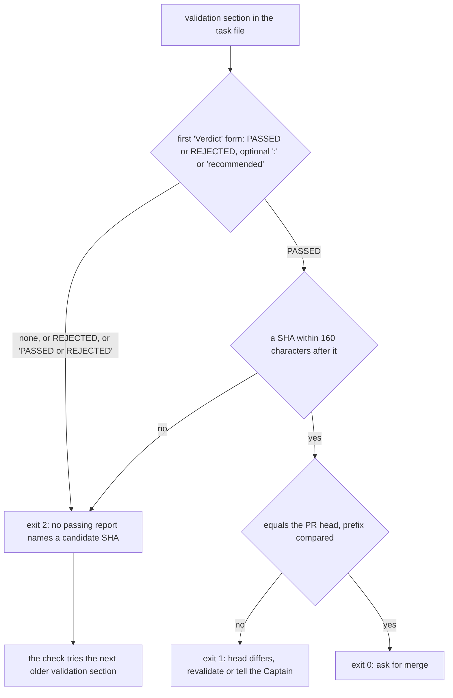

Filed on the Captain's 「開」 (2026-10-14), from a package issue the spacedock-dev/subspace-relay FO reported: on relay task `owner-sees-all-feedback-page` (PR spacedock-dev/subspace-relay#368) the validator wrote `Verdict: PASSED, recommended. Artifact: candidate 985200258…`, and `delivery_gate.py check` exited 2 ("no passing validation report … names a candidate SHA"); the relay FO sent the validator back for a one-line report repair (relay state commits 387b786 and 940921b). On this workflow's task `fo-lifecycle-mod` a validator also wrote a "Verdict recommended: PASSED" form.

## Scope

- Confirmed 2026-10-14 on origin/main: `PASSED = re.compile(r"Verdict PASSED[\s\S]{0,160}?" + SHA)` in `kc-dev-flow-2/scripts/delivery_gate.py`; the docstring says only "`Verdict PASSED` within 160 characters". Nothing in the validation skill or stage text states that exact line.
- Every merge ask runs this check, so each new validator wording holds a delivery.
- Candidate fixes: accept a tolerant verdict form (for example `Verdict:? (recommended:? )?PASSED`, case-insensitive), or state one exact verdict line in the validation stage contract and check it there; which, and whether the checker or the contract owns it, is for ideation. Related: `dev2-laws-check`.
- Non-goals: set in `## Design` under Limits.

## Acceptance criteria

`<package>` is the kc-dev-flow-2 package root; paths are relative to `kc-dev-flow-2/` in `iamcxa/kc-claude-plugins`. Base is origin/main `c545b896` (package 0.22.1, #643 merged); every base observation below was made on it on 2026-10-15. New tests go in `scripts/test_delivery_gate.py`, which CI already runs (`.github/workflows/kc-dev-flow-2-tests.yml`, step `test_delivery_gate.py`). "Section" is one `## Stage Report: validation` section; `S` is a 7 to 40 character hexadecimal SHA containing a digit.

**AC-1** The relay report that held now passes at the same head.
Verified by: a new test whose validation section carries the verdict line shape of relay task `owner-sees-all-feedback-page` as committed in `387b7863` (`Verdict: PASSED, recommended. Artifact: candidate <40 hex> (branch ..., base <7 hex>), unmodified`) and `--head` equal to that SHA exits 0 and prints `equals validated candidate`; the repaired shape of `940921b0` (`Verdict PASSED, recommended. Artifact: candidate ...`) exits 0 too. Replay on the real files: `git -C /Users/kent/conductor/repos/subspace-relay show 387b7863:owner-sees-all-feedback-page.md > /tmp/r.md` then `python3 <package>/scripts/delivery_gate.py check /tmp/r.md --pr o/r#1 --text-file <any file> --head 985200258eebc7aad832716fa8e4b8b57518921f`: base exits 2 with `no passing validation report ... names a candidate SHA` (observed), candidate exits 0 (observed on a prototype, see Design).
Falsifier: restore `Verdict PASSED[\s\S]{0,160}?` as the pattern; the `387b7863` case exits 2 and the test fails. Limit: the committed test holds the line shape with synthetic SHAs; the relay repository is read only on this machine.

**AC-2** Every accepted form is accepted, each with its own test line.
Verified by: a table-driven test, one subTest per line, each in a validation section and each exiting 0 against the SHA it names: `Verdict PASSED at S (base S2)`; `Verdict: PASSED, recommended. Artifact: candidate S`; `Verdict recommended: PASSED. No Material finding. Candidate S`; `Verdict recommendation: PASSED, with one finding. Candidate S`; `Verdict: recommend PASSED. Candidate S`; `**Verdict: PASSED.** Candidate HEAD S`. In the count (Design) the family covers 92 of 267 PASSED sections where base covers 34.
Falsifier: the base pattern accepts only the first line; the other five subTests fail on it.

**AC-3** Forms outside the accepted family still hold, each with its own test line, so the check never guesses a verdict from a bare word.
Verified by: subTests, each exiting 2 with `names a candidate SHA`: `PASSED. HEAD S, merge-base S2`; `Recommend PASSED. Candidate S`; `Independent verdict: PASSED. Candidate S` (lower-case `verdict`); `Verdict PASSED` followed by 161 characters then `S`; `Verdict PASSED with one finding` (no SHA); `Verdict PASSED or REJECTED naming head S` (a template line that names both outcomes is no verdict; the same line is a positive case in base `test_the_candidate_is_the_sha_after_the_verdict_within_160_characters`, so this test line changes deliberately and the change is named in the commit message). Observed on the prototype 2026-10-15: bare `PASSED.`, `Recommend PASSED.` exit 2.
Falsifier: add a line-start `PASSED` alternative to the pattern; the first two subTests fail. Limit: these are the leading forms of 132 of the 267 PASSED sections counted; they hold until the validator writes the contract line (AC-6).

**AC-8** Amended by Captain, amendment 1: the latest validation section that carries a counting Verdict form decides, and a latest REJECTED holds even when an older section PASSED.
Verified by: tests exiting 2 for `Verdict REJECTED at S1: one Material finding.`; that line followed by `Cycle 1 read Verdict PASSED at S2.` with `--head S2`; a section with no verdict word and no older section; a section carrying `Verdict PASSED at S` then a later `## Stage Report: validation (cycle 2)` section carrying `Verdict REJECTED at S` with `--head S` (the same head), exit 2; and several sections with a latest REJECTED above an older PASSED, exit 2. A latest section with no counting form is skipped and the next older section with one decides; a latest PASSED names its own SHA. Base test `test_the_latest_passing_report_names_the_candidate` pins an older candidate under a later REJECTED section and flips deliberately; the commit message names the change.
Falsifier: restore the fall-through (a REJECTED section returns no decision and the walk continues to older sections); the later-REJECTED cases exit 0 or 1 and the tests fail.

**AC-5** FO reads no more words at any lifecycle moment than on base.
Verified by: at validation, the word counts per moment as in the learning "Measure the words FO reads at each moment": startup, idle on an open PR, idle on a merged PR, after the archive and the merge ask each take the same passages and script output at base and candidate. Candidate changes no file FO reads: `python3 <package>/scripts/lint-skills.py` prints `references/sd/workflow.md: 5511 of 5511 words` (observed on the prototype), the mod and the adopted README are untouched, and `delivery_gate.py check` prints byte-identical output on base and candidate for the three base test reports that carry no new form (exit 0, 1 and 2 cases of `test_each_exit_ends_with_the_next_line_for_the_ask`, which passes unmodified).
Falsifier: put the line in `references/sd/workflow.md`; lint-skills.py reports a word count above 5511 and the byte comparison of FO's reading fails. Limit: counts text and script output, not a measured FO session.

**AC-6** The validation contract states the one line, where the validator reads it and no other reader does.
Verified by: `skills/validation/principles.md` carries one sentence naming `Verdict PASSED at <sha>` and `Verdict REJECTED at <sha>` (prototype: 617 to 657 words in that file, 5511 words unchanged in workflow.md); a new entry in `scripts/test_sd_dispatch.py` for it, in the form of the existing `dispatch-records-check` entry (`need` string plus a `swaps` mutation that deletes the sentence and makes the test fail); `lint-skills.py` and `test_lint_skills.py` exit 0 (observed on the prototype 2026-10-15). `grep -c 'Verdict PASSED' references/sd/workflow.md` prints 0 at base and at candidate.
Falsifier: delete the sentence; the `swaps` mutation in the new entry fails.

**AC-7** A validator that has only the contract writes the line, and the check accepts it. Not yet verified.
Verified by (at validation, once): a fresh worker is given only the candidate `skills/validation/principles.md` and a finished fixture task (candidate commit `S`, one passing and one failing check) and asked for its `## Stage Report: validation`; `delivery_gate.py check` exits 0 on its report with `--head S`. The same prompt with base `principles.md` is the control, and its verdict line form is recorded.
Falsifier: the worker writes a form the check holds (exit 2); then the wording of the sentence is repaired and AC-7 is rerun. Limit: one worker and one control is a sample, not a rate; the rate is observed on the first adopter validation after release.

## Design

### Chain check (read 2026-10-15)

- **Spacedock** 0.27.2: the stage report has no verdict field. `spacedock status --help` lists `verdict` only as the task frontmatter value `merge guard <slug> --verdict passed|rejected` writes, which FO passes in; nothing parses a validator's report for a candidate. Nothing to reuse.
- **kc-dev-flow-2** at origin/main `c545b896`: the only parser is `PASSED` in `scripts/delivery_gate.py` (`git grep -n 'Verdict PASSED' origin/main`: that script, its docstring and its test, nothing in `skills/`, `references/` or the mod). `references/sd/workflow.md` says validators "recommend `PASSED` or `REJECTED`" and `skills/validation/principles.md` says "Report verdict, artifact identity, evidence and material limits"; neither gives a line shape. So the checker's form is a rule no one told validators.
- **kc-dev-flow** (v1): its references use `spacedock merge guard --verdict`; no report-verdict parser to borrow.
- **Sibling adopters**: relay, qnow and ss-web validators wrote their own forms (count below); none carries a parser. ADR 0014 D2 (strict equality, hold on a head that differs) is untouched: the head comparison stays as is. `git -C <state> grep -n 'Override:'` finds no gate override on this question.

### Existing-code capability check

Boundary: `delivery_gate.py check` reading the validation report. It works for the one form it names (completeness: working code, no consumer for a contract line because none exists). The observation that justifies a change: relay#368's validator held at exit 2 and relay's FO sent it back for a one-line repair (`387b7863` to `940921b0`, one character: `Verdict:` became `Verdict`); the count below shows that form is the common case, not the exception. The change repairs the existing script and adds the missing contract sentence; it adds no new mechanism.

### What the validators wrote (count, read only, 2026-10-15)

Method: every file under `~/conductor/repos` and `~/conductor/workspaces` that has a `## Stage Report: validation` heading and `variant: kc-dev-flow-2` in its frontmatter, one copy per (repository, task file name), the largest copy kept (a state checkout appears under several worktrees). That is 141 tasks (relay 52, qnow 46, this workflow 35, subspace-v0 5, subspace-web 3) and 353 distinct validation sections, 267 of them whose first verdict-bearing line says PASSED. The scripts are machine-local (`/tmp/count3.py`, `/tmp/eval3.py`) and are not committed: the committed test carries one fixture line per form instead. Classification is by the first line of a section holding PASSED or REJECTED that is not a diff reference or the checklist echo; it is approximate (29 sections hold neither word, and one section, relay `remote-comment-include`, has `Verdict PASSED <sha>` but no decision by this rule), so read the counts as within a few sections. `delivery_gate.py` landed 2026-10-13 (#640): these counts measure how validators write when nothing tells them, not how many deliveries were held. One held delivery is known (relay#368).



| Form of the first verdict line in the 267 PASSED sections | Sections | Base accepts | Candidate accepts |
| --- | --- | --- | --- |
| bare `PASSED.` or `PASSED at S` (no word `Verdict`) | 90 | 1 | 12 |
| `Recommend PASSED` / `Recommendation: PASSED` | 55 | 0 | 1 |
| `Verdict: PASSED` (and `Independent verdict: PASSED`) | 49 | 0 | 36 |
| `Verdict PASSED` | 42 | 33 | 33 |
| `Verdict recommended: PASSED` / `Verdict recommendation:` / `Verdict: recommend` | 22 | 0 | 9 |
| other | 9 | 0 | 1 |
| all 267 | 267 | 34 | 92 |

A section in the first two rows is accepted only when a `Verdict` line with a SHA in range appears later in it. The `Verdict` rows are not accepted in full because the SHA sits beyond 160 characters or is absent (the lower-case `Independent verdict:` spelling is also held).

Per task (126 tasks with a PASSED section): the check finds a candidate on 17 at base and 50 at the candidate. Of the 57 REJECTED sections, base and candidate both accept none. The candidate still holds 175 PASSED sections: 132 whose first verdict line is a bare `PASSED` or `Recommend PASSED`, and 43 in the other rows.

### PRFAQ

**Press release.** The merge ask no longer depends on how a validator happens to spell its verdict. The validation skill now states one line, `Verdict PASSED at <sha>` or `Verdict REJECTED at <sha>`, and `delivery_gate.py check` reads that line, plus the three near spellings validators have already written (`Verdict: PASSED`, `Verdict recommended: PASSED`, `Verdict: recommend PASSED`). A report that says REJECTED, or that quotes an earlier PASSED after saying REJECTED, holds the ask.

**FAQ.**
- *Why both a contract line and a wider check?* The contract line carries the weight: 132 of 267 PASSED sections lead with a bare `PASSED` or `Recommend PASSED`, and 43 more place the SHA beyond 160 characters or omit it, so no spelling tolerance reaches them. The wider check covers validators that read an older package, and the three spellings the two reported holds used. Without the check, the next `Verdict: PASSED` holds a delivery until the validator is sent back; without the contract, 175 of 267 (65%) stay held.
- *Why not accept a bare `PASSED.`?* Recheck reports quote earlier verdicts (`against PASSED <sha>`, `PASSED baseline`), so a line-start `PASSED` would accept a SHA that is not the candidate. Base already has this fault on the `Verdict PASSED` spelling: a REJECTED report that quotes an earlier `Verdict PASSED at S2` is accepted today (AC-4). The first `Verdict` form decides.
- *Why keep the 160-character window?* `SHA` accepts any 7 to 40 hex run with a digit (`20261015` is one), so a wider window raises the chance of picking a date or a base. The contract puts the SHA on the verdict line instead.
- *Why is `Verdict PASSED or REJECTED naming head S` now a hold?* A line naming both outcomes is a template, not a verdict. Base test `test_the_candidate_is_the_sha_after_the_verdict_within_160_characters` pins it as accepted; it changes on purpose (AC-3).
- *Where does the sentence live?* `skills/validation/principles.md`, which the validator reads and FO does not. FO's `workflow.md`, the mod and the gate's output carry no new word, so no lifecycle moment reads more than at base (AC-5, learning "Measure the words FO reads at each moment"). The workflow word budget stays 5511. The validator also gets the stage definition `show-stage-def` prints, which is `workflow.md`'s `validation` section and is unchanged; the sentence reaches it through the skill, whose `SKILL.md` links `principles.md`.
- *What reaches adopters?* A package release (`fix(kc-dev-flow-2): ...`); the sentence and the check are package-internal, so there is no adopter file to sync. Adopters whose validators run an older package keep writing their own forms until their pin moves.

### Change, in files

Expected to change: `kc-dev-flow-2/scripts/delivery_gate.py` (the `PASSED` pattern becomes a `VERDICT` pattern plus a `CANDIDATE` window; asterisks are removed from the section before matching; the first verdict form decides; the docstring names the accepted family and the contract line), `kc-dev-flow-2/scripts/test_delivery_gate.py` (AC-1 to AC-4), `kc-dev-flow-2/skills/validation/principles.md` (one sentence, about 40 words), `kc-dev-flow-2/scripts/test_sd_dispatch.py` (one entry for it). Not changed: `references/sd/workflow.md`, the mod, `scripts/lint-skills.py` budgets. Prototype of exactly this on a temporary copy of origin/main (not a repository file): `test_lint_skills.py` and `lint-skills.py` pass; `test_delivery_gate.py` passes except the deliberate case above. `pr-watch-state-per-session` expects `pr_watch.py` and `test_pr_watch.py`; I name no file both change (its design names `scripts/lint-skills.py` word budgets as the only spot both could reach; this change adds no FO-read text).

### Limits

- Counts come from validation reports written before the contract; they say nothing about the rate at which a validator follows the new sentence (AC-7 samples it once; the rate is read on the first adopter validation after release).
- The check still reads one SHA near the first `Verdict` form; two verdict forms in one section (one REJECTED then PASSED, or the reverse) are decided by the first.
- The hold line (`no passing validation report ... names a candidate SHA`) is unchanged: a REJECTED report and a report in an unaccepted form print the same line. A line telling FO which one it is would add FO-read words at the failing merge-ask moment (9 words measured on a draft: 10 to 19 on that line); it is left out until a hold shows FO misreading it.
- Non-goals: accepting bare `PASSED.` or `Recommend PASSED`; widening the 160-character window; making `lint-skills.py` or a hook parse validation reports; changing how `merge guard --verdict` is passed; any adopter file.

### Unresolved decisions for the Captain

- **D1: contract line plus a wider check (recommended), or the contract line only?** The two answers are coupled with D2, so they go together. Both: the wider check also saves deliveries whose validators run an older package, and covers the two forms that held relay and this workflow. What gets worse: two spellings of the verdict are accepted, so a future validator who writes a third spelling (`Verdict on candidate S: PASSED`) is held until the contract reaches it, and the accepted family has to be kept in the docstring. Contract only: one spelling, no regex growth; what gets worse: the next older-package `Verdict: PASSED` holds a delivery as relay#368 did, and the check finds a candidate for 17 of 126 tasks' history, against 50 with the wider check, until validators adopt the sentence.
- **D2: the check accepts only spellings that contain the word `Verdict` (recommended), or also a bare line-start `PASSED` and `Recommend PASSED`?** Only `Verdict`: no wrong SHA is taken from a quoted earlier verdict. What gets worse: the 132 PASSED sections that lead with a bare `PASSED` or `Recommend PASSED` (49%) stay held until the contract reaches their validators, and each hold costs one validator round trip, as at relay (`387b7863` then `940921b0`). Accepting them: fewer holds now; what gets worse: a recheck report quoting `PASSED <old sha>` could name the old SHA as the candidate and the head comparison (exit 1) becomes the only guard.


## Captain amendments

### Amendment 1 — 2026-10-15, chat
Captain: 「都按建議核准」 (chat, 2026-10-15)
Asked: 「#647 的 AC-4 要照哪種讀法？我建議最新一次的驗證結論為準。也就是說，同一個版本先通過、後來重驗否決時，檢查要擋下來。代價是要刻意反轉 main 上一個鎖住舊行為的測試。」
Supersedes: AC-4
Design: none
Superseded text:

    **AC-4** A REJECTED or not-passing report holds, including one that quotes an earlier PASSED.
    Verified by: tests exiting 2 for: `Verdict REJECTED at S1: one Material finding.`; the same line followed by `Cycle 1 read Verdict PASSED at S2.` with `--head S2`; a section with no verdict word; and, over several sections, a latest section that is REJECTED above an older PASSED one (the latest section that has a candidate still wins, as in base `test_the_latest_passing_report_names_the_candidate`). Base defect observed 2026-10-15: the second case exits 0 on base (`PR head 2222222b equals validated candidate 2222222b`), so base asks for merge on a REJECTED report. Over the 57 REJECTED sections in the count, base and candidate both accept 0.
    Falsifier: search the whole section for a PASSED line instead of deciding by the first `Verdict` form; the quoting case exits 0 and the test fails.

Replaced by AC-8.

## FO alignment

Alignment: not needed before ideation; the Captain approved filing it.
Release review: not needed: workflow maintenance, on no journey map.
Surfaces: none
Visible change: none

### Feedback Cycles

- Cycle 1 (FO, 2026-10-15): Codex review round 1 on #647 57d58532 (review:5526632675) left one P1, to fix (a P1 blocks in every round); investigation first, then FO fix authorization, then a fresh validation recheck. The validation of 57d58532 dispatched before this finding continues; its judgement of the AC-4 conflict joins the same repair.
  - P1 #647 `scripts/delivery_gate.py` (around line 26): the unanchored `\bVerdict` match accepts a qualified label such as `Independent Verdict: PASSED` or `Prior Verdict: PASSED` as the section's verdict, so a quoted or prior verdict before the real rejection can return success; the new test passes only because it uses lowercase `verdict`.
- Cycle 1, validation (FO, 2026-10-15): validation recommended REJECTED at 57d58532 on one Material finding (F1, AC-7): a fresh validator wrote the stated line `Verdict PASSED at <sha>` exactly, but an earlier echoed checklist item `- DONE: Verdict PASSED or REJECTED naming the head` (FO's own checklist wording) is the first form, and a template line decides as a hold, so the report is held where base exits 0 (1 of 3 runs). The validator also showed AC-4's fall-through: a PASSED section then a later REJECTED section on the same head exits 0 on base and candidate. FO takes it to repair rather than defer, because AC-4 states that a latest REJECTED section above an older PASSED one exits 2. All three go to one repair: the Codex P1 anchor (reproduced by the worker), F1 (reproduced by the validator) and AC-4 (reproduced by the validator).

## Stage Report: ideation

- DONE: A design (PRFAQ and Mermaid) for which verdict lines kc-dev-flow-2/scripts/delivery_gate.py accepts on main (after #643): a tolerant pattern, or one exact verdict line stated in the validation stage contract and checked, or both; with a count of the verdict forms that occur in archived validation reports across this workflow and the adopters on this machine (read only), and what the validation skill or stage text must say
  Both: one contract line in skills/validation/principles.md plus a three-spelling check that lets the first Verdict form decide; count in `## Design`: 353 validation sections in 141 tasks (relay, qnow, this workflow, ss-v0, ss-web), the check finds 34 of 267 PASSED sections at base and 92 on a prototype; chain checked (Spacedock, kc-dev-flow-2, kc-dev-flow v1, adopters).
- DONE: Acceptance criteria with reproducible evidence clauses and falsifiers, replaying the relay report that held (Verdict: PASSED) and the forms found in the count, and showing a REJECTED or not-yet-passing report still holds
  AC-1 to AC-7 below; relay `387b7863` exits 2 at base and 0 on the prototype (observed), a REJECTED report quoting an earlier PASSED exits 0 at base and 2 on the prototype (observed).
- DONE: Unresolved decisions for the Captain, each with a recommendation and what gets worse under it
  D1 (contract plus wider check, or contract only) and D2 (accept only spellings with the word Verdict, or also bare PASSED), coupled, in `## Design`; ADR 0014 D2 and the `Override:` lines read, none contradicts.
- DONE: AC-1 relay report that held passes at the same head
  Current evidence: base exit 2 on `387b7863`, prototype exit 0 on `387b7863` and `940921b0`; not yet verified: the committed test (implementation).
- DONE: AC-2 every accepted form is accepted
  Current evidence: six lines run on the prototype, base accepts one; corpus 34 to 92 of 267; not yet verified: the committed subTest table.
- DONE: AC-3 forms outside the family still hold
  Current evidence: nine lines run on the prototype, the bare, Recommend, lower-case, 161-character, no-SHA and `PASSED or REJECTED` cases all print None; not yet verified: the committed table and the deliberate flip of the base test case.
- DONE: AC-4 REJECTED or not-passing report holds, including one quoting an earlier PASSED
  Current evidence: base exits 0 on the quoting case, prototype exits 2; 57 REJECTED corpus sections accepted by neither; not yet verified: the committed tests.
- DONE: AC-5 FO reads no more words at any moment than base
  Current evidence: prototype lint-skills.py prints 5511 of 5511 words, test_lint_skills.py 26 tests OK; not yet verified: the per-moment recount and the byte comparison of gate output (validation).
- DONE: AC-6 the validation contract states the one line where only the validator reads it
  Current evidence: prototype sentence passes lint-skills.py after the `<package>/scripts/` wording fix; not yet verified: the new test_sd_dispatch.py entry and its mutation.
- DONE: AC-7 a validator with only the contract writes the line
  Not yet verified: no fresh-worker run exists; it is planned once with a control at validation, and the rate is only observable after release.
- DONE: design_surfaces.py check
  `python3 <package>/scripts/design_surfaces.py check <task>` printed `delivery-gate-verdict-form.md: design surfaces presentable`, exit 0 (Surfaces: none).

### Summary

The check holds deliveries because nothing tells validators one verdict line: of 267 PASSED sections written unprompted, base finds a candidate in 34. The design states the line in the validation skill (validator-read, no FO-read words) and widens the check by three spellings with a first-verdict-decides rule, which also closes a base defect that accepts a REJECTED report quoting an earlier PASSED. Files expected: delivery_gate.py, test_delivery_gate.py, skills/validation/principles.md, test_sd_dispatch.py; none shared with pr-watch-state-per-session. The corpus scripts are machine-local and the classification is approximate (stated in Design); the prototype lived in /tmp, no repository file was written.

## Stage Report: implementation

- DONE: One Draft PR (fix(kc-dev-flow-2): ...) from a branch off origin/main changing delivery_gate.py, test_delivery_gate.py, skills/validation/principles.md and test_sd_dispatch.py, AC-1 to AC-6 green with each falsifier shown failing by a mutation run
  PR https://github.com/iamcxa/kc-claude-plugins/pull/647 (Draft), head 57d585326 on base c545b896; 4 files only. The worktree branch sat at 656543f4, so I fast-forwarded it to origin/main (0 own commits lost) before editing.
  AC-1 `test_the_relay_report_that_held_passes_at_the_same_head` fails if the base pattern is restored; real replay of relay `387b7863`: base exit 2, candidate exit 0.
  AC-2 `test_every_accepted_verdict_form_names_its_candidate` (8 lines incl. `**Verdict:** PASSED`) fails on the base pattern (5 lines) and with `*` not stripped (bold line).
  AC-3 `test_forms_outside_the_family_name_no_candidate` fails if a line-start `PASSED` alternative, a 400-character window, an accepted template, or newline-spanning `Verdict\n PASSED` is added.
  AC-4 `test_a_rejected_or_verdictless_report_holds_even_when_it_quotes_an_earlier_passed` and `test_two_rejected_sections_...` fail with a whole-section PASSED search.
  AC-5 lint-skills.py prints `references/sd/workflow.md: 5511 of 5511 words`; a line added to workflow.md gives FAIL 5518 > 5511; `test_each_exit_ends_with_the_next_line_for_the_ask` passes unmodified; `grep -c 'Verdict PASSED' references/sd/workflow.md` prints 0.
  AC-6 new `validation-states-the-verdict-line` entry in `test_sd_dispatch.py`; deleting the sentence fails its fixture check; test_lint_skills.py 26 OK.
- DONE: No word added to any FO-read file (workflow.md budget unchanged), roborev evidence= line, CI green on the PR head, CI cost measured or stated as not measured
  workflow.md untouched. roborev: `clean on 57d585326; evidence=roborev:685`. CI on the PR head: 4 checks pass (unit tests 50s, route gate 8s, version parity 40s, GitGuardian). CI cost not measured (job durations only; no new job).
- DONE: AC-7 left to validation
  Not run here, as assigned.
- DONE: comment_ratio.py, doc_impact.py, design_surfaces.py check
  `code lines 75, comment lines 0, 0.0%`, maximum met, exit 0. doc_impact listed `kc-dev-flow-2/README.md` and `references/sd/adoption.md`: both unaffected: they mention only the `test_sd_dispatch.py --sd-plugin-root` invocation, which is unchanged. design_surfaces: `presentable`. No ADR added.

### Summary

delivery_gate.py now reads the four Verdict spellings, ignores `*`, lets the first Verdict form decide and holds a REJECTED first form or one naming both outcomes; the validation skill states the one line. Two findings for FO: (1) the verdict regex uses `[ \t]` not `\s` between `Verdict` and the outcome, because the report format `- DONE: Verdict` then a next-line `PASSED. HEAD S` would otherwise match as a verdict; (2) AC-4 says a latest REJECTED section above an older PASSED one exits 2, but it also says the latest section with a candidate still wins as in base `test_the_latest_passing_report_names_the_candidate`, which keeps the older candidate (exit 0 or 1 by head); I kept the base behavior, tested the REJECTED-quote and two-REJECTED cases for exit 2, and listed the fall-through as a Limit in the PR. Test_sd_dispatch ran against a spacedock 0.27.0 plugin root (the 0.27.2 root CI pins is not on this machine) with the 0.27.2 binary; CI's live run passed.

## Stage Report: validation

- DONE: Independent verdict on #647 head 57d58532 against AC-1 to AC-6, re-running each evidence command and at least one falsifier per criterion yourself (the relay report that held, each accepted Verdict spelling, forms outside the family, a REJECTED or verdictless report quoting an earlier PASSED, the word budget, the pinned sentence), and judging the implementation's two choices: the [ \t] separator, and AC-4's conflict, where the latest section that names a candidate wins, so a later REJECTED section that names none falls through to an older PASSED one; say whether a REJECTED recheck on the same head as an older PASSED can reach exit 0, with a probe
  Verdict REJECTED at 57d585326cdeed2ae6ecd9e85f7439be84c73ecb (PR #647 head, open Draft, equals the dispatched head; base c545b896): AC-1 to AC-6 hold, AC-7 fails once in three runs on one Material finding below. Candidate and base were read from throwaway worktrees (removed).
  AC-1 `test_delivery_gate` 18 OK, `test_lint_skills` 26 OK, `test_sd_dispatch` (spacedock 0.27.2, `--sd-plugin-root` 0.27.0) PASS. Real relay replay: `387b7863` base exit 2, candidate exit 0; `940921b0` exit 0 on both. Mutation (scratch copy): restoring the base pattern fails 5 tests.
  AC-2 and AC-3 own probe of 36 lines on base and candidate: all six accepted spellings plus `Verdict recommended PASSED`, tab or double space, bold, backticks and `> ` quoting pass; lowercase `verdict`, `Independent verdict`, `Verdict - PASSED`, `| Verdict | PASSED |`, `Verdict is PASSED`, a 161-character gap and `PASSED or REJECTED` or `PASSED / REJECTED` hold. A clean mutation that adds a line-start `PASSED` alternative fails exactly the `PASSED.` and `Recommend PASSED.` subTests; window 400, dropped template guard and `\s` each fail their own test.
  AC-4 quoting case: base exit 0, candidate exit 2; whole-section PASSED search mutation fails 2 tests. AC-4 conflict, judged: keeping base behaviour is consistent with the base test `test_the_latest_passing_report_names_the_candidate`, which pins an older candidate under a later REJECTED section, but AC-4's own sentence that a latest REJECTED section above an older PASSED one exits 2 is not met: it exits 1 on a different head. Probe, same head: PASSED at `1111111a`, then a cycle 2 section `REJECTED at 1111111a`, `--head 1111111a` gives exit 0 on base and on candidate (script step 4). Deferred risk, see Findings.
  AC-5 `lint-skills.py` 5511 of 5511; `git diff --stat` over `references/`, README and the mod is empty and `diff -r` of `references/` is identical; `check` output is identical (exit and bytes) on the five cases of `test_each_exit_ends_with_the_next_line_for_the_ask`. AC-6 `grep -c 'Verdict PASSED' references/sd/workflow.md` 0 on both; deleting the sentence in a scratch package fails `test_sd_dispatch` naming `validation-states-the-verdict-line`; principles.md is 651 words (617 at base), the dispatch of this stage does not carry it to FO.
  `[ \t]` judged sound: replacing it with `\s` fails `test_forms_outside_the_family_name_no_candidate` and, on a re-count of 320 distinct validation sections on this machine (base finds a candidate in 34, candidate in 82, 48 gained, 1 lost), would accept 8 more sections that write a `### Verdict` heading followed by `PASSED.` on a new line; those stay held, as at base, and are outside the stated family. The one lost section is the template echo in `worker-completion-goes-to-main`, the deliberate flip. Not run: a measured FO session.
- DONE: AC-7: one fresh validator run on the package text of the candidate, writing a validation report for a small fixture, with its verdict line checked against the stated form, and one control run on the base text
  Fixture `/tmp/dgv-ac7/seed` (base `7bb5a9ed`, candidate `a63645f8`: `add()` plus a passing test, and `test_legacy` failing identically at base, out of scope). Launch, from inside each copy of the fixture: `claude -p "$(cat ../prompt.txt)" --model sonnet --output-format stream-json --verbose --setting-sources project --disable-slash-commands --strict-mcp-config --permission-mode bypassPermissions --no-session-persistence --max-budget-usd 2`; the stream init names `claude-sonnet-5-5`, 5 turns, about 1000 output tokens each; the only principles.md in reach is the candidate's (run `cand`) or base's (run `ctrl`); the user-level CLAUDE.md was not excluded (no API key for `--bare`). Streams and task copies are in `/tmp/dgv-ac7/`.
  Candidate run 1: the stream's Bash write carries `Verdict PASSED at a63645f886f8e208aa6d6ec41aa25534b619807e`, exactly the stated form, but `delivery_gate.py check --head a63645f8` on the candidate script exits 2 (`names a candidate SHA`); base script exit 0. Cause: the worker echoed my checklist item as `- DONE: Verdict PASSED or REJECTED naming the head, ...` (capital V, protocol says copy items verbatim) ahead of the line, and the candidate's first form is that template, which holds. AC-7 as written (exit 0) is therefore not met on this run.
  Same prompt again (`cand3`) exit 0 (the worker echoed it lower case); a checklist shaped like this dispatch's real items (`cand2`, verdict phrase mid-item) exit 0. So 1 of 3 candidate runs held: a sample, not a rate. Control `ctrl` (base principles.md): `Verdict: PASSED for head a63645f (base 7bb5a9e)`; base script exit 2, candidate script exit 0, so the control form is one the new check reads.
  Repair verified in a scratch copy only: decide by the first form that is not a template (`next((v for v in VERDICT.finditer(section) if not v.group(2)), None)` in place of `VERDICT.search`): 18 tests still OK and the run-1 report exits 0; the template-only line still holds.
- DONE: A minimal acceptance script the Captain can run (three to six steps, exact commands, expected output), run by you exactly as written in a fresh bash shell, with its observed output; /Users/kent/.claude/plugins/cache/kc-claude-plugins/kc-dev-flow-2/0.22.1/scripts/adr_lint.py docs/adr --since <base> with its exit code; verdict PASSED or REJECTED naming the head, with findings classified by the workflow's Review-finding disposition
  Script saved as `/tmp/dgv-accept.sh`, run as `env -i HOME=$HOME PATH=/usr/bin:/bin:/usr/local/bin:/opt/homebrew/bin bash --noprofile --norc /tmp/dgv-accept.sh`; it needs the colombo checkout (holds both commits), the read-only relay checkout and python3, no spacedock binary. Six steps, observed output:
```bash
A=/tmp/dgv-accept; R=/Users/kent/conductor/workspaces/kc-claude-plugins/colombo
G=kc-dev-flow-2/scripts/delivery_gate.py; H=985200258eebc7aad832716fa8e4b8b57518921f
run() { python3 -B $A/$1/$G check $2 --pr o/r#1 --text-file $A/text.txt --head $3; }

echo "--- 1 setup: base c545b896 and candidate 57d58532 extracted from $R (no spacedock binary used)"
rm -rf $A && mkdir -p $A/base $A/cand && echo gate > $A/text.txt
git -C $R archive c545b896 kc-dev-flow-2 | tar -x -C $A/base && git -C $R archive 57d58532 kc-dev-flow-2 | tar -x -C $A/cand && echo extracted

echo "--- 2 the relay report that held (subspace-relay commit 387b7863), same head"
git -C /Users/kent/conductor/repos/subspace-relay show 387b7863:owner-sees-all-feedback-page.md > $A/relay.md
for v in base cand; do run $v $A/relay.md $H | head -1 | cut -c1-110; echo "$v exit ${PIPESTATUS[0]}"; done

echo "--- 3 verdict forms: exit codes base/cand (head 0830a3be)"
for L in 'Verdict PASSED at 0830a3be' 'Verdict: PASSED, recommended. Candidate 0830a3be' 'Verdict recommended: PASSED. Candidate 0830a3be' 'Verdict: recommend PASSED. Candidate 0830a3be' '**Verdict: PASSED.** Candidate HEAD 0830a3be' 'PASSED. HEAD 0830a3be' 'Recommend PASSED. Candidate 0830a3be'; do
  printf '## Stage Report: validation\n\n- DONE: x\n  %s\n' "$L" > $A/t.md
  for v in base cand; do run $v $A/t.md 0830a3be >/dev/null; printf '%s ' "$v=$?"; done; echo " <- $L"
done

echo "--- 4 REJECTED reports: quoting an earlier PASSED (head 2222222b), then a REJECTED recheck on the same head as an older PASSED (head 1111111a)"
printf '## Stage Report: validation\n\n  Verdict REJECTED at 1111111a: one Material finding.\n  Cycle 1 read Verdict PASSED at 2222222b.\n' > $A/rej.md
for v in base cand; do run $v $A/rej.md 2222222b >/dev/null; printf '%s ' "quoting $v=$?"; done; echo
printf '## Stage Report: validation\n\n  Verdict PASSED at 1111111a\n\n## Stage Report: validation (cycle 2)\n\n  Verdict REJECTED at 1111111a: new Material finding.\n' > $A/rej2.md
for v in base cand; do run $v $A/rej2.md 1111111a >/dev/null; printf '%s ' "same-head-recheck $v=$?"; done; echo

echo "--- 5 a checklist item echoed verbatim ahead of the contract line (head a63645f8)"
printf '## Stage Report: validation\n\n- DONE: Verdict PASSED or REJECTED naming the head\n  Verdict PASSED at a63645f8\n' > $A/echo.md
for v in base cand; do run $v $A/echo.md a63645f8 >/dev/null; printf '%s ' "$v=$?"; done; echo

echo "--- 6 candidate unit suite, and no FO-read file differs from base"
(cd $A/cand/kc-dev-flow-2/scripts && python3 -B -m unittest test_delivery_gate 2>&1 | tail -3)
diff -r $A/base/kc-dev-flow-2/references $A/cand/kc-dev-flow-2/references && echo "references/ identical to base"
```
  Observed: step 2 base exit 2, cand exit 0 (equals validated candidate 985200258eeb...); step 3 `base=0 cand=0` for the first line, `base=2 cand=0` for lines 2 to 5, `base=2 cand=2` for the last two; step 4 `quoting base=0 quoting cand=2` and `same-head-recheck base=0 same-head-recheck cand=0`; step 5 `base=0 cand=2`; step 6 `Ran 18 tests ... OK` and `references/ identical to base`. Steps 4 (second line) and 5 are the two findings: after repair, step 5 should print `base=0 cand=0`.
  `python3 /Users/kent/.claude/plugins/cache/kc-claude-plugins/kc-dev-flow-2/0.22.1/scripts/adr_lint.py docs/adr --since c545b896` run in the candidate worktree: "15 ADR file(s) checked, 0 legacy", exit 0 (the candidate adds no ADR).
  `doc_impact.py c545b896 57d58532` exit 0 lists `kc-dev-flow-2/README.md` and `references/sd/adoption.md` (both mention `test_sd_dispatch.py`); the implementation report records each as `unaffected` with a reason, so each carries a disposition. `design_surfaces.py check` on this task: `design surfaces presentable`, exit 0. `number_guards.py` not owed (Surfaces: none, no ADR).
  Findings by Review-finding disposition. F1 Material: a report carrying the stated line `Verdict PASSED at <sha>` is held when an earlier echoed checklist item begins `Verdict PASSED or REJECTED`; fields: workflow = any validator following the protocol's verbatim-item rule on an FO checklist item that starts with the verdict phrase, then the merge ask; harm = exit 2 and a validator round trip, the harm this task exists to remove, base exit 0 on the same report; criterion = value-ac[AC-7] (and AC-2's intent); the design's own PRFAQ calls a line naming both outcomes "a template, not a verdict" and AC-3 holds it alone, yet the code lets that non-verdict be the deciding first form, so the code contradicts the stated design rule; observed trigger is thin (AC-7 run 1 only, and the real dispatch shape in `cand2` passed): trigger = AC-7 run 1 (`/tmp/dgv-ac7/cand/task.md`), and one real corpus section echoes the capital form (`worker-completion-goes-to-main`, held now, accepted at base only through the template line). Repair is the one line above plus a test line for template-then-real; return through feedback. F2 Deferred risk and Needs decision (which reading of AC-4 holds is the Captain's ruling): a REJECTED recheck on the same head as an older PASSED reaches exit 0 (as at base); no observed trigger (4 REJECTED-after-PASSED sections in the corpus, none on the same SHA); becomes Material when a same-head REJECTED is recorded and FO proceeds to the merge ask; AC-4's multi-section sentence contradicts its own parenthesis, which the Captain may want settled. F3 Polish: the principles.md sentence says a report without the line holds the merge ask, while the three near spellings also pass; and 8 real sections written as a `### Verdict` heading stay held.

### Summary

Verdict REJECTED at 57d585326cdeed2ae6ecd9e85f7439be84c73ecb. AC-1 to AC-6 hold with falsifiers shown failing, the word budget and gate output are unchanged, and the `[ \t]` choice is sound; AC-4's fall-through is base behaviour and a Deferred risk. AC-7 is the finding: a worker that wrote the stated line exactly was held once in three runs because the first-form rule meets a verbatim checklist echo; a one-line repair is verified in scratch and awaits the feedback route. Counts here (320 sections, 34 to 82) are an independent re-count and differ from the design's 267 to 92.

## Stage Report: implementation (cycle 3, repair under Captain amendment 1)

- DONE: Recovery first: the previous worker is unreachable; its two unpushed commits 747d0fc9 and 36ffa7a1 sit on the task branch in the existing worktree of PR iamcxa/kc-claude-plugins#647; check git status and git log, and keep them
  Worktree clean at start; 57d58532, 747d0fc9, 36ffa7a1 present and kept; pushed with the new commit, no force.
- DONE: Move AC-4 verbatim under Captain amendment 1 (task file) as Superseded text and write its replacement as a new AC id saying "Amended by Captain, amendment 1" ... commit the state
  AC-4 block now under `Superseded text:` in Amendment 1; replacement is AC-8; `design_surfaces.py check` exit 0 ("design surfaces presentable"); state commit d058fbfe.
- DONE: Build that rule in delivery_gate.py (walk sections from the latest; the first section with a counting form decides), flip the base test, add the same-head case, mutation shown red; re-run the corpus count
  43490668: `validated_candidate` returns the first section's `first_verdict` result (REJECTED holds, PASSED with no SHA holds, no counting form falls through). Flipped `test_the_latest_passing_report_names_the_candidate` and `test_two_rejected_sections_...` (older PASSED under later REJECTED now None / exit 2); added `test_a_later_rejected_section_holds_a_head_an_earlier_section_passed` (PASSED then cycle-2 REJECTED on 2222222b and prefix 2222222, exit 2) plus a verdictless-latest-falls-through and a latest-PASSED-without-SHA-holds case. Mutation (a REJECTED decision continues the walk): 4 tests fail (the three above), restored green.
  Corpus (141 tasks, read only, /tmp/corpus4.py, machine-local): candidate found 43 tasks with and without this commit; 2 tasks change from a candidate to a hold, both a later PASSED section with no SHA over an older PASSED with one (dev2 worker-completion-goes-to-main, cycles 2 and 3 'recheck at'; ss-web holder-panel-header-and-polish, cycle 2). No REJECTED-over-PASSED task appears in the corpus changed set. Per-section results are unchanged.
- DONE: Suite, mutations, the roborev gate, one push of all commits without force, CI green, stage report appended
  test_delivery_gate.py 22 OK; test_lint_skills.py 26 OK; test_sd_dispatch.py OK (local spacedock 0.27.0 root, CI pins 0.27.2); lint-skills 5511 of 5511 words; comment_ratio 0 of 126 code lines; doc_impact 0 documents. Roborev `clean on 434906685; evidence=roborev:688` (no fix rounds used). Pushed 57d58532..43490668; all four CI checks pass at 43490668 (unit tests, version parity, multi-profile route gate, GitGuardian).

### Summary

The latest validation section with a counting Verdict form now decides, so a later REJECTED holds even on the head an earlier section passed, per AC-8. The side effect to know: a latest PASSED section with no SHA in range now holds instead of falling back to an older PASSED SHA (2 of 141 corpus tasks). Not done here: AC-7's fresh-validator run belongs to validation; the PR stays Draft with no comments, ready or merge.
