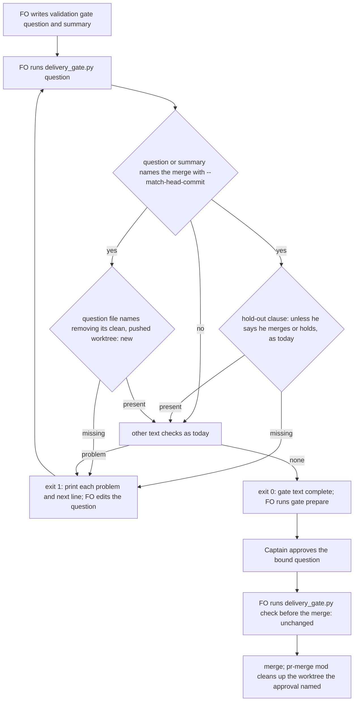

`delivery_gate.py question` holds a validation gate question that omits "removing its clean, pushed worktree", so an approval cannot be read as covering a cleanup it never named.

## Scope

- Source: the Captain 「開」 (chat, 2026-11-06), answering FO's batch 14 retrospective ask 「Should I open these two backlog tasks?」, whose second item was this check gap.
- Bite: the batch 14 merge questions for #786 and #787 omitted the clause; `delivery_gate.py question` and `check` both exited 0 on them; FO then removed both clean, pushed worktrees without that authority, and the extension-instruction-check-sees-every-listed-extension observer recorded it as a Delivery authority violation (observer.md, 2026-11-05).
- Upstream first: README Delivery authority ("removing its clean, pushed worktree"); `delivery_gate.py` question clause checks (`ASK_FORM` and the existing clause list).
- Non-goals: changing who may remove a worktree.

- Batch 15: the Captain 「可以」 (chat, 2026-11-06), answering 「第 15 批做這 2 張，可以嗎？其他 4 張要退休或擱置，我下一題再問你。」, which named this task.

## Budget
- One package PR; the workflow word budget does not rise.

## Stop condition
- Replays of the #786 and #787 questions are held by `delivery_gate.py question`; the #788 question, which carries the clause, passes.

## FO alignment

Alignment: not needed: the clause is already the README's rule; the check only reads it.
Surfaces: none
Visible change: none
Release review: not needed: workflow maintenance, on no journey map.

## Design

### PRFAQ

When FO writes a validation gate question that carries the merge, `delivery_gate.py question` now holds it unless the question itself says the approval also covers "removing its clean, pushed worktree". FO adds the six words before `gate prepare`, the Captain reads them in the question he approves, and his quoted answer then carries the cleanup FO performs after the merge. A question that does not carry the merge needs no clause, because it grants nothing.

- *Why the question file and not the summary?* The Captain's approval binds to the quoted question (ADR 0062). A clause only in the summary never reaches `answering 「…」`, so it grants nothing.
- *Why not hold in `check` too?* `check` runs after he answered. Holding there blocks a merge he did grant and cannot repair the approved text. See D1.
- *How often does it fire?* Of 68 merge-naming validation questions recorded in this state checkout, 24 lack the clause and would have been held (corpus run below).
- *Does it change who may remove a worktree?* No. The README rule is unchanged; the check only makes the question say what the rule needs.

### Flow

All problems print together, as today: the hold-out and the new clause are independent checks, and either one missing gives exit 1.

### Existing-code check (chain: Spacedock, kc-dev-flow-2, sibling adopters)

- Spacedock 0.27.3: `spacedock gate --help` lists prepare, withdraw, record, consume; none reads question text. The adopted `_mods/pr-merge.md` says "Clean up any worktree/branch" after a merge with no authority check, so the package is where the bound question is checked.
- kc-dev-flow-2 at origin/main b804d81d3 (released 0.35.0 differs: main adds `ASK_FORM`, `ASK_UNQUOTED`): the sibling mechanism exists. `GRANT` and `HOLD_OUT` with `grant_without_hold_out` hold a merge-naming question that lacks the hold-out clause, in `question()` only (`check` "does not judge that clause"). This design adds one pattern beside `HOLD_OUT` and one condition in `question()`. It adds no new mechanism.
- Adopters: `git ls-files | grep delivery_gate` returns 0 in subspace-relay, subspace-web and qnow (2026-11-06). All three run the package script, so they need no local copy changed.
- README Delivery authority (workflow.md, same section in this adoption): "merging the full head … unless he says he merges or holds, and removing its clean, pushed worktree." ADR 0023 D1: when the question names the merge and the removal, his approval answers both asks.

### Mechanism

1. A `WORKTREE_REMOVAL` pattern next to `HOLD_OUT`: `remove`, `removes` or `removing`, then `clean`, `pushed` and `worktree(s)`, in that order, in one sentence (no `.`, `;` or line break between them), case-insensitive.
2. `question()` keeps the `--text-file` contents as the question text before it appends `--summary-file`. When the combined text matches `GRANT` (as the hold-out check does) and the question text does not match `WORKTREE_REMOVAL`, it adds the problem `the gate text names the merge with --match-head-commit but its question does not name removing its clean, pushed worktree` and `next: hold the gate; add 'and removing its clean, pushed worktree' to the question, then run this check again.`
3. The docstring `question` paragraph gains one sentence for the clause. "`check` does not judge that clause" becomes "either clause".
4. Tests in `test_delivery_gate.py`: the `MERGE_ASK` fixture gains the clause. New `QuestionTests` cases cover the three recorded questions, the summary-only clause, wording variants and a mutation. The `check` no-judge test extends to this clause.

Prototype, not the deliverable: `delivery-question-requires-worktree-clause/ideation/prototype.diff` in the state checkout. It adds 7 lines to `delivery_gate.py` and changes no tests. Reproduce: `git archive origin/main kc-dev-flow-2/scripts | tar -x -C <dir>`, copy it to a second dir and `patch -p1` the diff there, then run `ideation/replay_question.py <dir> <state checkout>` for each.

### Measured (2026-11-06, origin/main b804d81d3, state 846c4202b)

| Run | origin/main | prototype |
| --- | --- | --- |
| `replay_question.py`: the three recorded batch 14 questions through `question` (test fixture task, clauses and Captain steps; the question string verbatim from `_archive/<task>/review/validation/briefing-N/index.json`) | #786 exit 0, #787 exit 0, #788 exit 0 | #786 exit 1, #787 exit 1, #788 exit 0 |
| `text_problems(at_gate=True)` on recorded question + summary | no problem for all three | (unchanged function) |
| `corpus_validation_questions.py`: every `review/validation/briefing-*/index.json` here | — | 68 name the merge: 44 carry the clause; 24 lack it and are held. 22 of the 24 never mention a worktree. 2 (`adr-protected-path-guard`, `kc-adr-format-source`) say "remove the candidate worktree" without "clean, pushed" (D2) |
| `python3 -B -m unittest test_delivery_gate` in the `git archive` extraction | 157 run, 7 errors | same 7 errors, plus 1 failure with 3 subtests: `test_both_wordings_in_use_and_a_question_that_names_no_merge_pass`, whose `MERGE_ASK` fixture names the merge without the clause (the intended hold; the fixture gains the clause) |

The 7 errors are from the extraction, not from the change: those tests read `kc-dev-flow-2/extensions/copilot/copilot_review.py`, which the scripts-only archive lacks. Why the full `question` command is not replayed on the archived tasks themselves: their Captain-steps records name absolute pre-archive paths, so all three, #788 included, exit 1 on `Captain steps record fails` for reasons that have nothing to do with the clause. The replay therefore feeds the recorded question string into the suite's `question` fixture.

### Words FO reads at each moment, before and after

| Moment | What FO reads | Before | After |
| --- | --- | --- | --- |
| Startup / README | workflow.md | unchanged | unchanged; `git diff origin/main -- kc-dev-flow-2/references/sd/workflow.md` empty, so the word budget does not rise |
| Before `gate prepare`, question passes | `question` output | claim-source line, `gate text complete`, `ASK_FORM` | byte-identical |
| Before `gate prepare`, merge named without the clause | `question` output | `gate text complete` (exit 0) | +1 problem line (19 words) and +1 `next:` line (19 words) (`wc -w`), exit 1 |
| Gate presentation (Captain reads) | the bound question | as FO wrote it | +6 words ("and removing its clean, pushed worktree") where FO used to omit it |
| Merge ask | `check` output | unchanged | unchanged (D1 recommendation) |
| After merge | `_mods/pr-merge.md` cleanup | unchanged | unchanged (Spacedock-owned) |
| `--help` only | module docstring | — | one more sentence of about 20 words in the `question` paragraph |

### Known limits

- Presence only: "not removing its clean, pushed worktree" passes, like every other clause check in this script.
- The clause must be in English. A question written only in Chinese is held until FO adds the English clause, which is the practice ADR 0062's ruling already uses (the 「核准也涵蓋…」 sentence goes in the question).
- The check does not prove the worktree is clean and pushed when FO removes it. That stays FO's step under the README.

### Past rulings read

ADR 0023 (the question may carry the merge and the worktree removal) is what this enforces. ADR 0062: the approval grants what its quoted question says, so the question file is what this check reads. ADR 0027 D4 rejected a word-matching check for prose quality ("matching words cannot stop that class of error"). It does not cover this case: this is a required grant clause in a known slot, the same class as the existing `HOLD_OUT` check, and the Captain opened this task naming the check (「開」). `git -C <state> grep -n 'Override:'` finds no override on a merge-question clause check.

## Acceptance criteria

**AC-1** `delivery_gate.py question` holds the recorded #786 and #787 questions and passes the #788 question. Verified by: a new `QuestionTests` case feeds the three question strings verbatim (from the briefings named above, state 846c4202b) through the suite's `question` fixture: #786 and #787 exit 1 with the new problem line, and #788 exits 0 with `gate text complete`. Also `ideation/replay_question.py <candidate package> <state>` prints exit 1, 1, 0 against origin/main's 0, 0, 0. Falsifier: deleting the new condition in `question()` makes #786 and #787 exit 0.

**AC-2** The clause is read from the question file only, and only a merge-naming text owes it. Verified by: (a) the #786 question with the clause only in `--summary-file` exits 1; (b) a question that does not match `--match-head-commit` and has no clause exits 0; (c) the #786 question with the clause appended exits 0. Falsifier: matching `WORKTREE_REMOVAL` against the combined text makes (a) exit 0.

**AC-3** The README wording passes in its usual forms, and a sentence that does not grant the removal is held. Verified by: "and removing its clean, pushed worktree", "and remove the clean, pushed worktree" and an upper-case variant exit 0. "and keeping its clean, pushed worktree", "remove the candidate worktree" (per D2) and a clause split by a full stop exit 1. Falsifier: a mutation test that reduces the pattern to `worktree` makes the "keeping" case exit 0.

**AC-4** `check` is unchanged (D1). Verified by: the existing `test_the_merge_time_check_does_not_judge_the_hold_out_clause` extends to a merge-naming text without the worktree clause: `run_check` output has no worktree problem. A `check` run on the #786 question text prints the same lines and exit code as origin/main's script. Falsifier: running the new condition inside `text_problems` without an `at_gate` guard makes `check` print the worktree problem.

**AC-5** Nothing new for FO to read on the passing path, and the workflow word budget holds. Verified by: the `question` exact-output tests (`test_legacy_combined_text_still_accepts_no_round_count`, `test_both_wordings_in_use_and_a_question_that_names_no_merge_pass` with the clause in `MERGE_ASK`) pass byte-for-byte. `git diff origin/main -- kc-dev-flow-2/references/sd/workflow.md` is empty. `python3 kc-dev-flow-2/scripts/lint-skills.py`, the package test suite and `scripts/version-parity-check.sh` pass. Falsifier: printing an extra line on pass changes the exact-output tests.

## Unresolved decisions for the Captain

**D1. Should the merge-time `check` also act on a missing worktree clause?** Recommend no change. With this task, every merge-granting question that passes `question` carries the clause, and no recorded case shows FO skipping `question`. Worse under it: a question prepared without running `question` still reaches the merge with no warning, and the observer finds it after the archive. No live case today: the one task here at validation with a Captain record, adr-required-statement, has a bound question that does not name the merge (decision `hold`). Alternatives: (b) `check` prints one advisory `next:` line before `ASK` when the effective approval's quoted question named the merge without the clause: "keep the worktree after the merge". About 20 words, only when it fires, and one more branch beside the `ASK_UNQUOTED` logic. (c) `check` holds. Not recommended: it blocks a merge he granted and cannot fix the approved text.

**D2. Must the clause say "clean, pushed", or is any "remove … worktree" enough?** Recommend requiring "clean" and "pushed", as the README words it. Those words limit the grant to a worktree with nothing to lose. Worse under it: 2 past questions that did grant a removal ("remove the candidate worktree") would have been held, and FO must use the README wording. Alternative: accept `remov…worktree` in one sentence. That passes those 2, but a question could then grant removal of a dirty worktree.

### Batch overlap

Files this design changes: `kc-dev-flow-2/scripts/delivery_gate.py` (`WORKTREE_REMOVAL` beside `HOLD_OUT`, `question()`, the docstring's `question` paragraph and its "`check` does not judge" sentence) and `kc-dev-flow-2/scripts/test_delivery_gate.py` (`MERGE_ASK`, `QuestionTests`). No workflow.md, ADR, ADR number or budget change.

| Task (state) | Same file, check or record? | Order |
| --- | --- | --- |
| merge-guard-stops-unasked-merges (batch 15, ideation) | No: a pre-tool hook on `gh pr merge` reading `merge/ask-N.json`; 0 `delivery_gate` hits in its file. This design leaves `ask-N.json` and `check` alone | independent |
| comment-check-reaches-delivery-gate (ideation) | Yes, both files: it changes `check()`, `write_record` and the docstring's `check` paragraph; this changes `question()` and the `question` paragraph | either order; textual conflicts only in the docstring and the test file's end |
| fo-write-checks-parse-top-level (ideation) | Yes, both files: `DECLINE_END`, `declined_items`, a docstring sentence on item runs | either order; same kind of textual conflict |
| captain-ruling-sources-checked (held) | No: `design_surfaces.py`, peers `EXTENSION.md`, `adoption.md`; it only runs `delivery_gate` tests as measurement | none |
| adoption-asks-which-extensions (ideation) | No: `dispatch_records.py`, `number_guards.py`; its table says `delivery_gate.py` unchanged | none |
| archive-waits-for-observer-report (implementation) | No `delivery_gate` change named | none |
| adr-silent-undo-probe, dispatch-carries-reserved-adr-number, journey-canvas-hosted-poc, picky-reviewers-may-run-on-gemini, seed-check-requires-alignment-result, ops-inbox-r1-setup-and-isolation, pr-review-lite-value-pilot, adr-required-statement | 0 `delivery_gate` hits in each task file (grep, 2026-11-06); none touches the two files | none |
| journey-server-host-pilot (folder task `journey-server-host-pilot/index.md`, validation) | No: 0 `delivery_gate` hits in `index.md` (grep, 2026-11-06); it runs the package script as a consumer | none |

Recommended order: this task first among the three `delivery_gate.py` editors. It is the smallest (7 lines in the prototype), it touches only `question()`, and the other two then rebase over a docstring sentence and the test file's end.

## Stage Report: ideation

- DONE: Design the hold in /Users/kent/.claude/plugins/cache/kc-claude-plugins/kc-dev-flow-2/0.35.0/scripts/delivery_gate.py question (and check) for a validation question that omits the README's worktree-removal clause, with replays of the #786 and #787 questions held and the #788 question passing
  `## Design` Mechanism: `WORKTREE_REMOVAL` beside `HOLD_OUT`, read from the question file only in `question()`. `check` is unchanged (D1). The prototype (`ideation/prototype.diff`, against origin/main b804d81d3) replays #786/#787/#788 as exit 1/1/0, where origin/main gives 0/0/0.
- DONE: A `### Batch overlap` section naming each file the design would change and each other batch task (merge-guard-stops-unasked-merges) and live task of other sessions (adoption-asks-which-extensions, adr-silent-undo-probe, captain-ruling-sources-checked (held), comment-check-reaches-delivery-gate, dispatch-carries-reserved-adr-number, fo-write-checks-parse-top-level, journey-canvas-hosted-poc, picky-reviewers-may-run-on-gemini, seed-check-requires-alignment-result, archive-waits-for-observer-report, ops-inbox-r1-setup-and-isolation, pr-review-lite-value-pilot, adr-required-statement, journey-server-host-pilot (stalled, held or driven by other sessions; read only)) that changes the same file or check, so FO can order implementation
  Two files share edits: comment-check-reaches-delivery-gate and fo-write-checks-parse-top-level both change `delivery_gate.py` and its tests. Recommended order: this task first. journey-server-host-pilot (a folder task, validation) has 0 `delivery_gate` hits.
- DONE: The words FO reads at each lifecycle moment, before and after, per root learning.md "Measure the words FO reads at each moment, not one file's size"
  `### Words FO reads…` table. The passing path and workflow.md are unchanged. A hold adds 19+19 words (`wc -w`). The Captain's question gains 6 words where FO used to omit them.
- DONE: Acceptance criteria with reproducible evidence clauses and falsifiers, and unresolved decisions for the Captain, each with a recommendation and what gets worse under it
  AC-1..AC-5 each carry a verification and a falsifier. D1 (`check` action: no change recommended) and D2 (require "clean, pushed": recommended) each say what gets worse.
- DONE: AC-1 recorded questions: prototype replay exit 1/1/0 vs origin/main 0/0/0 (`replay_question.py`, 2026-11-06); the durable test is not yet written (implementation).
- DONE: AC-2 question file only: not yet verified; prototype reads `question_text` before the summary is appended, no test run.
- DONE: AC-3 wording forms: not yet verified. The corpus run shows 44 of 68 recorded merge questions pass the pattern and 2 near-miss wordings are held (D2).
- DONE: AC-4 `check` unchanged: not yet verified; prototype edits only `question()`.
- DONE: AC-5 no new words on pass: not yet verified. In the prototype suite, `test_both_wordings_in_use_and_a_question_that_names_no_merge_pass` fails because its `MERGE_ASK` fixture lacks the clause. Implementation adds the clause to the fixture. The 7 other errors also appear on origin/main in the scripts-only extraction (missing `extensions/copilot`).
- DONE: `design_surfaces.py check` (0.35.0 and origin/main): "design surfaces presentable", exit 0.

### Summary

The design adds one pattern beside the existing hold-out check, so `delivery_gate.py question` holds a merge-naming question whose question file does not say "removing its clean, pushed worktree". Replayed on a /tmp prototype, #786 and #787 are held and #788 passes. Across 68 recorded merge questions, 24 would have been held. The Captain has two decisions: leave `check` unchanged (recommended), and require the README's "clean, pushed" wording (recommended; 2 past questions would have been held). No ADR is needed: this enforces ADR 0023's existing rule.
