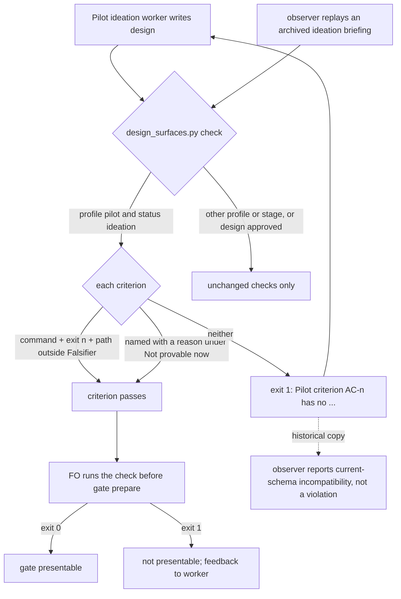

## Scope

- Source: the Captain 「先做一：把 Pilot 試作補完整，再做二：邊界合約先行」 (chat, 2026-11-13), answering FO's list of four directions, whose first read 「一、把 Pilot 試作補完整｜這版的兩條規則只靠文字：每條驗收條件要記齊、試作最多兩輪｜驗證時兩個測試 worker 一個漏記；顧問明說只有檢查程式擋得住｜兩張小任務，其中一張已在待辦」.
- Bite (validation of PR 864, 2026-11-13): the merged Pilot text asks an ideation worker to run each criterion's proof once and record command, exit and output path; one history-free test worker recorded them for 2 of its 3 criteria, a second for 4 of 4 after a one-sentence rewording, and the investigation could not decide from one run whether wording was the cause. The chief-engineer's read the same day: the requirement is prose only, the design check reads that criteria are declared and not that each carries the three fields, so completeness rests on the worker.
- Outcome: before the design gate, the existing design check refuses a Pilot design in which a criterion has neither a complete record (command, observed exit, retained output path) nor an entry under `Not provable now` naming that criterion and why.
- What exists: `design_surfaces.py check <task>`, run by FO before every ideation gate; the criterion form (bold `AC-N`, evidence clause, falsifier) and the `Not provable now` heading from ADR 0084.
- Open for the design: how a record is recognised without a new required syntax that old tasks fail; whether tasks approved before the change are exempt by date or by profile; what the check does for a criterion whose proof is a document reading and has no command.
- Non-goals: proving that a recorded command was really run or that its output is true; any change to POC or Prod; the round cap (task budget-form-counts-ideation-rounds-and-times-each-round carries it).

## Budget
1 implementation and 2 validation cycles, in one package PR.

## Stop condition
- A replay of the two test workers' designs from PR 864's validation is refused for the one with a missing record and passes the complete one, and no task approved before the change is refused. Return to the Captain if the check needs a new required line in every criterion.

## FO alignment

Alignment: not needed before ideation: his words admit the direction; the recognition rule is ruled at the design gate.
Surfaces: none
Visible change: none
Release review: not needed: workflow maintenance, on no journey map.

## Design

### PRFAQ

When a Pilot design reaches its gate, the existing design check now reads each criterion for its proof record. It refuses the design when a criterion carries neither a command, an observed exit and an output path, nor an entry under a `Not provable now` heading naming that criterion and why. The ideation worker already runs this check before reporting, and FO runs it before gate prepare, where a non-zero exit already means the gate is not presentable. A missing record therefore reaches the worker in its own dispatch instead of depending on the worker remembering. The rule applies only while a Pilot task is in ideation and its design has no approval at the ideation gate. Implementation and validation runs, POC and Prod tasks, and every design the Captain has approved are unaffected.

FAQ:
- *How is a record recognised without a new required line?* By three loose tokens inside the criterion's own block, read outside its Falsifier sentence: the word `command` or a code span; `exit <n>`; and a path-like token (a `/` or a file extension). No label, order or new line is required. The probe shows that in practice the separator is mostly the `exit <n>` token: the code-span alternative accepts a path in backticks as the "command", and the check cannot tell a reference such as "same runner with `AC-2`" from a command. A planned clause such as "`python3 t.py` must exit 0 and write `out.log`" passes too (probe case `known-limit-planned-clause-passes`). Replayed as ideation briefings, 12 of 408 old Pilot designs with criteria pass, which bounds how often that happens in practice. Proving a recorded command really ran stays a non-goal.
- *Why read outside the Falsifier?* A falsifier often names an exit and a file ("exits 1 … writes `x.log`"). Counting those would pass a criterion that records nothing observed. The probe case `run2-AC1-record-only-in-falsifier` is refused.
- *What counts as a `Not provable now` entry?* A line under a heading (levels 2 to 4) that reads `Not provable now`, naming the criterion id plus at least three other words. A bare id is refused. Inline prose such as "… are Not provable now" inside a criterion does not count.
- *What about a criterion whose proof is a document reading?* No special case. Record the command that printed the text (for example `git show <sha>:<path>`), its exit and the saved copy, or list the criterion under `Not provable now`. See Needs decision D2.
- *Are tasks approved before the change exempt?* Yes. The rule fires only on `profile: pilot` with `status: ideation`, and skips a task whose frontmatter records an `approve` resolution for its ideation gate. A design approved but not yet moved to implementation still reads `status: ideation`; 3 such adopter tasks would otherwise be refused. The approval is read with `decision_ledger.gate_entries`, which the check already imports. The observer is the one other reader. It replays the check on archived ideation briefing copies, which still say `status: ideation`, so the observer's existing current-schema sentence gains this refusal (below). Pilot designs in ideation today are not exempt. See Needs decision D1.

Changes, all in `kc-dev-flow-2/`:
- `scripts/design_surfaces.py`: `proof_gaps`, `unprovable_entries` and `design_approved`, called from `check_task` beside the Prod security check, gated on `("pilot", "ideation")` and no ideation approval. One docstring sentence. The probe's `PROBE_EXEMPT` switch is measurement scaffolding and is not carried over.
- `scripts/test_design_surfaces.py`: the 46 existing failures get a record in their Pilot-ideation fixture criteria (all trace to the new line, see AC-4). New tests: the two replays, the falsifier-only case, `Not provable now` with a reason and with a bare id, the inline phrase, the stage, profile and approval exemptions, and the planned-clause limit as a documented pass. Each guard has a mutation that removes it. `scripts/test_dispatch_stage.py`: `test_worth_requirement_uses_native_stage_for_yaml_status_values` builds a Pilot design in ideation whose criterion reads "Evidence: one CLI run." and expects exit 0, so its fixture gains a record (read from source; that test errors on base in this environment). `scripts/test_sd_dispatch.py`: `exercise_criteria_parity` (seed `criteria-parity`, ideation) checks that a lowercase heading with `**AC-1**: x` passes the real check; on the probe it fails with the new line, so its fixture criteria gain a record.
- `skills/observer/SKILL.md`: the sentence "For seed-field failures or `design needs '### Worth questions'` on historical copies, report current-schema incompatibility." also names "a `Pilot criterion` proof-record line" (15 → 20 words).
- Not changed: `references/sd/workflow.md` (no raise; it already says a non-zero exit is not presentable, and already names the three fields), `scripts/lint-skills.py`, `skills/ideation/principles.md`, `skills/ideation/profiles/pilot.md`, the ADRs. No ADR draft: this enforces ADR 0084's existing record rule and changes no ruling.

What it deletes or shortens: no text. What it removes is the reliance: the record no longer rests on the worker's reading of the workflow's 9-word phrase "recording command, exit and output path per criterion", because the check now enforces it. That phrase stays: the worker reads it before writing, and the check's line only arrives after.

Probe:
- Branch `poc/design-check-reads-each-pilot-criterion-for-its-proof-record`; base `6a1eaf837bd6087cd0b8b665dc19beaed3c44dff` (origin/main, PR 864); last commit `9f403d6f10f7a72d0336c480d206882d917617eb` (first probe commit `76df7fb`; the second adds the approval exemption and the corpus's briefing-copy proxy). Worktree `.worktrees/poc-design-check-reads-each-pilot-criterion-for-its-proof-record` removed after capture; branch kept; portable copy `evidence/ideation-1/probe.diff`.
- Riskiest hypothesis H1: text inside each criterion block separates the trial's one incomplete design from its complete one. Result: holds. The unmodified check passes both (exit 0, `base-run1.stdout.txt`, `base-run2.stdout.txt`). The probe refuses run 1 naming only AC-3 (no command, no exit) and passes run 2's four criteria. This agrees with the trial validator's own labels (6 complete, 1 incomplete).
- H2: the edge cases behave (record only in Falsifier refused; `Not provable now` with reason passes, bare id refused; inline phrase ignored; implementation status, `profile: poc` and an approved design still in ideation untouched; a planned clause passes, a known limit). Result: 10 of 10 cases as designed (`cases.json`). Prod is not exercised by a case; it is off by the same profile condition. Mutation: without the approval exemption, the approved-design case fails (`mutant-no-approval.stdout.txt`).
- H3: limiting the rule to Pilot + ideation refuses no approved task. Result: not by stage alone. In the first round, 3 adopter designs approved at their ideation gate but not yet moved still read `status: ideation` and were refused. With the approval exemption, live refusals are 11, 8, 1 and 3 across dev2 and three adopters, all unapproved designs now in ideation, and 0 archived or approved. It does not hold for the observer: replayed as ideation briefing copies (status forced to ideation, gate records removed, an approximation of the copy at its briefing sha), 155 of 236, 92 of 113, 82 of 98 and 67 of 137 Pilot tasks are refused. Hence the observer sentence. A `Probe:` marker left 2/3/1/1 refused. A `started:` date left 0/1/0/0, but it needs a release date constant and skips tasks with no `started:` field (`corpus.json`).
- H4: existing tests survive. Result: no, in two suites. `test_design_surfaces` goes from OK to 46 failures, all from Pilot-ideation fixtures whose criteria carry no record (43 print the new line, 3 assert exit 0; same 46 on `9f403d6`). `test_sd_dispatch` (full-tree extracts) goes from exit 0 on base to exit 1 on the probe, at its criteria-parity fixture. `test_dispatch_records` and `test_laws_check` stay OK. `lint-skills.py` exits 0 with 6099 of 6099 words. `test_dispatch_stage`, run from extracts of base and probe, exits 1 on both with the same 91 failures, none printing the new line. This environment cannot run that suite green, so the one test known from source to break (above) is masked there. A first comparison ran the probe in a git worktree and the base from an extract, and differed for that reason; it is superseded.
- Replay fixtures: run 1 is the trial's validation-1 subject design. Its archived copy has its seed lines omitted, so the replay prepends a minimal Pilot/ideation frontmatter and an FO alignment block. Run 2 is the validation-2 subject design, used as archived except that one adopter repository name in two Scope lines is replaced by `<adopter>` in the saved copy (cases re-run on it, exit 0). Adopter task files were read from each adopter's state branch into private scratch. Not archived (private): adopter task files; reproduce: `git -C <adopter> archive spacedock-state/dev2 | tar -x -C <dir>` then `python3 -B .probe/corpus.py <checker> <out.json> label=<dir>`.

### Worth questions

- Captain words served: 「這版的兩條規則只靠文字：每條驗收條件要記齊…顧問明說只有檢查程式擋得住」. This is the first of the two rules, moved from text to the check FO already runs.
- What breaks without each part: without the Falsifier exclusion, a criterion that records nothing observed passes (probe case). Without the stage gate, implementation and validation runs on old tasks are refused; without the approval exemption, 3 approved adopter designs are. Without the observer sentence, the observer reports a violation on 67–155 historical Pilot briefings per workflow. Without the fixture repairs, the package's own suite fails.
- The premise's cheap test: the replay. The trial's incomplete design is refused for the right criterion, and the complete one passes, on the unchanged trial text.

### Words FO reads at each lifecycle moment

| Moment | Reader | Before | After |
| --- | --- | --- | --- |
| FO startup and resume | `references/sd/workflow.md` | 6099 | 6099 |
| Pilot ideation dispatch (stage definition) | worker | unchanged | unchanged |
| Ideation worker before reporting | check output, clean design | 1 presentable line | same |
| Ideation worker or FO, incomplete design | check output | 1 presentable line | +1 line of 36 words per incomplete criterion; exit 1 |
| Before gate prepare | FO, check output | as above | as above |
| Implementation and validation check runs | check output | unchanged | unchanged (rule off past ideation) |
| Archive (observer replay) | `skills/observer/SKILL.md` | 1371 | 1376 |

### Not provable now

- AC-6 (observer sentence takes effect): the observer's report on a real archived Pilot task is an agent reading prose. It is observable only at the first archive after release.
- AC-5's `test_dispatch_stage` part: the suite exits 1 on unmodified origin/main here (the same 91 failures on base and probe extracts), so it cannot show the one test known from source to break, or prove that the repaired suite passes. It is owed by the implementation PR's CI run.

### Needs decision

- **D1. Pilot designs in ideation today are refused at their next check.** That is 23 tasks across four workflows (11 in dev2, 12 in three adopters), each owing records or `Not provable now` entries before its gate. Recommended: accept, and apply the rule to every Pilot design in ideation. What gets worse: each of those tasks may need one more ideation dispatch, which counts toward the third-dispatch hold. Alternative: exempt designs whose ideation started before the release, using a date constant in the script. That leaves a permanent date in code, and many of those tasks have no `started:` field, so they would be silently exempt.
- **D2. No special case for a document-reading criterion.** Recommended: record the command that printed the text, or list it under `Not provable now`. What gets worse: a pure reading criterion carries a command line that can feel ceremonial.

### Batch overlap

Files this design changes: `kc-dev-flow-2/scripts/design_surfaces.py`, `kc-dev-flow-2/skills/observer/SKILL.md`, and fixtures in `kc-dev-flow-2/scripts/test_design_surfaces.py`, `test_dispatch_stage.py` (one test) and `test_sd_dispatch.py` (one fixture). It changes no workflow text, lint budget step, ADR or ADR index.
- budget-form-counts-ideation-rounds-and-times-each-round (this batch, ideation): its Scope is the budget reader and the timeline helper. Its budget reader is in `dispatch_stage.py`, whose budget tests sit in `test_dispatch_stage.py` and `test_sd_dispatch.py`. Those are the two test files this design touches for one fixture each, so a textual conflict is possible there; no shared code file. The Captain was told both tasks might raise the workflow word budget, but this one raises nothing.
- merge-ask-is-produced-from-records, validator-commands-fit-the-delivery-check, ready-pr-gets-a-codex-code-review-without-fo-noticing, evidence-is-declared-public-before-state-publication, agent-messages-are-english, captain-question-outside-a-gate-is-an-open-record (backlog): none names these files. merge-ask names the observer as a reader only. agent-messages-are-english names `workflow.md`, which this design does not change.
- Other sessions' live tasks:
  - adoption-asks-which-extensions (ideation): states `skills/observer/SKILL.md` is not changed, and names `design_surfaces.py` only through a sibling's change.
  - adr-required-statement (validation): extends `adr_lint.py`; it names `design_surfaces.py` only as a check it ran.
  - adr-silent-undo-probe, journey-canvas-hosted-poc, ops-inbox-r1-setup-and-isolation: name `design_surfaces.py check` only as a check run.
  - comment-check-reaches-delivery-gate: changes `delivery_gate.py`.
  - pr-review-lite-value-pilot: no overlap.
  - journey-server-host-pilot: not in this workflow's state; not read.
  - Note: the open Pilot designs among these (comment-check-reaches-delivery-gate, adoption-asks-which-extensions, journey-canvas-hosted-poc) are among the D1 count. The probe refuses 6, 5 and 4 of their criteria.
- Recommended order: independent of the batch sibling in code. Whichever merges second rebases over the other's fixture edits in the two shared test files. If D1 is accepted, land after the open Pilot designs above reach their gates, or tell their FOs first.

## Acceptance criteria

**AC-1** — Replaying the trial's two designs, the check refuses the incomplete one naming only AC-3 and passes the complete one; the unmodified check passes both. Evidence command: `python3 -B .probe/cases.py kc-dev-flow-2/scripts/design_surfaces.py evidence/ideation-1/fixtures/run1.md evidence/ideation-1/fixtures/run2.md <out>` on probe commit `9f403d6`; exit 0; output `evidence/ideation-1/cases.json` (cases `run1-replay`, `run2-replay`), baseline `python3 -B <origin/main>/kc-dev-flow-2/scripts/design_surfaces.py check evidence/ideation-1/fixtures/runN.md` exit 0 both, `evidence/ideation-1/base-run1.stdout.txt` and `base-run2.stdout.txt`. Falsifier: dropping the `exit` field from the required set lets run 1 pass the probe's `run1-replay` case.

**AC-2** — A record found only in the Falsifier is refused; a `Not provable now` heading entry with a reason passes; a bare id under it is refused; inline "Not provable now" prose does not count. Evidence command: the AC-1 command; exit 0; output `evidence/ideation-1/cases.json` (cases `run2-AC1-record-only-in-falsifier`, `run2-AC2-exit-removed`, `run2-AC2-exit-removed-unprovable-with-reason`, `run2-AC2-exit-removed-unprovable-bare-id`). Falsifier: removing the Falsifier strip passes `run2-AC1-record-only-in-falsifier`; dropping the three-word reason test passes the bare-id case.

**AC-3** — No approved task is refused, and the rule is off outside Pilot ideation. Evidence command: `python3 -B .probe/corpus.py kc-dev-flow-2/scripts/design_surfaces.py <out.json> dev2=<state> adopter-N=<dir>` on probe commit `9f403d6`; exit 0; output `evidence/ideation-1/corpus.json`. Also the AC-1 command's `run1-replay-status-implementation`, `run1-replay-profile-poc` and `run1-replay-design-approved-status-still-ideation` cases, exit 0, `cases.json`. Prod is not exercised by a case. Falsifier: removing the `("pilot", "ideation")` condition refuses the implementation-status replay; removing the approval exemption refuses the approved-design case (`mutant-no-approval.stdout.txt`, exit 1).

**AC-4** — The package's design-check suites pass with the rule in place. Evidence command: `python3 -B -m unittest discover -s kc-dev-flow-2/scripts -p test_design_surfaces.py` on a full-tree extract of probe commit `9f403d6`; exit 1; output `evidence/ideation-1/r2-test_design_surfaces.log` (46 failures, all Pilot-ideation fixtures without records), against base exit 0, `evidence/ideation-1/base-test_design_surfaces.log`. And `python3 -B kc-dev-flow-2/scripts/test_sd_dispatch.py --sd-plugin-root <spacedock 0.27.3>` on full-tree extracts: base exit 0, probe exit 1 at the criteria-parity fixture, `evidence/ideation-1/base-full-test_sd_dispatch.log` and `probe-full-test_sd_dispatch.log`. Falsifier: implementation passes only after fixtures gain records; a mutation that removes the call in `check_task` must fail one of the new tests. Current evidence: fails on the probe as expected; the fixture repair is implementation work.

**AC-5** — The workflow word budget is unchanged and no other suite regresses. Evidence command: `python3 -B kc-dev-flow-2/scripts/lint-skills.py` on a full-tree extract of probe commit `9f403d6`; exit 0; output `evidence/ideation-1/r2-lint-skills.log` (6099 of 6099); `python3 -B -m unittest discover -s kc-dev-flow-2/scripts -p test_dispatch_records.py` and `-p test_laws_check.py`, exit 0 both, `evidence/ideation-1/r2-test_dispatch_records.log`, `r2-test_laws_check.log`; `-p test_dispatch_stage.py` exit 1 on both base and probe extracts with the same 91 failures, `evidence/ideation-1/base-extract-test_dispatch_stage.log` and `probe-extract-test_dispatch_stage.log`. Its green run is under `Not provable now`. Falsifier: any workflow text edit changes the lint count.

**AC-6** — The observer reports a proof-record refusal on a historical ideation briefing as current-schema incompatibility, not a violation. Evidence: listed under `Not provable now` with its reason. Falsifier: an observer report after release that calls a pre-release Pilot briefing's proof-record line a violation.

## Stage Report: ideation

- DONE: Run this ideation probe-first, as the text merged on origin/main by PR 864 (ADR 0084, not yet released) asks: before writing the design, build a throwaway probe of this task's outcome on the local branch poc/design-check-reads-each-pilot-criterion-for-its-proof-record from origin/main, run it on the real cases the task's Scope and Stop condition name, and save what it showed in the task folder; then write the design as what the probe showed and what it lacks. Under a Probe: line in the design record the branch, base and last commit and each hypothesis with its result; remove the probe worktree before reporting and keep the branch. Every criterion's evidence command runs once on it, recording command, exit and output path per criterion, provenance included; what cannot run goes under Not provable now with the criterion named. Design against origin/main, which already carries PR 864. State what the change deletes or shortens with word counts; if the workflow text must grow past its lint budget, name the raise for the Captain as an unresolved decision instead of assuming it
  Probe commits `76df7fb` and `9f403d6` on base `6a1eaf8`, local only; worktree removed, branch kept. H1–H4 are recorded under `Probe:`. The Stop-condition replay refuses the trial's incomplete design for AC-3 only and passes the complete one; 10/10 cases (`evidence/ideation-1/cases.json`). Deletes no text; workflow stays at 6099/6099, so no raise.
- DONE: A `### Batch overlap` section naming each file the design would change and each other batch task (design-check-reads-each-pilot-criterion-for-its-proof-record, budget-form-counts-ideation-rounds-and-times-each-round (the two tasks of this batch); in backlog and not dispatched: merge-ask-is-produced-from-records, validator-commands-fit-the-delivery-check, ready-pr-gets-a-codex-code-review-without-fo-noticing, evidence-is-declared-public-before-state-publication, agent-messages-are-english, captain-question-outside-a-gate-is-an-open-record) and live task of other sessions (adoption-asks-which-extensions, adr-required-statement, adr-silent-undo-probe, comment-check-reaches-delivery-gate, journey-canvas-hosted-poc, journey-server-host-pilot, ops-inbox-r1-setup-and-isolation, pr-review-lite-value-pilot (driven by other sessions; read only)) that changes the same file or check, so FO can order implementation
  Changes `design_surfaces.py`, `observer/SKILL.md` and three test files; no listed task shares a file. The open Pilot designs among them fall under D1. journey-server-host-pilot is not in this workflow's state.
- DONE: The words FO reads at each lifecycle moment, before and after, per root learning.md "Measure the words FO reads at each moment, not one file's size"
  Table in the design: startup 6099→6099; at the gate, +36 words per incomplete criterion only; observer skill 1371→1376.
- DONE: Acceptance criteria with reproducible evidence clauses and falsifiers, and unresolved decisions for the Captain, each with a recommendation and what gets worse under it
  Six criteria, one bullet each below; D1 (refuse the 23 unapproved Pilot designs now in ideation at their next check) and D2 (no special case for document reading).
- DONE: AC-1 current evidence
  `cases.py` exit 0 on `9f403d6`: `run1-replay` refused for AC-3 only, `run2-replay` passes. The base check exits 0 on both fixtures.
- DONE: AC-2 current evidence
  Same run: falsifier-only refused, reasoned entry passes, bare id refused, inline phrase ignored.
- DONE: AC-3 current evidence
  `corpus.py` exit 0: live refusals 11/8/1/3, 0 archived or approved. Exemption cases pass. The no-approval mutant fails its case (exit 1). Prod is not exercised by a case.
- DONE: AC-4 current evidence
  Exercised, and it fails on the probe as expected: `test_design_surfaces` exit 1 (46 failures, base exit 0) and `test_sd_dispatch` exit 1 (base exit 0). The fixture repairs are implementation work.
- DONE: AC-5 current evidence
  `lint-skills.py`, `test_dispatch_records` and `test_laws_check` exit 0. `test_dispatch_stage` fails the same 91 cases on base and probe; its green run is Not provable now.
- SKIPPED: AC-6 current evidence
  Not provable now: observer prose, observable at the first archive after release.

### Notes

- `design_surfaces.py check` on this task: probe and released 0.41.0 both exit 0, "design surfaces presentable" (`evidence/ideation-1/dogfood-*.stdout.txt`).
- Redone after the session closed:
  - A killed command had left the base copy of `design_surfaces.py` in the probe worktree. I restored the probe file from scratch and committed it.
  - The test comparisons were re-run from extracts. This showed the earlier "nondeterministic" reading of `test_dispatch_stage` was a worktree-vs-extract artifact, and found the `test_sd_dispatch` break.
  - A second probe commit adds the approval exemption, after 3 approved adopter designs were found still reading `status: ideation`.
- Scratch close output:
  `Scratch removed: /private/tmp/dev2/kc-claude-plugins-3042bb224e995ded/design-check-reads-each-pilot-criterion-for-its-proof-record/ideation-1 (3667168791 bytes)`
  `Evidence: evidence/ideation-1/ (36 files, 981.8 KiB)`

### Summary

The probe adds a Pilot-ideation-only proof-record rule to the existing design check, and replays the two trial designs exactly as the Stop condition asks. No new required line is needed; the separator is mostly an `exit <n>` token read outside the Falsifier. Approved designs are exempt by stage and by their ideation approval. The observer needs a 5-word extension to its current-schema sentence. Implementation repairs fixtures in three test files. The Captain decides D1: whether the 23 unapproved Pilot designs now in ideation must add records at their next check.
