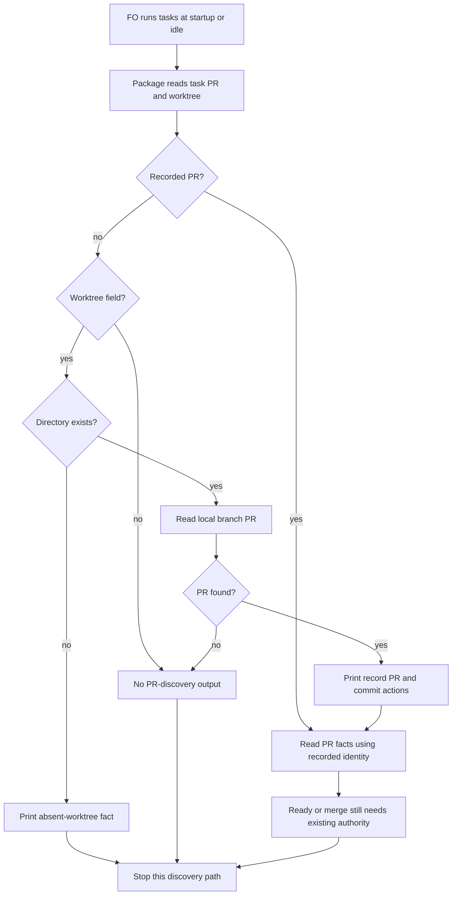

Filed on the Captain's 「開」 (chat, 2026-10-16), after FO's first run of the v0.23.0 lifecycle mod's idle step on this workflow.

## Scope

- Observed 2026-10-16, kc-dev-flow-2 0.23.0, `python3 <package>/scripts/pr_watch.py tasks <workflow dir>` on this workflow printed two `next:` lines: "record journey-server-host-pilot's PR with status --set journey-server-host-pilot pr=<owner/repo>#<N>; its worktree is not on this machine." and the same for pr-review-lite-value-pilot. Neither task is driven by the session that ran the mod (one is held at validation by another session, the other unchanged since 2026-09-22), and neither has a PR yet.
- The mod tells FO to do each `next:` line in order, so an FO that follows it may record a wrong PR on another session's task. Several FO sessions drive one workflow in adopters such as <adopter>.
- Candidate fix: a task whose worktree is not on this machine is listed as a fact line, not a `next:` action; a test with such a task.
- Should land before <adopter> syncs to the mod.
- Also seen 2026-10-16 on the same run: `next: run spacedock state commit amendment-form-check` while that task's implementation worker was still writing its report (the worker owns that commit), and `next: mark #649 ready if Delivery authority allows` before its validation had run. Both are `next:` lines an FO must not follow at that moment; whether they become facts too is for ideation.
- Non-goals: to be set at ideation.

## Budget
1 implementation and 2 validation cycles, in one package PR.

## Stop condition
- A task whose worktree is not on this machine produces no `next:` line telling FO to record a PR; a test covers such a task. The two other `next:` lines seen on 2026-10-16 are decided in the design, not assumed in scope.

## FO alignment

Alignment: not needed before ideation: one observed defect with a candidate fix; the Captain filed it.
Surfaces: none
Visible change: none
Release review: not needed: workflow maintenance, on no journey map.

## Design

### PRFAQ: proposition and recommendation

FO can inspect a shared workflow without being told to invent a PR for a task whose worktree is absent. The current source already delivers the accepted narrow outcome: retain it and return this task for a no-change disposition, rather than implement the same fix again.

This is an ideation recommendation, not closure, gate approval, implementation validation, or permission to change another task. The task's frontmatter and existing Captain ruling remain untouched. Profile: Pilot; surface: none; no new persistent mechanism, production credential, service, migration, support obligation or profile change.

Presentability is blocked: the required design checker exits 1 because this replay's original Scope differs from its backlog-gate snapshot at `faaccf50`. It names the missing trial-admission line and tells the worker to report it to FO without editing Scope or amendments. The complete original 4041-byte task is preserved as an unchanged prefix (see `evidence/preserved-input.json`); this dispatch did not introduce that mismatch. FO must reconcile the gate-bound source before presentation.

### Existing work and source chain

1. Spacedock first: read the installed 0.28.0 ensign contract and its own `mods/pr-merge.md` startup/idle contract. That mod acts on recorded PR fields and reports an unresolved worktree/repository; it does not specify this package's absent-worktree discovery message. Do not substitute an adopter workaround for that upstream contract.
2. kc-dev-flow-2 next: pinned `origin/main` is `88f86f2749dadb6f4ef0cf9aa089c1827096865b`; its plugin manifest says 0.41.0. Commit `9bdc9f73083d8b2cf6a317a10f91a10a3d9fbb58` (recorded subject references PR #858) already changes the absent-worktree branch in `scripts/pr_watch.py` to a fact and strengthens the named regression in `scripts/test_pr_watch.py`. This is local captured Git evidence, not a new remote PR query. The dispatched package's script bytes match that pinned source (SHA-256 `3bbef070429e27ee7db054f2ef920fe6ae535172981e1737afd0b843b570db04`).
3. Read the lifecycle mod, the task's prior body (no prior stage report), all fifteen named batch/live task records, relevant learning, and ADRs 0015 (early Draft PR and recording), 0037 (shared-work checks), 0048 (final-reply handoff), 0055 (claim attribution), and 0062 (approval scope). ADR 0015 keeps ready/merge authority separate from a discovered Draft PR. No new ADR is proposed.
4. Sibling-adopter check: 0 available, 3 unavailable in this isolated replay. No private adopter repository was accessed; no private task names, titles, rulings or logs are copied here. Local sibling-task records establish only captured scope and overlap, not current remote state.
5. Relevant `Override:` records were read. The recorded close decision in `fo-write-checks-parse-top-level` and hold/replacement decision in `gate-summary-names-each-decline` favor avoiding speculative duplicate work; neither grants closure here. The lifecycle/watch-state records name no override of the absent-worktree behavior.

The broader existing-code capability inventory is inapplicable: this is a named broken seam already repaired, not a new abstraction or a claim that no capability exists. The bounded observation is execution of the package's real command entrypoint with controlled external adapters. Use the existing implementation and regression; do not replace either.

### FAQ and boundaries

**What happens when the worktree is absent and PR is empty?** The operator reads `fact: <slug> has no recorded PR; its worktree is not on this machine.` No PR-recording action or provider query is derived from that task. Absence is a filesystem observation, not proof of another session's identity or ownership.

**What stays actionable?** An existing local worktree with a discovered PR still yields the current repository-qualified record command and its state-commit command. A recorded PR is still watched when its worktree is absent. A task with neither PR nor worktree field remains silent for PR discovery. Other independent diagnostics may still be `next:` lines; this design does not suppress every action associated with a foreign task.

**What about the other two historical messages?** Keep them outside this repair. The local-discovery control reproduces the state-commit line after PR discovery and the green-Draft ready line qualified by “if Delivery authority allows.” Neither is a permission grant or proof the implementation worker has finished. Broad worker-liveness arbitration or replacing all ready/state-commit actions with facts would change the established lifecycle contract; no such change is accepted here.

**What files would a new delivery change?** None. The already-landed repair owns `kc-dev-flow-2/scripts/pr_watch.py` and `kc-dev-flow-2/scripts/test_pr_watch.py`. This dispatch changes only this task body plus an unshipped disposable probe branch. No version, workflow, CI, ADR index, adopter, PR, merge or release change is proposed.

The diagram follows the prose's actors, order and alternatives. No user interaction or database surface is added. A renderer was not run under the no-browser replay boundary; the diagram's semantic correspondence was checked manually, while the package checker below checks presentability markers, not rendering.

### Probe

Branch: `poc/pr-watch-tasks-foreign-worktree-replay2`.
Base: `88f86f2749dadb6f4ef0cf9aa089c1827096865b`.
Last commit: `ddfc0426062bbec4e7455e4141a5954ac3cd0ee6`.
The unsuffixed branch already existed in the independent fixture repository, so it was preserved. The new branch contains only disposable probe code/fixtures. Product files are unchanged from the pinned trunk.

The probe was built and run before this design was written. The riskiest premise was “the accepted defect still needs a product change”; executing the current entrypoint falsified it. Widening then checked the adjacent local-discovery and recorded-PR paths. The runner calls the real package `main(... tasks ...)` in a subprocess; only GitHub and the unrelated Spacedock held/ready queries use explicit offline adapters, and scratch lookup is directed to an absent replay-owned path. Real Git and package helper processes run; network, native gate behavior, live agent decisions and adopter behavior are not proved.

Evidence root: `<scratch>/pilot-ideation-runs-a-probe-before-the-design/validation-2/live/evidence`.
Runner retained there as `pr_watch_probe.py`; per-entrypoint command, exit, stdout/stderr path, provider calls and input equality are in `commands.jsonl`. AC results are `AC-1.json` through `AC-4.json`, with corresponding logs.

- Hypothesis: absent relative/absolute worktrees in flat/folder tasks produce a fact without a record action. Result: both cases pass; restoring the historical instruction in memory makes both fail the acceptance comparison.
- Hypothesis: narrowing that branch preserves local discovery and known PR monitoring. Result: no-worktree-field, local discovered PR, already-recorded PR, merged PR and empty-after-archive controls pass.
- Hypothesis: another production patch is needed. Result: falsified by the current source, observed behavior and empty product diff; existing regression is present but was not executed as a unit suite.
- Initial AC-1 run exited 1 because the fixture task was uncommitted and the real role checker refused it. That failure is retained as `initial-AC-1.log` and `initial-absent-flat.stdout`; committing the synthetic input fixed the fixture. Initial AC-4 exited 1 because the trial package workflow differs from product trunk; it is retained as `initial-AC-4.log`. The corrected reading comparison uses unchanged product documents, while stage instructions/scripts still come from the authoritative dispatched package.
- Each entrypoint subprocess has a 30-second timeout. No timeout occurred. The probe worktree was removed after its local commit; `worktrees-after.txt` records removal, and the branch plus evidence remain. The replay root was retained for the supervisor.

Reproduce in a new replay-owned worktree from the recorded base: extract `.replay/pr_watch_probe.py` from the recorded probe commit into that worktree, then run `REPLAY_ROOT=<live> TMPDIR=<live>/tmp PYTHONDONTWRITEBYTECODE=1 python3 -B <new-worktree>/.replay/pr_watch_probe.py AC-1`, followed by the same command with `AC-2`, `AC-3`, and `AC-4`. Use a clean fixture directory; the runner refuses to overwrite one. It commits only its synthetic workflow inputs locally and writes outputs under the replay evidence root. No remote operation is needed.

### Worth questions

- Absent-worktree fact: serves the Captain's accepted “PR 監看不該對別台機器的任務提示” and the explicit stop condition. Without the landed branch, the historical record-PR instruction returns. Premise making new work unnecessary: the current package already has that branch; AC-1 checked it and rejected the historical reverse mutation.
- Compatibility controls: serve the accepted narrow scope and avoid silently removing local discovery/known PR watching. Without them, “remove every next line” could falsely appear sufficient. Premise making a broader rewrite unnecessary: adjacent paths still work; AC-2 checks this.
- Worker-liveness arbitration and unconditional conversion of ready/state-commit actions serve no newly accepted scope. Recommend leaving them out. What breaks without them remains the historical ownership concern, not a newly reproduced permission bug; this probe observes emitted words, not FO obeying them.
- New production patch: serves no remaining unmet stop condition on this pin. Recommend no patch. The cheap disproof is the pinned source plus executable absent-worktree cases; both already satisfy the required outcome.

### Words FO reads at each moment

No product prose or emitted message changes in this proposed no-change disposition. Historical reverse control: 16 whitespace-separated words in the record-PR instruction versus 13 in the existing fact; this is one line's delta, not a full lifecycle saving.

The reproducible AC-4 reader packet includes the complete pinned product workflow, lifecycle mod and the corresponding synthetic `tasks` output. It deliberately uses the same packet definition for before/after, rather than counting just the file that changed. It is a bounded comparison, not a trace of a live FO's warm-session reads or optional hooks.

| Moment | Before | Proposed after | Evidence/limit |
| --- | ---: | ---: | --- |
| Startup with absent task | 6094 | 6094 | AC-4.json; absent-flat.stdout |
| Idle with discovered open Draft PR | 6135 | 6135 | AC-4.json; local-discovery.stdout |
| Idle with merged PR, no extensions | 6081 | 6081 | AC-4.json; merged-pr.stdout |
| After archive, empty task list, no extensions | 6081 | 6081 | AC-4.json; after-archive.stdout |
| Merge ask | Not provable now | Not provable now | No approved delivery candidate/question in this replay |

The first four deltas are zero. Full live per-moment totals, optional extension output and merge-question text remain unmeasured. No reduction claim is made; the root learning's warning against treating one file's size as a lifecycle measurement is retained.

### Needs decision

**Return this task as already satisfied on the pinned source, rather than spend an implementation cycle?** Recommend the no-change disposition, with FO using the authorized lifecycle path. The accepted narrow stop condition is observed, the historical regression is detected by a reverse control, and a second patch has no distinct behavior to add. What gets worse: this does not settle the two adjacent historical ownership concerns or verify installation in the three unavailable adopters. The worker grants no closure; if the Captain wants broader ownership behavior, FO must establish its scope separately.

### Batch overlap

Proposed delivery-file changes: none. If a later ruling reopens the narrow repair, its affected files are `kc-dev-flow-2/scripts/pr_watch.py` and `kc-dev-flow-2/scripts/test_pr_watch.py`; the following records were read without alteration:

- `design-surfaces-task-dir-crash`: no delivery-file overlap; shares the design-surfaces presentability check.
- `new-work-checks-what-exists-first`: no delivery-file overlap; shares the Before-new-work instruction used here.
- `delivery-gate-s4-skips-removed-scratch`: no delivery-file overlap; its cleanup-evidence path check is relevant to later delivery reports, not this no-change gate.
- `observer-check-learn-only-when-listed`: adjacent archived-task output and `test_pr_watch.py` coverage; preserve the current learn-selected branch already in the pinned source.
- `pr-watch-tasks-foreign-worktree`: this task; the prior repair and regression are already in the pinned source.
- `dispatch-close-out-archives-evidence-and-removes-scratch` (captured PR #854): shares `pr_watch.py` scratch hooks; its code is present through local commit `46e9d0ed4`. The task record's live status and remote PR state were not refreshed.
- `held-and-closed-tasks-leave-the-design-queue` (captured PR #856): shares `pr_watch.py`, `test_pr_watch.py` and lifecycle-mod context; its code is present through local commit `bf0c1a21c`. Preserve the held-task distinction.
- `adoption-asks-which-extensions`: no delivery-file overlap; shared workflow/extension reading context and lint checks only.
- `adr-required-statement`: no delivery-file overlap; shared workflow and ADR-check context only.
- `adr-silent-undo-probe`: no delivery-file/check change in common; separate disposable scenario.
- `comment-check-reaches-delivery-gate`: no delivery-file overlap; later delivery/comment checks are shared gates.
- `journey-canvas-hosted-poc`: no delivery-file overlap; design-surfaces check is shared.
- `journey-server-host-pilot`: no delivery-file overlap; it was a historical absent-worktree input, never modified or operated here.
- `ops-inbox-r1-setup-and-isolation`: no delivery-file overlap; design/ADR checks are shared.
- `pr-review-lite-value-pilot`: no delivery-file overlap; it was a historical absent-worktree input, never modified or operated here.

No shared ADR index, numbered record or check implementation is changed by this design. Recommended order: reconcile this already-landed outcome with FO first; retain the pinned scratch/held/learn integrations; only after an explicit new scope decision consider another implementation touching the shared watcher files. No peer work or PR action is owed by this worker.

## Acceptance criteria

**AC-1** — An empty PR with an absent worktree produces the exact existing fact in both a flat relative-path task and a folder absolute-path task, with no PR-recording action, provider call, input mutation or watch-state creation. Evidence command: `python3 -B <probe-worktree>/.replay/pr_watch_probe.py AC-1` with the replay environment above; final exit 0, `evidence/AC-1.log`, `AC-1.json` and per-case stdout. Falsifier: restoring the old `next: record` branch; it was executed and rejected in both cases. Current evidence: passed within the offline entrypoint boundary.

**AC-2** — Existing local PR discovery retains qualified record/state-commit actions; a recorded PR is watched despite a missing directory; no-field and merged/archived controls retain their current bounded output. Evidence command: same runner with `AC-2`; exit 0, `evidence/AC-2.log`, `AC-2.json` and provider-call logs. Falsifier: suppressing local discovery, skipping a known PR based on its absent worktree, or changing the ready-authority qualifier breaks the assertions. Current evidence: passed with synthetic provider replies; live provider and native Spacedock behavior are Not provable now.

**AC-3** — The no-change recommendation binds the executed watcher to pinned product bytes, finds the existing regression, and introduces no product diff or undeclared adopter proof. Evidence command: same runner with `AC-3`; exit 0, `evidence/AC-3.log` and `AC-3.json`. Falsifier: changed watcher bytes, removal of the named regression, or any product diff fails. Current evidence: passed for source identity/diff; the existing application unit, integration and e2e suites were not run as required by the harness. Private adopter coverage: 0 checked, 3 unavailable.

**AC-4** — Before/after reading uses a declared per-moment reader packet, reports zero deltas for the four exercised moments, and leaves the merge ask/live optional-hook totals explicitly unmeasured. Evidence command: same runner with `AC-4`; corrected exit 0, `evidence/AC-4.log` and `AC-4.json`. Falsifier: a product-document change fails the identity assertion; a newly claimed full lifecycle saving without the missing live outputs would not satisfy this criterion. Current evidence: bounded packet measured; full live lifecycle and merge ask are Not provable now.

## Stage Report: ideation

- DONE: Current design definition and acceptance criteria with reproducible evidence clauses; unresolved decisions identified for the user.
  The PRFAQ recommends retaining the already-landed repair; the Captain/FO still owns no-change disposition, and no stage or gate was advanced.
- DONE: A `### Batch overlap` section naming each file the design would change and each other batch task and live task of other sessions that changes the same file or check, so FO can order implementation.
  All fifteen named records are mapped above; proposed product-file changes are none, with shared watcher-file integrations explicitly retained.
- DONE: The words FO reads at each lifecycle moment, before and after, per root learning.md "Measure the words FO reads at each moment, not one file's size".
  AC-4.json measures four declared synthetic reader packets with zero deltas; the merge ask and complete live lifecycle totals are explicitly Not provable now.
- DONE: Acceptance criteria with reproducible evidence clauses and falsifiers, and unresolved decisions for the Captain, each with a recommendation and what gets worse under it.
  AC-1 through AC-4 each name their command, current result, limit and falsifier; the sole material decision is a no-change disposition versus a newly scoped task.
- DONE: Pilot probe before design, with branch/base/last commit and each hypothesis result.
  Branch poc/pr-watch-tasks-foreign-worktree-replay2, base 88f86f2749dadb6f4ef0cf9aa089c1827096865b, last ddfc0426062bbec4e7455e4141a5954ac3cd0ee6; worktree removed, branch/evidence retained.
- DONE: AC-1 current evidence.
  Final runner exit 0; two absent-worktree cases emit facts, leave inputs unchanged and make no provider call; the historical next-record mutation is rejected in both.
- DONE: AC-2 current evidence.
  Runner exit 0; local discovery still emits the qualified record/commit actions and a known PR is still watched without its worktree; suppressing either breaks an assertion.
- DONE: AC-3 current evidence.
  Runner exit 0; executed watcher bytes match origin/main, product diff is empty and the named regression exists; byte drift, removal or product edits fail the check.
- DONE: AC-4 current evidence.
  Corrected runner exit 0; product documents match the pin and bounded before/after packets match; full live totals and the merge ask remain unverified.
- FAILED: Run `python3 <package>/scripts/design_surfaces.py check <task>` and cite its output.
  Executed from the authoritative package, exit 1; evidence/design-surfaces.log reports Scope drift from backlog snapshot faaccf50 and directs FO to restore the original line without a worker Scope/amendment edit. Gate not presentable.
- SKIPPED: Private sibling-adopter verification.
  0 repositories checked, 3 unavailable; no private adopter task details were added, and no installation or delivery claim is made.
- SKIPPED: Application unit, integration and e2e suites; servers, databases and browsers.
  Prohibited by the replay assignment; custom offline entrypoint probes and required package checker ran. Mermaid rendering was not run.
- DONE: Preserve original task authority, isolate changes and retain completion evidence.
  Original body/frontmatter prefix preserved byte-for-byte; no product edits, remote operations, peer messages, stash or Git config writes; only replay-owned local commits.

### Summary

The accepted absent-worktree behavior is already present on the pinned 0.41.0 product source, and the disposable probe confirms it while rejecting the historical regression. Recommend no new product patch and leave the adjacent state-commit/ready concerns outside this scope; the stage cannot be presented until FO reconciles the inherited Scope mismatch. The report is ideation evidence only, with synthetic provider boundaries and unavailable adopter/full-lifecycle proof stated.
