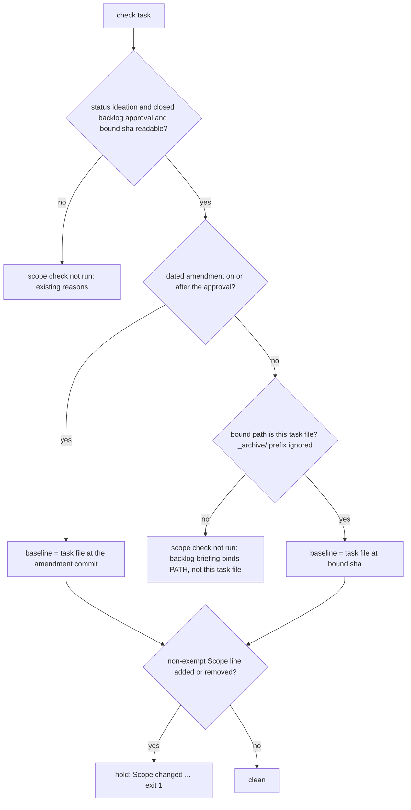

When the artifact bound at a gate has no Scope section, `design_surfaces.py check` prints a not-run line naming the artifact instead of reporting "Scope changed" against an empty baseline, and `gate prepare` warns when the artifact is not the task file.

## Scope

- Source: the Captain 「開」 (chat, 2026-11-06), answering 「要開這 4 張嗎？」 after fo-feedback round 005 (.notes/fo-feedback/round-005.md, closed 2026-11-06).
- Bite: relay llms-teaches-versions (2026-11-06): FO bound the Chinese presentation file as the backlog artifact, and the design check later held "Scope changed" though a diff showed Scope identical (round 005, operator report; the FO disclosed it under "Presentability hold").
- Upstream first: kc-dev-flow-2 scripts/design_surfaces.py check; Spacedock gate prepare (upstream; a warning there is an upstream issue).
- Non-goals: allowing a non-task artifact at a gate.

## Budget
- One package PR; the workflow word budget does not rise unless the design names a raise for the Captain.

## Stop condition
- A replay with a non-task artifact prints the not-run line, and a real Scope change is still held.

## FO alignment

Alignment: needed at ideation; the design choice is his to accept.
Result: aligned at backlog: Batch 17 backlog sitting, the Captain 「核准（建議）」 (host question dialog, 2026-11-07), answering 「決定：第 17 批這五張（Paseo 瀏覽器當工人驗收的預設、決策紀錄檢查分清驗證取代與指向依據、派工時自動寫派工紀錄、沒給範圍時設計檢查說沒跑、觀察者列出沒有合併提問紀錄的合併）都用 Pilot，照各自寫下的範圍、預算與停止條件進入構想嗎？建議核准。要改哪張直接說。」, approved the outcome and bounds in this file; the design choice the Alignment line names stays his at the ideation gate.
Surfaces: none
Visible change: none
Release review: not needed: workflow maintenance, on no journey map.

## Design

Read 2026-11-07. Package: `kc-dev-flow-2/` at iamcxa/kc-claude-plugins `origin/main` `139feeaee7ce037a0c6535568cd6bd103155cbae`. Released version there: 0.35.0. The dispatched install `kc-dev-flow-2/0.35.0` differs from it only by the `ASK_FORM` print at the end of `main`.

### PRFAQ

**Proposition.** At the ideation gate, a task whose backlog briefing bound a presentation file instead of the task file no longer gets a false "Scope changed" hold. `design_surfaces.py check` prints `scope check not run: backlog briefing binds <path>, not this task file` and leaves the exit code alone. A task whose backlog briefing bound the task file is still compared, and a real Scope edit is still held.

**FAQ**
- *Why did it hold?* `scope_hold` takes the file at the bound `git-root://state/<sha>/<path>` as the Scope baseline. A presentation file has no `## Scope` section (relay's is in Chinese), so `scope_lines` returns `[]` and every Scope line in the task counts as changed.
- *How often?* 15 of 388 backlog briefings bind a file other than the task: relay 2/92, this workflow 3/144 (two folder tasks binding their own `index.md` are excluded), qnow 10/81, web 0/71. Counted 2026-11-07 from each state checkout's `review/**/backlog/briefing-*/index.json`.
- *Were the holds false?* Yes, all 10 replayed. Relay `llms-teaches-versions` and nine qnow tasks: base holds, and the task's own Scope at the bound sha matches its Scope at the ideation commit line for line (0 changed lines in each).
- *Why key on the path and not on "the baseline has no Scope"?* This workflow has two bound `review.md` files that carry their own `## Scope` heading (`canvas-document-popup`, `release-please-exclude-paths`). A no-Scope test would compare the task against a different file's Scope. The path test covers the bite and those two.
- *Why does an amendment still win?* When a dated `### Amendment N` exists, the baseline is already the task file at the amendment's commit, so the binding does not matter. The guard applies only on the backlog-baseline branch.
- *What about `gate prepare` warning?* Spacedock does not support it. Its `internal/gates/prepare.go` (spacedock-dev/spacedock `origin/main` `324c61588`; binary here 0.27.2) treats `--artifact` as "the primary presentation item". A comment there says FO "legitimately references the entity under review alongside a gate-review artifact". An upstream warning would contradict that contract. See decision D2.

**Existing-code check.** The capability exists: `scope_hold` already returns `("not run", why)` for six unjudgeable states, and `main` prints that line with the exit code unchanged. The change adds one more such state. No replacement mechanism.

**Change.** In `kc-dev-flow-2/scripts/design_surfaces.py`:
- `scope_hold`: after the bound sha is read, compute `foreign` = the bound path differs from this task's repository path, with the `_archive/` prefix stripped on both sides as `file_at` does. Take the task path from `git rev-parse --show-prefix` plus the file name, so folder tasks (`<slug>/index.md`) and untracked task files resolve.
- On the no-amendment branch, a `foreign` binding returns `("not run", "backlog briefing binds <path>, not this task file")`.
- One clause added to the module docstring's not-run sentence.
- `kc-dev-flow-2/scripts/test_design_surfaces.py` gains four `ScopeCheckTests` cases (see the ACs).

No change to `references/sd/workflow.md`, `README.md`, any ADR or Spacedock. ADR 0027 (FO-write rules checked by the script FO runs) governs this check. Its Consequences already bound the check by stage. This adds a not-run state of the same kind as "backlog briefing unreadable", so it needs no ADR edit. No `Override:` line in this workflow's gate records bears on the Scope check or artifact binding (`git grep 'Override:'`, 2026-11-07).

**Prototype (throwaway, /tmp, not a branch).** `git archive origin/main kc-dev-flow-2/scripts` patched as above:
- The relay replay exits 0 with the not-run line.
- All 213 existing `test_design_surfaces` tests pass (4 skipped), the same as base.
- The four new cases pass on the prototype; base fails the two foreign-binding cases.
- An earlier prototype that returned before the amendment lookup failed the amendment case, which is why the guard sits on the no-amendment branch.

**Replay recipe (any machine with read access).**
- Relay, the bite: `git clone --no-checkout git@github.com:spacedock-dev/subspace-relay.git -b spacedock-state/dev2 /tmp/r && git -C /tmp/r checkout 6008953a`, then `python3 <package>/scripts/design_surfaces.py check /tmp/r/llms-teaches-versions.md`. The bound artifact is `llms-teaches-versions/review/backlog-gate.md` at `01d0e0e4`.
- qnow, second corpus: `https://github.com/iamcxa/qnow.git`, branch `spacedock-state/dev2`. Run `scope_hold` on each task at its ideation commit: `slots-by-capacity` 57bfb2a2a, `booking-submit-staff-confirm` 2f9904260, `r1-online-walkthrough` 5c41a245f, `clerk-web-phone-signin` 788e40b07, `clerk-testing-token-e2e` bc968f3a5, `phone-country-code-honest` 90c510883, `closed-days-no-slots` c4c01f094, `shop-entry-services-slots` 989e65a62, `demo-tenant-in-migrations` b01fc025c.

**Non-goals.** Making a non-task artifact a supported binding; changing what FO binds; a Spacedock change.

**New obligation.** None that would change the profile: one package script and its tests, an ordinary published upgrade.

### Words FO reads at each moment

Counted with `wc -w` on the script output, base `139feeae` against the /tmp prototype.

| Moment | Base | After |
| --- | --- | --- |
| Backlog gate (`check --seed`, workflow.md seed paragraph) | unchanged | unchanged (`scope_hold` is skipped under `--seed`; workflow.md stays 5933 words) |
| Ideation gate, task bound to itself | unchanged | unchanged (213 existing tests pin the output) |
| Ideation gate, real Scope change | 1 hold line, exit 1 | same |
| Ideation gate, task bound to another file (relay replay) | 63 words: the false hold, exit 1, gate not presentable | 78 words: presentable line 4 + not-run line 12 + the existing `ASK_FORM` 62, exit 0 |

The +15 is real. It is the clean-path reminder every presentable task already prints, not new text. learning.md's below-base rule governs changes meant to cut words, which this is not. The only new text FO reads is the 12-word not-run line, and only on a foreign binding. The workflow word budget does not rise.

### Batch overlap

Files this design changes: `kc-dev-flow-2/scripts/design_surfaces.py` (`scope_hold`, two small helpers, one module-docstring clause) and `kc-dev-flow-2/scripts/test_design_surfaces.py` (`ScopeCheckTests`). No table, ADR number or shared index.
- Batch 17 siblings:
  - worker-browser-checks-use-paseo-browser and observer-lists-unasked-merges: neither task file names either file. None.
  - adr-lint-tells-supersession-assertion-from-pointer: `adr_lint.py`, `test_sd_dispatch.py`. None.
  - dispatch-build-writes-the-dispatch-record: names neither file. Dispatch checking imports `design_surfaces.py`, but this change touches no shared parsing. None.
- Other sessions (read only):
  - merge-guard-stops-unasked-merges (validation) runs the check only. None.
  - gate-summary-names-each-decline (held) reads `design_surfaces.py` and changes `delivery_gate.py`. None.
  - Journey-map tasks: journey-server-host-pilot and journey-canvas-hosted-poc only run the check. None.
- Other live tasks here that change the same files:
  - fo-write-checks-parse-top-level (ideation): `scope_lines` and a docstring clause, adjacent to `scope_hold`. `origin/main` already has a fence-aware `scope_lines` with `test_the_scope_is_the_first_scope_heading_outside_a_fence`.
  - captain-ruling-sources-checked (ideation): `design_surfaces.py` and its tests.
  - seed-check-requires-alignment-result (ideation): the seed branch and seed tests.
  - design-surfaces-task-dir-crash (backlog): same script by title.

Recommended order: land this first. It is one guard inside `scope_hold` with its own tests. The others would rebase over a single docstring clause and an appended test block.

## Acceptance criteria

**AC-1**: The relay bite prints the not-run line and exits 0.
Verified by: the replay recipe on the relay clone at `6008953a` exits 0 and prints exactly `scope check not run: backlog briefing binds llms-teaches-versions/review/backlog-gate.md, not this task file` after `llms-teaches-versions.md: design surfaces presentable`, with no `Scope changed` line.
Falsifier: the same replay against base `139feeae` exits 1 with `Scope changed after the backlog gate (01d0e0e4)` (observed 2026-11-07). Removing the guard restores that.

**AC-2**: A real Scope change on a task bound to itself is still held.
Verified by: every existing `ScopeCheckTests` case passes unchanged (added line, removed line, amendment baselines, fence handling, exempt prefixes). A new case binds a folder task `f/index.md` to itself: clean, then hold after an added Scope line.
Falsifier: making the guard unconditional fails `test_a_scope_line_added_after_the_backlog_gate_holds_with_a_line_addressed_to_fo`. Taking the task path as `<parent>.md` for a folder task fails the folder case (both mutations run on the prototype, 2026-11-07).

**AC-3**: A foreign binding is not run even when the bound file carries its own `## Scope`.
Verified by: a case binding `review/t/backlog/review.md`, a copy of the task, returns `not run`. A case binding `t/review/backlog-gate.md` with no Scope returns `("not run", "backlog briefing binds t/review/backlog-gate.md, not this task file")` before and after an added Scope line.
Falsifier: keying the guard on "the bound file has no Scope" turns the first case `clean` (mutation run on the prototype).

**AC-4**: A dated amendment still gives the baseline under a foreign binding.
Verified by: with a foreign binding, an added Scope line committed with `### Amendment 1` is `clean` against that commit. A further unrecorded Scope line is `hold`.
Falsifier: placing the guard before the amendment lookup fails this case (the first prototype did).

**AC-5**: Nothing FO reads at another moment changes.
Verified by: the diff touches only the two files named in Batch overlap; `references/sd/workflow.md` word count stays 5933; `lint-skills.py` passes; full `unittest discover -s kc-dev-flow-2/scripts` is green.
Falsifier: any other file in the PR diff.

## Decisions for the Captain

D1 and D2 are coupled: under option B of D1, a foreign binding is checked normally, so D2's warning has no job left.

**D1 — what the check does when the backlog briefing bound a file other than the task.**
- **A (recommended):** print the not-run line naming the file, exit unchanged. Your approved outcome and stop condition say this, and it keeps the binding visible each time FO runs the check.
- **A′:** key on "the bound file has no Scope", the title's literal wording. It misses the two bound files here that carry their own `## Scope`, and it compares across files.
- **B:** compare against the task file at the same bound sha and print a note naming the presentation file. All 10 replays would be `clean`, so the guard stays on.

Why A over B: you approved the presentation, not the task file at that sha. B would certify a text you did not read.
What gets worse under A: a task bound to a presentation file gets no Scope check at ideation. On qnow that is about one task in eight (10 of 81). 0 of the 10 replayed showed a real Scope change.

**D2 — the outcome's "`gate prepare` warns when the artifact is not the task file" half.**
- Recommend dropping it from this task and filing no upstream issue: Spacedock's `prepare.go` defines the artifact as the presentation item, so a warning would argue against its own contract.
- No kc-dev-flow-2 script runs at backlog `gate prepare` with the artifact in hand. `check --seed` runs earlier and takes only the task.
- The not-run line is the warning, one gate late.
- What gets worse: FO learns of the binding only at the ideation gate, after the backlog gate closed, and the outcome sentence in this file then reads wider than what is built. The wording is yours to amend.
- Alternative: give `check --seed` an `--artifact` option and add it to FO's seed step in workflow.md, about +15 README words.

## Stage Report: ideation

- DONE: Design how /Users/kent/.claude/plugins/cache/kc-claude-plugins/kc-dev-flow-2/0.35.0/scripts/design_surfaces.py check prints a not-run line when the bound artifact is not a task file, replaying the relay llms-teaches-versions case named in the task, while a real Scope change is still held
  `## Design`: a path guard on `scope_hold`'s no-amendment branch. The relay replay (6008953a) holds on base 139feeae (exit 1). On a /tmp prototype it prints the not-run line (exit 0). 9 qnow replays agree. 213 existing tests pass.
- DONE: A `### Batch overlap` section naming each file the design would change and each other batch task (worker-browser-checks-use-paseo-browser, adr-lint-tells-supersession-assertion-from-pointer, dispatch-build-writes-the-dispatch-record, observer-lists-unasked-merges) and live task of other sessions (merge-guard-stops-unasked-merges and gate-summary-names-each-decline (held by the Captain; read only), and journey-map tasks driven by the journey-map FO (read only)) that changes the same file or check, so FO can order implementation
  `### Batch overlap`: two files. None of the named tasks changes them. fo-write-checks-parse-top-level, captain-ruling-sources-checked, seed-check-requires-alignment-result and design-surfaces-task-dir-crash share the script. Order: this first.
- DONE: The words FO reads at each lifecycle moment, before and after, per root learning.md "Measure the words FO reads at each moment, not one file's size"
  `### Words FO reads at each moment`: unchanged at every moment but one. A foreign binding goes from 63 words (false hold) to 78 (4 + 12-word not-run line + the existing 62-word `ASK_FORM`). workflow.md stays 5933 words.
- DONE: Acceptance criteria with reproducible evidence clauses and falsifiers, and unresolved decisions for the Captain, each with a recommendation and what gets worse under it
  AC-1: verified on the /tmp prototype, not a branch (relay replay exit 0, the exact line). AC-2: existing tests pass on the prototype; folder case passes; both mutations caught. AC-3: both cases pass on the prototype, fail on base; no-Scope mutation caught. AC-4: passes on the prototype; the early-return prototype failed it. AC-5: not yet verified (no PR diff exists). D1 (recommend A, not run) and D2 (recommend drop the gate prepare warning), each with what gets worse.
- DONE: design_surfaces.py check
  `python3 <package 0.35.0>/scripts/design_surfaces.py check design-check-says-not-run-without-a-scope.md`: "design surfaces presentable", exit 0.

### Summary

The false hold comes from `scope_hold` using whatever file the backlog briefing bound as the Scope baseline. 15 of 388 backlog briefings across relay, this workflow, qnow and web bind a presentation file, and all 10 replayed holds were false. The design adds one not-run state, keyed on the bound path rather than on a missing Scope (two bound files here carry their own `## Scope`), placed after the amendment lookup so amendment baselines are unchanged.

Spacedock's `prepare.go` defines `--artifact` as the presentation item, so the "gate prepare warns" half is D2 (recommend drop). Comparing against the task file at the same sha is D1's option B, kept for the Captain.
