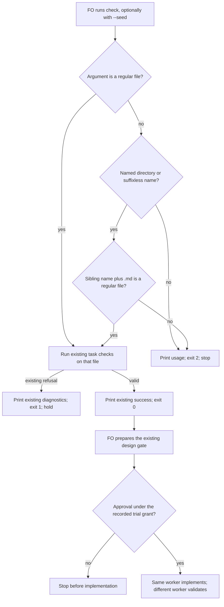

Filed from a package issue reported by the spacedock-dev/subspace-relay First Officer (found by its implementation worker on 2026-10-13); the Captain confirmed filing on 2026-10-14 (「確認」 to "should FO file relay #1 and #4?").

## Scope

- Reproduced 2026-10-14 on kc-dev-flow-2 0.22.1: from the state checkout root, `python3 <package>/scripts/design_surfaces.py check followup-dispatch-records-checked` raises `IsADirectoryError: [Errno 21] Is a directory: 'followup-dispatch-records-checked'`; the same command with `followup-dispatch-records-checked.md` works. Every task with dispatch records has a `<task>/` directory beside `<task>.md`, and the workflow README tells FO and workers to run `design_surfaces.py check <task>` and `check --seed <task>`.
- Candidate fix: resolve `<task>` to `<task>.md` when the argument is a directory or has no suffix, or fail with a usage message; a test for the directory case.
- Non-goals: changing checker rules, workflow text, gate authority, Spacedock resolution, folder-form discovery, task IDs, other scripts, private task content, or automatic migration.
- Trial (2026-11-13): admitted by the Captain's 「五張都准，授權代記設計關卡（建議）」 (host question dialog, 2026-11-13) as one of five tasks run by hand under the trial route rules: one worker builds a working probe during ideation and continues into implementation, a different worker validates, at most 3 build rounds counted by hand; stop for the Captain on an overturned premise, spent budget, two rounds without progress or a second validation rejection, a change of scope or criterion, or a component boundary or Prod trigger.

## Design

### Before building

- Needed: the Captain admitted the same-name-directory crash repair on 2026-11-13. The current released package is 0.39.1 at origin/main `8125e6d516d32abbf79c6772de10cde2c20900a8`; `main()` hands the argument unchanged to `check_task` and then `scope_hold`, whose unguarded read still accepts a directory. Without repair the documented suffixless design-gate command can crash or reject a valid seed instead of reading its sibling task file. The cheap premise test is the real CLI with and without `.md`, in both modes.
- Existing chain checked in order: Spacedock 0.28.0 source `internal/status/discover.go:127` resolves a slug to a regular `slug/index.md` or `slug.md` (folder form wins if both entity files exist); its `ResolveActivePath` owns workflow/ID discovery. The active launcher reports 0.27.2, contract 3. Then current kc-dev-flow-2 source: the Python checker has no path resolver, while its existing `check_task` and `scope_hold` already perform the actual checks. `pr_watch.py` invokes seed checking with explicit paths and consumes its exit; `laws_check.py` imports functions rather than parsing this CLI. Repair the checker entrance without adding a dependency on Spacedock resolution. Finally three read-only adopter inventories found 178 active task files, including 47 same-name directories; no local fork of this checker was found in the bounded package-path check. Private adopter details will be retained as counts only.
- Standard: this is local command-line filename handling, not a network protocol; no RFC governs this repair. Spacedock's documented entity discovery is not imported as a new package contract. Keep explicit task-file support and the existing checker verdict/output, with standard argparse usage errors for an unresolved file.
- Smaller route: telling FO to append `.md` works around the failure, but leaves the documented suffixless command broken. A local filename fallback plus real CLI regression tests is smaller than changing the workflow, importing a resolver, or adding a new abstraction.
- Boundary: no component boundary change is needed. Contract remains `check [--seed] <task-file-or-suffixless-name>` in the current directory: prefer an existing regular file, otherwise try its sibling `<name>.md` for a suffixless name or a named directory, then refuse unresolved input with usage exit 2. Do not discover workflow roots, IDs, archived entities or folder-form entities; explicit `index.md` remains a regular file. Existing explicit file checks continue with identical stdout/stderr and exit codes.
- New facts: this task body owns the design and criteria; `design-surfaces-task-dir-crash/evidence/` owns reproducible commands, sanitized output and counts. The throwaway code will be committed only to local `poc/design-surfaces-task-dir-crash` under the workflow checkout's `.worktrees/`; no product push or PR. One implementation cycle and two validation cycles remain FO-owned after design approval.

### Working probe

The four-line repair at `main()` prefers an existing regular file; otherwise a named directory or a suffixless argument tries a sibling whose name is the complete argument name plus `.md`. Using `name + ".md"` preserves dots in a directory name. Only a regular resolved file reaches the existing checker; an unresolved argument is an argparse usage error (exit 2, no traceback). This intentionally changes the prior missing-file seed diagnostic from exit 1 to usage exit 2; the old test's missing-file subcase moves to real CLI coverage, while its invalid-UTF-8 subcase remains exit 1. It changes no surface, criterion, Scope-baseline or approval logic for valid explicit files.

- Base: `8125e6d516d32abbf79c6772de10cde2c20900a8`, released package 0.39.1, fetched from origin/main before the worktree was created.
- Local-only branch: `poc/design-surfaces-task-dir-crash`; worktree: `.worktrees/poc-design-surfaces-task-dir-crash` under the workflow code checkout.
- Probe commit: `54424755e201fbb39363835e8dbabb971caa67a1`. Two files only: `kc-dev-flow-2/scripts/design_surfaces.py` and `kc-dev-flow-2/scripts/test_design_surfaces.py`; 4 product lines, five entrance tests, and the existing missing-file expectation adjusted to the newly explicit usage contract.
- Baseline goal check: `evidence/baseline-tests.txt`, exit 1, five test methods with 14 failed assertions/subcases. A public synthetic fixture shows the default-mode `IsADirectoryError`; seed mode rejects the directory rather than reading its sibling. The first aggregate probe's fixture used an obsolete Budget spelling and correctly failed seed validation; `initial-probe-run.txt` and `initial-synthetic.json` retain that harness failure. The final fixture uses the current Budget grammar.
- Final entrance proof: `evidence/probe-tests.txt`, exit 0, five methods; `evidence/probe-run.txt`, exit 0, 32 synthetic CLI commands plus 94 real adopter-mode comparisons. In those 94 comparisons, task-file bytes were stable, explicit-file output was unchanged, and suffixless output equalled explicit-file output in every case. Default-mode tracebacks fell from 47 to 0. Of the 94 outcomes, 16 passed and 78 correctly retained existing refusals; a refusal is not relabelled as a pass. Private inputs and outputs remained in memory; saved adopter evidence is counts only.
- Complete checker test file: `evidence/full-design-tests-final.txt`, exit 0, 234 total tests: 230 passed and 4 skipped for undeclared frozen corpus/historical-replay inputs. The earlier run's one old missing-file expectation failure is retained in `full-design-tests.txt`; it was resolved by moving that expectation into the usage-error CLI test, not by weakening valid-file checks.
- `evidence/lint-skills.txt`: exit 0; template remains 6033 words. `evidence/comment-ratio.txt`: exit 0, 64 added code lines, 0 comment lines, 0.0% against a 5% maximum.

### Worth questions

- Filename repair serves the Captain's admitted crash task and Stop condition. Without it the documented gate entrance fails on an ordinary dispatch-evidence directory. Premise that would make it unnecessary: current release already reads the sibling file. Cheap disproof: run the unchanged current-release CLI next to that directory; the saved baseline trace and 47 real default-mode tracebacks reject that premise.
- Usage refusal and entrance tests serve the Scope's "or fail with a usage message" and directory-test request. Without them, directories without a sibling could still reach `read_text`, or a broad fallback could silently replace an explicitly named file. Premise that would remove their need: all arguments always name valid task files. The unresolved-input and exact-file-precedence CLI cases reject that premise. No independently proposed capability is added.

### PRFAQ

**Proposition:** FO can run the documented `design_surfaces.py check <task>` and `check --seed <task>` beside a same-named evidence directory and receive the verdict for `<task>.md`. A failing task still fails; selecting the file does not approve the design.

**Why local repair?** Spacedock already resolves its own workflow references, including folder-form entities and IDs. This checker accepts filesystem paths. Calling the full resolver would widen the interface and introduce a new component contract for a four-line entrance repair.

**What changes for explicit files?** Existing regular files keep priority, with the same verdict and output. Missing files and directories without a valid sibling receive usage exit 2. Other unreadable-file behavior is unchanged; generalized permission/race recovery is outside scope.

**Who approves and continues?** FO runs the installed design checker and prepares the existing design gate. Only the Captain's actual trial delegation permits FO to record approval when no stop fires. The same build worker may then implement; a different worker validates. This report neither records approval nor advances state, opens a PR, or publishes the probe branch.

The diagram follows the probe's file-selection branches and the existing human gate order. Its source is present and semantically checked; this host has no local Mermaid renderer, so rendered presentation is not claimed as passed.

### Pilot bar and stop-condition assessment

The local probe reaches the approved Stop condition's mechanism: the recorded command shape reads a sibling task file, real state-root collisions preserve both successful and refusing verdicts, and the directory case has subprocess regression coverage. The actual historical named task no longer exists in the three checked current state checkouts, so that exact historical record was not replayed; its filename shape was exercised synthetically and 47 current collisions were exercised in place, read-only. This is not a release or a claim that all adopter tasks are presentable.

Before Pilot delivery: run the implementation route on the accepted source, independent validation at its exact candidate, required package checks/review, and the separately authorized package PR/release path. No production data/credentials, broad exposure, migration, unattended operation, support duty or release/rollback ownership is introduced. One admitted build round has been used for this probe; the authorized implementation/validation budget is not silently enlarged by these local checks.

### Words FO reads at each moment

`evidence/reading.py` counts the same named package-owned passage inventory using `len(text.split())` on base and probe, not one file's size. Startup: 6882 -> 6882; idle on open PR: 1018 -> 1018; idle on merged PR: 1018 -> 1018; after archive (including the optional learn reference equally): 310 -> 310; merge ask: 1153 -> 1153. All four passage files are byte-identical, and no new rule or instruction is relocated elsewhere. `evidence/reading.json` lists every counted source.

These are scoped instruction counts, not complete runtime reading totals: upstream pr-merge passages and ordinary dynamic PR/observer output were not re-executed, so no end-to-end reading-time or total-reading reduction is claimed. The changed entrance's actual synthetic command output is measured separately: default collision 73 -> 10 words; seed collision 10 -> 7. The before side is a failure diagnostic, not useful instruction. Explicit-file output equality is proven by the fixture and the 94 real comparisons; the repair adds no FO step.

### Not provable now

- Exact replay of the historical named task: zero matching current files in the three checked state roots. No private history, task title, ruling or raw output was copied. This limits historical identity, not the present reproduced seam.
- Four pre-existing frozen-corpus/historical tests: their declared environment inputs were not supplied. Current live-corpus comparisons are separate evidence, not substituted claims that those four tests ran.
- Complete runtime FO reading totals and rendered Mermaid presentation: no fresh FO lifecycle run or local diagram renderer was used. Source passages and entrance output are measured; no rendering or behavior savings are inferred.
- Independent validation, hosted CI, package publication and released-adopter behavior: future implementation/release work, not proved by a local ideation probe.

### Unresolved Captain decisions

None within the admitted Scope and budget. Recommendation: approve the narrow local repair through the existing trial gate; the trade-off is that callers needing Spacedock IDs, workflow discovery or automatic folder-form selection must still pass an explicit task-file path. Widening that contract would stop this task and return to the Captain.

### Batch overlap

Files proposed: `kc-dev-flow-2/scripts/design_surfaces.py` and `kc-dev-flow-2/scripts/test_design_surfaces.py`. No workflow, ADR index, numbered record or migration is changed. Read current task bodies read-only; the two open PRs were checked by their live changed-file lists on 2026-11-13.

- design-surfaces-task-dir-crash: this task owns those two files and the suffixless design/seed entrance.
- new-work-checks-what-exists-first: no same source file found in its current Scope; shares the design-gate checker as a consumer. Recheck its final design before implementation because its initial design was not yet complete at first read.
- delivery-gate-s4-skips-removed-scratch: no same source file; delivery-gate inspection is a different check. Any retained script-test failure stays separately classified.
- observer-check-learn-only-when-listed: no same file; observer output and extension selection are separate.
- pr-watch-tasks-foreign-worktree: no same file expected; its `pr_watch.py` seed invocation consumes this checker's exit, and already passes explicit task paths. Preserve that interface and rerun seed consumer checks if it changes that call.
- dispatch-close-out-archives-evidence-and-removes-scratch (open PR #854, head `d4fe39e54dc7069b099d61c4b0e3fa2e5aecd8c6`): changed-file list names dispatch, PR-watch and scratch scripts/tests plus an ADR; no same source file. Cleanup requirements apply to this worker's own scratch.
- held-and-closed-tasks-leave-the-design-queue (open PR #856, head `455846c6d30d4ab650c1c4503bc591722231586d`): changed-file list names PR-watch scripts/tests and an ADR; no same source file. Its seed/gate listing is a shared consumer check, not shared ownership of this checker.
- adoption-asks-which-extensions: no same file in its narrowed current design; dispatch-history extension checks are separate. Its earlier design mentions this checker only as gate evidence.
- adr-required-statement: no same file in its recorded candidate; ADR/workflow/lint checks are separate.
- adr-silent-undo-probe: no same file; its fictional scenario harness is separate.
- comment-check-reaches-delivery-gate: no same file in the recorded design; delivery-gate/comment checks are separate.
- journey-canvas-hosted-poc: no same file; this checker is only its design-gate instrument.
- journey-server-host-pilot: no current task file under that slug was found; ownership/change set is unknown, not assumed absent. Do not edit or infer its held status.
- ops-inbox-r1-setup-and-isolation: no same source file in the recorded design/implementation paths; operations contracts and inbox package are separate.
- pr-review-lite-value-pilot: current entity has no design body and its recorded worktree is absent on this machine. Its change set remains unknown; FO must recheck with its owner if that session resumes.

Recommended order: this two-file repair can be implemented independently of the named batch. Preserve PR-watch's explicit-path seed interface; before a concurrent consumer lands, rerun the targeted checker tests and that consumer's tests on the integration head. Unknown future designs remain unknown rather than claiming conflict-free ownership.

## Acceptance criteria

Commands below use `PROBE` for the recorded local probe worktree, `TASK` for this task's state folder, and `BASE=8125e6d516d32abbf79c6772de10cde2c20900a8`. Set those explicit paths from this design; they are command inputs, not implicit host state. Evidence scripts require Python 3.11 or newer and Git. Private adopter state roots are supplied as `ADOPTER_STATE_1`, `ADOPTER_STATE_2`, `ADOPTER_STATE_3` outside the public record; no private pathname/task output is saved.

**AC-1** — With a same-named directory beside `<task>.md`, both `check <task>` and `check --seed <task>` read the sibling file and return exactly the explicit file's stdout, stderr and exit. Include a dotted directory name and a valid and invalid task; invalid tasks retain exit 1 rather than becoming presentable.
Evidence command: `cd "$PROBE" && PYTHONDONTWRITEBYTECODE=1 python3 kc-dev-flow-2/scripts/test_design_surfaces.py TaskArgumentTests.test_same_named_directory_checks_the_sibling_task_in_both_modes TaskArgumentTests.test_resolving_a_name_preserves_a_failing_verdict > "$TASK/evidence/ac-1.txt" 2>&1`.
Ran now: exit 0, two tests, saved `design-surfaces-task-dir-crash/evidence/ac-1.txt`. Falsifier: remove the fallback or replace the complete dotted name's suffix; the collision/dotted case fails. Unconditionally return success; the invalid-task case fails.

**AC-2** — A suffixless name without a same-named directory resolves to its sibling `.md`; an existing exact regular file wins over a conflicting sibling `.md`. Both modes retain existing file checking.
Evidence command: `cd "$PROBE" && PYTHONDONTWRITEBYTECODE=1 python3 kc-dev-flow-2/scripts/test_design_surfaces.py TaskArgumentTests.test_suffixless_name_without_a_directory_checks_the_task TaskArgumentTests.test_an_existing_file_wins_over_a_sibling_md_file > "$TASK/evidence/ac-2.txt" 2>&1`.
Ran now: exit 0, two tests, saved `design-surfaces-task-dir-crash/evidence/ac-2.txt`. Falsifier: require a directory before fallback, or remove the exact-file preference; one of these entrance tests fails.

**AC-3** — Missing names, explicit missing `.md`, and directories without a valid sibling (including `.` and root) produce an argparse usage diagnostic and exit 2 without traceback in both modes. An existing invalid-UTF-8 file retains the seed-mode read diagnostic and exit 1.
Evidence command: `cd "$PROBE" && PYTHONDONTWRITEBYTECODE=1 python3 kc-dev-flow-2/scripts/test_design_surfaces.py TaskArgumentTests.test_unresolved_names_and_directories_are_usage_errors SeedBoundsTests.test_unreadable_seed_is_a_diagnostic_and_nonzero_without_traceback > "$TASK/evidence/ac-3.txt" 2>&1`.
Ran now: exit 0, two tests, saved `design-surfaces-task-dir-crash/evidence/ac-3.txt`. Falsifier: let unresolved input reach `scope_hold`, or treat a readable file's encoding error as usage; the respective CLI/read diagnostic assertions fail.

**AC-4** — Exercise current real same-name state-root collisions read-only, in both modes: explicit-file verdict/output remains unchanged from the base and suffixless probe verdict/output equals it, with task-file bytes stable and zero new alias tracebacks. Existing task refusals remain refusals; retain only counts for private adopter inputs.
Evidence command: `PYTHONDONTWRITEBYTECODE=1 python3 "$TASK/evidence/run_probe.py" --source "$PROBE" --base "$BASE" --scratch /tmp/design-surfaces-task-dir-crash-ideation-final --output "$TASK/evidence" --adopter-state "$ADOPTER_STATE_1" --adopter-state "$ADOPTER_STATE_2" --adopter-state "$ADOPTER_STATE_3" > "$TASK/evidence/probe-run.txt" 2>&1`.
Ran now: exit 0, 47 real tasks / 94 mode comparisons; 94 stable-byte checks, 94 unchanged explicit checks, 94 equal aliases, 0 unavailable, 0 candidate alias tracebacks. Saved `design-surfaces-task-dir-crash/evidence/probe-run.txt`, `adopter-counts.json`, `probe-summary.json`; public synthetic raw output is `synthetic.json`. Falsifier: remove fallback; alias equivalence drops and default-mode tracebacks recur. Change a valid-file checker rule; base-versus-probe explicit output comparison detects the change. A fresh rerun needs a new empty scratch path, since the named paths were removed after evidence commit.

## Budget
1 implementation and 2 validation cycles, in one package PR.

## Stop condition
- The recorded command, run from a state checkout root where a same-named directory sits beside the task file, no longer raises IsADirectoryError and checks the task file; a test covers the directory case.

## FO alignment

Alignment: not needed before ideation; the Captain confirmed filing it.
Release review: not needed: workflow maintenance, on no journey map.
Surfaces: none
Visible change: none

## Stage Report: ideation

- DONE: Before building: necessity, existing chain, standard, smaller route, component boundary and destination of new facts.
  `## Design` answers all six before the probe; current package 0.39.1, Spacedock source then package then three read-only adopter inventories; no new boundary contract required.
- DONE: Build a working throwaway probe on local poc/design-surfaces-task-dir-crash, commit locally, never push or open a PR.
  Local commit `54424755e201fbb39363835e8dbabb971caa67a1` changes two files; four product lines repair the entrance. No product push/create action performed; the final read-only GitHub query confirms no PR for this branch (`evidence/probe-prs.json`); the initial sandbox connection error is retained.
- DONE: Run the probe against real cases named by Scope and save what it showed, with private adopter content reduced to counts.
  Current same-name-directory shape: 47 tasks / 94 mode comparisons, all alias/explicit output and verdicts equal; 47 baseline default tracebacks become 0. Historical named record absent; exact historical identity is not claimed (`evidence/adopter-counts.json`).
- DONE: Write the design as probe findings, Pilot gaps, Stop-condition assessment and acceptance criteria; record branch and commit.
  `## Design` keeps the existing checks, one PR budget, independent validation and release duties; PRFAQ/Mermaid preserves FO gate and stop authority.
- DONE: AC-1 — same-name and dotted directories read the sibling file in both modes, preserving valid and refusing verdicts.
  `evidence/ac-1.txt`, exit 0, two tests; removing fallback, replacing dotted suffix or forcing success falsifies the equality/refusal assertions.
- DONE: AC-2 — suffixless name without a directory resolves, and an exact regular file retains priority.
  `evidence/ac-2.txt`, exit 0, two tests; requiring a directory or preferring sibling `.md` over the exact file falsifies this proof.
- DONE: AC-3 — unresolved input receives usage exit 2; invalid UTF-8 seed input retains read-error exit 1.
  `evidence/ac-3.txt`, exit 0, two tests; letting a directory reach `scope_hold`, or masking encoding failure as usage, falsifies the diagnostic assertions.
- DONE: AC-4 — real state-root collisions are read-only and preserve base explicit-file results.
  `evidence/probe-run.txt`, exit 0; `probe-summary.json` has 94 stable, unchanged explicit and equal-alias checks, 0 unavailable; bypassing fallback or changing valid-file checks falsifies the comparison.
- DONE: Batch overlap names both proposed files and all five batch tasks and every listed other-session task.
  `### Batch overlap` records live #854/#856 changed-file lists, the PR-watch seed consumer, and two unresolved task/worktree locations; no same-file overlap found among known designs.
- DONE: Words FO reads at each lifecycle moment, before and after, with the root learning's measurement limit.
  `evidence/reading.json`: five named passage inventories all have delta 0; actual changed-entrance output is measured separately. Complete runtime totals and savings are not claimed.
- DONE: Acceptance evidence clauses, falsifiers and unresolved decisions for the Captain, each with recommendation and cost.
  Four bold criteria each name its exact executed command, exit and output; no material choice remains inside the admitted scope. Recommend narrow local resolution; automatic workflow/ID/folder discovery remains unavailable.
- DONE: Required design checker and local regression/static checks.
  Installed Codex package check on the explicit task file exits 0 (`evidence/design-check-installed.txt`); full checker suite 234 total / 230 passed / 4 skipped; lint and comment ratio exit 0. Initial failures and their corrections are retained.
- DONE: Commit evidence, remove owned /tmp scratch by exact path, and keep the local probe worktree and branch.
  Evidence was committed at `51ba14766` before cleanup; `evidence/cleanup.json` lists `/tmp/design-surfaces-task-dir-crash-ideation` and `/tmp/design-surfaces-task-dir-crash-ideation-final`, both removed. The local probe is retained.
- DONE: Record the sha256 of the package references/sd/workflow.md read by this host.
  `/Users/kent/.codex/plugins/cache/kc-claude-plugins/kc-dev-flow-2/0.39.1/references/sd/workflow.md`: `075005be5d2ba9e8ac2a30400faba8324754aef47077e5f7301462c3e19623eb`; same as current source. Dispatch's Claude copy differs; both hashes are in `evidence/provenance.json`.
- SKIPPED: Exact historical task replay, four frozen/history tests, rendered Mermaid and complete runtime FO reading totals.
  `### Not provable now` gives each concrete limit; no private history was exported and no renderer or agent experiment was installed/launched.
- SKIPPED: Product publication, PR creation, independent validation and stage/gate mutation.
  Outside ideation's authority; only this entity/evidence is state-synchronized, and the local probe worktree/branch is retained for the continuing worker.

### Summary

The current-release failure is reproduced at the actual CLI; a four-line local repair makes suffixless names read sibling task files without changing valid-file checking. The local probe and saved evidence support the narrow design; Pilot delivery still needs FO's design gate and the implementation/independent-validation route.

### Trial round 1

Premise: current-release suffixless task commands fail beside dispatch-evidence directories; goal check: unchanged base default CLI raises IsADirectoryError and seed refuses, while probe matches explicit `.md`. Start 2026-11-13 01:04:58 Asia/Taipei; end 2026-11-13 01:22:00 Asia/Taipei. Start source `clock.curr_time` UTC converted +08:00; end source host system clock via Python `datetime.now(timezone(+08:00))`, cross-checked with `clock.curr_time`. Base `8125e6d516d32abbf79c6772de10cde2c20900a8`; probe `54424755e201fbb39363835e8dbabb971caa67a1`. Check command: AC-4's `run_probe.py` command; saved `evidence/probe-run.txt`, exit 0, 32 synthetic commands and 94 real mode comparisons. Blocked/limits: historical identity, four undeclared history fixtures, renderer/full FO-runtime totals; none blocks the reproduced local seam. Fired: none (no overturned premise, Captain-only scope/criterion/trade-off choice, new component contract, Production trigger or file/budget expansion). This is build round 1; no implementation or validation cycle has been claimed.

## Stage Report: implementation

- DONE: Build the approved design from the local probe, on the assigned branch off origin/main; only the files the design names.
  Base `8125e6d516d32abbf79c6772de10cde2c20900a8`; branch `spacedock-ensign/design-surfaces-task-dir-crash`; candidate `ef9aaffcbc48d6f17dd2e1dd744c4ffb5862d0f8`, cherry-picked from probe `54424755e` with identical tree. Only `design_surfaces.py` and `test_design_surfaces.py` change.
- DONE: AC-1 — same-name and dotted directories use the sibling task file in both modes, preserving refusing verdicts.
  Candidate rerun exit 0 (`implementation/round-2/ac-1.txt`); no-fallback, suffix-replacement and force-success mutations each fail the named tests, exit 1.
- DONE: AC-2 — suffixless names resolve without a directory; an exact regular file retains priority.
  Candidate rerun exit 0 (`implementation/round-2/ac-2.txt`); require-directory and override-exact-file mutations each fail the named tests, exit 1.
- DONE: AC-3 — unresolved input produces usage exit 2; invalid UTF-8 seed input retains read-error exit 1.
  Candidate rerun exit 0 (`implementation/round-2/ac-3.txt`); removing the usage guard and converting encoding failure to usage each make the test run exit 1 (the latter exposes SystemExit 2 instead of the promised return 1).
- DONE: AC-4 — real same-name state-root collisions preserve explicit-file and suffixless output/verdicts, with stable task bytes.
  Exit 0 (`implementation/round-2/ac-4.txt`): 47 tasks / 94 mode comparisons, all stable, explicit unchanged and aliases equal, 0 unavailable. Removing the four-line entrance repair or adding a valid-file refusal makes the same corpus command exit 1; private outputs saved as counts only.
- DONE: Every acceptance criterion green with its named evidence; each falsifier shown failing by an executed mutation (python3 -B, caches cleared).
  Exact commands are in `implementation/round-2/commands.json`; `mutation-results.json` / `mutation-summary.json`: 9 of 9 valid Python mutations detected, each child exits 1, checker pyc cleared, original bytes restored; final five entrance tests exit 0 (`restored-tests.txt`).
- DONE: Run the package workflow's complete Python check list locally.
  29 of 29 commands exit 0; 1,417 unittest cases (1,406 passed, 11 conditional skips), plus 11 native-dispatch PASS groups and one observer-recovery group. Initial runner missed the `python3 -B` timeline line; it was run separately and the final command mapping checked complete/unique (`suite-summary.json`, `suite-results.json`).
- DONE: kc-dev-flow-2/scripts/lint-skills.py (the repository copy CI runs).
  Exit 0 (`implementation/round-2/lint-skills.txt`); workflow remains 6033 words. No rule, dependency or abstraction was added; every changed line belongs to input selection or its named regression/falsifier.
- DONE: adr_lint.py docs/adr --since base; ADRs added or changed.
  Exit 0, 73 ADR files checked, 0 legacy (`adr-lint.txt`). ADRs: none added or changed; this is the approved CLI repair, with no new product ruling or reservation.
- DONE: number_guards.py check exit 0.
  Exit 0 with fresh refs (`number-guards.txt`), base 8125e6d51 / head ef9aaffcbc48; no findings, migration guard inapplicable with no migrations-path. The earlier local-ref fetch warning is retained separately, not hidden.
- DONE: comment_ratio.py within its maximum.
  Exit 0 (`comment-ratio.txt`): 64 added code lines, 0 comment lines, 0.0% against a 5% maximum.
- DONE: doc_impact.py base candidate; every listed document disposition.
  Exit 0 (`doc-impact.txt`); full reasons in `document-dispositions.txt`:
  `docs/adr/0041-seed-admission-enforces-required-fields.md` — unaffected: seed fields and checks unchanged.
  `docs/adr/0057-rewritten-criteria-are-compared-with-the-captains-words.md` — unaffected: added_words/amendment comparison unchanged.
  `docs/adr/0076-a-journey-workflows-new-seed-records-its-story-or-none.md` — unaffected: story/extension rules unchanged and see the same selected file.
  `docs/adr/0077-a-task-budget-counts-cycles-and-past-it-the-question-returns-to-the-captain.md` — unaffected: Budget grammar, Worth questions and cycle guards unchanged.
- DONE: Commit locally, no product push; PR title and text written for FO; no version bump.
  Candidate ef9aaffcbc48 is committed/clean. `/tmp/impl-design-surfaces-task-dir-crash-pr.md` first line is `fix(kc-dev-flow-2): resolve task files beside evidence directories`; body/hash recorded in `verification.json`; this file is kept.
- SKIPPED: One Draft PR; FO pushes, opens the Draft PR, runs RoboRev and reads CI.
  No PR opened: no push grant for this worker. `roborev not run: FO runs RoboRev after this report`; hosted CI and independent validation are not run and not reported clean. Local SD source 0.28.0/runtime 0.27.2 differs from hosted CI's pin, so local success is not hosted equivalence.
- DONE: CI cost measured or stated as not measured; owned scratch removed only after evidence commit.
  CI cost per PR: not measured; triggers/jobs unchanged. Evidence committed at `2f1195ddb` before exact-path deletion of `/tmp/design-surfaces-task-dir-crash-implementation`, `/tmp/design-surfaces-task-dir-crash-tests`, `/tmp/design-surfaces-task-dir-crash-mutations`; `cleanup.json` records removal and the kept PR file/worktrees.
- DONE: Required design check, role prerequisite and loaded workflow identity.
  `design-check.txt` and `role-triggers.txt` exit 0; role output records implementation 1 / validation 0 within Budget. Loaded Codex `references/sd/workflow.md` sha256 remains `075005be5d2ba9e8ac2a30400faba8324754aef47077e5f7301462c3e19623eb` (`provenance.json`).

### Summary

The approved four-line entrance repair and its regression tests are committed locally at the exact candidate above, with fresh criterion, mutation and complete local package evidence. FO owns product publication, RoboRev, hosted CI and the independent validator; no gate or stage was advanced by this worker.

### Trial round 2

Premise: the released suffixless entrance fails beside a same-named evidence directory; goal check: base default CLI raises IsADirectoryError and seed refuses, while candidate matches explicit .md. Start 2026-11-13 01:25:19 Asia/Taipei; end 2026-11-13 01:51:01 Asia/Taipei. Start source `clock.curr_time` UTC +08:00; end source host `datetime.now(timezone(+08:00))`, cross-checked with `clock.curr_time`. Base `8125e6d516d32abbf79c6772de10cde2c20900a8`; candidate `ef9aaffcbc48d6f17dd2e1dd744c4ffb5862d0f8`. Check: AC-4's `run_probe.py` command, rerun with candidate source and the new owned scratch path; saved `implementation/round-2/ac-4.txt`, exit 0, 32 synthetic commands and 94 real comparisons. Since round 1: approved probe carried unchanged into the assigned implementation branch; all four criteria rerun, all nine falsifiers caught, complete 29-command local package evidence and prepared PR text added. Blocked/delegated: product push/PR, RoboRev, hosted CI and independent validation remain FO-owned; exact historical task identity and conditional historical fixtures remain unproved. Stop fired: none; no changed premise, criterion, scope, component contract, Production trigger, named file or Budget expansion. This is trial build round 2 and implementation cycle 1; no validation verdict is claimed.
