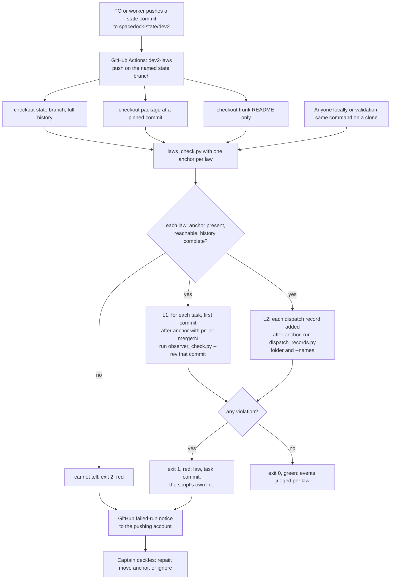

Filed on the Captain's 「同意兩件」 (2026-10-14), after FO compared Bend 2's `LAWS.bend` idea (invariants a checker proves the program keeps) with dev2's failures that day. Those failures were at the layer where FO follows text: a relay FO archived a task without an observer report, FO built dispatches before running `dispatch_records.py --names`, and FO answered a chat cue without running Spacedock's hooks. The scripts themselves were not wrong.

## Scope

- One file listing dev2 invariants, each checked by a script against the committed `spacedock-state` history, for example: no `pr: pr-merge:N` sentinel without a committed `observer.md` where `learn` is listed; every dispatch record carries an absolute `Package root:` line; the head a delivery gate question names equals the latest passing validation report's candidate.
- Existing checks that are already such laws and would join the list: `observer_check.py`, `dispatch_records.py`, `delivery_gate.py`, `design_surfaces.py check`.
- A run point that does not depend on FO remembering it: candidate is CI on each push to the state branch; which run point is for ideation.
- Observer rules read today as `can't tell` are candidates to become laws (task `chat-only-evidence-observer-blind`).
- No Spacedock change; Python, no new language.
- Non-goals: to be set at ideation.

## Design

The ruling: ship one package-owned laws file and one runner, `scripts/laws_check.py`, that calls the checks dev2 already has on events in the committed `spacedock-state/dev2` history, run by a GitHub Actions workflow on each push to that branch. v1 carries two laws, and each law judges only events after an anchor commit the adopter names for it.

### Chain check (2026-10-16)

- **Spacedock 0.27.2** (`spacedock --help`, `spacedock gate validate`, `spacedock state --help`): no command checks workflow-state invariants over history. `gate` lists a `validate` in the top-level help and answers "unknown subcommand (want: prepare|withdraw|record|consume)"; `doctor` checks plugin and binary compatibility only. `spacedock status` exiting 0 on a state checkout is Spacedock's own schema check and stays Spacedock's. Nothing to reuse; no Spacedock change is needed.
- **kc-dev-flow-2 0.23.0** (`origin/main` 1383c911): no laws file and no workflow touching the state branch (`.github/workflows/kc-dev-flow-2-tests.yml` runs on PRs and `push: main`). The checks exist and work, but each runs only when FO or a worker runs it: `observer_check.py <state> <slug> [--rev REV]` already reads a past commit, `dispatch_records.py <task folder>` and `--names <record>...`, `design_surfaces.py check <task>`, `delivery_gate.py check`. `pr_watch.py tasks` is FO's idle-hook runner for the PR-bound ones. `decision_ledger.py` (`split_task`, `ledger`) is the one script that already walks active and archived task files read-only; the runner imports `split_task` for frontmatter instead of writing a fourth parser.
- **Siblings** (read-only, `gh api`, 2026-10-16): `spacedock-dev/subspace-relay` and `spacedock-dev/subspace-web` (private) each have a `spacedock-state/dev2` branch (relay also `dev`, `dev2-poc`, `plan`); `contents/.github?ref=spacedock-state/dev2` answers 404 on both, so neither runs a workflow on its state branch. Trunk workflow files were listed by name only (`ci.yml`, `release.yml`, relay also deploy and release-gate files), not read. qnow has no local clone on this machine and was not probed.
- **Bounded existing-code check:** the checks above are complete and unit-tested; what is missing is a run that does not depend on FO. Use them unchanged, through subprocess, and add only the runner, the laws file and a workflow template. No script is replaced.
- **ADRs and rulings read:** ADR 0014 records that `workflow_checkout.py` is prose-enforced and says to reopen "if Spacedock gains a pre-dispatch hook"; ADR 0009 cites SWE-CC (agents violate 43.1% of applicable repository policies, nearly half of them in the process) and makes finding problems automatically the direction. `git -C <state> grep -n 'Override:'` (2026-10-16): every hit is prose in a task body, none is a gate record; no past ruling goes against CI on the state branch or against a check that adds no FO words.

### PRFAQ

**Press release (future).** From the next kc-dev-flow-2 release, an adopter whose state branch carries the one-file workflow gets a red GitHub run within a minute of a push that breaks a dev2 law: a task reached `pr: pr-merge:N` with no observer report committed beforehand, or a worker dispatch record lacks a part the README requires. The run names the law, the task, the commit and the check's own words. FO's reading does not grow: nothing in the README, the idle mod or any script output changes. Each law judges only events after an anchor commit written in the workflow file, so adopting it never starts red over history that predates the rule.

**FAQ**

- *Why did FO's own checks not catch these?* They run when FO remembers. On 2026-10-14 a relay FO archived a task with no observer report, FO built dispatches before running `dispatch_records.py --names`, and FO answered a chat cue without running Spacedock's hooks. Two of the three leave a committed trace; the third (hooks skipped) leaves none, so no history law can see it.
- *Does CI stop the mistake?* No. It runs after the push, so it detects a violation; it cannot stop `merge guard` or a dispatch already built. Prevention stays with `names-check-before-dispatch`, `extension-instruction-reaches-dispatch` and the merge-time observer check.
- *Why is a red run sticky?* An event is a committed fact: a record or a sentinel cannot be un-written. A violation stays red until the anchor moves past it. Moving the anchor is the Captain's acceptance, recorded as a commit to the workflow file on the state branch. A waiver list is the next step only if moving the anchor hides things that bite.
- *Who sees a red run?* v1: GitHub's failed-run notification to the account that pushed (D3). Not verified that it reaches the Captain; AC-8 asks him.
- *What does a law cost to add?* One section in `laws.md`, one function in the runner, one anchor flag in each adopter's workflow file. A law with no anchor flag is printed as `not judged`, so a release that adds a law does not turn an adopter red.
- *Is this a new platform?* No: the runner has no scheduling, state or network use; the workflow reads only the repository and calls `laws_check.py`.

### The laws in v1

| Id | Rule | Event, judged by | Bite | Anchor to use |
| --- | --- | --- | --- | --- |
| L1 `observer-before-sentinel` | When the workflow README lists `learn`, an observer report (or its `observer not run: <reason>` line) is committed no later than the commit that first writes `pr: pr-merge:<N>` in the task's frontmatter. | The first such commit per task, found by reading each candidate commit's parsed frontmatter, not by substring; judged by `observer_check.py <state> <slug> --rev <commit>`. | A relay FO archived a task with no observer report (2026-10-14); roborev:653 on `fo-lifecycle-mod` names this law as `dev2-laws-check`'s first. In this state branch `observer-before-merge-guard` committed its report after its sentinel: `observer_check.py` at tip passes it, `--rev` at the sentinel fails it. | `91fae734` (that task's own sentinel commit) |
| L2 `dispatch-record-complete` | Each dispatch record has every part `dispatch_records.py` requires and no bare package script name. | Each `<task>/dispatch/*.md` whose adding commit is after the anchor; judged by `dispatch_records.py <task folder>` and `dispatch_records.py --names <records>`. | 5 bare-name, 7 missing completion-to-`main`, 4 missing `Package root:` hits in 12 of 68 records added since `49da5ddb` (Measurements). `names-check-before-dispatch` records the late `--names` catch on at least three dispatches. | D1 recommends the tip at adoption, not `49da5ddb` |

**Eligible, not wired in v1** (each a one-section addition later; D4 asks whether to wire them now):

- *Delivery head equals dispatched candidate.* Grammar it would assert: the committed validation briefing's `question` carries `head <7-40 hex>` and that value prefix-matches a `Candidate: <40-hex>` line of the latest `validation-N.md` at that commit, via `delivery_gate.py check ... --head`. Measured 2026-10-16 at `e73634e6`: of 39 committed validation briefings, 13 carry a `head <hex>` token and 1 task (`delivery-gate-verdict-form`) has a `Candidate:` line in a validation record header, so after any sensible anchor the in-scope set is about 0. It would be green because it judged nothing, with no consumer to bite yet.
- *`design_surfaces.py check` on tasks.* At `e73634e6`, 3 of 25 archived tasks fail (all lack `## FO alignment`, a rule they predate) `journey-server-host-pilot.md` ends in a Python traceback (`design-surfaces-task-dir-crash` is filed), and live `pr-review-lite-value-pilot.md` lacks a `Surfaces:` line. `amendment-form-check` states its new rules add 8 corpus errors on closed tasks, which cannot be repaired. No recorded case of FO skipping the run.
- *`delivery_gate.py` at the ask* needs the live PR head from GitHub; stays FO-run.
- *`can't tell` observer rules* (`chat-only-evidence-observer-blind`): the rules leave no committed record, so a history law cannot judge them either. That task decides whether each names a record; each one that does becomes a law row.

### What the runner does

`python3 <package>/scripts/laws_check.py <state checkout> [--rev REV] [--readme FILE] --anchor L1=<sha> [--anchor L2=<sha>]`

- Reads committed bytes only (`git show`, `git ls-tree`, a `git archive` of REV into a temp directory for the folder-mode script), never the working tree; changes nothing.
- Prints one line per law, `L1 observer-before-sentinel: <N> events judged after <anchor>, <M> violated`, then one `violation:` line per violation naming the law, the task or record, the commit and the first line of the check's own output. A law with no `--anchor` prints `not judged, no anchor`.
- Exit 0 every anchored law held; 1 some law violated; 2 something could not be judged (fail closed, red), even when another law also failed; both kinds print.
- Exit 2 causes (each its own test): history shallow (`git rev-parse --is-shallow-repository`), REV or an anchor not a commit, an anchor not an ancestor of REV (otherwise every event would count as after it), no anchor given, a script missing, a check exiting 2 or printing a Python traceback, a check exiting 1 with output that matches neither line shape the runner parses, L1 anchored with no `--readme` or a README whose `extensions:` cannot be read.
- L1 is judged only when the README lists `learn`; otherwise it prints `0 events judged (README lists no learn)`.
- "After the anchor" means a strict descendant of it, by `git merge-base --is-ancestor`. `origin/spacedock-state/dev2` has 1024 commits, 0 merges.
- Bounds: first sentinel per task only (a `merge guard --rework` that later rewrites `pr:` is not judged again); a record's adding commit is its newest `--diff-filter=A` commit.

### Workflow template and run point

`references/sd/state-laws.workflow.yml`, copied by FO onto the state branch at `.github/workflows/dev2-laws.yml` with the adopter's anchors and a pinned package commit. Trigger `push` on the one named state branch (not `spacedock-state/**`; relay has four state branches), `concurrency` with `cancel-in-progress`, `permissions: contents: read`, no secrets. Steps: checkout state (full history), checkout `iamcxa/kc-claude-plugins` at a pinned commit of a published `kc-dev-flow-2-vX.Y.Z` tag for the scripts (public, so private adopters need no token; the state branch carries no scripts), sparse checkout of trunk's `docs/dev2/README.md` for `extensions:`, run the command above. Rolling this out is a separate state-branch commit after release, on the Captain's word, once per adopter; it is not part of this task's PR.

The run point for ideation and validation is the same command run on a clone: validation runs it for AC-4 and AC-6, and anyone can run it before a gate.

**Cost.** Pushes to the state branch are bounded by its commit count, 1024 in the 30 days to 2026-10-16 (`git rev-list --count origin/spacedock-state/dev2`); runs per month are not measured. Measured wall time per check on this machine, largest task: `dispatch_records.py` 1.17 s, `observer_check.py` 0.70 s; end-to-end job time is not measured and AC-12 requires it from the probe runs. `kc-claude-plugins` is public; relay and subspace-web are private, so their minutes are billed and not measured here.

**Profile check** (`references/profiles/pilot.md` return triggers). A `push` trigger answers a push; a `schedule:` cron would be unattended recurring operation and needs a profile ruling, so v1 has none. No production data or credentials, no consumer-required migration (adopters opt in by adding one file), no release or rollback duty: a red run puts no one on call.

### Measurements (read-only, 2026-10-16)

State: `git clone --branch spacedock-state/dev2 https://github.com/iamcxa/kc-claude-plugins.git`, revision `e73634e6dab6e96eef9b327f489c05ffd3527247` (an ancestor of origin's tip `da2418b9`), package 0.23.0 scripts.

- L1, `observer_check.py <state> <slug> --rev <first sentinel commit>` for all 25 archived tasks: 9 held, 16 violated. Held: `copilot-quota-refusal-is-not-a-review`, `delivery-gate-verdict-form`, `fo-lifecycle-mod`, `fo-record-checks`, `followup-dispatch-records-checked`, `learn-delivery-follow-through`, `pr-watch-state-per-session`, `worker-completion-goes-to-main`, `workflow-checkout-must-match-trunk-readme`. The 9 are exactly the tasks whose sentinel is a strict descendant of `91fae734`; the 16 violated are the other 15 (before the rule existed) plus `observer-before-merge-guard`, which committed its report 11,382 s after its sentinel (`git log --diff-filter=A` times 1791876623 and 1791888005).
- L2 with anchor `49da5ddb`: 68 records added after it, 12 violate (16 part hits: 5 bare-name over `delivery-gate-verdict-form`, `fo-lifecycle-mod`, `followup-dispatch-records-checked`; 7 missing completion-to-`main` and 4 missing `Package root:` in `journey-server-host-pilot` implementation-8 to -11 and validation-8 to -10). Run over all history with today's scripts, 10 of the 11 archived tasks that have dispatch records fail at least one part or the bare-name check, because the rules came later; this is why every law needs an anchor.
- State branch tolerance: on a scratch clone with a committed `.github/workflows/dev2-laws.yml`, `spacedock status --workflow-dir <scratch>` printed byte-identical output to the clone without it (28 lines, exit 0).

### Unverified at ideation

- That GitHub runs a push workflow committed on the orphan state branch and that the job passes: ideation pushes nothing. AC-8 runs it on a probe branch.
- That `spacedock state init`, `gate prepare` or `merge guard --rework` leave a `.github/` directory on the state branch alone: only `status` was probed. AC-9 probes the rest on a scratch clone.
- Who commits `.github/workflows/dev2-laws.yml`: `spacedock state commit <slug>` is path-scoped to one task, so it is a plain path-scoped `git add`/`commit -- <path>` by FO, once.
- That GitHub's failed-run notice reaches the Captain.

### Batch overlap

Read 2026-10-16 from the four other tasks' current text (names-check, extension-instruction and amendment-form now hold designs; prod-security-review-gates holds only its seed). Files this task would change:

| File | This task | Other batch-1 task on the same file or check |
| --- | --- | --- |
| `kc-dev-flow-2/scripts/laws_check.py`, `test_laws_check.py`, `references/sd/laws.md`, `references/sd/state-laws.workflow.yml` | new | none |
| `.github/workflows/kc-dev-flow-2-tests.yml` | one step for `test_laws_check.py` | none names it; all four add tests to existing files that already have a step |
| `kc-dev-flow-2/references/sd/adoption.md` | one section (anchor rule, rollout, limits) | none names it |
| `kc-dev-flow-2/scripts/dispatch_records.py` | untouched; L2 calls its folder run and `--names` | `names-check-before-dispatch` (`--newest` branch in `main`) and `extension-instruction-reaches-dispatch` (a folder-run part and `--readme FILE`) edit it. The runner parses `<record>.md: needs ...` and `<file>:<line>: bare ...`; if the extension task makes the README required, L2 must pass `--readme` or exit 2. Neither orders against this task; implement this one after both, or re-run `test_laws_check.py` after each |
| `kc-dev-flow-2/scripts/design_surfaces.py` | untouched; not wired in v1 | `amendment-form-check` edits it; a later `design_surfaces` law would be anchored after that lands |
| `kc-dev-flow-2/scripts/pr_watch.py` | untouched under D3 option A; option B edits `tasks` | `names-check-before-dispatch` edits `tasks` too: B would need a merge order with it |
| `kc-dev-flow-2/references/sd/workflow.md`, `lint-skills.py` `WORKFLOW_WORD_BUDGET` | untouched (`5495 of 5511` stays) | names-check, extension-instruction, amendment-form and prod-security-review-gates may add README words against the same 16-word headroom; this task adds none |
| `docs/adr/` | one ADR draft: "history laws judge only events after an anchor" | `amendment-form-check` also adds one; FO reserves numbers in dispatch order |

Absorbs none of the four, leaves all: a history check detects after the push, while names-check and extension-instruction need the catch before the worker runs. Each, once landed, becomes a check L2 already runs or a row added to `laws.md`. `chat-only-evidence-observer-blind` (not in batch 1) is the route by which `can't tell` rules become future rows.

### Words FO reads at each moment

Rule as `learning.md`, "Measure the words FO reads at each moment, not one file's size": every passage and script output that instructs a step due at the moment, counted with `len(text.split())`, same way for base and candidate. This design edits no passage and no script output FO reads, so each moment reads the same text in both columns; a full per-passage recount at 0.23.0 was not redone, and validation recounts with the fo-lifecycle-mod rule. Measured today on `origin/main`: the idle mod `references/sd/mods/kc-dev-flow-2.md` is 48 words; `references/sd/workflow.md` is 5495.

| Moment | Base | Candidate, D3 option A (recommended) | Candidate, D3 option B |
| --- | --- | --- | --- |
| Startup | mod + `pr-merge` startup hook + `tasks` output | same text, 0 added | same, plus 19 words only when the latest laws run is red |
| Idle on an open PR | mod + `pr-merge` idle hook + `wait`/`tasks` output | same | same plus 19 only when red |
| Idle on a merged PR (observer check) | same + `observer_check.py` output | same | same plus 19 only when red |
| After the archive | `after pr-merge:` lines + `observer_check.py` exit 0 | same | same plus 19 only when red |
| The merge ask | authority paragraph + `delivery_gate.py` output | same | same plus 19 only when red |
| Adoption (once, not an FO moment) | adoption.md | plus one section | plus one section |

The B line, drafted not shipped: "next: the laws check is red on spacedock-state/dev2: read it with `gh run view --log-failed` and tell the Captain." (19 words, counted). The README total is unchanged under both.

### Non-goals

- No Spacedock change, no new language: Python standard library and `git`, as the scripts it calls.
- The run reports; it does not block `merge guard`, a dispatch or a push.
- No repair of history before an anchor, and no waiver list in v1: moving the anchor is the acceptance.
- Laws check form; whether a record means the right thing stays with the observer (the first bullet of `amendment-form-check`).
- No `schedule:` trigger (D2) and no adopter-specific laws: the laws file is package-owned and not copied into `docs/dev2`.
- Rolling the workflow onto this repository's state branch or an adopter's is a later state-branch commit on the Captain's word, not this PR. A workflow whose state is inline in the trunk has no state branch to trigger on and is not covered.

### Existing-code and retention check

Without the laws runner, nothing runs `observer_check.py` or `dispatch_records.py` unless FO does, which is the failure class the Captain filed. Without `laws.md`, the runner's function list has no reader-facing statement of what each law is for and which failure it bit; the parity test (AC-1) is what keeps the two from drifting. Without an anchor, the measurements above show red on 16 of 25 and on pre-rule records forever.

## Acceptance criteria

`PKG` is `<package>/..` of the candidate checkout (`kc-dev-flow-2/`); `STATE` is a full clone of `spacedock-state/dev2` (`git clone --branch spacedock-state/dev2 https://github.com/iamcxa/kc-claude-plugins.git`); `E73` is `e73634e6dab6e96eef9b327f489c05ffd3527247`. Every "not yet verified" below is the honest current state: ideation runs nothing on the candidate. Design-time evidence is under `### Measurements`.

- **AC-1** `references/sd/laws.md` has one section per law the runner registers, each stating the rule, the event, the script it calls and the failure that bit; a test fails when the two lists differ. Evidence: `python3 PKG/scripts/test_laws_check.py` includes `test_laws_file_matches_registry`. Falsifier: a heading added to `laws.md` with no registered function, and a function registered with no heading, each fail that test (two mutation runs, run with `python3 -B`). Current evidence: not yet verified.
- **AC-2** The runner's exit contract holds: 0 all anchored laws held, 1 a law violated, 2 something could not be judged; exit 2 wins when both occur and both are printed. Evidence: one test per cause in `### What the runner does` (shallow history, REV not a commit, anchor not a commit, anchor not an ancestor, no anchor, script missing, check exits 2, check prints a traceback, check exits 1 with unparseable output, L1 with no `--readme`), each asserting exit 2 and the cause in the output, not only the exit code. Falsifier: removing the shallow-history guard turns the shallow test from exit 2 to exit 0; making the runner treat a traceback as a violation turns that test from 2 to 1. Current evidence: not yet verified.
- **AC-3** L1 judges history, not the tip: on a scratch state repository built by the test, (a) observer committed before the sentinel is held; (b) no observer is violated; (c) observer committed after the sentinel is violated although `observer_check.py <state> <slug>` at the tip exits 0; (d) a task body that quotes `pr: pr-merge:7` in prose is not an event; (e) a sentinel at or before the anchor is not judged; (f) a README with no `learn` gives 0 events. Evidence: `test_laws_check.py` cases (a) to (f). Falsifier: replacing the `--rev <commit>` call with a tip call turns (c) from violated to held; matching the sentinel by substring instead of parsed frontmatter turns (d) from 0 events to 1. Current evidence: not yet verified.
- **AC-4** L1 on the real history reproduces the design-time counts. Evidence: with `README` the file `git show origin/main:docs/dev2/README.md` (its `extensions:` lists `learn`), `python3 PKG/scripts/laws_check.py STATE --rev E73 --readme README --anchor L1=91fae734` prints `9 events judged ... 0 violated` and exits 0; with `--anchor L1=166c16d968305ad711481276809433a15fcf8a5e` (the root commit) it prints `25 events judged ... 16 violated`, exit 1, and the 16 `violation:` lines name the 15 pre-rule tasks and `observer-before-merge-guard`. Falsifier: the tip-call mutation from AC-3 makes the root-anchor run report 15, not 16, because `observer-before-merge-guard` then reads as held. Current evidence: the 9/16 split was measured with `observer_check.py --rev` per task; the runner does not exist yet, so not verified.
- **AC-5** L2 judges records added after its anchor and names the part. Evidence: scratch fixtures with a record that (a) lacks the completion-to-`main` line, (b) lacks an absolute `Package root:`, (c) names a package script bare, (d) is only a pointer to another record, (e) is complete, and (f) violates but was added before the anchor; the runner reports (a) to (d) as `violation:` lines naming the record and the part, and (e), (f) as none. Falsifier: judging by the task's `started:` date or the record's file mtime instead of its adding commit turns (f) into a violation; dropping the `--names` call turns (c) into held. Current evidence: not yet verified.
- **AC-6** L2 on the real history reproduces the design-time counts. Evidence: `laws_check.py STATE --rev E73 --anchor L2=49da5ddb574f9aba739e33b97632338bc69ef7c2` prints `68 events judged ... 12 violated`, exit 1, naming the 12 records listed in `### Measurements`; any difference is explained by a record that the design-time script run and the runner place on opposite sides of the anchor, named in the validation report. Falsifier: dropping the ancestry filter makes the run judge every record at E73, so the count rises above 68 and the violations above 12. Current evidence: 68 and 12 measured by a design-time script that used `git merge-base --is-ancestor` on each record's adding commit; the runner is not written, so not verified.
- **AC-7** The runner's tests run in the package's CI. Evidence: the candidate PR's `kc-dev-flow-2 tests` run, read per run id (`gh run view <id> --json jobs`), lists a step `test_laws_check.py` that passed, and `python3 PKG/scripts/lint-skills.py` and `PKG/scripts/test_lint_skills.py` still pass with the new reference files. Falsifier: deleting the new step from the workflow leaves the step list without it. Current evidence: not yet verified.
- **AC-8** The workflow runs on GitHub from the state branch. Evidence, on a throwaway branch `spacedock-state/laws-probe` made from the state branch plus the template workflow with its trigger set to that branch: (a) a push with a task whose sentinel has its observer report runs green; (b) a push adding a sentinel with no observer report runs red, exit 1, the log carrying the `violation:` line; (c) a push with an unknown anchor runs red, exit 2; run ids and conclusions from `gh run list --branch spacedock-state/laws-probe --json databaseId,conclusion`; then the branch is deleted. The Captain states in the validation report whether (b) or (c) notified him. Falsifier: a branch with no workflow file shows no run for the same push. If the notice did not reach him, D3 flips to option B before merge. Current evidence: not yet verified.
- **AC-9** A `.github/` directory on the state branch does not disturb Spacedock. Evidence: on a scratch clone with the template committed, `spacedock status`, `spacedock status --next`, `spacedock state init`, `spacedock gate prepare` and `spacedock merge guard <slug> --rework` run, and the file is still present and unchanged after each (`git diff --exit-code`). Falsifier: any of them removing or editing the file fails the criterion and the rollout step is held. Current evidence: `spacedock status` output identical with and without the file (28 lines, exit 0, design-time scratch); the other four not yet verified.
- **AC-10** FO reads no more words at any moment under D3 option A. Evidence: the candidate diff touches none of `references/sd/workflow.md`, `references/sd/mods/*.md`, `extensions/*/EXTENSION.md`, `scripts/pr_watch.py`, `scripts/observer_check.py`, `scripts/dispatch_records.py`, `scripts/delivery_gate.py` (`git diff --stat <base> <head> -- <those paths>` is empty), and `lint-skills.py` still prints `5495 of 5511` (or the merged value if another batch task has landed words first, with the delta unchanged). Under option B the table in `### Words FO reads at each moment` is recounted with its rule and the added words are 19 only on a red run and 0 on a green one. Falsifier: any diff in those paths fails option A and triggers the per-moment recount. Current evidence: by design no such edit; not yet verified on a diff.
- **AC-11** `references/sd/adoption.md` gains one section stating the anchor rule, that a red run is sticky until the anchor moves, that the run detects and cannot block `merge guard`, the rollout once per adopter on the Captain's word, and the unverified items. Evidence: the section, and `python3 PKG/scripts/adr_lint.py docs/adr --since <base>` passing with the ADR "history laws judge only events after an anchor" (no number in this design; FO reserves it). Falsifier: the section lacking any of those five statements. Current evidence: not yet verified.
- **AC-12** The PR body states the trigger and a measured per-run time. Evidence: durations from the AC-8 runs (`gh run view <id> --json jobs`) quoted with their run ids, and the sentence that private adopters' minutes are not measured. Falsifier: a number in the PR body with no run id beside it. Current evidence: not yet verified; measured today only the per-script wall times in `### Workflow template and run point`.

## Unresolved decisions for the Captain

Past rulings read: ADR 0009 and ADR 0014 (see `### Chain check`); no gate `Override:` line bears on these.

- **D1: where do the anchors go?** Recommend L1 at `91fae734` (the sentinel commit of the task that introduced the observer rule: 9 events judged, 0 violated) and L2 at the state branch's tip on the day an adopter turns the workflow on, not at `49da5ddb`. A history violation cannot be repaired, so an anchor that starts red stays red until it is moved. What gets worse: L2 never judges the 68 records added since `49da5ddb`, so the 12 violations (7 of them in the still-open `journey-server-host-pilot`) stay unflagged by CI; they are reported once in `### Measurements` for you to repair or accept. Choosing `49da5ddb` instead gives a real but permanent red from the first run.
- **D2: what triggers the run?** Recommend `push` on the one named state branch with `cancel-in-progress`, and no `schedule:`. A cron would be unattended recurring operation, which `references/profiles/pilot.md` lists as a trigger to return to profile selection, so it would need your ruling. What gets worse: no push means no run, so a miss shows up at the next push; private adopters (relay, subspace-web) pay minutes per run, up to 1024 pushes in the last 30 days on this branch alone, minutes unmeasured.
- **D3: how does a red run reach anyone?** Recommend option A: GitHub's failed-run notice to the pushing account, zero FO words. Option B adds one `next:` line (19 words, only when red) to `pr_watch.py tasks`. What gets worse under A: if your notifications for that account are off, a red run sits unseen (AC-8 asks you, and flips this to B before merge if the notice did not arrive); under B, `pr_watch.py tasks` is also edited by `names-check-before-dispatch`, so the two need a merge order.
- **D4: which laws are wired in v1?** Recommend two: L1 and L2, the only two with recorded failures and a script that works over committed history. The head-equals-candidate law you named as an example is left out because it would judge about 0 events today (13 of 39 briefings carry a head token, 1 task has a `Candidate:` line), and `design_surfaces.py check` is left out because it has no recorded skipped run and fails closed tasks that cannot be repaired. What gets worse: the delivery-head mismatch stays an FO-run check until a later row; adding either now costs one section and one function each and would print `0 events judged` for the head law.

## FO alignment

Alignment: not needed before ideation; the Captain approved filing it.
Release review: not needed: workflow maintenance, on no journey map.
Surfaces: none
Visible change: none

## Stage Report: ideation

- DONE: A design (PRFAQ and Mermaid) for one file of dev2 invariants, each checked by a script over the committed spacedock-state history, and a run point that does not depend on FO remembering; which existing checks join it, and which of the batch-1 tasks it absorbs or leaves
  `## Design`: `laws.md` plus `scripts/laws_check.py` calling `observer_check.py --rev` (L1) and `dispatch_records.py` folder and `--names` (L2) on events after a per-law anchor; run point is a push workflow on the named state branch plus the same command locally. Joins: observer_check, dispatch_records; eligible but not wired: delivery head, design_surfaces (D4). Absorbs none of the four, leaves all.
- DONE: A `### Batch overlap` section naming each file the design would change and each other batch-1 task (prod-security-review-gates, dev2-laws-check, extension-instruction-reaches-dispatch, names-check-before-dispatch, amendment-form-check) that changes the same file or check, so FO can order implementation
  Table read from the other four tasks' text on 2026-10-16: shared surfaces are `dispatch_records.py` (names-check, extension-instruction), `design_surfaces.py` (amendment-form), `pr_watch.py` (names-check, only under D3 option B) and the README word budget; no file edited by two tasks including this one.
- DONE: The words FO reads at each lifecycle moment, before and after, per root learning.md "Measure the words FO reads at each moment, not one file's size"
  Five-moment table for options A and B: 0 added under A; 19 words only on a red run under B. Not redone: a per-passage recount at 0.23.0 (this design edits no passage or output; AC-10 has validation recount).
- DONE: Acceptance criteria with reproducible evidence clauses and falsifiers, and unresolved decisions for the Captain, each with a recommendation and what gets worse under it
  `## Acceptance criteria` AC-1 to AC-12 and `## Unresolved decisions for the Captain` D1 to D4. Current evidence per criterion:
  AC-1 not yet verified (needs the registry test). AC-2 not yet verified (needs the runner).
  AC-3 not yet verified (needs the L1 fixtures). AC-4 not yet verified; the 9 held / 16 violated split was measured with `observer_check.py --rev` per task at `e73634e6`.
  AC-5 not yet verified (needs the L2 fixtures). AC-6 not yet verified; 68 records / 12 violating measured by a design-time script with `git merge-base --is-ancestor`.
  AC-7 not yet verified (needs the PR's CI run). AC-8 not yet verified (needs a push of the probe branch; ideation pushes nothing).
  AC-9 partly verified: `spacedock status` output identical with and without `.github/` on a scratch clone (28 lines, exit 0); `state init`, `gate prepare`, `merge guard --rework` not yet verified.
  AC-10 not yet verified on a diff; no FO-read file is edited by design. AC-11 not yet verified. AC-12 not yet verified; only per-script wall times measured (1.17 s, 0.70 s).
  `python3 <package>/scripts/design_surfaces.py check dev2-laws-check.md` printed "dev2-laws-check.md: design surfaces presentable", exit 0.

### Summary

The design is one package-owned laws file and a runner that reuses `observer_check.py --rev` and `dispatch_records.py`, run by a push workflow on the state branch; two laws, each judging only events after an anchor. Measured on the real history: without an anchor L1 fails 16 of 25 tasks and L2 fails 12 of 68 records, so anchors are the load-bearing choice, and a red run is sticky because history cannot be repaired. Needs your decision: D1 anchors (L1 at `91fae734`, L2 at adoption tip), D2 push-only trigger (cron would be a Pilot profile trigger), D3 how red reaches anyone (GitHub notice, or one 19-word `pr_watch.py` line), D4 two laws in v1 (the head-equals-candidate example judges about 0 events today).
