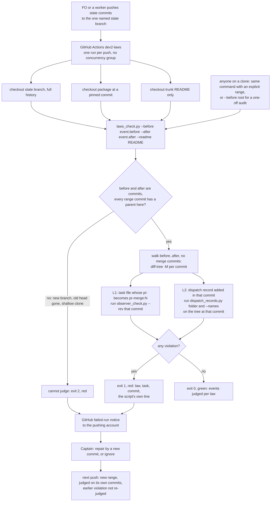

Filed on the Captain's 「同意兩件」 (2026-10-14), after FO compared Bend 2's `LAWS.bend` idea (invariants a checker proves the program keeps) with dev2's failures that day. Those failures were at the layer where FO follows text: a relay FO archived a task without an observer report, FO built dispatches before running `dispatch_records.py --names`, and FO answered a chat cue without running Spacedock's hooks. The scripts themselves were not wrong.

## Scope

- One file listing dev2 invariants, each checked by a script against the committed `spacedock-state` history, for example: no `pr: pr-merge:N` sentinel without a committed `observer.md` where `learn` is listed; every dispatch record carries an absolute `Package root:` line; the head a delivery gate question names equals the latest passing validation report's candidate.
- Existing checks that are already such laws and would join the list: `observer_check.py`, `dispatch_records.py`, `delivery_gate.py`, `design_surfaces.py check`.
- A run point that does not depend on FO remembering it: candidate is CI on each push to the state branch; which run point is for ideation.
- Observer rules read today as `can't tell` are candidates to become laws (task `chat-only-evidence-observer-blind`).
- No Spacedock change; Python, no new language.
- Non-goals: to be set at ideation.

## Design

The ruling: `scripts/laws_check.py` judges only the events that the commits of one push add, the `before..after` range GitHub reports for a push to the state branch, and reports each violation once, in that push's run; the next push is judged on its own commits, so its run is green again whether or not the violation was repaired. Captain amendment 1 (「就按照新的建議」) withdraws the guarantee that a committed violation stays red, and the per-law anchors that served it go with it.

### Chain check (2026-10-16)

- **Spacedock 0.27.2** (`spacedock --help`, `spacedock state --help`, `spacedock gate validate`): no command checks workflow-state invariants over history. `gate` lists `validate` in the top-level help and answers "unknown subcommand"; `doctor` checks plugin and binary compatibility only. Nothing to reuse; no Spacedock change.
- **kc-dev-flow-2 0.23.0** (`origin/main` 1383c911, still the head of `main` by `gh api repos/iamcxa/kc-claude-plugins/commits/main`): no laws file and no workflow on the state branch; the checks exist and run only when FO or a worker runs them: `observer_check.py <state> <slug> [--rev REV]`, `dispatch_records.py <task folder>` and `--names <record>...`, `design_surfaces.py check`, `delivery_gate.py check`. `decision_ledger.py` (`split_task`, `unquote`) is the one frontmatter parser the runner reuses.
- **Siblings** (read-only `gh api`): `spacedock-dev/subspace-relay` and `spacedock-dev/subspace-web` each have a `spacedock-state/dev2` branch with no `.github/` on it (404). qnow has no local clone here and was not probed.
- **Existing code:** PR #651 (head d64cf199, Draft, five checks green) is the existing implementation of the anchor design; this redo reuses it. Disposition by symbol is under `### What PR #651 becomes`.
- **Rulings read:** ADR 0009 (SWE-CC: agents violate 43.1% of applicable repository policies; finding problems automatically is the direction); ADR 0014 (a prose-enforced check reopens if a hook arrives). `git -C <state> grep -n 'Override:'`: no gate record bears on this. The first ideation gate (batch 1) accepted a push-only trigger and two laws as recommended, and amendment 1 does not touch either.

### PRFAQ

**Press release (future).** From the next kc-dev-flow-2 release, an adopter whose state branch carries the one-file workflow gets a red GitHub run within seconds of a push that adds a dev2 violation: a task first written as `pr: pr-merge:N` with no observer report committed beforehand, or a dispatch record added with a missing required part. The run names the law, the task or record, the commit and the check's own words. The next push is judged only on what it adds, so the run after a violation is green again, and turning the workflow on starts green: its first range holds the one commit that adds the workflow file. FO reads no more than today.

**FAQ**

- *Why not keep the run red until it is fixed?* The Captain ruled it out (amendment 1). What gets worse: a red run nobody sees disappears from view at the next push. A violation is a committed fact and no later commit un-writes it; a repair is a new commit that the next run simply does not judge.
- *What counts as "the events a push adds"?* The commits in `before..after`, each read at its own commit: a task file whose parsed `pr:` becomes a `pr-merge:N` sentinel in that commit (L1), a dispatch record added in that commit (L2). A bad event added and corrected inside the same push is still red, because the adding commit is what was committed.
- *Does CI stop the mistake?* No. It runs after the push; it cannot stop `merge guard` or a dispatch already built. Prevention stays with the merge-time observer check, `names-check-before-dispatch` and `extension-instruction-reaches-dispatch`.
- *Why no `concurrency` block?* Each run owns one range. A cancelled run is a range nobody judges, and a concurrency group keeps at most one pending run, so a middle push could be dropped (GitHub documentation, not probed here; AC-18 probes two back-to-back pushes).
- *Can I still audit the old history?* Yes, once, by hand: the same command with `--before <root commit>` replays every event ever added. That is an audit, not a CI check, and it is expected to report old violations.
- *Who sees a red run?* GitHub's failed-run notice to the pushing account (D1). Not verified to reach the Captain.
- *What does a new law cost?* One section in `laws.md` and one function in the runner. Because a law judges only pushes made after the adopter pins the release that carries it, a release that adds a law turns no adopter red on history.



### The laws in v1

| Id | Rule | Event, judged by | Bite |
| --- | --- | --- | --- |
| L1 `observer-before-sentinel` | When the workflow README lists `learn`, an observer report (or its `observer not run: <reason>` line) is committed no later than the commit that writes `pr: pr-merge:<N>` in a task's frontmatter. | A commit in the range where a top-level or `_archive/` `<slug>.md` has a parsed `pr:` sentinel and its first parent's file (followed through a rename) did not. Judged by `observer_check.py <state> <slug> --rev <commit>`. | A relay FO archived a task with no observer report (2026-10-14); roborev:653 on `fo-lifecycle-mod` names this law as this task's first. |
| L2 `dispatch-record-complete` | Each dispatch record has every part `dispatch_records.py` requires and names no package script without its directory. | A commit in the range that adds a `<task>/dispatch/<name>.md` (status A, or a rename from a path that is not a dispatch record). Judged by `dispatch_records.py <task folder>` and `--names <records>` over the record and its folder as committed at that commit. | 15 missing parts in 10 of 48 records added after `49da5ddb` at `e73634e6` (4 bare script names, 7 without the completion recipient `main`, 4 without an absolute `Package root:`). |

Bound changes from #651: L1 judges every transition into a sentinel, so a `merge guard --rework` that clears `pr:` and a later sentinel are judged again (the observer report from the first pass satisfies it); the first-per-task bound is gone. An archive move or a task-folder rename is no event for either law, by rename detection (`-M`).

Eligible, not wired (unchanged from the first gate, D4 there): delivery head equals the dispatched candidate (13 of 39 committed validation briefings carry a `head <hex>` token, 1 task has a `Candidate:` header line, so it would judge about 0 events); `design_surfaces.py check` on tasks (3 of 25 archived tasks fail on a rule they predate; `design-surfaces-task-dir-crash` filed); `delivery_gate.py` at the ask needs the live PR head and stays FO-run. Each is one section and one function when wanted, and with no anchors a new law needs no per-adopter setting.

### What the runner does

`python3 <package>/scripts/laws_check.py <state checkout> --before <commit> [--after <commit>] [--readme FILE]` (`--after` defaults to `HEAD`).

- Reads committed bytes only (`git rev-list`, `git diff-tree -r -M`, `git show`, `git ls-tree`), never the working tree; changes nothing.
- Prints one line per law, `L1 observer-before-sentinel: <N> events judged in <before12>..<after12>, <M> violated`, then one `violation:` line per violation naming the law, the task or record, the commit and the first line of the check's own output.
- Exit 0 every law held; 1 some law violated; 2 something could not be judged (fail closed, red), even when another law also failed; both kinds print.
- L1 is judged only when the README lists `learn` (`readme_extensions`, kept); otherwise it prints `0 events judged (README lists no learn)`. The README is the one supplied at run time, which is the rule in force when the push was judged. This answers the held Cycle 3 P1 by construction: a README change affects pushes after it and cannot turn a past push green, because no past push is judged again. The limit: a re-run or a local run supplied with a different README can give a different verdict for the same range.

Edge cases, each its own test, each a decision rather than a silent default:

| Case | Behaviour | Why |
| --- | --- | --- |
| `--before` all zeros (branch creation) or not a commit in this clone | exit 2, `cannot judge: --before <x> names no commit` | fail closed; a state branch is created once and its first push carries no range |
| Force push, `before` present but not an ancestor of `after` | judge `before..after`, the commits new to the branch | the range is still what the push added; dropped commits are not judged |
| Force push, `before` no longer fetchable | exit 2, same cause as above | cannot tell what the push added |
| A range commit with no parent in this clone (shallow boundary) | exit 2, `cannot judge: <sha> has no parent here` | otherwise `diff-tree --root` would read the boundary commit's whole tree as added and flood the run with old events |
| `git rev-parse --is-shallow-repository` is true | not by itself an error | measured: this state checkout reports true because the repository's `.git/shallow` lists one commit, yet the state branch reaches its root commit; #651's guard would exit 2 here, falsely |
| Merge commits in the range | the merge itself holds no event; every side-branch commit in `before..after` is judged at its own tree | the state branch has 0 merges today; this answers the old unverified item about a side branch forked before an anchor |
| No `--readme` while judging L1 | exit 2 | as in #651 |
| A check crashes, exits 2, exits 1 with no stdout, or exits 1 with a line the runner does not parse | exit 2 naming the check | kept from #651 (`run_check`); also covers the line `extensions not checked: ...` that `dispatch_records.py` prints in #652 |

### Workflow template and run point

`references/sd/state-laws.workflow.yml`, copied by FO onto the state branch at `.github/workflows/dev2-laws.yml` with the adopter's branch name, trunk workflow directory and a pinned package commit. Trigger `push` on the one named state branch (relay has four state branches), `permissions: contents: read`, no secrets, no `concurrency` block. Steps: checkout state with `fetch-depth: 0`; checkout `iamcxa/kc-claude-plugins` at a pinned commit of a published `kc-dev-flow-2-vX.Y.Z` tag; sparse checkout of trunk's `<workflow dir>/README.md`; run `laws_check.py state --before ${{ github.event.before }} --after ${{ github.event.after }} --readme trunk/<workflow dir>/README.md`. Rolling it out is a separate state-branch commit on the Captain's word, once per adopter, not part of this PR. GitHub's "Re-run" reuses the same event, so the same range. A workflow whose state is inline in trunk has no state branch to trigger on.

The run point for ideation and validation is the same command on a clone with an explicit range, so FO's reading does not grow.

Profile check (`references/profiles/pilot.md` return triggers): a `push` trigger answers a push; a `schedule:` cron would be unattended recurring operation and is not used. No production data or credentials, no consumer-required migration, no release or rollback duty: a red run puts no one on call.

### What PR #651 becomes (head d64cf199, read only)

| Piece | Disposition |
| --- | --- |
| `run`, `git`, `Cannot`, `script`, `run_check` (traceback, exit 2, exit 1 with no stdout) and the exit 0/1/2 contract in `main` | kept |
| L2's judging body: write the record and its folder from the adding commit, run `dispatch_records.py` folder and `--names`, parse `<record>.md: needs ...` and `<file>:<line>: bare ...` | kept; its input changes from `additions()` over all history to the range's added records |
| `frontmatter_pr`, `SENTINEL`, `readme_extensions`, `ledger` | kept |
| `after()` (ancestry set), `sentinel_slugs`, `first_sentinel`, `additions`, the `known` all-records scan in `l2_dispatch_record_complete`, `commit_of` for anchors | rewritten as one walk over `rev-list --no-merges before..after` with `diff-tree -r -M --name-status` per commit |
| `--anchor`, `judge()`'s anchor checks, the shallow-history guard, "not judged, no anchor" | deleted; replaced by `--before/--after` and the parentless-commit guard |
| F6 (a slug rename turns L2 into a permanent exit 2) | gone with the `known` scan; a rename is no event |
| `laws.md` | skeleton and the registry-parity test kept; the opening paragraph, each Event line and L1 Bounds rewritten; the anchor and "stays red" sentences deleted |
| `state-laws.workflow.yml` | pinned actions, package checkout, trunk README checkout kept; `concurrency`, the anchor flags deleted; `--before/--after` added |
| `adoption.md` section "State laws check" | rewritten: range rule, no anchors, green on adoption, red once per violation, detects only, rollout on the Captain's word, unverified items |
| `.github/workflows/kc-dev-flow-2-tests.yml` step for `test_laws_check.py` | kept |
| ADR 0017 (reserved for this task) | its #651 decision, "judge only events after an anchor", is replaced by the draft below; no new number |
| `test_laws_check.py` (30 tests) | 18 kept, retargeted to a range: registry parity; held 0 and violated 1; missing script; check exit 2; traceback; unparseable line; no stdout in L1 and in L2 either mode; L1 without README; exit 2 wins; L1 held and violated, report-after-sentinel against the tip, quoted sentinel, README without `learn`; L2 corrected-after, deleted-after, delete and re-add, pointer folder at the adding commit. 7 rewritten: no anchor becomes a missing `--before`; rev not a commit becomes before or after not a commit; a sentinel at or before the anchor becomes a sentinel in an earlier push; archive keeps its sentinel commit becomes an archive move is no event; deleted task becomes a task deleted later in the same push; records after the anchor becomes records added by this push; the property test becomes AC-17. 5 deleted: unknown law (no `--anchor` to misname one), shallow history, anchor not a commit, anchor not an ancestor, a record with no adding commit (the `known` scan). New: a parentless range commit, a violation in one push absent from the next, adoption starting green, a force push, a merge commit, a `--rework` re-sentinel judged again |

### What the anchors, the full-history counts and the property test become

- **Anchors:** deleted. The range is the anchor, so adoption starts green by construction and the first-anchor choice (D1 at the first gate) disappears.
- **Full-history counts:** the figures that were acceptance criteria (9/16, 25/16, 68/12, later 10/0, 25/15, 48/10) were measures of a rule that no longer exists in CI. They become two things. First, fixed-range reproductions on pinned SHAs (AC-15), which pin the event rules (their falsifiers separate on this history, unlike the old AC-4 falsifier). Second, a one-off audit replay with `--before <root>` that is expected to report old violations and gates nothing.
- **Property test:** "no later edit, delete or archive of a file changes a verdict" guarded the sticky guarantee and took about 48 s locally. It becomes AC-17: appending commits after `after` that edit, delete and archive every file in the range leaves the output and exit code of the same `--before/--after` identical. The reads are all at commits inside the range, so it is a small fixture test, not an 8-file by 3-mutation matrix.

### Measurements (read-only, 2026-10-16)

State checkout `.../docs/dev2/.spacedock-state` at `470199a8f8561c95233d6ded98086add7ebc3d44`, equal to `git ls-remote origin spacedock-state/dev2` that day; `e73634e6dab6e96eef9b327f489c05ffd3527247` and the root `166c16d968305ad711481276809433a15fcf8a5e` are ancestors. Package scripts: `origin/main` 1383c911 exported to a scratch directory. All figures below come from a throwaway prototype of the event walk (about 80 lines, not the runner, not retained), run with `python3 -I -B`; the runner must reproduce them or name the difference.

- **Range A** `e73634e6..470199a8`: 100 commits; L1 0 events; L2 33 events, 3 violated (3 parts), exit 1; 10 s wall for the whole run on this machine, one run, 3.7 s of it the event walk.
- **Range B** `166c16d9..e73634e6` (the whole history; an audit): 1018 commits; L1 25 events, 15 violated; L2 149 events, 90 violated, 200 parts; 77 s wall, one run. L1 reproduces #651's root-anchor count of 25/15 from the transition rule, so the event definition agrees with the first-sentinel one on this history. The 15 L1 violators are the tasks before the observer rule existed.
- **Mutations of the event rule, counted on range B** (enumeration only): L1 "any commit that touches a task file already holding a sentinel" gives 50 events instead of 25; L2 "a rename counts as an add" gives 269 instead of 149. Both separate, so AC-15 can carry them as falsifiers.
- **Real pushes** (GitHub events API for the repository, filtered to `refs/heads/spacedock-state/dev2`, which keeps only recent events): 198 pushes from 2026-10-13T06:44:10Z to 2026-10-15T09:20:57Z, 195 of one commit and 3 of two (201 commits); every `before` resolved in the state checkout. Replaying today's rules push by push: 4 L1 events, 0 violated; 58 L2 events; 24 of 198 pushes (12%) would have been red, all L2. Of the 69 pushes after 2026-10-14T09:00Z, 2 would have been red (2026-10-15T01:02:54Z and 04:11:27Z, records of `delivery-gate-verdict-form`). Most red pushes predate the rules they break; the figure shows how often a red run would reach the Captain, not how often agents currently err.
- **Runner time on one push range** (prototype, whole process including Python start, one run per push): median 1.01 s, p90 1.62 s, max 4.93 s over the 198 real pushes. The #651 runner measured 4 s on `e73634e6` and 25 s on the 1115-commit tip (validation cycle 2, one run each), because it walks all history on every push. GitHub job time for the new design is not measured (AC-18 measures it); #651's three probe runs took 9 to 11 s of job time with the full-history runner. `kc-claude-plugins` is public; private adopters' minutes are not measured.
- **Shallow flag:** `git rev-parse --is-shallow-repository` prints `true` in the state checkout, whose shared `.git/shallow` holds one line, while `git rev-list --max-parents=0 HEAD` finds the root commit. Under #651 the runner exits 2 there ("history is shallow"); under this design it does not.

### Words FO reads at each moment

Rule as `learning.md`, "Measure the words FO reads at each moment, not one file's size": every passage and script output that instructs a step due at the moment, counted with `len(text.split())`, the same way for base and candidate. Base is `origin/main` 1383c911 (kc-dev-flow-2 0.23.0), measured today by running the archived `fo-lifecycle-mod/implementation/recount.py` trimmed to its shipped half: passage anchors moved to the 0.23.0 text, the merge-ask head passage renamed, and the `delivery_gate.py` fixture given a `Candidate:` line so the exit 0 output is the one counted. The adapted script is not retained. This design edits no passage and no script output FO reads, so the candidate column is the base column.

| Moment | Base words (passages and outputs) | Candidate |
| --- | --- | --- |
| Startup, one open task PR | 440: `pr-merge` startup 365, mod 48, `tasks` output 27 | 440, 0 added |
| Idle on an open PR, `wait` exit on a green draft | 408: `pr-merge` idle 100, mod 48, `tasks` 27, authority paragraph 215, `wait` 18 (416 when `tasks` runs on the green draft) | 408, 0 added |
| Idle on a merged PR, no observer report, then the rerun | 377: idle 100, mod 48, merge paragraph 82, learn step 35, `wait` 24, `tasks` with report missing 68, rerun 20 | 377, 0 added |
| After the archive | 55: `after pr-merge:` lines and mod step 3, `observer_check` exit 0 28 | 55, 0 added |
| The merge ask, ready PR, CI green | 392: authority 215, head paragraph 57, Extensions merge-ask sentences 90, `wait` 10, `delivery_gate` exit 0 20 | 392, 0 added |
| Total | 1672 | 1672 |

`fo-lifecycle-mod` recorded 1666 at its own head; the 6-word difference is later changes to `main` and is not chased. No option that adds FO words is drafted: a way for FO to read missed red runs needs a record of which it has already seen, which is new state and an edit to `pr_watch.py` (see D1).

### Batch overlap (PR heads read 2026-10-16)

| File | This task | Other batch-1 task on the same file |
| --- | --- | --- |
| `kc-dev-flow-2/scripts/laws_check.py`, `test_laws_check.py`, `references/sd/laws.md`, `references/sd/state-laws.workflow.yml` | edited (already on #651) | none |
| `.github/workflows/kc-dev-flow-2-tests.yml`, `references/sd/adoption.md` | kept step, rewritten section | none |
| `kc-dev-flow-2/scripts/dispatch_records.py` | untouched; L2 calls its folder run and `--names` | #649 (a4217cd3, `--newest`) and #652 (8d051de7, `[--readme FILE]`) edit it. Neither orders against this task. After #652 the folder run prints `extensions not checked: no workflow README above <folder>` when it finds no README, which the runner would read as an unparseable line and exit 2; the implementation passes the runner's own `--readme FILE` to the folder-mode call once #652 has landed, and re-runs `test_laws_check.py` after each of the two |
| `kc-dev-flow-2/scripts/pr_watch.py` | untouched | #649 and #652 edit it |
| `kc-dev-flow-2/scripts/design_surfaces.py`, `references/sd/workflow.md` | untouched | #650 (458324f8) edits both; this task's amendment entry is written in the form #650 enforces |
| `docs/adr/` | one ADR (0017, reserved) | #650 adds 0016 |

### ADR draft: history laws judge only the events a push adds

**Words:** 「就按照新的建議」 — Captain, 2026-10-16, chat, answering 「這三個新建議可以嗎？」 (item 1: 「dev2-laws-check（#651）：改成「只檢查這次推送新增的事件」，不再保證「歷史上的違規永遠是紅燈」。」).

**Options considered:**
- each run judges only the events the commits of the push add (`before..after`), reported once (chosen)
- per-law anchors with a run red until the anchor moves (the #651 build; withdrawn by amendment 1)
- a waiver list per violation — not chosen: with nothing staying red there is nothing to waive

**Recommended:** the first option, as the Captain accepted.

Consequences: adoption starts green; a violation is reported once; a red run that is not seen leaves no trace after the next push, so the failed-run notice is the whole signal; the run detects after the push and cannot stop `merge guard`. Reopen if a violation reported once is recorded as missed.

### Non-goals

- No Spacedock change, no new language: Python standard library and `git`, as the scripts it calls.
- The run reports; it does not block `merge guard`, a dispatch or a push.
- No guarantee about history, no repair of old violations, no waiver list.
- Laws check form; whether a record means the right thing stays with the observer.
- No `schedule:` trigger and no adopter-specific laws: the laws file is package-owned.
- Rolling the workflow onto a state branch is a later state-branch commit on the Captain's word, not this PR.

### Unverified at ideation

- That GitHub supplies `github.event.before` and `github.event.after` as this design reads them on a push to the orphan state branch, and that two quick pushes each get a completed run (AC-18).
- GitHub job time for the new runner, and private adopters' minutes.
- That `spacedock state init`, `gate prepare`, `gate record` and `merge guard --rework` leave a committed `.github/` file alone: #651's implementation and validation ran the first five on a scratch clone and saw only the refusal of `--rework` (validation finding F5); not re-run here.
- That GitHub's failed-run notice reaches the Captain (D1).

### Retention check

Without the runner, nothing runs `observer_check.py` or `dispatch_records.py` unless FO does, which is the failure class the Captain filed. Without `laws.md`, no reader-facing statement of what each law is for exists, and the parity test keeps list and runner from drifting. What is removed (anchors, the shallow guard, the `known` scan, the matrix property test) had a bite only under the withdrawn guarantee.

## Acceptance criteria

`PKG` is the `kc-dev-flow-2/` directory of the candidate checkout; `STATE` is a full clone of the state branch (`git clone --branch spacedock-state/dev2 https://github.com/iamcxa/kc-claude-plugins.git`); `README` is `git show 1383c9119eb5328543e2c4df5e562be22b74e355:docs/dev2/README.md` saved to a file (its `extensions:` lists `learn`); `ROOT` is `166c16d968305ad711481276809433a15fcf8a5e`, `E73` is `e73634e6dab6e96eef9b327f489c05ffd3527247`, `TIP` is `470199a8f8561c95233d6ded98086add7ebc3d44`. The command is `python3 -B PKG/scripts/laws_check.py STATE --before B --after A --readme README`. The figures marked "prototype" come from the throwaway event walk in `### Measurements`, not from the runner, which does not exist yet; nothing below is verified against the runner.

- **AC-13** Amended by Captain, amendment 1. A run judges only the events its own range adds, and a violation is reported once. Evidence: `test_laws_check.py` builds a scratch state repository with four pushes: P0 adds only the workflow file to a history that already holds an old violation; P1 adds a dispatch record lacking its completion line to `main`; P2 adds a complete record; P3 adds nothing a law judges. The runner on each push's own `--before/--after` gives P0 exit 0 with 0 events for both laws, P1 exit 1 with one `violation:` line naming the record and its commit, P2 exit 0 with `1 events judged` although P1's commit is an ancestor, P3 exit 0. Falsifier: walking from the root instead of `--before` turns P0, P2 and P3 to exit 1. Current evidence: prototype over 198 real pushes gives 24 red runs, each followed by pushes that are green by their own range; runner not yet verified.
- **AC-14** Amended by Captain, amendment 1. Events are what each commit adds, read at that commit. Evidence, fixtures in `test_laws_check.py`. L1: (a) a report committed before the sentinel is held; (b) none is violated; (c) a report committed after the sentinel is violated although `observer_check.py <state> <slug>` at the tip exits 0; (d) a task body quoting `pr: pr-merge:7` in prose is no event; (e) an archive move that leaves `pr:` unchanged is no event; (f) a `merge guard --rework` that clears `pr:` followed by a second sentinel is a second event and is judged; (g) a README without `learn` gives 0 events. L2: (a) a record lacking the completion line to `main`, (b) lacking an absolute `Package root:`, (c) naming a package script bare, (d) a pointer to another record are each reported with the part; (e) a complete record is held; (f) a record added in an earlier push is not judged; (g) a record corrected in a later commit of the same push is still judged as added; (h) a record deleted later in the same push is still judged; (i) a record deleted and added again is judged at each add; (j) an archive move and a task-folder rename are no events. Falsifiers, each a mutation run with `python3 -B` and caches cleared: `--rev` replaced by the tip turns L1 (c) to held; sentinel matched by substring turns L1 (d) to an event; dropping the parent comparison turns L1 (e) to an event; reading record bytes or the folder at `--after` fails L2 (g) and (h); dropping `-M` fails L2 (j); dropping the `--names` call turns L2 (c) to held. Current evidence: not yet verified.
- **AC-15** Amended by Captain, amendment 1. The event rules reproduce the design-time counts on pinned real history. Evidence on `STATE`: range A, `--before E73 --after TIP` prints `L1 observer-before-sentinel: 0 events judged in e73634e6dab6..470199a8f856, 0 violated` and `L2 dispatch-record-complete: 33 events judged in e73634e6dab6..470199a8f856, 3 violated`, exit 1, three `violation:` lines. Range B, `--before ROOT --after E73`, prints 25 events judged and 15 violated for L1 (the same 15 tasks as the root-anchor run of the withdrawn design: board-optout, canvas-document-popup, dispatch-and-report-hygiene, ideation-gaps, journey-map-dev2-contract, journey-render-keeps-annotations, learning-serialize-evaluation, migration-and-number-guards, patch-0102, patch-0103, poc-no-migrations, reflow-order, release-please-exclude-paths, release-review, review-cadence) and 149 events judged and 90 violated for L2 (200 parts), exit 1; wall time is recorded, not asserted. Any difference is explained in the validation report by a task or record the prototype and the runner place on opposite sides. Falsifier: the L1 any-touch mutation prints 50 events instead of 25 and the L2 rename-as-add mutation prints 269 instead of 149 on range B. Current evidence: all figures prototype; runner not yet verified.
- **AC-16** Amended by Captain, amendment 1. What cannot be judged exits 2 and says why. Evidence: one test per cause asserting exit 2 and the cause text, not only the exit code: `--before` all zeros; `--before` or `--after` not a commit; a range commit with no parent in the clone (a depth-limited clone of the fixture whose boundary lies inside the range); L1 with no `--readme`; a script missing; a check that crashes, exits 2, exits 1 with no stdout, or exits 1 with a line the runner does not parse; exit 2 wins over a violation and both print. A force push (`--before` a commit that is not an ancestor of `--after`) judges the commits new to the branch. On the real state checkout, where `git rev-parse --is-shallow-repository` prints `true`, range A runs to completion instead of exiting 2. Falsifier: removing the parentless-commit guard makes the depth-limited fixture print a judged-event count above its range's own; restoring #651's shallow guard makes range A exit 2 on that checkout. Current evidence: shallow flag measured as described (`### Measurements`); runner not yet verified.
- **AC-17** Amended by Captain, amendment 1. Commits appended after `--after` do not change the verdict for the same range. Evidence: a fixture runs a range, appends commits that edit, delete and archive every file the range touched, and runs the same `--before/--after` again; output and exit code are identical. Falsifier: reading a record's bytes, a record's folder listing or a task's frontmatter at `HEAD` instead of at the range's own commits fails it (the two defects #651 shipped and its review found). Current evidence: not yet verified.
- **AC-18** Amended by Captain, amendment 1. The workflow runs on GitHub from the state branch, one run per push. Evidence, on a throwaway branch `spacedock-state/laws-probe` made from the state branch tip with the template workflow whose trigger names that branch: (a) the commit that adds the workflow file, on a history holding violations, runs green with 0 events; (b) a push adding a record without its completion line to `main` runs red, exit 1, the log carrying the `violation:` line; (c) the next push, adding a complete record, runs green; (d) two pushes within a few seconds each get a completed run whose log names its own range, none cancelled (`gh run list --branch spacedock-state/laws-probe --json databaseId,conclusion,headSha`); (e) one further push with a `concurrency` block set to cancel in progress added to the template shows what a cancelled run looks like, then the branch is deleted and `git ls-remote` confirms. Run ids, conclusions and job durations from `gh run view <id> --json jobs`. The Captain states in the validation report whether the failed-run notice of (b) reached him. Falsifier: (e) shows a cancelled run for the first of two quick pushes; a branch with no workflow file shows no run for the same push. Current evidence: not yet verified; ideation pushes nothing.
- **AC-19** Amended by Captain, amendment 1. FO reads no more words at any moment under D1 option A. Evidence: `git diff --stat <base> <head> -- kc-dev-flow-2/references/sd/workflow.md kc-dev-flow-2/references/sd/mods kc-dev-flow-2/extensions kc-dev-flow-2/scripts/pr_watch.py kc-dev-flow-2/scripts/observer_check.py kc-dev-flow-2/scripts/dispatch_records.py kc-dev-flow-2/scripts/delivery_gate.py kc-dev-flow-2/scripts/design_surfaces.py` is empty (against the merged base if #649, #650 or #652 land first), and the recount by the rule in `### Words FO reads at each moment` prints 440, 408, 377, 55 and 392 for base and candidate, the implementation keeping its recount script under the task's `implementation/` folder. Falsifier: any diff in those paths, or any moment whose candidate count exceeds its base count. Current evidence: base counts measured; candidate is the base by design, not yet verified on a diff.
- **AC-20** Amended by Captain, amendment 1. The documents and CI say what the design says. Evidence: `references/sd/laws.md` has one section per registered law and `test_laws_file_matches_registry` fails on a heading with no function and on a function with no heading (two mutation runs); the `adoption.md` section states the range rule and that there are no anchors, that adopting starts green, that a violation is reported once and later pushes do not re-judge it, that the run detects and cannot block `merge guard`, the rollout once per adopter on the Captain's word, and the unverified items; `python3 PKG/scripts/adr_lint.py docs/adr --since <base> --require <reserved number>` exits 0 with the ADR draft above; the PR's CI run lists a passing `test_laws_check.py` step (`gh run view <id> --json jobs`), and `lint-skills.py` and `test_lint_skills.py` pass; the PR body quotes job durations from AC-18 with their run ids, says private adopters' minutes are not measured, and states the suite's local time (48 s under #651). Falsifier: any of the six statements missing; deleting the CI step leaves the job's step list without it. Current evidence: not yet verified.

## Unresolved decisions for the Captain

Past rulings read: ADR 0009 and ADR 0014 (see `### Chain check`); no gate `Override:` line bears on these. The first ideation gate (batch 1) accepted D2 (push trigger only, no `schedule:`) and D4 (two laws in v1) as recommended; this redo keeps both. Its D1 (anchors) is deleted with the anchors, and its D3 is re-asked below because amendment 1 makes it the only signal.

- **D1: how does a red run reach anyone?** Recommend A: GitHub's failed-run notice to the account that pushes, no FO words. Measured: replayed over 198 real pushes (2026-10-13 to 2026-10-15), 24 would have been red and 2 of the 69 after 2026-10-14T09:00Z, so the Captain would see a few notices a day at first and fewer once agents follow the rules. What gets worse under A: the next push is green, so a violation whose notice was missed (notifications off, or sent to an account nobody reads) leaves no trace on the branch, where the withdrawn design's red state was a second signal. AC-18 asks you whether the notice reached you; if it did not, the fallback is B: FO lists failed runs of `dev2-laws.yml` at startup, which needs a stored mark of the last run it saw (new state), edits `pr_watch.py` (also edited by #649 and #652) and adds FO words not drafted here.
- **D2: what does a push the runner cannot read do?** Recommend exit 2, a red run with `cannot judge`, for a branch-creation push, a force push whose old head is no longer in the clone, and a range commit with no parent in the clone; a force push whose old head is present judges the commits new to the branch. What gets worse: a force push you make on purpose to repair state shows one red run you must ignore. The alternative, skipping such a push as green, would hide a push nobody judged.

## Captain amendments

### Amendment 1 — 2026-10-16, chat
Captain: 「就按照新的建議」 (chat, 2026-10-16)
Asked: 「這三個新建議可以嗎？」（第 1 項：「dev2-laws-check（#651）：改成「只檢查這次推送新增的事件」，不再保證「歷史上的違規永遠是紅燈」。」）
Supersedes: AC-1, AC-2, AC-3, AC-4, AC-5, AC-6, AC-7, AC-8, AC-9, AC-10, AC-11, AC-12
Design: the whole `## Design` is redone at ideation as the asked item states: each run judges only the events the pushed commits add, and the guarantee that a committed violation stays red is dropped
Superseded text:
- **AC-1** `references/sd/laws.md` has one section per law the runner registers, each stating the rule, the event, the script it calls and the failure that bit; a test fails when the two lists differ. Evidence: `python3 PKG/scripts/test_laws_check.py` includes `test_laws_file_matches_registry`. Falsifier: a heading added to `laws.md` with no registered function, and a function registered with no heading, each fail that test (two mutation runs, run with `python3 -B`). Current evidence: not yet verified.
- **AC-2** The runner's exit contract holds: 0 all anchored laws held, 1 a law violated, 2 something could not be judged; exit 2 wins when both occur and both are printed. Evidence: one test per cause in `### What the runner does` (shallow history, REV not a commit, anchor not a commit, anchor not an ancestor, no anchor, script missing, check exits 2, check prints a traceback, check exits 1 with unparseable output, L1 with no `--readme`), each asserting exit 2 and the cause in the output, not only the exit code. Falsifier: removing the shallow-history guard turns the shallow test from exit 2 to exit 0; making the runner treat a traceback as a violation turns that test from 2 to 1. Current evidence: not yet verified.
- **AC-3** L1 judges history, not the tip: on a scratch state repository built by the test, (a) observer committed before the sentinel is held; (b) no observer is violated; (c) observer committed after the sentinel is violated although `observer_check.py <state> <slug>` at the tip exits 0; (d) a task body that quotes `pr: pr-merge:7` in prose is not an event; (e) a sentinel at or before the anchor is not judged; (f) a README with no `learn` gives 0 events. Evidence: `test_laws_check.py` cases (a) to (f). Falsifier: replacing the `--rev <commit>` call with a tip call turns (c) from violated to held; matching the sentinel by substring instead of parsed frontmatter turns (d) from 0 events to 1. Current evidence: not yet verified.
- **AC-4** L1 on the real history reproduces the design-time counts. Evidence: with `README` the file `git show origin/main:docs/dev2/README.md` (its `extensions:` lists `learn`), `python3 PKG/scripts/laws_check.py STATE --rev E73 --readme README --anchor L1=91fae734` prints `9 events judged ... 0 violated` and exits 0; with `--anchor L1=166c16d968305ad711481276809433a15fcf8a5e` (the root commit) it prints `25 events judged ... 16 violated`, exit 1, and the 16 `violation:` lines name the 15 pre-rule tasks and `observer-before-merge-guard`. Falsifier: the tip-call mutation from AC-3 makes the root-anchor run report 15, not 16, because `observer-before-merge-guard` then reads as held. Current evidence: the 9/16 split was measured with `observer_check.py --rev` per task; the runner does not exist yet, so not verified.
- **AC-5** L2 judges records added after its anchor and names the part. Evidence: scratch fixtures with a record that (a) lacks the completion-to-`main` line, (b) lacks an absolute `Package root:`, (c) names a package script bare, (d) is only a pointer to another record, (e) is complete, and (f) violates but was added before the anchor; the runner reports (a) to (d) as `violation:` lines naming the record and the part, and (e), (f) as none. Falsifier: judging by the task's `started:` date or the record's file mtime instead of its adding commit turns (f) into a violation; dropping the `--names` call turns (c) into held. Current evidence: not yet verified.
- **AC-6** L2 on the real history reproduces the design-time counts. Evidence: `laws_check.py STATE --rev E73 --anchor L2=49da5ddb574f9aba739e33b97632338bc69ef7c2` prints `68 events judged ... 12 violated`, exit 1, naming the 12 records listed in `### Measurements`; any difference is explained by a record that the design-time script run and the runner place on opposite sides of the anchor, named in the validation report. Falsifier: dropping the ancestry filter makes the run judge every record at E73, so the count rises above 68 and the violations above 12. Current evidence: 68 and 12 measured by a design-time script that used `git merge-base --is-ancestor` on each record's adding commit; the runner is not written, so not verified.
- **AC-7** The runner's tests run in the package's CI. Evidence: the candidate PR's `kc-dev-flow-2 tests` run, read per run id (`gh run view <id> --json jobs`), lists a step `test_laws_check.py` that passed, and `python3 PKG/scripts/lint-skills.py` and `PKG/scripts/test_lint_skills.py` still pass with the new reference files. Falsifier: deleting the new step from the workflow leaves the step list without it. Current evidence: not yet verified.
- **AC-8** The workflow runs on GitHub from the state branch. Evidence, on a throwaway branch `spacedock-state/laws-probe` made from the state branch plus the template workflow with its trigger set to that branch: (a) a push with a task whose sentinel has its observer report runs green; (b) a push adding a sentinel with no observer report runs red, exit 1, the log carrying the `violation:` line; (c) a push with an unknown anchor runs red, exit 2; run ids and conclusions from `gh run list --branch spacedock-state/laws-probe --json databaseId,conclusion`; then the branch is deleted. The Captain states in the validation report whether (b) or (c) notified him. Falsifier: a branch with no workflow file shows no run for the same push. If the notice did not reach him, D3 flips to option B before merge. Current evidence: not yet verified.
- **AC-9** A `.github/` directory on the state branch does not disturb Spacedock. Evidence: on a scratch clone with the template committed, `spacedock status`, `spacedock status --next`, `spacedock state init`, `spacedock gate prepare` and `spacedock merge guard <slug> --rework` run, and the file is still present and unchanged after each (`git diff --exit-code`). Falsifier: any of them removing or editing the file fails the criterion and the rollout step is held. Current evidence: `spacedock status` output identical with and without the file (28 lines, exit 0, design-time scratch); the other four not yet verified.
- **AC-10** FO reads no more words at any moment under D3 option A. Evidence: the candidate diff touches none of `references/sd/workflow.md`, `references/sd/mods/*.md`, `extensions/*/EXTENSION.md`, `scripts/pr_watch.py`, `scripts/observer_check.py`, `scripts/dispatch_records.py`, `scripts/delivery_gate.py` (`git diff --stat <base> <head> -- <those paths>` is empty), and `lint-skills.py` still prints `5495 of 5511` (or the merged value if another batch task has landed words first, with the delta unchanged). Under option B the table in `### Words FO reads at each moment` is recounted with its rule and the added words are 19 only on a red run and 0 on a green one. Falsifier: any diff in those paths fails option A and triggers the per-moment recount. Current evidence: by design no such edit; not yet verified on a diff.
- **AC-11** `references/sd/adoption.md` gains one section stating the anchor rule, that a red run is sticky until the anchor moves, that the run detects and cannot block `merge guard`, the rollout once per adopter on the Captain's word, and the unverified items. Evidence: the section, and `python3 PKG/scripts/adr_lint.py docs/adr --since <base>` passing with the ADR "history laws judge only events after an anchor" (no number in this design; FO reserves it). Falsifier: the section lacking any of those five statements. Current evidence: not yet verified.
- **AC-12** The PR body states the trigger and a measured per-run time. Evidence: durations from the AC-8 runs (`gh run view <id> --json jobs`) quoted with their run ids, and the sentence that private adopters' minutes are not measured. Falsifier: a number in the PR body with no run id beside it. Current evidence: not yet verified; measured today only the per-script wall times in `### Workflow template and run point`.

## FO alignment

Alignment: not needed before ideation; the Captain approved filing it.
Release review: not needed: workflow maintenance, on no journey map.
Surfaces: none
Visible change: none

### Feedback Cycles

- Cycle 1 (FO, 2026-10-16): Codex review round 1 on #651 de7c416c (review:5543173293) left one P1 and one P2, both to fix; investigation first, then FO fix authorization, then a fresh validation recheck. The validation of de7c416c dispatched before this finding continues.
  - P1 `scripts/laws_check.py`: L2 reads each record's bytes and folder listing at the run revision, not at the commit that added it, so a record corrected or deleted later turns a committed violation green without moving the anchor.
  - P2 `scripts/laws_check.py`: a checker that exits 1 with no parseable output (a crash writing only to stderr) leaves the law at exit 0 instead of exit 2.
- Cycle 1, roborev (FO, 2026-10-16): roborev (evidence=roborev:711) on 096ce885 reported one High: a record deleted and re-added at the same path is judged only at its newest add, so its first, bad add escapes. Same class as the Cycle 1 P1 (later history erases a committed violation); FO fixes it in this cycle rather than defer it, although 0 of 149 records on the real history have more than one add.
- Cycle 2 (FO, 2026-10-16): Codex review on #651 9fbe0440 (review:5544579970) left one P1, to fix (a P1 blocks in every round); investigation first, then FO fix authorization, then a fresh validation recheck.
  - P1 `scripts/laws_check.py`: L1 enumerates task files only from the run revision, so a task that violated L1 and was later deleted drops out and the check goes from exit 1 to 0 events judged.
- Cycle 3 (FO, 2026-10-16): Codex review round 3 on #651 d64cf199 (review:5544771716) left one P1, the fourth finding of one class (a later change erases a committed L1 violation): L1 reads whether `learn` applies from the README supplied now, so removing `learn` from the trunk README turns a red history green without moving the anchor. FO holds the repair for a Captain ruling on the approach (circuit breaker): read the README as of each event, or state that a README change, like moving the anchor, is the Captain's act.
  - P1 `scripts/laws_check.py`: L1 applicability is recomputed from the current README instead of preserved for historical events.

## Stage Report: ideation

- DONE: A design (PRFAQ and Mermaid) for one file of dev2 invariants, each checked by a script over the committed spacedock-state history, and a run point that does not depend on FO remembering; which existing checks join it, and which of the batch-1 tasks it absorbs or leaves
  `## Design`: `laws.md` plus `scripts/laws_check.py` calling `observer_check.py --rev` (L1) and `dispatch_records.py` folder and `--names` (L2) on events after a per-law anchor; run point is a push workflow on the named state branch plus the same command locally. Joins: observer_check, dispatch_records; eligible but not wired: delivery head, design_surfaces (D4). Absorbs none of the four, leaves all.
- DONE: A `### Batch overlap` section naming each file the design would change and each other batch-1 task (prod-security-review-gates, dev2-laws-check, extension-instruction-reaches-dispatch, names-check-before-dispatch, amendment-form-check) that changes the same file or check, so FO can order implementation
  Table read from the other four tasks' text on 2026-10-16: shared surfaces are `dispatch_records.py` (names-check, extension-instruction), `design_surfaces.py` (amendment-form), `pr_watch.py` (names-check, only under D3 option B) and the README word budget; no file edited by two tasks including this one.
- DONE: The words FO reads at each lifecycle moment, before and after, per root learning.md "Measure the words FO reads at each moment, not one file's size"
  Five-moment table for options A and B: 0 added under A; 19 words only on a red run under B. Not redone: a per-passage recount at 0.23.0 (this design edits no passage or output; AC-10 has validation recount).
- DONE: Acceptance criteria with reproducible evidence clauses and falsifiers, and unresolved decisions for the Captain, each with a recommendation and what gets worse under it
  `## Acceptance criteria` AC-1 to AC-12 and `## Unresolved decisions for the Captain` D1 to D4. Current evidence per criterion:
  AC-1 not yet verified (needs the registry test). AC-2 not yet verified (needs the runner).
  AC-3 not yet verified (needs the L1 fixtures). AC-4 not yet verified; the 9 held / 16 violated split was measured with `observer_check.py --rev` per task at `e73634e6`.
  AC-5 not yet verified (needs the L2 fixtures). AC-6 not yet verified; 68 records / 12 violating measured by a design-time script with `git merge-base --is-ancestor`.
  AC-7 not yet verified (needs the PR's CI run). AC-8 not yet verified (needs a push of the probe branch; ideation pushes nothing).
  AC-9 partly verified: `spacedock status` output identical with and without `.github/` on a scratch clone (28 lines, exit 0); `state init`, `gate prepare`, `merge guard --rework` not yet verified.
  AC-10 not yet verified on a diff; no FO-read file is edited by design. AC-11 not yet verified. AC-12 not yet verified; only per-script wall times measured (1.17 s, 0.70 s).
  `python3 <package>/scripts/design_surfaces.py check dev2-laws-check.md` printed "dev2-laws-check.md: design surfaces presentable", exit 0.

### Summary

The design is one package-owned laws file and a runner that reuses `observer_check.py --rev` and `dispatch_records.py`, run by a push workflow on the state branch; two laws, each judging only events after an anchor. Measured on the real history: without an anchor L1 fails 16 of 25 tasks and L2 fails 12 of 68 records, so anchors are the load-bearing choice, and a red run is sticky because history cannot be repaired. Needs your decision: D1 anchors (L1 at `91fae734`, L2 at adoption tip), D2 push-only trigger (cron would be a Pilot profile trigger), D3 how red reaches anyone (GitHub notice, or one 19-word `pr_watch.py` line), D4 two laws in v1 (the head-equals-candidate example judges about 0 events today).

## Number guards

ADR: 0017

## Stage Report: implementation

- DONE: One Draft PR (feat(kc-dev-flow-2): ...) from a branch off origin/main implementing D1 to D4 as recommended with FO's change: the package laws file, kc-dev-flow-2/scripts/laws_check.py and its template workflow; v1 is wired on no state branch by this PR
  Draft PR https://github.com/iamcxa/kc-claude-plugins/pull/651, branch `spacedock-ensign/dev2-laws-check` off `1383c911` (origin/main), head `de7c416c`: `laws_check.py`, `test_laws_check.py`, `references/sd/laws.md`, `references/sd/state-laws.workflow.yml`, one `adoption.md` section, one CI step, ADR 0017. Two laws (L1, L2), push-only trigger, no FO-read change.
- DONE: every acceptance criterion in the task file green, each falsifier shown failing by a mutation you run (python3 -B, caches cleared)
  AC-1/2/3/5/7/8/9/10/11/12 green; AC-4 and AC-6 give different counts than written (below). Nine mutations, each failing only its named test: laws.md heading without function and function without heading (AC-1, `test_laws_file_matches_registry`); shallow guard removed (AC-2, `test_shallow_history_exits_2`); traceback unrecognised (AC-2, fails on the cause text); `--rev <commit>` replaced by the tip (AC-3c); substring instead of parsed frontmatter (AC-3d); no ancestry filter (AC-5f); `--names` call dropped (AC-5c); rename detection off (AC-6).
- DONE: AC-4 and AC-6 on the real history
  State `e73634e6`. L1 root anchor: 25 events, 15 violated (AC says 16); anchor `91fae734`: 10 events, 0 violated (AC says 9). `observer-before-merge-guard` has its report in `52565de7` and its first `pr: pr-merge:632` line in `4c22c6d9`, the next commit, so it holds; `91fae734` is its ideation commit, where `pr:` was an open-PR number. The AC-4 falsifier does not separate on this history (tip call also gives 15); AC-3c does, on a fixture. L2 anchor `49da5ddb`: 48 records, 10 violated, same 16 failed parts (AC says 68 and 12): the design counted an archive move as an add. With rename detection off the runner prints exactly 68 and 12; the 20 extra records were added before the anchor and archived after it, the two extra violators are `followup-dispatch-records-checked` implementation-1 and -2. Kept rename detection: otherwise archiving an old task turns L2 red. No-ancestry-filter run prints 148 events, 89 violated.
- DONE: AC-8 probe and AC-9 scratch checks
  Throwaway `spacedock-state/laws-probe` (deleted, `git ls-remote` confirms): push with no workflow file made no run; held push run 38850935736 success 11 s; sentinel without report run 38851003491 failure, exit 1, `violation:` line, 9 s; unknown anchor run 38851131592 failure, exit 2, `cannot judge`, 10 s. Scratch clone with a local bare origin: `status`, `status --next`, `state init` (and on a fresh clone), `gate prepare`, `gate record --consume`, `merge guard --rework` all ran; `cmp` against the template and `git diff --exit-code -- .github` clean after each. Captain notification for (b)/(c) not asked: AC-8 needs his statement in the validation report.
- DONE: No FO-read word added beyond the design; the candidate's own kc-dev-flow-2/scripts/lint-skills.py exits 0
  `git diff --stat` shows none of `workflow.md`, `mods/`, `extensions/*/EXTENSION.md`, `pr_watch.py`, `observer_check.py`, `dispatch_records.py`, `delivery_gate.py`; `lint-skills.py` exit 0, `5495 of 5511`; `test_lint_skills.py` 26 tests OK.
- DONE: roborev evidence= line
  `clean on de7c416c7; evidence=roborev:707`, exit 0, base `1383c9119eb5`.
- DONE: push without force; CI green on the PR head; CI cost measured or stated as not measured
  Pushes `6b1baaec` then `de7c416c`, no force. All four runs at `de7c416c` success, `kc-dev-flow-2 tests` run 38851506538: job 50 s, step `test_laws_check.py` 2 s. A state-branch run took 9 to 11 s of job time on the public repository; private adopters' minutes not measured.
- DONE: Affected documents, ADR, comment ratio, number guards
  `doc_impact.py 1383c911 de7c416c` lists `kc-dev-flow-2/README.md`: unaffected: it points at `kc-dev-flow-2-tests.yml` for every other test file and that file gained the step. `adr_lint.py docs/adr --since origin/main --require 0017` exit 0 (ADR 0017 added; 0016 and 0018 untouched). `comment_ratio.py`: code lines 477, comment lines 2, 0.4%, exit 0. `number_guards.py check` PASS, base `1383c9119eb5`. `design_surfaces.py check` exit 0.

### Summary

The runner, laws file, workflow template, adoption section and ADR 0017 are in Draft PR #651 with CI green. Two criteria did not reproduce as written: the design's L1 count treated an ideation commit as a sentinel (15 violated, not 16) and its L2 count read archive moves as adds (48 records, not 68); the runner keeps the rename-aware reading, and the written counts are reproducible with rename detection off. Needs the Captain: whether the failed-run notice reached him (AC-8), and whether the AC-4 and AC-6 counts are amended to 10/0, 25/15 and 48/10.

## Stage Report: validation

- DONE: Independent verdict on PR #651 head de7c416c against every acceptance criterion in the task file, re-running each evidence command and at least one falsifier per criterion yourself, and judging each limit the implementation report states
  Verdict recommended: REJECTED at head de7c416c7c4d4615f8f889af279f84e63d486e1b (`gh pr view 651` headRefOid, base 1383c9119eb5, Draft, five checks green). Material finding F1 (the Cycle 1 P1) reproduced; F2 (P2) reproduced; the repair FO authorized in implementation-4 covers both. Per criterion, all re-run at the candidate in a throwaway worktree and a fresh state clone at `e73634e6`: AC-1 met (mutations: a `laws.md` heading with no function, a function with no heading, each fail only `test_laws_file_matches_registry`). AC-2 met for L1, not met for the L2 half (F2); shallow-guard mutation fails `test_shallow_history_exits_2` on the cause text only, the exit stays 2 on another cause. AC-3 met (tip call fails (c); substring match fails (d)). AC-4 met at the runner's counts (below); the written falsifier does not separate (tip call also gives 25/15 and 10/0), "event is any `pr:` write" does (25/25, 9/9). AC-5 met (no ancestry filter fails; `--names` dropped fails). AC-6 met at 48/10 (rename detection off prints 68/12). AC-7 met (run 38851506538 at de7c416c, step `test_laws_check.py` success; `lint-skills.py` exit 0, `test_lint_skills.py` 26 OK). AC-8 met (logs of runs 38850935736, 38851003491, 38851131592: green, `violation:` line with exit 1, `cannot judge` with exit 2; `gh run list` shows those three only, branch gone); notification is the Captain's. AC-9 met on a scratch clone with the template committed and a local bare origin: `status`, `status --next`, `state init` (also on a fresh clone), `gate prepare` and `gate record --consume` ran, the last two writing state commits, and `cmp` and `git diff --exit-code -- .github` were clean after each; `merge guard --rework` only refused (F5). AC-10 met (diff of the FO-read paths is empty; adoption.md as a control is not; `5495 of 5511`). AC-11 met (the five statements are in the section; `adr_lint.py` exit 0). AC-12 met (PR body quotes run ids and 11, 9 and 10 s, and says private minutes are unmeasured). Implementation-report limits: the AC-4/AC-6 differences, kept rename detection and the AC-4 falsifier gap are accepted as stated; "nine mutations each failing only its named test" holds per test but the no-ancestry and rename-off mutations fail the same test with the same output (7 events, 6 violated), so they are told apart only by the real-history run.
- DONE: Judge the implementation's AC-4 and AC-6 count differences from the design (L1 10/0 at 91fae734 and 25/15 at the root, L2 48/10 with rename detection, versus the design's 9/0, 16 and 68/12): reproduce both readings and say which counts the criteria should carry and why; AC-8's failed-run notice reaching the Captain is his to state, not yours
  Both readings reproduced. L1: the design's 9 omitted `observer-before-merge-guard`; its first `pr: pr-merge:632` is `4c22c6d9`, its report `52565de7` is the commit before, and `91fae734` is its ideation commit (`pr:` absent there), so it holds: the runner's 10/0 and 25/15 are right, and the design's 16th violator was the ideation timestamp read as a sentinel. L2: the design counted an archive move as an add; the record `followup-dispatch-records-checked/dispatch/implementation-1.md` was added in `e081c5f2` (07:44), before anchor `49da5ddb` (10:56:06), and renamed at R100 in `3e9dd277` (10:56:09). A copy of the runner with `--no-renames` prints 68/12, so both are reproducible. The criteria should carry 10/0, 25/15 and 48/10: an archive is routine and would turn L2 red on every archive. Carry the judged and violated counts, not the part-line count (it moves under F1: 16 now, 15 after the repair). The amendment itself is the Captain's. I state nothing for AC-8's notice.
- DONE: A minimal acceptance script the Captain can run (three to six steps, exact commands, expected output), run by you exactly as written in a fresh bash shell, with its observed output; /Users/kent/.claude/plugins/cache/kc-claude-plugins/kc-dev-flow-2/0.23.0/scripts/adr_lint.py docs/adr --since <base> with its exit code; your verdict naming the head, with findings classified by the workflow's Review-finding disposition
  Script below, run as `env -i HOME=$HOME PATH=$PATH bash --noprofile --norc <file>` in 58 s, output matched. `python3 /Users/kent/.claude/plugins/cache/kc-claude-plugins/kc-dev-flow-2/0.23.0/scripts/adr_lint.py docs/adr --since 1383c9119eb5328543e2c4df5e562be22b74e355 --require 0017` run in the candidate worktree: `16 ADR file(s) checked, 0 legacy`, exit 0. Also at the candidate: `comment_ratio.py` 477 code, 2 comment lines, 0.4%, exit 0; `doc_impact.py` lists `kc-dev-flow-2/README.md` and the implementation report records `unaffected: <reason>`; `number_guards.py check` PASS; `design_surfaces.py check` exit 0; `dispatch_records.py` on this task folder: 6 records complete, exit 0.

### Findings

- F1, Material. Released user and workflow: an adopter running `dev2-laws` on its state branch, L2 judging dispatch records. Harm: L2 judges each record's bytes at the run revision, not at the commit that added it, so a later edit changes the verdict. Affected: `contract[kc-dev-flow-2/references/sd/laws.md#l2-dispatch-record-complete]` and the file's opening claim that a violation is a committed fact that stays red until the anchor moves, plus `value-ac[AC-6]`. Trigger: on real history at `e73634e6`, after anchor `49da5ddb`, `delivery-gate-verdict-form/dispatch/implementation-4.md` has a bare script name at its adding commit `f277c688` and none at the run revision (missed), and `fo-lifecycle-mod/dispatch/implementation-12.md` is clean at `0b9f9a79` and has two bare names at the run revision (reported against `0b9f9a793e5a` that did not contain them). Fixture reproduction: a record corrected in the next commit, or deleted, turns the run from exit 1 to exit 0. Same as the Codex P1; repair authorized in Cycle 1.
- F2, Deferred risk. A checker that exits 1 with no stdout makes L2 print `0 violated` and exit 0 (stub on `dispatch_records.py`: exit 0; the same stub on `observer_check.py` gives exit 2 for L1). AC-2 lists this cause, so the L2 half of AC-2 is unmet as written. No real trigger: every exit-1 path in `dispatch_records.py` prints a line. It becomes Material when that script gains a silent exit-1 path; `names-check-before-dispatch` and `extension-instruction-reaches-dispatch` both edit it. Same as the Codex P2; fix it in the authorized repair with an L2 test for the same cause.
- F3, Polish. `laws_check.py` `task_files` carries an inline comment that restates its name.
- F4, Needs decision (Captain). Amend the AC-4 and AC-6 counts to 10/0, 25/15 and 48/10, and drop or replace the AC-4 real-history falsifier, which does not separate on this history; AC-2's shallow falsifier names an exit change that does not happen.
- F5, Deferred risk. `merge guard --rework` was exercised only through its refusal (no pending terminal approval), so its write path is not shown to leave `.github/` alone; it would become Material if that path wrote outside the task's own paths.
- Recheck on the repaired head must also carry: `laws.md` and the PR body quote 16 parts and `ADR 0017` quotes 10 of 48, so the first two change to 15 parts (FO's figure) and 48/10 stands.

### Unverified obligations

- That GitHub's failed-run notice reaches the Captain (AC-8, his statement).
- Private adopters' minutes per run; any run of the workflow at the repaired head.
- AC-7's falsifier (deleting the CI step) and AC-8's no-workflow-no-run control were read from run lists, not re-pushed: I push nothing.
- `merge guard --rework` write path (F5).

### Minimal acceptance script

Needs `git`, `python3` and network access to the public repository; writes only under `/tmp/laws-acc`. Run in a fresh bash shell:

```bash
# 1. Fetch the candidate head and the workflow README that lists `learn`
rm -rf /tmp/laws-acc && mkdir /tmp/laws-acc && cd /tmp/laws-acc && git clone -q --no-checkout https://github.com/iamcxa/kc-claude-plugins.git cand && git -C /tmp/laws-acc/cand checkout -q --detach de7c416c7c4d4615f8f889af279f84e63d486e1b && git -C /tmp/laws-acc/cand show 1383c9119eb5328543e2c4df5e562be22b74e355:docs/dev2/README.md > /tmp/laws-acc/README.md && git -C /tmp/laws-acc/cand rev-parse HEAD
# expect: de7c416c7c4d4615f8f889af279f84e63d486e1b
# 2. Fetch the state branch history (full clone)
git clone -q --branch spacedock-state/dev2 https://github.com/iamcxa/kc-claude-plugins.git /tmp/laws-acc/state && git -C /tmp/laws-acc/state cat-file -t e73634e6dab6e96eef9b327f489c05ffd3527247
# expect: commit
# 3. The runner's own tests
python3 -B /tmp/laws-acc/cand/kc-dev-flow-2/scripts/test_laws_check.py 2>&1 | tail -3
# expect: Ran 22 tests in about 18s, then OK
# 4. L1 from the commit that introduced the observer rule
python3 -B /tmp/laws-acc/cand/kc-dev-flow-2/scripts/laws_check.py /tmp/laws-acc/state --rev e73634e6dab6e96eef9b327f489c05ffd3527247 --readme /tmp/laws-acc/README.md --anchor L1=91fae734 | head -1; echo "exit ${PIPESTATUS[0]}"
# expect: L1 observer-before-sentinel: 10 events judged after 91fae734, 0 violated / exit 0
# 5. L1 from the root commit (every task, including those before the rule)
python3 -B /tmp/laws-acc/cand/kc-dev-flow-2/scripts/laws_check.py /tmp/laws-acc/state --rev e73634e6dab6e96eef9b327f489c05ffd3527247 --readme /tmp/laws-acc/README.md --anchor L1=166c16d968305ad711481276809433a15fcf8a5e | head -1; echo "exit ${PIPESTATUS[0]}"
# expect: L1 observer-before-sentinel: 25 events judged after 166c16d96830, 15 violated / exit 1
# 6. L2 from the anchor the design measured
python3 -B /tmp/laws-acc/cand/kc-dev-flow-2/scripts/laws_check.py /tmp/laws-acc/state --rev e73634e6dab6e96eef9b327f489c05ffd3527247 --anchor L2=49da5ddb574f9aba739e33b97632338bc69ef7c2 | head -2 | tail -1; echo "exit ${PIPESTATUS[0]}"
# expect: L2 dispatch-record-complete: 48 events judged after 49da5ddb574f, 10 violated / exit 1
```

Does not cover: the GitHub workflow run and its failed-run notice, the F1 and F2 defects (both pass this script at de7c416c; they show only on a record edited after it was added, or a checker with no stdout), or any state branch other than this repository's.

### Summary

Recommended verdict: REJECTED at de7c416c7c4d4615f8f889af279f84e63d486e1b. Every criterion reproduces except that L2 judges a dispatch record by its latest bytes, not the bytes at the commit that added it (F1, Material, seen on two real records after the anchor), and the L2 half of AC-2's fail-closed contract does not hold (F2, Deferred risk, same Codex findings FO already authorized to repair). The implementation's 10/0, 25/15 and 48/10 are the right counts; the design's 9, 16, 68 and 12 miscounted an ideation commit and archive moves. Throwaway worktree and clones removed.

## Stage Report: implementation (cycle 1)

- DONE: Reproduce the Codex round-1 P1 and P2 (review:5543173293) as failing tests
  Five new tests failed at `de7c416c` (27 run, 5 failed): `test_check_exiting_1_with_no_stdout_exits_2` and `test_l2_check_exiting_1_with_no_stdout_exits_2_in_either_mode` (a checker exiting 1 with stderr only must be exit 2; was 0); `test_a_record_corrected_after_it_was_added_is_still_judged_as_added`, `test_a_record_deleted_after_it_was_added_is_still_judged_as_added`, `test_a_pointer_is_judged_against_the_folder_at_the_commit_that_added_it` (a later fix, deletion or sibling deletion must not clear a violation; were held).
- DONE: Apply the authorized fix for P1 and P2 and commit with named files only
  `096ce885`: `run_check` raises when a check exits 1 with no stdout (P2); L2 writes each record and its folder from its newest adding commit, groups by (commit, folder), judges deleted records too, and keeps the exit-2 guard for a record with no adding commit (P1). Violation lines name the path at the adding commit (FO accepted); one existing assertion changed from `_archive/t/dispatch/` to `t/dispatch/`. `laws.md` L2 Event, Judged-by and Bit text updated to match (15 parts, 4 bare names). Suite 27/27 OK; `lint-skills.py` exit 0 (5495 of 5511), `test_lint_skills.py` OK; `comment_ratio.py` 2 comment lines added in the two scripts, under 5%.
- DONE: Rerun the real-history AC-4 and AC-6 runs
  State clone at `e73634e6`. AC-4: anchor `91fae734` gives 10 events, 0 violated, exit 0; root anchor gives 25 events, 15 violated, exit 1 (unchanged by this fix). AC-6: anchor `49da5ddb` gives 48 events judged, 10 violated, 15 violation lines, exit 1 (before the fix: 48, 10, 16 lines). `fo-lifecycle-mod` implementation-12 left the set (clean as added, edited later); `delivery-gate-verdict-form` implementation-4 joined (bare `design_surfaces.py` as added, corrected later). Runner time on this history about 4 s before, about 16 s after (measured with `time`, one run each, this machine).
- DONE: Do NOT edit the acceptance-criteria text
  Not edited. AC-4 (written 9/0 and 25/16) and AC-6 (written 68/12) stay for the Captain to amend to 10/0, 25/15 and 48/10 with 15 lines.
- FAILED: roborev_gate.py --repo <worktree> --base 1383c911 clean
  `findings on 096ce8859; evidence=roborev:711`, exit 1, one High: `newest_additions` keeps only the newest add per (task, name), so a record deleted and re-added corrected at the same path leaves its first add unjudged. This is the design's stated bound ("a record's adding commit is its newest `--diff-filter=A` commit"). Not fixed: outside the authorized P1/P2 scope and I did not loop the gate. Measured trigger: 0 of 149 (task, name) records on the real history at `e73634e6` have more than one add commit (`git log -M --diff-filter=A` count). Candidate for Deferred risk, or one more fix if the Captain wants every add judged; FO decides.
- DONE: Push without force and report CI on the new head
  `de7c416c..096ce885` pushed, no force. See Summary for CI.

### Summary

P1 and P2 are fixed in `096ce885` with five new tests; the written AC-4 and AC-6 counts are not met as written and are not edited (measured: AC-4 10/0 and 25/15, AC-6 48 judged, 10 violated, 15 lines; runner about 4 s to about 16 s). roborev found one more High, delete-and-re-add at the same path, which is the design's documented bound and unobserved on the real history; it is left for FO to rule.

## Stage Report: implementation (cycle 1, roborev High)

- DONE: L2 judges every add event of a record after the anchor, not only the newest
  `9fbe0440`: `additions()` returns every `--diff-filter=A` commit and path; `known` keeps the exit-2 guard for a tree record with no add. `laws.md` Event line updated. Suite 28/28.
- DONE: Add a delete-and-re-add test, and a mutation (newest add only) that fails it
  `test_a_record_deleted_and_added_again_is_judged_at_every_add` asserts 2 events judged and a violation at the first add's commit after a corrected re-add at the same path. Mutation (skip a record key already seen, newest first) run in the worktree: only that test fails (1 failure of 28); file restored from a saved copy, `git status` clean of it afterward.
- DONE: Rerun the suite and the real-history AC-4 and AC-6 runs
  State `e73634e6`. AC-4: `91fae734` gives 10 events, 0 violated, exit 0; root anchor gives 25 events, 15 violated. AC-6: `49da5ddb` gives 48 judged, 10 violated, 15 lines, exit 1, violation lines identical to the cycle 1 run (0 of 149 records have more than one add). Runner wall time: about 4 s at `de7c416c`, 15.9 s after cycle 1, 21.1 s after this change (`time`, shared machine, one run each).
- DONE: Commit with named files only
  `9fbe0440` stages `laws_check.py`, `test_laws_check.py`, `references/sd/laws.md`; `lint-skills.py` exit 0.
- DONE: roborev until clean, at most twice
  Run 1 on `9fbe0440`: `clean on 9fbe04406; evidence=roborev:716`, exit 0.
- DONE: Push without force; update the PR body
  `096ce885..9fbe0440` pushed, no force. PR body now has 28 tests, the new mutation, 48/10/15 parts, a review-round section with the cycle 1 values and the runner time change. No AC text edited; no PR comment, review request or ready mark.

### Summary

L2 now judges every add of a record at its adding commit, closing the delete-and-re-add path; roborev is clean on `9fbe0440`. Measured on the real history: AC-4 10/0 and 25/15, AC-6 48 judged, 10 violated, 15 lines (unchanged from cycle 1); runner time about 4 s to about 21 s. CI on the new head is recorded in the completion message.

## Stage Report: implementation (cycle 3, phase 1)

- DONE: Phase 1 only: reproduce the Codex P2 on #651 head 9fbe0440 (review:5544579970) as a failing test, and propose the smallest fix; report and stop, with no commit or push, until FO authorizes the fix
  The finding is labelled P1 on GitHub (Cycle 2 above agrees; the dispatch said P2). Reproduced at 9fbe0440 by `/tmp/laws-repro/repro_l1_deleted.py` (outside the worktree; worktree status clean, HEAD unchanged, nothing committed or pushed): `test_a_task_deleted_after_its_violating_sentinel_is_still_judged` builds `Base.violating()` (exit 1, task=t), commits `git rm t.md`, and gets `0 events judged after 215d601f3826, 0 violated`, exit 0, so it fails `assertEqual(code, 1)`; it would pass only if a deleted task stays judged.
- DONE: Propose the smallest fix (class audit included)
  Cause: `task_files(state, rev)` lists `git ls-tree` of REV, so a task whose file is gone at REV never reaches `first_sentinel`, which already reads history. Fix: replace `task_files` with `sentinel_slugs`, one `git log --format= --name-only -G"^pr: [\"']?pr-merge:" REV -- ':(glob)*.md' ':(glob)_archive/*.md'` and the set of basenames minus `README.md`; `first_sentinel` and `observer_check.py --rev <commit>` are unchanged (both read the sentinel commit). Net -4 lines in `laws_check.py`, plus the test above in `L1Test` (a deleted task, and an archived task already passes). Tried on a throwaway copy `/tmp/laws-repro/pkg/scripts`: the repro passes and all 28 existing tests in `test_laws_check.py` pass.
  Class audit of every place `laws_check.py` reads the run revision: `task_files` (the bug); `l2` loop `ls-tree -r REV` over dispatch records (only a fail-closed check that each current record has an add commit, cannot erase an event); `additions` (already `git log`); `ls-tree commit` and `git show commit:path` for L2 folders and records (at the adding commit); `after()` (ancestry); `readme_extensions(--readme FILE)` (a file the caller names, not history; it gates whether L1 applies, so a README that lists `learn` at the run point decides it, which the property test can fix as a constant). So `task_files` is the only enumeration left; the Cycle 1 P1 and the roborev High were the two L2 ones.
  Not in this phase: the property test (edit, delete and archive every file after its event, assert each law's result unchanged). It is a separate piece the dispatch asks for after authorization.

### Summary

Reproduced the Codex finding (L1 goes from exit 1 to exit 0 when a violating task is deleted) with a failing test, and verified a 4-line-shorter fix on a scratch copy that keeps all 28 existing tests green. Worktree untouched at 9fbe0440 and this report is uncommitted in the state checkout, per the "no commit or push" instruction. Awaiting FO authorization to apply the fix, add the test and the property test, and commit.

## Stage Report: implementation (cycle 3, phase 2)

- DONE: Apply `sentinel_slugs()` and the deleted-task test
  `d64cf199` (pushed, no force): `task_files` (ls-tree at the run revision) replaced by `sentinel_slugs`, one `git log -G` over root and `_archive/` `.md` paths; `laws.md` L1 Event line now says tasks are paths whose history writes a sentinel, not files at the judged revision. `test_a_task_deleted_after_its_violating_sentinel_is_still_judged` asserts exit 1, "1 events judged", `task=t` after `git rm t.md`; fails if a deleted task drops out.
- DONE: Property test, class guard
  `LaterHistoryTest.test_no_later_edit_delete_or_archive_of_a_file_changes_a_verdict`: fixture with a violating and a held L1 task and four L2 records (one bad, one correct, one pointer, one in another folder); for each of the 8 files and for all at once, an edit (corrects or clears the file), a delete and an archive is committed after the event and asserts exit code and full output of both laws equal the baseline (exit 1, 2 and 4 events judged). It found no further run-revision dependence; the audit of every `ctx.rev` read says the same (L2 `ls-tree -r` only fails closed).
- DONE: Mutation restoring `ls-tree` at the run revision fails both tests
  Mutation A (sentinel_slugs listing `ls-tree` at REV, root and `_archive/`): fails the deleted-task test and the property test, 2 of 2. Mutation B (L2 writes the record from `ctx.rev` instead of the adding commit, the Cycle 1 P1): fails the property test only, so the property test covers both laws; each mutation restored before commit.
- DONE: Suite and real-history runs
  `test_laws_check.py` 30 tests OK (about 48 s local, 10 s as the CI step); `lint-skills.py` exit 0. State `e73634e6`: L1 anchor `91fae734` 10 events 0 violated exit 0; root anchor 25 events 15 violated exit 1; L2 anchor `49da5ddb` 48 events 10 violated, 15 violation lines, exit 1; identical to the 9fbe0440 runner, so no deleted task holds a sentinel there.
- DONE: roborev, push, CI, PR body
  `roborev_gate.py --base 1383c911`: `clean on d64cf1995; evidence=roborev:718` on the first run. Pushed `9fbe0440..d64cf199`. CI on `d64cf199`: five checks pass, `unit tests (python3)` run 38870901178 1m3s. PR body updated (30 tests, two new mutations, review round 2, cost 10 s of 63 s); no AC text edited, no comment, review request or ready mark.

### Summary

L1 now finds tasks from history, so a deleted task stays judged, and a property test over every file's later edit, delete and archive guards both laws. The remaining limit is cost: the suite grew from 17 s to about 48 s locally, 10 s in CI. Needs recheck by a fresh validation at `d64cf199`.

## Stage Report: validation (cycle 2)

- DONE: Independent verdict on PR #651 head d64cf199 against every acceptance criterion in the task file, re-running each evidence command and at least one falsifier per criterion yourself, and judging each limit the implementation report states
  Verdict recommended: PASSED at head d64cf1995ba24a2fd2efcc2fa9a4dee7031f4d5a (`gh pr view 651` headRefOid, Draft, five checks green; `kc-dev-flow-2 tests` run 38870901178 step `test_laws_check.py` success, 10 s). Recheck run in a throwaway worktree and a fresh state clone at `e73634e6`: `test_laws_check.py` 30 tests OK (46 s), `lint-skills.py` exit 0 (5495 of 5511), `test_lint_skills.py` OK, AC-10 diff of the FO-read paths empty, `adr_lint.py` exit 0, `comment_ratio.py` 579 code and 2 comment lines (both shebangs), `doc_impact.py` lists only `kc-dev-flow-2/README.md` (implementation recorded `unaffected: <reason>`), `number_guards.py check` PASS, `design_surfaces.py check` exit 0, `dispatch_records.py` on this task folder 11 records complete. AC-1: a `laws.md` heading with no function, and a registered function with no heading, each fail `test_laws_file_matches_registry`. AC-3, AC-5 and AC-2 still carry their cycle 1 mutations (suite unchanged apart from the new tests below); AC-8, AC-9 and AC-12 evidence is unchanged at this head and read, not re-pushed (no push by me).
  Limits judged: the AC-4 and AC-6 count differences and kept rename detection stand (see F4); runner time rose from about 4 s to 25 s wall on the 1115-commit tip (one `time` run), accepted as a CI cost of about 10 s; the PR body says L2 read-at-run-revision "fails the property test only", my variant of that mutation also failed two L2 tests, so the body understates it (Polish, no harm).
- DONE: Recheck after the Cycle 1, roborev and Cycle 2 repairs: confirm validation F1 and F2, the delete-and-re-add High and the deleted-task P1 (under ### Feedback Cycles) are fixed at this head, each test failing under a mutation you run, and try one more way later history could change a law's result that the property test does not cover; re-run AC-4 and AC-6 on real history and state the counts the Captain is asked to amend to; AC-8's failed-run notice reaching the Captain is his to state
  Mutations run by me on a second throwaway worktree, file restored after each. F2 (no-stdout guard removed): `test_check_exiting_1_with_no_stdout_exits_2` and `test_l2_check_exiting_1_with_no_stdout_exits_2_in_either_mode` fail, 2 of 30. F1 (L2 reads the record at the run revision): `test_a_record_corrected_after_it_was_added_is_still_judged_as_added`, `test_a_record_deleted_and_added_again_is_judged_at_every_add` and the property test fail, 3 of 30; (L2 lists the folder at the run revision): `test_a_pointer_is_judged_against_the_folder_at_the_commit_that_added_it`, `test_a_record_deleted_after_it_was_added_is_still_judged_as_added`, `test_records_after_the_anchor_are_judged_by_part_and_older_ones_are_not` and the property test fail, 4 of 30. Delete-and-re-add (newest add only): `test_a_record_deleted_and_added_again_is_judged_at_every_add` only, 1 of 30. Deleted task (`ls-tree` at the run revision): `test_a_task_deleted_after_its_violating_sentinel_is_still_judged` and the property test, 2 of 30. All four repairs are present and held.
  One more way, probed on scratch repositories with the runner at d64cf199: renaming a task folder or a record (not an archive move) after its event. L1 is unchanged (a held task stays held, a violating one stays violated after a slug rename). L2 goes from exit 1 (1 judged, 1 violated) to exit 2 `cannot judge: no commit found that added t2/dispatch/implementation_1.md`, and stays exit 2 after the anchor moves past it, because the fail-closed `known` check scans every current record, not only those after the anchor. Red, not green; see F6. The property test covers edit, delete and archive and not a rename.
  Real history at `e73634e6`, anchors as the acceptance script: AC-4 L1 at `91fae734` 10 events, 0 violated, exit 0; at the root commit 25 events, 15 violated, exit 1, the 15 violating tasks are board-optout, canvas-document-popup, dispatch-and-report-hygiene, ideation-gaps, journey-map-dev2-contract, journey-render-keeps-annotations, learning-serialize-evaluation, migration-and-number-guards, patch-0102, patch-0103, poc-no-migrations, reflow-order, release-please-exclude-paths, release-review, review-cadence. AC-6 L2 at `49da5ddb` 48 events, 10 violated, 15 `violation:` lines, exit 1. Counts the Captain is asked to amend to: AC-4 10/0 and 25/15 (written 9/0 and 25/16), AC-6 48 judged, 10 violated, 15 lines (written 68 and 12). AC-8's failed-run notice: not mine to state.
- DONE: A minimal acceptance script the Captain can run (three to six steps, exact commands, expected output), run by you exactly as written in a fresh bash shell, with its observed output; /Users/kent/.claude/plugins/cache/kc-claude-plugins/kc-dev-flow-2/0.23.0/scripts/adr_lint.py docs/adr --since <base> with its exit code; your verdict naming the head, with findings classified by the workflow's Review-finding disposition
  Script below, run as `env -i HOME=$HOME PATH=$PATH bash --noprofile --norc <file>` in 102 s; every line matched its expectation (head `d64cf199...`, `commit`, 30 tests OK, 10/0 exit 0, 25/15 exit 1, 48/10 exit 1). `python3 /Users/kent/.claude/plugins/cache/kc-claude-plugins/kc-dev-flow-2/0.23.0/scripts/adr_lint.py docs/adr --since 1383c9119eb5328543e2c4df5e562be22b74e355 --require 0017` in the candidate worktree: `16 ADR file(s) checked, 0 legacy`, exit 0. Verdict PASSED at d64cf1995ba24a2fd2efcc2fa9a4dee7031f4d5a; findings F1 and F2 (previous report) are fixed and no longer open; open ones below.

### Findings

- F6, Deferred risk. Renaming a task folder or a dispatch record (not an archive move) after its event turns L2 from exit 1 to a permanent exit 2 for that adopter, even after the anchor moves, because the fail-closed `known` check in `l2_dispatch_record_complete` scans all current records. Trigger evidence: 120 renames touching dispatch records in 1115 commits at the state branch tip, 0 of them other than a move to or from `_archive/`; no promise names a slug rename. It becomes Material when an adopter renames a task slug that has dispatch records; the repair would limit `known` to records whose adding commit is after the anchor.
- F4, Needs decision (Captain), carried from the previous report. Amend AC-4 to 10/0 and 25/15 and AC-6 to 48 judged, 10 violated, 15 lines; drop or replace the AC-4 real-history falsifier (the tip call also gives 25/15 and 10/0 on this history, so only the AC-3c fixture separates it) and the AC-2 shallow-history falsifier (removing the guard changes the cause text, not the exit code).
- F5, Deferred risk, carried. `merge guard --rework` write path not re-run by me; the implementation report says a scratch run left `.github/` byte-identical; the previous validation saw only its refusal. Material only if that path writes outside the task's own paths.
- F2 and F3 of the previous report: F2 fixed (above); F3 gone (the only comment lines the candidate adds are two shebangs).

### Unverified obligations

- That GitHub's failed-run notice reaches the Captain (AC-8, his statement).
- Private adopters' minutes per run; no run of the workflow at d64cf199 itself (I push nothing).
- `merge guard --rework` write path (F5).
- A merge commit on the state branch: the state branch has 0 merges today, and events on a side branch forked before the anchor would never count as after it; not probed.

### Minimal acceptance script

Needs `git`, `python3` and network access to the public repository; writes only under `/tmp/laws-acc`. Run in a fresh bash shell:

```bash
# 1. Fetch the candidate head and the workflow README that lists `learn`
rm -rf /tmp/laws-acc && mkdir /tmp/laws-acc && cd /tmp/laws-acc && git clone -q --no-checkout https://github.com/iamcxa/kc-claude-plugins.git cand && git -C /tmp/laws-acc/cand checkout -q --detach d64cf1995ba24a2fd2efcc2fa9a4dee7031f4d5a && git -C /tmp/laws-acc/cand show 1383c9119eb5328543e2c4df5e562be22b74e355:docs/dev2/README.md > /tmp/laws-acc/README.md && git -C /tmp/laws-acc/cand rev-parse HEAD
# expect: d64cf1995ba24a2fd2efcc2fa9a4dee7031f4d5a
# 2. Fetch the state branch history (full clone)
git clone -q --branch spacedock-state/dev2 https://github.com/iamcxa/kc-claude-plugins.git /tmp/laws-acc/state && git -C /tmp/laws-acc/state cat-file -t e73634e6dab6e96eef9b327f489c05ffd3527247
# expect: commit
# 3. The runner's own tests
python3 -B /tmp/laws-acc/cand/kc-dev-flow-2/scripts/test_laws_check.py 2>&1 | tail -3
# expect: Ran 30 tests in about 45s, then OK
# 4. L1 from the commit that introduced the observer rule
python3 -B /tmp/laws-acc/cand/kc-dev-flow-2/scripts/laws_check.py /tmp/laws-acc/state --rev e73634e6dab6e96eef9b327f489c05ffd3527247 --readme /tmp/laws-acc/README.md --anchor L1=91fae734 | head -1; echo "exit ${PIPESTATUS[0]}"
# expect: L1 observer-before-sentinel: 10 events judged after 91fae734, 0 violated / exit 0
# 5. L1 from the root commit (every task, including those before the rule)
python3 -B /tmp/laws-acc/cand/kc-dev-flow-2/scripts/laws_check.py /tmp/laws-acc/state --rev e73634e6dab6e96eef9b327f489c05ffd3527247 --readme /tmp/laws-acc/README.md --anchor L1=166c16d968305ad711481276809433a15fcf8a5e | head -1; echo "exit ${PIPESTATUS[0]}"
# expect: L1 observer-before-sentinel: 25 events judged after 166c16d96830, 15 violated / exit 1
# 6. L2 from the anchor the design measured
python3 -B /tmp/laws-acc/cand/kc-dev-flow-2/scripts/laws_check.py /tmp/laws-acc/state --rev e73634e6dab6e96eef9b327f489c05ffd3527247 --anchor L2=49da5ddb574f9aba739e33b97632338bc69ef7c2 | head -2 | tail -1; echo "exit ${PIPESTATUS[0]}"
# expect: L2 dispatch-record-complete: 48 events judged after 49da5ddb574f, 10 violated / exit 1
```

Observed output of the run matched every expect line (steps 3 to 6 above, 102 s total). Does not cover: the GitHub workflow run and its failed-run notice, a rename of a task folder or record (F6), a merge commit on the state branch, or any state branch other than this repository's. Step 3 shows the repairs only as passing tests; the mutations that make them fail were run by me and are listed above.

### Summary

Recommended verdict: PASSED at d64cf1995ba24a2fd2efcc2fa9a4dee7031f4d5a. F1, F2, the delete-and-re-add High and the deleted-task P1 are fixed, and each fails 1 to 4 tests under the mutation I ran. One new Deferred risk (F6, a non-archive rename turns L2 into a permanent exit 2, no real trigger in 1115 commits). The Captain is asked to amend AC-4 to 10/0 and 25/15 and AC-6 to 48 judged, 10 violated, 15 lines (F4), and to state whether the failed-run notice reached him (AC-8). Throwaway worktrees, clones and scratch files removed.


## Stage Report: ideation (cycle 2)

- DONE: Captain amendment 1 applied: AC-1 to AC-12 moved under it as `Superseded text:` and kc-dev-flow-2/scripts/design_surfaces.py check exits 0
  The 12 criteria sit verbatim under `### Amendment 1`; the new `## Acceptance criteria` declares AC-13 to AC-20, each "Amended by Captain, amendment 1", no old id in bold. `design_surfaces.py check` exit 0 with the 0.23.0 package script ("design surfaces presentable") and exit 0 with #650's stricter copy (head 458324f8); `spacedock status --read --ac-scan` lists AC-13 to AC-20.
- DONE: A redone `## Design` (PRFAQ and Mermaid) where each run judges only the events the pushed commits add (the push's before..after range on the state branch), with the guarantee that a committed violation stays red dropped; say what of PR #651 (head d64cf199) is kept, rewritten or deleted, and what the anchors, the full-history counts and the property test become
  `## Design`: PRFAQ, Mermaid, laws table with the new event rules (L1 transition into a sentinel, L2 record added, archive move and rename excluded), runner edge cases (zero before, force push, shallow boundary, merge commit), `### What PR #651 becomes` by symbol and by test (18 kept, 7 rewritten, 5 deleted of 30), anchors deleted, full-history counts become pinned-range reproductions plus a one-off `--before <root>` audit, the property test becomes AC-17, ADR draft with no number. Resolves the held Cycle 3 P1 by construction (README read at run time is the rule in force).
- DONE: The words FO reads at each lifecycle moment, before and after, and the measured runner time on one push range
  `### Words FO reads at each moment`: base measured at `origin/main` 1383c911 with the archived `recount.py` trimmed and adapted (440, 408, 377, 55, 392; total 1672), candidate the same, 0 added, no FO-read file edited. Runner time (prototype, one run per push, whole process): median 1.01 s, p90 1.62 s, max 4.93 s over 198 real pushes; range A (100 commits) 10 s; #651's runner 4 s to 25 s. GitHub job time for the new design is not measured (AC-18).
- DONE: Acceptance criteria written as 'Amended by Captain, amendment 1', with reproducible evidence clauses and falsifiers, and unresolved decisions for the Captain, each with a recommendation and what gets worse under it
  AC-13 to AC-20 and D1 (how a red run reaches anyone), D2 (a push the runner cannot read). Current evidence per criterion: AC-13 not yet verified (prototype: 24 of 198 real pushes red, neighbours green). AC-14 not yet verified. AC-15 prototype only: range A 0/0 and 33/3, range B 25/15 and 149/90, falsifier mutations 50 and 269. AC-16 not yet verified (shallow flag true on the real checkout measured). AC-17 not yet verified. AC-18 not yet verified (ideation pushes nothing). AC-19 base counts measured, candidate not yet verified on a diff. AC-20 not yet verified.

### Summary

The redo drops anchors and the sticky-red guarantee: each push is judged on its own `before..after` commits, so adoption starts green and a violation is reported once. Most of #651 survives (the check-running and fail-closed core, L2's read at the adding commit, the laws file, the workflow skeleton, 18 of 30 tests); the enumeration, the CLI and the shallow guard are replaced by one `diff-tree -M` walk over the range. Needs your decision: D1, because the next push is green, so the failed-run notice is now the only signal; D2, exit 2 for a push the runner cannot read. Design-time figures come from a throwaway prototype and a trimmed recount script in `/tmp`, not retained; PR #651 and its worktree were read only.

## Stage Report: implementation (cycle 4, redone design)

- DONE: One Draft PR (feat(kc-dev-flow-2): ...) from a branch off origin/main implementing the redone design of amendment 1 on the existing #651 branch, keeping, rewriting and deleting the #651 code and tests as the design lists; AC-13 to AC-20 green
  #651 (Draft, head `833b5c16`, pushes `d64cf199..8c459dc4..833b5c16`, no force): `laws_check.py` walks `rev-list --no-merges before..after` and `log -M --name-status` once; anchors, `after()`, `sentinel_slugs`, `first_sentinel`, `additions`, the `known` scan and the shallow guard deleted; `--before/--after` and a parentless-commit guard added. 34 tests: 18 kept, 7 rewritten, 5 deleted, new range, force push, merge, rework, parentless and template tests.
- DONE: every acceptance criterion in the task file green, each falsifier shown failing by a mutation you run (python3 -B, caches cleared)
  AC-13: `test_each_push_is_judged_on_its_own_range_and_adoption_starts_green` (P0 0 events, P1 exit 1, P2 exit 0 with 1 event, P3 0); walking from the root fails 3 tests. AC-14 falsifiers: `--rev` to tip fails the report-after-sentinel test; substring fails the quoted-sentinel test; parent comparison dropped fails the edit and archive tests; records read at `--after` fails 4 L2 tests; `--no-renames` fails the archive and folder-rename tests; `--names` dropped fails the part test. AC-16: parentless guard removed fails the depth-limited test; on the real shallow checkout (`is-shallow` true) range A completes, and with the first build's shallow guard restored it exits 2. AC-17: reading at `HEAD` fails the later-history test (L2 and L1 mutations). AC-20: registry test fails on a heading with no function and on a function with no heading. Mutation harness `/tmp/mut/drive.py`, copies of the package, not retained.
- DONE: AC-15 reproduction on pinned real history
  Range B `166c16d9..e73634e6`: L1 25 events 15 violated (the 15 named tasks), L2 149 events 90 violated, 200 parts, exit 1; any-touch mutation prints 50, rename-as-add 269. Range A `e73634e6..470199a8`: L1 0/0, L2 33 events, 4 violated, not 3: `dev2-laws-check/dispatch/implementation-6.md` at `1a82780b` names `laws_check.py` bare, which was no package script in the prototype's `origin/main` export. Wall time about 16 s (A) one run; range B about 2.5 min, two concurrent runs.
- DONE: AC-18 on GitHub and the Captain's concurrency finding
  Probe branch `spacedock-state/laws-probe`, package pinned to `8c459dc4`, deleted (`git ls-remote` empty): (a) run 38879610261 success 10 s, 0 events; (b) 38879688178 failure exit 1 with `violation:`, 8 s; (c) 38879762335 success 8 s; (d) 38879935988 and 38879949663 both success, own ranges, 11 s and 8 s, overlapping; (e) with `cancel-in-progress: true`: 38880183811 cancelled, 38880195154 success. FO's coordinator flagged `cancel-in-progress: true` as fail-open: the shipped template has no `concurrency` block (removed in `8c459dc4`; (e) existed only on the probe), and `833b5c16` adds `test_template_has_no_concurrency_block_that_could_cancel_a_push_run`, which fails when the block is added back (mutation run). Whether the failed-run notice reaches the Captain: FO settled it (both earlier probe failures arrived); not re-asked.
- DONE: No FO-read word added beyond the design; the candidate's own kc-dev-flow-2/scripts/lint-skills.py exits 0
  Diff over `workflow.md`, `mods/`, `extensions/`, `pr_watch.py`, `observer_check.py`, `dispatch_records.py`, `delivery_gate.py`, `design_surfaces.py` is empty; `dev2-laws-check/implementation/recount.py` prints base and candidate 440, 408, 377, 55, 392 (total 1672 both); `lint-skills.py` exit 0 `5495 of 5511`; `test_lint_skills.py` OK.
- DONE: roborev evidence= line
  `findings on 8c459dc4d; evidence=roborev:726` and `findings on 833b5c16b; evidence=roborev:727`, exit 1 both, two runs used. Findings for FO, not fixed because each contradicts an approved design row: (1) High, `--no-merges` leaves a violation introduced only by merge-conflict resolution unjudged (design: a merge holds no event; state branch has 0 merges); (2) High, L2 judges added records, not later edits of a record (design: a record added is the event; the first build's all-add rule is kept). Each is a Deferred-risk candidate: material only if a state merge or a record edit is observed.
- DONE: push without force; CI green on the PR head; CI cost measured or stated as not measured
  Five checks pass at `833b5c16` (`kc-dev-flow-2 tests` run 38880412534, job 67 s, step `test_laws_check.py` 6 s). State-branch run 8 to 11 s on the public repository; private adopters' minutes not measured. PR body rewritten for the redone design (stays Draft, no comment, no review request).
- DONE: Affected documents, ADR, comment ratio, number guards, design surfaces
  `doc_impact.py origin/main HEAD` lists `kc-dev-flow-2/README.md`: unaffected: it points at the tests workflow for every test file and that workflow's step was kept. `adr_lint.py docs/adr --since origin/main --require 0017` exit 0 (0017 renamed to `history-laws-judge-only-the-events-a-push-adds`, rewritten to amendment 1). `comment_ratio.py` 2 comment lines of 618 code lines, 0.3%. `number_guards.py check` PASS; `design_surfaces.py check` exit 0.
- SKIPPED: Pass `--readme` to the dispatch-records folder call
  `origin/main` `dispatch_records.py` accepts no `--readme` (#652 is still open at `8d051de7`), so passing it now makes the check exit 2; the runner keeps its current call, and the PR body names the limit. After #652 lands the follow-up needs the `--readme` pass-through and a widened L2 line parser, because `extension_errors` also prints `<record>.md: <ext> worker instruction is absent ...` lines that the runner's `needs` pattern does not match.

### Summary

The runner now judges each push on its own `before..after` range; adoption starts green and a violation is reported once. Real-history counts reproduce the design (25/15 and 149/90), range A differs by one record explained above, and the GitHub probe showed one run per push with none cancelled once the template carries no `concurrency` block. Needs FO: the two roborev Highs above, and the `--readme` pass-through plus a widened L2 line parser once #652 lands.

## Stage Report: validation (cycle 3)

- DONE: Independent verdict on PR #651 head 833b5c16 against every acceptance criterion in the task file, re-running each evidence command and at least one falsifier per criterion yourself, and judging each limit the implementation report states
  Verdict recommended: PASSED at head 833b5c16bd0ea1f77e84a62c82c1abdb6fc02351 (`gh pr view 651` headRefOid, Draft, five checks green, `kc-dev-flow-2 tests` run 38880412534 step `test_laws_check.py` success 6 s of a 67 s job). Everything ran at a throwaway worktree of that head and a fresh full clone of the state branch; mutations ran on copies, each failing only named tests. AC-13: `test_laws_check.py` 34 OK (26 s idle); walking from the root instead of `--before` fails 5 tests including `test_each_push_is_judged_on_its_own_range_and_adoption_starts_green`. AC-14: `--rev` to the tip fails 3, substring match fails the quoted-sentinel test, parent comparison dropped fails 2, record bytes at `--after` fails 4 and the folder at `--after` fails 2, `--no-renames` fails 2, `--names` dropped fails 2. AC-15: range B `166c16d9..e73634e6` prints L1 25 events 15 violated (the 15 named tasks, identical set) and L2 149 events 90 violated 200 parts, exit 1, 2 min 25 s wall; any-touch mutation prints 50 and rename-as-add prints 269; range A `e73634e6..470199a8` prints L1 0/0 and L2 33 events, 4 violated, not the 3 the criterion names (explained in the judged-limit item below). AC-16: one test per cause; parentless guard removed fails the depth-limited test; on this workspace's state checkout (`is-shallow-repository` true) range A completes, and a copy with the first build's shallow guard prints `cannot judge: history is shallow`, exit 2. AC-17: appended-commits test passes; reading record bytes, the folder listing or the task frontmatter at `HEAD` each fail only it. AC-18: read from GitHub, not re-pushed (I push nothing): runs 38879610261 (a, success, 0 events), 38879688178 (b, failure, `violation:` line, exit 1), 38879762335 (c, success), 38879935988 and 38879949663 (d, created 7 s apart, both success, overlapping job windows, own ranges in the logs), 38880183811 (e, cancelled) and 38880195154; `git ls-remote` for `spacedock-state/laws-probe*` prints nothing; the probes pinned `8c459dc4`, and `8c459dc4..833b5c16` changes only `test_laws_check.py` (+7), so the probed runner is the head's. Concurrency: the template has no block; adding top-level or job-level `concurrency` or `cancel-in-progress` fails `test_template_has_no_concurrency_block_that_could_cancel_a_push_run` (finding F10 below for the quoted-key gap). AC-19: diff of the FO-read paths is empty (0 lines) and `implementation/recount.py` prints 440, 408, 377, 55, 392 for base and candidate (total 1672 both); five words added inside the authority passage of a copy print `OVER` at moments 2 and 5, exit 1. AC-20: `laws.md` registry test fails on a heading with no function and on a function with no heading; `adoption.md` carries all six statements; `adr_lint.py ... --require 0017` exit 0; `lint-skills.py` exit 0 (5495 of 5511), `test_lint_skills.py` 26 OK; CI step present; PR body quotes run ids and 8 to 11 s, says private minutes are unmeasured, and states 26 s local time (I measured 26.0 s). Also at the candidate: `comment_ratio.py` 623 code, 2 comment lines (both shebangs), 0.3%, exit 0; `doc_impact.py` lists `kc-dev-flow-2/README.md` and the implementation report records `unaffected: <reason>`; `number_guards.py check` PASS; `design_surfaces.py check` exit 0; `dispatch_records.py` on this task folder 14 records complete. Limits judged: range A 4 not 3: `dev2-laws-check/dispatch/implementation-6.md` at `1a82780b` names `laws_check.py` bare, and a copy of the candidate whose package-script list omits `laws_check.py` prints exactly 3 with the same three records, so a record's verdict depends on the package supplied to the run; AC-15 allows a difference explained in this report, so no amendment is needed. Shallow-flag decision, edge-case table and the unmeasured private minutes stand as stated. The AC-18 notice reaching the Captain was settled by FO at gate 2 (both earlier probe failures arrived); not mine to state.
- DONE: Validate the redone design under Captain amendment 1 (AC-13 to AC-20), including the concurrency fix (no concurrency block; a test fails if one returns) and the AC-18 GitHub probe runs; judge the two roborev Highs (a violation introduced only by a merge commit; later edits of a record) against the approved design rows; state what the runner does once #652 lands without the --readme pass-through
  Redone design validated as above. Roborev High 1 (merge-only violation): the design row says a merge holds no event and its side commits are judged; `test_a_merge_commit_holds_no_event_and_its_side_commits_are_judged` holds it; the state branch has 0 merge commits in 1131; classified Deferred risk (F8). Roborev High 2 (later edit of a record): the design row and AC-14 (g) make the add the event; classified Deferred risk with one observed instance (F7). #652 (head `8d051de7`, read through `gh api`, not edited): I ran the candidate with #652's `dispatch_records.py` copied in and the runner unchanged. A push whose records are complete stays exit 0, and the new extension check silently does not run (the runner ignores output lines at exit 0). A push whose folder run finds a missing part gets exit 2, `L2 ... cannot judge: dispatch_records.py exited 1 with output this runner does not parse: extensions not checked: no workflow README above <tmp folder>`, so the violation line is replaced by a cannot-judge line (still red). A push whose only findings are bare script names stays exit 1 with its `violation:` lines (range A with #652 gives the same 4). No case turns a violation green. The PR body's sentence "exits 2 until the runner passes `--readme`" holds only for the second case (F9, Polish).
- DONE: A minimal acceptance script the Captain can run (three to six steps, exact commands, expected output), run by you exactly as written in a fresh bash shell, with its observed output; /Users/kent/.claude/plugins/cache/kc-claude-plugins/kc-dev-flow-2/0.23.0/scripts/adr_lint.py docs/adr --since <base> with its exit code; your verdict naming the head, with findings classified by the workflow's Review-finding disposition
  Script below, run as `env -i HOME=$HOME PATH=$PATH bash --noprofile --norc <file>` in 94 s; every line matched its expect line. `python3 /Users/kent/.claude/plugins/cache/kc-claude-plugins/kc-dev-flow-2/0.23.0/scripts/adr_lint.py docs/adr --since 1383c9119eb5328543e2c4df5e562be22b74e355 --require 0017` run in the candidate checkout: `16 ADR file(s) checked, 0 legacy`, exit 0. Verdict PASSED at 833b5c16bd0ea1f77e84a62c82c1abdb6fc02351; no Material finding.

### Findings

- F7, Deferred risk (roborev High 2). Released user and workflow: an adopter whose FO appends a note to a dispatch record after adding it. Harm: a record edited after its add that gains a bare package script name is not reported by any run. Field 3: no criterion promises it; AC-14 (g) and the design row define the add as the event. Trigger evidence: of 11 modifications of dispatch records in 1131 state commits, 1 introduced parts (`4b4bf992`, a `### Dispatch Retries` note in `fo-lifecycle-mod/dispatch/implementation-12.md` naming `pr_watch.py` and `test_pr_watch.py` bare, 2 parts); the other 10 held, removed parts or left one unchanged. Becomes Material if the Captain accepts a criterion that edited records are judged; that widening is his call (it changes the L2 event rule).
- F8, Deferred risk (roborev High 1). A violation that exists only in a merge-conflict resolution is unjudged. Trigger: 0 merge commits in 1131 on the state branch; the worker contract syncs with `pull --rebase`. Becomes Material when a state merge commit is observed.
- F9, Polish. Once #652 lands the follow-up (pass `--readme`, widen the L2 line parser) is already named in the implementation report's SKIPPED item; the PR body states the exit-2 consequence more broadly than it occurs (see above).
- F10, Polish. The concurrency test matches the line `concurrency:` or `cancel-in-progress:` unquoted; a quoted YAML key (`"concurrency":`) with a cancel block passes it (run on a copy, OK). No current trigger: the template is package-owned and unquoted.
- F4 of the earlier cycles (AC-4 and AC-6 counts) is superseded: those criteria are withdrawn by amendment 1.

### Unverified obligations

- That GitHub's failed-run notice reaches the Captain (AC-18; FO recorded both probe failures arriving at gate 2).
- Private adopters' minutes per run; no run of the workflow at 833b5c16 itself (probes ran on `8c459dc4`, same runner bytes); AC-18 control "a branch with no workflow file shows no run" was read from the implementation report, not re-pushed.
- `merge guard --rework` leaving a committed `.github/` file unchanged (still unverified on this release; the adoption section says so).
- Behaviour of the runner with #652 landed AND the workflow's package pin on a release carrying both (only a copy was exercised).

### Minimal acceptance script

Needs `git`, `python3` and network access to the public repository; writes only under `/tmp/laws-acc`. Run in a fresh bash shell:

```bash
# 1. Fetch the candidate head, the workflow README that lists `learn`, and the state branch history
rm -rf /tmp/laws-acc && mkdir /tmp/laws-acc && git clone -q --no-checkout https://github.com/iamcxa/kc-claude-plugins.git /tmp/laws-acc/cand && git -C /tmp/laws-acc/cand checkout -q --detach 833b5c16bd0ea1f77e84a62c82c1abdb6fc02351 && git -C /tmp/laws-acc/cand show 1383c9119eb5328543e2c4df5e562be22b74e355:docs/dev2/README.md > /tmp/laws-acc/README.md && git clone -q --branch spacedock-state/dev2 https://github.com/iamcxa/kc-claude-plugins.git /tmp/laws-acc/state && git -C /tmp/laws-acc/cand rev-parse HEAD && git -C /tmp/laws-acc/state cat-file -t e73634e6dab6e96eef9b327f489c05ffd3527247
# expect: 833b5c16bd0ea1f77e84a62c82c1abdb6fc02351 then commit
# 2. The runner's own tests
python3 -B /tmp/laws-acc/cand/kc-dev-flow-2/scripts/test_laws_check.py 2>&1 | tail -3
# expect: Ran 34 tests in 25 to 40 s, then OK
# 3. The push that added a bad dispatch record is red (one violation, naming the record and the commit)
python3 -B /tmp/laws-acc/cand/kc-dev-flow-2/scripts/laws_check.py /tmp/laws-acc/state --before 1a82780b4274^ --after 1a82780b4274 --readme /tmp/laws-acc/README.md; echo "exit $?"
# expect: L2 dispatch-record-complete: 1 events judged in 0ea77aaba22f..1a82780b4274, 1 violated / violation: L2 dispatch-record-complete record=dev2-laws-check/dispatch/implementation-6.md commit=1a82780b4274 bare package script name laws_check.py (line 14) / exit 1
# 4. The very next push is green: the earlier violation is not judged again
python3 -B /tmp/laws-acc/cand/kc-dev-flow-2/scripts/laws_check.py /tmp/laws-acc/state --before 1a82780b4274 --after 28840e2bdf154f5420fc1938a9652b71e3b7a4d4 --readme /tmp/laws-acc/README.md; echo "exit $?"
# expect: L2 dispatch-record-complete: 0 events judged in 1a82780b4274..28840e2bdf15, 0 violated / exit 0
# 5. A real 100-commit range of the state branch (about 20 s)
python3 -B /tmp/laws-acc/cand/kc-dev-flow-2/scripts/laws_check.py /tmp/laws-acc/state --before e73634e6dab6e96eef9b327f489c05ffd3527247 --after 470199a8f8561c95233d6ded98086add7ebc3d44 --readme /tmp/laws-acc/README.md | head -2; echo "exit ${PIPESTATUS[0]}"
# expect: L1 ...: 0 events judged in e73634e6dab6..470199a8f856, 0 violated / L2 ...: 33 events judged in e73634e6dab6..470199a8f856, 4 violated / exit 1
# 6. The ADR record check, from the candidate checkout
cd /tmp/laws-acc/cand && python3 /Users/kent/.claude/plugins/cache/kc-claude-plugins/kc-dev-flow-2/0.23.0/scripts/adr_lint.py docs/adr --since 1383c9119eb5328543e2c4df5e562be22b74e355 --require 0017; echo "exit $?"
# expect: 16 ADR file(s) checked, 0 legacy / exit 0
```

Does not cover: the GitHub workflow run and its failed-run notice (read from run logs, not re-pushed), the 1018-commit audit range B (about 2.5 min, run by me: 25/15 and 149/90), the `--readme` interaction with #652, a merge commit or a later edit of a record (F7, F8), or any state branch other than this repository's.

### Summary

Recommended verdict: PASSED at 833b5c16bd0ea1f77e84a62c82c1abdb6fc02351. AC-13 to AC-20 reproduce, the no-concurrency template is guarded by a test that fails when the block returns, and the GitHub probe runs show one run per push with overlapping pushes both judged. The two roborev Highs are Deferred risks against approved design rows (F7 has one observed instance in 11 record edits; F8 has none). Once #652 lands unmodified the runner stays red on a folder-level violation but as `cannot judge`, and the extension check does not run until the runner passes `--readme`. Throwaway worktree and scratch files removed.
