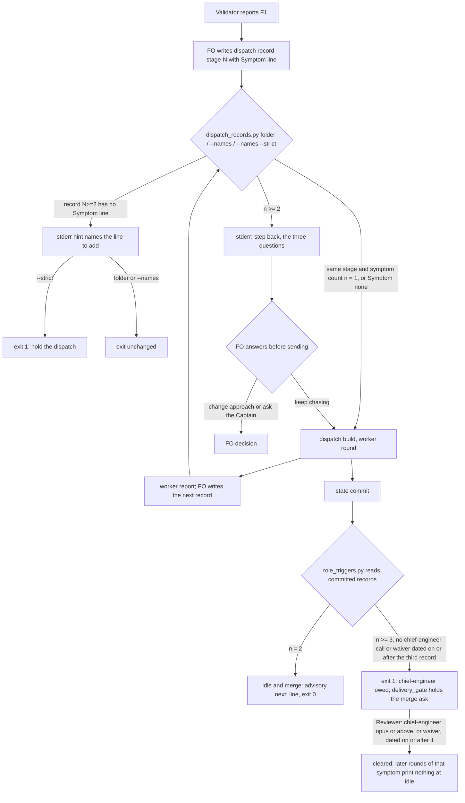

## Scope
- Source: Batch 13 sitting, the Captain, chat 2026-11-03: 「ABC 都開，不屬於套件的本身也要討論一下」, answering 「決定：A、B、C 三個都開成 dev2 任務，跟 #768 一起發版嗎？要刪哪個直接說。」; and 「先不合併，我想要把這些也評估修復後，再一起發版」 about Release PR #768. FO had proposed it as 「診斷回合要按『同一個症狀』累計」.
- Outcome: repeated diagnosis rounds on the same symptom inside one stage reach the step-back questions, the way a second failed validation or a second replacing amendment already does.
- Gap: the step-back reminder from PR #766 counts failed validations and replacing amendments only; rounds inside one validation do not count. The global circuit breaker counts per approach, not per symptom.
- Bite: the agent-observatory report on the qnow FO, 2026-11-03 (sampled, not yet checked against the source). One mobile-width freeze was chased through more than six browser runs from 2026-10-30 17:58 to 21:05, and stopped only when the Captain tried it by hand and it did not reproduce.
- Consumer: every adopter FO and its validation workers, through the reminder that `role_triggers.py` already prints.
- Upstream first: `scripts/role_triggers.py` and its step-back counts, `scripts/pr_watch.py`, ADR 0026.

## Non-goals
- Grading the answers; counting rounds across different symptoms; a new stage or tool.

## Budget
- One package PR. Workflow word budget unchanged unless the design names a raise for the Captain.

## FO alignment
Alignment: needed before ideation; the scope is the Captain's ruling and the evidence is an observatory sample, which ideation must check against its source first.
Result: aligned at backlog: Batch 13 backlog sitting, the Captain 「進」 (chat, 2026-11-03), answering 「決定：這批七張（A 權限、B 同症狀計數、C 改寫條件比對原話、D release 驗收不在正式站、來源標註、FO 先自己試、release 驗收到期提醒）都用 Pilot，照各自寫下的範圍、預算與停止條件進入構思嗎？要改哪張直接說。」, approved the outcome and bounds in this file.
Surfaces: none
Visible change: none
Release review: not needed: workflow maintenance, on no journey map.

## Stop condition
- A replay shaped like the qnow freeze prints the step-back reminder at the second diagnosis round on the same symptom; rounds on different symptoms print none.

## Design

### PRFAQ

When First Officer (FO) sends a second worker after the same failure inside one stage, the check FO already runs on that dispatch record prints the three step-back questions before the worker starts. At the third such dispatch a chief-engineer call is owed at idle and at the merge ask, the way two failed validations or two replacing amendments already work (ADR 0026, amended 2026-11-02). FO names the failure on one new line of the dispatch record it already writes: `Symptom: <name>`, or `Symptom: none`.

- **Who reads it?** FO, at three moments it already has: the dispatch-record check (`dispatch_records.py`, folder or `--names`), the idle hook (`pr_watch.py tasks`, through `role_triggers.py`) and the merge ask (`delivery_gate.py`, through `role_triggers.py`). Workers see one more line in their dispatch record.
- **What is a round?** One dispatch record `<task>/dispatch/<stage>-<N>.md` for implementation or validation, a follow-up message record included. Rounds are counted per stage and per symptom name, so a validation recheck and its repair are never one count.
- **What is the same symptom?** The same `Symptom:` value after trimming, collapsing spaces and casefolding. FO names it, using the finding id when one exists (`validation-4 F1 phone-width freeze`). A value that starts with `none` is not counted.
- **Why not count browser runs?** They live in worker transcripts and permission prompts, not in committed task state. A worker that runs seven browser runs inside one dispatch counts as one round. This is a declared limit.
- **Why the dispatch check and not only the idle hook?** In the bite, the count that already existed owed a chief-engineer call the whole time, and FO never ran the idle hook. The dispatch check is the one FO did run, 17 times in the window. ADR 0027 already rules that a check belongs in the script FO runs at that write.

### Bite, checked against its source

Source: the qnow FO session transcript `~/.claude/projects/-Users-kent-conductor-repos-qnow-adopt-dev2/9ddabfa9-e016-4501-9e54-cf196d487185.jsonl` and the archived task `_archive/schedule-settings-match-design.md` in qnow-adopt-dev2 `docs/dev2/.spacedock-state` (head `aa5bb2e38`, read 2026-11-03). The observatory sample is right in shape and wrong in three details:

- Times are UTC on 2026-10-30, which is 2026-10-31 in Taipei. The freeze was first seen at 18:19 UTC in validation 4. The fix chase ran from the implementation-15 dispatch at 18:51 to 21:05 UTC, about 2 h 14 min, not from 17:58.
- There were more than six browser runs: two in validation, about seven inside implementation-15..18 (one worker), and one or more in each of nine later dispatches (19–27).
- It did not stop only when the Captain tried it by hand. FO stopped its own diagnostic runs at 19:16 UTC (「Seven browser runs this round reproduced the freeze but never found the cause」), then sent nine more dispatches (19–27) with four fixes. At 21:05 UTC it asked the Captain with a recommendation. The Captain chose 「先暫停，你手測」 at 00:11 UTC on 10-31. His hand check on 11-01 was 「沒有當機」.

### Existing-code check

- **Spacedock 0.27.3:** nothing counts dispatches per failure. `dispatch build` writes the dispatch file and runs no kc-dev-flow-2 check (as ADR 0027 records for 0.27.2 task-file writes).
- **kc-dev-flow-2 at origin/main `713d4e6ed`, manifest 0.34.0:** `role_triggers.py` already counts repair passes (`## Stage Report: implementation` headings minus one) and, on origin/main only, failed validations and replacing amendments (#766; not in the cached 0.34.0 install, so this replay used an origin/main copy). Replayed on the qnow task at seven state commits from `9f517663a` to `ab68f2b2c`, it exits 1 at every one, owing chief-engineer for 8 → 18 repair passes and 4 → 5 failed validations. The installed 0.34.0 copy also owes it at `9f517663a` (8 repair passes). The task's only `Reviewer:` line is a waiver dated 2026-11-01.
- **Why the existing count did not help:** (1) Reach. The transcript shows `pr_watch.py tasks` run on 2026-10-20 and not again until 2026-11-01, although qnow's adopted `_mods/kc-dev-flow-2.md` has carried that idle step since `2caba07c2` (2026-10-22). The untimestamped transcript entries holding that string are `api-request-blob` replays, not runs. `dispatch_records.py .` ran before 17 of the dispatches in the window, and prints no role-call line. (2) Shape. The repair-pass event is per task and is cleared for good by one call with no date test. After one chief-engineer call, a later chase on a new failure never fires again. A per-symptom count, dated by its third record, does.
- **Sibling adopters:** relay, web and qnow dispatch records carry `Dispatched:`, `Model:` and (validation) `Candidate:` lines above the first `## ` heading. None carries a failure name. qnow's chase records name the failure only in prose (15 and 17 say `validation 4 F1`; 16 says only `Continue implementation-15`), which ADR 0026 says not to match.
- **Conclusion:** repair, not replace. Reuse `STEP_BACK`, `owed_line`, `records`, `rank` and `outside_fences` in `role_triggers.py`. `dispatch_records.py` already imports from it. No new script, stage, tool or README text.

### Design

1. **Record (FO writes).** Above the first `## ` heading of each `implementation-<N>.md` and `validation-<N>.md` under `<task>/dispatch/`, FO writes `Symptom: <name>` when the dispatch chases a named failure, else `Symptom: none`. The first record of a stage needs no line.
2. **Count (one function, two readers).** `role_triggers.symptom_rounds(records)` takes `(file name, text)` pairs and returns, per (stage, normalized symptom), the record numbers in order with each record's first `Dispatched:` date. Fenced lines are skipped, and only the first `Symptom:` line above the first `## ` heading counts. `dispatch_records.py` passes records read from disk (the one being checked is not yet committed). `role_triggers.py` passes records from `git ls-tree` / `git show` at `--rev` under `<slug>/dispatch/` or `_archive/<slug>/dispatch/`. A flat task has no folder and counts zero.
3. **Dispatch moment.** Folder mode checks the highest-numbered record of each stage; `--names <record>` checks that record against records of its stage numbered no higher. When its group has n ≥ 2, the check prints to **stderr** `<file>:1: step back: <n> <stage> dispatches name symptom "<name>"; before you send this one, answer: <three questions>`. It prints every round from the second on: each dispatch is a new decision to keep chasing. When such a record (N ≥ 2) has no `Symptom:` line, stderr gets `<file>:1: no 'Symptom:' line; above the first '## ' heading add 'Symptom: <the failure this dispatch chases, named the same way each time>' or 'Symptom: none'`. Exit codes and stdout are unchanged except under `--strict`, which exits 1 on a missing line (D1). stderr keeps `laws_check.py` L2 parsing stable, because it fullmatches stdout lines and raises `Cannot` on any other line at exit 1.
4. **Idle and merge.** `role_triggers.check` adds the symptom groups. At n = 2 it adds an advisory `next: <slug> has 2 <stage> dispatches on symptom "<name>": before the next step, answer: <three questions>`, suppressed when an owed line already carries the questions (as #766). At n ≥ 3 the chief-engineer event is owed, joined into the one owed line as `<n> <stage> dispatches on symptom "<name>"` with the step-back question. It clears on a chief-engineer call at opus rank or above, or a waiver, dated no earlier than the third record's `Dispatched:` date, or by any call or waiver when that line has no date. `pr_watch.py` and `delivery_gate.py` already forward these lines and are unchanged.
5. **ADR.** Amend ADR 0026 (`role-calls-are-owed-on-counts-read-from-task-records-and-a-dated-call-clears-them`) with the Captain's words for this task, the count, the dated clearing, the stderr placement at the dispatch check and the measured words. Cite ADR 0027 for the placement.

### Replay of the stop condition

Read-only prototype at `/tmp/b13diag/proto.py` (the counting rule only, not the candidate). It ran on qnow's archived `schedule-settings-match-design/dispatch/` at state commit `290b47a39`, copied to `/tmp/b13diag/replay2/`, with `Symptom: validation-4 F1 phone-width freeze` inserted in records 15–21 and 24–26, and distinct names in 22 (`bootstrap shows no day cards`), 23 (`focus after Apply`) and 27 (`mask left after Apply`). Result: implementation-16 is round 2 → reminder; -17 is round 3 → chief-engineer owed; 22, 23 and 27 are round 1 each → nothing. Record 16 was committed at 19:01 UTC (`dad6d1da8`), 2 h 04 min before FO asked the Captain and before 11 more dispatches.

### Words FO reads at each moment

Base measured on 2026-11-03 with origin/main scripts. Candidate line lengths are counted with `wc -w` on the drafted text, with the qnow symptom name. Implementation recounts both with an independent copy (root learning.md, "Measure the words FO reads at each moment").

| Moment | Base (measured) | Candidate |
| --- | --- | --- |
| Dispatch check, no repeat | `dispatch_records.py` folder: 4 words (`34 dispatch record(s) complete`), plus 8 when no README is found | +0 |
| Dispatch check, round 2 and on | same | +48 per round, on stderr |
| Dispatch check, N ≥ 2 record without the line | same | +26 (stderr hint; `--strict` also holds) |
| Idle (`pr_watch.py tasks`), clean task | 0 role-trigger words | +47 at n = 2; +74 at n ≥ 3 until cleared, or about +8 joined to an already-owed chief-engineer line |
| Idle, qnow at `05231fd06` | 77 (owed chief-engineer line) | about 85 (one line, `and 10 implementation dispatches on symptom "…"` joined) |
| Merge ask (`delivery_gate.py`) | as idle | as idle; at n ≥ 3 also the existing hold problem line |
| Startup, after archive | 0 | 0 |
| `references/sd/workflow.md` | 5781 words | unchanged; `WORKFLOW_BUDGET` unchanged |
| Worker's dispatch record | — | +5 per record (`Symptom: validation-4 F1 phone-width freeze`) |

### Limits

- A symptom renamed between rounds, or written `none`, is not counted. The hint and the refusal say "named the same way each time". The observer can read the records afterwards.
- Browser runs inside one dispatch are not counted.
- An FO that runs neither the dispatch check nor the idle hook sees nothing. The dispatch check is the one the bite shows FO running.
- Rounds before the release carry no `Symptom:` line and count zero. There is no backfill.

### Batch overlap

Files the design would change: `kc-dev-flow-2/scripts/role_triggers.py` (docstring, `symptom_rounds`, `read_records`, `check`), `kc-dev-flow-2/scripts/test_role_triggers.py`, `kc-dev-flow-2/scripts/dispatch_records.py` (docstring, folder mode, `--names`, `--strict`), `kc-dev-flow-2/scripts/test_dispatch_records.py`, one integration case each in `kc-dev-flow-2/scripts/test_pr_watch.py` and `kc-dev-flow-2/scripts/test_delivery_gate.py`, and `docs/adr/0026-role-calls-are-owed-on-counts-read-from-task-records-and-a-dated-call-clears-them.md` (amendment paragraph). Not changed: `references/sd/workflow.md`, `pr_watch.py`, `delivery_gate.py`, `laws_check.py`, `lint-skills.py`.

| Task | Shared file or check | Effect |
| --- | --- | --- |
| adoption-asks-which-extensions (live, ideation) | `dispatch_records.py` folder mode (`extension_errors`), `test_dispatch_records.py`, docstring | direct file overlap |
| dispatch-carries-reserved-adr-number (live, ideation) | `dispatch_records.py --names` | overlap only if its D1 adds a check; its design recommends no package change |
| rewritten-criteria-checked-against-captain-words (batch 13) | names `dispatch_records.py` as upstream | overlap only if its design edits it; re-check after its ideation |
| seed-check-requires-alignment-result (live, ideation) | `design_surfaces.py` predicate that `dispatch_records.py` imports | adjacent, no shared lines |
| adr-required-statement (live, validation) | ADR lint rules that the ADR 0026 amendment must pass | check order |
| release-walk-due-trigger (batch 13), fo-write-checks-parse-top-level, archive-waits-for-observer-report, comment-check-reaches-delivery-gate (live) | `pr_watch.py tasks` / `delivery_gate.py` output at idle and merge | shared moment word counts, no shared file |
| claims-name-their-source, fo-tries-what-it-asks-the-captain (batch 13), captain-ruling-sources-checked (live) | `delivery_gate.py` merge-ask output | shared moment, no shared file |
| fo-answers-own-worker-permissions-by-listed-id, release-walk-off-production-before-release (batch 13); adr-silent-undo-probe, journey-canvas-hosted-poc, journey-server-host-pilot, ops-inbox-r1-setup-and-isolation, picky-reviewers-may-run-on-gemini, pr-review-lite-value-pilot (live) | none found in their task files at state pull 2026-11-03 | none |

Recommended order: adoption-asks-which-extensions before this task if both ship in one release (both edit `dispatch_records.py` folder mode and its fixtures; this task rebases and reruns `test_dispatch_records.py` and `test_laws_check.py`); adr-required-statement before this task's ADR amendment; every other task independent. Recount the idle and merge word totals after whichever of the shared-moment tasks lands last.

## Acceptance criteria

Package tests run as `python3 -B -m unittest discover -s kc-dev-flow-2/scripts` from the repository root at the candidate head.

**AC-1** At the dispatch check, the second same-stage dispatch on one symptom prints the step-back questions. A fixture task folder with `implementation-1.md` (no `Symptom:` line), `implementation-2.md` and `implementation-3.md` (both `Symptom: validation-1 F1 page freeze`) run through `dispatch_records.py <folder>` puts one line on stderr containing `step back: 2 implementation dispatches name symptom "validation-1 f1 page freeze"` and the three `STEP_BACK` questions. Stdout and exit code equal the run on the same folder without the `Symptom:` lines. With only records 1 and 2, nothing is printed. Verified by: new cases in `test_dispatch_records.py`. Falsifier: counting record 1 as round one of every symptom, or printing on stdout, fails these cases.

**AC-2** Different symptoms, other stages and `none` print nothing. Records 2 and 3 named `A` and `B`; `validation-2.md` named the same as `implementation-2.md`; `Symptom: None`; and a `Symptom:` line inside a fenced block or below the first `## ` heading: each gives no step-back line. `Validation-1  F1 Page freeze` matches `validation-1 f1 page freeze`. Verified by: `test_dispatch_records.py` and `test_role_triggers.py` cases. Falsifier: dropping the stage from the group key prints for the validation case.

**AC-3** `--names` checks the named record, and `--strict` holds a missing line. `--names <implementation-3.md>` prints the AC-1 line on stderr, counting records numbered no higher than 3. `--names --strict` on `implementation-2.md` with no `Symptom:` line exits 1 with the hint line. With `Symptom: none` it exits 0. On `implementation-1.md` with no line it exits 0. Plain `--names` and folder mode print the hint on stderr with exit unchanged. Verified by: `test_dispatch_records.py`. Falsifier: requiring the line on record 1, or holding in folder mode, fails these cases.

**AC-4** Idle and merge count committed records, and a dated call clears them. In a fixture git state checkout, `role_triggers.py <state> <slug>` exits 0 with the advisory `next:` line at two committed same-symptom records. At three it exits 1 with one chief-engineer line carrying `3 implementation dispatches on symptom` and the step-back question. A `Reviewer: kc-dev-flow-2:chief-engineer opus <date> — <q>` under `## FO alignment`, dated on or after the third record's `Dispatched:` date, clears it, and a fourth record prints nothing. A call dated earlier, a `sonnet` call, or a third record on disk but not committed leaves the earlier result. The archived path `_archive/<slug>/dispatch/` is read the same way. Verified by: `test_role_triggers.py`. Falsifier: reading records from disk, or skipping the date test, fails these cases.

**AC-5** A replay shaped like the qnow freeze prints at the second round only for that symptom. Copy qnow-adopt-dev2 `docs/dev2/.spacedock-state` at commit `290b47a39`, path `schedule-settings-match-design/dispatch/`, to a temporary folder. Insert the `Symptom:` lines listed under "Replay of the stop condition". For each k from 14 to 27, run the candidate `dispatch_records.py` folder mode on the folder holding only implementation records numbered k or lower (all validation records kept). The first step-back line appears at k = 16. None appears at k ≤ 15. No line names the symptoms of records 22, 23 or 27. Verified by: the replay transcript in the validation folder, with the record hashes. Falsifier: the base script prints no step-back line at any k.

**AC-6** `laws_check.py` L2 parses unchanged. `test_laws_check.py` passes unchanged. An L2 run over a fixture state whose new dispatch records repeat a symptom and lack the line on N ≥ 2 gives the same verdict as the same state without those lines. Verified by: one added `test_laws_check.py` case or a recorded run. Falsifier: moving the reminder or the hint to stdout makes L2 raise `Cannot` when exit is 1.

**AC-7** `pr_watch.py tasks` and `delivery_gate.py` forward the lines with no code change. `pr_watch.py tasks` on a fixture with two same-symptom committed records prints the advisory line. `delivery_gate.py check` on three holds the merge ask with the owed line, running the real `role_triggers.py` (as the existing role-trigger class in `test_delivery_gate.py` does). Verified by: one case each. Falsifier: a role_triggers change that prints the advisory without `next:` fails the pr_watch case.

**AC-8** The words FO reads at each moment match the design table. Recounted on base and candidate with an independent copy of the counting: dispatch check +0 with no repeat, +48 or fewer per repeat round, +26 or fewer per missing-line hint; idle and merge +47 or fewer at n = 2 and +74 or fewer at n ≥ 3; startup and after-archive +0; `references/sd/workflow.md` word count and `WORKFLOW_BUDGET` unchanged (`lint-skills.py` passes). Verified by: a per-moment count in the validation folder.

**AC-9** ADR 0026 carries a dated amendment paragraph with this task's Captain words, the count, the dated clearing, the stderr placement citing ADR 0027, and the measured words. Repository ADR checks pass (`test_adr_doc_checks.py`, and `adr_lint.py` if adr-required-statement has landed). Verified by: those runs.

## Unresolved decisions

- **D1 — Does `--names --strict` hold a dispatch whose record (N ≥ 2) has no `Symptom:` line?** Recommended: yes. `none` passes, folder mode and plain `--names` only hint, and the hold also teaches the line without README words. The bite shows that a fail-open line is never written. What gets worse: every implementation or validation re-dispatch carries one more line and one more refusal mode, and an in-flight task gets one refusal on its next dispatch. The other choice, optional with no hold, needs about 20 README words and a recorded budget raise (ADR 0020).
- **D2 — Does the third same-symptom dispatch owe a chief-engineer call (merge ask held until a dated call or waiver)?** Recommended: yes, mirroring the other two step-back counts (ADR 0026, amended 2026-11-02). What gets worse: a long but sound diagnosis costs one opus call or a one-line dated waiver, and one more way the merge ask can hold. The other choice, reminder only, meets the stop condition but leaves the chase with no escalation in task state.

Override check: `git -C <workflow dir>/.spacedock-state grep -n 'Override:'` on 2026-11-03 finds no Override in the role-call, step-back or dispatch-record area. The past rulings in this area (ADR 0026 D1–D5 and its 2026-11-02 amendments, ADR 0027) went as recommended. Both recommendations follow them.

Follow-up (proposal, not in scope): the bite also shows the idle hook unrun for 12 days on an adopter that carries it. Whether the dispatch check should also forward already-owed role-call lines is a separate reach question for FO to file or drop.

## Stage Report: ideation

- DONE: First check the qnow freeze evidence against its source; then design how a diagnosis round and its symptom are recorded so /Users/kent/.claude/plugins/cache/kc-claude-plugins/kc-dev-flow-2/0.34.0/scripts/role_triggers.py can count rounds on the same symptom, and where the reminder appears
  `### Bite, checked against its source` (qnow FO transcript 9ddabfa9…, qnow state `aa5bb2e38`): the shape holds, but times are UTC, the chase ran 18:51–21:05, there were more than 6 runs, and FO stopped itself and then asked. Round = dispatch record with `Symptom:`. Reminder on stderr at the dispatch check, plus idle and merge through role_triggers. The design targets origin/main `713d4e6ed` (it carries #766; the cached 0.34.0 does not).
- DONE: A `### Batch overlap` section naming each file the design would change and each other batch task (fo-answers-own-worker-permissions-by-listed-id, diagnosis-rounds-count-toward-step-back, rewritten-criteria-checked-against-captain-words, release-walk-off-production-before-release, claims-name-their-source, fo-tries-what-it-asks-the-captain, release-walk-due-trigger) and live task of other sessions (adoption-asks-which-extensions, adr-required-statement, adr-silent-undo-probe, archive-waits-for-observer-report, captain-ruling-sources-checked, comment-check-reaches-delivery-gate, dispatch-carries-reserved-adr-number, fo-write-checks-parse-top-level, journey-canvas-hosted-poc, journey-server-host-pilot, ops-inbox-r1-setup-and-isolation, picky-reviewers-may-run-on-gemini, pr-review-lite-value-pilot, seed-check-requires-alignment-result (live tasks; read only)) that changes the same file or check, so FO can order implementation
  Seven package files are named. The direct overlap is adoption-asks-which-extensions (`dispatch_records.py` folder mode); adr-required-statement goes before the ADR amendment; shared idle and merge moments are listed; `Recommended order:` is given. pr-review-lite's "0026" hit is a message id.
- DONE: The words FO reads at each lifecycle moment, before and after, per root learning.md "Measure the words FO reads at each moment, not one file's size"
  `### Words FO reads at each moment`: base measured with origin/main scripts on qnow (dispatch check 4 words, idle role-trigger 77 at `05231fd06`, 0 for a clean task). Candidate lines counted with `wc -w` (48 / 26 / 47 / 74). workflow.md 5781 words, unchanged.
- DONE: Acceptance criteria with reproducible evidence clauses and falsifiers, and unresolved decisions for the Captain, each with a recommendation and what gets worse under it
  AC-1: not yet verified (candidate unbuilt). The counting rule is prototyped on qnow records: round 2 at implementation-16.
  AC-2: not yet verified. The prototype groups by stage and symptom; 22, 23 and 27 stay at round 1.
  AC-3: not yet verified.
  AC-4: not yet verified. Base replay: role_triggers exits 1 at 7 qnow commits, through existing counts only.
  AC-5: not yet verified on the candidate. The prototype replay on qnow `290b47a39` gives a first reminder at record 16.
  AC-6: not yet verified. The constraint was read in `laws_check.py` `l2_dispatch_record_complete` (stdout fullmatch, `Cannot` on other lines at exit 1).
  AC-7: not yet verified. Base forwarding was read in `pr_watch.py` (role_triggers loop) and `delivery_gate.py` (`owed_role_calls`).
  AC-8: not yet verified on the candidate. Base numbers are measured; candidate numbers are drafted-text counts.
  AC-9: not yet verified.
  D1 (`--strict` holds a missing `Symptom:` line) and D2 (third round owes chief-engineer): both recommended yes, each with what gets worse.

### Summary

The qnow freeze bite holds in shape and is corrected in detail against its transcript. The count that already existed owed chief-engineer throughout the chase. FO never ran the idle hook, but it ran `dispatch_records.py .` before 17 dispatches. So the design records `Symptom:` on each dispatch record, counts per stage and symptom in `role_triggers.py`, and prints the step-back questions on stderr at the dispatch check from round 2 (laws_check-safe), with chief-engineer owed at round 3. No README words. `design_surfaces.py check` (0.34.0 package): `design surfaces presentable`, exit 0. Two decisions for the Captain: D1 and D2.
