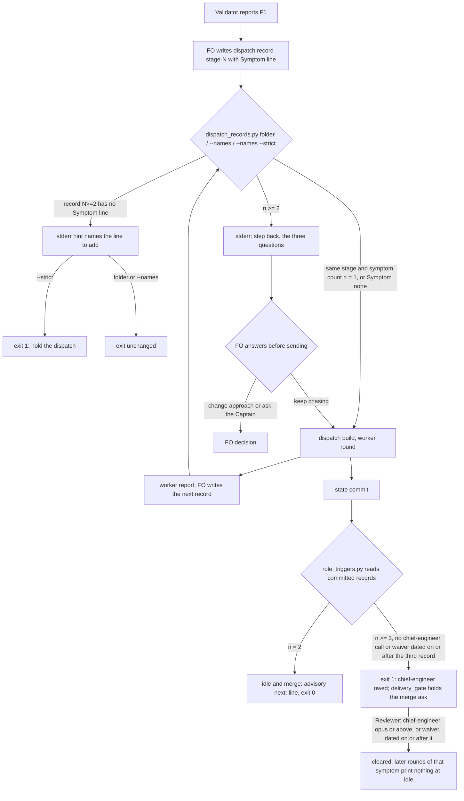

## Scope
- Source: Batch 13 sitting, the Captain, chat 2026-11-03: 「ABC 都開，不屬於套件的本身也要討論一下」, answering 「決定：A、B、C 三個都開成 dev2 任務，跟 #768 一起發版嗎？要刪哪個直接說。」; and 「先不合併，我想要把這些也評估修復後，再一起發版」 about Release PR #768. FO had proposed it as 「診斷回合要按『同一個症狀』累計」.
- Outcome: repeated diagnosis rounds on the same symptom inside one stage reach the step-back questions, the way a second failed validation or a second replacing amendment already does.
- Gap: the step-back reminder from PR #766 counts failed validations and replacing amendments only; rounds inside one validation do not count. The global circuit breaker counts per approach, not per symptom.
- Bite: the agent-observatory report on the qnow FO, 2026-11-03 (sampled, not yet checked against the source). One mobile-width freeze was chased through more than six browser runs from 2026-10-30 17:58 to 21:05, and stopped only when the Captain tried it by hand and it did not reproduce.
- Consumer: every adopter FO and its validation workers, through the reminder that `role_triggers.py` already prints.
- Upstream first: `scripts/role_triggers.py` and its step-back counts, `scripts/pr_watch.py`, ADR 0026.

## Non-goals
- Grading the answers; counting rounds across different symptoms; a new stage or tool.

## Budget
- One package PR. Workflow word budget unchanged unless the design names a raise for the Captain.

## FO alignment
Alignment: needed before ideation; the scope is the Captain's ruling and the evidence is an observatory sample, which ideation must check against its source first.
Result: aligned at backlog: Batch 13 backlog sitting, the Captain 「進」 (chat, 2026-11-03), answering 「決定：這批七張（A 權限、B 同症狀計數、C 改寫條件比對原話、D release 驗收不在正式站、來源標註、FO 先自己試、release 驗收到期提醒）都用 Pilot，照各自寫下的範圍、預算與停止條件進入構思嗎？要改哪張直接說。」, approved the outcome and bounds in this file.
Surfaces: none
Visible change: none
Release review: not needed: workflow maintenance, on no journey map.

## Stop condition
- A replay shaped like the qnow freeze prints the step-back reminder at the second diagnosis round on the same symptom; rounds on different symptoms print none.

## Design

### PRFAQ

When First Officer (FO) sends a second worker after the same failure inside one stage, the check FO already runs on that dispatch record prints the three step-back questions before the worker starts. At the third such dispatch a chief-engineer call is owed at idle and at the merge ask, the way two failed validations or two replacing amendments already work (ADR 0026, amended 2026-11-02). FO names the failure on one new line of the dispatch record it already writes: `Symptom: <name>`, or `Symptom: none`.

- **Who reads it?** FO, at three moments it already has: the dispatch-record check (`dispatch_records.py`, folder or `--names`), the idle hook (`pr_watch.py tasks`, through `role_triggers.py`) and the merge ask (`delivery_gate.py`, through `role_triggers.py`). Workers see one more line in their dispatch record.
- **What is a round?** One dispatch record `<task>/dispatch/<stage>-<N>.md` for implementation or validation, a follow-up message record included. Rounds are counted per stage and per symptom name, so a validation recheck and its repair are never one count.
- **What is the same symptom?** The same `Symptom:` value after trimming, collapsing spaces and casefolding. FO names it, using the finding id when one exists (`validation-4 F1 phone-width freeze`). A value that starts with `none` is not counted.
- **Why not count browser runs?** They live in worker transcripts and permission prompts, not in committed task state. A worker that runs seven browser runs inside one dispatch counts as one round. This is a declared limit.
- **Why the dispatch check and not only the idle hook?** In the bite, the count that already existed owed a chief-engineer call the whole time, and FO never ran the idle hook. The dispatch check is the one FO did run, 17 times in the window. ADR 0027 already rules that a check belongs in the script FO runs at that write.

### Bite, checked against its source

Source: the qnow FO session transcript `~/.claude/projects/-Users-kent-conductor-repos-qnow-adopt-dev2/9ddabfa9-e016-4501-9e54-cf196d487185.jsonl` and the archived task `_archive/schedule-settings-match-design.md` in qnow-adopt-dev2 `docs/dev2/.spacedock-state` (head `aa5bb2e38`, read 2026-11-03). The observatory sample is right in shape and wrong in three details:

- Times are UTC on 2026-10-30, which is 2026-10-31 in Taipei. The freeze was first seen at 18:19 UTC in validation 4. The fix chase ran from the implementation-15 dispatch at 18:51 to 21:05 UTC, about 2 h 14 min, not from 17:58.
- There were more than six browser runs: two in validation, about seven inside implementation-15..18 (one worker), and one or more in each of nine later dispatches (19–27).
- It did not stop only when the Captain tried it by hand. FO stopped its own diagnostic runs at 19:16 UTC (「Seven browser runs this round reproduced the freeze but never found the cause」), then sent nine more dispatches (19–27) with four fixes. At 21:05 UTC it asked the Captain with a recommendation. The Captain chose 「先暫停，你手測」 at 00:11 UTC on 10-31. His hand check on 11-01 was 「沒有當機」.

### Existing-code check

- **Spacedock 0.27.3:** nothing counts dispatches per failure. `dispatch build` writes the dispatch file and runs no kc-dev-flow-2 check (as ADR 0027 records for 0.27.2 task-file writes).
- **kc-dev-flow-2 at origin/main `713d4e6ed`, manifest 0.34.0:** `role_triggers.py` already counts repair passes (`## Stage Report: implementation` headings minus one) and, on origin/main only, failed validations and replacing amendments (#766; not in the cached 0.34.0 install, so this replay used an origin/main copy). Replayed on the qnow task at seven state commits from `9f517663a` to `ab68f2b2c`, it exits 1 at every one, owing chief-engineer for 8 → 18 repair passes and 4 → 5 failed validations. The installed 0.34.0 copy also owes it at `9f517663a` (8 repair passes). The task's only `Reviewer:` line is a waiver dated 2026-11-01.
- **Why the existing count did not help:** (1) Reach. The transcript shows `pr_watch.py tasks` run on 2026-10-20 and not again until 2026-11-01, although qnow's adopted `_mods/kc-dev-flow-2.md` has carried that idle step since `2caba07c2` (2026-10-22). The untimestamped transcript entries holding that string are `api-request-blob` replays, not runs. `dispatch_records.py .` ran before 17 of the dispatches in the window, and prints no role-call line. (2) Shape. The repair-pass event is per task and is cleared for good by one call with no date test. After one chief-engineer call, a later chase on a new failure never fires again. A per-symptom count, dated by its third record, does.
- **Sibling adopters:** relay, web and qnow dispatch records carry `Dispatched:`, `Model:` and (validation) `Candidate:` lines above the first `## ` heading. None carries a failure name. qnow's chase records name the failure only in prose (15 and 17 say `validation 4 F1`; 16 says only `Continue implementation-15`), which ADR 0026 says not to match.
- **Conclusion:** repair, not replace. Reuse `STEP_BACK`, `owed_line`, `records`, `rank` and `outside_fences` in `role_triggers.py`. `dispatch_records.py` already imports from it. No new script, stage, tool or README text.

### Design

1. **Record (FO writes).** Above the first `## ` heading of each `implementation-<N>.md` and `validation-<N>.md` under `<task>/dispatch/`, FO writes `Symptom: <name>` when the dispatch chases a named failure, else `Symptom: none`. The first record of a stage needs no line.
2. **Count (one function, two readers).** `role_triggers.symptom_rounds(records)` takes `(file name, text)` pairs and returns, per (stage, normalized symptom), the record numbers in order with each record's first `Dispatched:` date. Fenced lines are skipped, and only the first `Symptom:` line above the first `## ` heading counts. `dispatch_records.py` passes records read from disk (the one being checked is not yet committed). `role_triggers.py` passes records from `git ls-tree` / `git show` at `--rev` under `<slug>/dispatch/` or `_archive/<slug>/dispatch/`. A flat task has no folder and counts zero.
3. **Dispatch moment.** Folder mode checks the highest-numbered record of each stage; `--names <record>` checks that record against records of its stage numbered no higher. When its group has n ≥ 2, the check prints to **stderr** `<file>:1: step back: <n> <stage> dispatches name symptom "<name>"; before you send this one, answer: <three questions>`. It prints every round from the second on: each dispatch is a new decision to keep chasing. When such a record (N ≥ 2) has no `Symptom:` line, stderr gets `<file>:1: no 'Symptom:' line; above the first '## ' heading add 'Symptom: <the failure this dispatch chases, named the same way each time>' or 'Symptom: none'`. Exit codes and stdout are unchanged except under `--strict`, which exits 1 on a missing line (D1). stderr keeps `laws_check.py` L2 parsing stable, because it fullmatches stdout lines and raises `Cannot` on any other line at exit 1.
4. **Idle and merge.** `role_triggers.check` adds the symptom groups. At n = 2 it adds an advisory `next: <slug> has 2 <stage> dispatches on symptom "<name>": before the next step, answer: <three questions>`, suppressed when an owed line already carries the questions (as #766). At n ≥ 3 the chief-engineer event is owed, joined into the one owed line as `<n> <stage> dispatches on symptom "<name>"` with the step-back question. It clears on a chief-engineer call at opus rank or above, or a waiver, dated no earlier than the third record's `Dispatched:` date, or by any call or waiver when that line has no date. `pr_watch.py` and `delivery_gate.py` already forward these lines and are unchanged.
5. **ADR.** Amend ADR 0026 (`role-calls-are-owed-on-counts-read-from-task-records-and-a-dated-call-clears-them`) with the Captain's words for this task, the count, the dated clearing, the stderr placement at the dispatch check and the measured words. Cite ADR 0027 for the placement.

### Replay of the stop condition

Read-only prototype at `/tmp/b13diag/proto.py` (the counting rule only, not the candidate). It ran on qnow's archived `schedule-settings-match-design/dispatch/` at state commit `290b47a39`, copied to `/tmp/b13diag/replay2/`, with `Symptom: validation-4 F1 phone-width freeze` inserted in records 15–21 and 24–26, and distinct names in 22 (`bootstrap shows no day cards`), 23 (`focus after Apply`) and 27 (`mask left after Apply`). Result: implementation-16 is round 2 → reminder; -17 is round 3 → chief-engineer owed; 22, 23 and 27 are round 1 each → nothing. Record 16 was committed at 19:01 UTC (`dad6d1da8`), 2 h 04 min before FO asked the Captain and before 11 more dispatches.

### Words FO reads at each moment

Base measured on 2026-11-03 with origin/main scripts. Candidate line lengths are counted with `wc -w` on the drafted text, with the qnow symptom name. Implementation recounts both with an independent copy (root learning.md, "Measure the words FO reads at each moment").

| Moment | Base (measured) | Candidate |
| --- | --- | --- |
| Dispatch check, no repeat | `dispatch_records.py` folder: 4 words (`34 dispatch record(s) complete`), plus 8 when no README is found | +0 |
| Dispatch check, round 2 and on | same | +48 per round, on stderr |
| Dispatch check, N ≥ 2 record without the line | same | +26 (stderr hint; `--strict` also holds) |
| Idle (`pr_watch.py tasks`), clean task | 0 role-trigger words | +47 at n = 2; +74 at n ≥ 3 until cleared, or about +8 joined to an already-owed chief-engineer line |
| Idle, qnow at `05231fd06` | 77 (owed chief-engineer line) | about 85 (one line, `and 10 implementation dispatches on symptom "…"` joined) |
| Merge ask (`delivery_gate.py`) | as idle | as idle; at n ≥ 3 also the existing hold problem line |
| Startup, after archive | 0 | 0 |
| `references/sd/workflow.md` | 5781 words | unchanged; `WORKFLOW_BUDGET` unchanged |
| Worker's dispatch record | — | +5 per record (`Symptom: validation-4 F1 phone-width freeze`) |

### Limits

- A symptom renamed between rounds, or written `none`, is not counted. The hint and the refusal say "named the same way each time". The observer can read the records afterwards.
- Browser runs inside one dispatch are not counted.
- An FO that runs neither the dispatch check nor the idle hook sees nothing. The dispatch check is the one the bite shows FO running.
- Rounds before the release carry no `Symptom:` line and count zero. There is no backfill.

### Batch overlap

Files the design would change: `kc-dev-flow-2/scripts/role_triggers.py` (docstring, `symptom_rounds`, `read_records`, `check`), `kc-dev-flow-2/scripts/test_role_triggers.py`, `kc-dev-flow-2/scripts/dispatch_records.py` (docstring, folder mode, `--names`, `--strict`), `kc-dev-flow-2/scripts/test_dispatch_records.py`, one integration case each in `kc-dev-flow-2/scripts/test_pr_watch.py` and `kc-dev-flow-2/scripts/test_delivery_gate.py`, and `docs/adr/0026-role-calls-are-owed-on-counts-read-from-task-records-and-a-dated-call-clears-them.md` (amendment paragraph). Not changed: `references/sd/workflow.md`, `pr_watch.py`, `delivery_gate.py`, `laws_check.py`, `lint-skills.py`.

| Task | Shared file or check | Effect |
| --- | --- | --- |
| adoption-asks-which-extensions (live, ideation) | `dispatch_records.py` folder mode (`extension_errors`), `test_dispatch_records.py`, docstring | direct file overlap |
| dispatch-carries-reserved-adr-number (live, ideation) | `dispatch_records.py --names` | overlap only if its D1 adds a check; its design recommends no package change |
| rewritten-criteria-checked-against-captain-words (batch 13) | names `dispatch_records.py` as upstream | overlap only if its design edits it; re-check after its ideation |
| seed-check-requires-alignment-result (live, ideation) | `design_surfaces.py` predicate that `dispatch_records.py` imports | adjacent, no shared lines |
| adr-required-statement (live, validation) | ADR lint rules that the ADR 0026 amendment must pass | check order |
| release-walk-due-trigger (batch 13), fo-write-checks-parse-top-level, archive-waits-for-observer-report, comment-check-reaches-delivery-gate (live) | `pr_watch.py tasks` / `delivery_gate.py` output at idle and merge | shared moment word counts, no shared file |
| claims-name-their-source, fo-tries-what-it-asks-the-captain (batch 13), captain-ruling-sources-checked (live) | `delivery_gate.py` merge-ask output | shared moment, no shared file |
| fo-answers-own-worker-permissions-by-listed-id, release-walk-off-production-before-release (batch 13); adr-silent-undo-probe, journey-canvas-hosted-poc, journey-server-host-pilot, ops-inbox-r1-setup-and-isolation, picky-reviewers-may-run-on-gemini, pr-review-lite-value-pilot (live) | none found in their task files at state pull 2026-11-03 | none |

Recommended order: adoption-asks-which-extensions before this task if both ship in one release (both edit `dispatch_records.py` folder mode and its fixtures; this task rebases and reruns `test_dispatch_records.py` and `test_laws_check.py`); adr-required-statement before this task's ADR amendment; every other task independent. Recount the idle and merge word totals after whichever of the shared-moment tasks lands last.

## Acceptance criteria

Package tests run as `python3 -B -m unittest discover -s kc-dev-flow-2/scripts` from the repository root at the candidate head.

**AC-1** At the dispatch check, the second same-stage dispatch on one symptom prints the step-back questions. A fixture task folder with `implementation-1.md` (no `Symptom:` line), `implementation-2.md` and `implementation-3.md` (both `Symptom: validation-1 F1 page freeze`) run through `dispatch_records.py <folder>` puts one line on stderr containing `step back: 2 implementation dispatches name symptom "validation-1 f1 page freeze"` and the three `STEP_BACK` questions. Stdout and exit code equal the run on the same folder without the `Symptom:` lines. With only records 1 and 2, nothing is printed. Verified by: new cases in `test_dispatch_records.py`. Falsifier: counting record 1 as round one of every symptom, or printing on stdout, fails these cases.

**AC-2** Different symptoms, other stages and `none` print nothing. Records 2 and 3 named `A` and `B`; `validation-2.md` named the same as `implementation-2.md`; `Symptom: None`; and a `Symptom:` line inside a fenced block or below the first `## ` heading: each gives no step-back line. `Validation-1  F1 Page freeze` matches `validation-1 f1 page freeze`. Verified by: `test_dispatch_records.py` and `test_role_triggers.py` cases. Falsifier: dropping the stage from the group key prints for the validation case.

**AC-3** `--names` checks the named record, and `--strict` holds a missing line. `--names <implementation-3.md>` prints the AC-1 line on stderr, counting records numbered no higher than 3. `--names --strict` on `implementation-2.md` with no `Symptom:` line exits 1 with the hint line. With `Symptom: none` it exits 0. On `implementation-1.md` with no line it exits 0. Plain `--names` and folder mode print the hint on stderr with exit unchanged. Verified by: `test_dispatch_records.py`. Falsifier: requiring the line on record 1, or holding in folder mode, fails these cases.

**AC-4** Idle and merge count committed records, and a dated call clears them. In a fixture git state checkout, `role_triggers.py <state> <slug>` exits 0 with the advisory `next:` line at two committed same-symptom records. At three it exits 1 with one chief-engineer line carrying `3 implementation dispatches on symptom` and the step-back question. A `Reviewer: kc-dev-flow-2:chief-engineer opus <date> — <q>` under `## FO alignment`, dated on or after the third record's `Dispatched:` date, clears it, and a fourth record prints nothing. A call dated earlier, a `sonnet` call, or a third record on disk but not committed leaves the earlier result. The archived path `_archive/<slug>/dispatch/` is read the same way. Verified by: `test_role_triggers.py`. Falsifier: reading records from disk, or skipping the date test, fails these cases.

**AC-5** A replay shaped like the qnow freeze prints at the second round only for that symptom. Copy qnow-adopt-dev2 `docs/dev2/.spacedock-state` at commit `290b47a39`, path `schedule-settings-match-design/dispatch/`, to a temporary folder. Insert the `Symptom:` lines listed under "Replay of the stop condition". For each k from 14 to 27, run the candidate `dispatch_records.py` folder mode on the folder holding only implementation records numbered k or lower (all validation records kept). The first step-back line appears at k = 16. None appears at k ≤ 15. No line names the symptoms of records 22, 23 or 27. Verified by: the replay transcript in the validation folder, with the record hashes. Falsifier: the base script prints no step-back line at any k.

**AC-6** `laws_check.py` L2 parses unchanged. `test_laws_check.py` passes unchanged. An L2 run over a fixture state whose new dispatch records repeat a symptom and lack the line on N ≥ 2 gives the same verdict as the same state without those lines. Verified by: one added `test_laws_check.py` case or a recorded run. Falsifier: moving the reminder or the hint to stdout makes L2 raise `Cannot` when exit is 1.

**AC-7** `pr_watch.py tasks` and `delivery_gate.py` forward the lines with no code change. `pr_watch.py tasks` on a fixture with two same-symptom committed records prints the advisory line. `delivery_gate.py check` on three holds the merge ask with the owed line, running the real `role_triggers.py` (as the existing role-trigger class in `test_delivery_gate.py` does). Verified by: one case each. Falsifier: a role_triggers change that prints the advisory without `next:` fails the pr_watch case.

**AC-8** The words FO reads at each moment match the design table. Recounted on base and candidate with an independent copy of the counting: dispatch check +0 with no repeat, +48 or fewer per repeat round, +26 or fewer per missing-line hint; idle and merge +47 or fewer at n = 2 and +74 or fewer at n ≥ 3; startup and after-archive +0; `references/sd/workflow.md` word count and `WORKFLOW_BUDGET` unchanged (`lint-skills.py` passes). Verified by: a per-moment count in the validation folder.

**AC-9** ADR 0026 carries a dated amendment paragraph with this task's Captain words, the count, the dated clearing, the stderr placement citing ADR 0027, and the measured words. Repository ADR checks pass (`test_adr_doc_checks.py`, and `adr_lint.py` if adr-required-statement has landed). Verified by: those runs.

## Unresolved decisions

- **D1 — Does `--names --strict` hold a dispatch whose record (N ≥ 2) has no `Symptom:` line?** Recommended: yes. `none` passes, folder mode and plain `--names` only hint, and the hold also teaches the line without README words. The bite shows that a fail-open line is never written. What gets worse: every implementation or validation re-dispatch carries one more line and one more refusal mode, and an in-flight task gets one refusal on its next dispatch. The other choice, optional with no hold, needs about 20 README words and a recorded budget raise (ADR 0020).
- **D2 — Does the third same-symptom dispatch owe a chief-engineer call (merge ask held until a dated call or waiver)?** Recommended: yes, mirroring the other two step-back counts (ADR 0026, amended 2026-11-02). What gets worse: a long but sound diagnosis costs one opus call or a one-line dated waiver, and one more way the merge ask can hold. The other choice, reminder only, meets the stop condition but leaves the chase with no escalation in task state.

Override check: `git -C <workflow dir>/.spacedock-state grep -n 'Override:'` on 2026-11-03 finds no Override in the role-call, step-back or dispatch-record area. The past rulings in this area (ADR 0026 D1–D5 and its 2026-11-02 amendments, ADR 0027) went as recommended. Both recommendations follow them.

Follow-up (proposal, not in scope): the bite also shows the idle hook unrun for 12 days on an adopter that carries it. Whether the dispatch check should also forward already-owed role-call lines is a separate reach question for FO to file or drop.

## Captain amendments

### Amendment 1 — 2026-11-03, chat
Captain: 「照你建議」 (chat, 2026-11-03)
Asked: 「決定：B 照原設計修，讓追加指示紀錄也算進同症狀的輪數嗎？」
Supersedes: none

## Stage Report: ideation

- DONE: First check the qnow freeze evidence against its source; then design how a diagnosis round and its symptom are recorded so /Users/kent/.claude/plugins/cache/kc-claude-plugins/kc-dev-flow-2/0.34.0/scripts/role_triggers.py can count rounds on the same symptom, and where the reminder appears
  `### Bite, checked against its source` (qnow FO transcript 9ddabfa9…, qnow state `aa5bb2e38`): the shape holds, but times are UTC, the chase ran 18:51–21:05, there were more than 6 runs, and FO stopped itself and then asked. Round = dispatch record with `Symptom:`. Reminder on stderr at the dispatch check, plus idle and merge through role_triggers. The design targets origin/main `713d4e6ed` (it carries #766; the cached 0.34.0 does not).
- DONE: A `### Batch overlap` section naming each file the design would change and each other batch task (fo-answers-own-worker-permissions-by-listed-id, diagnosis-rounds-count-toward-step-back, rewritten-criteria-checked-against-captain-words, release-walk-off-production-before-release, claims-name-their-source, fo-tries-what-it-asks-the-captain, release-walk-due-trigger) and live task of other sessions (adoption-asks-which-extensions, adr-required-statement, adr-silent-undo-probe, archive-waits-for-observer-report, captain-ruling-sources-checked, comment-check-reaches-delivery-gate, dispatch-carries-reserved-adr-number, fo-write-checks-parse-top-level, journey-canvas-hosted-poc, journey-server-host-pilot, ops-inbox-r1-setup-and-isolation, picky-reviewers-may-run-on-gemini, pr-review-lite-value-pilot, seed-check-requires-alignment-result (live tasks; read only)) that changes the same file or check, so FO can order implementation
  Seven package files are named. The direct overlap is adoption-asks-which-extensions (`dispatch_records.py` folder mode); adr-required-statement goes before the ADR amendment; shared idle and merge moments are listed; `Recommended order:` is given. pr-review-lite's "0026" hit is a message id.
- DONE: The words FO reads at each lifecycle moment, before and after, per root learning.md "Measure the words FO reads at each moment, not one file's size"
  `### Words FO reads at each moment`: base measured with origin/main scripts on qnow (dispatch check 4 words, idle role-trigger 77 at `05231fd06`, 0 for a clean task). Candidate lines counted with `wc -w` (48 / 26 / 47 / 74). workflow.md 5781 words, unchanged.
- DONE: Acceptance criteria with reproducible evidence clauses and falsifiers, and unresolved decisions for the Captain, each with a recommendation and what gets worse under it
  AC-1: not yet verified (candidate unbuilt). The counting rule is prototyped on qnow records: round 2 at implementation-16.
  AC-2: not yet verified. The prototype groups by stage and symptom; 22, 23 and 27 stay at round 1.
  AC-3: not yet verified.
  AC-4: not yet verified. Base replay: role_triggers exits 1 at 7 qnow commits, through existing counts only.
  AC-5: not yet verified on the candidate. The prototype replay on qnow `290b47a39` gives a first reminder at record 16.
  AC-6: not yet verified. The constraint was read in `laws_check.py` `l2_dispatch_record_complete` (stdout fullmatch, `Cannot` on other lines at exit 1).
  AC-7: not yet verified. Base forwarding was read in `pr_watch.py` (role_triggers loop) and `delivery_gate.py` (`owed_role_calls`).
  AC-8: not yet verified on the candidate. Base numbers are measured; candidate numbers are drafted-text counts.
  AC-9: not yet verified.
  D1 (`--strict` holds a missing `Symptom:` line) and D2 (third round owes chief-engineer): both recommended yes, each with what gets worse.

### Summary

The qnow freeze bite holds in shape and is corrected in detail against its transcript. The count that already existed owed chief-engineer throughout the chase. FO never ran the idle hook, but it ran `dispatch_records.py .` before 17 dispatches. So the design records `Symptom:` on each dispatch record, counts per stage and symptom in `role_triggers.py`, and prints the step-back questions on stderr at the dispatch check from round 2 (laws_check-safe), with chief-engineer owed at round 3. No README words. `design_surfaces.py check` (0.34.0 package): `design surfaces presentable`, exit 0. Two decisions for the Captain: D1 and D2.

## Stage Report: implementation

- DONE: Implement the approved design, Symptom: line, dispatch-check reminder and ADR 0026 amendment; only the seven named files, with D1 and D2 as recommended.
  Candidate `97cf87965ec052a1c9f2d40a1a1d0ca83e8d2244`, branch `spacedock-ensign/diagnosis-rounds-count-toward-step-back`, base `713d4e6ed6381e65fa6d8305e08b282ceb56a8fb` (fetched origin/main, fast-forwarded before edits); clean code worktree. Evidence below is in `diagnosis-rounds-count-toward-step-back/validation/implementation-1/`; `candidate.json` and `product-hashes.json` bind it to the candidate.
- SKIPPED: One Draft PR in iamcxa/kc-claude-plugins, with a Conventional Commit title scoped to the plugin.
  FO's 2026-11-03 dispatch reply confirms ADR 0042/0048 and the listed paseo exception: FO publishes the local candidate. Prepared title/body: `pr.md`; worker did not push code or open a PR. No version bump.
- DONE: Every acceptance criterion green with the evidence each names; package tests as python3 -B -m unittest discover -s kc-dev-flow-2/scripts.
  `full-suite.log`: 879 tests, 0 failures, 6 skips, exit 0; `suite.json` retains the result. The seven product hashes remained identical throughout the final tests and commit.
- DONE: AC-1, AC-2 and AC-3: second same-stage symptom dispatch reminds on stderr; normalized groups stay separate; named-record cutoff and strict missing-header hold.
  `SymptomDispatchTests` and `SymptomRoundsTest` exercise folder/--names/--strict, first-record exemption, none, case/space folding, distinct stages, fenced/body/duplicate headers, numeric ordering and message continuations. Counting record 1, removing stage, moving stderr to stdout, holding folder mode or requiring record 1's header fails the corresponding mutant.
- DONE: AC-4: idle and merge count committed records, and a dated call clears them.
  `SymptomRoundsTest` exercises two/three rounds, uncommitted and deleted disk records, --rev, archived/index/nested state layouts, old/low-model calls, dated/undated waivers, undated third records, fourth-round clearing and independent event reminders. Disk reads or removal of the date test fail the mutants.
- DONE: AC-5: replay the qnow freeze with record hashes.
  `replay.json` binds source state revision `290b47a39` and each original record's SHA-256; 14 candidate/base runs (k=14..27) first remind at 16, none through 15 or for distinct symptoms 22/23/27. Base never reminds; stdout and exit codes stay equal.
- DONE: AC-6: laws_check.py L2 parses unchanged.
  Unmodified `test_laws_check.py`: 63 tests, exit 0 (one skip), `laws-tests.log`; `laws.json` runs the real checker over repeated/missing headers and records identical verdicts and semantic L2 violations (commit ids/line offsets normalized). Moving hints/reminders to stdout makes the probe fail with Cannot.
- DONE: AC-7: pr_watch.py tasks and delivery_gate.py forward lines without production changes to either file.
  Added integration tests run real committed-state role_triggers: idle forwards the round-two advisory; round three holds merge and saves no ask. Removing the advisory's next: prefix fails the idle mutant.
- DONE: AC-8: per-moment word limits, unchanged workflow and WORKFLOW_BUDGET.
  Independent CLI comparison in `words.json`: added words clean dispatch 0, repeat 48, missing hint 21 (<=26), idle/merge round two 47, round three 74; startup/after-archive additions 0 by unchanged entry/template and inactive archived-task path. Workflow 5781 -> 5781; workflow.md and lint-skills.py byte-identical to base. Added STEP_BACK words fail the count mutant.
- DONE: AC-9: ADR 0026 carries this task's dated Captain amendment, counts, dated clearing, stderr placement citing ADR 0027 and measured words.
  Changed ADRs: 0026 only. test_adr_doc_checks.py passes within the full suite; cached-package `adr_lint.py docs/adr --since <base> --require 26`: 50 records checked, exit 0 (`adr-lint.log`).
- DONE: Each named falsifier is exercised by a mutation (python3 -B, caches cleared).
  `mutations.json` and `mutation-0.log`..`mutation-9.log`: ten mutations rejected by assertions, plus the base-script replay counterexample for AC-5. `proof.py` retains the reproducible probes; DIAGNOSIS_CODE_ROOT and DIAGNOSIS_EVIDENCE_DIR select a fresh candidate checkout/output; DIAGNOSIS_QNOW_STATE selects the task-declared qnow source.
- DONE: Repository lint-skills.py, package number_guards.py check and comment_ratio.py meet their bars.
  `checks.json`: all exit 0; number guards base 713d4e6ed638/head 97cf87965ec0 PASS (migration guard inapplicable, no migrations-path); comments 0 / 262 code lines = 0%, maximum 5%; workflow lint 5781/5781. Full commands and output are retained in their logs.
- DONE: Goal check, shared-work check and committed-corpus regression evidence.
  Every product addition maps to the accepted counter/check path, tests or ADR; removing the change leaves the replay silent. No new product scaffolding or dependency. Direct overlap with adoption-asks-which-extensions and rewritten-criteria was checked and returned to FO; FO orders integration. `corpus.json` at state `d7af6b4b7f72ad8a2652e9b9530b47184cd0c210`: 101 task folders, 443 base/candidate folder/plain/strict checks, zero stdout/unexpected changes, 66 intended new strict holds for missing Symptom headers; historical fixtures retain their bytes and compare stdout separately from allowed hints.
- DONE: design_surfaces.py check and doc_impact.py <base> <candidate>, with a verdict for each listed document.
  `design.log`: presentable, exit 0. `doc-impact.json`: docs/adr/0045 unaffected: later-ruling predicate/recovery/stdout unchanged; docs/adr/0048 unaffected: paseo completion and publication boundary unchanged; docs/adr/0049 unaffected: model ranks/floors unchanged; learning.md unaffected: existing recorded lessons remain accurate. ADR 0026 updated as designed.
- SKIPPED: roborev evidence= line.
  Not run by worker: FO owns exact-base/head RoboRev under ADR 0042/0048 and its explicit dispatch reply; no evidence= or incomplete: output was fabricated. It remains required on this exact head before the dependent step.
- SKIPPED: CI green on the PR head; CI cost measured or stated as not measured.
  Hosted CI is not run: FO must publish the Draft PR, run exact-head RoboRev and verify CI before fresh validation. CI cost per PR was not measured; no CI configuration changed.

### Summary

This Pilot candidate counts same-symptom diagnosis dispatches through the existing dispatch, idle and merge checks, with D1/D2 implemented and all nine local acceptance criteria exercised. The code worktree is clean at `97cf87965ec052a1c9f2d40a1a1d0ca83e8d2244`; no version or workflow-budget change. FO still owns publication, exact-head RoboRev, hosted CI and fresh independent validation; these are not claimed clean.

## Stage Report: implementation

- DONE: Reproduce RoboRev job 1418's High finding before repair, on the reported candidate.
  Not reproduced on `97cf87965ec052a1c9f2d40a1a1d0ca83e8d2244`, base `713d4e6ed6381e65fa6d8305e08b282ceb56a8fb`, branch `spacedock-ensign/diagnosis-rounds-count-toward-step-back`. Product hashes match the original 879-test candidate and the code worktree is clean. New evidence is `diagnosis-rounds-count-toward-step-back/validation/implementation-2/`; earlier acceptance evidence remains in `implementation-1/`.
- DONE: Run the reviewer's named test unchanged, with its archive moved under nested/.
  Exact command: `cd /Users/kent/conductor/workspaces/kc-claude-plugins/colombo/.context/dev2-adoption/worktree/.worktrees/spacedock-ensign-diagnosis-rounds-count-toward-step-back/kc-dev-flow-2/scripts && python3 -B -m unittest -v test_role_triggers.SymptomRoundsTest.test_archived_folder_records_and_nested_state_checkout`; exit 0. Output: `test_archived_folder_records_and_nested_state_checkout (test_role_triggers.SymptomRoundsTest.test_archived_folder_records_and_nested_state_checkout) ... ok`, `Ran 1 test in 0.536s`, `OK` (`nested-test.log`, complete output retained).
- DONE: Exercise the actual nested Git reads and the real role checker, with an independent fixture.
  `git --version` -> `git version 2.54.0 (Apple Git-157)`. Exact command: `git -C /tmp/opencode/diagnosis-rounds/review-1418/fixture/nested rev-parse --show-prefix` -> exit 0, `nested/`. `git -C /tmp/opencode/diagnosis-rounds/review-1418/fixture/nested show HEAD:./_archive/task/index.md` -> exit 0, `---\nprofile: pilot\n---\n## FO alignment\nSurfaces: none\n`. `git -C /tmp/opencode/diagnosis-rounds/review-1418/fixture/nested cat-file -e HEAD:./_archive/task/index.md` -> exit 0, empty stdout/stderr.
  Exact command: `git -C /tmp/opencode/diagnosis-rounds/review-1418/fixture/nested ls-tree -r --name-only HEAD -- _archive/task/dispatch/` -> exit 0, `_archive/task/dispatch/implementation-2.md`, `_archive/task/dispatch/implementation-3.md`, `_archive/task/dispatch/implementation-4.md` (one per line). Each returned path read with `git -C /tmp/opencode/diagnosis-rounds/review-1418/fixture/nested show HEAD:./<returned path>` exits 0 and prints `Dispatched: 2026-11-03` plus `Symptom: page freeze`.
  Exact command: `/Users/kent/.pyenv/versions/3.11.14/bin/python3 -B /Users/kent/conductor/workspaces/kc-claude-plugins/colombo/.context/dev2-adoption/worktree/.worktrees/spacedock-ensign-diagnosis-rounds-count-toward-step-back/kc-dev-flow-2/scripts/role_triggers.py /tmp/opencode/diagnosis-rounds/review-1418/fixture/nested task` -> exit 1, `next: task has 3 implementation dispatches on symptom "page freeze"; dispatch kc-dev-flow-2:chief-engineer ...` with the three questions. `reproduction.log` and `reproduction.json` retain the complete exact commands, output and exit codes, including every dispatch read.
- DONE: A negative control proves the existing test detects root-relative lookup.
  A throwaway copy replaces all three `f"{rev}:./{path}"` expressions with `f"{rev}:{path}"`; python3 -B, caches absent. Exact command in `/tmp/opencode/diagnosis-rounds/review-1418/mutant/kc-dev-flow-2/scripts`: `/Users/kent/.pyenv/versions/3.11.14/bin/python3 -B -m unittest -v test_role_triggers.SymptomRoundsTest.test_archived_folder_records_and_nested_state_checkout` -> exit 1, `AssertionError: 2 != 1`, `FAILED (failures=1)`. Direct `git -C /tmp/opencode/diagnosis-rounds/review-1418/fixture/nested show HEAD:_archive/task/index.md` -> exit 128; Git suggests `HEAD:nested/_archive/task/index.md` aka `HEAD:./_archive/task/index.md`. Full output: `reproduction.log`.
- SKIPPED: Prepend a git prefix, make a product repair commit and bind a new product head.
  The dispatched no-reproduction branch applies: current `:./` revision paths and cwd-relative ls-tree pathspec already resolve nested state correctly. Candidate stays `97cf87965ec052a1c9f2d40a1a1d0ca83e8d2244`; no product change is justified. Review disposition remains with FO; these results cover the local Git/runtime, not an unseen reviewer environment.
- DONE: AC-1, AC-2, AC-3 and all original falsifiers remain exercised on the unchanged exact candidate.
  `implementation-1/full-suite.log`: 879 tests, zero failures, six skips; `mutations.json`: ten mutations rejected plus the base replay. Original SymptomDispatchTests prove stderr placement, separated normalized groups, named-record cutoff, strict-only missing-header hold and first-record exemption. Removing stage, moving stderr or changing the first/strict rules fails those controls. Full discovery was not repeated in this report-only follow-up.
- DONE: AC-4: committed records, dated clearing, archived/nested layouts and independent event reminders.
  Fresh command `python3 -B -m unittest discover -s kc-dev-flow-2/scripts -p test_role_triggers.py` from the assigned worktree: 41 tests, zero failures, exit 0 (`role-tests.log`). Disk-read and omitted-date mutants remain recorded in implementation-1; the additional root-relative-path mutant fails the existing nested test here.
- DONE: AC-5: historical qnow replay, with record hashes and the base counterexample.
  Unchanged candidate, `implementation-1/replay.json`: pinned source 290b47a39, k=14..27; first reminder at 16, none through 15 or for distinct symptoms 22/23/27. Base prints none; stdout and exit codes equal. No product bytes changed, so this evidence is carried rather than rerun.
- DONE: AC-6 and AC-7: unchanged L2 parsing and real idle/merge forwarding.
  Carried exact-head evidence: unmodified test_laws_check.py 63 tests, exit 0, and `implementation-1/laws.json` real equal-verdict probe; real pr_watch idle advisory and delivery_gate round-three hold in the 879-test run. Moving stderr or dropping next: fails the retained mutations.
- DONE: AC-8 and AC-9: measured lifecycle reading cost, unchanged budget and ADR 0026 amendment.
  Carried `implementation-1/words.json`: added 0/48/21 dispatch words, 47/74 idle/merge words, startup/after-archive 0; workflow 5781 -> 5781 and budget bytes unchanged. ADR 0026 carries the Captain's dated amendment; ADR tests passed and adr_lint checked 50 records, exit 0. Changed ADRs in candidate: 0026 only; none added/edited in this follow-up.
- DONE: Local lint, number guards, comment ratio, document-impact verdicts and scope checks.
  Original `implementation-1/checks.json` binds lint/ADR/number guards/doc-impact exit 0 to this same head; fresh `comment-ratio.log`: 0 comment / 262 code lines, 0%, maximum 5%, exit 0. design_surfaces presentable remains recorded. doc-impact: ADR 0045 unaffected (ruling check), ADR 0048 unaffected (completion/publication), ADR 0049 unaffected (model floor), learning.md unaffected (historical lessons); no product documentation changed here.
- DONE: Run the exact-head RoboRev gate once as routed, and report the printed result.
  Exact command: `python3 /Users/kent/.claude/plugins/cache/kc-claude-plugins/kc-dev-flow-2/0.34.0/extensions/roborev/roborev_gate.py --repo /Users/kent/conductor/workspaces/kc-claude-plugins/colombo/.context/dev2-adoption/worktree/.worktrees/spacedock-ensign-diagnosis-rounds-count-toward-step-back --base 713d4e6ed6381e65fa6d8305e08b282ceb56a8fb`; exit 3; `incomplete: the roborev daemon is not running` (`roborev.log`). One attempt, no review verdict or evidence= line claimed.
- DONE: Update the prepared Conventional Commit PR title/body and preserve the bounded Pilot handoff.
  `implementation-2/pr.md` carries the original final behavior, unchanged head, nested-read/mutation evidence and incomplete local review limit. No version, workflow text, budget, dependency or product file changed; the original seven-file scope remains.
- SKIPPED: One Draft PR, CI green on its head and CI cost measurement.
  FO reports the branch pushed and owns the Draft PR, disposition of finding 1418, a usable exact-head review and hosted CI before independent validation. Worker did not publish. CI cost per PR was not measured; no CI configuration changed.

### Summary

This complete report supersedes the earlier implementation report. RoboRev finding 1418 was not reproduced: the existing nested test and direct Git reads pass, and removing `./` reproduces the reported lookup failure and makes that test fail; candidate remains `97cf87965ec052a1c9f2d40a1a1d0ca83e8d2244`. The required one-shot local review is incomplete because its daemon is unavailable; FO owns review disposition, Draft PR publication, hosted CI and independent validation.

## Stage Report: validation

- DONE: Independent verdict on PR #771 head 97cf8796 against every acceptance criterion in the task file, re-running each evidence command and at least one falsifier per criterion yourself, and judging each limit the implementation report states
  **REJECTED** at `97cf87965ec052a1c9f2d40a1a1d0ca83e8d2244`, base `713d4e6ed6381e65fa6d8305e08b282ceb56a8fb`; the nine literal AC fixtures pass, but the approved follow-up-message scope conflicts with the candidate (F1). Evidence: `diagnosis-rounds-count-toward-step-back/validation/validation-1/details.md`.
- DONE: Judge the RoboRev 1418 decline from the reproduction evidence in the implementation report. Do not start agents you were not asked to
  Decline supported: unchanged nested test and direct Git reads pass; removing `./` fails that test with 2 != 1. `reproduction.log` and `review-1418/reproduction.json` retain fresh commands/output; no agent or new review was started.
- DONE: A minimal acceptance script the Captain can run (three to six steps, exact commands, expected output), run by you exactly as written in a fresh bash shell, with its observed output; /Users/kent/.claude/plugins/cache/kc-claude-plugins/kc-dev-flow-2/0.34.0/scripts/adr_lint.py docs/adr --since <base> with its exit code; your verdict naming the head, with findings classified by the workflow's Review-finding disposition
  `acceptance.md` gives all five exact steps and full output; unchanged `acceptance.sh` ran in fresh `/bin/bash --noprofile --norc`, exit 0, visibly reproducing F1. Both dispatch-named and resolved Codex-package ADR lint ran with `--since 713d4e6ed6381e65fa6d8305e08b282ceb56a8fb --require 26`: 50 records, zero legacy, exit 0.
- DONE: AC-1, AC-2 and AC-3 — numbered-record dispatch behavior and decisive failure controls.
  Real CLI tests preserve stderr/stdout, stage/symptom separation, normalization, named cutoff, strict-only missing-header hold and first-record exemption; five mutants fail assertions (`mutation-0.log` through `mutation-4.log`). F1 limits the claim to numbered records.
- DONE: AC-4 — committed records, dated clearing and independent events.
  Standalone role suite: 41 tests, exit 0; disk-read/date-removal mutants fail and the nested-path mutant fails (`role-tests.log`, `mutation-5.log`, `mutation-6.log`, `reproduction.log`).
- DONE: AC-5 — independently rerun the pinned qnow replay and base counterexample.
  `replay.json`: source 290b47a39 with full revision/record hashes, k=14..27; first reminder at 16, none through 15 or on distinct symptoms 22/23/27; base never reminds and stdout/exits match.
- DONE: AC-6 and AC-7 — unchanged laws parsing and actual idle/merge forwarding.
  Laws: 63 tests, one skip, exit 0; real repeated/missing-header probe retains the same L2 verdict. Real role checker feeds idle and holds merge without saving an ask; stdout and missing-next-prefix mutants fail (`laws.json`, `mutation-7.log`, `mutation-8.log`).
- DONE: AC-8 — lifecycle word cost, unchanged workflow budget and counterexample.
  Fresh outputs plus independent `wc -w`: added dispatch words 0/48/21, idle/merge 47/74, startup 0; real archive probe prints no line. Workflow 5781 -> 5781; extra-question-words mutant fails (`words-independent.json`, `archive-moment.json`, `mutation-9.log`).
- DONE: AC-9 — dated ADR 0026 amendment and falsifiers.
  Required contents and checks pass; the base without amendment fails the content check and deleting Recommended fails required-record lint (`adr-falsifiers.json`). The amendment's message-exclusion clause is not silently accepted; see F1.
- DONE: Local suite, live PR/CI identity, retained documents, scope and implementation limits.
  Full discovery: 879 tests, six skips, zero failures, exit 0; all four hosted checks green on the exact Draft PR head. Seven product hashes match; comment ratio 0/262, all structural checks pass; doc-impact verdicts and each stated limit are judged in details.md; CI cost was not measured.
- DONE: Historical compatibility and goal/minimal-necessity checks.
  Current committed corpus: 101 folders, 445 comparisons, zero stdout/unexpected changes, 66 intended strict holds. Base replay is silent, justifying the change; overall goal sufficiency is unresolved only for F1.
- FAILED: Approved Design includes follow-up message records in a diagnosis round.
  One numbered record plus two valid `implementation-2-message-N.md` records with the same symptom counts as one; folder/names/committed-state checks stay silent (`message-records.json`). The accepted definition at state `f9a78202d` includes these records; the candidate matcher and ADR exclude them.
- SKIPPED: Requested `spacedock state commit` helper and state push.
  The installed helper automatically publishes split-root state and has no no-push flag; the dispatch explicitly says not to push. Report/evidence are committed locally with path-scoped Git instead; FO owns later synchronization. No remote/config write or product change.
- F1 Needs decision: Resolve whether follow-up message records count before repair or delivery.
  Normal user/workflow: adopter FO continues diagnosis through supported message records; harm: repeated rounds miss reminders/escalation; `value-ac[AC-1]`: second same-stage dispatch reminds, with approved Design explicitly including messages; trigger: real three-record probe counts one. Exact findings and four evidence fields are in details.md; no repair authorization is inferred.

### Summary

The nine explicit numbered-record acceptance fixtures and their falsifiers pass at `97cf87965ec052a1c9f2d40a1a1d0ca83e8d2244`, and the RoboRev 1418 decline is independently supported. Verdict is **REJECTED** for the unresolved accepted-design mismatch F1; candidate/product bytes remain unchanged and temporary checkouts were removed.

## Stage Report: implementation

- DONE: Repair validation-1 F1 under Captain amendment 1: count follow-up message records as rounds on their symptom in both readers and remove the ADR 0026 exclusion.
  Captain: 「照你建議」, answering 「決定：B 照原設計修，讓追加指示紀錄也算進同症狀的輪數嗎？」; Supersedes: none, so no acceptance criterion moved. Shared matcher admits `<stage>-N-message-M.md`; committed-state and disk readers both count it. Numeric (record, message) ordering drives folder newest, named cutoff and third-round date. ADR 0026 removes the exclusion and records his clarification. Evidence below is in `diagnosis-rounds-count-toward-step-back/validation/implementation-3/`.
- DONE: Red-to-green test: one plain implementation record plus two message records on one symptom print the reminder and owe the call; a mutation dropping messages fails it.
  `red.log`: all three new tests fail before the repair; `green.log`: all three pass after it. Real committed-state CLI observes one silent round, two advisory rounds, three owed rounds, an uncommitted-message exclusion and dated clearing; disk CLI covers folder/--names/--strict and excludes later messages. Numeric message 2/10 ordering is tested. `symptom-tests.log`: all 12 symptom tests pass.
- DONE: Message-specific failure controls and every earlier falsifier are rerun at the repair bytes (python3 -B, caches cleared).
  `message-mutations.json`: four assertion failures when the shared counter drops messages, committed reader drops them, disk reader drops them, or named cutoff ignores message number. `mutations.json`: all ten previous controls fail as intended, plus the base-script replay counterexample; full output is in message-mutation-0..3.log and mutation-0..9.log.
- DONE: Keep every existing fixture green and commit locally before the full suite and gate.
  Repair commit `7aad891353a973c7fbda2ad4214a3aadea71d2a6`, parent `97cf87965ec052a1c9f2d40a1a1d0ca83e8d2244`, branch `spacedock-ensign/diagnosis-rounds-count-toward-step-back`, original base `713d4e6ed6381e65fa6d8305e08b282ceb56a8fb`. Five named repair files; overall PR still seven approved files. Historical/raw fixtures are unchanged; two owned assertions that excluded messages now expect their authorized inclusion. `candidate.json` and `product-hashes.json` bind all seven product files.
- DONE: Full package suite on the committed repair head.
  `python3 -B -m unittest discover -s kc-dev-flow-2/scripts` from the assigned worktree: 882 tests, zero failures, 6 skips, exit 0 (`full-suite.log`, `suite.json`). This includes all prior fixture checks and the three added cases.
- DONE: AC-1, AC-2 and AC-3: dispatch questions, group separation, normalized names, first-record exemption, strict-only missing-header hold and named cutoff.
  Existing tests and fresh original controls pass in the full suite; follow-up tests extend both disk readers without changing stdout or exit rules. Future messages are excluded by numeric (N, M) cutoff; folder mode chooses the latest follow-up. Counting record one, dropping stage, moving reminders to stdout or broadening the hold fails the retained controls.
- DONE: AC-4: committed-state counts, dated clearing, archived/nested layouts and independent event families.
  Full suite includes all role-trigger cases. The new three-record test proves messages reach read_records and symptom_rounds; old call before message 2's date leaves the call owed and a call on it clears. The numeric message-date case prevents message 10 preceding message 2. Disk-read and missing-date controls fail as intended; no nested Git path change.
- DONE: AC-5: reproduce the qnow-shaped stop condition with record hashes and the base counterexample.
  Fresh `replay.json`, pinned source 290b47a39, k=14..27: first reminder at 16, none through 15 or for distinct symptoms 22/23/27; base never reminds; stdout and exits equal. Full record hashes and commands are retained with `proof.py`.
- DONE: AC-6 and AC-7: unchanged L2 parsing and existing real idle/merge forwarding.
  Full suite includes the unmodified laws tests and real pr_watch/delivery_gate integration. Fresh `laws.json`: repeated/missing headers have equal L2 verdicts and no Cannot. Moving stderr to stdout or dropping advisory next: fails the corresponding controls. Neither production pr_watch.py nor delivery_gate.py changes.
- DONE: AC-8: lifecycle reading limits and unchanged workflow budget.
  Fresh `words.json`: added dispatch words 0 clean / 48 repeated / 21 hint (<=26), idle/merge 47 advisory / 74 owed; startup/after-archive additions 0 by unchanged lifecycle/template. Workflow 5781 -> 5781; workflow.md and lint-skills.py byte-identical to base; an added-question-words control fails. Message support adds no printed words.
- DONE: AC-9: ADR 0026 reflects the Captain's original approval and amendment 1.
  The message-exclusion clause is removed, the dated clarification quotes his exact words/question, and the count/clearing/stderr/word-cost statements remain. Changed ADRs: 0026 only. ADR tests pass in the full suite; cached-package adr_lint.py docs/adr --since <base> --require 26 exits 0 (`adr-lint.log`).
- DONE: Repository lint, number guards, comment ratio, design surfaces, document-impact and goal/scope checks.
  `checks.json`: all exit 0 at this head; comment ratio 0 comment / 311 code lines = 0%, maximum 5%; number guards PASS against the original base (migration guard inapplicable). `design.log`: presentable. doc-impact: ADR 0045 unaffected (ruling check), ADR 0048 unaffected (completion/publication), ADR 0049 unaffected (model floor), learning.md unaffected (historical lessons). Every repair line maps to message counting, ordering, its tests or the requested ADR correction; no new product scaffolding.
- DONE: Committed-corpus comparison with follow-ups included in latest-record selection.
  `corpus.json`, state `2b8eb76603b37bfb8b9f05081490937551fd51f7`: 102 task folders, 460 folder/plain/strict checks against base, zero stdout/unexpected changes, 68 intended strict holds for missing headers. The snapshot is immutable and the script retains full per-file verdicts.
- DONE: Run the RoboRev gate once against base 713d4e6ed6381e65fa6d8305e08b282ceb56a8fb after committing.
  Exact command: `python3 /Users/kent/.claude/plugins/cache/kc-claude-plugins/kc-dev-flow-2/0.34.0/extensions/roborev/roborev_gate.py --repo /Users/kent/conductor/workspaces/kc-claude-plugins/colombo/.context/dev2-adoption/worktree/.worktrees/spacedock-ensign-diagnosis-rounds-count-toward-step-back --base 713d4e6ed6381e65fa6d8305e08b282ceb56a8fb`; exit 3, `incomplete: the roborev daemon is not running` (`roborev.log`). One attempt; no clean review or evidence= line claimed.
- DONE: Hand back the head and updated PR title/body, and append a complete new implementation report.
  Head `7aad891353a973c7fbda2ad4214a3aadea71d2a6`. `pr.md` title: `feat(kc-dev-flow-2): count symptom rounds across dispatch follow-ups`; body describes the final feature, ordered follow-up counting, validation and review limit. This exact-heading report covers the whole implementation; no version or workflow-budget bump.
- SKIPPED: Product push/PR update, complete external review, hosted CI and fresh independent validation.
  FO owns pushing this head to PR #771, a usable exact-head review, hosted checks and the fresh validator. Earlier hosted green results applied to 97cf87965 and are not claimed for this repair. CI cost per PR was not measured; no CI configuration changed.

### Summary

This complete report supersedes the earlier implementation reports. Captain amendment 1 is implemented at `7aad891353a973c7fbda2ad4214a3aadea71d2a6`: plain and follow-up records count in both readers, numeric message ordering is preserved, and the ADR exclusion is removed; red-to-green proof, all prior fixtures, fourteen mutation controls and all nine acceptance criteria pass locally. The one-shot RoboRev gate is incomplete because its daemon is unavailable; FO still owns PR #771 publication, external review, hosted checks and fresh independent validation.

## Stage Report: validation

- DONE: Independent verdict on PR #771 head 7aad8913 against every acceptance criterion in the task file, re-running each evidence command and at least one falsifier per criterion yourself, and judging each limit the implementation report states
  **PASSED** at `7aad891353a973c7fbda2ad4214a3aadea71d2a6`; all nine criteria and Captain amendment 1 pass. Fetched `origin/main=e1bee223c47a1cd534a665a47776b683375b34fc`, merge base `713d4e6ed6381e65fa6d8305e08b282ceb56a8fb`. Evidence: `diagnosis-rounds-count-toward-step-back/validation/validation-2/details.md`.
- DONE: This rerun's ruling is Captain amendment 1 in the task file (validation-1 F1 ruled toward the approved design: follow-up message records count as rounds). Re-judge validation-1 F1 and every criterion at this head. Do not start agents you were not asked to
  Prior F1 is resolved: one plain record plus two messages counts three, reminds in folder/named modes and owes chief-engineer in committed state. The three added tests fail on the pre-repair parent and pass here; four message-specific mutation controls fail by assertion. No agents or reviewers started.
- DONE: A minimal acceptance script the Captain can run (three to six steps, exact commands, expected output), run by you exactly as written in a fresh bash shell, with its observed output; /Users/kent/.claude/plugins/cache/kc-claude-plugins/kc-dev-flow-2/0.34.0/scripts/adr_lint.py docs/adr --since <base> with its exit code; your verdict naming the head, with findings classified by the workflow's Review-finding disposition
  Five steps in `acceptance.md`, run unchanged as `/bin/bash --noprofile --norc acceptance.sh`, exit 0; full commands/output retained. Both dispatch-named and resolved-package ADR lint with `--since origin/main --require 26`: 50 ADRs, zero legacy, exit 0. No new Material, Deferred risk, Polish or Needs decision findings.
- DONE: AC-1, AC-2 and AC-3: dispatch reminder, grouping and strict-only header refusal.
  Six actual CLI tests pass; first-record, stdout-placement, stage-key and folder-hold mutations fail. Named numeric message cutoff and latest-message selection pass; ignoring message number fails. Evidence: acceptance step 2, mutation-0..4.log and message-mutation-2..3.log.
- DONE: AC-4: committed-state count, dates, model floor, waiver, archive/nested layout and event independence.
  Seven symptom tests pass; disk-read and date-removal mutations fail. Message-2/message-10 ordering dates the third round correctly, and uncommitted messages do not count. Evidence: acceptance step 3, mutation-5..6.log, message-mutation-0..1.log.
- DONE: AC-5: pinned qnow replay and the base counterexample.
  Fourteen k=14..27 runs first remind at 16, never through 15 or on distinct symptoms 22/23/27; both original and fetched-origin/main bases remain silent with equal stdout/exits. Full revision and record hashes: replay.json and origin-main/replay.json.
- DONE: AC-6 and AC-7: unchanged L2 parsing and real idle/merge forwarding.
  The real L2 probe gives equal verdicts and no Cannot; stdout mutation fails. Real role checker feeds the idle next: line and holds merge without saving an ask; removing next: fails. Evidence: laws.json, acceptance step 3, mutation-7..8.log.
- DONE: AC-8: independently recounted words and lifecycle limits.
  Independent wc -w: dispatch additions 0 clean / 48 repeated / 21 hint; idle/merge 47 advisory / 74 owed. Startup adds zero; real post-archive idle emits no line. Workflow 5781 -> 5781 and budget unchanged; extra words fail mutation-9.
- DONE: AC-9: dated ADR amendment and Captain follow-up clarification.
  ADR 0026 covers count, dated clearing, stderr/ADR 0027, word costs and both message readers. Base without amendment and deletion of Recommended are rejected; ADR tests and required-record lint pass (adr-falsifiers.json).
- DONE: Full scripts-directory suite, structural checks, document impact and exact product identity.
  882 tests, 6 skips, zero failures, exit 0 (full-suite.log, suite.json). All seven product hashes match the handoff; lint, guards, design/dispatch checks and diff checks pass. Comment ratio 0/311 (0%, maximum 5%); all four doc-impact dispositions are justified in details.md.
- DONE: Historical compatibility, goal sufficiency and minimal necessity.
  State `3f2da193a3035e78148ce6edf3c0af0561fc9364`: 102 task folders, 460 comparisons, zero stdout/unexpected changes, 71 intended strict missing-header holds. The seven-file delta is bounded to accepted counting/readers, their tests and ADR; all accepted limits are individually judged.
- DONE: Hosted identity and evidence boundary.
  PR #771 is Draft/open at the assigned head; six hosted checks succeed and deploy is skipped. CI cost was not measured; no CI configuration changed. The earlier nested-path review decline stays settled; its existing test passes.
- SKIPPED: Requested spacedock state commit helper and state push.
  Installed split-root helper automatically publishes and has no no-push flag; the dispatch prohibits push. Report/evidence are committed locally with path-scoped Git; FO owns synchronization. No product commit, remote/config write, PR comment or readiness change.
- SKIPPED: Complete exact-head RoboRev review, merge, release and adoption.
  Implementation's one-shot review was incomplete because its daemon was unavailable. No clean external review is claimed; these delivery obligations remain with FO and the Captain.

### Summary

This complete cycle-2 report supersedes the earlier validation verdict under Captain amendment 1. **PASSED** at `7aad891353a973c7fbda2ad4214a3aadea71d2a6`: follow-up records now satisfy the approved design, every acceptance criterion has passing evidence and a rejecting control, and the fresh-shell acceptance passes. The candidate is unchanged; local report handoff does not complete external review or authorize delivery.
