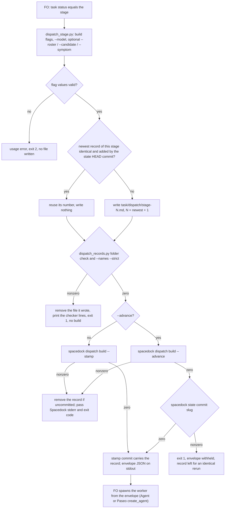

A dispatch built with `dispatch build --stamp` leaves <task>/dispatch/<stage>-<cycle>.md written from the same checklist, scope notes, model and SHA it sends, so the record no longer depends on FO remembering it.

## Scope

- Source: the Captain 「開」 (chat, 2026-11-06), answering 「要開這 4 張嗎？」 after fo-feedback round 005 (.notes/fo-feedback/round-005.md, closed 2026-11-06).
- Bite: kc-paseo-plugins reconstructed every dispatch record of batch r1b-polish-1 after the fact (_archive/project-env-rate-limit-cause/dispatch/ideation-1.md: "Reconstructed by FO on 2026-11-06, after the dispatch"; FO read 2026-11-06); qnow sent a follow-up addendum with no record (observer); the kc-plugin FO wrote one message record late and omitted required lines in batches 14 and 15 (observer reports).
- Upstream first: Spacedock dispatch build --stamp (Spacedock is not the Captain's repository: a change there is an upstream issue, so the dev2 side may be a package wrapper); kc-dev-flow-2 dispatch_records.py, which checks the record.
- Non-goals: follow-up messages to a running worker (a separate record kind).

## Budget
- One package PR; the workflow word budget does not rise unless the design names a raise for the Captain.

## Stop condition
- A stamped dispatch leaves a record that dispatch_records.py accepts without FO writing it, or the design names why Spacedock cannot and what the package does instead.

## FO alignment

Alignment: needed at ideation; the design choice is his to accept.
Result: aligned at backlog: Batch 17 backlog sitting, the Captain 「核准（建議）」 (host question dialog, 2026-11-07), answering 「決定：第 17 批這五張（Paseo 瀏覽器當工人驗收的預設、決策紀錄檢查分清驗證取代與指向依據、派工時自動寫派工紀錄、沒給範圍時設計檢查說沒跑、觀察者列出沒有合併提問紀錄的合併）都用 Pilot，照各自寫下的範圍、預算與停止條件進入構想嗎？建議核准。要改哪張直接說。」, approved the outcome and bounds in this file; the design choice the Alignment line names stays his at the ideation gate.
Surfaces: none
Visible change: none
Release review: not needed: workflow maintenance, on no journey map.

## Design

### Chain check

Read 2026-11-07 at the pins named here.

- **Spacedock** (`spacedock-dev/spacedock` origin/main 324c61588, and tag v0.27.2, the installed and CI-pinned binary): `dispatch build --stamp` (`runStamp` in `internal/dispatch/stamp.go`) stamps `started`/`worktree`, makes one path-scoped state commit `dispatch: <slug> entering <stage>`, publishes it and creates the worktree; `runBuildFields` in `build.go` then writes only `/tmp/spacedock-dispatch/<name>.md`. Nothing writes `<task>/dispatch/`. Mods have four hook points only (`git grep -hoE '## Hook: [a-z-]+'`: startup, merge, idle, shutdown); none runs at dispatch. The build also cannot know the record's `Model:` line: on Claude its envelope `model` is the Agent enum (`opus`), and a Paseo dispatch's model and `Roster:` come from `model_roster.py`, which Spacedock does not read.
- **The seam the design uses:** `entityCommitPaths` puts the task's companion folder `<slug>/` into the stamp commit (`git add -A -- <slug>.md <slug>/`). Probe on 0.27.2 (`/tmp/stamp-probe.3Byi`, split-root fixture with this workflow's README): an uncommitted `probe/dispatch/ideation-1.md` was committed by `dispatch: probe entering ideation`; on a second build for the same stage, with `started` already set, `ideation-2.md` alone was committed by the same subject. `spacedock state commit probe` committed an uncommitted `implementation-1.md` as `state: update probe`, which covers `--advance`, where `--stamp` is refused.
- **kc-dev-flow-2** (origin/main 139feeaee, 0.35.0): `dispatch_records.py` checks a record and writes none; `replay_dispatch.py` wraps `dispatch build` for replays and copies the dispatch file into its run folder, not a record. `git grep 'dispatch build'` finds no other writer.
- **Adopters** (subspace-relay, subspace-web, qnow, `origin/HEAD`, read-only `git grep -lE 'dispatch build|dispatch_records|/dispatch/[a-z]+-'`): their synced `docs/dev2*/README.md`, plus qnow history notes; no wrapper and no record writer.

So Spacedock cannot write the record without an upstream change in a repository the Captain does not own, and it would still lack the model line. The package wraps the build instead.

### PRFAQ

**kc-dev-flow-2 records every worker dispatch as it builds it.** FO now builds a worker dispatch with one package script. The script writes `<task>/dispatch/<stage>-<cycle>.md` from the same checklist and scope-notes files it hands to `spacedock dispatch build --stamp`, adds the model and the workflow checkout's SHA, runs both `dispatch_records.py` checks, and only then builds. The stamp's own state commit carries the record, so a record cannot be missing, written after the fact, or different from what the worker received.

- *What does FO still write?* The checklist and the scope notes, as today, and the model, roster, candidate and symptom values as flags. The script writes the header, the sections and the cycle number.
- *What if a part is missing?* The script removes the file it wrote, prints the checker's lines, and builds nothing. Its message starts `dispatch_stage: dispatch not built;`, so FO does not mistake it for a `dispatch build` failure that allows break-glass dispatch.
- *What if the build fails?* Spacedock's stderr and exit code pass through unchanged. If the record was not committed, the script removes it; an identical immediate rerun reuses the committed number instead of minting a new one.
- *Follow-up messages to a live worker?* Not covered: FO still saves those by hand.
- *Acceptance evidence:* a test against the CI-pinned Spacedock 0.27.2 binary (AC-1 to AC-6), and the README and pinned tests (AC-7).

### Flow

### Existing-code check

Completeness: `dispatch build --stamp` works through the journey and writes no record; `dispatch_records.py` works as a checker; no record writer exists (two bounded searches: the Spacedock `## Hook:` and `dispatch/<stage>` greps, and the package and adopter `dispatch build` greps above; excluded: `_archive/` evidence copies). Need: the Scope bite, three sessions with records written late, reconstructed or short of required lines. The design adds one script and reuses `dispatch_records.py`'s checks unchanged, and `task_folder` from `design_surfaces.py`.

### What changes

One package PR:

- `kc-dev-flow-2/scripts/dispatch_stage.py` (new). Arguments: `--workflow-dir`, `--entity-path`, `--stage`, `--checklist-file`, `--scope-notes-file`, optional `--feedback-context-file`/`--feedback-reflow`/`--advance` passed through, `--model TEXT` (required), `--roster TEXT`, `--candidate SHA` (repeatable, 40 hex or exit 2), `--symptom TEXT`, `--spacedock BIN` (default `$SPACEDOCK_BIN`, then `spacedock`).
  - Writes `# <stage>-<N>`, `Dispatched: <git -C workflow-dir rev-parse HEAD> (workflow checkout)`, `Model:`, then the given `Roster:`, `Candidate:` and `Symptom:` lines, `## Checklist` with the checklist file, `## Scope notes` with the scope-notes file. It never edits either file's text: an omitted `Package root:` or completion line is held by the checker, before any build.
  - N: let M be the highest `<stage>-<M>.md` committed at the state checkout's HEAD (message records excluded). N = M, writing nothing, only when that file's bytes equal what would be written and the state checkout's HEAD commit is the one that added it (an immediate retry after a sync or assembly failure); otherwise N = M + 1, 1 when none, overwriting an uncommitted file at N. Any state commit in between makes an identical dispatch a new record, so `role_triggers.py` still counts a repeated round.
  - `--note TEXT` appends `, TEXT` inside the `Dispatched:` parentheses, for the README version and batch annotations FO writes today.
  - Runs `dispatch_records.py <task folder>` and `--names --strict <record>` as subprocesses with the same Python; on success it prints nothing of theirs.
  - Without `--advance`, runs `<spacedock> dispatch build --stamp` with the build flags; with it, `dispatch build --advance` and then `<spacedock> state commit <slug> --workflow-dir <dir>`. Stdout is the build's envelope.
- `kc-dev-flow-2/scripts/test_dispatch_stage.py` (new): split-root git fixtures with the README from `references/sd/workflow.md`, run against `$SPACEDOCK_BIN`; exits nonzero naming `SPACEDOCK_BIN` when it is unset, so CI cannot pass it by skipping.
- `.github/workflows/kc-dev-flow-2-tests.yml`: one step after "Install pinned Spacedock", `SPACEDOCK_BIN="$HOME/.local/bin/spacedock" python3 kc-dev-flow-2/scripts/test_dispatch_stage.py`. Cost per PR: not measured.
- `kc-dev-flow-2/references/sd/workflow.md` (Stages): three passages replaced, text below.
- `kc-dev-flow-2/scripts/lint-skills.py`: one `WORKFLOW_BUDGET_STEPS` entry, `delta=-2`, why "dispatch_stage.py saves and checks the record; the README names the script and its flags".
- `kc-dev-flow-2/scripts/test_sd_dispatch.py`: the `dispatch-record` and `resumed-dispatch` entries' `need` and `swaps` follow the new text. `kc-dev-flow-2/scripts/test_dispatch_records.py`: `ContextNoticeTests.PARAGRAPH` follows the new third passage.
- ADR, only if the Captain accepts D1 (the number reserved at implementation dispatch), short title `stage-worker-dispatches-are-built-by-a-package-script-that-writes-their-record`. Draft: **Decision:** FO builds each stage-worker dispatch with `dispatch_stage.py`, which writes the record from the build's own inputs, checks it, and lets the stamp commit carry it; Spacedock is unchanged. **Context:** the Scope bite; the Chain check. **Consequences:** like ADR 0014, prose-enforced: an FO that follows Spacedock's skill text instead writes no record, and `dispatch_records.py --coverage` still holds that task after the report. Reopen on ADR 0014's condition, a dispatch-time hook in Spacedock. **Protects:** `kc-dev-flow-2/scripts/dispatch_stage.py` — `main`. **Words:** the Captain's ruling on D1.

New README text, replacing "FO saves those scope notes … fixes each part it lists.", "A follow-up message … never a pointer to another record." and "Before `dispatch build`, FO runs … on stderr.":

> FO builds each worker dispatch with `python3 <package>/scripts/dispatch_stage.py`: `dispatch build`'s flags, `--model`, and `--roster`, `--candidate` or `--symptom` where owed. It saves the checklist, scope notes, model and the SHA it dispatches from as `<task>/dispatch/<stage>-<cycle>.md`, so the instruction a worker followed outlives the session that wrote it, checks it as below, then builds; the build's commit carries the record.
>
> A follow-up message to a worker FO resumes is a dispatch too, saved by hand as `<stage>-<cycle>-message-<n>.md` with a checklist of the items it asks, never a pointer to another record, and committed with `spacedock state commit <slug> --workflow-dir <dir>`.
>
> Each record passes `python3 <package>/scripts/dispatch_records.py <task folder>` and `--names --strict <record>` before a worker reads it; nonzero holds dispatch. Relative script paths are allowed; bare package script names remain errors. Plain `--names` preserves existing historical verdicts and reports skipped context checks on stderr.

Not changed: `dispatch_records.py`, `extensions/paseo/EXTENSION.md` (its "chain … onto that same build command" now chains onto the script, which is that build command), `_mods/`, Spacedock.

### Words FO reads at each moment

Counted as `len(text.split())` over whitespace-normalized text, the count `lint-skills.py` uses; base origin/main 139feeaee (`lint-skills.py` exit 0, "5933 of 5933 words").

| Moment | Base | Candidate |
| --- | --- | --- |
| startup and resume (README read whole) | 5933 | 5931 |
| fresh worker dispatch: README passages | 112 (passages 1 and 3) | 101 (passages 1 and 3) |
| fresh worker dispatch: script output on a complete record | 4 ("N dispatch record(s) complete") | 0 |
| follow-up message: README passages | 143 (all three; passage 2's "the same check" needs passage 1) | 83 (passages 2 and 3) |
| follow-up message: script output | 4 | 4 |
| worker report (`--coverage`), idle, merge ask, archive | unchanged | unchanged |

Spacedock's own dispatch text (`claude-fo-dispatch.md`) is read in both and unchanged. The script's docstring is read only through `--help`.

### Non-goals and limits

- Follow-up messages (Scope non-goal); deriving `Model:` from the roster (D2); moving `package_version.py` and `workflow_checkout.py` into the script (D3); an upstream Spacedock issue; filling omitted scope-note lines.
- An FO that runs `spacedock dispatch build` directly, as Spacedock's skill text says, writes no record; `--coverage` catches it after the report, as today. This PR does not show FO uses the script: the first batch after release shows it (each fresh record's adding commit subject is `dispatch: <slug> entering <stage>`).
- An identical rerun with no state commit since the record was added reuses its number; a re-dispatch after any later state commit, such as a worker report, is a new record.
- The `Model:` and `Roster:` text stays FO-typed; a wrong value is not caught, as today.
- No new profile obligation: no production data, credentials or unattended operation.

### Needs decision

- **D1: build dispatches through a package script (this design), not an upstream Spacedock change, and land the ADR above.** Recommend yes. It is the only route the package owns, and it works on the pinned 0.27.2 today. Worse under it: Spacedock's skill still tells FO to call `dispatch build`, so the README must win that conflict; FO runs one more script per dispatch; a later Spacedock change to `entityCommitPaths` would break the commit seam, caught by AC-1 in CI.
- **D2: keep `--model` and `--roster` as FO-supplied flags rather than have the script run `model_roster.py resolve`.** Recommend keep. Resolving needs `--code-root` and inherits the resolver's exit-1 holds, and FO already runs it before a Paseo spawn. Worse under it: those two lines stay hand-typed.
- **D3: do not move `package_version.py` and `workflow_checkout.py`, which FO runs before each dispatch, into the script in this task.** Recommend not now: no bite is recorded since ADR 0014, and their hold (show the remedy, wait for the Captain) is a different contract. Worse under it: FO still runs three commands per dispatch, and those two checks stay prose-enforced.

Past rulings read: ADR 0014 (pre-dispatch checks; "a check inside Spacedock dispatch build — outside this package"), ADR 0020 (word budget), ADR 0027 (FO-write rules checked by the script FO runs at the write). `git -C <state> grep -n 'Override:'` finds none about dispatch records or wrapping `dispatch build`.

### Batch overlap

| Task | Shared file or check | Note |
| --- | --- | --- |
| worker-browser-checks-use-paseo-browser | `references/sd/workflow.md`, `lint-skills.py` budget steps, only if its design edits the README; not `extensions/paseo/EXTENSION.md`, which this design leaves alone | no design yet; the second to land rebases its budget step |
| adr-lint-tells-supersession-assertion-from-pointer | `scripts/test_sd_dispatch.py` (it may revert the split ADR 0047 path; this task edits the `dispatch-record` and `resumed-dispatch` entries) | different entries; either order |
| design-check-says-not-run-without-a-scope | `design_surfaces.py`: this task imports `task_folder`, unchanged | none unless it renames `task_folder` |
| observer-lists-unasked-merges | none (`delivery_gate.py`, observer) | none |
| merge-guard-stops-unasked-merges (held, read only) | `.github/workflows/kc-dev-flow-2-tests.yml` (both add one step); the ADR number index (it reserves one) | land it first; this task rebases its CI step |
| gate-summary-names-each-decline (held, read only) | none: it leaves `workflow.md` and `lint-skills.py` unchanged; `design_surfaces.py` import only | none |
| journey-map tasks (journey-map FO, read only) | the ADR number index only (journey-map takes 0065+) | FO reserves the number |

Recommended order: merge-guard-stops-unasked-merges, then this task; the batch-17 tasks in any order around it.

## Acceptance criteria

**AC-1** A stamped dispatch leaves a record `dispatch_records.py` accepts, committed by the stamp. Evidence: `test_dispatch_stage.py` against `$SPACEDOCK_BIN` 0.27.2, on a split-root fixture whose README is the raw `references/sd/workflow.md` (its frontmatter carries `state: .spacedock-state` and the stage list), as `test_sd_dispatch.py` uses it, and whose task is at `status: ideation`: exit 0; `<task>/dispatch/ideation-1.md` exists; `dispatch_records.py <task folder>` and `--names --strict <record>` exit 0; `git log -1 --format=%s -- <record>` is `dispatch: <slug> entering ideation`; stdout parses as JSON with `dispatch_file_path`. Falsifiers: building without `--stamp` leaves the record uncommitted and fails the subject assertion; dropping the `Model:` line fails the checker assertion.

**AC-2** The record holds what the worker receives. Evidence: the same test asserts every nonblank line of the checklist and scope-notes files appears in the record's matching section and in the file at `dispatch_file_path`. Falsifier: writing the record from a copy with one scope-notes line dropped fails it.

**AC-3** An incomplete record builds nothing and leaves nothing. Evidence: a scope-notes file without `Package root:` gives exit 1, a first stderr line starting `dispatch_stage: dispatch not built;` followed by the checker's part line, no file under `<task>/dispatch/`, the state checkout's HEAD and the task file unchanged, and no call to a fake `--spacedock` that writes a marker file when run. Falsifiers: skipping the removal leaves `ideation-1.md`; building before checking writes the marker.

**AC-4** A validation dispatch without a candidate is held before the build. Evidence: `--stage validation` without `--candidate` exits 1 with `dispatch_records.py`'s "no 'Candidate: <40-hex head>' line" text and leaves no file; `--candidate abc` exits 2 before writing. Falsifier: ignoring the checker's exit code lets the fake build run.

**AC-5** A failed or repeated build leaves no phantom record. Evidence: (a) a task at `status: backlog` dispatched with `--stage ideation`: Spacedock's stderr line starting `dispatch build --stamp:` and its exit code 1 pass through, and no `ideation-1.md` remains; (b) right after a successful `ideation-1`, an identical rerun exits 0 and adds no `ideation-2.md`, while the same rerun after one unrelated state commit adds `ideation-2.md`; (c) a rerun with one changed checklist line adds `ideation-2.md`, committed by the stamp. Falsifiers: without the removal (a) leaves a file; without the identical-reuse rule the first rerun of (b) adds `ideation-2.md`; reusing on bytes alone makes the second rerun of (b) add none.

**AC-6** A reuse-advance dispatch is recorded and committed. Evidence: a task at `status: implementation` with `--advance` adds `implementation-1.md`, committed with subject `state: update <slug>`, and prints the advance envelope; when `state commit` fails (fake binary), exit 1 and no envelope on stdout. Falsifier: skipping `state commit` leaves the record uncommitted.

**AC-7** The README names the script and costs no words. Evidence: `references/sd/workflow.md` holds the three passages under `### What changes` verbatim; `python3 -B kc-dev-flow-2/scripts/lint-skills.py` exits 0 printing `5931 of 5931 words`, with the `delta=-2` step; `test_sd_dispatch.py --sd-plugin-root <pinned root>` and `test_dispatch_records.py` pass with their updated pins. Falsifier: restoring the base passages makes `lint-skills.py` exit 1 on the count.

**AC-8** CI runs the seam test with the real binary. Evidence: `kc-dev-flow-2-tests.yml` holds the new step after "Install pinned Spacedock", and the PR's run shows it passing; `test_dispatch_stage.py` with `SPACEDOCK_BIN` unset exits nonzero naming it. Falsifier: deleting the step removes the check from the run.

## Stage Report: ideation

- DONE: Design how a stamped dispatch leaves a dispatch record that /Users/kent/.claude/plugins/cache/kc-claude-plugins/kc-dev-flow-2/0.35.0/scripts/dispatch_records.py accepts without FO hand-writing it, or why Spacedock cannot and what the package does instead, after reading Spacedock's own dispatch build source
  `### Chain check`: stamp.go/build.go at 324c61588 and v0.27.2 write no record and have no dispatch hook; package script `dispatch_stage.py` writes and checks the record and the stamp commit carries it (0.27.2 probe: record committed by `dispatch: probe entering ideation`, also on a repeat build; `state commit` covers `--advance`).
- DONE: A `### Batch overlap` section naming each file the design would change and each other batch task (worker-browser-checks-use-paseo-browser, adr-lint-tells-supersession-assertion-from-pointer, design-check-says-not-run-without-a-scope, observer-lists-unasked-merges) and live task of other sessions (merge-guard-stops-unasked-merges and gate-summary-names-each-decline (held by the Captain; read only), and journey-map tasks driven by the journey-map FO (read only)) that changes the same file or check, so FO can order implementation
  `### Batch overlap` table: shared CI workflow file and ADR index with merge-guard (land it first), `test_sd_dispatch.py` with adr-lint (different entries), README/budget with worker-browser only if it edits the README; others none.
- DONE: The words FO reads at each lifecycle moment, before and after, per root learning.md "Measure the words FO reads at each moment, not one file's size"
  `### Words FO reads at each moment`: startup 5933→5931; fresh dispatch 116→101; follow-up message 147→87; others unchanged. Base `lint-skills.py` exit 0 at origin/main 139feeaee.
- DONE: Acceptance criteria with reproducible evidence clauses and falsifiers, and unresolved decisions for the Captain, each with a recommendation and what gets worse under it
  AC-1..AC-8 each with evidence and falsifier; D1 (script, not upstream; ADR), D2 (model flags stay FO's), D3 (pre-dispatch checks stay out) under `### Needs decision`.
- DONE: AC-1 stamped record accepted and stamp-committed — not yet verified (implementation test); the 0.27.2 commit seam it rests on was observed in the probe.
- DONE: AC-2 record holds what the worker receives — not yet verified.
- DONE: AC-3 incomplete record builds nothing — not yet verified.
- DONE: AC-4 validation without candidate held — not yet verified; the checker's Candidate hold exists at origin/main (`check_candidates`).
- DONE: AC-5 no phantom record on failure or rerun — not yet verified; stamp refusal before any commit read in `runStamp`.
- DONE: AC-6 reuse-advance recorded — not yet verified; `state commit` sweeping the record observed in the probe.
- DONE: AC-7 README names the script at −2 words — draft counted 141 against 143; lint and pinned tests not yet run on a candidate.
- DONE: AC-8 CI runs the seam test — not yet verified; CI already installs Spacedock v0.27.2 (`kc-dev-flow-2-tests.yml`).

### Summary

Spacedock 0.27.2 cannot write the record (no dispatch hook; it does not know the roster model), so the design adds `kc-dev-flow-2/scripts/dispatch_stage.py`: it writes the record from the build's own input files, runs both existing checks, then runs `dispatch build --stamp`, whose path-scoped commit already sweeps the task folder (observed on 0.27.2). The README passages shrink by 2 words; three Captain decisions are open (D1–D3). `design_surfaces.py check`: "design surfaces presentable", exit 0. The probe's procedure is in `### Chain check`; its `/tmp` fixture is not retained evidence.
