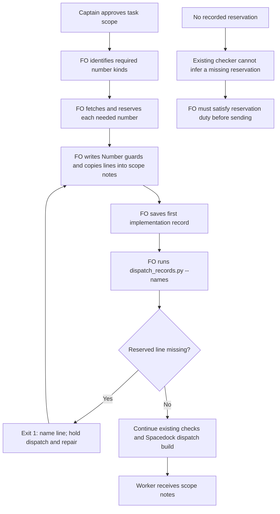

## Scope

- Source: the Captain 「同意開 1 到 5，第 6 項併進「GPT 夥伴」提案」 (chat, 2026-10-27), answering FO's list of package-issue candidates (items 2 to 5 relayed by the relay FO, Paseo 1671c3a9, from its pair-once and room-specs-follow-web-part-select observer reports; item 1 relayed by the kc-ops-inbox FO, Paseo 46c2ebdf).
- Bite: relay pair-once implementation-1: its scope notes lacked 'ADR: 0069' though the task held that number, and `dispatch_records.py --names` passed it.
- Upstream first: `scripts/dispatch_records.py`, `scripts/number_guards.py`, the README's Number guards.

## FO alignment

Alignment: needed before ideation; where the check runs is a package design choice.
Surfaces: none
Visible change: none
Release review: not needed: workflow maintenance, on no journey map.
Result: aligned 2026-10-27 on the outcome by the Captain's 「全准」 answering this task's backlog briefing-1 question, which named refusing a dispatch record without the Number guards line of a reserved ADR; where the check runs is put to him at the ideation gate.
Reviewer: kc-dev-flow-2:chief-engineer opus 2026-10-27 — batch 8 review at the ideation gate (the Captain's batch ruling 2026-10-27): per-task disposition, the Captain's decisions, order and batch risk.

## Design

### Recommendation and bounded existing-code check

Reuse the shipped refusal; do not implement a duplicate. The reported first-record case already fails `dispatch_records.py --names` on the current package. The Captain still needs to decide whether to accept that bounded result or require broader coverage of later dispatches. This report does not close the task or interpret the earlier approval as accepting a narrower guarantee.

Read on 2026-10-27 after a successful `git fetch origin`: repository `origin/main` is `8bf4f3582411e8e4238f19fbadda8ddeca6767be`, released manifest version `0.32.0`. The dispatched Codex package is `/Users/kent/.codex/plugins/cache/kc-claude-plugins/kc-dev-flow-2/0.32.0`; its `dispatch_records.py`, `number_guards.py`, `design_surfaces.py` and `laws_check.py` are byte-equal to that revision. No GitHub API query was needed or attempted; PR references below are local Git history, not a claim about current provider state.

Chain, checked in this order:

1. **Spacedock, the workflow orchestrator:** installed 0.27.3 own `skills/first-officer/references/fo-dispatch-core.md` requires saving scope notes and forwarding the generated envelope; `internal/dispatch/build.go` reads `scope_notes` and appends it to the prompt (lines 202-207, 665-667). These paths do not understand the package's ADR (architecture decision record) or migration reservation grammar. The refusal belongs in the existing package pre-send check; a skipped check is not a Spacedock-enforced stop.
2. **kc-dev-flow-2, the development workflow package:** `check_task_facts()` already reads `number_guards.task_facts()` and refuses every missing reserved ADR or Migration line for `implementation-1.md`. Local commit `18dbf490b` (PR #671) introduced it; `be137f20c` (PR #720) added folder-task lookup. `--names` calls it, default folder mode does not, and `--newest` deliberately checks bare script names only. The README already orders reservation before dispatch and calls `--names` before `dispatch build`.
3. **Sibling adopters:** read relay, web and qnow state only; no adopter workaround was used as upstream authority. The relay pair-once observer identifies the actual ordering defect: dispatch commit `70c8f952` preceded reservation commit `16809dc9`. At the first commit, the task has no `## Number guards` reservation. A checker of numbers the task already holds cannot infer that missing future reservation. At the second commit the same dispatch fails on `ADR: 0069` using the current package.

Two bounded searches established the mechanism and consumers: `git grep` for `dispatch_records.py` / `reserved line` under the pinned package scripts, and the direct call/condition inspection in `dispatch_records.py`, `number_guards.py`, `laws_check.py`, `pr_watch.py` plus the README dispatch and reserve passages. `laws_check.py` already recognizes the reserved-line diagnostic; its event-time reconstruction and `pr_watch.py --newest` must not be presented as a live pre-send reservation check. External wrappers, manual sends and dynamically selected old installations were not audited. No absence claim extends to them.

Applicable decisions read: ADR 0002 (reserve before implementation), ADR 0025 (land or release a held ADR), ADR 0027 (check structured writes in the existing script), and current task-state `Override:` records. ADR 0027's rejected phrase check supports avoiding inference from prose such as "Reserve and write the relay ADR". No applicable override requires replacing this existing structured comparison. No new ADR or numbered record is proposed.

### PRFAQ

**Proposition.** Before sending the first implementation assignment for a task with recorded reservations, the First Officer (FO) uses the existing pre-send check to refuse missing number lines. FO reserves the required kinds, writes the printed lines into the task and the dispatch scope notes, saves the record, runs the check, repairs a refusal, and then follows the existing Spacedock dispatch procedure. The worker receives the number FO reserved rather than choosing one itself.

**What changes?** Under the recommendation, no package behavior or documentation changes. This task supplies verified evidence and a precise limit for the ideation decision. A claim that this is a newly implemented fix would be false.

**What is compared?** The existing parser reads bare `ADR: <digits>` and `Migration: <digits>` lines under the task's `## Number guards`. Task lookup supports `<task>/index.md` and `<task>.md`. In the first implementation record's `## Scope notes`, the numeric value must match; current compatibility accepts zero-padding differences, indentation, a list prefix, `Number guards:` prefix and a trailing explanation. An unrelated prose mention, a wrong/longer number or a checklist-only mention does not satisfy it. Reuse this grammar; do not invent a second reservation parser or tighten spelling incidentally.

**What stops?** `--names` exits 1 and prints the missing kind/number and repair instruction. FO holds sending until the required check passes. This is script refusal plus FO procedure; it cannot stop a sender that never invokes the script.

**What remains outside the guarantee?** A task with no recorded reservation, a record with no discoverable task, later implementation/follow-up/validation records, the default folder mode and `--newest` do not receive this reserved-line refusal. No check here proves a reservation was made on time, that the saved scope notes equal a manually altered send, or that old records matched the task's later state. No adopter history is repaired. No new release, CI trigger, network service, migration, schema or production obligation is proposed.



Rendered with Mermaid CLI 11.17.0 to local SVG and PNG; inspected the PNG: FO owns reservation/repair/send, the missing-line branch stops before dispatch, and the missing-reservation limitation is separate. The first sandboxed browser launch failed; an approved local render outside that sandbox succeeded. Reproduce by saving this block as `flow.mmd` and running `npx --yes @mermaid-js/mermaid-cli@11.17.0 -i flow.mmd -o flow.png`. The renderer is a review tool, not a new project dependency; temporary output `/tmp/dispatch-reserved-adr-ideation/flow.png` is not a durable acceptance artifact.

### Observed replay

The current script was exercised, not just searched. `python3 -B <package>/scripts/test_dispatch_records.py` passed 54 tests, including both number kinds, folder/flat tasks, scope placement, longer-number refusal and accepted line forms. Removing the reserved-number branch would make the first-record refusal cases fail; accepting a checklist-only number would make the placement case fail. These tests do not prove FO follows the reservation order.

| Input, run with the unchanged 0.32.0 checker | Exit and observation |
| --- | --- |
| relay task and first record at `70c8f952` | 0, silent; no reservation existed yet |
| relay task at `16809dc9`, original first record | 1, `reserved line 'ADR: 0069' missing from scope notes` |
| same pair, only add `ADR: 0069` under scope notes in scratch | 0, silent |
| scratch task holds ADR 0069 and Migration 0021; both omitted | 1, two diagnostics, one per kind |
| same missing-line fixture named `implementation-2.md`, `implementation-followup-1.md`, or `validation-1.md` with a valid Candidate line | 0 each; current boundary confirmed |
| default folder mode on those four otherwise complete scratch records | 0, `4 dispatch record(s) complete`; not a reservation verdict |

This workflow's committed snapshot `d9a93cb5b0e584e1b22447b0a89f764d7d4ca121` was exported read-only with `git archive <revision> -- '*.md'` into scratch, preserving paths and copying the adopted README above it. All 490 `**/dispatch/*.md` records were run individually through `--names`: 354 exit 0, 136 exit 1, none exit 2. Twelve records print the reserved-line diagnostic. Default folder mode separately reports 62 folders complete and 10 incomplete; those structural verdicts are not substituted for `--names`.

The twelve first-record findings are in `_archive/amendment-form-check`, `_archive/dev2-laws-check`, `_archive/fo-lifecycle-mod`, `_archive/fo-write-checks`, `_archive/journey-map-dev2-contract`, `_archive/prod-security-review-gates`, `_archive/prod-security-validation-gate`, `_archive/release-acceptance`, `_archive/ui-design-review-in-ideation`, `_archive/workflow-budget-ratchet`, `journey-server-host-pilot` and `ops-inbox-r1-setup-and-isolation`. This is a current-task-snapshot comparison, not twelve proven violations at their historical send time. The original relay ordering replay shows why that distinction matters.

Sibling tracked records were also read on disk, without changing their checkout or fetching their remotes:

| State checkout / read-time HEAD | Records | `--names` exit 0 / 1 | Reserved-line diagnostics |
| --- | ---: | ---: | ---: |
| relay `f2aa776f24ac1e73470da8750fd90080d9386fff` | 279 | 192 / 87 | 18 |
| web `905be98f3f9d1099092e3ffa7046a66675362503` | 105 | 66 / 39 | 9 |
| qnow `8cbfed6ac3d55dcf1a42c6ffaafc2e601f707573` | 222 | 114 / 108 | 19 |

These sibling counts are supplementary read-time evidence, not immutable historical verdicts; a task can have multiple kind/number diagnostics. Other failures include bare script names, missing Candidate lines and amendment references and are not this task's repair scope. With no candidate code change, the recommended design creates zero changed checker verdicts.

Reproduce the decisive relay comparison with Python 3, Git, the dispatched package and the existing relay state clone; this creates scratch files only:

```python
from pathlib import Path
import subprocess, tempfile, sys
pkg = Path('/Users/kent/.codex/plugins/cache/kc-claude-plugins/kc-dev-flow-2/0.32.0')
state = Path('/Users/kent/conductor/workspaces/subspace-relay/beirut-dev2/docs/dev2/.spacedock-state')
def read(rev, path):
    return subprocess.check_output(['git', '-C', str(state), 'show', rev + ':' + path])
with tempfile.TemporaryDirectory() as scratch:
    root = Path(scratch)
    record = root / 'pair-once/dispatch/implementation-1.md'
    record.parent.mkdir(parents=True)
    original = read('70c8f952', 'pair-once/dispatch/implementation-1.md')
    record.write_bytes(original)
    command = [sys.executable, '-B', str(pkg / 'scripts/dispatch_records.py'), '--names', str(record)]
    for revision, expected in [('70c8f952', 0), ('16809dc9', 1)]:
        (root / 'pair-once.md').write_bytes(read(revision, 'pair-once.md'))
        assert subprocess.run(command).returncode == expected
    record.write_bytes(original.replace(b'## Scope notes\n', b'## Scope notes\n\nADR: 0069\n'))
    assert subprocess.run(command).returncode == 0
```

For a full replay, export the stated plugin-state revision's tracked Markdown files to a scratch `state/`, put this workflow's README beside `state/`, enumerate `sorted(state.glob('**/dispatch/*.md'))`, and run the same `--names` command once per file; count exit codes and lines containing `reserved line`. Use `git show <revision>:<path>` or `git archive` to retain folder tasks and archives. Do not rewrite older records to make the corpus green. State clone paths are supplied evidence locations, not package runtime dependencies.

### Words FO reads at each moment

Count with `len(text.split())`, before = pinned 0.32.0, after = the recommended unchanged package. The task adds no standing instruction or output at startup, idle, archive or merge. Since all their passages and scripts remain byte-identical and no command is added, each full lifecycle total is identical for identical inputs; absolute totals for the unrelated PR/review/learn machinery were not remeasured. The table separates that fact from the measured reservation-related reading, rather than calling a zero delta a zero total.

| Lifecycle moment | Reservation-related words before | After | Full moment delta |
| --- | ---: | ---: | ---: |
| Startup | 0 | 0 | 0; unchanged hook, passages and output |
| Idle on an open PR | 0 | 0 | 0; unchanged `pr_watch.py --newest` behavior |
| Idle on a merged PR | 0 | 0 | 0; unchanged observer and merge instructions |
| After archive | 0 | 0 | 0; unchanged learning instructions |
| Merge ask | 0 added by this dispatch check | 0 added | 0; existing number/delivery checks unchanged |
| First implementation dispatch, clean | 394 | 394 | 0 |
| First implementation dispatch, one missing reserved line | 422 | 422 | 0 |

Dispatch passage bounds are the workflow text from `FO resolves <package>` through the sentence before `When status --set` (310 words, counting the literal Markdown), plus the whole `Reserve` bullet before `Applied` (84). A successful `--names` run adds 0 output words; one actual reserved-line diagnostic adds 28, two add 56. This is the full text of the two reservation/dispatch passages, not a README-size proxy. No reduction is claimed. If the Captain chooses broader coverage, the revised design must count its new refusal lines at the affected moments before claiming a budget benefit; this report supplies no approved budget increase.

## Acceptance criteria

These criteria assess the recommended reuse, not an unapproved broader implementation. Each has executed current evidence below; FO still owns the scope decision.

- **AC-1** A first implementation record linked to a task holding an ADR or Migration line is refused by `--names` when its scope notes omit that line; the output names each missing kind/number and exits 1. Evidence: 54 existing tests and the two-kind scratch replay above. Falsifier: remove the reserved-number branch or accept a number appearing only in Checklist; the relevant test must fail.
- **AC-2** Adding exactly the missing line under Scope notes clears that reservation defect without changing task or code. Evidence: relay at `16809dc9`, original record exit 1, line-only scratch repair exit 0; existing cases cover flat/folder task lookup and number mismatch. Falsifier: copy `ADR: 0068`, `ADR: 00690`, or place 0069 outside Scope notes; the original refusal must remain.
- **AC-3** The evidence distinguishes a missing recorded reservation from a missing carried line and states all checked mode/stage limits. Evidence: relay `70c8f952` exit 0, later task exit 1; later-record and default-mode probes exit 0. Falsifier: claim the checker stopped the original send, every dispatch is checked, or default folder success proves reservations; any such claim fails this criterion.
- **AC-4** Replay covers this workflow's committed dispatch corpus and the relay original case read-only, with exits, pins and unchanged artifacts. Evidence: 490 records, 354/136 exits, 12 reserved-line findings, 72 folder checks, and historical relay scratch replay. Falsifier: omit archives or folder-task `index.md`, repair source data, or count pattern occurrences instead of executing the checker; the evidence is rejected.
- **AC-5** Recommended reuse adds no repository file, new FO command, recurring words, output grammar, CI trigger or numbered record; the diagram matches the procedural stop and its limit. Evidence: the file/consumer audit, per-moment table and successful Mermaid render/inspection. Falsifier: any proposed source diff or extra standing step requires a revised before/after measurement and renewed Captain decision; a diagram showing Spacedock independently enforces the check also fails.

### Captain decision

**D1 — coverage choice.** Accept the existing first-record refusal and close this as already covered, or require all dispatches with a currently held reservation to be checked? Recommend accepting reuse: it already rejects the named case once the reservation exists, adds no duplicate mechanism, and a wider check still would not detect an unrecorded reservation at the original send. What remains worse under that recommendation: later implementation/follow-up/validation records keep their current enforcement gap, and reservation timing still depends on FO following the existing rule. If the Captain requires wider coverage, return this design for that scope: specify stages, current versus event-time facts, and historical-record treatment before implementation; do not silently extend the comparison to old ideation records. No choice has been accepted in this report.

### Batch overlap

Recommended file changes: only this task body/report in the shared state checkout. **No package source, tests, workflow README, ADR, shared index or CI file changes.** Thus no source conflict is introduced. If D1 instead selects broader coverage, likely files for a revised design are `kc-dev-flow-2/scripts/dispatch_records.py`, `scripts/test_dispatch_records.py`, `scripts/test_laws_check.py`, and any affected contract in `references/laws.md`; inspect `scripts/laws_check.py` for event-time task reconstruction and output parsing before deciding it needs a change. This is an impact map, not authorization to edit those files.

| Other task, read as it stood | Shared file/check under recommendation; coordination if scope widens |
| --- | --- |
| archive-waits-for-observer-report — refuse premature archive | none; adjacent observer/merge and history-law checks only |
| idle-hook-names-merged-tasks-without-learn — surface missing learning | none; shares `pr_watch.py` as a consumer, but this design leaves `--newest` unchanged |
| copilot-not-run-line-carries-quote — preserve reviewer evidence | none; delivery/reviewer check only |
| dispatch-carries-reserved-adr-number — this task | owns only its task body; no source claim |
| seed-check-requires-schema-fields — validate required seed fields | none; `design_surfaces.py` is imported by dispatch checking, so rerun dispatch tests if that sibling changes shared parsing |
| journey-probe-finds-nested-maps — find nested journey maps | none; adoption map discovery |
| read-adr-honors-adr-folder — honor supplied decision directory | none; kc-adr source and synchronized skill copy |
| adr-required-statement — require explicit ADR disposition | none; adjacent number/decision lifecycle and workflow rules; coordinate semantics before widening reservation coverage |
| journey-server-host-pilot — hosted canvas server | none; a corpus task with an existing reserved-line finding, not authority to repair its dispatch |
| ops-inbox-r1-setup-and-isolation — isolated operations inbox | none; another corpus task with an existing reserved-line finding; preserve its records |
| pr-review-lite-value-pilot — compare review routes | none; no shared reservation checker change found in its task |
| adr-silent-undo-probe — measure accidental decision reversal | none; held here and moved to a POC task, no authorized package changes |
| comment-check-reaches-delivery-gate — require comment evidence | none; its recorded Captain choice says not to build; do not schedule its old design as live implementation |
| journey-canvas-hosted-poc — test hosted canvas | none; recorded hold on its earlier design, separate canvas work |

Recommended order: FO settles D1 before dispatching implementation for this task; if accepting reuse, close through the supported lifecycle without a code PR. The other batch tasks need no source ordering behind this recommendation. If widening, recheck their then-current designs and order any shared parser/history-law changes explicitly. No peer session was contacted or modified.

## Stage Report: ideation

- DONE: A design for /Users/kent/.claude/plugins/cache/kc-claude-plugins/kc-dev-flow-2/0.32.0/scripts/dispatch_records.py to refuse a dispatch record whose task holds a reserved ADR or Migration number in ## Number guards but whose scope notes lack that Number guards line, replayed over this workflow's dispatch records and the relay pair-once record read only
  Current 0.32.0 already refuses the recorded first-dispatch case: 490 committed records replayed (354 exit 0, 136 exit 1; 12 reserved-line findings), plus relay historical 0 / 1 / line-only repair 0; later-dispatch limits are explicit.
- DONE: A `### Batch overlap` section naming each file the design would change and each other batch task (archive-waits-for-observer-report, idle-hook-names-merged-tasks-without-learn, copilot-not-run-line-carries-quote, dispatch-carries-reserved-adr-number, seed-check-requires-schema-fields, journey-probe-finds-nested-maps, read-adr-honors-adr-folder) and live task of other sessions (adr-required-statement, journey-server-host-pilot, ops-inbox-r1-setup-and-isolation, pr-review-lite-value-pilot, adr-silent-undo-probe, comment-check-reaches-delivery-gate, journey-canvas-hosted-poc (driven by other sessions; read only)) that changes the same file or check, so FO can order implementation
  Batch overlap lists every named task, read-only findings and file/check intersections; recommendation changes only this entity body, with conditional wider-scope files identified for a new design.
- DONE: The words FO reads at each lifecycle moment, before and after, per root learning.md "Measure the words FO reads at each moment, not one file's size"
  Dispatch passages measured at 394 words before/after, or 422 with one refusal; all five other lifecycle deltas are zero for identical inputs because their passages, scripts and commands remain unchanged. Unrelated absolute totals were not remeasured.
- DONE: Acceptance criteria with reproducible evidence clauses and falsifiers, and unresolved decisions for the Captain, each with a recommendation and what gets worse under it
  AC-1 through AC-5 have reproducible evidence and falsifiers; D1 asks reuse versus broader coverage, recommends reuse and names the remaining follow-up/timing gaps.
- DONE: AC-1
  54 existing dispatch tests passed and a two-kind scratch record exits 1 twice; deleting the reserved-line branch or accepting checklist-only lines breaks the relevant tests.
- DONE: AC-2
  Relay with reserved ADR 0069 exits 1, then 0 after adding that scope line only; a wrong/longer number or placement outside scope must remain refused.
- DONE: AC-3
  At historical dispatch commit 70c8f952 no number existed and exit was 0; later records/default mode also pass the isolated missing-line probes, disproving an all-dispatch or timing guarantee.
- DONE: AC-4
  Pinned plugin state d9a93cb5b0e584e1b22447b0a89f764d7d4ca121 was replayed in scratch including archives/folder tasks; omitting those inputs invalidates the corpus result. Relay source was read only.
- DONE: AC-5
  Recommended source diff is empty; Mermaid CLI 11.17.0 render succeeded and inspected diagram equals the entity block. A new standing command or hard-stop claim would invalidate this no-change result.
- DONE: Design surface check
  design_surfaces.py check printed "dispatch-carries-reserved-adr-number.md: design surfaces presentable" (exit 0); removing the usable acceptance section would fail this gate check.

### Summary

The current package already implements the reported first-record refusal; the relay failure began with reservation after dispatch, not a missing comparison in today's checker. Recommend reusing that mechanism and closing as already covered only if the Captain accepts D1; checking later dispatches remains a separate unresolved coverage choice, so no implementation or task-state advancement was performed. Only this state task body/report was changed; original frontmatter and Scope were preserved.
