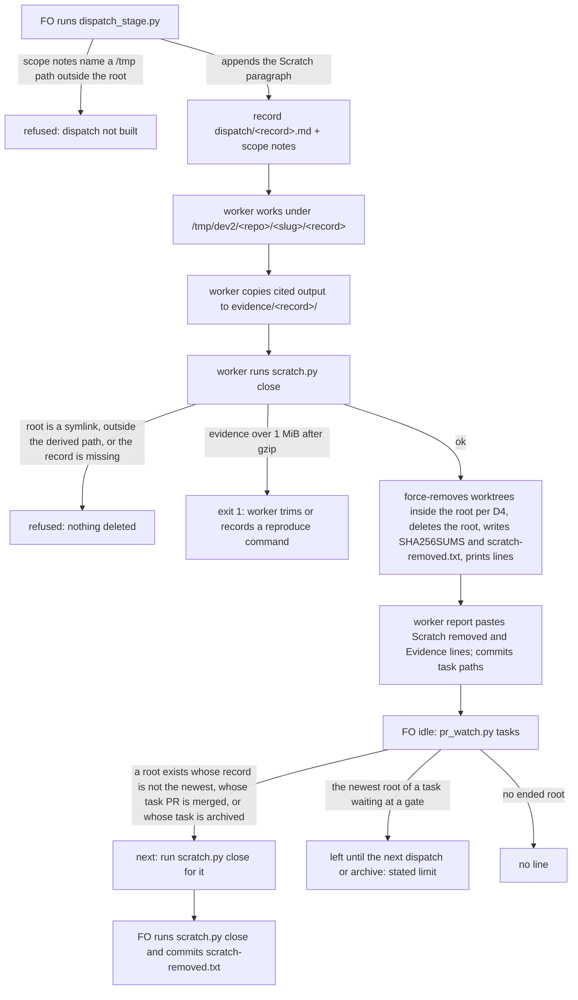

## Scope

- Source: the Captain 「把派工結束收尾清理要刪除過程產生的可移除檔案，以及把必要證據壓縮封存到派工分支中紀錄成故事，下一批要做，目前這樣都沒人刪檔很困擾」 (chat with FO session 3, 2026-11-11); earlier that day 「都刪除，且要找出為何完工了卻沒清理的原因？等於完工一定要清理」.
- Bite (FO measured 2026-11-11): free disk fell to 5.6 Gi; single finished tasks left 3.6 G and 4.3 G under /tmp, and a shared scratch folder held 17 G of which about 12 G belonged to archived tasks. Cause FO found: no step and no owner removes scratch; validation dispatches tell workers to export candidates under /tmp; workers kept /tmp copies "as supporting evidence"; FO's close-out removed only the git worktree.
- Interim practice since 2026-11-11, by hand: each dispatch asks the worker to remove its own scratch by exact path and list it; FO removes the rest at archive.
- Outcome: at close-out, evidence a later reader needs is in the task's records in compressed form and can be restored, and every scratch path the dispatch created is gone, with a record of what was removed.
- Open for the design: what "派工分支" means per stage, given that the state branch is public; what counts as necessary evidence and its size limit; who removes what and when (worker at report, FO at archive); how a removed path is told from missing evidence by the delivery check.
- Non-goals: cleaning other sessions' or other repositories' scratch; a retention policy for git branches.

## Budget
1 cycle per stage, in one package PR.

## Stop condition
- One real task run after the change ends with no path it created left under /tmp, its evidence restorable from the archive by the documented command, and the delivery check passing. Return to the Captain if evidence that must stay private cannot be kept off the public state branch.

## FO alignment

Alignment: not needed: the Captain's words under Source name the outcome; where the archive lives is compared in the design and ruled at the ideation gate.
Reviewer: kc-dev-flow-2:engineering-reviewer not run 2026-11-12: amendment 2 scopes AC-3 to the dispatch's own scratch root, which is what the independent validator proposed in finding F2 of validation-1 after showing that a whole-repository zero count conflicts with removing only one's own root; the Captain chose it in the gate dialog, and the second validation judges the replacement criterion.
Reviewer: kc-dev-flow-2:engineering-reviewer gpt-6-astra 2026-11-13 — are the two Codex P2 findings repaired at c429ab181 and did the merge of main keep both sides; is RoboRev job 1815's High finding (archived evidence has no public check) a build defect, a design change for the Captain, or outside this PR; what else could fail a third validation? Answer: both repaired with tests that fail on d4fe39e54, merge keeps both sides; the finding is a design-control gap, not a defect against approved decision D3, and the change adds no automatic publication path; recommends validation 3 as is with the finding deferred to a named follow-up, which needs the Captain's ruling.
Surfaces: none
Visible change: none
Release review: not needed: workflow maintenance, on no journey map.

## Captain amendments

### Amendment 1 — 2026-11-12, host question dialog
Captain: 「四張都允許（建議）」 (host question dialog, 2026-11-12)
Asked: 「要不要允許實驗裡這四張任務的實作各多寫一份決策紀錄檔，記下你在設計關卡裁的決定？我建議允許。四張是：收尾清理（已經停下來等這個答案）、計時紀錄、擱置的任務、問題裡的事實。這是修改你已核准的設計範圍，會記成各張任務的一筆修正案；決策紀錄只寫你在關卡上核准的內容，不加新的決定。收尾清理那張我用追加訊息讓原本的工人接著做，不算新的一次派工。變差的是：四張任務各多一個檔，而且實驗要記上「設計核准後改範圍」四筆，其中三筆是我預先處理、還沒真的發生。」
Supersedes: none

### Amendment 2 — 2026-11-12, host question dialog
Captain: 「一次授權，跑完（建議）」 (host question dialog, 2026-11-12)
Asked: 「實驗裡還沒過驗證的三張任務（收尾清理、問題裡的事實、擱置的任務）要怎麼走完？我建議一次給足授權讓它們跑完：一、這三張的預算都改成「1 implementation and 2 validation cycles」，退回後用追加訊息修正、再驗一次；第二次驗證再被退回就停下來回到你這裡。二、收尾清理那條「收尾後整個 repo 的暫存工作目錄是零」的驗收條件，改成只看這次派工自己的暫存資料夾，不為了湊到零去刪別的派工的資料夾。三、問題裡的事實那條要拿「擱置的任務」成品重播的條件不改，等那張的成品出來後補跑。這些會記成三張任務各一筆修正案。變差的是：三張各多一輪驗證（每輪約 15 到 20 分鐘），今天會跑到晚上；而且這段期間我不會再為「程式缺陷修完重驗」回來問你。」
Supersedes: AC-3
Budget: 1 implementation and 2 validation cycles
Superseded text:

**AC-3** After a dispatch's close, no git worktree of the code repository is registered under `/tmp/dev2/`.
Evidence: `git -C <code repo> worktree list --porcelain | grep -c '^worktree /\(private/\)\?tmp/dev2/'`; pass is count 0, which `grep -c` reports with exit 1.
Run now: 90 worktrees registered, 3 under `/tmp`, none under `/tmp/dev2/`; count 0, exit 1 (`evidence/code-repo-tmp-worktrees.txt`). This shows the command works; it proves nothing about close yet.
Falsifier: a `git worktree add` inside a root that close leaves registered.

### Amendment 3 — 2026-11-13, chat
Captain: 「加預算，修完：#854、#856 各改成 1 implementation and 3 validation cycles」 (chat, 2026-11-13)
Asked: 「#854、#856 要不要各加一次驗證預算？ 同意即接受：兩張預算改成 1 implementation and 3 validation cycles；修正交回原 worker；第三次驗證前先請獨立審查者看一次；第三次再被退回就停下來回到你這裡。」
Supersedes: none
Budget: 1 implementation and 3 validation cycles

### Feedback Cycles

- Cycle 1 (FO, 2026-11-12): validation-1 on #854 head 223dbb6d1 recommended REJECTED with two findings: F1 assessed Material and owned (kind build; the generated dispatch instruction omits the Captain's rule that private repository evidence is never archived and bans only secrets and personal data); F2 Needs decision (kind aim or scope; AC-3's whole-repository zero-worktree count conflicts with the rule that a close-out removes only its own scratch root), settled by Captain amendment 2. Routed to the implementation worker as a repair message.
- Cycle 2 (FO, 2026-11-13): after validation-2 passed at d4fe39e54, Codex review 5873421269 left two P2 findings on that head (a later-dispatch scratch path is validated against the previous dispatch's root, so a second validation dispatch that names its scratch root cannot be built; a compression that fails partway and is retried records the compressed file's digest as the original's), and merges of PRs 858 and 861 left a conflict with main in kc-dev-flow-2/scripts/pr_watch.py. FO assesses both findings Material and owned (kind build, inside the approved design: the first blocks an ordinary second-validation dispatch, the second breaks ADR 0079's original-digest statement). Captain amendment 3 grants the third validation cycle; repair by follow-up message to the implementation worker, then an engineering-reviewer read, then validation-3.

## Design

### PRFAQ

**Proposition.** From the next kc-dev-flow-2 release, every worker dispatch gets one scratch folder, `/tmp/dev2/<repo>/<slug>/<record>`, named after its dispatch record (`<record>` is the record's file name without `.md`, for example `validation-2`). The record says so, so FO no longer types it. The worker copies what its report cites into `<task folder>/evidence/<record>/` on the state branch. Before reporting, it runs one package command, `scratch.py close`. That command deletes the folder and any git worktree registered inside it, gzips each evidence file over 256 KiB, refuses evidence over 1 MiB after compression, and writes one line to `<task folder>/scratch-removed.txt`. When FO's idle look sees a scratch folder whose dispatch has ended, or whose task is archived, it prints the same command as a `next:` line. Finished work leaves nothing under `/tmp`, and a later reader restores evidence with `git show`.

**FAQ**
- *Why one folder per dispatch, named after the record?* The deletion target is derived from the task folder and an existing record, never parsed from report prose. A record-named root also tells FO which folders are finished: any root that is not the task's newest record is done.
- *What is "necessary evidence"?* What the report cites: logs, command output, small JSON, the acceptance script. Checkouts and dependency trees are reproduced from the recorded SHA and command instead. In one 4.3 GiB ideation scratch folder of a sibling adopter, six subfolders of about 0.7 GiB each made up the bulk (the one opened was a repository checkout with `node_modules`; the other five were sized, not opened), and the 24 loose files were 1.4 MiB (`du`, 2026-11-12, run once and not saved to keep other projects' task names off this branch). On this state branch the median task folder is 42 KiB, the 90th percentile 1306 KiB, and the largest single file 1.6 MB (`evidence/state-task-folder-sizes.txt`, `evidence/state-largest-file.txt`). That file gzips to 74,708 bytes (`evidence/ac-restore-roundtrip.txt`).
- *Why not compress everything into one archive per dispatch?* Plain text in git is already compressed: this state tree is 124,211,200 bytes raw and 28,255,842 as tar.gz (`evidence/state-compression.txt`). ADR 0072's gate-count check also reads the numbers in cited task-folder files as text, and the observer reads committed state with `git grep`. A tarball hides both. This is decision D2 below.
- *Does the delivery check need to tell removed scratch from missing evidence?* No change is needed. Since 0.36.0 (#799, `629cf7326`), its missing-path check (S4) reads only FO's message and `Asked:` lines. On the 0.39.1 package, a validation report naming a removed `/tmp` path exits 0, and FO's message naming that same path still holds with exit 1 (`evidence/ac-s4-removed-path.txt`). The design keeps that split. A path under the scratch root is never evidence; evidence is task-folder-relative under `evidence/`.
- *Why can't the OS clean /tmp?* On this machine nothing does. `/tmp` holds 3470 entries, 121.2 GiB. Seventy-eight entries are named `<slug>-<stage>-<N>` and hold 56.2 GiB; one of those slugs is a task in this workflow, and the other 77 match no task here (`evidence/tmp-usage.txt`). `/etc/defaults/periodic.conf` has no `clean_tmps` line (grep, 2026-11-12).

### Mechanism

1. **dispatch_stage.py** builds the stage and special-role dispatches it already builds (ADR 0070, ADR 0074). It derives the root `/tmp/dev2/<repo>/<slug>/<record>`, where `<repo>` is the name in the code repository's `origin` URL. It writes the scope-notes file it passes to `dispatch build` as FO's notes plus the Scratch paragraph, worded as in `### Words FO reads at each moment`. The record therefore carries the same `Scratch:` line. A follow-up message record `<stage>-<cycle>-message-<n>` shares its dispatch's root. It refuses scope notes that name an absolute `/tmp/…` or `/private/tmp/…` path outside that root. This addresses the cause FO found, where validation notes said `git worktree add --detach /tmp/<name>` (seen in `_archive/delivery-gate-verdict-form/dispatch/validation-1.md`).
2. **scratch.py close `<task folder>` `<record>`** (new, about 100 lines, with tests).
   - **Refusals, with nothing deleted:** a record absent from `<task folder>/dispatch/`; a root or parent that is a symlink; a resolved root not equal to the derived path.
   - **Deletion:** for each worktree of the code repository registered inside the root, `git worktree remove --force` (decision D4), recording its count of uncommitted files; then `git worktree prune`; then it deletes the root, and the empty slug folder.
   - **Evidence:** gzips each file over 256 KiB in `evidence/<record>/`; exits 1 if the folder is over 1 MiB after that, without deleting the evidence.
   - **Record:** appends `<record> <root> <bytes removed> <UTC time>` to `<task folder>/scratch-removed.txt`, and writes `evidence/<record>/SHA256SUMS` with the digest of each evidence file before compression.
   - **Output:** prints `Scratch removed: <root> (<size>)` and `Evidence: evidence/<record>/ (<n> files, <KiB>)`.
   - **Already gone:** an absent root prints `(absent)` and exits 0, so FO's later sweep is idempotent.
3. **pr_watch.py tasks** (the idle look FO already runs and obeys) lists the folders under `/tmp/dev2/<repo>/`. For each root whose slug is archived, or whose record is not the task's newest dispatch record (`dispatch_records.py --newest`), it prints the `next:` line. A root whose slug is in no task folder is only reported, never closed. For a task whose PR is merged, it prints the close lines before its `next: let pr-merge record` line, so the record lands before archive; the post-archive sweep is the backup.
   **Limit:** a root whose worker did not close it stays while its task waits at a gate or for merge with no newer dispatch, until the next dispatch or the archive. The finished-task bite is covered; a long gate wait is not.
4. **Profile.** No new obligation that would change the profile arises: no production data or credential, no broad exposure, no unattended recurring operation (FO runs the idle look), and no migration.
5. **No README change.** `references/sd/workflow.md` is under a word budget that needs a Captain ruling to raise (`WORKFLOW_BUDGET_STEPS` in lint-skills.py). The worker reads the rule in its dispatch, and FO reads the `next:` line only when one is due.

**Existing-code check.**
- *Spacedock 0.27.2:* `merge guard` removes the task's git worktree and branch at finalize, nothing under `/tmp` (`merge guard --help`; `fo-merge-core.md` "Worktree removal safety"). It also never removes its own `/tmp/spacedock-dispatch/` files: 5936 files, 24 MB, out of scope and Spacedock's to own.
- *kc-dev-flow-2 0.39.1:* `git grep -c -i scratch` over workflow.md, the FO mod, pr_watch.py and dispatch_stage.py finds nothing (`evidence/before-package-scratch-words.txt`, exit 1).
- *Sibling adopters* qnow, subspace-relay and subspace-web (read-only `git grep` of their Markdown): no scratch close-out rule.
- *Reused:* dispatch_stage.py's record, dispatch_records.py's `--newest` and pr_watch.py's archive scan. Deletion is new because none of those deletes anything. A separate script keeps the one destructive step behind its own refusals.

### Decisions for the Captain

- **D1. 「派工分支」: where evidence lives.**
  - **Recommend:** the task folder on the state branch (`spacedock-state/dev2`). ADR 0034's walk record and ADR 0072's saved outputs already live there, and 172 task folders already hold evidence.
  - **Gets worse:** this repository is public (`gh repo view`, 2026-11-12), so archived evidence is public.
  - **Alternatives:** the task's PR branch, which merges evidence into the product's `main` and the shipped plugin tree; or a per-task `evidence/<slug>` branch, also public, which adds branches with no retention policy (a non-goal).
- **D2. 「壓縮」: compression form.**
  - **Recommend:** plain files, with each file over 256 KiB gzipped, and git's own compression for the rest (about 4.4× on this tree).
  - **Gets worse:** small files are not individually compressed in the working tree.
  - **Alternative:** one `.tar.gz` per dispatch. It follows the words literally, but ADR 0072's count check stops seeing numbers in cited evidence, and `git grep` stops seeing the evidence.
- **D3. Private evidence (the stop condition).**
  - **Recommend:** never archive it. It is deleted with the scratch folder, and the report keeps a `Not archived (private): <what>; reproduce: <command>` line.
  - **Gets worse:** a later reader must re-run the command to see that evidence.
  - **Alternative:** a private local folder outside `/tmp` that close-out keeps. It is not removable by this mechanism and brings the disk bite back.
  - **Effect:** with this recommendation, private evidence never reaches the public branch, so the stop condition's return does not trigger.

- **D4. Unattended `git worktree remove --force` inside a scratch root.** The README says not to clean up an owned worktree unless the action is authorized, and Spacedock says `--force` is never default.
  - **Recommend:** authorize it for worktrees inside a dispatch's scratch root only, on the Captain's 「都刪除，且要找出為何完工了卻沒清理的原因？等於完工一定要清理」, recording each one's uncommitted-file count in `scratch-removed.txt`.
  - **Gets worse:** uncommitted work a worker left in a scratch worktree is lost without a question; the count tells afterwards, not before.
  - **Alternative:** remove without `--force` and refuse a dirty worktree, printing it for FO; a dirty scratch worktree (build output, test files) then stays, and the bite returns for it.

Override check: `git grep -n 'Override:'` over the state branch shows no ruling in this area (scratch, evidence, archive).

### Worth questions

- **Per-dispatch root and worker close.**
  - *Captain's words:* 「把派工結束收尾清理要刪除過程產生的可移除檔案」.
  - *Without it:* 121.2 GiB under `/tmp`, and 3.6 to 4.3 G left by single finished tasks (Scope).
  - *Premise that would make it unneeded:* the OS cleans `/tmp` itself. Checked now: there is no `clean_tmps` setting, and the 121 GiB is still there.
- **Evidence in the task folder, compressed.**
  - *Captain's words:* 「把必要證據壓縮封存到派工分支中紀錄成故事」.
  - *Without it:* a report that names a `/tmp` path as evidence loses it when scratch is deleted. 127 of 157 archived task files name `/tmp` paths, and 749 of those 824 distinct paths no longer exist (`evidence/archived-tmp-path-scan.txt`). How many of those were evidence rather than scratch was not measured.
  - *Premise:* reports never name `/tmp` paths. That is false, as measured.
- **FO sweep of ended roots and archived tasks.**
  - *Captain's words:* 「都刪除，且要找出為何完工了卻沒清理的原因？等於完工一定要清理」.
  - *Without it:* a worker that forgets or dies leaves its folder; workers keeping copies is the cause FO found.
  - *Premise:* workers always clean when told. Not testable cheaply now. The hand practice since 2026-11-11 has no record of misses either way.
- **`scratch-removed.txt` record.**
  - *Captain's words:* 「找出為何完工了卻沒清理的原因」. The Outcome's "a record of what was removed" is FO's wording of that.
  - *Without it:* the next "why wasn't this cleaned" question has no answer.
- **Scope-notes `/tmp` refusal.**
  - *Captain's words:* none directly. It serves the cause FO found under Bite.
  - *Without it:* FO's old habit of naming `/tmp/<name>` puts scratch outside every root.
  - *Ask:* the Captain can keep or cut it.

### Words FO reads at each moment

**Method.** Words, counted with `wc -w`, that instruct a scratch or evidence step due at that moment. *Before* is measured on 0.39.1 / origin/main `8ce0eb605`. *After* is the word count of the text proposed here. It is a ceiling, not a measurement of shipped code.

| Moment | Before | After (ceiling) |
| --- | --- | --- |
| startup (README) | 0 | 0 (no README change) |
| building a dispatch | 0 package words; FO types its 19-word hand sentence ("Remove any scratch directory you create under /tmp, by exact path, before you finish, and say so.") | 0; the script adds the 66-word paragraph, which the worker reads |
| after a worker report | 0 | 0 |
| idle, nothing ended | 0 of 901 output words (`evidence/before-idle-words.txt`) | 0 |
| idle, a dispatch ended or a task archived | 0; FO removed folders by hand, from memory | 21 words per ended root |
| merge ask | 0 | 0 |

The 66-word paragraph:
> Scratch: /tmp/dev2/\<repo\>/\<slug\>/\<record\>
> Put every file or checkout you create outside the task worktree and the state checkout under that folder. Copy what your report cites into evidence/\<record\>/ in the task folder, and nothing that holds a secret or a person's data: for that, write `Not archived (private): <what>; reproduce: <command>`. Before your report, run `python3 <package>/scripts/scratch.py close <task folder> <record>` and paste the lines it prints.

The 21-word `next:` line: ``next: run `python3 <package>/scripts/scratch.py close <task folder> <record>`; that dispatch has ended. Commit the scratch-removed.txt it writes with the task path.``

### Not provable now

These need code that does not exist yet. Each one becomes an acceptance check at validation.

- **Dispatch refusal.** dispatch_stage.py refuses scope notes naming a `/tmp` path outside the root. Falsifier: notes with `/tmp/x` build anyway.
- **Close refusals.** `scratch.py close` refuses a missing record, a symlinked root, and a root that differs from the derived path, and deletes nothing in each case. Falsifier: a symlinked root pointing at a sentinel folder; the sentinel must survive.
- **Close behaviour.** `scratch.py close` removes a worktree registered inside the root: afterwards `git worktree list` no longer names it. It gzips a file over 256 KiB, and exits 1 at more than 1 MiB of evidence.
- **Restore after a real run.** `git -C <state> show origin/spacedock-state/dev2:<task path>/evidence/<record>/<file>.gz | gunzip -c | shasum -a 256` equals that file's line in `evidence/<record>/SHA256SUMS`, which close writes; there is no such file before the change. Today's basis: a gzip round trip of the largest evidence file on this branch compares equal, `cmp` exit 0, 1,621,352 bytes to 74,708 (`evidence/ac-restore-roundtrip.txt`). Falsifier: a truncated `.gz`.
- **Post-archive record.** A `scratch-removed.txt` committed into `_archive/<slug>/` after archive does not disturb learn or the observer; untested.
- **Idle sweep.** pr_watch.py prints the `next:` line for a non-newest or archived root, and none for the newest root of a live task.
- **Words per moment.** Recount the after column on the candidate with an independent copy (root learning.md).
- **Stop condition.** One real task dispatched after release ends with no path it created under `/tmp`: `ls /tmp/dev2/<repo>/<slug>` fails. Its evidence restores with the documented command, and `delivery_gate.py check` passes.

### Batch overlap

This design changes `kc-dev-flow-2/scripts/dispatch_stage.py` and `test_dispatch_stage.py`, `kc-dev-flow-2/scripts/pr_watch.py` and `test_pr_watch.py`, and the new `kc-dev-flow-2/scripts/scratch.py` and `test_scratch.py`. It changes no README, ADR index, or `delivery_gate.py`. The four other tasks in this batch have no design yet, so their files below are read from their Scope, not their designs.

- **merge-ask-tests-the-merge-result:** probably `delivery_gate.py` and the merge-ask text. No shared file expected.
- **held-and-closed-tasks-leave-the-design-queue:** probably `pr_watch.py tasks`, the same function this design adds a block to.
- **each-task-records-stage-time-revises-and-interruptions:** probably `dispatch_stage.py`, in `record_text`, beside this design's notes change.
- **gate-question-facts-are-checked-before-the-captain-reads-them:** probably `delivery_gate.py`. No shared file expected.
- **adoption-asks-which-extensions** (ideation, another session): names `pr_watch.py`, `workflow.md` and `dispatch_records.py`. Shared file: `pr_watch.py`.
- **comment-check-reaches-delivery-gate** (ideation, another session): names `pr_watch.py`, `delivery_gate.py` and `workflow.md`. Shared file: `pr_watch.py`.
- **adr-required-statement** (validation, another session): `workflow.md` and the lint-skills.py word budget. No shared file, because this design leaves `workflow.md` alone.
- **No overlap found:** adr-silent-undo-probe, journey-canvas-hosted-poc, journey-server-host-pilot, ops-inbox-r1-setup-and-isolation and pr-review-lite-value-pilot. Their mentions of "scratch" are their own scratch projects.
- **delivery-gate-s4-skips-removed-scratch** (backlog): its bite, measured on 0.35.0, no longer reproduces on 0.39.1 (`evidence/ac-s4-removed-path.txt`). FO may close it as fixed by #799.

Recommended order: this task before held-and-closed-tasks-leave-the-design-queue and each-task-records-stage-time-revises-and-interruptions. Both of those edit the same functions; each adds an independent block, so the later one rebases. adoption-asks-which-extensions and comment-check-reaches-delivery-gate rebase their `pr_watch.py` edits on whichever lands first.

## Acceptance criteria

**AC-1** Every stage dispatch record built by dispatch_stage.py carries `Scratch: /tmp/dev2/<repo>/<slug>/<record>`.
Evidence: `grep -c '^Scratch: /tmp/dev2/' <task folder>/dispatch/<record>.md`; pass is exit 0 with count 1.
Run now on this task's `dispatch/ideation-1.md`: count 0, exit 1, red as expected before the change (`evidence/ac-record-scratch-line.txt`).
Falsifier: a record built without the paragraph.

**AC-2** A report naming a removed scratch path does not hold the delivery check, while FO's message naming a missing path still does.
Evidence: `PYTHONPATH=<package>/scripts python3 -B evidence/s4_repro.py <package>/scripts` (needs `test_delivery_gate.py` from the same revision beside it); pass is exit 0.
Run now on 0.39.1: exit 0. The report case exited 0 with no S4; the message case exited 1 with `message S4: missing path …` (`evidence/ac-s4-removed-path.txt`).
Falsifier: a candidate that makes S4 read reports again.

**AC-4** Amended by Captain, amendment 2. 只看這次派工自己的暫存資料夾，不為了湊到零去刪別的派工的資料夾。
Current evidence: `python3 -B -m unittest test_scratch.ScratchTests.test_close_keeps_another_dispatch_in_the_same_repository` from the candidate scripts, with `PYTHONPATH` set to those scripts; pass is exit 0. The test creates two dispatch roots in one synthetic repository, closes one, checks zero registered worktrees under that root and that the other dispatch's uncommitted file and registration survive.
Falsifier: leaving the closed dispatch's worktree registered, or deleting the other dispatch's worktree.

## Number guards

ADR: 0079

## Stage Report: ideation

- DONE: The Captain's experiment for this task (his words are in the task's backlog gate record): this task is in the arm without a proof of concept. For every acceptance criterion, run its evidence command or procedure once now and write beside the criterion the exact command, its exit and the path of its saved output in the task folder; a criterion whose proof cannot be run now is not written under Acceptance criteria but under a 'Not provable now' list with the reason, for the Captain to see at the design gate
  AC-1..AC-3 each carry command, exit and `evidence/` path. The restore check after a real run moved to `### Not provable now` (no `<original>` survives deletion), with the other proofs that need scratch.py, the dispatch_stage/pr_watch changes, the recount, the post-archive record, or the real-task stop condition.
- DONE: A `### Batch overlap` section naming each file the design would change and each other batch task (merge-ask-tests-the-merge-result, held-and-closed-tasks-leave-the-design-queue, each-task-records-stage-time-revises-and-interruptions, dispatch-close-out-archives-evidence-and-removes-scratch, gate-question-facts-are-checked-before-the-captain-reads-them) and live task of other sessions (adoption-asks-which-extensions, adr-required-statement, adr-silent-undo-probe, comment-check-reaches-delivery-gate, journey-canvas-hosted-poc, journey-server-host-pilot, ops-inbox-r1-setup-and-isolation, pr-review-lite-value-pilot (driven by other sessions; read only)) that changes the same file or check, so FO can order implementation
  Shared `pr_watch.py` with held-and-closed, adoption-asks and comment-check; `dispatch_stage.py` with each-task-records (both probable for the batch tasks, which have no design yet); no README change; backlog delivery-gate-s4-skips-removed-scratch is already fixed on 0.39.1; `Recommended order:` given.
- DONE: The words FO reads at each lifecycle moment, before and after, per root learning.md "Measure the words FO reads at each moment, not one file's size"
  `### Words FO reads at each moment`: before is 0 package words at every moment (`evidence/before-package-scratch-words.txt`, `evidence/before-idle-words.txt`); after is a ceiling, not measured: 0 at every moment except 21 words per ended root at idle. FO's 19 hand-typed words per dispatch go.
- DONE: Acceptance criteria with reproducible evidence clauses and falsifiers, and unresolved decisions for the Captain, each with a recommendation and what gets worse under it
  Three ACs, each with a falsifier. Decisions: D1 where 「派工分支」 is (state task folder); D2 compression form (plain plus gzip over 256 KiB); D3 private evidence (never archived; reproduce line); D4 unattended `--force` worktree removal inside a root (authorize, with the dirty count recorded). Each has a recommendation and what gets worse under it.
- DONE: AC-1 record carries the Scratch line
  The grep on this task's `dispatch/ideation-1.md` gives count 0, exit 1: red before the change, as expected (`evidence/ac-record-scratch-line.txt`). A pass needs the change.
- DONE: AC-2 a removed path in a report does not hold the delivery check; FO's message naming it does
  `evidence/s4_repro.py` on 0.39.1 exits 0: the report case exits 0, the message case exits 1 with `message S4` (`evidence/ac-s4-removed-path.txt`). This passes today, with no code change needed.
- DONE: AC-3 no code-repo worktree registered under /tmp/dev2
  Count 0, exit 1 (`evidence/code-repo-tmp-worktrees.txt`). The command works, but nothing about close is proven until the change exists.
- DONE: design_surfaces.py check
  `python3 <package>/scripts/design_surfaces.py check <task>` exit 0, "design surfaces presentable" (`evidence/design-surfaces-check.txt`).
- DONE: scratch I created removed by exact path
  Removed `/tmp/ccx-ideation` (a directory), `/tmp/ccx-prwatch.py` (a file) and `/tmp/ccx-scan.pJia5e` (a directory); `ls` afterwards reports no such file for each.

### Summary

The design is one record-named scratch folder per dispatch, under `/tmp/dev2/<repo>/<slug>/<record>`, written into scope notes by dispatch_stage.py. A new `scratch.py close` deletes it with refusals that guard the deletion, archives cited evidence in the task folder with gzip over 256 KiB and a 1 MiB cap, and logs the removal in `scratch-removed.txt`. pr_watch.py's idle look names each ended or archived root. The design needs no README or delivery-check change: S4 has read only FO's text since 0.36.0, verified on 0.39.1. Four decisions are open for the Captain: D1 where 「派工分支」 is, D2 the compression form, D3 private evidence, and D4 unattended `--force` worktree removal. Measured today, `/tmp` holds 121.2 GiB, and 749 of the 824 `/tmp` paths named in archived task files no longer exist. A root left by a worker while its task waits at a gate is a stated limit.

## Stage Report: implementation

- FAILED: One Draft PR (Conventional Commit title scoped to the plugin) from a branch off origin/main (8ce0eb6050c889b21baccf50fec35231bc888d66) implementing the approved design and acceptance criteria in the task file; decisions D1 to D4 as the design recommends and the Captain approved at the ideation gate; the items under 'Not provable now' become checks you run and report; only the files the design names
  Held before implementation: the design permits six script/test files, whereas `<package>/skills/implementation/principles.md` requires "Write one file per decision, `docs/adr/NNNN-short-title.md`". The approved enduring evidence-location, compression, private-evidence and forced-removal decisions have no new ADR path or reserved number in this task; adding one would exceed the explicit file boundary. FO must reconcile the scope and decision-record requirement before redispatch. No product file changed or empty commit made.
- SKIPPED: Every acceptance criterion green with the evidence each names; each falsifier shown failing by a mutation you run (python3 -B, caches cleared)
  Not run: the dispatch says to stop if an out-of-design file is needed. No acceptance, mutation, real-run, restore, idle-sweep, post-archive or word-count result is claimed.
- SKIPPED: kc-dev-flow-2/scripts/lint-skills.py (the repository copy CI runs), /Users/kent/.claude/plugins/cache/kc-claude-plugins/kc-dev-flow-2/0.39.1/scripts/adr_lint.py docs/adr --since <base> exit 0; /Users/kent/.claude/plugins/cache/kc-claude-plugins/kc-dev-flow-2/0.39.1/scripts/number_guards.py check exit 0; /Users/kent/.claude/plugins/cache/kc-claude-plugins/kc-dev-flow-2/0.39.1/scripts/comment_ratio.py within its maximum; commit locally, no push; PR text written for FO; FO pushes, opens the Draft PR, runs RoboRev and reads CI; CI cost measured or stated as not measured
  Not run: lints, number/comment guards, RoboRev and CI; CI cost not measured. Product branch `spacedock-ensign/dispatch-close-out-archives-evidence-and-removes-scratch` remains at fetched base/candidate `8ce0eb6050c889b21baccf50fec35231bc888d66`; no product push or PR opened. `/tmp/impl-dispatch-close-out-archives-evidence-and-removes-scratch-pr.md` is a held handoff, not a publishable implementation PR.
- DONE: Required stage entry and approved-scope checks
  Loaded ensign and implementation/Pilot references; role_triggers.py exited 0 (implementation 1, validation 0). Verified assigned pwd/git root, clean branch and successful `git fetch origin`; HEAD equals origin/main at `8ce0eb6050c889b21baccf50fec35231bc888d66`. Read the ideation approval and accepted ADRs 0070, 0072 and 0074; they do not record these cleanup decisions.
- DONE: Scratch cleanup
  No disposable /tmp scratch created. Retained only the requested `/tmp/impl-dispatch-close-out-archives-evidence-and-removes-scratch-pr.md` for FO to remove; removed-path list: none.

### Summary

Implementation is held at the approved-file boundary: the mandatory decision record would require a file the design does not name. FO needs to resolve that one scope conflict; product bytes, candidate SHA and task frontmatter remain unchanged, and no passing implementation or delegated-check result is claimed.

## Stage Report: implementation

- SKIPPED: One Draft PR (Conventional Commit title scoped to the plugin) from a branch off origin/main (8ce0eb6050c889b21baccf50fec35231bc888d66) implementing the approved design and acceptance criteria in the task file; decisions D1 to D4 as the design recommends and the Captain approved at the ideation gate; the items under 'Not provable now' become checks you run and report; only the files the design names
  Publication delegated by dispatch: no product push or PR opened. Local candidate `77e240d46ced4980ec1f6f2dc61a692f27857af1` on `spacedock-ensign/dispatch-close-out-archives-evidence-and-removes-scratch` is based on fetched `8ce0eb6050c889b21baccf50fec35231bc888d66`; `evidence/implementation-1/candidate.json` confirms exactly the six designed scripts/tests plus Captain-authorized ADR 0079, with a clean code worktree. PR title/body: `/tmp/impl-dispatch-close-out-archives-evidence-and-removes-scratch-pr.md`.
- DONE: Every acceptance criterion green with the evidence each names; each falsifier shown failing by a mutation you run (python3 -B, caches cleared)
  AC-1 real Spacedock-built record and artifact each carry one Scratch line; removing the paragraph fails `AC1-paragraph-removed.log`. AC-2 report/missing-message path exits remain 0/1 (`ac2-s4.log`); restoring report scanning fails `AC2-reports-scanned.log`. AC-3 actual code-repo worktree count under /tmp/dev2 is 0 after close (`actual-close-after.json`); skipping removal leaves a registered worktree and fails `AC3-skip-worktree-remove.log`. All paths in this report are under `evidence/implementation-1/` unless stated otherwise.
- SKIPPED: kc-dev-flow-2/scripts/lint-skills.py (the repository copy CI runs), /Users/kent/.claude/plugins/cache/kc-claude-plugins/kc-dev-flow-2/0.39.1/scripts/adr_lint.py docs/adr --since <base> exit 0; /Users/kent/.claude/plugins/cache/kc-claude-plugins/kc-dev-flow-2/0.39.1/scripts/number_guards.py check exit 0; /Users/kent/.claude/plugins/cache/kc-claude-plugins/kc-dev-flow-2/0.39.1/scripts/comment_ratio.py within its maximum; commit locally, no push; PR text written for FO; FO pushes, opens the Draft PR, runs RoboRev and reads CI; CI cost measured or stated as not measured
  Only the FO-owned push, Draft PR, RoboRev and hosted CI are unrun. All local commands passed at the candidate; their individual results are below. CI cost per PR is not measured; CI triggers are unchanged and existing `test_pr_watch.py` loads the new scratch tests.
- DONE: Captain amendment 1 of this task (2026-11-12, in the task file under Captain amendments) permits one decision-record file: write docs/adr/0079-<short-title>.md recording only what the Captain approved at the ideation gate (decisions D1 to D4 in the design, with his words from the ideation gate record), and resume the implementation you stopped
  `docs/adr/0079-dispatch-close-out-retains-public-evidence-and-removes-scratch.md` records the ideation approval, the cleanup question's words and the four chosen options; no additional ruling or version change.
- DONE: The task's Number guards section now holds ADR: 0079; run the package ADR lint with --require 0079 and the number guards check as the first dispatch record says
  `adr-lint-final.log`: `--since 8ce0eb6050c889b21baccf50fec35231bc888d66 --require 0079` exit 0; `number-guards-final.log`: fresh state-ref check exit 0, no findings, candidate `77e240d46ced`.
- DONE: Everything else in the first implementation record stands, including the single-PR rule and the report form; your stage report supersedes the stop report
  One local product commit, no push, named-file staging, no stash/config writes/version bump; this complete report supersedes the earlier implementation hold report within the same dispatch cycle.
- DONE: Local checks and distinct-suite totals
  Repository `lint-skills.py`, package ADR lint, number guards, design_surfaces check and comment_ratio all exit 0 (`required-checks.json` and named logs); comment ratio is 1.1%, maximum 5%. `tests.json` contains 333 distinct passed tests: 49 dispatch, 148 watch/cleanup, 136 dispatch-record; its initially skipped native case was rerun with declared native inputs (`dispatch-records-native-tests.json`), leaving no skip. `first-dispatch-run.txt.gz` preserves the initial unreachable test-origin failure before the local-bare-remote fixture repair.
- DONE: Refusal, compression, restore and idle checks previously not provable
  `test_scratch` exercises missing records, symlinked roots/parents/evidence, mismatched roots, exact 256 KiB threshold, the 1 MiB cap and dirty worktree removal; reversing the safety/threshold/cap behavior fails the named mutation logs. `test_pr_watch` checks old/archived/merged prompts, silence for the current live root, unknown-root non-removal and unchanged successful observer/learn results after a committed post-archive removal record. These are exercised synthetic workflows, not a released adopter run.
- DONE: Fresh-shell verification and falsifiers at the committed candidate
  Archived `acceptance.py CODE_REPO SPACEDOCK_BINARY OWNED_OUTPUT_FOLDER` ran under `zsh -f`: 15 decisive tests plus the S4 command passed (`fresh-shell-tests.json`, `fresh-shell-s4.log`); the script uses the task's existing `../s4_repro.py`. Ten `python3 -B` behavioral mutations were rejected (`mutations.json`, `mutate.py` and named logs); candidate caches were absent and mutation copies exclude caches. `fresh-shell-layout-error.txt` preserves the first invocation's missing sibling input before running from the documented task-evidence location.
- DONE: Word ceilings and retained documents
  Independent `wc -w` counts of emitted worker notes and idle output meet the design's 66/21-word ceilings (`words.json`, `words-emitted.txt`); no README words added. `doc-impact.json` lists four documents, disposed below.
- DONE: docs/adr/0070-stage-worker-dispatches-are-built-by-a-package-script-that-writes-their-record.md
  unaffected: write/check/build order, FO-supplied model/roster and separate preflights remain; scratch notes use that writer.
- DONE: docs/adr/0074-special-role-calls-are-built-by-the-stage-dispatch-script.md
  unaffected: model floor, checked role record and commit-before-prompt ordering remain.
- DONE: docs/adr/0077-a-task-budget-counts-cycles-and-past-it-the-question-returns-to-the-captain.md
  unaffected: cycle/budget logic and Captain routing remain; continuation does not add a dispatch cycle.
- DONE: docs/adr/0079-dispatch-close-out-retains-public-evidence-and-removes-scratch.md
  updated: new authorized decision record; ADR lint verifies its code pointers.
- DONE: This real task's local close-out, committed evidence restoration and exact scratch removal
  Evidence was committed/synced in state commit `8d48cf354` before cleanup. Candidate `scratch.py close` removed `/tmp/dev2/kc-claude-plugins/dispatch-close-out-archives-evidence-and-removes-scratch/implementation-1` and its empty slug folder, including the code repository's actual verification worktree and two uncommitted files. Also removed the empty test containers `/tmp/dev2/dispatch-code` and `/tmp/dev2/kc-claude-plugins`; exact removed/retained paths are in `actual-close-after.json`. Retained only `/tmp/impl-dispatch-close-out-archives-evidence-and-removes-scratch-pr.md` for FO.
- DONE: Scratch removed and Evidence output
  `Scratch removed: /private/tmp/dev2/kc-claude-plugins/dispatch-close-out-archives-evidence-and-removes-scratch/implementation-1 (36885419 bytes)`; idempotent rerun prints `(absent)`. `Evidence: evidence/implementation-1/ (43 files, 176.5 KiB)`. `scratch-removed.txt` records `uncommitted-files=2`; remote `git show origin/spacedock-state/dev2:<task>/evidence/implementation-1/first-dispatch-run.txt.gz` gunzips to its SHA256SUMS digest, and the retained file digests were verified (`actual-close-after.json`).
- SKIPPED: One real task dispatched after release ends with no created /tmp path, restores its archive and passes delivery_gate.py check
  Release, post-release dispatch and delivery approval are not authorized worker actions and have not occurred. The current task's actual local cleanup/remote restore and real-binary synthetic delivery checks passed; they do not establish this post-release stop condition. No private repository evidence was read or archived.

### Summary

This report supersedes the earlier implementation stop report: Captain amendment 1 resolved its file-boundary hold, and the seven-file Pilot candidate implements the approved cleanup decisions with 333 distinct passing suite tests, fresh-shell proof and ten rejected mutations. Public evidence is committed on the state branch and this task's actual scratch/worktree is removed; FO still owns product publication, RoboRev, hosted CI and the post-release real-task stop condition.

## Stage Report: implementation

- DONE: RoboRev job 1800 on head 77e240d46 reports one High finding in kc-dev-flow-2/scripts/scratch.py: the scratch root is namespaced by the origin repository's basename only, so two repositories with the same basename, or two clones of one repository running the same task record, share one scratch root, and a close-out from one can overwrite the other's notes and force-remove its worktree with uncommitted changes
  Material, locally reproduced: `repair-1/replay-old.json` shows shared roots and deleted peer uncommitted files for both same-basename and same-origin independent-copy cases, leaving peer worktree registrations. The current released dispatch workflow supplies the normal operator/record context; this deletion is candidate-only, not a released-adopter incident. Observable loss violates `captain-ruling[2026-11-12]` D4's current-dispatch-only forced-removal boundary. Source/trigger details are in `repair-1/candidate.json`.
- DONE: Judge it against the approved design (each dispatch has its own scratch folder; Captain decision D4 allows unattended forced removal inside a dispatch's scratch root only): reproduce it or show why it cannot happen; if real, repair it inside the design, for example a collision-resistant identity for the root and an ownership check before reading or deleting an existing root, with a test that fails without the repair; say in the report whether the path form the design shows changes
  Repaired within the six designed scripts/tests: the namespace hashes origin, canonical Git common directory and state-checkout identity. An exclusively created `.owner.json` binds the full SHA-256 identity, task and dispatch; existing-root note reuse and close refuse missing/mismatched ownership before notes, evidence or worktrees change. `repair-1/replay-candidate.json` preserves peer files/registrations in both cases; new tests cover ownership refusal before the native builder, linked code/state worktrees, separate workflows and archive moves.
- DONE: Path form change
  Yes: `/tmp/dev2/<repo>/<slug>/<record>` becomes `/tmp/dev2/<repo>-<16-hex identity>/<slug>/<record>`. The directory suffix distinguishes clone/workflow contexts; the marker compares the full identity so a suffix collision refuses reuse. The record still supplies the worker's path; a message shares its parent dispatch. Archive moves preserve the state identity. Existing unowned roots are not adopted or overwritten. This is the isolation repair authorized by implementation-1-message-2; no new Captain policy, ADR edit or workflow prose.
- DONE: Commit locally, do not push; append a complete new stage report that supersedes the earlier one; run the package checks the first record names again
  Added local commit `223dbb6d1b5e895a45d11537b9494aa08610c8f8` on `spacedock-ensign/dispatch-close-out-archives-evidence-and-removes-scratch`, parent `77e240d46ced4980ec1f6f2dc61a692f27857af1`; no amendment or product push. Repository skill lint, package ADR lint (`--since 8ce0eb6050c889b21baccf50fec35231bc888d66 --require 0079`), fresh-ref number guards, design_surfaces and comment_ratio exit 0; ratio 0.9%, maximum 5% (`repair-1/required-checks.json` and named logs). This complete report supersedes all earlier implementation reports within the same dispatch cycle.
- SKIPPED: One Draft PR (Conventional Commit title scoped to the plugin) from a branch off origin/main (8ce0eb6050c889b21baccf50fec35231bc888d66) implementing the approved design and acceptance criteria in the task file; decisions D1 to D4 as the design recommends and the Captain approved at the ideation gate; the items under 'Not provable now' become checks you run and report; only the files the design names
  FO reports Draft PR #854 already opened on the reviewed parent; this worker did not query or change its remote state. Local implementation/repair are committed above the original base; exactly the six designed scripts/tests plus the previously authorized ADR 0079 differ from that base. FO owns publishing the new commit to that PR. Updated title/body and candidate are in `/tmp/impl-dispatch-close-out-archives-evidence-and-removes-scratch-pr.md`.
- DONE: Every acceptance criterion green with the evidence each names; each falsifier shown failing by a mutation you run (python3 -B, caches cleared)
  AC-1: real stage/role records and dispatch artifacts retain one Scratch line; paragraph removal fails. AC-2: removed report path passes while a missing FO-message path fails (`repair-1/s4.log`); restoring report scanning fails. AC-3: cleanup removes its registered dirty worktree while peer worktrees survive; skipping removal fails. `repair-1/acceptance-mutations.json` and named logs retain all ten acceptance mutations, and `repair-1/repair-mutations.json` adds three rejected namespace/ownership mutations. Candidate caches were absent; all runs used `python3 -B` and mutation copies exclude caches.
- SKIPPED: kc-dev-flow-2/scripts/lint-skills.py (the repository copy CI runs), /Users/kent/.claude/plugins/cache/kc-claude-plugins/kc-dev-flow-2/0.39.1/scripts/adr_lint.py docs/adr --since <base> exit 0; /Users/kent/.claude/plugins/cache/kc-claude-plugins/kc-dev-flow-2/0.39.1/scripts/number_guards.py check exit 0; /Users/kent/.claude/plugins/cache/kc-claude-plugins/kc-dev-flow-2/0.39.1/scripts/comment_ratio.py within its maximum; commit locally, no push; PR text written for FO; FO pushes, opens the Draft PR, runs RoboRev and reads CI; CI cost measured or stated as not measured
  All named local checks passed at the repair candidate as above. Only the FO-owned publication/review/hosted-CI portion is unrun on the new head; job 1800 is the old-head finding, not a clean review of this repair. CI cost per PR is not measured and CI triggers are unchanged.
- DONE: Captain amendment 1 and reserved ADR 0079
  The existing decision record remains in the candidate; ADR lint requires 0079 and passes. Repair adds no decision-record file, number, migration, version change or production obligation; the approved cleanup/privacy/compression decisions remain.
- DONE: Current-round regression and fresh-shell proof
  `repair-1/tests.json`: 201 distinct tests passed, no failures/skips (50 native dispatch; 151 watch/cleanup, including 12 scratch cases). The prior standalone dispatch-record suite is not rerun in this repair round; the real dispatch suite exercises its checker at the builder seam. `zsh -f` acceptance yields 19 passed results: 18 decisive tests plus the S4 command (`repair-1/fresh-shell-tests.json`). Prior reports' 333-test total belongs to the prior head and is not claimed for this repair.
- DONE: Previously unprovable behavior and word ceilings
  The current suites preserve missing-record, symlink and mismatched-root refusals; exact compression threshold, retained-evidence cap, committed gzip restore, actual dirty worktree removal, idle older/merged/archived prompts, current-root silence and unchanged observer/learn results after archive. New code/state identity agreement was also checked in this real task (`repair-1/candidate.json`); emitted worker notes remain 65 words, below 66, and the idle text and its 21-word ceiling are unchanged. No README change.
- DONE: docs/adr/0070-stage-worker-dispatches-are-built-by-a-package-script-that-writes-their-record.md
  unaffected: record write/check/build order remains; root claiming joins before any returned prompt or scope-note write (`repair-1/doc-impact.json`).
- DONE: docs/adr/0074-special-role-calls-are-built-by-the-stage-dispatch-script.md
  unaffected: role model floor and checked/committed record-before-prompt order remain; role dispatches now also claim their owned root.
- DONE: docs/adr/0077-a-task-budget-counts-cycles-and-past-it-the-question-returns-to-the-captain.md
  unaffected: budget and Captain routing remain; this is the authorized continuation of implementation-1, not a new cycle.
- DONE: docs/adr/0079-dispatch-close-out-retains-public-evidence-and-removes-scratch.md
  unaffected policy record: the repair enforces its dispatch-only cleanup decision; the changed technical path spelling is disclosed above. The accepted ADR remains immutable.
- DONE: Evidence committed, scratch removed by exact path
  Repair evidence was committed/synced as state commit `250f1c108` before deletion. Candidate close verified ownership and removed `/private/tmp/dev2/kc-claude-plugins-3042bb224e995ded/dispatch-close-out-archives-evidence-and-removes-scratch/implementation-1` (217 bytes), its empty slug folder and empty namespace. Removed `/tmp/impl-dispatch-close-out-repair-854` with all replay/mutation/test scratch. Exact paths and retained handoff file are listed in `repair-1/cleanup.json`; no private repository content was read or archived.
- DONE: Scratch removed and Evidence lines; committed restore proof
  Initial close printed `Scratch removed: /private/tmp/dev2/kc-claude-plugins-3042bb224e995ded/dispatch-close-out-archives-evidence-and-removes-scratch/implementation-1 (217 bytes)`; repeat prints `(absent)`. `Evidence: evidence/implementation-1/ (87 files, 296.9 KiB)`. The remote committed manifest's 86 pre-cleanup evidence digests matched, including decompressed evidence; the final manifest also retains this cleanup proof. Original removal logs and evidence remain, with the new removal appended.
- SKIPPED: One real task dispatched after release passes its full cleanup/restore/delivery stop condition
  Still unrun: the feature is in a Draft PR and publication/post-release task execution are outside this worker's authority. This round's real task namespace/ownership/cleanup and remote evidence verification do not establish that release stop condition. FO owns the next push, local-review rerun, hosted CI and later validation/release route.

### Summary

This complete report supersedes the earlier implementation reports: the High finding is real, and the new local commit isolates clone/workflow roots and refuses unowned reuse/deletion within the approved design. Current-round evidence includes 201 passing regression tests, 19 fresh-shell results, preserved peer files in both collision replays and thirteen rejected mutations; owned scratch is removed and product push/review/CI remain with FO.

## Stage Report: validation

- DONE: Independent verdict on PR #854 head 223dbb6d against every acceptance criterion in the task file, re-running each evidence command and at least one falsifier per criterion yourself, and judging each limit the implementation report states
  REJECTED at 223dbb6d1b5e895a45d11537b9494aa08610c8f8; assessment.md maps every criterion, 337 distinct passed checks after a disclosed fixture-only adaptation, raw export failures, and 13 rejected mutations; AC-3 literal scope fails. Paths below are in evidence/validation-1/.
- DONE: Captain amendment 1 (one decision-record file, ADR 0079) is in scope: judge that the ADR records only what the Captain approved at the ideation gate. Judge each item the design lists under 'Not provable now' as proven now, still not provable, or wrong. Run the close command on a scratch folder you create and show that cited evidence is restorable and the folder is gone; judge the repair of the local review's finding (scratch roots of two repositories or two clones must not collide, and a close-out must not remove a root it does not own) and whether the path form now differs from the approved design's
  ADR 0079 records the approved D1-D4 only; close CLI removes its owned root and restores committed gzip, while old-head collision loss becomes peer survival. assessment.md individually judges all eight Not provable now items; the post-release stop condition remains unproven.
- DONE: A minimal acceptance script the Captain can run (three to six steps, exact commands, expected output), run by you exactly as written in a fresh bash shell, with its observed output; /Users/kent/.claude/plugins/cache/kc-claude-plugins/kc-dev-flow-2/0.39.1/scripts/adr_lint.py docs/adr --since <base> with its exit code; your verdict naming the head, with findings classified by the workflow's Review-finding disposition
  acceptance.sh has four steps and was run unchanged under bash --noprofile --norc: 19 decisive checks pass, actual close/restore passes, privacy check yields expected exit 1 (captain-run.log). Package adr_lint.py docs/adr --since 8ce0eb6050c889b21baccf50fec35231bc888d66 --require 0079 exits 0 (adr-lint.log).
- DONE: Candidate identity, primary reruns, required checks and report limits
  candidate.json binds all seven files; pr-live.json confirms OPEN Draft #854 at that head. required-checks.json plus number-guards-live.log establish the exact commands and fresh-ref rerun; no product change or external PR write. CI cost per PR not measured; triggers unchanged.
- DONE: Evidence restoration and owned scratch accounting
  committed-implementation-restore.json independently restores 87/87 manifested files from the fetched state ref; captain/close-restore.json proves the validator's own CLI close, SHA-256 restore and rejected truncation. cleanup.json records the exact final cleanup separately; no /tmp copy is retained as evidence.

### Summary

REJECTED. F1 Material, kind build: the emitted worker instruction excludes secrets/personal data but drops the Captain's all-private-repository evidence ban (scratch.py:106-107; captain/privacy.json). F2 Needs decision, kind aim or scope: two owned dispatch fixtures show correct isolated deletion leaves the whole-repo AC-3 count at one; changing that by deleting another dispatch would violate D4 (ac3-scope.json). Both findings carry the four disposition fields in assessment.md and are individually listed below.

- F1 Material: kind=build; captain-ruling[2026-11-12] private repository evidence must never be archived; the emitted archive instruction omits that boundary. Restore the approved instruction; no actual private exposure is claimed.
- F2 Needs decision: kind=aim or scope; value-ac[AC-3] whole-repository zero conflicts with captain-ruling[2026-11-12] owned-root-only deletion; FO must route the criterion correction, not broaden deletion.

The collision repair is independently effective for both same-basename repositories and same-origin clones, and its `<repo>-<16-hex identity>` path difference is disclosed. Raw /tmp-export tests and the original acceptance runner failed because Package root metadata was itself refused; the retained adapter changes only three fixture input strings, with candidate bytes/assertions unchanged. The fresh script is a reproducible rejection, not delivery acceptance; release, post-release adoption and the final gate remain FO/Captain responsibilities.

## Stage Report: implementation

- DONE: Restore the Captain's complete private-repository evidence rule in generated dispatch instructions, with a test that fails without the repair; add no private-evidence scanner
  F1 is Material, kind build, against captain-ruling[2026-11-12] D3: the old native build fails the new regression assertion (repair-2/privacy-red.json/log). Local candidate d4fe39e54dc7069b099d61c4b0e3fa2e5aecd8c6 includes the blanket private-repository, secret and personal-data exclusions plus the reproduction line in its record and actual native artifact (repair-2/replay/). Removing just the private-repository phrase fails; no scanner or private input was added.
- DONE: Apply Captain amendment 2: move the superseded criterion and write its replacement under a fresh id using only his words; check only this dispatch's own scratch folder and do not remove another folder to reach zero
  F2 was Needs decision, kind aim or scope, now settled by amendment 2. The complete AC-3 block is moved verbatim to Superseded text; AC-4's requirement is the exact quoted substring of Asked (repair-2/amendment-proof.json). The candidate CLI closes one of two dispatch roots in one synthetic repository: own root absent, own registered count 0, whole-repository count 1, peer uncommitted file and registration preserved (repair-2/replay/replay.json). Cleanup logic is unchanged.
- DONE: Commit on top of 223dbb6d1 locally, do not amend or push; append a complete superseding stage report; run the first-record package checks again including design check on the task
  Local commit d4fe39e54dc7069b099d61c4b0e3fa2e5aecd8c6 has parent 223dbb6d1b5e895a45d11537b9494aa08610c8f8; exactly scratch.py, test_dispatch_stage.py and test_scratch.py changed this round (repair-2/candidate.json). All named checks exit 0, including design_surfaces on the amended task and fresh-ref number guards (repair-2/required-checks.json). No amendment of commits or product push; this report supersedes all earlier implementation reports in the same dispatch cycle.
- SKIPPED: One Draft PR (Conventional Commit title scoped to the plugin) from a branch off origin/main (8ce0eb6050c889b21baccf50fec35231bc888d66) implementing the approved design and acceptance criteria in the task file; decisions D1 to D4 as the design recommends and the Captain approved at the ideation gate; the items under 'Not provable now' become checks you run and report; only the files the design names
  The existing Draft PR #854 is OPEN at 223dbb6d1, checked read-only (repair-2/pr-live.json). The repaired branch retains the original base and the six designed scripts/tests plus amendment-1-authorized ADR 0079; no other product file, number or version changed. FO owns publishing the new head; updated title/body is /tmp/impl-dispatch-close-out-archives-evidence-and-removes-scratch-pr.md.
- DONE: Every acceptance criterion green with the evidence each names; each falsifier shown failing by a mutation you run (python3 -B, caches cleared)
  AC-1 real record grep returns count 1, exit 0 (repair-2/ac1-record-scratch-line.txt); paragraph removal fails. AC-2 removed report path passes and missing FO-message path fails (repair-2/s4.log); restoring report scanning fails. AC-4's exact unittest command passes (repair-2/ac4.log); leaving the own registration fails, deleting the peer root loses its asserted file and fails. All 13 mutations are rejected, including the privacy omission (repair-2/mutations/); candidate caches absent and all runs python3 -B, copied scripts exclude caches. Superseded global AC-3 is not claimed green.
- SKIPPED: kc-dev-flow-2/scripts/lint-skills.py (the repository copy CI runs), /Users/kent/.claude/plugins/cache/kc-claude-plugins/kc-dev-flow-2/0.39.1/scripts/adr_lint.py docs/adr --since <base> exit 0; /Users/kent/.claude/plugins/cache/kc-claude-plugins/kc-dev-flow-2/0.39.1/scripts/number_guards.py check exit 0; /Users/kent/.claude/plugins/cache/kc-claude-plugins/kc-dev-flow-2/0.39.1/scripts/comment_ratio.py within its maximum; commit locally, no push; PR text written for FO; FO pushes, opens the Draft PR, runs RoboRev and reads CI; CI cost measured or stated as not measured
  All named local checks pass against the unchanged candidate bytes; ADR lint requires 0079 with --since 8ce0eb6050c889b21baccf50fec35231bc888d66. Fresh-ref number guards resolve the retained initial sandbox-fetch warning; comment ratio 0.9%, maximum 5%. Only FO-owned publication, RoboRev and hosted CI remain unrun on this head; no clean-review claim. CI cost per PR is not measured and triggers are unchanged.
- DONE: Current-round regression and fresh-shell proof
  repair-2/tests.json has 202 distinct passing tests, no failures/skips: 50 native dispatch and 152 watch/cleanup, including 13 scratch cases. Original acceptance.py was run unchanged with declared worktree/binary/output arguments under zsh -f: 20 passing results (19 decisive tests and S4), retained as repair-2/fresh-shell-tests.json. No fixture adapter was needed at the assigned non-/tmp candidate path. The standalone dispatch-record suite was not rerun; older implementation/validation totals are not current-round claims.
- DONE: Required policy documents and previously unprovable behavior
  ADR 0079 is unchanged: the repair restores its existing privacy policy and tests its dispatch-only cleanup policy (repair-2/doc-impact.json); no new decision record. ADRs 0070/0074/0077 are unaffected by this wording/test-only delta. Current suites retain compression threshold/cap/committed-gzip restore, refusal/ownership/isolation checks, idle/archive/merged prompts and observer/learn preservation. Worker paragraph is 52 words, ceiling 66; idle text unchanged. Instructions alone do not prove arbitrary worker privacy compliance.
- DONE: Evidence committed and restored before scratch removal; exact paths removed
  State commit 266006de6 was pushed before cleanup. Its 141 manifested evidence files restored from committed blobs with matching original SHA-256, including compressed evidence (repair-2/committed-restore.json). Candidate close removed the owned actual task root (234 bytes); its empty slug and namespace, plus /tmp/impl-dispatch-close-out-repair2-854, were removed by exact path. repair-2/cleanup.json lists them and confirms absence; the PR handoff file is retained for FO. Only synthetic/public evidence is archived.
- DONE: Scratch removed and Evidence lines
  repair-2/actual-close.log records Scratch removed: /private/tmp/dev2/kc-claude-plugins-3042bb224e995ded/dispatch-close-out-archives-evidence-and-removes-scratch/implementation-1 (234 bytes). Final retained summary: Evidence: evidence/implementation-1/ (146 files, 430.1 KiB). The removal log is appended; prior evidence remains.
- SKIPPED: One real task dispatched after release passes its full cleanup/restore/delivery stop condition
  Still unproven: the candidate remains an unpublished local repair above an open Draft PR. FO owns product push, review, hosted CI, validation-2 and later release/adopter proof; this report is implementation evidence, not gate approval or delivery.

### Summary

This complete report supersedes every earlier implementation report: both validation findings are addressed under the existing design and Captain amendment 2. The local repair has 202 passing tests, 20 fresh-shell results and 13 rejected mutations; public evidence is committed/restorable, owned scratch is absent, and publication plus independent second validation remain with FO.

## Stage Report: validation

- DONE: Independent verdict on PR #854 head d4fe39e5 against every acceptance criterion in the task file, re-running each evidence command and at least one falsifier per criterion yourself, and judging each limit the implementation report states
  PASSED at d4fe39e54dc7069b099d61c4b0e3fa2e5aecd8c6; evidence/validation-2/assessment.md maps AC-1/AC-2/AC-4, their actual command outputs and behavior falsifiers, all design checks and limits. tests.json records 338 distinct selected-suite passes, mutations.json records 16 rejected changes; raw export failures and setup-only adaptation remain explicit.
- DONE: Recheck after Feedback Cycle 1, allowed by Captain amendment 2 (budget 1 implementation and 2 validation cycles; AC-3 superseded): reproduce validation-1's finding F1 at this head and confirm the generated dispatch instruction now carries the Captain's whole private-evidence rule; judge the replacement criterion written for AC-3 against the Captain's words in amendment 2; Captain amendment 1 (ADR 0079) stays in scope; confirm nothing else changed
  F1 fixed (kind build): the previous native build fails the new privacy assertion; the candidate record/artifact carries the blanket rule and its removal fails again. F2 resolved (kind aim or scope): amendment-proof.json verifies the verbatim AC-3 move and AC-4 Captain words; actual CLI close leaves own count 0 and peer count 1 with its dirty file intact. Only scratch.py instruction and two regression-test files changed above 223dbb6d1; ADR 0079 and the remaining design are unchanged.
- DONE: A minimal acceptance script the Captain can run (three to six steps, exact commands, expected output), run by you exactly as written in a fresh bash shell, with its observed output; /Users/kent/.claude/plugins/cache/kc-claude-plugins/kc-dev-flow-2/0.39.1/scripts/adr_lint.py docs/adr --since <base> with its exit code; your verdict naming the head, with findings classified by the workflow's Review-finding disposition
  acceptance.md/acceptance.sh give five exact steps run under bash --noprofile --norc, including export cleanup; captain-verified.log exits 0 and captain-verified/checks/acceptance.json records 20 passing results. Package adr_lint.py docs/adr --since 8ce0eb6050c889b21baccf50fec35231bc888d66 --require 0079 exits 0 (adr-lint.log). No new rejection findings; the resolved findings retain their four disposition fields and kinds in assessment.md.
- DONE: Required checks, candidate identity, minimal necessity and goal sufficiency
  required-checks.json and number-guards-live.log record all local checks passing after the fresh-ref number-guard rerun; pr-live.json confirms OPEN Draft #854 at the exact head, candidate-files.json verifies exported bytes. doc-impact.log and assessment.md disposition every affected ADR; unchanged CI triggers, CI cost per PR not measured. No product mutation, push, PR comment or review request.
- DONE: Evidence committed and restored, then every owned scratch path removed by exact path
  State evidence commit 99a9dc85e08d0bac9f7dbfd2d66af4f9b7d05e5d was pushed before cleanup; committed-restore.json restores 135 manifested files with matching SHA-256. cleanup.json and cleanup-paths.txt account for 173 owned directory roots and 52 generated native dispatch files, all absent; the final two remaining roots removed were /private/tmp/dev2/dispatch-code-1f6eff239d0cad20 and /private/tmp/close-854-validation2-20261112. No /tmp evidence copy remains; shared parents and peers were untouched.
- SKIPPED: The design's post-release real-task stop condition and FO-owned delivery checks
  No released real-adopter task exists at this open Draft candidate; hosted CI, RoboRev, gate, merge and release are not claimed complete. Instructions and synthetic fixtures do not prove every worker obeys privacy or cleanup. FO retains these obligations.

### Summary

PASSED for the pre-release candidate d4fe39e54dc7069b099d61c4b0e3fa2e5aecd8c6; this independent second validation supersedes validation-1's verdict after the authorized repair and Captain amendment 2. Evidence lives in evidence/validation-2/; the final retained folder is 140 manifested files, 827.1 KiB (SHA256SUMS plus cleanup.json), with public/synthetic inputs only. Started 2026-11-12 19:13:04 Asia/Taipei; validation and cleanup finished 2026-11-12 19:30:14 Asia/Taipei. This is not gate approval, merge, release or completion of the post-release stop condition.

## Stage Report: implementation

- DONE: Codex review 5873421269 on d4fe39e54, P2, kc-dev-flow-2/scripts/dispatch_stage.py: when a committed dispatch exists and new scope notes name the next dispatch's scratch root, the notes are validated against the previous dispatch's root and the build raises before it selects the next number, so a second validation dispatch that names its own scratch root cannot be built. Verify it, repair it, and add a test that fails on d4fe39e54
  Material, kind build; reproduced before repair with the real native builder (repair-3/diagnostics/dispatch-red.json/log). The selected next record still validates before write; an incompatible previous-record render is not reused. Native validation-2 and engineering-reviewer-2 accept their own paths and identical retries create no third record. Restoring the old selector fails both cases (repair-3/repair-mutations/); arbitrary-path and chosen-root ownership checks remain.
- DONE: Codex review 5873421269 on d4fe39e54, P2, kc-dev-flow-2/scripts/scratch.py: when compression succeeds for an earlier evidence file and a later file meets an existing compressed destination, close-out raises after deleting the earlier original and before writing the digest list; a retry then records the compressed file's digest as the original's, against ADR 0079. Verify it, repair it (for example by checking collisions before compressing anything), and add a test that fails on d4fe39e54
  Material, kind build, source ADR 0079; diagnostics/compression-before.json shows deleted a.txt and wrong a.txt.gz digest after retry on the reviewed head. Read-only destination/gzip/digest checks now precede changes; original digests are saved before compression and destinations open exclusively. The audit also reproduced bad saved-gzip/digest and later-write-error siblings; their regressions and mutations fail before the corresponding repair. Refusal leaves evidence unchanged; repaired retry restores original bytes/names/digests (repair-3/acceptance-probe/ and diagnostics/io-red.json/io-green.json).
- DONE: origin/main moved (PRs 853, 855, 852, 858, 860, 859, 861 and the 0.40.0 release): merge origin/main into the branch (a merge commit, no rebase, no force push) and resolve the conflict in kc-dev-flow-2/scripts/pr_watch.py and its test, keeping both sides' behaviour; say in the report how each conflicting hunk was resolved
  Fetched main abe8c08ea2716e5f1c046823082e122759703b87 and merged it in two-parent commit 2f454b7bd. Import hunk keeps scratch and readme_extensions; MERGED hunk keeps cleanup before the learn condition and main's explicit --readme on observer_check. The printed observer command also keeps --readme. The test file auto-merged without markers; the combined detached-state test executes that command and proves cleanup with learn disabled. Original/resolved hunks and all retained upstream behaviors are mapped in repair-3/merge-resolution.md and patches; no rebase, force push or commit amendment.
- DONE: List every sibling site of each finding in the files this design changes and say whether it has the same defect
  repair-3/sibling-audit.md enumerates selector/renderer/root/message/role/stage-note/idle-reader sites, every compression/validation/manifest/unlink phase and adjacent non-compressor writes across the six designed files and tests. Same defects found in role selection, later saved-gzip/digest validation and later-write retry are repaired. No new file outside the design was needed for repair; inherited main changes are the explicitly authorised merge.
- DONE: Rerun every acceptance criterion's evidence command and the full package test list on the merged candidate; append a complete superseding stage report
  All 28 merged CI Python entry points are covered: 1,438 unittest passes, 10 opt-in skips, zero failures, plus two passing native integration programs (repair-3/test-counts.json, tests.json, module-results.json). The selected set replaces the watcher entry with its 156-case passing rerun after one test-only canonical-path correction; coverage-binding.json and both SHA inventories bind all other unchanged package bytes. Raw alias failures remain disclosed. Six historical-state/corpus and four journey dependency cases are skipped, not passed (skipped-tests.json). This complete report supersedes every earlier implementation report in the same dispatch cycle.
- DONE: Commit locally and report the candidate SHA; do not push: the First Officer pushes, runs RoboRev and asks Codex
  Local candidate c429ab1815a5fc5507056ee54f8005be024e1e69 on spacedock-ensign/dispatch-close-out-archives-evidence-and-removes-scratch; parent chain retains the reviewed head, repair commits and two-parent main merge (repair-3/candidate.json). No product push or external review request. Draft PR #854 remains OPEN at d4fe39e54 in the read-only snapshot (pr-live.json); updated title/body is /tmp/impl-dispatch-close-out-archives-evidence-and-removes-scratch-pr.md, retained for FO.
- DONE: Captain amendment 3 stands: the Budget is 1 implementation and 3 validation cycles; this repair is followed by one more validation, and a rejection there stops the task
  role_triggers exits 0 with spent implementation 1, validation 2 (repair-3/role-triggers.log). This is a follow-up within implementation-1, not another implementation cycle. FO retains the required independent review before validation-3; a third rejection returns to the Captain.
- SKIPPED: One Draft PR (Conventional Commit title scoped to the plugin) from a branch off origin/main (8ce0eb6050c889b21baccf50fec35231bc888d66) implementing the approved design and acceptance criteria in the task file; decisions D1 to D4 as the design recommends and the Captain approved at the ideation gate; the items under 'Not provable now' become checks you run and report; only the files the design names
  The existing Draft PR is FO-owned and unmodified by this worker. Relative to merged main, exactly the six designed scripts/tests plus the amendment-1-authorised unchanged ADR 0079 differ; source version 0.40.0 is inherited from the authorised main merge, not hand-edited. The retained branch begins at the original base and was merge-updated as directed. Publication and the released-adopter stop condition are not claimed complete.
- DONE: Every acceptance criterion green with the evidence each names; each falsifier shown failing by a mutation you run (python3 -B, caches cleared)
  Four-step acceptance.sh ran unchanged under bash --noprofile --norc at c429ab181: AC-1 native validation-2 record grep count 1; AC-2's exact S4 command passes removed report paths and rejects missing FO-message paths; AC-4's exact unittest passes, and the real close CLI leaves own count 0 with a peer dirty worktree intact. acceptance-candidate.log and acceptance-probe/ retain results. All 20 mutations are rejected (mutations.json); the prior gzip mutation operand was updated for the moved write expression, with its raw failed lookup preserved. Runs use python3 -B and copied scripts exclude caches.
- SKIPPED: kc-dev-flow-2/scripts/lint-skills.py (the repository copy CI runs), /Users/kent/.claude/plugins/cache/kc-claude-plugins/kc-dev-flow-2/0.39.1/scripts/adr_lint.py docs/adr --since <base> exit 0; /Users/kent/.claude/plugins/cache/kc-claude-plugins/kc-dev-flow-2/0.39.1/scripts/number_guards.py check exit 0; /Users/kent/.claude/plugins/cache/kc-claude-plugins/kc-dev-flow-2/0.39.1/scripts/comment_ratio.py within its maximum; commit locally, no push; PR text written for FO; FO pushes, opens the Draft PR, runs RoboRev and reads CI; CI cost measured or stated as not measured
  All five local checks exit 0 at the final candidate (repair-3/required-checks-final.json); source skill lint, assigned 0.39.1 policy tools, ADR --since 8ce0eb6050c889b21baccf50fec35231bc888d66 --require 0079, fresh remote number refs and design check are explicit. Comment ratio 0.8%, maximum 5%, includes authorised main changes. Only FO-owned publication, RoboRev/Codex/engineering review and hosted CI are unrun; no clean-review claim. CI cost per PR is not measured and triggers are unchanged.
- DONE: Each affected retained decision record and earlier behavior obligation
  ADRs 0070/0074 preserve checked record-before-prompt ordering and role floor; 0077's budget/routing is unchanged; immutable 0079 keeps the approved privacy/compression/dispatch-only deletion policy and its original-digest promise now survives the reproduced retries. repair-3/doc-impact.json uses merged main as the boundary; no ADR edit or new number. Existing compression threshold/cap, ownership/refusals, idle/archive/merged cleanup and observer/learn behavior remain covered. Instructions alone do not prove every worker follows privacy or cleanup.
- DONE: Evidence committed/restored before exact-path scratch removal
  State commit f8ddd9267 was pushed before cleanup; 258 manifested original evidence files restored from committed blobs and matched SHA-256, including gzip originals (repair-3/committed-restore.json). Candidate close removed the owned actual task root (16,671,555 bytes), with empty parents removed only when empty. Exactly 144 uniquely emitted native fixture files were checked against committed ownership/hash records and unlinked by exact path; 327 recorded outside paths were already absent. cleanup.json lists deletion targets; fixture-paths.txt.gz preserves all 7,299 recorded fixture paths. Shared parents/peers were untouched and the PR handoff file is retained.
- DONE: Scratch removed and Evidence lines
  repair-3/actual-close.log records Scratch removed: /private/tmp/dev2/kc-claude-plugins-3042bb224e995ded/dispatch-close-out-archives-evidence-and-removes-scratch/implementation-1 (16671555 bytes). Final retained summary: Evidence: evidence/implementation-1/ (261 files, 1000.2 KiB). The root and all 144 outside native fixture files are absent; the task's removal log is appended.
- SKIPPED: One real task dispatched after release passes its full cleanup/restore/delivery stop condition
  Still unproven at this unpublished local repair. FO owns publication, independent review, hosted CI and validation-3, then any gate/merge/release/adopter route. This report is bounded implementation proof, not gate approval or delivery.

### Summary

This complete report supersedes all earlier implementation reports: both P2 findings are verified and repaired, their same-defect siblings are covered, and the two main-merge hunks preserve both sides' behavior. Candidate c429ab1815a5fc5507056ee54f8005be024e1e69 has full 28-entry package coverage with 1,438 unittest passes, 10 declared skips and two native-program passes, four-step acceptance and 20 rejected mutations; public evidence is committed/restorable and owned scratch is absent. Product publication and the independent review/third-validation route remain with FO under Captain amendment 3.
