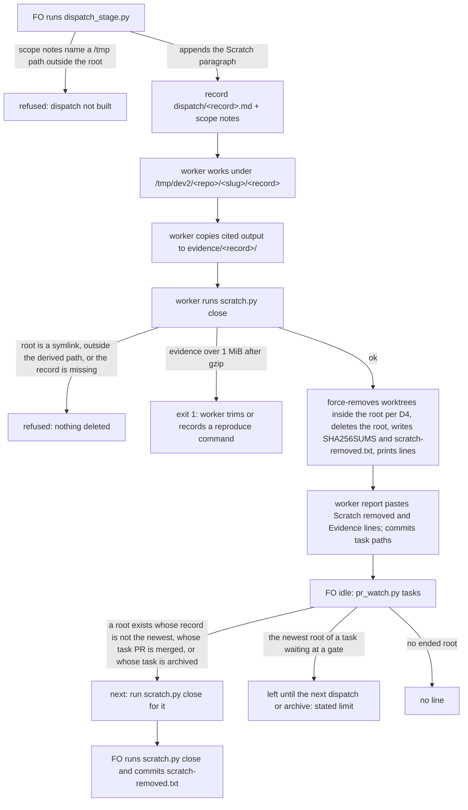

## Scope

- Source: the Captain 「把派工結束收尾清理要刪除過程產生的可移除檔案，以及把必要證據壓縮封存到派工分支中紀錄成故事，下一批要做，目前這樣都沒人刪檔很困擾」 (chat with FO session 3, 2026-11-11); earlier that day 「都刪除，且要找出為何完工了卻沒清理的原因？等於完工一定要清理」.
- Bite (FO measured 2026-11-11): free disk fell to 5.6 Gi; single finished tasks left 3.6 G and 4.3 G under /tmp, and a shared scratch folder held 17 G of which about 12 G belonged to archived tasks. Cause FO found: no step and no owner removes scratch; validation dispatches tell workers to export candidates under /tmp; workers kept /tmp copies "as supporting evidence"; FO's close-out removed only the git worktree.
- Interim practice since 2026-11-11, by hand: each dispatch asks the worker to remove its own scratch by exact path and list it; FO removes the rest at archive.
- Outcome: at close-out, evidence a later reader needs is in the task's records in compressed form and can be restored, and every scratch path the dispatch created is gone, with a record of what was removed.
- Open for the design: what "派工分支" means per stage, given that the state branch is public; what counts as necessary evidence and its size limit; who removes what and when (worker at report, FO at archive); how a removed path is told from missing evidence by the delivery check.
- Non-goals: cleaning other sessions' or other repositories' scratch; a retention policy for git branches.

## Budget
1 cycle per stage, in one package PR.

## Stop condition
- One real task run after the change ends with no path it created left under /tmp, its evidence restorable from the archive by the documented command, and the delivery check passing. Return to the Captain if evidence that must stay private cannot be kept off the public state branch.

## FO alignment

Alignment: not needed: the Captain's words under Source name the outcome; where the archive lives is compared in the design and ruled at the ideation gate.
Surfaces: none
Visible change: none
Release review: not needed: workflow maintenance, on no journey map.

## Design

### PRFAQ

**Proposition.** From the next kc-dev-flow-2 release, every worker dispatch gets one scratch folder, `/tmp/dev2/<repo>/<slug>/<record>`, named after its dispatch record (`<record>` is the record's file name without `.md`, for example `validation-2`). The record says so, so FO no longer types it. The worker copies what its report cites into `<task folder>/evidence/<record>/` on the state branch. Before reporting, it runs one package command, `scratch.py close`. That command deletes the folder and any git worktree registered inside it, gzips each evidence file over 256 KiB, refuses evidence over 1 MiB after compression, and writes one line to `<task folder>/scratch-removed.txt`. When FO's idle look sees a scratch folder whose dispatch has ended, or whose task is archived, it prints the same command as a `next:` line. Finished work leaves nothing under `/tmp`, and a later reader restores evidence with `git show`.

**FAQ**
- *Why one folder per dispatch, named after the record?* The deletion target is derived from the task folder and an existing record, never parsed from report prose. A record-named root also tells FO which folders are finished: any root that is not the task's newest record is done.
- *What is "necessary evidence"?* What the report cites: logs, command output, small JSON, the acceptance script. Checkouts and dependency trees are reproduced from the recorded SHA and command instead. In one 4.3 GiB ideation scratch folder of a sibling adopter, six subfolders of about 0.7 GiB each made up the bulk (the one opened was a repository checkout with `node_modules`; the other five were sized, not opened), and the 24 loose files were 1.4 MiB (`du`, 2026-11-12, run once and not saved to keep other projects' task names off this branch). On this state branch the median task folder is 42 KiB, the 90th percentile 1306 KiB, and the largest single file 1.6 MB (`evidence/state-task-folder-sizes.txt`, `evidence/state-largest-file.txt`). That file gzips to 74,708 bytes (`evidence/ac-restore-roundtrip.txt`).
- *Why not compress everything into one archive per dispatch?* Plain text in git is already compressed: this state tree is 124,211,200 bytes raw and 28,255,842 as tar.gz (`evidence/state-compression.txt`). ADR 0072's gate-count check also reads the numbers in cited task-folder files as text, and the observer reads committed state with `git grep`. A tarball hides both. This is decision D2 below.
- *Does the delivery check need to tell removed scratch from missing evidence?* No change is needed. Since 0.36.0 (#799, `629cf7326`), its missing-path check (S4) reads only FO's message and `Asked:` lines. On the 0.39.1 package, a validation report naming a removed `/tmp` path exits 0, and FO's message naming that same path still holds with exit 1 (`evidence/ac-s4-removed-path.txt`). The design keeps that split. A path under the scratch root is never evidence; evidence is task-folder-relative under `evidence/`.
- *Why can't the OS clean /tmp?* On this machine nothing does. `/tmp` holds 3470 entries, 121.2 GiB. Seventy-eight entries are named `<slug>-<stage>-<N>` and hold 56.2 GiB; one of those slugs is a task in this workflow, and the other 77 match no task here (`evidence/tmp-usage.txt`). `/etc/defaults/periodic.conf` has no `clean_tmps` line (grep, 2026-11-12).

### Mechanism

1. **dispatch_stage.py** builds the stage and special-role dispatches it already builds (ADR 0070, ADR 0074). It derives the root `/tmp/dev2/<repo>/<slug>/<record>`, where `<repo>` is the name in the code repository's `origin` URL. It writes the scope-notes file it passes to `dispatch build` as FO's notes plus the Scratch paragraph, worded as in `### Words FO reads at each moment`. The record therefore carries the same `Scratch:` line. A follow-up message record `<stage>-<cycle>-message-<n>` shares its dispatch's root. It refuses scope notes that name an absolute `/tmp/…` or `/private/tmp/…` path outside that root. This addresses the cause FO found, where validation notes said `git worktree add --detach /tmp/<name>` (seen in `_archive/delivery-gate-verdict-form/dispatch/validation-1.md`).
2. **scratch.py close `<task folder>` `<record>`** (new, about 100 lines, with tests).
   - **Refusals, with nothing deleted:** a record absent from `<task folder>/dispatch/`; a root or parent that is a symlink; a resolved root not equal to the derived path.
   - **Deletion:** for each worktree of the code repository registered inside the root, `git worktree remove --force` (decision D4), recording its count of uncommitted files; then `git worktree prune`; then it deletes the root, and the empty slug folder.
   - **Evidence:** gzips each file over 256 KiB in `evidence/<record>/`; exits 1 if the folder is over 1 MiB after that, without deleting the evidence.
   - **Record:** appends `<record> <root> <bytes removed> <UTC time>` to `<task folder>/scratch-removed.txt`, and writes `evidence/<record>/SHA256SUMS` with the digest of each evidence file before compression.
   - **Output:** prints `Scratch removed: <root> (<size>)` and `Evidence: evidence/<record>/ (<n> files, <KiB>)`.
   - **Already gone:** an absent root prints `(absent)` and exits 0, so FO's later sweep is idempotent.
3. **pr_watch.py tasks** (the idle look FO already runs and obeys) lists the folders under `/tmp/dev2/<repo>/`. For each root whose slug is archived, or whose record is not the task's newest dispatch record (`dispatch_records.py --newest`), it prints the `next:` line. A root whose slug is in no task folder is only reported, never closed. For a task whose PR is merged, it prints the close lines before its `next: let pr-merge record` line, so the record lands before archive; the post-archive sweep is the backup.
   **Limit:** a root whose worker did not close it stays while its task waits at a gate or for merge with no newer dispatch, until the next dispatch or the archive. The finished-task bite is covered; a long gate wait is not.
4. **Profile.** No new obligation that would change the profile arises: no production data or credential, no broad exposure, no unattended recurring operation (FO runs the idle look), and no migration.
5. **No README change.** `references/sd/workflow.md` is under a word budget that needs a Captain ruling to raise (`WORKFLOW_BUDGET_STEPS` in lint-skills.py). The worker reads the rule in its dispatch, and FO reads the `next:` line only when one is due.

**Existing-code check.**
- *Spacedock 0.27.2:* `merge guard` removes the task's git worktree and branch at finalize, nothing under `/tmp` (`merge guard --help`; `fo-merge-core.md` "Worktree removal safety"). It also never removes its own `/tmp/spacedock-dispatch/` files: 5936 files, 24 MB, out of scope and Spacedock's to own.
- *kc-dev-flow-2 0.39.1:* `git grep -c -i scratch` over workflow.md, the FO mod, pr_watch.py and dispatch_stage.py finds nothing (`evidence/before-package-scratch-words.txt`, exit 1).
- *Sibling adopters* qnow, subspace-relay and subspace-web (read-only `git grep` of their Markdown): no scratch close-out rule.
- *Reused:* dispatch_stage.py's record, dispatch_records.py's `--newest` and pr_watch.py's archive scan. Deletion is new because none of those deletes anything. A separate script keeps the one destructive step behind its own refusals.

### Decisions for the Captain

- **D1. 「派工分支」: where evidence lives.**
  - **Recommend:** the task folder on the state branch (`spacedock-state/dev2`). ADR 0034's walk record and ADR 0072's saved outputs already live there, and 172 task folders already hold evidence.
  - **Gets worse:** this repository is public (`gh repo view`, 2026-11-12), so archived evidence is public.
  - **Alternatives:** the task's PR branch, which merges evidence into the product's `main` and the shipped plugin tree; or a per-task `evidence/<slug>` branch, also public, which adds branches with no retention policy (a non-goal).
- **D2. 「壓縮」: compression form.**
  - **Recommend:** plain files, with each file over 256 KiB gzipped, and git's own compression for the rest (about 4.4× on this tree).
  - **Gets worse:** small files are not individually compressed in the working tree.
  - **Alternative:** one `.tar.gz` per dispatch. It follows the words literally, but ADR 0072's count check stops seeing numbers in cited evidence, and `git grep` stops seeing the evidence.
- **D3. Private evidence (the stop condition).**
  - **Recommend:** never archive it. It is deleted with the scratch folder, and the report keeps a `Not archived (private): <what>; reproduce: <command>` line.
  - **Gets worse:** a later reader must re-run the command to see that evidence.
  - **Alternative:** a private local folder outside `/tmp` that close-out keeps. It is not removable by this mechanism and brings the disk bite back.
  - **Effect:** with this recommendation, private evidence never reaches the public branch, so the stop condition's return does not trigger.

- **D4. Unattended `git worktree remove --force` inside a scratch root.** The README says not to clean up an owned worktree unless the action is authorized, and Spacedock says `--force` is never default.
  - **Recommend:** authorize it for worktrees inside a dispatch's scratch root only, on the Captain's 「都刪除，且要找出為何完工了卻沒清理的原因？等於完工一定要清理」, recording each one's uncommitted-file count in `scratch-removed.txt`.
  - **Gets worse:** uncommitted work a worker left in a scratch worktree is lost without a question; the count tells afterwards, not before.
  - **Alternative:** remove without `--force` and refuse a dirty worktree, printing it for FO; a dirty scratch worktree (build output, test files) then stays, and the bite returns for it.

Override check: `git grep -n 'Override:'` over the state branch shows no ruling in this area (scratch, evidence, archive).

### Worth questions

- **Per-dispatch root and worker close.**
  - *Captain's words:* 「把派工結束收尾清理要刪除過程產生的可移除檔案」.
  - *Without it:* 121.2 GiB under `/tmp`, and 3.6 to 4.3 G left by single finished tasks (Scope).
  - *Premise that would make it unneeded:* the OS cleans `/tmp` itself. Checked now: there is no `clean_tmps` setting, and the 121 GiB is still there.
- **Evidence in the task folder, compressed.**
  - *Captain's words:* 「把必要證據壓縮封存到派工分支中紀錄成故事」.
  - *Without it:* a report that names a `/tmp` path as evidence loses it when scratch is deleted. 127 of 157 archived task files name `/tmp` paths, and 749 of those 824 distinct paths no longer exist (`evidence/archived-tmp-path-scan.txt`). How many of those were evidence rather than scratch was not measured.
  - *Premise:* reports never name `/tmp` paths. That is false, as measured.
- **FO sweep of ended roots and archived tasks.**
  - *Captain's words:* 「都刪除，且要找出為何完工了卻沒清理的原因？等於完工一定要清理」.
  - *Without it:* a worker that forgets or dies leaves its folder; workers keeping copies is the cause FO found.
  - *Premise:* workers always clean when told. Not testable cheaply now. The hand practice since 2026-11-11 has no record of misses either way.
- **`scratch-removed.txt` record.**
  - *Captain's words:* 「找出為何完工了卻沒清理的原因」. The Outcome's "a record of what was removed" is FO's wording of that.
  - *Without it:* the next "why wasn't this cleaned" question has no answer.
- **Scope-notes `/tmp` refusal.**
  - *Captain's words:* none directly. It serves the cause FO found under Bite.
  - *Without it:* FO's old habit of naming `/tmp/<name>` puts scratch outside every root.
  - *Ask:* the Captain can keep or cut it.

### Words FO reads at each moment

**Method.** Words, counted with `wc -w`, that instruct a scratch or evidence step due at that moment. *Before* is measured on 0.39.1 / origin/main `8ce0eb605`. *After* is the word count of the text proposed here. It is a ceiling, not a measurement of shipped code.

| Moment | Before | After (ceiling) |
| --- | --- | --- |
| startup (README) | 0 | 0 (no README change) |
| building a dispatch | 0 package words; FO types its 19-word hand sentence ("Remove any scratch directory you create under /tmp, by exact path, before you finish, and say so.") | 0; the script adds the 66-word paragraph, which the worker reads |
| after a worker report | 0 | 0 |
| idle, nothing ended | 0 of 901 output words (`evidence/before-idle-words.txt`) | 0 |
| idle, a dispatch ended or a task archived | 0; FO removed folders by hand, from memory | 21 words per ended root |
| merge ask | 0 | 0 |

The 66-word paragraph:
> Scratch: /tmp/dev2/\<repo\>/\<slug\>/\<record\>
> Put every file or checkout you create outside the task worktree and the state checkout under that folder. Copy what your report cites into evidence/\<record\>/ in the task folder, and nothing that holds a secret or a person's data: for that, write `Not archived (private): <what>; reproduce: <command>`. Before your report, run `python3 <package>/scripts/scratch.py close <task folder> <record>` and paste the lines it prints.

The 21-word `next:` line: ``next: run `python3 <package>/scripts/scratch.py close <task folder> <record>`; that dispatch has ended. Commit the scratch-removed.txt it writes with the task path.``

### Not provable now

These need code that does not exist yet. Each one becomes an acceptance check at validation.

- **Dispatch refusal.** dispatch_stage.py refuses scope notes naming a `/tmp` path outside the root. Falsifier: notes with `/tmp/x` build anyway.
- **Close refusals.** `scratch.py close` refuses a missing record, a symlinked root, and a root that differs from the derived path, and deletes nothing in each case. Falsifier: a symlinked root pointing at a sentinel folder; the sentinel must survive.
- **Close behaviour.** `scratch.py close` removes a worktree registered inside the root: afterwards `git worktree list` no longer names it. It gzips a file over 256 KiB, and exits 1 at more than 1 MiB of evidence.
- **Restore after a real run.** `git -C <state> show origin/spacedock-state/dev2:<task path>/evidence/<record>/<file>.gz | gunzip -c | shasum -a 256` equals that file's line in `evidence/<record>/SHA256SUMS`, which close writes; there is no such file before the change. Today's basis: a gzip round trip of the largest evidence file on this branch compares equal, `cmp` exit 0, 1,621,352 bytes to 74,708 (`evidence/ac-restore-roundtrip.txt`). Falsifier: a truncated `.gz`.
- **Post-archive record.** A `scratch-removed.txt` committed into `_archive/<slug>/` after archive does not disturb learn or the observer; untested.
- **Idle sweep.** pr_watch.py prints the `next:` line for a non-newest or archived root, and none for the newest root of a live task.
- **Words per moment.** Recount the after column on the candidate with an independent copy (root learning.md).
- **Stop condition.** One real task dispatched after release ends with no path it created under `/tmp`: `ls /tmp/dev2/<repo>/<slug>` fails. Its evidence restores with the documented command, and `delivery_gate.py check` passes.

### Batch overlap

This design changes `kc-dev-flow-2/scripts/dispatch_stage.py` and `test_dispatch_stage.py`, `kc-dev-flow-2/scripts/pr_watch.py` and `test_pr_watch.py`, and the new `kc-dev-flow-2/scripts/scratch.py` and `test_scratch.py`. It changes no README, ADR index, or `delivery_gate.py`. The four other tasks in this batch have no design yet, so their files below are read from their Scope, not their designs.

- **merge-ask-tests-the-merge-result:** probably `delivery_gate.py` and the merge-ask text. No shared file expected.
- **held-and-closed-tasks-leave-the-design-queue:** probably `pr_watch.py tasks`, the same function this design adds a block to.
- **each-task-records-stage-time-revises-and-interruptions:** probably `dispatch_stage.py`, in `record_text`, beside this design's notes change.
- **gate-question-facts-are-checked-before-the-captain-reads-them:** probably `delivery_gate.py`. No shared file expected.
- **adoption-asks-which-extensions** (ideation, another session): names `pr_watch.py`, `workflow.md` and `dispatch_records.py`. Shared file: `pr_watch.py`.
- **comment-check-reaches-delivery-gate** (ideation, another session): names `pr_watch.py`, `delivery_gate.py` and `workflow.md`. Shared file: `pr_watch.py`.
- **adr-required-statement** (validation, another session): `workflow.md` and the lint-skills.py word budget. No shared file, because this design leaves `workflow.md` alone.
- **No overlap found:** adr-silent-undo-probe, journey-canvas-hosted-poc, journey-server-host-pilot, ops-inbox-r1-setup-and-isolation and pr-review-lite-value-pilot. Their mentions of "scratch" are their own scratch projects.
- **delivery-gate-s4-skips-removed-scratch** (backlog): its bite, measured on 0.35.0, no longer reproduces on 0.39.1 (`evidence/ac-s4-removed-path.txt`). FO may close it as fixed by #799.

Recommended order: this task before held-and-closed-tasks-leave-the-design-queue and each-task-records-stage-time-revises-and-interruptions. Both of those edit the same functions; each adds an independent block, so the later one rebases. adoption-asks-which-extensions and comment-check-reaches-delivery-gate rebase their `pr_watch.py` edits on whichever lands first.

## Acceptance criteria

**AC-1** Every stage dispatch record built by dispatch_stage.py carries `Scratch: /tmp/dev2/<repo>/<slug>/<record>`.
Evidence: `grep -c '^Scratch: /tmp/dev2/' <task folder>/dispatch/<record>.md`; pass is exit 0 with count 1.
Run now on this task's `dispatch/ideation-1.md`: count 0, exit 1, red as expected before the change (`evidence/ac-record-scratch-line.txt`).
Falsifier: a record built without the paragraph.

**AC-2** A report naming a removed scratch path does not hold the delivery check, while FO's message naming a missing path still does.
Evidence: `PYTHONPATH=<package>/scripts python3 -B evidence/s4_repro.py <package>/scripts` (needs `test_delivery_gate.py` from the same revision beside it); pass is exit 0.
Run now on 0.39.1: exit 0. The report case exited 0 with no S4; the message case exited 1 with `message S4: missing path …` (`evidence/ac-s4-removed-path.txt`).
Falsifier: a candidate that makes S4 read reports again.

**AC-3** After a dispatch's close, no git worktree of the code repository is registered under `/tmp/dev2/`.
Evidence: `git -C <code repo> worktree list --porcelain | grep -c '^worktree /\(private/\)\?tmp/dev2/'`; pass is count 0, which `grep -c` reports with exit 1.
Run now: 90 worktrees registered, 3 under `/tmp`, none under `/tmp/dev2/`; count 0, exit 1 (`evidence/code-repo-tmp-worktrees.txt`). This shows the command works; it proves nothing about close yet.
Falsifier: a `git worktree add` inside a root that close leaves registered.

## Stage Report: ideation

- DONE: The Captain's experiment for this task (his words are in the task's backlog gate record): this task is in the arm without a proof of concept. For every acceptance criterion, run its evidence command or procedure once now and write beside the criterion the exact command, its exit and the path of its saved output in the task folder; a criterion whose proof cannot be run now is not written under Acceptance criteria but under a 'Not provable now' list with the reason, for the Captain to see at the design gate
  AC-1..AC-3 each carry command, exit and `evidence/` path. The restore check after a real run moved to `### Not provable now` (no `<original>` survives deletion), with the other proofs that need scratch.py, the dispatch_stage/pr_watch changes, the recount, the post-archive record, or the real-task stop condition.
- DONE: A `### Batch overlap` section naming each file the design would change and each other batch task (merge-ask-tests-the-merge-result, held-and-closed-tasks-leave-the-design-queue, each-task-records-stage-time-revises-and-interruptions, dispatch-close-out-archives-evidence-and-removes-scratch, gate-question-facts-are-checked-before-the-captain-reads-them) and live task of other sessions (adoption-asks-which-extensions, adr-required-statement, adr-silent-undo-probe, comment-check-reaches-delivery-gate, journey-canvas-hosted-poc, journey-server-host-pilot, ops-inbox-r1-setup-and-isolation, pr-review-lite-value-pilot (driven by other sessions; read only)) that changes the same file or check, so FO can order implementation
  Shared `pr_watch.py` with held-and-closed, adoption-asks and comment-check; `dispatch_stage.py` with each-task-records (both probable for the batch tasks, which have no design yet); no README change; backlog delivery-gate-s4-skips-removed-scratch is already fixed on 0.39.1; `Recommended order:` given.
- DONE: The words FO reads at each lifecycle moment, before and after, per root learning.md "Measure the words FO reads at each moment, not one file's size"
  `### Words FO reads at each moment`: before is 0 package words at every moment (`evidence/before-package-scratch-words.txt`, `evidence/before-idle-words.txt`); after is a ceiling, not measured: 0 at every moment except 21 words per ended root at idle. FO's 19 hand-typed words per dispatch go.
- DONE: Acceptance criteria with reproducible evidence clauses and falsifiers, and unresolved decisions for the Captain, each with a recommendation and what gets worse under it
  Three ACs, each with a falsifier. Decisions: D1 where 「派工分支」 is (state task folder); D2 compression form (plain plus gzip over 256 KiB); D3 private evidence (never archived; reproduce line); D4 unattended `--force` worktree removal inside a root (authorize, with the dirty count recorded). Each has a recommendation and what gets worse under it.
- DONE: AC-1 record carries the Scratch line
  The grep on this task's `dispatch/ideation-1.md` gives count 0, exit 1: red before the change, as expected (`evidence/ac-record-scratch-line.txt`). A pass needs the change.
- DONE: AC-2 a removed path in a report does not hold the delivery check; FO's message naming it does
  `evidence/s4_repro.py` on 0.39.1 exits 0: the report case exits 0, the message case exits 1 with `message S4` (`evidence/ac-s4-removed-path.txt`). This passes today, with no code change needed.
- DONE: AC-3 no code-repo worktree registered under /tmp/dev2
  Count 0, exit 1 (`evidence/code-repo-tmp-worktrees.txt`). The command works, but nothing about close is proven until the change exists.
- DONE: design_surfaces.py check
  `python3 <package>/scripts/design_surfaces.py check <task>` exit 0, "design surfaces presentable" (`evidence/design-surfaces-check.txt`).
- DONE: scratch I created removed by exact path
  Removed `/tmp/ccx-ideation` (a directory), `/tmp/ccx-prwatch.py` (a file) and `/tmp/ccx-scan.pJia5e` (a directory); `ls` afterwards reports no such file for each.

### Summary

The design is one record-named scratch folder per dispatch, under `/tmp/dev2/<repo>/<slug>/<record>`, written into scope notes by dispatch_stage.py. A new `scratch.py close` deletes it with refusals that guard the deletion, archives cited evidence in the task folder with gzip over 256 KiB and a 1 MiB cap, and logs the removal in `scratch-removed.txt`. pr_watch.py's idle look names each ended or archived root. The design needs no README or delivery-check change: S4 has read only FO's text since 0.36.0, verified on 0.39.1. Four decisions are open for the Captain: D1 where 「派工分支」 is, D2 the compression form, D3 private evidence, and D4 unattended `--force` worktree removal. Measured today, `/tmp` holds 121.2 GiB, and 749 of the 824 `/tmp` paths named in archived task files no longer exist. A root left by a worker while its task waits at a gate is a stated limit.
