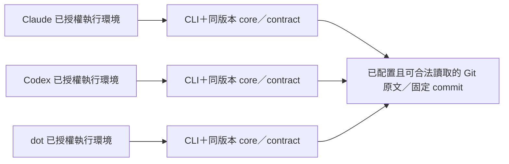

# CLI 優先的共用決策讀取設計

> **2026-10-20 重切：** P1 改為 S01、S10、S11、S19、S20、S21、S22（見[切片說明](slice-map.md#p1)）。本文件對 P1 三端、雙使用者隔離與多來源層級的描述屬重切前 P1，現分屬 P4a（dot）與 P4b（S04、隔離）。dot 是 ChatGPT 上沒有終端機的 agent，讀取需 MCP／connector（見切片說明 D13）；本文件中 dot 經本機 task 執行 CLI 的描述未經證實。

**方向已接受；以下介面與技術安排是待人類書面審閱的設計，CLI尚未實作／部署，非ready handoff；本PR整理規劃設計。** 使用者在討論 CLI＋本機 git／gh 的方向後回答「可以，就這個方向」。D5 因此取代把 hosted MCP 當必要入口的安排；MCP 視需要選配。D1–D4、28 個故事、8 個活動與原有裁決權不變。

P1 已於 2026-10-20 重切為 **S01、S10、S11、S19、S20、S21、S22**，profile 為 **Pilot**。先前投入原話「1-3天」；本輪已澄清「三個完整工作日」，appetite 上限 **3 days**；估算仍為 `null`、fit `unknown`。D5當時只確認方向；本輪另已授權文件PR，仍未授權產品實作、安裝、登入、新憑證或部署。

## 1. 一個核心，各環境各自執行

圖中的每個 CLI 在各自環境執行；不依賴一個共用遠端 process。各環境可以有自己的 clone／loaded view，不能因此產生不同決策真相。原文、commit、層級與獲授權決策者仍是權威。

| 元件 | 責任 | 邊界 |
| --- | --- | --- |
| 共用 core／contract | 原生 ADR 解析、list／read／search／effective、精確引用、保守錯誤語義 | 不取得任意來源、不做 transport auth，不相信 caller 自稱 owner |
| CLI 與唯讀 source loader | 選擇既定 binding、讀固定 commit、輸出 JSON／人讀結果與 context | 不寫 Git、不配號、不造 task、不自動外部動作 |
| git | 既有 repo／ref 查核及由 checkout 持有者執行 D2 安全更新 | 依原有權限；讀取 CLI 不自行 fetch、merge、reset 或切分支 |
| gh | 該 runtime 既有 GitHub 身分及獲准的 PR 操作 | 不授予裁決權；不能推定 Git remote 使用相同 credential |
| 選配 MCP／connector | 有具體需要時提供另一入口，共用相容 core／contract | 無 terminal 的 client 路徑另議；不列為 CLI P1 前提 |

通用程式目標仍是 `iamcxa/kc-claude-plugins`。最小共用 core 整理、唯讀 loader 與 CLI 封裝屬這次方向的新工作；現有程式與歷史 unit tests 不證明已存在可安裝 CLI。遠端搬站、整庫 code／data 搬遷及私人 ADR 公開均不包含在內。

## 2. 來源與權限先於查詢

每個 binding 明示決策空間、repo 身分、追蹤 ref、實際 immutable commit、原文 path、層級與 scope。code repo、使用者獨立決策 repo、工程 repo 分開；上層與工程 ADR 都保留原生格式及實際路徑，不為 parser 搬檔。canonical key 必須包含來源與權威域，不能只用 project／數字；supersession 限同域，上層引用固定 commit。

loader 只接受已配置 binding，拒絕錯 repo／ref／path、未配置 binding 與來源不匹配。這是防誤讀，**不是 tenant security**。實際可讀範圍由 OS／filesystem、GitHub 權限或獨立執行環境限制；同 OS 本來可讀的檔案不能聲稱被 CLI 隔離。不同使用者的來源應先依合法 context 分隔再建 view，不先混入一個 snapshot 再 filter；無關 owner 的壞來源不應污染另一 owner。

已有合法 clone 可依 OS／filesystem 與 binding 離線讀固定 commit，不必每次在線呼叫 gh 或取得 Sites 身份。CLI 不新增存取權；本機讀取權、gh 帳號、Git remote credential、Sites owner、裁決者與本次動作許可分別如實回報。多個 agent 沿用同一合法 owner 帳號可以合作，不要求各建一個 GitHub 用戶；共用帳號也不構成跨使用者隔離證明。

兩使用者負向驗收使用合成 ADR，但拒絕必須來自真實 OS／filesystem／GitHub 或獨立環境權限。兩個 label、allowlist 或合成 principal 只可驗證 binding 行為，不能替代這個安全證據。macOS兩已知非私密檔的4個read-deny cases已證process限制機制局部可用；不是完整A/B使用者隔離、跨平台保證或AC1通過。完整合成repo harness須限制整個query及Git/helpers，保護foreign metadata／objects／aliases並排除未受限旁路；屬P1驗證工作，不要求使用者先建真帳號或備妥成品。

## 3. CLI介面以P1技術草案為準

[P1技術契約草案](p1-technical-contract.md)已把31個技術主題收斂為A來源／權威／context、B固定blob／native parser、C輸出／資源／入口、D獨立oracle／三端回執四包。所有名稱、欄位、資源值仍是工程提案，尚未實作／驗證，也不是已接受API。

候選入口為Node24固定code checkout執行，單命令／單binding、必填完整40／64hex commit，不默用HEAD／ref／short SHA，不隱式fetch。`read/effective --id NNNN`採native四位號，僅在binding內選取；duplicate不任取，可用list已枚舉的精確`--path`。前版`GUIDE#0012`命令selector例子由此草案取代，不將新grammar當已接受API。

候選exit為0完成（含合法unresolved／empty）、2輸入／selector／cursor、3統一source_unavailable、5無可信view／不支援／資源限制、1內部失敗；**前版候選exit4取消**。source_unavailable不探無權存在，`source/record/loaded_view=null`且不echo原生Git stderr／未准路徑。合法loaded view中的missing record另處理。

raw Buffer先SHA再嚴格UTF8，保留原path／BOM／CRLF；不follow symlink/submodule。native／Legacy／Accepted缺key保留原狀態；native lint結果與非權威衍生查詢分開；撤回整binding一律unresolved規則。read/list保留安全可讀原文與raw Status，需要完整合法view的查詢可操作級validation_failed／能力不足，不改其他Accepted。JSON／人讀、安全轉義、paging與limit詳見契約；不將原資料文字當工具授權。

## 4. 三種版本與離線限制

| 觀測 | 必須保留的事實 |
| --- | --- |
| 程式 | package、core／contract 版本與可證明的 code commit；安裝包沒有 checkout 就照實不適用 |
| ADR data | 每個 repo 各自的 immutable commit、原文 digest 與引用權威域 |
| 各 runtime loaded view | 實際來源配置、載入的 data commit／digest、所用 core／contract、indexed_at |

選配 adapter 可以獨立編版本；看採用的 core／contract 與相容性證據，不因 adapter 版本號不同就判語義不同。同 core／contract、來源配置與 data commit 應得到相同原文 digest、原狀態與 effective；時間與 runtime context 可以不同，不要求整包 bytes 相同。不同 revision／config／語義版本須報差異或未知，不能各稱「最新」。

離線固定 D0 可成立；遠端 ref、gh 身分與 freshness 若未觀測就是未知。讀取不自動呼叫 gh、登入或 fetch。P2 提供配置 checkout 的同／後／前／岔／remote unknown 與 dirty、observed_at 查核；P3 做影響分析，再由持有者依 D2 用既有 Git 工具安全更新並重讀各自 view。已安裝 package 不自升級。S17 遠端 host 維護保留在全圖並延後，CLI P1／P3 不依賴它。

## 5. 三端實際路徑與驗收

| 接手者 | 要成立的實際路徑 | 本輪狀態 |
| --- | --- | --- |
| Claude | 既有授權本機或 cloud executor 真正執行 CLI，合法讀同一來源 | CLI 2.1.303／native reader既有auth與Read/Grep已觀測；正常Claude本人發起唯讀Git命令原回執pending（非denied），新CLI端到端未做 |
| Codex | 同上；不同 runtime 的 credential 與 source 存取各自核對 | 本 task 本機命令執行／gh metadata 路徑已可用；新 CLI 尚不存在，未做獨立客戶端端到端驗收 |
| dot | 已連線本機 task 或可用 cloud runtime 真正執行 CLI | dot→已准delegated local task已有shell／Git／gh metadata鏈；不另要求前端直接shell。三端新CLI回執仍未驗，不推定cloud繼承登入或localhost |

沒有 terminal 的 client 須另議選配 MCP／既有 connector。CLI help、另一端轉述、合成 principal、某一 local runtime 的 gh metadata／pull 權限都不代表三端端到端通過。先前一次 Claude 遠端 OAuth client registration 失敗保留為歷史證據；CLI-first 不以修復它為前提，也不宣稱它已解決。

P1 六項 AC 的唯一來源仍是 [切片說明](slice-map.md#p1)：真實權限負向隔離、三端同一精確依據、不同 repo／層級、固定 D0 與三種版本、context／binding／錯誤、原生 ADR 與保守 effective。P1 最小 vertical outcome 包含 CLI 封裝、來源解析、身份邊界與整合驗證；不只做 help，也不提前實作 freshness 或 PR。所有案例使用合成資料。

## 6. 審閱、投入與既有流程

P2 對 P3／P4a／P5 是建議順序，不是整片硬依賴。P3 動作前須在本 runtime 重查 repo／ref、HEAD／target、ancestry、dirty／race、D2 條件並於更新後重讀；P4a 須核對精確 pin、當次 freshness／適用性、原 task 範圍與接手者自身權限；P5 須核對已准來源／base／diff、前次不確定結果及提交前重查。這些證據可來自當次既有 Git 等能力，不要求 P2 全套診斷先交付；無法核實仍 unknown／停止，不宣稱替代路徑已端到端可用。

原話「1-3天」是投入上限，不是完成承諾。[P1估工提案](p1-estimate.md)依source差異及驗證拓樸提出32–48 active工程小時、風險40–64h，包含共用core／封裝、native loader、身份、三端整合／驗證及一次修正。未經同類交付校準，8h/day僅換算假設；已明確投入三個完整工作日，8h/day不是人類指定，正式days scalar estimate仍null／fit unknown，不倒推3 days或自動增加預算。

先前 MCP 版本六片設計的獨立審查不等於本 CLI 增量已接受。前輪CLI actor／removal獨立審查僅支持其當時來源；後續問題／觀測及本次四包提案以增量核對為準，未重跑獨立整圖審查；P1 AC 與六片依賴變動的人類書面審閱、實測／UAT、fit 及 handoff 分開核對。本文件不標 ready、pass、UAT 或正式 handoff。歷史 admission／auth／architecture 紀錄不改寫，也不能將舊 brief／assessment／handoff 的 hash 或 acceptance 套到新來源。

待這份 CLI map／設計具體審閱接受後，先依 [release slicing](../../../kc-journey-map/skills/kc-journey-map/references/release-slicing.md) 把新 full-map requirements 重整 baseline，再做既有 cut／正式 brief／handoff。P1 五故事、Pilot 與 3 days 選擇繼續有效，不需重選；新需求不是用舊 MCP baseline 製造拒絕的理由。任務、gate、配號、Git／PR 與部署仍由原有 dev2／Spacedock 及各次適用授權控制，本輪不推進任何 state。

## 7. 已完成提問檢查，技術缺口仍保留

兩native陌生讀者只讀history-free白名單快照，43原題逐題triage、合成35個穩定P1 questions：7 Fact、28 Gap；其中31主題已有四包具體工程草案，實作／驗證仍在，沒有新的human value決策。短問答以[journey.yaml](journey.yaml)的questions為準；全文見[P1契約](p1-technical-contract.md)，原題mapping見[故事問題來源對照](story-map.md#question-origins)，可讀投影見[故事地圖](story-map.md)。原始events、最終回答、scope audit與工具stdout／stderr留本批task驗證紀錄。

技術open集中在：native path／DOT／Legacy parser適配、合法binding先分view與可讀故障粒度、canonical/config/context身分、受控Git object與raw bytes、error／paging／資源限制與安全人讀、封裝與真實client回執、獨立Git blob oracle。它們服務既有P1目標，沒有各自新建task或新授權。

已確認的邊界仍有效：Accepted缺key可unresolved；一次binding各有固定commit，不承諾跨repo原子view；不隱式fetch／login，不用Words／gh／config自造裁決權；不默存原文／索引到tool repo；不silent truncate或任取duplicate ID。schema／limits／checkout入口已有候選提案，未成為已接受API；31個技術open仍待實作／驗證，不是31個新的人類決策。

dot委派本機task的既有命令鏈已有證據；Claude正常本人唯讀Git回執仍pending非denied，由我方沿既有工作階段補核。OS局部read-deny已證機制，完整repo／Git helpers負向harness及三端CLI屬P1產品工作，不要求先有成品。scope audit／提問完成不等於產品UAT、fit、精確proposal的人類接受或ready handoff。估算仍null，appetite仍原話1-3天／上限3 days。

原生ADR格式／Status／配號／驗收與feedback沿dev2；原生lint整體check fail不改其他Accepted。已撤回整binding一律unresolved策略，衍生effective只作非權威查詢；見[dev2原生對齊](p1-technical-contract.md#native-dev2-alignment)。
