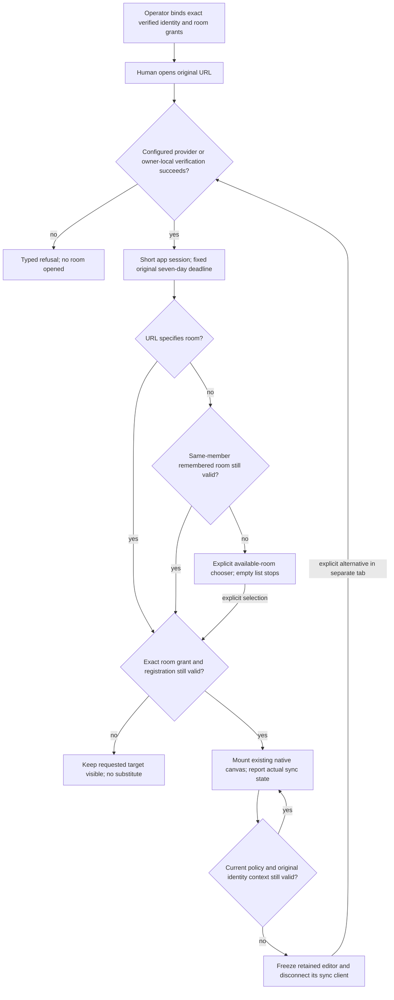

# Accepted private canvas entry

Planning source derives from accepted SHA-256
`65e4cb19150f029df0de64de0b66c2ccbb9805fb4395234e4620925b6240ac63`;
personal author references are normalized to roles and current authority/status
is updated here. Frozen source reports remain byte-identical.

The complete design was confirmed on 2026-10-19 for Pilot implementation in four
slices, with eight stories grouped 3/2/2/1. Formal merge remains a separate human
decision. Cloudflare must stay on Free; canvas IDs, data and complete-record
concurrency remain unchanged. Detailed account and usage evidence stays local.

[draw-a-journey.yaml](draw-a-journey.yaml) is the recoverable planning source.
Its 31 questions are design dispositions, not runtime passes. Historical wording
about pending whole-design approval is superseded by this confirmation. The
existing `.tldr` remains an earlier projection and is not proof of this release.

## Accepted behavior

A verified enabled member reaches the exact permitted existing room in the URL.
Without a target, only the same member's still-permitted remembered room may
resume; otherwise show a chooser, including a stopped empty inventory. An
explicit denied or missing room stays visible and opens no substitute or empty
canvas. Identity verification, room admission and actual sync status are distinct.

The operator binds exact issuer and stable subject to members and room grants.
Cloudflare human login validates signature, issuer, audience, expiry, subject,
non-service identity and correlated provider login time. Remote Node uses the
same explicitly configured Access adapter over HTTPS. Owner-local Node uses an
original-tab challenge and explicit OS-account approval through a peer-verified
Unix socket; remote browser bindings cannot use that path. No raw identity
header, arbitrary UID, email, legacy principal or first visitor establishes a
person. Browser sign-in and machine credentials remain separate authorities.

The browser app session lasts at most 15 minutes and may renew while healthy;
its original human event and seven-day deadline never slide. Admission checks
current member state, authorization generation and room policy. Each mounted
human context also binds its original backend, member and sign-in event.
Application data routes return typed failures; only the human login path enters
provider UI. Cookies are host-only, HttpOnly and SameSite Strict, with Secure on
HTTPS. The narrowly scoped provider-start verifier uses a 60-second Lax cookie
for the provider's top-level return; it grants no app access by itself.

The other stories retain agent pairing and rotation, installation credential
storage, interrupted-context restoration,
stream-stop guarantees and durable human drafts. Approved defaults are five
minutes for pairing, 60 seconds for local handoff, 30 seconds for stream leases,
an observed stop target of at most 60 seconds, and 30 days for lifecycle receipts.
Security tombstones have no receipt-retention deletion. Human drafts have no
programmed expiry and require verified restoration plus cloud sync or manual
deletion. Unknown installation refresh/save outcomes require confirmed revoke
then fresh pairing; ordinary network loss does not select that repair path.

## First-story implementation boundary

[ADR 0058](../../adr/0058-verified-human-entry-preserves-private-room-core.md)
records the shared admission decision. The first candidate adds opt-in human
entry, versioned member/session/challenge metadata and transactional adapters.
It preserves the room engine and legacy grants. Source presence, test simulation
or a green build does not establish actual provider acceptance or deployment.

Local evidence covers signed synthetic provider inputs in the actual Worker
runtime, real owner peer approval, real browser entry and negative admission.
Actual Cloudflare sign-in, seven-day provider/session precedence, configured
Access path protection, remote Node hosting, Free eligibility/workload fit and
public delivery are not established. Current production defaults and credentials
remain unchanged. Independent validation and the later safety stories remain
required before activation.

The diagram describes the accepted boundary. Rendering proves presentation only;
operator/provider/runtime evidence remains separate. Frozen historical reports
and design-review findings are preserved outside this current product snapshot.

## Room catalog candidate

[Room catalog](../../../kc-journey-map/docs/room-catalog.md) implements metadata-only
permitted-room discovery and staged native switching on the accepted first-entry
prerequisite. This is a local, default-off candidate, not whole-journey runtime
acceptance. Original IDs and complete-record concurrency remain unchanged.
Physical-device, hosted-provider, outgoing-stream safety and durable-draft work
remain separate; no sibling story is marked complete.
