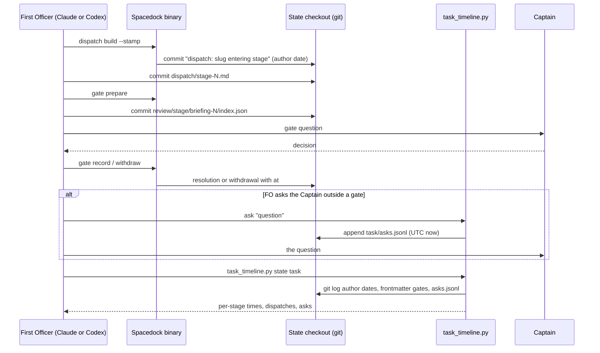

## Scope

- Source: the Captain 「prod 應該要縝密沒有問題的，但是不管哪個 profile 都必須明確加入計時機制，要可以追溯每個 stage 的時間，revise 次數，打斷次數，以便改進整個 agentic DX」 (chat with FO session 3, 2026-11-12); earlier 「如果可行，應該要搭配一套 lint + helper 工具記錄時間，判準，取出時間」 and 「而且你沒記錄時間現在看來是一個非常大的問題」 (same chat, 2026-11-11).
- Bite (FO, 2026-11-11 and 2026-11-12): FO could not say how long PR #849 took per stage without reading commit times by hand; a two-week measurement could match agent sessions to tasks for 3 of 10 sampled tasks and could not count interruptions at all, because none is recorded.
- What exists (study of 2026-11-12, FO's local notes, not verified line by line): Spacedock stamps started, completed and archived once per task and each gate decision, not when a gate was opened; kc-dev-flow version 1's POC close guard recorded decision-ready seconds, Captain interventions and Captain wait; a Codex First Officer keeps a per-task time file by hand; state commit times give stage times after the fact.
- Outcome: for any task, one command prints each stage's start and end, agent time against waiting where the source allows, the number of repeat dispatches per stage, and the number of questions put to the Captain outside the task's scheduled gates, from records written at the time.
- Open for the design: the definition of a revise and of an interruption that can be counted; what must be newly recorded and by whom; the time source on Claude and on Codex; whether a check refuses a task with missing records or only reports.
- Non-goals: a time or minutes budget that holds work (ADR 0077 says minutes are not counted); cost in money or tokens; dashboards.

## Budget
1 cycle per stage, in one package PR.

## Stop condition
- The command, run on three tasks finished after the change, prints the same stage times FO kept by hand for them within five minutes each, and the counts match FO's hand tally. Return to the Captain if a reliable time source does not exist on one host.

## FO alignment

Alignment: not needed: the Captain's words under Source name the three quantities and that every profile carries them; definitions are compared in the design and ruled at the ideation gate.
Surfaces: none
Visible change: none
Release review: not needed: workflow maintenance, on no journey map.

## Design

Ruling in one paragraph. A new read-only helper, `kc-dev-flow-2/scripts/task_timeline.py`, prints for one task each stage's start, end and minutes split into before the gate, Captain wait and after the gate, the dispatches per stage, the gate attempts with their outcome, and the questions put to the Captain outside a gate. Stage times and dispatch counts need no new record: Spacedock and FO already write them at the time, as state-checkout commits and gate `at` stamps, and the proof of concept read them back for 135 of 157 archived tasks. Interruptions need one new record, `<task>/asks.jsonl`, written by the same helper's `ask` subcommand when FO asks; nothing records them today. Nothing refuses a task for missing records; the helper reports.

Proof of concept: branch `poc/each-task-records-stage-time-revises-and-interruptions` at `89568e4840b9cd4f386511bcc97982edcb9fff9c` (local only, worktree `.worktrees/poc-each-task-records-stage-time-revises-and-interruptions` under the workflow checkout, based on origin/main `8ce0eb6050c889b21baccf50fec35231bc888d66`, kc-dev-flow-2 0.39.1). Implementation starts from that commit. Saved output is in this task's `poc/` folder.

### PRFAQ

**Proposition.** After this change, FO answers "how long did each stage of this task take, how many times was a stage dispatched again, and how often was the Captain asked outside a gate" with one command, `python3 <package>/scripts/task_timeline.py <state> <task>`, from records written when each thing happened, on a Claude FO or a Codex FO alike.

- **Where does a time come from?** The author date of the state commit Spacedock writes (`dispatch|advance: <slug> entering <stage>`, `archive <slug>`), the commit that adds each `dispatch/<stage>-<N>.md` record and each gate room's `review/<stage>/briefing-<N>/index.json`, and the `at` Spacedock writes on each gate resolution or withdrawal. Author date, because `pull --rebase` (the state sync route) rewrites committer dates: 86 of 5225 commits in this state checkout differ (`git log --format='%aI %cI' | awk '$1!=$2'`, 2026-11-12).
- **Why both `entering` commits and dispatch records?** A repeat dispatch of the same stage writes a record but no `entering` commit. The first proof-of-concept pass counted only `entering` commits and found repeats in 9 tasks; with records, 91.
- **What is a revise?** Each dispatch of a stage after the first, counted as the highest `dispatch/<stage>-<N>.md` number (the number FO assigns; a gap means a record was never written, not that no dispatch ran). This is the count `role_triggers.py` already spends against a budget; the two agree on 62 of 62 comparable tasks. Gate `revise` decisions and withdrawn gate attempts print beside it under their own names.
- **What is an interruption?** Each question FO puts to the Captain about a task outside that task's gate attempts, recorded by `task_timeline.py <state> <task> ask "<question>"` when FO asks. Chat amendments and withdrawn gate attempts print beside it under their own names and are not added in.
- **What does "agent time" mean here?** The proof of concept cannot separate worker time from FO idle before a gate; it prints "before gate" (dispatch to gate room), "Captain wait" (room to decision) and "after gate" (decision to next dispatch). captain-question-load shows why the split matters: its ideation stage is 914 minutes, of which 431 are Captain wait and 448 after the gate.
- **Does anything stop work?** No. ADR 0077 counts budgets in cycles, not minutes, and the task's non-goals exclude a time budget that holds work.

### Chain check (Spacedock, kc-dev-flow-2, adopters)

- **Spacedock 0.27.2** (`spacedock --help`, `docs/site/reference/command-reference.md` in plugin 0.27.3, `internal/cli/gate_ceremony.go` and `internal/cli/cli.go`, read 2026-11-12): no timeline or duration command. It writes the exact `dispatch: <slug> entering <stage>` commit (`dispatch build --stamp`), `gate: record <slug> <stage> <decision>` and `gate: consume <slug> -> <stage>` commits, `at` on each resolution and withdrawal, and `started`/`completed`/`archived` once per task. `gate prepare` writes no time; the caller's commit of the room is the only record of when a gate opened.
- **kc-dev-flow-2 0.39.1** (origin/main `8ce0eb60`): `decision_ledger.py` parses gate resolutions and withdrawals (reused, `gate_entries`, `split_task`); `role_triggers.py` counts implementation and validation dispatches spent against a budget (`STAGE_RECORD`, reused); `dispatch_records.py` and `pr_watch.py` count no time. Nothing reads stage times. kc-dev-flow version 1's `poc-close-guard.py` recorded `decision_ready_elapsed_seconds`, `captain_interventions_before_decision_ready` and `captain_wait_seconds` in a close receipt written by hand; the design keeps its split of Captain wait from work and does not copy its hand-written receipt.
- **Adopters** (read-only): the qnow dev2 state checkout carries the same commit subjects (181 `entering` commits, `git log --format=%s | grep -c ' entering '`), and the proof of concept at `89568e48` read one of its archived tasks, whose 21 dispatch records all name Codex workers: 4 stages printed, exit 0 (rerun 2026-11-12; output not saved, as that adopter is private and this state branch is public). That shows Codex workers do not change the records; it does not show a Codex First Officer, because the commits are FO's. The hand-kept Codex FO time file the Scope mentions was searched for and not found (`find` for `*timing*`, `*time-log*`, `times.*` under qnow, relay and bridge state, 2026-11-12); only an unrelated test-timing file turned up.

### Existing-code check

Use or repair first: `role_triggers.py` already holds the revise count for implementation and validation, but only for tasks with a budget line (64 of 157 archived) and not ideation or times; `decision_ledger.py` already parses every gate close. The helper imports both rather than parsing again (`from decision_ledger import gate_entries, split_task`, `from role_triggers import STAGE_RECORD`), so a change to either parser reaches it. `lint-skills.py` and `test_lint_skills.py` pass on the proof-of-concept worktree (exit 0, 47 tests; "package script paths" PASS, workflow.md 6008 of 6008 words), so a new script needs no registration beyond the CI test line. Observation showing a new script is needed: for #849 the stage times had to be read from `git log` by hand (`poc/pr-849-hand-log.txt`); no packaged script prints them.

### What the proof of concept showed

- **#849's task** (`poc/pr-849-task.txt`): backlog 5.3 min, ideation 21.7, implementation 15.7, validation 42.8; every boundary equals the author date in the hand log (`poc/pr-849-hand-log.txt`). Both read the same commits, so this shows the reading is right, not that the source is.
- **This task and its four batch siblings, live** (`poc/live-batch.txt`): each prints its backlog gate (two attempts, one withdrawn) and a running ideation stage. Session-only, not reproducible from the task folder: this task's ideation start, 05:16:44Z, is 57 seconds before this worker's own clock read at its first command (13:17:41 Asia/Taipei, 05:17:41Z), the one comparison against a clock outside the records.
- **Archive sweep** (`poc/archive-sweep.txt`): 157 archived tasks, 0 errors, 135 with at least one timed stage; each of the 22 without has no `started:` in its frontmatter and no `dispatch/` folder (checked one by one, 2026-11-12), so none was dispatched. No ` entering ` subject in the state history fails the helper's pattern (0 of 269). 91 have a repeat dispatch, 24 a withdrawn gate attempt, 54 an amendment outside a gate, 0 an `asks.jsonl`.
- **Revise counts against the budget counter** (`poc/compare-spent.txt`): 62 of 62 equal; 2 tasks listed apart because a stage has no dispatch record at all (role_triggers counts 0, the helper counts the `entering` commit). Counting record files instead of the highest number gives 2 differences (`poc/falsifiers.txt`).
- **The ask record** (`poc/ask-smoke.txt`): two asks on a throwaway git repository read back as 2; an empty question is refused; the scratch directory removes itself.

### Expansion plan (what the proof of concept lacks for Pilot and the Stop condition)

1. Tests: `kc-dev-flow-2/scripts/test_task_timeline.py` on fixture repositories with fixed author dates, covering repeat dispatch without an `entering` commit, a record-number gap, a withdrawn then approved gate, a running stage, a folder-form (`<slug>/index.md`) task, committer date differing from author date, and `ask`; one line in `.github/workflows/kc-dev-flow-2-tests.yml`.
2. Stage attribution of asks: print each ask under the stage running at its time, not only a task total.
3. The README sentence (draft, 25 words, `wc -w`): "Before asking the Captain anything outside a gate, FO runs `python3 <package>/scripts/task_timeline.py <state> <task> ask "<question>"`; `task_timeline.py <state> <task>` prints each stage's times and counts." It goes in `references/sd/workflow.md` beside `## Captain steps`, with a `WORKFLOW_BUDGET_STEPS` raise step in `lint-skills.py` (D4).
4. `--all` prints the tasks whose stage has no start record, as the report the Captain's "lint" asks for (D3).
5. Clean the proof of concept: the docstring's usage, `--json` field names, and the `before gate` value of a gate-only stage (backlog), which today is the gap between two attempts.
6. The Stop condition: FO keeps stage times and an ask tally by hand for three tasks finished after the release, then compares.

### Worth questions

- **Stage times.** Serves 「要可以追溯每個 stage 的時間」 and 「搭配一套 lint + helper 工具記錄時間，判準，取出時間」. Without it FO reads commit times by hand, as for #849. Premise that would make it unneeded: Spacedock already prints stage durations; checked with `spacedock --help` and the command reference, 2026-11-12: it does not.
- **Revise count.** Serves 「revise 次數」. Without it FO counts dispatch record names by hand, and `role_triggers.py` shows only implementation and validation on budgeted tasks. Premise: role_triggers already covers it; checked by `poc/compare_spent.py`: it covers 64 of 157 archived tasks and no ideation stage.
- **Interruption count.** Serves 「打斷次數」 and the Bite "could not count interruptions at all". Without the new record they stay uncountable. Premise: chat amendments already record them; checked against captain-question-load's measurement (15 of 22 Captain answers left no gate row) and the sweep (54 tasks carry an amendment outside a gate, which records only asks that changed something).
- **A check that refuses.** Serves 「lint」 in the 2026-11-11 words. Without it a missed `ask` undercounts silently; no script can see a question that was never recorded, so the design reports instead (D3). Named for the Captain to keep or cut.

### Words FO reads at each moment

Counted with `len(text.split())` on origin/main `8ce0eb60` for before and on the draft for after.

| Moment | Before | After | Source |
|---|---|---|---|
| Startup (adopted README) | 6008 | 6033 | `references/sd/workflow.md` + the 25-word sentence |
| Idle on an open PR, idle on a merged PR, after the archive, the merge ask | unchanged | unchanged | helper not wired to these moments |
| Asking the Captain outside a gate | 0 | 5 | the `recorded ask N in <path>` line |
| When FO or the Captain wants a task's times | hand `git log` | 124 | `poc/pr-849-task.txt` minus its command and exit lines, `wc -w` |

### Decisions for the Captain

Past rulings (`decision_ledger.py <state>`, 10 override rows of 524, 2026-11-12): one is in this area. fo-batch-sittings D1 recommended deriving a count of the Captain's answers from the gate record times, and the Captain chose no sitting counter (area: sitting measurement); FO counts answers from the ledger by hand at batch close. D2 differs: his words of 2026-11-12 ask for an interruption count by name, and the record is FO's at the time of the ask, the route ADR 0054 (FO records the steps it runs before asking) and fo-tries-what-it-asks-the-captain (FO-written records over host hooks) already chose.

- **D1. A revise is each dispatch of a stage after the first, by highest record number.** Recommended. Worse under it: a correction sent to a reused worker (`<stage>-<N>-message-<M>.md`) is not counted, and a fresh dispatch after a worker died counts as a revise.
- **D2. An interruption is each question FO puts to the Captain outside a gate, recorded by `ask` when asked; amendments and withdrawn gates are shown apart.** Recommended. Worse under it: a missed `ask` undercounts with no warning, and a message the Captain sends unprompted counts only if it becomes an amendment. The alternative, counting from host session transcripts, is machine-local (the Bite's 3 of 10 match).
- **D3. Report, do not refuse.** Recommended: `--all` names tasks with an untimed stage; nothing holds a task. Worse under it: his word "lint" gets a report, not a gate, so a gap is seen only when someone runs it.
- **D4. Raise the README word budget by 25 for the ask sentence (ADR 0020).** Recommended, since FO must run `ask` at the moment it asks and only the README is read then. Worse under it: startup reading grows by 25 words.
- No ADR is proposed: ADR 0077 already rules minutes out of budgets, and the definitions live in the helper's docstring and the README sentence.

### Batch overlap

Files this design would change: new `kc-dev-flow-2/scripts/task_timeline.py` and `test_task_timeline.py`; `kc-dev-flow-2/references/sd/workflow.md` (one sentence near `## Captain steps`); `kc-dev-flow-2/scripts/lint-skills.py` (`WORKFLOW_BUDGET_STEPS`); `.github/workflows/kc-dev-flow-2-tests.yml` (one test line). It imports, without changing, `decision_ledger.py` and `role_triggers.py`.

- merge-ask-tests-the-merge-result: names only `test_design_surfaces.py`; no shared file found in its task file.
- held-and-closed-tasks-leave-the-design-queue: shares `references/sd/workflow.md` and the `lint-skills.py` word budget.
- dispatch-close-out-archives-evidence-and-removes-scratch: shares `references/sd/workflow.md`, the `lint-skills.py` word budget, and likely the CI test list (it names a new `test_scratch.py`).
- gate-question-facts-are-checked-before-the-captain-reads-them: names no file yet; it adds a step before FO asks the Captain, the same moment as `ask`, so the two README sentences should be read together.
- adoption-asks-which-extensions (other session, ideation): shares `references/sd/workflow.md` and `lint-skills.py`.
- adr-required-statement (other session, validation): shares `references/sd/workflow.md` and `lint-skills.py`.
- comment-check-reaches-delivery-gate (other session, ideation): shares `references/sd/workflow.md` and `lint-skills.py`.
- adr-silent-undo-probe, journey-canvas-hosted-poc, journey-server-host-pilot, ops-inbox-r1-setup-and-isolation, pr-review-lite-value-pilot: no shared file found (`grep` of each task file for script and README names, 2026-11-12).

The `lint-skills.py` budget is an exact word count, so every task above that adds README words conflicts on `WORKFLOW_BUDGET_STEPS` and must recount after the one merged before it.

Recommended order: after adr-required-statement and after gate-question-facts-are-checked-before-the-captain-reads-them (whose ask-moment sentence this one should sit beside); this task's README change is one sentence and rebases cheaply, so it goes last among the README-touching tasks.

## Acceptance criteria

Falsifiers ran on mutated copies by `bash poc/falsifiers.sh <TT> <pkg> <state> poc`, exit 0, `poc/falsifiers.txt`. Each criterion was run once at proof-of-concept commit `89568e4840b9cd4f386511bcc97982edcb9fff9c` on 2026-11-12; `<TT>` is that commit's `kc-dev-flow-2/scripts/task_timeline.py`, `<state>` this workflow's state checkout, `<pkg>` the kc-dev-flow-2 0.39.1 package root, and paths are in this task folder.

**AC-1** — For a finished task, the helper prints each stage's start and end equal to the author dates of the records written at the time, and each gate attempt's open and close. Evidence: `python3 -B <TT> <state> worth-questions-asked-only-before-the-design-gate`, exit 0, `poc/pr-849-task.txt`; every boundary matches `poc/pr-849-hand-log.txt` (the hand `git log --format='%aI %s'`). Falsifier: dropping the `archive` match prints validation as running and `done: -` (`poc/falsifiers.txt`). Reading committer date changes nothing on this task, whose commits were never rebased; the fixture test in expansion item 1 owes that case.

**AC-2** — The dispatch count per stage equals the budget counter's spent count on every archived task where both have a dispatch record for the stage. Evidence: `python3 -B poc/compare_spent.py <TT> <pkg> <state>`, exit 0, `poc/compare-spent.txt` (62 same, 0 differ, 2 listed apart for a stage with no record). Falsifier: counting record files instead of the highest number gives 2 differences and exit 1 (`poc/falsifiers.txt`).

**AC-3** — `ask` appends one UTC-stamped question to `<task>/asks.jsonl`, the timeline counts it, and an empty question is refused. Evidence: `bash poc/ask_smoke.sh <TT>`, exit 0, `poc/ask-smoke.txt`. Falsifier: removing the `asks.jsonl` read fails the `asks_outside_gate == 2` assertion with exit 1 (`poc/falsifiers.txt`).

**AC-4** — The helper reads every archived task without error and times every task that was dispatched. Evidence: `python3 -B <TT> <state> --all`, exit 0, `poc/archive-sweep.txt` (157 tasks, 135 timed, 22 named untimed, each with no `started:` and no `dispatch/` folder). Falsifier: a task whose frontmatter or history the parser cannot read stops the sweep with a traceback and a nonzero exit.

**AC-5** — A running stage prints as running with minutes from its start to now. Evidence: the five batch tasks via `python3 -B <TT> <state> <task>`, five exit 0, `poc/live-batch.txt`. Falsifier: ending a running stage at its start prints 0.0 min (`poc/falsifiers.txt`).

## Not provable now

- **The Stop condition** (three tasks finished after the change, stage times within five minutes of FO's hand record, counts equal to FO's hand tally): needs tasks that finish after the release with hand records kept alongside.
- **A Codex First Officer writes the same records:** the time source is the Spacedock binary's commits and gate stamps, which a Codex FO runs too, but no task here is known to have been driven by a Codex FO; prove it on the first one.
- **FO runs `ask` before each out-of-gate question:** a behaviour of FO after the README sentence lands; checkable only on tasks run after it, by comparing `asks.jsonl` with the FO session.
- **`test_task_timeline.py` passes in CI and `lint-skills.py` passes with the budget raise:** the test file, the CI line and the README sentence are implementation work (expansion items 1 and 3).

## Stage Report: ideation

- DONE: The Captain's experiment for this task (his words are in the task's backlog gate record): ideation is a proof of concept plus an expansion plan. First build a working throwaway proof of concept of this task's outcome on a local branch poc/each-task-records-stage-time-revises-and-interruptions in a worktree you create under the workflow checkout's .worktrees/ from origin/main, commit it locally, never push it and open no PR; run it against the real cases the task's Bite names and save what it showed in the task folder. Then write the design as what the proof of concept showed, the expansion plan (what it lacks to meet the Pilot bar and the task's Stop condition), and the acceptance criteria. Record the branch name and commit in the design so the implementation worker can start from it. For every acceptance criterion, run its evidence command or procedure once now and write beside the criterion the exact command, its exit and the path of its saved output in the task folder; a criterion whose proof cannot be run now is not written under Acceptance criteria but under a 'Not provable now' list with the reason, for the Captain to see at the design gate, run on the proof of concept
  Branch poc/each-task-records-stage-time-revises-and-interruptions at 89568e4840b9cd4f386511bcc97982edcb9fff9c, local, unpushed; run on #849's task, the five live batch tasks and all 157 archived tasks; outputs in poc/; four items under `## Not provable now`.
- DONE: A `### Batch overlap` section naming each file the design would change and each other batch task (merge-ask-tests-the-merge-result, held-and-closed-tasks-leave-the-design-queue, each-task-records-stage-time-revises-and-interruptions, dispatch-close-out-archives-evidence-and-removes-scratch, gate-question-facts-are-checked-before-the-captain-reads-them) and live task of other sessions (adoption-asks-which-extensions, adr-required-statement, adr-silent-undo-probe, comment-check-reaches-delivery-gate, journey-canvas-hosted-poc, journey-server-host-pilot, ops-inbox-r1-setup-and-isolation, pr-review-lite-value-pilot (driven by other sessions; read only)) that changes the same file or check, so FO can order implementation
  `### Batch overlap`: workflow.md and the exact lint-skills.py word budget shared with five tasks; recommended order after adr-required-statement and gate-question-facts-are-checked-before-the-captain-reads-them.
- DONE: The words FO reads at each lifecycle moment, before and after, per root learning.md "Measure the words FO reads at each moment, not one file's size"
  `### Words FO reads at each moment`: startup 6008 to 6033, four lifecycle moments unchanged, ask moment 0 to 9, on-demand timeline 124 words for #849.
- DONE: Acceptance criteria with reproducible evidence clauses and falsifiers, and unresolved decisions for the Captain, each with a recommendation and what gets worse under it
  AC-1 run now: exit 0, poc/pr-849-task.txt matches poc/pr-849-hand-log.txt; falsifier (no archive match) bites, committer-date falsifier does not bite on this task and is owed by the fixture test.
  AC-2 run now: exit 0, poc/compare-spent.txt 62 same, 0 differ; falsifier gives 2 differ, exit 1.
  AC-3 run now: exit 0, poc/ask-smoke.txt; falsifier fails the assertion, exit 1.
  AC-4 run now: exit 0, poc/archive-sweep.txt 157 tasks, 135 timed, 22 untimed each without `started:` or `dispatch/`; falsifier not run (a parse failure would raise).
  AC-5 run now: five exit 0, poc/live-batch.txt; falsifier prints 0.0 min.
  D1 to D4 each carry a recommendation and what gets worse; `design_surfaces.py check` exit 0, "design surfaces presentable".

### Summary

The proof of concept shows stage times and revise counts already exist as records written at the time (Spacedock's commits, gate stamps and FO's dispatch records) and need only a reader; interruptions have no record, so the design adds one written by the same helper's `ask`. The revise count agrees with the budget counter on all 62 comparable tasks. Open for the Captain: the two definitions (D1, D2), report rather than refuse despite his word "lint" (D3), and a 25-word README raise (D4). Ideation also wrote a local poc branch, which this task's dispatch permitted against the stage's no-branch rule.
