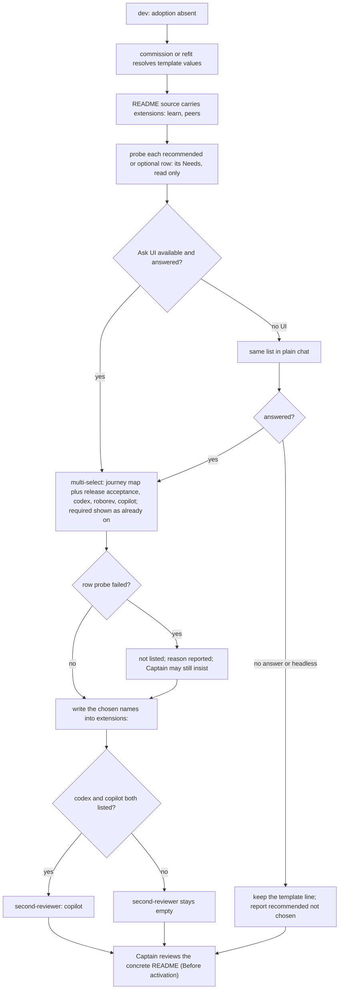

## Scope

- Source: the Captain (chat, 2026-10-25): 「版本走查預設全部都啟用，我們要討論一下預設值，列一下哪些建議啟用，哪些預設啟用」, then 「那就改成版本走查跟地圖一起？我想要讓必要的成為預設，建議的寫在repo readme，adopter 安裝時讓使用者用ui選」.
- Outcome he named: release-acceptance and journey-map are one choice; the required extensions are the template default; the recommended ones are listed in the repository README; at install, the adopter chooses through a UI.
- Facts (0.29.0, 2026-10-25): the workflow template ships `extensions: []` (`references/sd/workflow.md`); `references/sd/adoption.md` § Extensions says an adopter lists what it uses; seven extensions exist (codex, copilot, journey-map, learn, peers, release-acceptance, roborev); release-acceptance applies only where a kc-journey-map file is kept; a sync PR keeps each adopter's own list, so a template default reaches new adopters only.
- Required set: the Captain (chat, 2026-10-25): 「我認為 peers 應該也要預設開啟，它不是只有給 paseo 也是給 cc/codex 的基本準則，不是嗎？」, after FO recommended learn only. Proposed default: learn and peers; recommended: journey-map with release-acceptance as one choice, codex, roborev; optional: copilot. To be confirmed at this task's backlog gate.
- Peers fact (0.29.0 `extensions/peers/EXTENSION.md` § Host bindings, 2026-10-25): Claude Code is bound (`ListAgents`, `SendMessage`); Codex is not covered (a `codex queue` message did not wake the session, 2026-10-12); Paseo is not listed (dev2 backlog peers-paseo-host-binding); without a bound host FO writes `peers not run: <host> …` and finds the answer itself. Its Read and Requests rules (a peer's words are never the Captain's ruling; a peer cannot grant authority) apply on every host.
- Upstream first: adoption runs through `spacedock:commission` or `spacedock:refit` plus `references/sd/adoption.md`; check whether either already asks the user to pick options before adding a question.
- Non-goals: turning anything on in the five existing adopters (each asked separately).

## FO alignment

Alignment: needed before ideation: the required set is the Captain's.
Result: aligned 2026-10-25 by the Captain's 「那就這樣做，learn+peers預設開啟，其他建議」 (chat), after his peers question.
Surfaces: none
Visible change: none
Release review: not needed: workflow maintenance, on no journey map.

## Design

Ruling: the template ships `extensions: [learn, peers]`; the package README marks every extension required, recommended or optional in one table; and the adopting agent asks once, through the host's Ask UI, which recommended rows to add. Nothing is turned on in an existing adopter. Design read against `origin/main` 7a5c79c6 (package 0.29.0), 2026-10-25.

### What I checked first (upstream, then package, then siblings)

- Spacedock 0.27.3 (`spacedock:commission`, `spacedock:refit`): neither knows `extensions:` (`grep -rn "extensions:"` over `skills mods agents docs` finds nothing). Commission asks in chat prose; refit asks `Install it? (y/n)` per mod. So the extension choice cannot be added there from this repository; it belongs in the package's `references/sd/adoption.md`, which already says it supplies design inputs to commission/refit and already requires the user's approval of the concrete README (§ Before activation).
- Package: `adoption.md` § Extensions says an adopter lists what it uses and "check it is available before listing it"; the template ships `extensions: []`; the README table has no tier. The host Ask UI is already the package family's pattern: `kc-dev-flow/skills/choose-work-profile` ("the host's structured Ask UI, or plain chat if unavailable") and `kc-journey-map` Rendering (`AskUserQuestion`, multi-select; "If the tool is unavailable, or nobody answers, render the user journey alone").
- Siblings, read only 2026-10-25 (`git ls-tree`/`gh api` on each default branch): this repository's `docs/dev2`, subspace-relay, subspace-web, subspace-v0, kc-paseo-plugins and qnow (`main` and `next`) all already list `learn` and `peers`; none has `extensions: []`. kc-paseo-plugins lists `journey-map` and `release-acceptance` together; subspace-relay lists `journey-map` alone. This is the evidence for the required pair.
- Backlog `adoption-asks-which-extensions` (same file, same subject, from the Captain's 2026-10-22 words) is largely this task; see Batch overlap.

### Facts that shaped the design (measured, 2026-10-25, on a copy of origin/main)

1. **A template default is not "new adopters only".** `git merge-file` on `extensions:` with base `[]` and new `[learn, peers]`: adopter `[]` merges clean to `[learn, peers]` (silently turns both on); adopter `[learn, peers, roborev]` or `[codex]` conflicts on that line; adopter `[learn, peers]` merges clean. All six known adopters list something, so none changes silently, but each of their READMEs (10 files: relay, web, paseo, qnow have a POC copy too) meets one conflict hunk at its next re-sync, and resolving it to the template side would drop its roborev, codex or journey-map. The Scope's "a sync PR keeps each adopter's own list" holds only for lists the sync does not touch.
2. **The README word ledger blocks the edit.** `lint-skills.py` requires `references/sd/workflow.md` to equal its budget; `[learn, peers]` is one more whitespace token than `[]` (5385 against 5384) and `budget_errors` refuses with "add a raise step of 1 with 'captain' and 'loaded'". `test_lint_skills.py` gained two failures on the changed copy (`test_a_ledger_whose_sum_differs_from_the_count_is_refused_either_way`, `test_workflow_under_its_word_budget_names_the_cut_step`); ten more fail on both base and changed in my partial copy (missing repo-level files), so only the two are attributed.
3. **Release-acceptance is quiet today by the spelling of a label.** `dispatch_records.py` demands an extension's instruction only where its EXTENSION.md has the bullet `- **Instruction FO adds to the scope notes:**` and a `Joins:` stage (`INSTRUCTION`, `JOINS`); release-acceptance's bullet is `- **Acceptance task's implementation scope notes:**`. Run on a first implementation record with `extensions: [learn, peers, journey-map, release-acceptance, codex]` and no acceptance line: `1 dispatch record(s) complete`, exit 0. With `[learn, peers, roborev]`: `roborev worker instruction is absent`. No script reads `journey-map` or `release-acceptance` from the list (`pr_watch.py` reads `codex`, `copilot`, `learn`). So the only things that could make it loud are that label and FO's reading of the `<name> not run` rule in `workflow.md` `## Extensions`.
4. **roborev is the one recommended row that is loud when unmet**: listed without `roborev` on PATH, every first implementation record needs a `roborev not run: <reason>` line (shown above). The ask must therefore probe before listing.

### PRFAQ

*Headline.* A new kc-dev-flow-2 adopter gets `learn` and `peers` without being asked, is shown the four recommended choices with what each needs, and ends with a README whose `extensions:` line says exactly what it chose.

*FAQ.* **Why these two?** All six adopters already run both; `peers` is a rule about a peer's words never being the Captain's, which applies on every host, though only Claude Code can list and wake peers today (Codex and Paseo print `peers not run: <host> …` when FO needs a peer). **Why is journey-map one choice with release-acceptance?** The Captain asked for it; the walk needs a journey file, and the map needs none of the walk, so one option writes both names and the two extension folders stay (merging them would rewrite the lists of three adopters and an extension released yesterday). **What if there is no journey file?** The option is shown unchecked with "no file under `docs/journey/`" and is not listed; listed anyway, the pair adds no step (fact 3). **What if nobody answers, or the worker is headless?** The template line stays and FO reports `recommended not chosen: <names>`; nothing recommended is turned on by silence. **Do existing adopters change?** No file of theirs is touched; at their next re-sync the `extensions:` line is theirs to keep.

### The change, file by file

- `kc-dev-flow-2/references/sd/workflow.md`: frontmatter line 7 becomes exactly `extensions: [learn, peers]`. Nothing else in the file.
- `kc-dev-flow-2/scripts/lint-skills.py`: one `WORKFLOW_BUDGET_STEPS` raise of 1 (`captain` quoting 「那就這樣做，learn+peers預設開啟，其他建議」 (chat, 2026-10-25), `loaded` "startup and resume of the First Officer, which reads the README frontmatter"); plus `extension_tier_errors(root)`: every `required` row of the README table is in the template line and every name in the template line is a `required` row.
- `kc-dev-flow-2/scripts/test_lint_skills.py`: the two mutation cases for that check.
- `kc-dev-flow-2/README.md` § Extensions: a `Tier` column (learn required; peers required; journey-map recommended; release-acceptance recommended, "with journey-map"; codex recommended; roborev recommended; copilot optional) and one sentence saying the install ask offers the non-required rows.
- `kc-dev-flow-2/references/sd/adoption.md` § Extensions: the ask above (probe, one multi-select, no-answer rule, never list a failed probe, `second-reviewer:` rule) and one sentence on re-sync: the `extensions:` line is the adopter's, keep its value when the three-way merge conflicts or when a clean merge changed it.
- `kc-dev-flow-2/extensions/journey-map/EXTENSION.md` and `release-acceptance/EXTENSION.md`: the existing clause "and only when it keeps a kc-journey-map file" gains " under `docs/journey/`; with none, this extension has no step and FO writes no `<name> not run` line for it" (19 words each; `docs/journey/<journey>.yaml` is the kc-journey-map "Source placement").
- `kc-dev-flow-2/scripts/test_dispatch_records.py`: the quiet pin (AC-5). `kc-dev-flow-2/scripts/test_pr_watch.py`: the idle pin (AC-6).
- Named only if the Captain picks the root README (D1): `README.md`, one sentence at "Optional extensions (Codex review, roborev, learning at task archive) are listed per adopter."

Not changed: Spacedock, `docs/dev2/README.md` of this repository and every adopter's README, `workflow.md` `## Extensions`, `pr_watch.py`, `dispatch_records.py`, the `learn`, `peers`, `codex`, `roborev`, `copilot` EXTENSION.md files.

### Words FO reads at each moment

Counted with `lint-skills.py` `normalized_words` on origin/main 7a5c79c6 (the learning.md method). Base is `extensions: []`: 0 at every moment. "Script" is what `pr_watch.py tasks` prints; for the merged-PR lines I counted the three lines in the source and did not run them. "Text" is the EXTENSION.md FO follows at its `Joins:` point; **not measured**: whether FO opens a listed EXTENSION.md at startup. If it opens every listed file then, the upper bound is the sum row.

| Moment | Default `[learn, peers]`, after | A recommended row adds, if chosen |
| --- | --- | --- |
| startup | script 0, text 0 | 0 |
| idle, open PR | script 0, text 0 | codex text 228; copilot text 749 |
| idle, merged PR | script 20 (3 lines), learn text 293 | 0 |
| after the archive | learn text, same 293 (once per session) | journey-map text 605, on a journey task only |
| merge ask | 0 | codex 228; copilot 749 (when chosen, as today) |
| implementation dispatch | 0 | roborev instruction 55 (file 232) |
| on demand | peers text 756, first time FO needs a peer | release-acceptance 600, on an acceptance task only |
| upper bound if all opened at startup | 1049 (learn 293 + peers 756) | all recommended 2714; with copilot 3463; `workflow.md` itself is 5384 |

For a new adopter the default raises two moments (idle on a merged PR, on demand), none falls; for the six existing adopters every cell is 0 because their lists do not change. This design's own edits to text FO reads: `workflow.md` +1 token; each of the two EXTENSION.md files +19 words, read only on a journey task or acceptance task; `adoption.md`, README tables and `lint-skills.py` are not read by FO at these moments.

## Acceptance criteria

**AC-1** The template ships the required pair. Evidence: `grep -n '^extensions:' kc-dev-flow-2/references/sd/workflow.md` prints exactly `7:extensions: [learn, peers]` and `python3 kc-dev-flow-2/scripts/poc_readme.py derive kc-dev-flow-2/references/sd/workflow.md` prints the same line (carries into a POC README; measured 2026-10-25 on a changed copy). Falsifier: with the line `extensions: []`, AC-3's check exits 1 naming `learn` and `peers`.

**AC-2** The word ledger accepts exactly the one added token. Evidence: `python3 kc-dev-flow-2/scripts/lint-skills.py` exits 0 and `python3 kc-dev-flow-2/scripts/test_lint_skills.py` passes in CI; the new step has `captain` quoting the 2026-10-25 words and a `loaded` moment. Falsifier: the same tree without the step prints `5385 words exceeds the budget of 5384` (re-measure against the then-current budget; other tasks may have moved it).

**AC-3** The README table and the template line cannot disagree. Evidence: `extension_tier_errors` runs in `lint-skills.py`; `test_lint_skills.py` has two mutations, each asserting the printed reason and not only exit 1: drop `peers` from the template line prints a line naming `peers` as `required` but not listed; mark `codex` required while the line omits it prints a line naming `codex`. Falsifier: delete the check and both mutations pass, so each test must fail without it (run once with the check removed).

**AC-4** The install ask does what the diagram says, on a real run. Evidence: a fresh sonnet worker, given only `adoption.md` and a disposable repository with one `docs/journey/x.yaml`, `node` present, `roborev` absent, answers scripted in plain chat, ends with: (A) every row chosen: `extensions: [learn, peers, journey-map, release-acceptance, codex, copilot]`, `second-reviewer: copilot`, and a line saying roborev was not listed because its probe failed; (B) no answer: `extensions: [learn, peers]` and `recommended not chosen: journey-map, release-acceptance, codex, roborev`; (C) same repo with `docs/journey/` removed and journey chosen: neither journey name listed, reason named. The three resulting README lines and the probe commands the worker ran are copied into the validation report. Falsifier: rerun (A) on `adoption.md` with the "never list a failed probe" sentence removed; roborev must then appear (if it does not, the sentence is not what held it and the AC is rewritten). Limit, stated not tested: the Ask UI rendering (one multi-select of four options) is not exercised by any worker, because a subagent cannot put a question to the Captain (`kc-plugin-forge/reference/quality-pipeline.md`); the option cap of the host tool was not verified in this session. The first real adoption by the Captain is the proof, and if the host caps below four options the ask falls to plain chat.

**AC-5** release-acceptance and journey-map stay quiet without a journey file. Evidence: a case in `test_dispatch_records.py`: README `extensions: [learn, peers, journey-map, release-acceptance, codex]`, a first implementation record with no acceptance line, `dispatch_records.py` exits 0 and prints no line naming `journey-map` or `release-acceptance`; and the 19-word clause is in both EXTENSION.md files (`grep -c 'under \`docs/journey/\`' kc-dev-flow-2/extensions/{journey-map,release-acceptance}/EXTENSION.md` prints 1 each). Falsifier: rename release-acceptance's `Acceptance task's implementation scope notes` bullet to `Instruction FO adds to the scope notes` with a `Joins: implementation` line; the case then fails with `release-acceptance worker instruction is absent` (assert that text). Limit: nothing checks that FO obeys the clause about the `not run` line; the observer does not read it, and a maintainer's read of an adopter's first task after a release is the only check.

**AC-6** The default adds no word at startup or while a PR is open. Evidence: a case in `test_pr_watch.py` runs `tasks` over one open task PR with `extensions` empty and with `peers, journey-map, release-acceptance` and asserts byte-identical output; the words table above is re-counted with `normalized_words` on the candidate and each cell matches or the table is corrected. Falsifier: make `tasks` print one line when `peers` is listed; the case fails.

**AC-7** Re-sync keeps the adopter's list. Evidence: `adoption.md` § Extensions says the `extensions:` line is the adopter's and to keep its value, and cites the four-case merge result of fact 1 (clean `[]` adopter changed, conflicting lists, equal list clean). Limit: prose only; no check reads a re-synced README for a dropped extension, so a wrong resolution is caught only by the adopter's own review of the sync PR.

**AC-8** Nothing outside scope changes. Evidence: `git diff --name-only origin/main...HEAD` lists only the paths under "The change, file by file" (plus `README.md` only if D1 says so) and no adopter file. Falsifier: any path under `docs/dev2/` or a sibling repository fails the criterion.

## Unresolved decisions for the Captain

**D1. Which README is "the repository README" for the recommended list?** Recommend the package README (`kc-dev-flow-2/README.md` § Extensions), because it already holds the extension table and AC-3 can check it against the template line. The root `README.md` sentence is already stale (it names three of seven) and CLAUDE.md allows a feature PR to touch only its plugin's files, so a root pointer would be a separate `docs(readme)` PR. Worse under the recommendation: a reader who only opens the root README does not see the tiers.

**D2. Is copilot offered in the install ask, or only written in the README?** Recommend offered, unchecked, labelled as quota-limited, and when codex and copilot are both chosen write `second-reviewer: copilot` (this repository's own setting; the copilot extension says its allowance is limited). Worse: a fourth option and one derived frontmatter value the Captain did not name; if the host caps options at three, copilot is the one that moves to plain chat.

**D3. Accept the one-time re-sync conflict, or keep `extensions: []` in the template and let the install ask write the required pair?** Recommend accepting, since you ruled the template carries the default and it also covers adoption by a non-interactive worker. Worse: each of the 10 adopter READMEs meets one conflict hunk at its next re-sync, a wrong resolution drops an adopter's extensions with only a sentence and the adopter's PR review to catch it (AC-7), and the Scope sentence "a sync PR keeps each adopter's own list" is true only where the sync does not touch the line.

### Batch overlap

State read from `origin/spacedock-state/dev2` after `git fetch`, 2026-10-25; PR list by `gh pr list --state open`. The six batch tasks you named are archived and merged into 0.29.0 (new-work-starts-from-a-story-map #705, codex-reader-reads-receipt-marker #693, merge-ask-holds-missing-clauses #703, idle-names-failing-seeds #694, agent-reads-governing-adr #698; fo-write-checks-parse-top-level is still ideation), so the base already contains them.

Files this design would change: `kc-dev-flow-2/references/sd/workflow.md` (frontmatter line 7), `kc-dev-flow-2/scripts/lint-skills.py` (`WORKFLOW_BUDGET_STEPS`, one new function), `kc-dev-flow-2/scripts/test_lint_skills.py`, `kc-dev-flow-2/scripts/test_dispatch_records.py`, `kc-dev-flow-2/scripts/test_pr_watch.py`, `kc-dev-flow-2/README.md` (§ Extensions), `kc-dev-flow-2/references/sd/adoption.md` (§ Extensions), `kc-dev-flow-2/extensions/journey-map/EXTENSION.md`, `kc-dev-flow-2/extensions/release-acceptance/EXTENSION.md`; `README.md` only under D1.

| Task | Same file or check? | What FO needs |
| --- | --- | --- |
| adoption-asks-which-extensions (backlog) | yes: `adoption.md` and `workflow.md`; its three parts (ask, default set, recommendation) are this task's, its extra part is the `dispatch_records.py` verdict on a record dispatched before an extension was listed | land this first; then reduce that task to the record-verdict part or close it. Its "recommendation from what the repository has" is covered here only as a probe result shown per option, not a mechanism |
| fo-write-checks-parse-top-level (ideation) | check only: its AC-6 says `lint-skills.py` exits 0 "with the same word budget"; it edits none of this design's files | if this lands first its evidence clause reads against budget 5385; no file conflict |
| PR #674, Draft (Codex model policy) | yes: `kc-dev-flow-2/README.md` (a different section) and `skills/dev/SKILL.md` (not edited here) | separate hunks; second to merge rebases |
| names-check-newest-followups (backlog) | `dispatch_records.py` `--newest`; this design only appends a case to `test_dispatch_records.py` | none |
| pr-review-lite-value-pilot (implementation), kc-decision-log-handoff-trial (backlog), journey-canvas-hosted-poc (ideation), journey-server-host-pilot (validation, other session), kc-decision-log-p1 and kc-decision-log-cli (archived) | no: grep of each task for the paths above finds none, or only `kc-pr-flow/`, `kc-journey-map/server/` and an old `0.21.0/scripts/design_surfaces.py` path | none |
| any task that raises or cuts the word ledger | `lint-skills.py` `WORKFLOW_BUDGET_STEPS` list end and the budget count | none live; a later one rebases and re-measures AC-2 |
| release-acceptance (shipped in 0.29.0, no live task) | its EXTENSION.md gains 19 words | none |

Recommended order: this task before adoption-asks-which-extensions; otherwise any order. Every kc-dev-flow-2 change shares one release-please component; a PR title `feat(kc-dev-flow-2): …` carries it.

## Stage Report: ideation

- DONE: Design the change for the Captain's outcome under ## Scope: the exact workflow template extensions line (learn and peers), the repository README list of recommended extensions (journey-map with release-acceptance as one choice, codex, roborev) and optional copilot, where an adopter chooses at install through a UI (check spacedock:commission, spacedock:refit and references/sd/adoption.md first), and how release-acceptance stays quiet without a journey file; name every file and the evidence each criterion needs
  `## Design`: line is `extensions: [learn, peers]`; commission and refit have no `extensions:` knowledge (grep, Spacedock 0.27.3), so the ask lives in `adoption.md` via the host Ask UI; quiet is pinned by AC-5 (`dispatch_records.py` exit 0 on a README listing both, measured). Files under "The change, file by file".
- DONE: A `### Batch overlap` section naming each file the design would change and each other batch task and live task of other sessions that changes the same file or check
  `### Batch overlap`: five of the named batch tasks are archived and merged in 0.29.0; the live overlap is adoption-asks-which-extensions (same files), PR #674 (README), and the word-ledger list; recommended order given.
- DONE: The words FO reads at each lifecycle moment, before and after, per root learning.md "Measure the words FO reads at each moment, not one file's size"
  Table under "Words FO reads at each moment": base 0; default raises idle-on-merged-PR (20 script + 293 text) and on-demand peers (756); 0 for existing adopters. Not measured: whether FO opens a listed EXTENSION.md at startup; merged-PR script lines counted from source, not run.
- DONE: Acceptance criteria with reproducible evidence clauses and falsifiers, and unresolved decisions for the Captain, each with a recommendation and what gets worse under it
  AC-1 to AC-8 with evidence and falsifier (AC-4, AC-5, AC-7 state limits); D1 (which README), D2 (copilot in the ask), D3 (one-time re-sync conflict), each with a recommendation and its cost.
- DONE: `python3 <package>/scripts/design_surfaces.py check <task>`
  Output: `extension-defaults-and-install-choice.md: design surfaces presentable`, exit 0.

### Summary

Required pair goes in the template line, tiers live in one README table that `lint-skills.py` checks against that line, and the adopting agent asks once through the host Ask UI, never turning on a recommended row by silence or a failed probe. Two findings change the Scope's premises: a template default hits every adopter's next re-sync as a one-line conflict (measured with `git merge-file`), and the README word ledger refuses a one-token edit without a Captain-quoted raise step. Not tested by any worker: the Ask UI rendering and its option cap.
