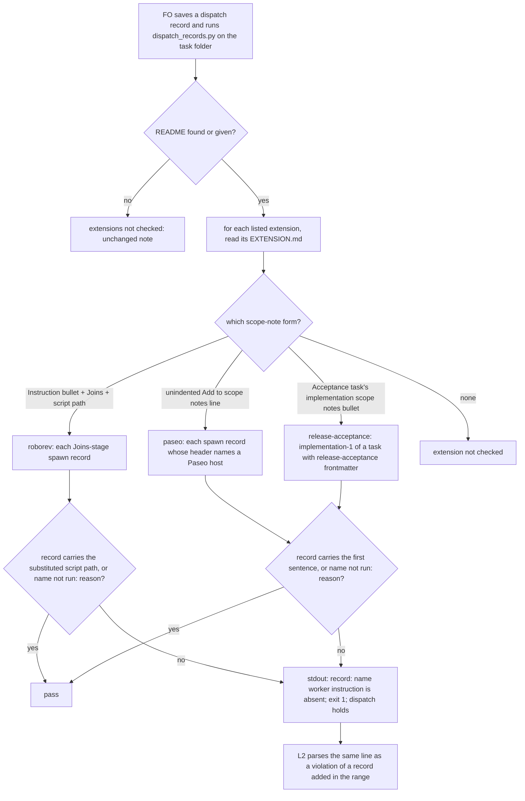

`dispatch_records.py` holds a dispatch record that lacks the scope-note instruction of any extension the workflow README lists, not only the instructions that name a package script.

Source: the Captain, chat 2026-11-05: 「開」, answering 「建議開兩張 dev2 任務，請你決定要不要開。」 whose first item read 「派工紀錄檢查器也要檢查每個已啟用擴充規定的交代句。這一類是 12 筆。」

Bite: observer reports across every archived task carry 12 violations (6 of them in the 12 tasks of batches 12 and 13; counted with grep over `_archive/*/observer.md` on 2026-11-05) of the paseo extension's rule "Start in the assigned worktree; verify pwd and git root before edits." (scope notes of Codex worker dispatch records, ideation, implementation, validation and message records). `dispatch_records.py --names` passed every one of those records. Cause, read in kc-dev-flow-2 0.35.0 on 2026-11-05: `declared_instructions` keeps an extension only when its EXTENSION.md has the `INSTRUCTION` bullet, a `JOINS` stage and a `<package>/extensions/...py` path in that bullet, and `extension_errors` reads only `dispatch/<stage>-1.md`. Of the nine packaged extensions only roborev passes that filter; paseo writes its line as `Add to scope notes: "..."` with no join stage and no script path, so it is never checked.

Consumer: every adopter FO whose README lists paseo (Codex workers through Paseo) or another extension whose scope-note instruction names no script, and the observer, which today is the only reader that catches the missing line.

## Scope

- Upstream first: `dispatch_records.py` (`declared_instructions`, `extension_errors`) already checks the roborev instruction; this task widens that check rather than adding one. The paseo, codex, copilot and other EXTENSION.md files state their own scope-note lines.
- Non-goals: the items already parked in extension-instruction-followups (YAML block lists, the README read at run time).
- Batch 14: the Captain 「可以」 (chat, 2026-11-05), answering 「這 5 張當下一批，可以嗎？」, which named this task.

## Budget
- One package PR. Workflow word budget unchanged unless the design names a raise for the Captain.

## Stop condition
- Every listed extension whose EXTENSION.md tells FO to add a scope-note line is checked in each dispatch record it applies to, not only `<stage>-1.md`; replays of the batch 12 and 13 records that lack the paseo line are held, and a record carrying the line or `<name> not run: <reason>` passes.

## FO alignment

Alignment: not needed: the line and where it applies are already written in each EXTENSION.md; the check only reads them.
Surfaces: none
Visible change: none
Release review: not needed: workflow maintenance, on no journey map.

## Design

### Chain check and existing-code check (2026-11-05, origin/main, kc-dev-flow-2 0.35.0)

- Spacedock 0.27.3: `dispatch build` takes `--scope-notes-file` and writes no `dispatch/<name>.md` record; it has no extension concept. Nothing to reuse.
- kc-dev-flow-2 0.35.0 (`scripts/dispatch_records.py` at origin/main is byte-identical to the dispatched package): `declared_instructions` keeps an extension only when its EXTENSION.md has the `- **Instruction FO adds to the scope notes:**` bullet, a `- **Joins:**` stage and a `<package>/extensions/...py` path; `extension_errors` judges only `<stage>-1.md`. Of the nine packaged EXTENSION.md files, three tell FO to add a scope-note line, in three forms: roborev (that bullet), paseo (an unindented `Add to scope notes: "..."` line under `## Workers through Paseo`, plus a conditional `For each worker needing human interaction, add to scope notes: ...` line) and release-acceptance (`- **Acceptance task's implementation scope notes:** FO adds to its first implementation record only: "..."`). codex, copilot, fo-feedback, journey-map, learn and peers give no scope-note line.
- Which records a worker reached through Paseo is already written in each record header: `Model: <model> (Claude via Paseo, ...` / `(Codex via Paseo, ...` (242 records in this state) or `Roster: ...; host=paseo; ...` (`references/model-roster.md`). `model_roster.py` `author()` parses these headers but only for Codex implementation/repair authors, so it cannot be reused as is; the check uses one header pattern of its own.
- `laws_check.py` L2 already passes `--readme` to the folder run and parses `<record>.md: <name> worker instruction ...` as a violation of the record added in the range (ADR 0017: added events only), so a new line in that shape reaches L2 with no `laws_check.py` change.
- Adopters (read-only, 2026-11-05, workflow READMEs found by `~/conductor/{repos,workspaces/*}/*/docs/*/README.md` and `~/Project/*/docs/*/README.md`, 24 with `extensions:`): none of them lists paseo, which this workflow lists; 8 of them (3 distinct lists, worktree copies counted) list release-acceptance; no task with `release-acceptance:` frontmatter has a dispatch record anywhere on this machine, so release-acceptance has no observed miss.
- Repaired, not replaced: `declared_instructions`, `instruction_error` and `extension_errors` in `dispatch_records.py`.

### Past rulings read

- `extension-instruction-reaches-dispatch` (#652, Captain 「准」 2026-10-17) Decision 1: the check runs in the folder run, not a new pre-send command; Decision 2: first record only, because "a follow-up to a live worker already holds the instruction", with the named cost "a fresh worker dispatched at cycle 2 or later without the line passes unnoticed". That cost has since bitten: observer reports flag roborev absent from `implementation-3`, `-5`, `-6` and `-7` spawn records. This task's approved stop condition ("not only `<stage>-1.md`") supersedes the first-record limit for fresh workers; its reason still holds for follow-up messages to a live worker, so this design keeps messages exempt (D3).
- ADR 0017 (L2 judges added events, not accumulated history), ADR 0027 (a FO-write rule is checked by the script FO already runs at the write), ADR 0042/0048 (Paseo workers commit locally and complete by final reply). `git -C <state> grep -n 'Override:'` (2026-11-05) finds no override on dispatch-record extension checks.
- `extension-instruction-followups` (backlog) parks the YAML block-list parse and the README-at-run-time limit; both stay out of scope.

### PRFAQ

**Press release (future).** FO saves a validation record for a Codex worker it is about to start through Paseo and runs the dispatch-record check as it does today. The check prints `validation-1.md: paseo worker instruction is absent; copy the scope-note instruction of <package>/extensions/paseo/EXTENSION.md into the scope notes, or add a line 'paseo not run: <reason>'`, and the dispatch holds until FO adds the line. The same check now judges every fresh worker's record, not only the first of its stage, and reads each listed extension's scope-note line in the form that extension writes it. The observer stops being the only reader that catches the missing paseo sentence.

**FAQ.**

- *What exactly must a record carry for paseo?* The first sentence of paseo's `Add to scope notes:` line, read from EXTENSION.md at run time: `Start in the assigned worktree; verify pwd and git root before edits.` That is the sentence every observer violation cites, and what FO writes in ideation and validation records today (36 records carry only it; the rest of the line is about the product branch, which ideation and validation do not have). See D2.
- *Which records does paseo apply to?* Every fresh-worker record (`ideation-<N>.md`, `implementation-<N>.md`, `validation-<N>.md`) whose header names a Paseo host, Claude or Codex. See D1.
- *What about follow-up messages?* `<stage>-<N>-message-<M>.md` goes to a worker that already received its record's lines, so the extension check does not judge it (D3); every other part of the record check still does.
- *What about roborev?* Unchanged rule (its script path with the record's `Package root:`), now on every `implementation-<N>.md`, not only `implementation-1.md`.
- *What about release-acceptance?* Its first sentence, `Lead the walk.`, on `implementation-1.md` of a task whose task file frontmatter has `release-acceptance:`, as its EXTENSION.md says ("its first implementation record only").
- *Is paseo's human-interaction line checked?* No. It applies "for each worker needing human interaction", and no record field says whether a worker needs one; requiring it everywhere would put a line with unfilled placeholders on every worker (D2).
- *What escapes?* A record carrying `<name> not run: <reason>` passes, as today. Records with other names (for example `implementation-1-package-recovery.md`) are not judged by the extension check, as today.
- *Does FO read more?* Only on a failure: one line of 24 words per missing paseo line. No README, workflow.md or EXTENSION.md word changes.

### What the design changes

1. `kc-dev-flow-2/scripts/dispatch_records.py`: `declared_instructions` returns, per listed extension, a record selector and a requirement for each of the three forms (anchored at line start, so paseo's conditional human-interaction line is not read); a spawn-record pattern `^(ideation|implementation|validation)-[1-9][0-9]*\.md$`; one Paseo header pattern (`Model: ... (Claude|Codex via Paseo` or `Roster: ...; host=paseo`) read above the first `## `; `instruction_error` checks a first sentence by whitespace-normalised substring as well as the existing script-path match; `extension_errors` walks every record of the folder instead of `<stage>-1.md`. The new message keeps the `<record>: <name> worker instruction is absent; ...` shape L2 parses. The module docstring's extension paragraph is rewritten to say which records each form applies to.
2. `kc-dev-flow-2/scripts/test_dispatch_records.py`: new cases for AC-1 to AC-4; `test_a_later_implementation_record_without_the_instruction_is_not_checked` and `test_every_shipped_instruction_is_read_from_its_extension_file` change to the new behaviour; `test_release_acceptance_turns_loud_when_its_bullet_carries_the_instruction_label` is replaced by the acceptance-task case.
3. `kc-dev-flow-2/scripts/test_laws_check.py`: one L2 case for a paseo line (AC-6). `laws_check.py` is not changed.

Not changed: every `EXTENSION.md`, `references/sd/workflow.md` (exact word budget), the adopted README, `references/sd/laws.md` (L2's rule already reads "every part `dispatch_records.py` requires"), `--names`, `--newest`, `--coverage`, the observer skill. No ADR: no ruling changes; Decision 2's first-record limit is narrowed by this task's approved stop condition, recorded above.

### Replay (prototype, 2026-11-05)

A throwaway copy of the 0.35.0 scripts with the change above, in `/tmp` (no repository file), run with `--readme docs/dev2/README.md` on each task folder:

| Records | 0.35.0 extension lines | Prototype extension lines |
|---|---|---|
| The 12 archived tasks of batches 12 and 13 (82 records) | 0 | paseo 30 (16 ideation, 14 implementation spawn records), roborev 7 (`implementation-2..4` of later cycles); 0 on validation records, all of which carry the sentence |
| Live tasks at state commit `962a430f0` (46 records) | roborev 1 (`journey-server-host-pilot/implementation-1.md`) | paseo 6 (ideation records of archive-waits-for-observer-report, captain-ruling-sources-checked ×2, dispatch-carries-reserved-adr-number, picky-reviewers-may-run-on-gemini, seed-check-requires-alignment-result), roborev 6 (journey-server-host-pilot implementation-1, -2, -3, -5, -6, -7); this task's and the other batch-14 ideation records pass |

The 19 batch-12/13 follow-up message records that lack the paseo sentence are not judged (D3); 12 of them follow a spawn record that is itself flagged, 7 follow one that carries the sentence.

### Words FO reads at each moment

Counted with `wc -w` on 2026-11-05 (learning.md "Measure the words FO reads at each moment, not one file's size"):

| Moment | Before | After |
|---|---|---|
| Startup / README read | adopted README and workflow.md | unchanged, 0 |
| Writing a dispatch record | paseo's 12-word sentence already owed by EXTENSION.md | unchanged, 0 |
| Folder check, clean | `N dispatch record(s) complete` | unchanged, 0 |
| Folder check, missing paseo sentence | nothing | +24 words per record (`<record>: paseo worker instruction is absent; copy ...`) |
| Folder check, missing roborev path on a later implementation record | nothing | +30 words per record (existing roborev line) |
| Usage error (docstring printed) | 771 words, 50 in the extension paragraph | about +60 (paragraph rewritten to name the three forms and their records); recounted at implementation |
| L2 law output | violation line per added record | same shape, now also for paseo |

### Batch overlap

Files the design would change: `kc-dev-flow-2/scripts/dispatch_records.py` (`declared_instructions`, `instruction_error`, `extension_errors`, docstring), `kc-dev-flow-2/scripts/test_dispatch_records.py`, `kc-dev-flow-2/scripts/test_laws_check.py`. No shared index (no ADR number, no migration, no word-budget raise).

| Task | Shared file or check | Order |
|---|---|---|
| step-back-answer-has-a-record-line (batch 14) | its D2 recommends leaving `dispatch_records.py` alone; if D2 is reversed, both edit `dispatch_records.py` (its step-back stderr, not the extension functions) | none; textual conflict only if its D2 is reversed |
| override-recorded-when-captain-departs (batch 14) | names `dispatch_records.py` in its overlap with none shared | none |
| gate-summary-names-each-decline, gate-presentation-asks-one-thing-plainly (batch 14) | no `dispatch_records.py`, test or EXTENSION.md change | none |
| adoption-asks-which-extensions (other session, ideation since 2026-10-25) | same function: makes `extension_errors` judge each record against the README at its `Dispatched:` SHA; same test file | direct; recommended this task first (approved stop condition, live bite), then that task rebases its per-record window onto the loop this task introduces |
| dispatch-carries-reserved-adr-number (ideation) | same file, different function (`check_task_facts`, `--names`) | textual only; either order |
| seed-check-requires-alignment-result (ideation) | `design_surfaces.py`; runs `test_dispatch_records.py` | none |
| captain-ruling-sources-checked (ideation) | `design_surfaces.py`, `extensions/peers/EXTENSION.md` (not read by this check: peers gives no scope-note line) | none |
| comment-check-reaches-delivery-gate (ideation) | `delivery_gate.py` | none |
| picky-reviewers-may-run-on-gemini (ideation) | changes no file; if reopened, `extensions/release-acceptance/EXTENSION.md` reviewer wording, not its `Lead the walk.` sentence | none; if it ever rewrites the first sentence, AC-1's test fails and tells it |
| archive-waits-for-observer-report (implementation) | `extensions/learn/EXTENSION.md` (gives no scope-note line) | none |
| journey-server-host-pilot (other session) | no file; its records gain 5 roborev lines (D4) | none |
| adr-required-statement, adr-silent-undo-probe, fo-write-checks-parse-top-level, journey-canvas-hosted-poc, ops-inbox-r1-setup-and-isolation, pr-review-lite-value-pilot | none of the three files | none |
| extension-instruction-followups (backlog) | same function and parse | after this task and adoption-asks-which-extensions |

Recommended order: this task, then adoption-asks-which-extensions, then extension-instruction-followups; the other batch-14 tasks in any order.

## Acceptance criteria

**AC-1** The reader finds each listed extension's scope-note line in the form its EXTENSION.md writes it. Run on the shipped package with all nine extensions listed, `declared_instructions` returns exactly three entries: roborev (stage `implementation`, path `extensions/roborev/roborev_gate.py`), paseo (sentence `Start in the assigned worktree; verify pwd and git root before edits.`) and release-acceptance (sentence `Lead the walk.`, `implementation-1.md` of an acceptance task); paseo's human-interaction line yields nothing. Evidence: a test reading the shipped EXTENSION.md files. Falsifier: dropping the line-start anchor (paseo's human line then becomes a second paseo entry), or keeping today's bullet-only reader (paseo absent), fails that test.

**AC-2** paseo is judged on the records it applies to. Under a README listing paseo, a spawn record lacking the sentence fails with `<record>: paseo worker instruction is absent` and exit 1 when its header is `Model: gpt-6.1-sol (Codex via Paseo, ...`, `Model: claude-opus-5-5 (Claude via Paseo, ...` or `Roster: ...; host=paseo; ...`; the same record passes with the sentence (also when wrapped across lines) or with `paseo not run: <reason>`; a record with `Model: sonnet` passes without it; a README not listing paseo passes. Evidence: tests asserting printed text and exit code. Falsifier: removing the header selector fails the `Model: sonnet` case; a Codex-only selector fails the Claude case (D1); an exact-whitespace match fails the wrapped case.

**AC-3** Every fresh-worker record is judged, follow-up messages are not. `ideation-2.md`, `implementation-3.md` and `validation-1.md` each fail for paseo when they lack the sentence beside a complete `<stage>-1.md`; `implementation-2.md` fails for roborev without the substituted path beside a complete `implementation-1.md`; `implementation-1-message-1.md` without either line passes (D3). Evidence: tests. Falsifier: keeping `<stage>-1.md` as the only judged record fails the first two cases; judging message records fails the last.

**AC-4** release-acceptance is judged only where its EXTENSION.md says. `implementation-1.md` lacking `Lead the walk.` fails in a task whose task file frontmatter has `release-acceptance: <journey>/<release>`, and passes in a task without it; `implementation-2.md` of the acceptance task passes without it. The existing `test_journey_map_and_release_acceptance_stay_quiet_without_an_acceptance_instruction` still passes. Evidence: tests. Falsifier: dropping the frontmatter condition fails the non-acceptance case; judging every implementation record fails the `implementation-2.md` case.

**AC-5** The real records replay as the prototype did, read-only. The candidate run with `--readme <workflow>/README.md` on the 12 archived task folders of batches 12 and 13 prints 30 paseo lines (16 ideation and 14 implementation spawn records) and 7 roborev lines, and 0.35.0 prints none; no validation record and no follow-up message record is named. The live-task row of the replay table is an observation at state commit `962a430f0`, not part of this criterion, because live records change with every dispatch. Evidence: the commands and counts in the validation report. Falsifier: a different count, or any named validation record (a false positive), fails this criterion.

**AC-6** L2 sees the new line without a `laws_check.py` change. `test_laws_check.py` gains a case where a record lacking the paseo sentence, with a Paseo header, is added in the range under a README listing paseo: `laws_check.py` prints `violation: L2 dispatch-record-complete record=<path> ... paseo worker instruction is absent ...` and does not raise its "output this runner does not parse" error. Evidence: that test with `python3 -B`, caches cleared. Falsifier: changing the new message so it no longer starts `<record>.md: paseo worker instruction` makes the test fail.

**AC-7** The change stays a detector. `git diff --name-only <base>..<candidate> -- kc-dev-flow-2` lists only `scripts/dispatch_records.py`, `scripts/test_dispatch_records.py` and `scripts/test_laws_check.py`; `python3 kc-dev-flow-2/scripts/lint-skills.py` exits 0 with `WORKFLOW_WORD_BUDGET` untouched; the package test suite and `scripts/version-parity-check.sh` pass; the words-per-moment table recounts with `wc -w` to the same values (the docstring delta stated as measured). Falsifier: any EXTENSION.md, README, workflow.md or laws.md edit in the diff fails this criterion.

## Unresolved decisions for the Captain

**D1. Which Paseo workers owe the line?** The dispatch checklist says "Codex workers"; paseo's EXTENSION.md section is "Workers through Paseo", and observer reports flag Claude-via-Paseo records too (e.g. `special-roles-follow-the-model-table/ideation-1`). Recommendation: every worker started through Paseo, Claude or Codex. What gets worse: 19 of the 30 held batch-12/13 records are Claude-via-Paseo (ideation, and `claims-name-their-source` implementation-2..4), and FO copies the sentence into Claude workers' records as it already does in this batch.

**D2. How much of paseo's line does a record owe?** Recommendation: its first sentence, everywhere it applies; the conditional human-interaction line is not checked. That is what the 12 observer violations cite and what FO writes in ideation and validation records today. What gets worse: an implementation record carrying the first sentence but contradicting the rest ("Push and Draft PR ...", seen twice, both in records that also lacked the sentence) passes the check; requiring the whole line instead would also hold the 36 records in this state that carry only the first sentence (every validation record and every batch-14 ideation record), and put "commit locally and report the branch" into ideation records, which write no commit.

**D3. Do follow-up messages to a live worker owe the lines?** Recommendation: no, as Decision 2 of `extension-instruction-reaches-dispatch` reasoned: the worker already holds its record's lines. What gets worse: the observer, which also judges message records, may still flag a follow-up whose spawn record passed (7 such batch-12/13 message records; one report already flagged one, `special-roles-follow-the-model-table/implementation-1-message-1`); judging messages instead would hold 19 batch-12/13 message records and add the paseo sentence and roborev instruction to every follow-up.

**D4. What does FO do with the live records the wider check newly flags?** 6 ideation records (paseo) in five live tasks and 5 implementation records (roborev) in `journey-server-host-pilot` will fail that task's next folder run. Recommendation: before its next dispatch on such a task, its FO appends to each flagged record's scope notes one line `<name> not run: line omitted when dispatched; found by dispatch_records.py <date>`, committed with the next state commit; no exemption is built. What gets worse: 11 historical records are edited after dispatch (visible in git; L2 judges added records only, ADR 0017), and the other sessions' FOs meet a failure they did not cause.

## Stage Report: ideation

- DONE: Design the widened instruction check in /Users/kent/.claude/plugins/cache/kc-claude-plugins/kc-dev-flow-2/0.35.0/scripts/dispatch_records.py: how each listed EXTENSION.md's scope-note line is read (paseo's `Add to scope notes:` form included), which dispatch records each one applies to (paseo: Codex workers), with replays of the batch 12 and 13 records that lack the paseo line
  `## Design`: three anchored forms (roborev bullet, paseo `Add to scope notes:` first sentence, release-acceptance first sentence on an acceptance task's implementation-1), every spawn record, Paseo header selector (Claude or Codex, D1); prototype replay in /tmp: 0.35.0 flags 0 batch-12/13 records, the design flags 30 paseo + 7 roborev.
- DONE: A `### Batch overlap` section naming each file the design would change and each other batch task (step-back-answer-has-a-record-line, override-recorded-when-captain-departs, gate-summary-names-each-decline, gate-presentation-asks-one-thing-plainly) and live task of other sessions (adoption-asks-which-extensions, adr-required-statement, adr-silent-undo-probe, captain-ruling-sources-checked, comment-check-reaches-delivery-gate, dispatch-carries-reserved-adr-number, fo-write-checks-parse-top-level, journey-canvas-hosted-poc, journey-server-host-pilot, picky-reviewers-may-run-on-gemini, seed-check-requires-alignment-result, archive-waits-for-observer-report, ops-inbox-r1-setup-and-isolation, pr-review-lite-value-pilot (stalled or driven by other sessions; read only)) that changes the same file or check, so FO can order implementation
  One direct overlap: adoption-asks-which-extensions edits the same `extension_errors`; order this task, then it, then extension-instruction-followups. Others none or textual only (grep of each task file for dispatch_records / EXTENSION.md / laws_check).
- DONE: The words FO reads at each moment, before and after, per root learning.md "Measure the words FO reads at each moment, not one file's size"
  Table in `## Design`: 0 at every clean moment; +24 words per missing paseo line, +30 per missing roborev path; docstring about +60 (printed on usage error only), recounted at implementation.
- DONE: Acceptance criteria with reproducible evidence clauses and falsifiers, and unresolved decisions for the Captain, each with a recommendation and what gets worse under it
  AC-1..AC-7 each carry evidence and a falsifier; D1 (which Paseo workers), D2 (first sentence only), D3 (messages exempt), D4 (11 live records) each carry a recommendation and its cost; no `Override:` bears on them.
- DONE: AC-1 reader finds three forms
  Prototype only (`declared_instructions` printed roborev/paseo/release-acceptance, no human-interaction entry); candidate not yet verified.
- DONE: AC-2 paseo judged on Paseo-header records
  Not yet verified (future tests).
- DONE: AC-3 every spawn record, messages exempt
  Not yet verified (future tests); prototype replay named no message record.
- DONE: AC-4 release-acceptance only on an acceptance task's implementation-1
  Not yet verified; no acceptance-task record exists on this machine to replay.
- DONE: AC-5 real-record replay
  Prototype observed 30 paseo / 7 roborev on batch 12/13 and 6 / 6 on live tasks, 0 validation records named; candidate not yet verified.
- DONE: AC-6 L2 parses the paseo line
  Not yet verified; `laws_check.py` regex `[\w-]+ worker instruction .+` read, the message keeps that shape.
- DONE: AC-7 detector-only diff
  Not yet verified (future diff and lint).
- DONE: design_surfaces.py check
  `python3 <package>/scripts/design_surfaces.py check <task>`: "design surfaces presentable", exit 0.

### Summary

The widened check reads all three scope-note forms the shipped EXTENSION.md files use and judges every fresh-worker record, so paseo's "Start in the assigned worktree" sentence is checked wherever the observer has been finding it missing; laws_check needs no change. Four Captain decisions: all Paseo workers, not only Codex (D1); first sentence only (D2); follow-up messages exempt, following #652's Decision 2 (D3); how FO handles the 11 live records the wider check newly flags (D4). The one ordering dependency is adoption-asks-which-extensions, which edits the same function.

## Stage Report: implementation

- DONE: Implement the approved design and D1 to D4 within the three named files.
  Branch spacedock-ensign/extension-instruction-check-sees-every-listed-extension; base d37c6dc653e0f45d6ca630c2faa6121c0863a57e; candidate 272721000cce947c8f2dcdd3a40c22cdf11dee09; fetched origin before edits, no version bump, clean product worktree.
- DONE: AC-1 reader finds the three shipped instruction forms.
  ExtensionInstructionTests reads the shipped files and requires exactly roborev, paseo and release-acceptance; removing the line-start anchor or restoring bullet-only parsing fails (/tmp/extension-instruction-mutations.json, controls 1-2).
- DONE: AC-2 paseo applies to Claude/Codex Paseo headers and host=paseo rosters.
  test_paseo_requires_the_sentence_for_each_supported_header proves missing/supplied/wrapped/not-run/unlisted/local cases; unconditional, Codex-only and exact-whitespace mutations fail (controls 3-5); header text below Scope notes does not select Paseo.
- DONE: AC-3 every fresh-worker record is checked, messages remain exempt.
  Later ideation/implementation/validation and later roborev cases fail without instructions; message and recovery records pass; first-record-only and message-inclusion mutations fail (controls 6-8).
- DONE: AC-4 release-acceptance applies to an acceptance task's implementation-1 only.
  test_release_acceptance_checks_an_acceptance_tasks_first_implementation_only exercises missing/supplied/not-run/ordinary/later-cycle records; dropping the frontmatter condition or selecting every implementation cycle fails (controls 9-10).
- DONE: AC-5 read-only replay of the 12 archived batch-12/13 folders.
  Candidate CLI --readme <workflow>/README.md yields paseo 30 (16 ideation, 14 implementation), roborev 7; 0.35.0 yields 0, and no validation/message record is named; Codex-only replay mutation fails the 30-count assertion (control 11). Commands, tasks, outputs and state 79fb4abf3f9c751c83e8d70dcfeaa654ff8774c4 are in /tmp/extension-instruction-replay.json.
- DONE: AC-6 L2 parses the paseo diagnostic with laws_check.py unchanged.
  test_a_missing_paseo_instruction_is_a_parseable_l2_violation runs the real history-law subprocess; changing the diagnostic prefix makes it fail (control 12), rather than accepting an unparseable run.
- DONE: AC-7 detector-only diff and falsifiers.
  git diff --name-only <base> HEAD lists scripts/dispatch_records.py, scripts/test_dispatch_records.py and scripts/test_laws_check.py under kc-dev-flow-2; a throwaway README diff is rejected by that exact whitelist (control 13). Every mutation ran with python3 -B and caches cleared; source bytes were restored and focused tests rerun successfully.
- DONE: Package test suite and repository checks.
  All 25 CI-listed package test commands exit 0; dispatch tests 115 (builder skip covered by the successful native-builder rerun), laws tests 65 (one optional replay skip below); lint-skills.py, scripts/version-parity-check.sh, adr_lint.py docs/adr --since <base>, number_guards.py check and design_surfaces.py check exit 0. Logs and command results: /tmp/extension-instruction-all-checks.json; native runtime Spacedock 0.27.3, not a claim of the CI-pinned 0.27.2 run.
- DONE: comment_ratio.py within its maximum and unchanged workflow budget.
  /tmp/extension-instruction-comments.log: code lines 99, comment lines 0, 0.0%, maximum 5% met; repository lint reports references/sd/workflow.md 5891 of 5891 words, WORKFLOW_WORD_BUDGET untouched.
- DONE: Words-per-moment recount with wc -w.
  /tmp/extension-instruction-words.json: existing paseo sentence 12 words, absent paseo diagnostic 24, absent roborev diagnostic 30; docstring 771 -> 824 (+53), extension paragraph 50 -> 103. Startup, record-writing and clean-run text are unchanged.
- DONE: Compare the widened extension predicate on existing tasks and preserve FO ownership.
  /tmp/extension-instruction-corpus.json: 106 dispatch folders, 64 changed, 245 added omissions (144 paseo, 101 roborev), 0 removed; all added entries are spawn records. The 11 live omissions match D4: their owning FO records the dated not-run reason before its next dispatch; no historical record was edited here.
- DONE: Affected-document dispositions.
  docs/adr/0045-validation-reruns-require-a-later-recorded-captain-ruling.md unaffected: names-only live-ruling predicate unchanged; docs/adr/0048-paseo-stage-workers-complete-by-final-reply-and-hand-publication-to-fo.md unaffected: completion/publication authority unchanged; learning.md unaffected: historical practices retained, new parser-consumer case covered. doc_impact.py output: /tmp/extension-instruction-doc-impact.json; no new ADR or number reservation.
- DONE: Commit locally and prepare the PR title/body for FO.
  /tmp/impl-extension-instruction-check-sees-every-listed-extension-pr.md has the Conventional Commit title on line 1 and the body after it; no existing task PR found by the read-only GitHub head-branch query.
- SKIPPED: One Draft PR / product-branch push, independent validation, RoboRev review and hosted CI.
  FO owns publication and review. FO explicitly confirmed by Paseo message b313d1d1-f4eb-44df-956d-aff84cae4952 that the generated roborev_gate.py checklist line is a dispatch defect for this worker: delegated, not run; no evidence= or incomplete: review line is claimed. No PR opened: no push grant; CI cost per PR not measured, CI triggers unchanged.
- SKIPPED: Optional pinned-history real-amendment replay.
  DEV2_OBLIGATION_SOURCES was not supplied; test_laws_check.py reports one skip. This does not supply evidence for that unrelated five-record historical fixture.

### Summary

The Pilot candidate checks the three shipped scope-note forms on their applicable fresh-worker records, keeps follow-up messages exempt and detects the archived omissions with the approved counts. The locally committed candidate and prepared PR text are ready for FO publication, review and independent validation; shared-state report synchronization is separate from product delivery.

## Stage Report: validation

- DONE: Independent verdict on PR #787 head 27272100 against every acceptance criterion in the task file, re-running each evidence command and at least one falsifier per criterion yourself, and judging each limit the implementation report states
  PASSED: head 272721000cce947c8f2dcdd3a40c22cdf11dee09, fetched base d37c6dc653e0f45d6ca630c2faa6121c0863a57e; AC-1 through AC-7 verified below; primary commands, outputs and limit judgments in [evidence](extension-instruction-check-sees-every-listed-extension/validation-1/evidence.md).
- DONE: Judge D1-D4 as approved; rerun the replay over the 12 batch 12 and 13 tasks and the live-task count D4 names. Do not start agents you were not asked to
  Recorded ideation approval accepts all four recommendations; 82 archived records yield 30 paseo/7 roborev omissions; state acb39aba17babc61ad66edb93d79d8a9f680bfaa and historical 962a430f0 both reproduce D4's 6 paseo plus 5 newly flagged roborev records; owning FOs retain dated next-touch corrections; no agents started.
- DONE: A minimal acceptance script the Captain can run (three to six steps, exact commands, expected output), run by you exactly as written in a fresh bash shell, with its observed output; /Users/kent/.claude/plugins/cache/kc-claude-plugins/kc-dev-flow-2/0.35.0/scripts/adr_lint.py docs/adr --since <base> with its exit code; your verdict naming the head, with findings classified by the workflow's Review-finding disposition
  [Five-step script](extension-instruction-check-sees-every-listed-extension/validation-1/acceptance.sh), executed from its final report path with /bin/bash --noprofile --norc, exit 0; [observed output](extension-instruction-check-sees-every-listed-extension/validation-1/acceptance.log); both active and dispatch-named package adr_lint.py commands report 58 ADR files, 0 legacy, exit 0; no new finding in any disposition class.
- DONE: AC-1 — all three shipped instruction forms
  All nine definitions produce exactly roborev, paseo and release-acceptance; line-anchor removal and scope-line-reader removal each fail the shipped-definition test (mutations 1-2).
- DONE: AC-2 — applicable Paseo headers, supplied/wrapped/not-run instructions and exclusions
  Claude/Codex/roster cases hold missing instructions and accept the approved escapes; local/unlisted/below-heading cases stay quiet; unconditional, Codex-only and exact-whitespace predicates each fail (mutations 3-5).
- DONE: AC-3 — later fresh workers, exempt messages
  Later ideation/implementation/validation and roborev records are checked; first-cycle-only, roborev-first-only and message-selection mutants each fail (mutations 6-8).
- DONE: AC-4 — acceptance task's first implementation record
  Missing/supplied/not-run/ordinary/later-cycle cases and the retained quiet test pass; ignoring task frontmatter or selecting later cycles each fails (mutations 9-10).
- DONE: AC-5 — archived replay and falsifier
  [Raw replay](extension-instruction-check-sees-every-listed-extension/validation-1/batch-replay.json): candidate 30 paseo (16 ideation, 14 implementation) and 7 roborev, baseline 0 extension lines; no validation/message extension diagnostic; Codex-only mutation fails the count (mutation 11). Five older completion-recipient errors occur identically in both versions and are not counted as extension errors.
- DONE: AC-6 — existing history-law consumer
  The real laws_check.py subprocess reports the Paseo omission as L2; changing its diagnostic prefix fails the test (mutation 12); laws_check.py is unchanged.
- DONE: AC-7 — detector-only scope
  Exactly the three approved files differ; a temporary README edit fails that whitelist (mutation 13); lint and version parity pass, workflow budget remains 5891/5891; all mutations ran with python3 -B and cleared caches, restored instruction tests pass 16/16.
- DONE: Package suite and native evidence
  All 25 CI-listed package test commands pass; dispatch 115 tests and laws 65 tests; native builder separately passes without its optional skip. [Checks](extension-instruction-check-sees-every-listed-extension/validation-1/checks.json) binds argv/exits/logs; native executable reports 0.27.2 with plugin root 0.27.3, while [hosted CI](extension-instruction-check-sees-every-listed-extension/validation-1/ci.json) passes on this exact head using its configured pinned runtime.
- DONE: Broader replay, comments and reading burden
  106 actual task folders: 64 changed, 245 added omissions (144 paseo/101 roborev), none removed, all spawn records; comment_ratio 0/99 code lines, 0.0% <= 5%; wc -w confirms 12/24/30-word sentence/paseo/roborev outputs and docstring 771 -> 824 (+53), changed paragraph 50 -> 103.
- DONE: Affected-document dispositions and necessity
  ADR 0045 unaffected: names-only ruling predicate unchanged; ADR 0048 unaffected: completion/publication unchanged; learning.md unaffected: retained practices exercised. Existing selectors, parser and diagnostic changes map to observed omissions/falsifiers; three history fixtures now supply the required roborev path; no new ADR or number reservation.
- DONE: Candidate preservation and cleanup
  Assigned branch remains at 272721000cce947c8f2dcdd3a40c22cdf11dee09 with clean product status; detached validation, mutation and acceptance checkouts removed. Report/evidence only; no push, PR comment, review request, ready or merge. State synchronization remains with FO under the dispatch's do-not-push instruction.
- SKIPPED: Optional unrelated pinned-history replay, live worker/release-walk execution, RoboRev and delivery
  DEV2_OBLIGATION_SOURCES was not supplied; the new L2 behavior was exercised. Workers were not launched; release-acceptance uses fixtures. RoboRev remains FO-owned. Earlier implementation absence of a PR/CI is resolved by current exact-head Draft PR/hosted-success evidence; approval, adoption and delivery remain unverified. CI triggers unchanged; cost per PR not measured.

### Summary

PASSED on 272721000cce947c8f2dcdd3a40c22cdf11dee09 against all seven accepted criteria; no new Material, Deferred risk, Polish or Needs decision finding. Accepted first-sentence, trusted-header/not-run, message-exemption and deferred README/YAML limits remain explicit in the evidence; execution-harness corrections and their failed logs are retained, with the corrected native run and final acceptance script both passing. This recommendation leaves gate and delivery authority with the Captain and FO.

### State synchronization correction

The prescribed spacedock state commit command committed and pushed the task report/evidence to spacedock-state/dev2 at 016335e51122b170729552138663c61129dc0a2e. The preceding line assigning pending state synchronization to FO is superseded: synchronization has already occurred automatically. No product-branch push or PR write was performed.
