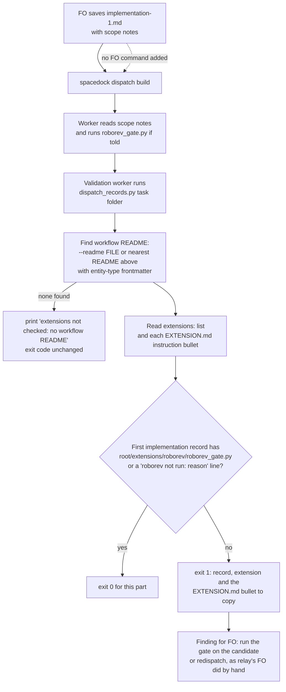

Filed from a package issue reported by the spacedock-dev/subspace-relay First Officer; the Captain confirmed filing on 2026-10-14 (「確認」 to "should FO file relay #1 and #4?"). Relay task `owner-sees-all-feedback-room` (PR spacedock-dev/subspace-relay#362, kc-dev-flow-2 0.22.0) dispatched implementation without the roborev extension's worker instruction, so the worker never ran `roborev_gate.py` and its report has no `evidence=` line; FO ran the gate afterwards (roborev:633).

## Scope

- The gap is enforcement: `extensions/roborev/EXTENSION.md` names an "Instruction FO adds to the scope notes", but `spacedock dispatch build` does not read the README's `extensions:` list and the workflow README text never names roborev (checked 2026-10-14: no `roborev` match in `references/sd/workflow.md` at origin/main 656543f4). Dispatch time has no Spacedock mod hook point, so a script check is the candidate route.
- Candidate fix: `dispatch_records.py` fails a dispatch record of a stage whose activated extension declares a worker instruction when that instruction is absent from its scope notes; or the README's stage text names it. Which extensions declare one (roborev; codex and copilot to be checked) is for ideation.
- Related: task `followup-dispatch-records-checked` changes the same script.
- Non-goals: see `### Non-goals` under `## Ideation design`.

## Ideation design

The ruling: add one part to `dispatch_records.py`'s folder run so a first implementation record that leaves out a listed extension's worker instruction fails at validation, with no new step for FO to remember. It changes two files and adds no README word.

### PRFAQ

**Headline.** A listed extension's worker instruction can no longer be left out of a first implementation dispatch without a failing check naming it.

**Press release.** From the next kc-dev-flow-2 release, the validation worker's existing `dispatch_records.py <task folder>` run reads the workflow README's `extensions:` list and each listed extension's declared worker instruction. A task whose first implementation record omits the instruction fails with one line that names the record, the extension and the bullet to copy. A first dispatch for which the instruction does not apply carries `<name> not run: <reason>` instead. Nothing new is added to what FO reads.

**FAQ.**
- *Why not README text?* It already exists (`## Extensions`) and 7 of 11 relay first dispatches still omitted the line.
- *Why not a pre-send command?* FO must remember it, the failure this fixes; Decision 1.
- *Does it prove the worker ran the gate?* No. It proves the instruction is in the record FO saved; the worker's `evidence=` line is a later check, deferred.
- *What does it cost?* One more pass over the records already read; no network, file or dependency.

**Acceptance evidence plan.** Unit tests with mutations (AC-1 to AC-5), a diff limited to two files (AC-6), and the real script replayed on 23 real records read-only (AC-7).

### Chain checked (2026-10-16)

- **Spacedock 0.27.2** (binary; mod text read from the 0.27.0 plugin cache): hooks are `startup`, `idle` and `merge` only (`first-officer-shared-core.md` `## Mod Hook Convention`), so no hook runs at dispatch. `spacedock dispatch build --help` takes entity, stage, checklist and scope notes and names no `extensions:` input; `grep -rn extensions` over the cache's `cmd/` and `internal/` hits only Pi-runtime files. Spacedock cannot add the instruction.
- **kc-dev-flow-2 0.23.0** (`origin/main` 1383c911): `references/sd/workflow.md` `## Extensions` already says "at a worker dispatch of its stage FO adds its instruction line to the scope notes". `dispatch_records.py` checks six parts and `--names`; none reads `extensions:`. Only `pr_watch.py` reads that README line (to choose the codex and copilot columns).
- **Adopters**: relay and subspace-web (`origin/main`) and qnow (`origin/next`) all list `roborev` under `extensions:`; so does this repository's `docs/dev2/README.md`. The gap is not relay-specific. Read-only `git show`.

### Which extensions declare a worker instruction

| Extension | Declares `Instruction FO adds to the scope notes` | Joins |
| --- | --- | --- |
| roborev | yes: `python3 <package>/extensions/roborev/roborev_gate.py --repo <worktree> --base <base sha>` | implementation, before the stage report |
| codex, copilot | no | FO review rounds and the merge ask |
| peers, learn, journey-map | no | FO steps |

Checked: `git grep -n -i 'instruction FO adds\|scope notes'` over `extensions/*/EXTENSION.md` hits only roborev. The check reads the label rather than a name, so a later extension that declares one is covered; codex, copilot and the FO-side extensions are outside it.

### Replay on the relay record that missed it (read-only)

Record: `_archive/owner-sees-all-feedback-room/dispatch/implementation-1.md` on `origin/spacedock-state/dev2` of spacedock-dev/subspace-relay. `Dispatched:` is `1aff02c2`; at that SHA `docs/dev2/README.md` reads `extensions: [learn, peers, roborev, journey-map]` and `4ed59a87` (listed roborev, 2026-10-13 12:59) is its ancestor. The record names `0.22.0` as Package root and holds no `roborev` token. A prototype (kept in `/tmp`, not in the repository) took the instruction's script path from the real `roborev/EXTENSION.md` and required `<Package root>/extensions/roborev/roborev_gate.py` in the record:

| Corpus (first implementation records whose README at the `Dispatched:` SHA lists roborev) | pass | absent | `<package>` left unsubstituted |
| --- | --- | --- | --- |
| relay, 11 | 3 | 7 | 1 (`signed-in-specs-run`) |
| subspace-web, 1 | 0 | 1 | 0 |
| this repository, 11 | 10 | 1 (`journey-server-host-pilot`) | 0 |
| qnow | its `spacedock-state/dev2` holds no dispatch record to read | | |

The relay record fails as the bite says. The unsubstituted case is a second failure of the README's own rule ("absolute root substituted"): the script path is in the record but not as a runnable path. Limits of this replay: it checks the README as committed at the SHA, not the checkout FO read (ADR 0014's stale-checkout hazard is unmeasured here); it proves the record, not what was sent.

### What makes the check fire, and the records it reads

Decision 1 (below) is why no pre-send command appears. The README already owes FO one (`--names`) and FO ran it after `dispatch build` on at least two dispatches (task `names-check-before-dispatch`); a second pre-send command fails the same way. The validation worker runs the folder check by `skills/validation/principles.md` without FO remembering anything, so it is the run point that does not depend on FO.

Rules the part applies:
- **Listed**: only an extension named in the README's `extensions:` list.
- **Declared**: only one whose `EXTENSION.md` has the `- **Instruction FO adds to the scope notes:**` bullet; its `<package>/extensions/<name>/<script>.py` paths are the required parts, and the first word of its `Joins:` bullet is the stage (`implementation`). Anything else (FO steps) is skipped.
- **Present**: the record contains each required path with `<package>` replaced by the record's own `Package root:` value, anywhere in the record (relay's `signed-in-specs-run-1` wrote the line under `## Checklist`; the worker still reads it).
- **Exempt**: a line `<name> not run: <non-empty reason>`, the form `## Extensions` and ADR 0013 already use for a listed extension that cannot run or is not requested. It is not a pointer to another record, so the pointer-only rule is untouched.
- **Which records**: the first record of the stage, `implementation-1.md` (Decision 2).
- **README source**: the README on disk now, not at the `Dispatched:` SHA, because that line carries a code SHA in relay and a state SHA in this repository, so no single read is right. Limit: an extension listed after a record was written fails that record until FO adds a `not run:` line.

### Existing-code capability check

Journey: FO saves a dispatch record, `dispatch build` writes the file, the worker reads it. Boundary: kc-dev-flow-2 0.23.0 plus Spacedock 0.27.x `dispatch build`.
- Completeness: the README sentence is text with no reader (broken seam); `dispatch_records.py` works through the journey at validation and lacks an extension part; Spacedock has no dispatch hook (not found, two searches: the hook convention text and `grep extensions` over the Go packages).
- Need: a falsifier exists (7 of 11 relay first records), a lifecycle obligation exists (roborev's evidence line), a consumer exists (the validation worker's folder run).
- Conclusion: extend `dispatch_records.py`, add no second script. Input it lacks today: the workflow README, found by walking up from the task folder or given as `--readme FILE`. `pr_watch.front` already reads README frontmatter; the implementation reuses a reader that exists rather than adding a third.
- Unknowns: Spacedock 0.27.2's source was not read (only the 0.27.0 cache); qnow's records could not be read.

### Non-goals

codex and copilot (no worker instruction); a Spacedock change (a request to let `dispatch build` read `extensions:` is a proposal for the Captain, not accepted scope); changing roborev's behaviour or EXTENSION.md; retrofitting archived records; proving the worker followed the instruction (a check on the stage report's `evidence=` line is deferred: no observed worker ignored an instruction it was given); any README, `workflow.md`, `lint-skills.py` or ADR change.

### Words FO reads at each lifecycle moment

Counted with `len(text.split())` on the same passages for base and candidate; the candidate is this design's draft, not a measured build.

| Moment | Base words | Candidate words |
| --- | --- | --- |
| startup (README, mod hook) | unchanged | unchanged, 0 added |
| idle, open PR / merged PR | unchanged | unchanged, 0 added |
| after the archive, merge ask | unchanged | unchanged, 0 added |
| worker dispatch: `--names` sentence 41 + extension sentence 37 + roborev instruction bullet 63 | 141 | 141 |
| validation, check fails | 0 | one output line, 32 words in the draft (the failing record, the extension, and the bullet to copy) |

No README passage changes, so no moment rises on a clean run. `workflow.md` stays at 5495 words against its 5511 budget; that file size is not the measure.

### Batch overlap

Files this design would change:
- `kc-dev-flow-2/scripts/dispatch_records.py`: one new check, the `--readme FILE` option, the module docstring.
- `kc-dev-flow-2/scripts/test_dispatch_records.py`: tests for the check against the real package extensions.

| Other batch-1 task | Shares | Order and note |
| --- | --- | --- |
| names-check-before-dispatch | `dispatch_records.py` `main()` and docstring; `test_dispatch_records.py`; the `--names` sentence in `workflow.md` (this design leaves it alone) | Same function and argument parsing: textual conflict. Land `names-check-before-dispatch` first (it owns the pre-send mode); then this adds the check to the folder run, and the extension check joins the pre-send mode there with one call and no new FO command. |
| dev2-laws-check | lists `dispatch_records.py` as an existing law and proposes CI on the state branch | Its CI checkout has no code-repo README above the task folder, so without `--readme FILE` the check prints its not-checked note and the law silently skips it. It must pass `--readme`. No file edit shared if it calls the CLI. |
| prod-security-review-gates | none today | If it adds an extension with a worker instruction, this check covers it unchanged. |
| amendment-form-check | none (`design_surfaces.py`) | none |

The other four task files are backlog stubs today; overlaps come from their Scope text and may change when their designs land.

### Proof of behaviour

This change adds no step FO must remember, so the scenario-question replay `maintain-flow` prescribes for FO-only rules is not owed. It does add one thing FO must learn: the exempt line `<name> not run: <reason>` now also lives in a dispatch record, where `## Extensions` places it only in stage reports and gate summaries. Nothing but the failing output teaches that, so the first task where roborev legitimately does not apply fails once at validation before FO writes the form. The proof is the script on real records (AC-7), plus unit tests with mutations (AC-1 to AC-5).

## Acceptance criteria

Run commands from the repository root of the implementation candidate; `<pkg>` is `kc-dev-flow-2`. Mutations run with `python3 -B` and cleared `__pycache__`.

**AC-1** A first implementation record that lacks a listed extension's worker instruction fails the folder run. Given a task folder whose nearest README above it lists `roborev`, and `dispatch/implementation-1.md` with `Package root: R` and neither a line containing `R/extensions/roborev/roborev_gate.py` nor a `roborev not run: <reason>` line, `python3 <pkg>/scripts/dispatch_records.py <task folder>` exits 1 and prints a line naming `implementation-1.md` and `roborev`. Evidence: `python3 -B <pkg>/scripts/test_dispatch_records.py` includes this case and passes. Falsifier: with the extension part removed from the folder run, the same fixture exits 0, so the test must fail under that mutation (run it and cite the failure).

**AC-2** The accepted and refused forms are exact. The record passes with the root-substituted path anywhere in it, passes with `roborev not run: <non-empty reason>`, and fails with the literal `<package>/extensions/roborev/roborev_gate.py` (its output line says `unsubstituted <package>`, a message the absent case does not print), with only the bare name `roborev_gate.py`, with `roborev not run:` and an empty reason. Evidence: one test per form in `test_dispatch_records.py`. Falsifier: a mutation that accepts any record containing the substring `roborev_gate.py` passes the placeholder and bare-name fixtures, so those tests must fail under it; a mutation that prints one message for both failures fails the test that asserts the `unsubstituted <package>` text.

**AC-3** The check applies only where it should. Same record, README not listing `roborev`: exit 0. A `validation-1.md` that lacks the instruction beside a complete `implementation-1.md`: exit 0. An `implementation-2.md` that lacks it beside a complete `implementation-1.md`: exit 0 (Decision 2 recommendation; if the Captain rules otherwise this clause is replaced). Evidence: three tests. Falsifier: a mutation that ignores the `extensions:` list, one that ignores the stage, and one that reads every `implementation-*` record each fail their own test.

**AC-4** The declaration is read from the real package, so a renamed label cannot silently turn the check off. A test builds the check against `<pkg>/extensions/*/EXTENSION.md` as shipped and asserts that every extension with the `Instruction FO adds to the scope notes` bullet yields the stage `implementation` and at least one `<package>/extensions/...py` path, and that the AC-1 failure still fires against the shipped roborev file. Evidence: that test passes on the candidate. Falsifier: in a temporary copy of the package, rename the bullet label in `roborev/EXTENSION.md`; the test fails.

**AC-5** README discovery is stated, never silent. With no README above the task folder and no `--readme`, the run prints `extensions not checked: no workflow README above <folder>` and its exit code is what it was before this change. `--readme FILE` takes the README from that path (the state-branch CI case in `dev2-laws-check`), and a `--readme` path that does not exist exits 2. Evidence: three tests asserting the printed text and exit codes, not only the exit code. Falsifier: a mutation that drops the note, and one that ignores `--readme`, each fail a test.

**AC-6** The change is a detector and says so. No file other than `scripts/dispatch_records.py` and `scripts/test_dispatch_records.py` changes: `git diff --name-only <base>..<candidate> -- <pkg>` lists exactly those two, `python3 <pkg>/scripts/lint-skills.py` exits 0 with `WORKFLOW_WORD_BUDGET` untouched, and the words-per-moment table above recounts with an independent copy of the counter to the same values (0 added at every moment on a clean run). Falsifier: a README or budget change in the diff, or a recount that differs, fails this criterion.

**AC-7** The real script reproduces the replay on real records, read-only. Rebuilding each corpus record into a temporary folder (record from the state branch, README from the `Dispatched:` SHA) and running the candidate gives: relay `owner-sees-all-feedback-room/implementation-1.md` exit 1 naming `roborev`; across the 11 relay first records 3 pass, 7 absent, 1 unsubstituted; subspace-web 1 absent; this repository 10 pass, 1 absent. Evidence: the temporary-folder commands and counts pasted in the validation report. Falsifier: a pass on the relay record, or a count different from the table, fails this criterion and sends the check back; a failure on any of the 13 passing records is a false positive and fails it too. Limit: it proves records, not what was sent or that a worker followed the line.

## Unresolved decisions for the Captain

**Decision 1: run point.** Should the check run only in the validation-time folder run (recommended), or also as a new pre-send command FO runs before `dispatch build`? Plainly: a script FO must remember to run has the failure that this task exists to fix, and FO already ran the existing pre-send `--names` check after the build on at least two dispatches (`names-check-before-dispatch` Scope). Recommendation: folder run only now; the extension check joins `names-check-before-dispatch`'s pre-send mode when that lands, as one call and no new FO command. What gets worse: the exempt form is taught only by the failure, so a legitimate not-applicable first dispatch fails once; a miss is found at validation, after the implementation ran without roborev, and costs FO one gate run on the candidate or a redispatch (what relay's FO did by hand); no prevention before the worker starts. Prior ruling read: ADR 0013 D2 and ADR 0014 apply to other questions; `git -C <state> grep -n 'Override:'` (2026-10-16) finds no override on this.

**Decision 2: which records.** Does the check read only the first record of the stage (recommended), or every `implementation-*` record with a `roborev not run: <reason>` line in each follow-up? Plainly: a follow-up to a live worker already holds the instruction, and the record cannot tell it from a fresh worker. Counted with the substring test: 20 of 68 implementation records here and 19 of 26 in relay lack the path, and of those 19 here and 12 in relay are later-cycle records, so "every record" would add a `not run:` line to about a third of later records here. Recommendation: first record only. What gets worse: a fresh worker dispatched at cycle 2 or later without the line passes unnoticed.

## Captain amendments

### Amendment 1 — 2026-10-17, chat
Captain: 「修改 AC-6，讓 #652 一併把 README 傳給 laws_check」 (chat, 2026-10-17)
Asked: 「要修改 AC-6，在 #652 一起做嗎？」
Supersedes: AC-6
Design: none

## FO alignment

Alignment: not needed before ideation; the Captain confirmed filing it.
Release review: not needed: workflow maintenance, on no journey map.
Surfaces: none
Visible change: none

### Feedback Cycles

- Cycle 1 (FO, 2026-10-16): Codex review on #652 56f83bf5 (review:5543222158) left one P2, to fix (rounds 1 and 2 fix every finding); investigation first, then FO fix authorization, then a fresh validation recheck.
  - P2 `scripts/dispatch_records.py`: the worker-script path match has no trailing token boundary, so `roborev_gate.py.bak` or `.pyx` passes as the instruction.
- Cycle 2 (FO, 2026-10-16): Codex review on #652 fee6662c (review:5544560816) left one P2, to fix (rounds 1 and 2 fix every finding); investigation first, then FO fix authorization, then a fresh validation recheck.
  - P2 `scripts/dispatch_records.py`: the trailing boundary still lets a `/` follow the script name, so `roborev_gate.py/extra` passes as the instruction (also the recheck's Polish).
- Cycle 3 (FO, 2026-10-17): after merging origin/main (head 65761bf0) the recheck PASSED with one Needs decision: the merge added a 2-line skip in `scripts/laws_check.py`, a third file against AC-6. roborev (evidence=roborev:749) on 65761bf0 then reported one High, which counts as P1: L2 runs `dispatch_records.py` on its temporary folder without `--readme`, so the extension check never runs in the state-branch laws and the new note line is skipped. This is the `--readme` follow-up the #651 delivery deferred into backlog task laws-check-followups. FO holds the PR and asks the Captain whether AC-6 is amended to include `laws_check.py` so the pass-through lands here.

## Stage Report: ideation

- DONE: A design (PRFAQ and Mermaid) for how an activated extension's worker instruction is made to reach the dispatch (a kc-dev-flow-2/scripts/dispatch_records.py check, README stage text, or another route), which extensions declare one (roborev; codex and copilot to be checked), with a replay on the relay record that missed it (read only)
  `## Ideation design`: PRFAQ, flowchart, chain check, declaring-extension table (roborev only; codex and copilot declare none), replay on relay `owner-sees-all-feedback-room/implementation-1.md` plus 23 corpus records via a `/tmp` prototype; `design_surfaces.py check <task file>` printed "design surfaces presentable", exit 0.
- DONE: A `### Batch overlap` section naming each file the design would change and each other batch-1 task (prod-security-review-gates, dev2-laws-check, extension-instruction-reaches-dispatch, names-check-before-dispatch, amendment-form-check) that changes the same file or check, so FO can order implementation
  Two files named; names-check-before-dispatch (same function, land first) and dev2-laws-check (needs `--readme`) overlap; the other two share nothing. The four other files are backlog stubs, so this rests on their Scope text.
- DONE: The words FO reads at each lifecycle moment, before and after, per root learning.md "Measure the words FO reads at each moment, not one file's size"
  Table in `### Words FO reads at each lifecycle moment`: every moment unchanged; dispatch 141 to 141; 32-word output line only on a failing check. The candidate column is a draft, not a measured build.
- DONE: Acceptance criteria with reproducible evidence clauses and falsifiers, and unresolved decisions for the Captain, each with a recommendation and what gets worse under it
  AC-1 to AC-7 each carry evidence and a falsifier; Decision 1 (run point) and Decision 2 (which records) each carry a recommendation and its cost; no past `Override:` bears on them.

### Acceptance criteria evidence

- AC-1 not yet verified by the script (no implementation). Design-time evidence: the prototype fails the relay record, which holds no `roborev` token.
- AC-2 not yet verified. Design-time evidence: the prototype classified `signed-in-specs-run-1` as the unsubstituted `<package>` form, distinct from absent.
- AC-3 not yet verified; the first-record-only clause waits on Decision 2.
- AC-4 not yet verified. Design-time evidence: the prototype parsed the real `roborev/EXTENSION.md` bullet and the `Joins:` stage word.
- AC-5 not yet verified; `dispatch_records.py` has no README input today.
- AC-6 not yet verified. Design-time evidence: word counts by `len(text.split())`, `workflow.md` 5495 against budget 5511.
- AC-7 not yet verified with the real script. Design-time prototype counts: relay 3 pass / 7 absent / 1 unsubstituted, subspace-web 0 / 1 / 0, this repository 10 / 1 / 0; qnow has no record to read.

### Summary

The gap is closed by one new part in `dispatch_records.py`'s validation-time folder run, which needs no FO memory and no README word; a pre-send command is left to `names-check-before-dispatch`'s pre-send mode (Decision 1). Only roborev declares a worker instruction. Two Captain decisions: the run point, and first record only versus every record.

## Stage Report: implementation

- DONE: One Draft PR (fix(kc-dev-flow-2): ...) from a branch off origin/main implementing Decision 1 and 2 as recommended: one new part in the validation-time kc-dev-flow-2/scripts/dispatch_records.py folder run that fails a first implementation record omitting a listed extension's worker instruction, with the 'roborev not run: <reason>' exemption; every acceptance criterion in the task file green, each falsifier shown failing by a mutation you run (python3 -B, caches cleared)
  Draft PR iamcxa/kc-claude-plugins#652, one commit 56f83bf5 on top of #649's head a4217cd3 (stacked, stated in the body; merge origin/main after #649 merges). 34 tests pass. Mutations on a package copy (`python3 -B`): drop part -> 7 fail; accept `roborev_gate.py` substring -> 3; one message for both failures -> 1; empty reason accepted -> 1; ignore `extensions:` -> 1; read every `implementation-*` -> 1; ignore stage -> 2; drop note -> 1; ignore `--readme` -> 1; rename EXTENSION.md label -> 8 (AC-4 test first). Each fails the test written for it.
- DONE: AC-7 on real records, read-only (README at each record's `Dispatched:` SHA)
  relay `owner-sees-all-feedback-room` exit 1 naming roborev. relay 12 roborev-listed: 3 pass / 8 absent / 1 unsubstituted; web 1 absent; this repo 16: 15 pass / 1 absent. Design counted 11/1/11: relay `front-door-hardening` (record added 2026-10-16 11:21 +08) is the extra absent, 5 newer records here pass; no false positive on a passing record.
- DONE: No FO-read word added beyond the design; the candidate's own kc-dev-flow-2/scripts/lint-skills.py exits 0
  lint-skills exit 0, `workflow.md` 5495 of 5511 unchanged; `git diff --name-only a4217cd3..HEAD` lists only `dispatch_records.py` and `test_dispatch_records.py` (AC-6). `comment_ratio.py`: 0 comment lines of 161 code lines. `doc_impact.py`: no document listed.
- DONE: roborev evidence= line
  `clean on 56f83bf51; evidence=roborev:708` (exit 0, first run).
- DONE: push without force; CI green on the PR head; CI cost measured or stated as not measured
  Pushed plain `git push -u`; all four checks pass on 56f83bf5 (unit tests 1m0s, route gate 7s, version parity 55s, GitGuardian). No new job or trigger; added test time about 1 s locally; CI minutes beyond those job durations not measured.

### Summary

The check is two functions in `dispatch_records.py` (`declared_instructions`, `instruction_error`) plus `--readme FILE` and README discovery; the frontmatter reader is `number_guards.frontmatter` (the import `comment_ratio.py` already uses), not `pr_watch.front` as the design named, because importing `pr_watch` for ten lines couples two scripts. Existing tests needed a README fixture in `check()` because the not-checked note changes exact output. Limit: proves the record, not that the worker ran the gate.

## Stage Report: validation

- DONE: Independent verdict on PR #652 head 56f83bf5 against every acceptance criterion in the task file, re-running each evidence command and at least one falsifier per criterion yourself, and judging each limit the implementation report states
  Verdict PASSED at 56f83bf518413984362e8a28a875d10dff1e6a10 (detached checkout, removed afterwards). Criteria AC-1 to AC-7 met; findings below are Polish and Deferred risk only. PR checks on that head: all four pass (unit tests 1m0s, route gate 7s, version parity 55s, GitGuardian).
- DONE: The PR is stacked on #649 (it contains #649's commits until #649 squash-merges): judge only the commits after #649's head a4217cd3, and say whether the stacked diff changes any #649 behaviour
  One commit after a4217cd3 (56f83bf5), two files. #649 behaviour unchanged: `--names` and `--newest` return before the new `--readme` parsing, and `pr_watch.py` calls only `--newest`; a4217cd3's own `test_dispatch_records.py` run against the candidate script passes every `--names`/`--newest` test, and `test_pr_watch.py` (69) passes. The only changed output is the folder run, which now prints `extensions not checked: ...` when no workflow README is found (11 of 24 old exact-output tests fail on that line, as AC-5 intends; the candidate's tests add a README fixture); grep finds no consumer that parses folder-run output.
- DONE: A minimal acceptance script the Captain can run (three to six steps, exact commands, expected output), run by you exactly as written in a fresh bash shell, with its observed output; /Users/kent/.claude/plugins/cache/kc-claude-plugins/kc-dev-flow-2/0.23.0/scripts/adr_lint.py docs/adr --since <base> with its exit code; your verdict naming the head, with findings classified by the workflow's Review-finding disposition
  Script and observed output are under `### Minimal acceptance script`; run with `env -i HOME PATH bash --noprofile --norc`, all expected lines observed. `adr_lint.py docs/adr --since a4217cd3` and `--since 1383c911` (merge-base with origin/main): "15 ADR file(s) checked, 0 legacy", exit 0.

### Evidence by criterion (all at 56f83bf5, run by me)

- AC-1/AC-2: `python3 -B test_dispatch_records.py` 34 tests OK. Mutations on a package copy (`python3 -B`, no caches): drop part -> 7 fail; accept bare `roborev_gate.py` substring -> 3; one message for both failures -> 1 (the `unsubstituted <package>` assertion); empty reason accepted -> 1. My extra mutation, drop the lookbehind so `x/abs/.../roborev_gate.py` passes -> 1 fails. Mutation using the running package root instead of the record's `Package root:` -> 12 errors/fails.
- AC-3: ignore `extensions:` -> 1 fails; read every `implementation-*` -> 1; ignore stage (read every `*-1.md`) -> 1.
- AC-4: rename the bullet label in a package copy's `roborev/EXTENSION.md` -> 8 fail, including `test_every_shipped_instruction_is_read_from_its_extension_file`.
- AC-5: drop the note -> 1 fails; ignore `--readme` -> 1; remove the missing-file exit 2 -> 1; accept any README without `entity-type:` -> 1. CLI: `--readme /nonexistent/x.md` prints `no such file`, exit 2.
- AC-6: `git diff --name-only a4217cd3..HEAD` lists only `dispatch_records.py` and `test_dispatch_records.py`; `git diff --stat 1383c911 HEAD` on `references`, `skills`, `extensions`, `lint-skills.py` is empty; `lint-skills.py` exit 0, `workflow.md` 5495 of 5511; my `len(text.split())` of `workflow.md` is 5495. `comment_ratio.py a4217cd3 HEAD`: 161 code lines, 0 comment, exit 0. `doc_impact.py`: 0 documents. `design_surfaces.py check` and `number_guards.py check` exit 0. Candidate `dispatch_records.py` on this task's own folder: 3 records complete, exit 0.
- AC-7 (own replay script: record from state branch, README from the `Dispatched:` SHA, candidate script, temp folders, read-only `git show`): relay `owner-sees-all-feedback-room` exit 1 naming roborev. Relay 12 roborev-listed: 3 pass / 8 absent / 1 unsubstituted (`signed-in-specs-run`); web 1: 0 / 1 / 0; this repo 16: 15 pass / 1 absent (`journey-server-host-pilot`). The task's 11/1/11 grew by `front-door-hardening` and 5 newer records here; all 8+1 relay and 1 web absents contain no `roborev_gate.py` token (grep), and none of the 18 passing records fails: no false positive.

### Limits judged

- "Proves the record, not that the worker ran the gate": accepted. It is a stated Non-goal and no criterion claims otherwise.
- `number_guards.frontmatter` instead of `pr_watch.front`: accepted; same reader `comment_ratio.py` imports, and avoids coupling two scripts.
- CI minutes beyond job durations not measured: accepted; no job or trigger added.
- Not verified: qnow records (state branch holds none); the stale-checkout hazard (README read on disk now); Spacedock 0.27.2 source. Decisions 1 and 2 were accepted as recommended at the ideation gate.

### Findings (Review-finding disposition)

- Polish: `Misconfigured` is imported and unused in `dispatch_records.py` (`pyflakes`: F401; `# noqa: E402` does not cover it); `for record in [Path(...)]` loops over one element. No user-visible loss.
- Deferred risk: `extensions:` written as a YAML block list reads as empty, so the check is silently skipped. Trigger today: none, since the four READMEs I read and the workflow template use the inline form. Becomes Material if an adopter README lists `roborev` as a block list.
- Deferred risk: the exempt form matches `<name> not run: <text>` anywhere on a line, including prose. Material only if a record is observed passing on such prose.

### Minimal acceptance script

Needs: network, git, python3 (no secrets); scratch dir `/tmp/ext-accept`; run in bash. It checks out PR #652's head, so a pass proves that revision only. Not covered: a real FO dispatch, whether a worker ran roborev, or any adopter's state branch.

    rm -rf /tmp/ext-accept && mkdir -p /tmp/ext-accept/task/dispatch
    git init -q /tmp/ext-accept/repo && git -C /tmp/ext-accept/repo fetch -q --depth 1 https://github.com/iamcxa/kc-claude-plugins.git 56f83bf518413984362e8a28a875d10dff1e6a10 && git -C /tmp/ext-accept/repo checkout -q FETCH_HEAD && git -C /tmp/ext-accept/repo rev-parse HEAD
    python3 -B /tmp/ext-accept/repo/kc-dev-flow-2/scripts/test_dispatch_records.py 2>&1 | tail -3
    printf -- '---\nentity-type: task\nextensions: [roborev]\n---\n' > /tmp/ext-accept/README.md
    printf 'Dispatched: 56f83bf518413984362e8a28a875d10dff1e6a10\nModel: sonnet\n\n## Checklist\n\n1. Do the work\n\n## Scope notes\n\nPackage root: /tmp/ext-accept/repo/kc-dev-flow-2\nSend your completion message to `main`.\n' > /tmp/ext-accept/task/dispatch/implementation-1.md
    python3 -B /tmp/ext-accept/repo/kc-dev-flow-2/scripts/dispatch_records.py /tmp/ext-accept/task; echo "exit=$?"
    printf 'Before reporting, run python3 /tmp/ext-accept/repo/kc-dev-flow-2/extensions/roborev/roborev_gate.py --repo w --base b\n' >> /tmp/ext-accept/task/dispatch/implementation-1.md
    python3 -B /tmp/ext-accept/repo/kc-dev-flow-2/scripts/dispatch_records.py /tmp/ext-accept/task; echo "exit=$?"
    rm /tmp/ext-accept/README.md
    python3 -B /tmp/ext-accept/repo/kc-dev-flow-2/scripts/dispatch_records.py /tmp/ext-accept/task; echo "exit=$?"

Observed: the SHA `56f83bf518413984362e8a28a875d10dff1e6a10`; `Ran 34 tests` then `OK`; `implementation-1.md: roborev worker instruction is absent; copy the 'Instruction FO adds to the scope notes' bullet of /tmp/ext-accept/repo/kc-dev-flow-2/extensions/roborev/EXTENSION.md into the scope notes, or add a line 'roborev not run: <reason>'` with `exit=1`; `1 dispatch record(s) complete` with `exit=0`; `extensions not checked: no workflow README above /tmp/ext-accept/task`, `1 dispatch record(s) complete`, `exit=0`.

### Summary

PASSED at 56f83bf5: every criterion holds, each falsifier fails the test written for it, and the real script reproduces the replay on real records with no false positive. The stacked diff leaves #649's `--names`/`--newest` behaviour alone. Two Polish items and two Deferred risks are recorded; none blocks delivery.

## Stage Report: implementation (cycle 2)

- DONE: Reproduce Codex P2 (review:5543222158, #652 56f83bf5) as a failing test
  `test_a_path_that_continues_past_the_script_name_is_absent_and_one_that_ends_there_passes`: tails `.bak`, `x`, `-old`, `~`, `.orig` after the root-substituted path exit 0 where 1 is expected (5 failures at 56f83bf5); tails `.` `,` backtick `)` `"` and none must still pass.
- DONE: Apply the trailing lookahead `(?![\w~-]|\.\w)` and show the falsifier failing
  Commit fee6662c, two files only (`dispatch_records.py`, `test_dispatch_records.py`). 35 tests pass; on a package copy with the lookahead removed the same test fails 5 times (`python3 -B`, caches cleared).
- DONE: Rerun AC-7 corpus read-only
  `/tmp/replay_ext.py` on the same refs, base 56f83bf5 vs candidate fee6662c, identical: relay 3 pass / 8 absent / 1 unsubstituted; web 1 absent; this repo 15 pass / 1 absent. No pass record changed, no false positive.
- DONE: roborev evidence= line
  `clean on fee6662cf; evidence=roborev:714` (`--base a4217cd3`).
- DONE: push without force, stacked on #649; CI on new head
  Plain push 56f83bf5..fee6662c, base a4217cd3 unchanged. lint-skills exit 0. Checks on fee6662c: all four pass: unit tests 1m0s, route gate 5s, version parity 49s, GitGuardian. No PR comment, review request or ready mark.

### Summary

The path match now has a trailing boundary, so `roborev_gate.py.bak` and similar no longer count as the instruction; a sentence-final period or comma still does. Corpus counts are unchanged by the fix.

## Stage Report: validation (cycle 2)

- DONE: Independent verdict on PR #652 head fee6662c against every acceptance criterion in the task file, re-running each evidence command and at least one falsifier per criterion yourself, and judging each limit the implementation report states
  Verdict PASSED at fee6662cf255335e353882c5f59e1a11334ff497 (PR open, Draft, base main; detached checkout, removed). The only change since the PASSED at 56f83bf5 is one regex lookahead plus one test, so AC-1 to AC-7 evidence is carried from cycle 1 except where rerun below: `test_dispatch_records.py` 35 OK; `test_pr_watch.py` 69 OK; `lint-skills.py` exit 0 (`workflow.md` 5495 of 5511); `comment_ratio.py a4217cd3 HEAD` 171 code lines, 0 comment; `doc_impact.py` 0 documents. Limits as judged in cycle 1 stand; AC-7 corpus rerun by the implementer was not repeated by me (the changed regex only narrows what follows the path; none of the 18 passing records has a tail past `.py`, per the implementer's identical counts).
- DONE: Recheck after the Cycle 1 repair: confirm the Codex P2 (review:5543222158, under ### Feedback Cycles) is fixed at this head with its test failing under a mutation you run, and judge only the commits after #649's head a4217cd3
  Fixed. Commits after a4217cd3: 56f83bf5 (judged in cycle 1) and fee6662c, 3 lines in 2 files (`dispatch_records.py` lookahead `(?![\w~-]|\.\w)`, one test). Script run on a record whose only path is `roborev_gate.py.bak`: exit 1, "worker instruction is absent". Mutations (`python3 -B`, package copy, no caches): lookahead removed -> the test fails 5 times (`.bak`, `x`, `-old`, `~`, `.orig`); `(?!\w)` -> 4 (`.bak`, `-old`, `~`, `.orig`); `(?![\w~-])` -> 2 (`.bak`, `.orig`); over-strict `(?!\S)` -> 6 (the pass tails `.` `,` backtick `)` `"` and the backticked existing test). Each fails the half it should, so the test pins both sides of the boundary. #649 files (`pr_watch.py`, `test_pr_watch.py`) untouched by these two commits.
- DONE: A minimal acceptance script the Captain can run (three to six steps, exact commands, expected output), run by you exactly as written in a fresh bash shell, with its observed output; /Users/kent/.claude/plugins/cache/kc-claude-plugins/kc-dev-flow-2/0.23.0/scripts/adr_lint.py docs/adr --since <base> with its exit code; your verdict naming the head, with findings classified by the workflow's Review-finding disposition
  Script below, run as `env -i HOME PATH bash --noprofile --norc script`; every expected line observed. `adr_lint.py docs/adr --since a4217cd3` and `--since 1383c911`: "15 ADR file(s) checked, 0 legacy", exit 0. PR checks on fee6662c: unit tests 1m0s, route gate 5s, version parity 49s, GitGuardian, all pass.

### Findings (Review-finding disposition), cycle 2

- Codex P2 (review:5543222158): resolved at fee6662c, no residue.
- Polish: the boundary lets `roborev_gate.py/x` pass (`/` is not excluded); no observed record has it.
- Deferred risk: cycle-1 items unchanged (`Misconfigured` unused import; block-list `extensions:` read as empty; `not run:` matched in prose). Not re-rated by the new commit.

### Minimal acceptance script

Needs: network, git, python3 (no secrets); scratch dir `/tmp/ext-accept`; bash. It checks out PR #652's head, so a pass proves that revision only. Not covered: a real FO dispatch, whether a worker ran roborev, any adopter's state branch.

    rm -rf /tmp/ext-accept && mkdir -p /tmp/ext-accept/task/dispatch
    git init -q /tmp/ext-accept/repo && git -C /tmp/ext-accept/repo fetch -q --depth 1 https://github.com/iamcxa/kc-claude-plugins.git fee6662cf255335e353882c5f59e1a11334ff497 && git -C /tmp/ext-accept/repo checkout -q FETCH_HEAD && git -C /tmp/ext-accept/repo rev-parse HEAD
    python3 -B /tmp/ext-accept/repo/kc-dev-flow-2/scripts/test_dispatch_records.py 2>&1 | tail -3
    printf -- '---\nentity-type: task\nextensions: [roborev]\n---\n' > /tmp/ext-accept/README.md
    printf 'Dispatched: fee6662cf255335e353882c5f59e1a11334ff497\nModel: sonnet\n\n## Checklist\n\n1. Do the work\n\n## Scope notes\n\nPackage root: /tmp/ext-accept/repo/kc-dev-flow-2\nSend your completion message to `main`.\n' > /tmp/ext-accept/task/dispatch/implementation-1.md
    python3 -B /tmp/ext-accept/repo/kc-dev-flow-2/scripts/dispatch_records.py /tmp/ext-accept/task; echo "exit=$?"
    printf 'Before reporting, run python3 /tmp/ext-accept/repo/kc-dev-flow-2/extensions/roborev/roborev_gate.py.bak --repo w --base b\n' >> /tmp/ext-accept/task/dispatch/implementation-1.md
    python3 -B /tmp/ext-accept/repo/kc-dev-flow-2/scripts/dispatch_records.py /tmp/ext-accept/task; echo "exit=$?"
    printf 'Before reporting, run python3 /tmp/ext-accept/repo/kc-dev-flow-2/extensions/roborev/roborev_gate.py --repo w --base b\n' >> /tmp/ext-accept/task/dispatch/implementation-1.md
    python3 -B /tmp/ext-accept/repo/kc-dev-flow-2/scripts/dispatch_records.py /tmp/ext-accept/task; echo "exit=$?"
    rm /tmp/ext-accept/README.md
    python3 -B /tmp/ext-accept/repo/kc-dev-flow-2/scripts/dispatch_records.py /tmp/ext-accept/task; echo "exit=$?"

Observed: SHA `fee6662cf255335e353882c5f59e1a11334ff497`; `Ran 35 tests` then `OK`; step 2 prints `implementation-1.md: roborev worker instruction is absent; copy the 'Instruction FO adds to the scope notes' bullet of .../roborev/EXTENSION.md into the scope notes, or add a line 'roborev not run: <reason>'` with `exit=1`; the `.bak` line leaves it `exit=1` with the same message; the real `roborev_gate.py` line gives `1 dispatch record(s) complete`, `exit=0`; with the README removed, `extensions not checked: no workflow README above /tmp/ext-accept/task`, `1 dispatch record(s) complete`, `exit=0`.

### Summary

PASSED at fee6662c: the Codex P2 is fixed, its test fails under four lookahead mutations (each on the side it guards), and the stacked diff after #649 is two commits touching only `dispatch_records.py` and `test_dispatch_records.py`. One new Polish item (`/` after the name passes); no Material finding.

## Stage Report: implementation (cycle 3)

- DONE: Reproduce the Codex P2 (review:5544560816, #652 fee6662c) as a failing test
  `test_only_listed_followers_end_the_script_path`: after the root-substituted path, 18 followers (`/extra`, `/`, `:`, `;`, `=`, `]`, `}`, `>`, `|`, `&`, `\`, `#`, `?`, `!`, `....`, `'x`, `` `)x ``, `.)x`) must exit 1 "worker instruction is absent"; under the old lookahead `(?![\w~-]|\.\w)` all 18 fail (exit 0).
- DONE: Replace the exclusion lookahead with an allowlist, with a test for each allowed and each refused follower
  Commit 8d051de7, two files: lookahead is now `(?=[.,`)"']{0,3}(?:\s|$))` (written with `\x22 \x27` and doubled braces in the rf-string). Allowed subtests: space, tab, `.` `,` backtick `)` `"` `'`, stacked `..` `` `) `` `.)` `.,` `` `). `` `"` + backtick + `)`, plus path at end of text, end of line, and `.` at end of line.
- DONE: Show the test pinning the run length
  Suite 36 OK at 8d051de7. Mutating `{0,3}` to `{0,2}` fails 2 subtests (the two three-character stacks); `{0,4}` fails 1 (`....`).
- DONE: Rerun the AC-7 corpus read-only
  `/tmp/replay_ext.py`, base fee6662c vs candidate 8d051de7: tallies and per-record detail identical (relay 3 pass / 8 absent / 1 unsubstituted; web 1 absent; this repo 15 pass / 1 absent). No passing record flipped.
- DONE: roborev evidence= line
  `clean on 8d051de72; evidence=roborev:717` (`--base a4217cd3`).
- DONE: push without force, stacked on #649; CI on new head
  Plain push fee6662c..8d051de7, base a4217cd3 unchanged. lint-skills exit 0; `comment_ratio.py` 171 code / 0 comment. Checks on 8d051de7: unit tests 1m2s, route gate 8s, version parity 55s, GitGuardian, all pass. No PR comment, review request or ready mark.

### Summary

A path in a dispatch record now counts as the worker instruction only when whitespace, end of text, or up to three of `. , ` ) " '` follow it, so `roborev_gate.py/extra` and every other unlisted follower is refused. The first attempt failed 29 tests because `{0,3}` inside the rf-string was read as an f-string field; doubling the braces fixed it.

## Stage Report: validation (cycle 3)

- DONE: Independent verdict on PR #652 head 8d051de7 against every acceptance criterion in the task file, re-running each evidence command and at least one falsifier per criterion yourself, and judging each limit the implementation report states
  Verdict PASSED at 8d051de720579b6cc7f9c28dba869d7cb2606eaf (PR open, Draft, base main; detached checkout, removed). At this head I ran: `test_dispatch_records.py` 36 OK; `test_pr_watch.py` 69 OK; `lint-skills.py` exit 0 (`workflow.md` 5495 of 5511); `comment_ratio.py a4217cd3 HEAD` 184 code lines, 0 comment, exit 0; `doc_impact.py` 0 documents; `number_guards.py check` and `design_surfaces.py check` exit 0; candidate `dispatch_records.py` on this task's folder: 9 records complete. One falsifier per criterion on a package copy (`python3 -B`, no caches): AC-1 drop the part -> 30 fail; AC-2 accept the bare script name -> 3; AC-3 ignore `extensions:` -> 1; AC-4 rename the bullet label -> `test_every_shipped_instruction_is_read_from_its_extension_file` errors (31 in all); AC-5 ignore `--readme` -> 1 error; AC-6 diff `a4217cd3..HEAD` is only `dispatch_records.py` and `test_dispatch_records.py`. AC-7 own replay (record from the state branch, README from the `Dispatched:` SHA, candidate script, read-only `git show`): relay `owner-sees-all-feedback-room` exit 1; relay 12 roborev-listed: 3 pass / 8 absent / 1 unsubstituted; web 1 absent; this repo 16: 15 pass / 1 absent. Same as cycle 2; none of the 18 passing records flipped, and every absent record holds no `roborev_gate.py` token. Limits stand as judged in cycles 1 and 2 (record not worker; qnow records unread; stale-checkout hazard and Spacedock 0.27.2 source unverified).
- DONE: Recheck after the Cycle 2 repair: confirm the round-2 P2 (review:5544560816, under ### Feedback Cycles) is fixed at this head with its test failing under a mutation you run; judge only the commits after #649's head a4217cd3
  Fixed. Commits after a4217cd3: 56f83bf5, fee6662c (judged earlier) and 8d051de7 (one regex line, 25 test lines). The script on a record whose only path is `.../roborev_gate.py/extra` exits 1 "worker instruction is absent". Mutations on a package copy: old lookahead `(?![\w~-]|\.\w)` -> `test_only_listed_followers_end_the_script_path` fails 18 subtests (`/extra`, `}`, `|`, `]`, `\`, `?` ...); lookahead removed -> 23; `{0,3}` to `{0,2}` -> 2 (`` `). `` and `"` + backtick + `)`); `{0,4}` -> 1 (`....`); drop `(?:\s|$)` -> 23; drop `$` (end of text refused) -> 2 (`.` and none at end of text); drop `"` `'` from the class -> 4, including one in the earlier test. Each fails the half it guards. #649 files untouched by these three commits; `test_pr_watch.py` passes.
- DONE: A minimal acceptance script the Captain can run (three to six steps, exact commands, expected output), run by you exactly as written in a fresh bash shell, with its observed output; /Users/kent/.claude/plugins/cache/kc-claude-plugins/kc-dev-flow-2/0.23.0/scripts/adr_lint.py docs/adr --since <base> with its exit code; your verdict naming the head, with findings classified by the workflow's Review-finding disposition
  Script below, run as `env -i HOME PATH bash --noprofile --norc script`; every expected line observed. `adr_lint.py docs/adr --since a4217cd3` and `--since 1383c911` (merge-base with origin/main): "15 ADR file(s) checked, 0 legacy", exit 0. PR checks on 8d051de7 all SUCCESS: unit tests, multi-profile route gate, version parity, GitGuardian.

### Findings (Review-finding disposition), cycle 3

- Round-2 Codex P2 (review:5544560816): resolved at 8d051de7, no residue. The cycle-2 Polish (`/` after the name passes) is closed by the same change.
- Deferred risk (new, fail-closed): the allowlist is narrow, so a record that writes the real path followed by `:` or `**` (probe: `.../roborev_gate.py:` and `...py**`) reports "worker instruction is absent" although the path is there. Trigger today: none; the 18 passing real records and the roborev bullet itself (`... roborev_gate.py --repo ...`) end in whitespace. Becomes Material if a real first record is observed refused for such a follower; the cost then is one FO edit, not a missed gate.
- Deferred risk (unchanged): `extensions:` as a YAML block list reads as empty, so the check skips; `not run:` matches in prose on a line.
- Polish (unchanged, not fixed): `Misconfigured` imported and unused (`pyflakes` F401); `for record in [Path(...)]` loops over one element.

### Minimal acceptance script

Needs: network, git, python3 (no secrets); scratch dir `/tmp/ext-accept`; bash. It checks out PR #652's head, so a pass proves that revision only. Not covered: a real FO dispatch, whether a worker ran roborev, any adopter's state branch.

    rm -rf /tmp/ext-accept && mkdir -p /tmp/ext-accept/task/dispatch
    git init -q /tmp/ext-accept/repo && git -C /tmp/ext-accept/repo fetch -q --depth 1 https://github.com/iamcxa/kc-claude-plugins.git 8d051de720579b6cc7f9c28dba869d7cb2606eaf && git -C /tmp/ext-accept/repo checkout -q FETCH_HEAD && git -C /tmp/ext-accept/repo rev-parse HEAD
    python3 -B /tmp/ext-accept/repo/kc-dev-flow-2/scripts/test_dispatch_records.py 2>&1 | tail -3
    printf -- '---\nentity-type: task\nextensions: [roborev]\n---\n' > /tmp/ext-accept/README.md
    printf 'Dispatched: 8d051de720579b6cc7f9c28dba869d7cb2606eaf\nModel: sonnet\n\n## Checklist\n\n1. Do the work\n\n## Scope notes\n\nPackage root: /tmp/ext-accept/repo/kc-dev-flow-2\nSend your completion message to `main`.\n' > /tmp/ext-accept/task/dispatch/implementation-1.md
    python3 -B /tmp/ext-accept/repo/kc-dev-flow-2/scripts/dispatch_records.py /tmp/ext-accept/task; echo "exit=$?"
    printf 'Before reporting, run python3 /tmp/ext-accept/repo/kc-dev-flow-2/extensions/roborev/roborev_gate.py/extra --repo w --base b\n' >> /tmp/ext-accept/task/dispatch/implementation-1.md
    python3 -B /tmp/ext-accept/repo/kc-dev-flow-2/scripts/dispatch_records.py /tmp/ext-accept/task; echo "exit=$?"
    printf 'Before reporting, run python3 /tmp/ext-accept/repo/kc-dev-flow-2/extensions/roborev/roborev_gate.py --repo w --base b\n' >> /tmp/ext-accept/task/dispatch/implementation-1.md
    python3 -B /tmp/ext-accept/repo/kc-dev-flow-2/scripts/dispatch_records.py /tmp/ext-accept/task; echo "exit=$?"
    rm /tmp/ext-accept/README.md
    python3 -B /tmp/ext-accept/repo/kc-dev-flow-2/scripts/dispatch_records.py /tmp/ext-accept/task; echo "exit=$?"

Observed: SHA `8d051de720579b6cc7f9c28dba869d7cb2606eaf`; `Ran 36 tests` then `OK`; the bare record prints `implementation-1.md: roborev worker instruction is absent; copy the 'Instruction FO adds to the scope notes' bullet of /tmp/ext-accept/repo/kc-dev-flow-2/extensions/roborev/EXTENSION.md into the scope notes, or add a line 'roborev not run: <reason>'` with `exit=1`; the `roborev_gate.py/extra` line leaves the same message and `exit=1`; the real `roborev_gate.py` line gives `1 dispatch record(s) complete`, `exit=0`; with the README removed, `extensions not checked: no workflow README above /tmp/ext-accept/task`, `1 dispatch record(s) complete`, `exit=0`.

### Summary

PASSED at 8d051de7: the round-2 P2 is fixed, its test fails under seven mutations each on the side it guards, and AC-1 to AC-7 hold with the real corpus counts unchanged. One new Deferred risk (the narrow allowlist refuses a path followed by `:` or `**`, failing closed); no Material finding.

## Stage Report: implementation (cycle 4)

- DONE: #649 squash-merged as 4ea2832a: `git fetch origin`, merge origin/main into branch (a merge commit, no rebase, no force push)
  Merge commit 45a9ed5b on spacedock-ensign/extension-instruction-reaches-dispatch; fast-forward push 8d051de7..45a9ed5b.
- DONE: resolve any conflict in dispatch_records.py or its test keeping both #649's and this branch's behaviour
  Conflicts in the docstring, `main()` and the test file: kept `--newest`/`check_newest` and this task's `--readme`/extension check, plus both test classes and constants.
- DONE: confirm `git diff origin/main` holds only this task's change
  Not only: it also holds a 2-line change in `laws_check.py` (65761bf0), needed because #651's L2 runner read the new `extensions not checked:` line as unparseable output; 8 `test_laws_check.py` failures before, 34 OK after.
- DONE: run test_dispatch_records.py and test_pr_watch.py
  36 tests OK and 69 tests OK on the merged tree; `test_laws_check.py` 34 OK after the fix. Falsifier for the fix: remove the `startswith("extensions not checked: ")` skip and 8 tests in `RangeTest`/`LaterHistoryTest` fail with `cannot judge`.
- DONE: push, CI green on the new head
  Head 65761bf0; `gh pr checks 652`: unit tests, route gate, version parity, GitGuardian all pass (first CI run on 45a9ed5b failed on the L2 line above).
- DONE: update the PR body to drop the 'contains #649' note
  Note removed; body now names the head, 36 tests and the `laws_check.py` change.

### Summary

Merged origin/main (#649 to #651) into the branch; the textual conflicts were resolved keeping both behaviours. The merge exposed one semantic interaction, #651's law runner rejecting the new not-checked line, fixed with a 2-line skip in `laws_check.py`, which goes beyond "change no behaviour beyond the merge" and needs the FO's eye. CI is green at 65761bf0.

## Stage Report: validation (cycle 4)

- DONE: Independent verdict on PR #652 head 65761bf0 against every acceptance criterion in the task file, re-running each evidence command and at least one falsifier per criterion yourself, and judging each limit the implementation report states
  Verdict PASSED at 65761bf0b16c38cbaeb9b69d5502813ce274c7ae (PR open, Draft, base main = 7e5439be, all four checks pass; detached checkout, removed). Run at this head: `test_dispatch_records.py` 36 OK; `test_pr_watch.py` 69; `test_laws_check.py` 34; `test_design_surfaces.py` 42; `lint-skills.py` exit 0 (`workflow.md` 5495 of 5511); `comment_ratio.py` 186 code lines, 0 comment; `doc_impact.py` 0 documents; `design_surfaces.py check` and `number_guards.py check` exit 0. Falsifiers on a package copy (`python3 -B`, no caches), one per criterion: AC-1 drop the part -> 30 fail; AC-2 accept the bare script name -> 26; AC-3 ignore `extensions:` -> 1; AC-4 rename the bullet label -> 31 (incl. the shipped-declaration test); AC-5 drop the note -> 1, ignore `--readme` -> 1 error; AC-6 `git diff --name-only 7e5439be HEAD` is three files, not two (Needs decision below). AC-7 own replay (record from the state branch, README at the `Dispatched:` SHA, candidate script, read-only `git show` on the local clones, not refetched): relay `owner-sees-all-feedback-room` exit 1 naming roborev; relay 13 listed: 4 pass / 8 absent / 1 unsubstituted; web 3 absent; this repo 16: 15 pass / 1 absent. The corpora grew since cycle 3 (relay +1 pass, web +2 absent); every absent record holds no `roborev_gate.py` token, no passing record fails. With the extension part dropped the same replay gives 13/3/16 passes and no absent, so the replay does fail a broken check. Limits stand as judged in cycles 1 to 3.
- DONE: Recheck after the merge of origin/main (after #649, #650, #651 landed): confirm the merge kept #649's and this task's behaviour, and judge the 2-line change to kc-dev-flow-2/scripts/laws_check.py (skipping the 'extensions not checked:' line) that the merge needed: is it correct, tested, and inside what the approved delivery covered, or is it the --readme follow-up of backlog task laws-check-followups
  Merge kept both: `git diff 8d051de7 45a9ed5b -- dispatch_records.py` is empty; all 24 test names of origin/main's `test_dispatch_records.py` are present in the head's 36; origin/main's own test file run against the head script fails 11 of 24, all exact-output folder-run tests, each differing only by the added `extensions not checked:` line (AC-5 intends it); the `--names`/`--newest` tests and `test_pr_watch.py` pass. The 2-line skip is correct: `laws_check.py` L2 reads folder-run output only when exit is 1, and without the skip the note line fails its `fullmatch` and raises `cannot judge`. Tested by existing tests only, none new: removing it fails 8 `test_laws_check.py` tests (`L2Test`, `RangeTest`, `LaterHistoryTest`); acceptance step 5 below also flips from `violation: L2 ...` exit 1 to `L2 ... cannot judge`, exit 2. It is not the follow-up: the follow-up's two parts, passing `--readme` through and parsing the extension error line, are both still undone and the extension check still never runs in L2. It is outside what was approved: AC-6 says exactly two files change, and the delivery approval (「Ａ准」) covered the gates as presented plus later review rounds, not a merge-forced change to another script.
- DONE: A minimal acceptance script the Captain can run (three to six steps, exact commands, expected output), run by you exactly as written in a fresh bash shell, with its observed output; /Users/kent/.claude/plugins/cache/kc-claude-plugins/kc-dev-flow-2/0.23.0/scripts/adr_lint.py docs/adr --since <base> with its exit code; your verdict naming the head, with findings classified by the workflow's Review-finding disposition
  Script below, run as `env -i HOME PATH bash --noprofile --norc script`; every expected line observed. `adr_lint.py docs/adr --since 7e5439be` run from the candidate checkout: "17 ADR file(s) checked, 0 legacy", exit 0.

### Findings (Review-finding disposition), cycle 4

- Needs decision: AC-6 bounds the change to two files and the head changes three. Recommendation: accept the 2-line `laws_check.py` skip in this PR. It cannot land separately first without dead code (no script prints the line before #652), and CI failed on 45a9ed5b without it. If the Captain declines, the repair is a separate PR that merges before #652.
- Polish: the PR body is stale at 65761bf0: it cites 161 code lines (now 186), 34 tests (36), drop-the-part 7 failing tests (30), and `evidence=roborev:708` for 56f83bf51; no roborev `evidence=` line exists for 65761bf0 (the cycle-4 report has none). Run `roborev_gate.py` on the head if the extension applies.
- Polish: the follow-up task `laws-check-followups` says a folder-level violation "becomes exit 2 cannot judge"; after this change that holds only for the extension error line, not for the note.
- Polish: no test names the interaction (note line plus a violation in one folder); the 8 existing tests catch its removal. Cycle-3 Polish unchanged (`Misconfigured` unused import; one-element loop).
- Deferred risk: cycle-3 items unchanged (allowlist refuses a path followed by `:` or `**`, fails closed; block-list `extensions:` reads as empty; `not run:` matches in prose). New: `find_readme` walks up unbounded from the temp folder in L2, so a stray `README.md` with `entity-type:` above the temp directory would run the extension check and raise `cannot judge`, fail closed; trigger today none.

### Minimal acceptance script

Needs: network, git, python3 (no secrets); scratch dir `/tmp/ext-accept`; bash. It checks out PR #652's head, so a pass proves that revision only. Not covered: a real FO dispatch, whether a worker ran roborev, any adopter's state branch.

    rm -rf /tmp/ext-accept && mkdir -p /tmp/ext-accept/task/dispatch /tmp/ext-accept/state/t/dispatch
    git init -q /tmp/ext-accept/repo && git -C /tmp/ext-accept/repo fetch -q --depth 1 https://github.com/iamcxa/kc-claude-plugins.git 65761bf0b16c38cbaeb9b69d5502813ce274c7ae && git -C /tmp/ext-accept/repo checkout -q FETCH_HEAD && git -C /tmp/ext-accept/repo rev-parse HEAD
    python3 -B /tmp/ext-accept/repo/kc-dev-flow-2/scripts/test_dispatch_records.py 2>&1 | tail -3
    python3 -B /tmp/ext-accept/repo/kc-dev-flow-2/scripts/test_laws_check.py 2>&1 | tail -3
    printf -- '---\nentity-type: task\nextensions: [roborev]\n---\n' > /tmp/ext-accept/README.md
    printf 'Dispatched: 65761bf0b16c38cbaeb9b69d5502813ce274c7ae\nModel: sonnet\n\n## Checklist\n\n1. Do the work\n\n## Scope notes\n\nPackage root: /tmp/ext-accept/repo/kc-dev-flow-2\nSend your completion message to `main`.\n' > /tmp/ext-accept/task/dispatch/implementation-1.md
    python3 -B /tmp/ext-accept/repo/kc-dev-flow-2/scripts/dispatch_records.py /tmp/ext-accept/task; echo "exit=$?"
    printf 'Before reporting, run python3 /tmp/ext-accept/repo/kc-dev-flow-2/extensions/roborev/roborev_gate.py --repo w --base b\n' >> /tmp/ext-accept/task/dispatch/implementation-1.md
    python3 -B /tmp/ext-accept/repo/kc-dev-flow-2/scripts/dispatch_records.py /tmp/ext-accept/task; echo "exit=$?"
    rm /tmp/ext-accept/README.md
    python3 -B /tmp/ext-accept/repo/kc-dev-flow-2/scripts/dispatch_records.py /tmp/ext-accept/task; echo "exit=$?"
    git init -q /tmp/ext-accept/state && printf 'x\n' > /tmp/ext-accept/state/a.txt && git -C /tmp/ext-accept/state add a.txt && git -C /tmp/ext-accept/state -c user.name=a -c user.email=a@a commit -q -m base
    printf -- '---\nentity-type: task\nextensions: [roborev]\n---\n' > /tmp/ext-accept/laws-readme.md
    printf 'Dispatched: 65761bf0b16c38cbaeb9b69d5502813ce274c7ae\n\n## Checklist\n\n1. Do the work\n\n## Scope notes\n\nPackage root: /tmp/ext-accept/repo/kc-dev-flow-2\nSend your completion message to `main`.\n' > /tmp/ext-accept/state/t/dispatch/implementation-1.md
    git -C /tmp/ext-accept/state add t && git -C /tmp/ext-accept/state -c user.name=a -c user.email=a@a commit -q -m record
    python3 -B /tmp/ext-accept/repo/kc-dev-flow-2/scripts/laws_check.py /tmp/ext-accept/state --before HEAD~1 --readme /tmp/ext-accept/laws-readme.md > /tmp/ext-accept/laws.out; echo "exit=$?"; sed -E 's/[0-9a-f]{12}/<sha12>/g' /tmp/ext-accept/laws.out

Observed: SHA `65761bf0b16c38cbaeb9b69d5502813ce274c7ae`; `Ran 36 tests` `OK`; `Ran 34 tests` `OK`; the bare record prints `implementation-1.md: roborev worker instruction is absent; copy the 'Instruction FO adds to the scope notes' bullet of /tmp/ext-accept/repo/kc-dev-flow-2/extensions/roborev/EXTENSION.md into the scope notes, or add a line 'roborev not run: <reason>'` with `exit=1`; the real `roborev_gate.py` line gives `1 dispatch record(s) complete`, `exit=0`; README removed gives `extensions not checked: no workflow README above /tmp/ext-accept/task`, `1 dispatch record(s) complete`, `exit=0`; the last step prints `exit=1`, `L1 observer-before-sentinel: 0 events judged (README lists no learn)`, `L2 dispatch-record-complete: 1 events judged in <sha12>..<sha12>, 1 violated`, `violation: L2 dispatch-record-complete record=t/dispatch/implementation-1.md commit=<sha12> needs a 'Model:' line`. With the 2-line skip removed that last step reads `L2 dispatch-record-complete: cannot judge: dispatch_records.py exited 1 with output this runner does not parse: extensions not checked: ...`, exit 2.

### Summary

PASSED at 65761bf0: AC-1 to AC-7 hold, the merge kept #649's and this task's behaviour, and the 2-line `laws_check.py` skip is correct and covered by 8 existing tests, but it is a third file beyond AC-6 and past what the delivery approval named, so FO owes the Captain one Needs-decision ruling on it. It is not the `--readme` follow-up, which stays open.
