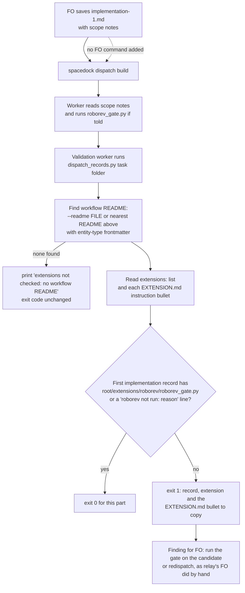

Filed from a package issue reported by the spacedock-dev/subspace-relay First Officer; the Captain confirmed filing on 2026-10-14 (「確認」 to "should FO file relay #1 and #4?"). Relay task `owner-sees-all-feedback-room` (PR spacedock-dev/subspace-relay#362, kc-dev-flow-2 0.22.0) dispatched implementation without the roborev extension's worker instruction, so the worker never ran `roborev_gate.py` and its report has no `evidence=` line; FO ran the gate afterwards (roborev:633).

## Scope

- The gap is enforcement: `extensions/roborev/EXTENSION.md` names an "Instruction FO adds to the scope notes", but `spacedock dispatch build` does not read the README's `extensions:` list and the workflow README text never names roborev (checked 2026-10-14: no `roborev` match in `references/sd/workflow.md` at origin/main 656543f4). Dispatch time has no Spacedock mod hook point, so a script check is the candidate route.
- Candidate fix: `dispatch_records.py` fails a dispatch record of a stage whose activated extension declares a worker instruction when that instruction is absent from its scope notes; or the README's stage text names it. Which extensions declare one (roborev; codex and copilot to be checked) is for ideation.
- Related: task `followup-dispatch-records-checked` changes the same script.
- Non-goals: see `### Non-goals` under `## Ideation design`.

## Ideation design

The ruling: add one part to `dispatch_records.py`'s folder run so a first implementation record that leaves out a listed extension's worker instruction fails at validation, with no new step for FO to remember. It changes two files and adds no README word.

### PRFAQ

**Headline.** A listed extension's worker instruction can no longer be left out of a first implementation dispatch without a failing check naming it.

**Press release.** From the next kc-dev-flow-2 release, the validation worker's existing `dispatch_records.py <task folder>` run reads the workflow README's `extensions:` list and each listed extension's declared worker instruction. A task whose first implementation record omits the instruction fails with one line that names the record, the extension and the bullet to copy. A first dispatch for which the instruction does not apply carries `<name> not run: <reason>` instead. Nothing new is added to what FO reads.

**FAQ.**
- *Why not README text?* It already exists (`## Extensions`) and 7 of 11 relay first dispatches still omitted the line.
- *Why not a pre-send command?* FO must remember it, the failure this fixes; Decision 1.
- *Does it prove the worker ran the gate?* No. It proves the instruction is in the record FO saved; the worker's `evidence=` line is a later check, deferred.
- *What does it cost?* One more pass over the records already read; no network, file or dependency.

**Acceptance evidence plan.** Unit tests with mutations (AC-1 to AC-5), a diff limited to two files (AC-6), and the real script replayed on 23 real records read-only (AC-7).

### Chain checked (2026-10-16)

- **Spacedock 0.27.2** (binary; mod text read from the 0.27.0 plugin cache): hooks are `startup`, `idle` and `merge` only (`first-officer-shared-core.md` `## Mod Hook Convention`), so no hook runs at dispatch. `spacedock dispatch build --help` takes entity, stage, checklist and scope notes and names no `extensions:` input; `grep -rn extensions` over the cache's `cmd/` and `internal/` hits only Pi-runtime files. Spacedock cannot add the instruction.
- **kc-dev-flow-2 0.23.0** (`origin/main` 1383c911): `references/sd/workflow.md` `## Extensions` already says "at a worker dispatch of its stage FO adds its instruction line to the scope notes". `dispatch_records.py` checks six parts and `--names`; none reads `extensions:`. Only `pr_watch.py` reads that README line (to choose the codex and copilot columns).
- **Adopters**: relay and subspace-web (`origin/main`) and qnow (`origin/next`) all list `roborev` under `extensions:`; so does this repository's `docs/dev2/README.md`. The gap is not relay-specific. Read-only `git show`.

### Which extensions declare a worker instruction

| Extension | Declares `Instruction FO adds to the scope notes` | Joins |
| --- | --- | --- |
| roborev | yes: `python3 <package>/extensions/roborev/roborev_gate.py --repo <worktree> --base <base sha>` | implementation, before the stage report |
| codex, copilot | no | FO review rounds and the merge ask |
| peers, learn, journey-map | no | FO steps |

Checked: `git grep -n -i 'instruction FO adds\|scope notes'` over `extensions/*/EXTENSION.md` hits only roborev. The check reads the label rather than a name, so a later extension that declares one is covered; codex, copilot and the FO-side extensions are outside it.

### Replay on the relay record that missed it (read-only)

Record: `_archive/owner-sees-all-feedback-room/dispatch/implementation-1.md` on `origin/spacedock-state/dev2` of spacedock-dev/subspace-relay. `Dispatched:` is `1aff02c2`; at that SHA `docs/dev2/README.md` reads `extensions: [learn, peers, roborev, journey-map]` and `4ed59a87` (listed roborev, 2026-10-13 12:59) is its ancestor. The record names `0.22.0` as Package root and holds no `roborev` token. A prototype (kept in `/tmp`, not in the repository) took the instruction's script path from the real `roborev/EXTENSION.md` and required `<Package root>/extensions/roborev/roborev_gate.py` in the record:

| Corpus (first implementation records whose README at the `Dispatched:` SHA lists roborev) | pass | absent | `<package>` left unsubstituted |
| --- | --- | --- | --- |
| relay, 11 | 3 | 7 | 1 (`signed-in-specs-run`) |
| subspace-web, 1 | 0 | 1 | 0 |
| this repository, 11 | 10 | 1 (`journey-server-host-pilot`) | 0 |
| qnow | its `spacedock-state/dev2` holds no dispatch record to read | | |

The relay record fails as the bite says. The unsubstituted case is a second failure of the README's own rule ("absolute root substituted"): the script path is in the record but not as a runnable path. Limits of this replay: it checks the README as committed at the SHA, not the checkout FO read (ADR 0014's stale-checkout hazard is unmeasured here); it proves the record, not what was sent.

### What makes the check fire, and the records it reads

Decision 1 (below) is why no pre-send command appears. The README already owes FO one (`--names`) and FO ran it after `dispatch build` on at least two dispatches (task `names-check-before-dispatch`); a second pre-send command fails the same way. The validation worker runs the folder check by `skills/validation/principles.md` without FO remembering anything, so it is the run point that does not depend on FO.

Rules the part applies:
- **Listed**: only an extension named in the README's `extensions:` list.
- **Declared**: only one whose `EXTENSION.md` has the `- **Instruction FO adds to the scope notes:**` bullet; its `<package>/extensions/<name>/<script>.py` paths are the required parts, and the first word of its `Joins:` bullet is the stage (`implementation`). Anything else (FO steps) is skipped.
- **Present**: the record contains each required path with `<package>` replaced by the record's own `Package root:` value, anywhere in the record (relay's `signed-in-specs-run-1` wrote the line under `## Checklist`; the worker still reads it).
- **Exempt**: a line `<name> not run: <non-empty reason>`, the form `## Extensions` and ADR 0013 already use for a listed extension that cannot run or is not requested. It is not a pointer to another record, so the pointer-only rule is untouched.
- **Which records**: the first record of the stage, `implementation-1.md` (Decision 2).
- **README source**: the README on disk now, not at the `Dispatched:` SHA, because that line carries a code SHA in relay and a state SHA in this repository, so no single read is right. Limit: an extension listed after a record was written fails that record until FO adds a `not run:` line.

### Existing-code capability check

Journey: FO saves a dispatch record, `dispatch build` writes the file, the worker reads it. Boundary: kc-dev-flow-2 0.23.0 plus Spacedock 0.27.x `dispatch build`.
- Completeness: the README sentence is text with no reader (broken seam); `dispatch_records.py` works through the journey at validation and lacks an extension part; Spacedock has no dispatch hook (not found, two searches: the hook convention text and `grep extensions` over the Go packages).
- Need: a falsifier exists (7 of 11 relay first records), a lifecycle obligation exists (roborev's evidence line), a consumer exists (the validation worker's folder run).
- Conclusion: extend `dispatch_records.py`, add no second script. Input it lacks today: the workflow README, found by walking up from the task folder or given as `--readme FILE`. `pr_watch.front` already reads README frontmatter; the implementation reuses a reader that exists rather than adding a third.
- Unknowns: Spacedock 0.27.2's source was not read (only the 0.27.0 cache); qnow's records could not be read.

### Non-goals

codex and copilot (no worker instruction); a Spacedock change (a request to let `dispatch build` read `extensions:` is a proposal for the Captain, not accepted scope); changing roborev's behaviour or EXTENSION.md; retrofitting archived records; proving the worker followed the instruction (a check on the stage report's `evidence=` line is deferred: no observed worker ignored an instruction it was given); any README, `workflow.md`, `lint-skills.py` or ADR change.

### Words FO reads at each lifecycle moment

Counted with `len(text.split())` on the same passages for base and candidate; the candidate is this design's draft, not a measured build.

| Moment | Base words | Candidate words |
| --- | --- | --- |
| startup (README, mod hook) | unchanged | unchanged, 0 added |
| idle, open PR / merged PR | unchanged | unchanged, 0 added |
| after the archive, merge ask | unchanged | unchanged, 0 added |
| worker dispatch: `--names` sentence 41 + extension sentence 37 + roborev instruction bullet 63 | 141 | 141 |
| validation, check fails | 0 | one output line, 32 words in the draft (the failing record, the extension, and the bullet to copy) |

No README passage changes, so no moment rises on a clean run. `workflow.md` stays at 5495 words against its 5511 budget; that file size is not the measure.

### Batch overlap

Files this design would change:
- `kc-dev-flow-2/scripts/dispatch_records.py`: one new check, the `--readme FILE` option, the module docstring.
- `kc-dev-flow-2/scripts/test_dispatch_records.py`: tests for the check against the real package extensions.

| Other batch-1 task | Shares | Order and note |
| --- | --- | --- |
| names-check-before-dispatch | `dispatch_records.py` `main()` and docstring; `test_dispatch_records.py`; the `--names` sentence in `workflow.md` (this design leaves it alone) | Same function and argument parsing: textual conflict. Land `names-check-before-dispatch` first (it owns the pre-send mode); then this adds the check to the folder run, and the extension check joins the pre-send mode there with one call and no new FO command. |
| dev2-laws-check | lists `dispatch_records.py` as an existing law and proposes CI on the state branch | Its CI checkout has no code-repo README above the task folder, so without `--readme FILE` the check prints its not-checked note and the law silently skips it. It must pass `--readme`. No file edit shared if it calls the CLI. |
| prod-security-review-gates | none today | If it adds an extension with a worker instruction, this check covers it unchanged. |
| amendment-form-check | none (`design_surfaces.py`) | none |

The other four task files are backlog stubs today; overlaps come from their Scope text and may change when their designs land.

### Proof of behaviour

This change adds no step FO must remember, so the scenario-question replay `maintain-flow` prescribes for FO-only rules is not owed. It does add one thing FO must learn: the exempt line `<name> not run: <reason>` now also lives in a dispatch record, where `## Extensions` places it only in stage reports and gate summaries. Nothing but the failing output teaches that, so the first task where roborev legitimately does not apply fails once at validation before FO writes the form. The proof is the script on real records (AC-7), plus unit tests with mutations (AC-1 to AC-5).

## Acceptance criteria

Run commands from the repository root of the implementation candidate; `<pkg>` is `kc-dev-flow-2`. Mutations run with `python3 -B` and cleared `__pycache__`.

**AC-1** A first implementation record that lacks a listed extension's worker instruction fails the folder run. Given a task folder whose nearest README above it lists `roborev`, and `dispatch/implementation-1.md` with `Package root: R` and neither a line containing `R/extensions/roborev/roborev_gate.py` nor a `roborev not run: <reason>` line, `python3 <pkg>/scripts/dispatch_records.py <task folder>` exits 1 and prints a line naming `implementation-1.md` and `roborev`. Evidence: `python3 -B <pkg>/scripts/test_dispatch_records.py` includes this case and passes. Falsifier: with the extension part removed from the folder run, the same fixture exits 0, so the test must fail under that mutation (run it and cite the failure).

**AC-2** The accepted and refused forms are exact. The record passes with the root-substituted path anywhere in it, passes with `roborev not run: <non-empty reason>`, and fails with the literal `<package>/extensions/roborev/roborev_gate.py` (its output line says `unsubstituted <package>`, a message the absent case does not print), with only the bare name `roborev_gate.py`, with `roborev not run:` and an empty reason. Evidence: one test per form in `test_dispatch_records.py`. Falsifier: a mutation that accepts any record containing the substring `roborev_gate.py` passes the placeholder and bare-name fixtures, so those tests must fail under it; a mutation that prints one message for both failures fails the test that asserts the `unsubstituted <package>` text.

**AC-3** The check applies only where it should. Same record, README not listing `roborev`: exit 0. A `validation-1.md` that lacks the instruction beside a complete `implementation-1.md`: exit 0. An `implementation-2.md` that lacks it beside a complete `implementation-1.md`: exit 0 (Decision 2 recommendation; if the Captain rules otherwise this clause is replaced). Evidence: three tests. Falsifier: a mutation that ignores the `extensions:` list, one that ignores the stage, and one that reads every `implementation-*` record each fail their own test.

**AC-4** The declaration is read from the real package, so a renamed label cannot silently turn the check off. A test builds the check against `<pkg>/extensions/*/EXTENSION.md` as shipped and asserts that every extension with the `Instruction FO adds to the scope notes` bullet yields the stage `implementation` and at least one `<package>/extensions/...py` path, and that the AC-1 failure still fires against the shipped roborev file. Evidence: that test passes on the candidate. Falsifier: in a temporary copy of the package, rename the bullet label in `roborev/EXTENSION.md`; the test fails.

**AC-5** README discovery is stated, never silent. With no README above the task folder and no `--readme`, the run prints `extensions not checked: no workflow README above <folder>` and its exit code is what it was before this change. `--readme FILE` takes the README from that path (the state-branch CI case in `dev2-laws-check`), and a `--readme` path that does not exist exits 2. Evidence: three tests asserting the printed text and exit codes, not only the exit code. Falsifier: a mutation that drops the note, and one that ignores `--readme`, each fail a test.

**AC-6** The change is a detector and says so. No file other than `scripts/dispatch_records.py` and `scripts/test_dispatch_records.py` changes: `git diff --name-only <base>..<candidate> -- <pkg>` lists exactly those two, `python3 <pkg>/scripts/lint-skills.py` exits 0 with `WORKFLOW_WORD_BUDGET` untouched, and the words-per-moment table above recounts with an independent copy of the counter to the same values (0 added at every moment on a clean run). Falsifier: a README or budget change in the diff, or a recount that differs, fails this criterion.

**AC-7** The real script reproduces the replay on real records, read-only. Rebuilding each corpus record into a temporary folder (record from the state branch, README from the `Dispatched:` SHA) and running the candidate gives: relay `owner-sees-all-feedback-room/implementation-1.md` exit 1 naming `roborev`; across the 11 relay first records 3 pass, 7 absent, 1 unsubstituted; subspace-web 1 absent; this repository 10 pass, 1 absent. Evidence: the temporary-folder commands and counts pasted in the validation report. Falsifier: a pass on the relay record, or a count different from the table, fails this criterion and sends the check back; a failure on any of the 13 passing records is a false positive and fails it too. Limit: it proves records, not what was sent or that a worker followed the line.

## Unresolved decisions for the Captain

**Decision 1: run point.** Should the check run only in the validation-time folder run (recommended), or also as a new pre-send command FO runs before `dispatch build`? Plainly: a script FO must remember to run has the failure that this task exists to fix, and FO already ran the existing pre-send `--names` check after the build on at least two dispatches (`names-check-before-dispatch` Scope). Recommendation: folder run only now; the extension check joins `names-check-before-dispatch`'s pre-send mode when that lands, as one call and no new FO command. What gets worse: the exempt form is taught only by the failure, so a legitimate not-applicable first dispatch fails once; a miss is found at validation, after the implementation ran without roborev, and costs FO one gate run on the candidate or a redispatch (what relay's FO did by hand); no prevention before the worker starts. Prior ruling read: ADR 0013 D2 and ADR 0014 apply to other questions; `git -C <state> grep -n 'Override:'` (2026-10-16) finds no override on this.

**Decision 2: which records.** Does the check read only the first record of the stage (recommended), or every `implementation-*` record with a `roborev not run: <reason>` line in each follow-up? Plainly: a follow-up to a live worker already holds the instruction, and the record cannot tell it from a fresh worker. Counted with the substring test: 20 of 68 implementation records here and 19 of 26 in relay lack the path, and of those 19 here and 12 in relay are later-cycle records, so "every record" would add a `not run:` line to about a third of later records here. Recommendation: first record only. What gets worse: a fresh worker dispatched at cycle 2 or later without the line passes unnoticed.

## FO alignment

Alignment: not needed before ideation; the Captain confirmed filing it.
Release review: not needed: workflow maintenance, on no journey map.
Surfaces: none
Visible change: none

## Stage Report: ideation

- DONE: A design (PRFAQ and Mermaid) for how an activated extension's worker instruction is made to reach the dispatch (a kc-dev-flow-2/scripts/dispatch_records.py check, README stage text, or another route), which extensions declare one (roborev; codex and copilot to be checked), with a replay on the relay record that missed it (read only)
  `## Ideation design`: PRFAQ, flowchart, chain check, declaring-extension table (roborev only; codex and copilot declare none), replay on relay `owner-sees-all-feedback-room/implementation-1.md` plus 23 corpus records via a `/tmp` prototype; `design_surfaces.py check <task file>` printed "design surfaces presentable", exit 0.
- DONE: A `### Batch overlap` section naming each file the design would change and each other batch-1 task (prod-security-review-gates, dev2-laws-check, extension-instruction-reaches-dispatch, names-check-before-dispatch, amendment-form-check) that changes the same file or check, so FO can order implementation
  Two files named; names-check-before-dispatch (same function, land first) and dev2-laws-check (needs `--readme`) overlap; the other two share nothing. The four other files are backlog stubs, so this rests on their Scope text.
- DONE: The words FO reads at each lifecycle moment, before and after, per root learning.md "Measure the words FO reads at each moment, not one file's size"
  Table in `### Words FO reads at each lifecycle moment`: every moment unchanged; dispatch 141 to 141; 32-word output line only on a failing check. The candidate column is a draft, not a measured build.
- DONE: Acceptance criteria with reproducible evidence clauses and falsifiers, and unresolved decisions for the Captain, each with a recommendation and what gets worse under it
  AC-1 to AC-7 each carry evidence and a falsifier; Decision 1 (run point) and Decision 2 (which records) each carry a recommendation and its cost; no past `Override:` bears on them.

### Acceptance criteria evidence

- AC-1 not yet verified by the script (no implementation). Design-time evidence: the prototype fails the relay record, which holds no `roborev` token.
- AC-2 not yet verified. Design-time evidence: the prototype classified `signed-in-specs-run-1` as the unsubstituted `<package>` form, distinct from absent.
- AC-3 not yet verified; the first-record-only clause waits on Decision 2.
- AC-4 not yet verified. Design-time evidence: the prototype parsed the real `roborev/EXTENSION.md` bullet and the `Joins:` stage word.
- AC-5 not yet verified; `dispatch_records.py` has no README input today.
- AC-6 not yet verified. Design-time evidence: word counts by `len(text.split())`, `workflow.md` 5495 against budget 5511.
- AC-7 not yet verified with the real script. Design-time prototype counts: relay 3 pass / 7 absent / 1 unsubstituted, subspace-web 0 / 1 / 0, this repository 10 / 1 / 0; qnow has no record to read.

### Summary

The gap is closed by one new part in `dispatch_records.py`'s validation-time folder run, which needs no FO memory and no README word; a pre-send command is left to `names-check-before-dispatch`'s pre-send mode (Decision 1). Only roborev declares a worker instruction. Two Captain decisions: the run point, and first record only versus every record.
