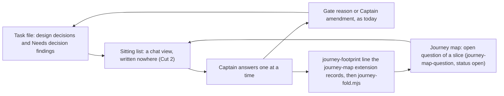

## Scope

- Source: the Captain, 2026-10-17: 「找一下 plugin FO 諮詢怎樣可以批次討論，批次實作，批次檢視的原則，這一段 dev2 還沒實裝，但是我需要你們按共同原則 dogfood 以便提高效率且降低我的負擔」. On 2026-10-20 he asked which task carries this and whether it is scheduled (「我想知道批次處理是哪張票？目前排了嗎」); none existed, so FO filed this one.
- Bite: nothing about batches is in kc-dev-flow-2 (`git grep -n -i batch origin/main -- kc-dev-flow-2/references kc-dev-flow-2/skills` to be rerun at ideation). FOs ran batches 2 and 3 of this workflow by interim rules kept outside the package. captain-question-load measured batch 2 at 22 Captain answers and 63 asks over six tasks; its AC-5 recount of batch 3 at batch close is the second measurement and the baseline for this task.
- Interim rules being dogfooded (FO's record, to be confirmed or dropped by measurement): gates stay per task, but all gates of one stage for the batch are presented in one message and each is recorded with his one answer; FO-side repairs, rechecks and external-review rounds run between sittings; every ideation has a `### Batch overlap` section; numbers are reserved before the batch's first dispatch; one follow-up task per delivered task for declined findings; a repeated finding class calls the chief-engineer.
- Captain's scope addition, 2026-10-20: 「此外這個模式，先列出清單再一題題問應該也要收納到dev2中，再下下版，未來的就是等sd review做到持續性continuity 時要整合進去，可以用webui進行討論」. The sitting pattern FO used for batch 3's leftovers (list every open item first, then ask them one at a time) belongs in this task, targeted two releases out; later, when Spacedock review gains continuity, it integrates there and can be discussed in a web UI.
- Conflict to settle here (Captain agreed 2026-10-20, 「同意」 to FO's item 4): the interim rule "reserve every ADR or migration number before the batch's first dispatch" contradicts the README's Number guards rule "when the implementation dispatch is built and not earlier"; observers flagged it on captain-question-load (7.5 h early) and chat-only-evidence-observer-blind (13 h early).
- Consumer: the Captain, and every adopter FO that runs more than one task at a time (relay, web, qnow).
- Upstream first: Spacedock's own scheduling (`status --next`, `concurrency`, gate presentation) before adding package text; captain-question-load (archived, ADR 0023) and its batch-3 recount.
- Non-goals: to be set at ideation.

## FO alignment

Alignment: needed before ideation. The Captain ruled to wait (「可以等批次 3 的那次計數出來再開始設計。目前多個 FO 都做了這個 dogfood，你可以派觀察者回收一下。」, 2026-10-20, chat, answering FO's 「要不要等批次 3 的那次計數出來再開始設計？我建議等。」): ideation starts after captain-question-load's batch-3 recount, and observers first collect the dogfood record of the FOs that ran batches (kc-claude-plugins, subspace-relay, subspace-web, qnow).
Release review: not needed: workflow maintenance, on no journey map.
Surfaces: none
Visible change: none
Outside this repository's surfaces: the Captain answers one message per stage per batch instead of one per gate.

## Captain amendments

### Amendment 1 — 2026-10-20, chat
Captain: 「好」 (chat, 2026-10-20, batch-4 sitting, question 14)
Asked: 「我的建議：這張任務先不做會議計數工具。ADR 也不要寫進「會議靠記錄時間間隔來認」這種規則，免得把一個量測上的權宜做法定成正式規則。」
Supersedes: AC-3, AC-4, no replacement
Design: Cut 1 item 2 (`decision_ledger.py --sittings`) is not built, and the ADR ruling drops "and its answers are counted from the recording burst". FO counts the Captain's answers per batch from the ledger at batch close, as for batch 3, until Spacedock review continuity (Cut 3) records each answer.
Superseded text: **AC-3** `decision_ledger.py --sittings` groups consecutive `person:captain` resolutions at most `--gap` seconds apart (default 20), across stages, into one answer; it excludes `agent:first-officer` rows and withdrawals; prints one line per answer and `rows N, sittings M`; `--since DATE` drops older rows; it writes nothing. Evidence: rows in `test_decision_ledger.py` on synthetic ledger lines: (a) seven rows 12 to 13 s apart in one stage, the seventh quoting a longer sentence that begins with the shared words: one answer of seven; (b) two rows 6 s apart at different stages: one answer; (c) two rows 36 s apart: two; (d) an FO-decided row and a withdrawal between two Captain rows 30 s apart bridge nothing: two; (e) `--gap 10` splits (a), `--gap 40` merges (c); (f) `--since` drops a row; (g) the directory listing is equal before and after the run. Falsifier: grouping on exact shared quote text splits (a); a fixed same-stage rule splits (b).
Superseded text: **AC-4** The counts in "What was measured" reproduce. Evidence: at validation, on `git archive` exports of the pinned state commits, `python3 <candidate>/scripts/decision_ledger.py --sittings --since 2026-10-17 <export>` prints `rows 45, sittings 25` (kc `c770d45f`), `rows 27, sittings 19` (relay `1e22e52d`) and `rows 12, sittings 8` (web `96a54eef`); relay and web equal the observers' hand counts of 19 and 8. Limit: the checkouts are private to this machine and their task bodies cannot be fixtures in this public repository, so this is a one-time validation step and CI runs AC-3's synthetic rows; thresholds are in-sample on three states. Falsifier: any count that differs prints the difference and fails the step.
Override: recommended the derived recording burst (design D1); Captain chose no sitting counter, on FO's revised recommendation in chat; area: sitting measurement

### Amendment 2 — 2026-10-20, chat
Captain: 「好，那就下一版，跟故事地圖一起，我越來越覺得兩者結合很重要」 (chat, 2026-10-20, batch-4 sitting, question 15)
Asked: 「第 15 題：「先列清單、再一題一題問」這個做法，要不要另外開一張任務，安排在兩個版本之後再上？」
Supersedes: AC-7, no replacement
Design: Cut 2 (list every open decision once, then ask one at a time) is not in this task and gets no task of its own; it moves into new-work-starts-from-a-story-map, targeted at the next release.
Superseded text: **AC-7** (Cut 2, a later task if D2 is accepted; not verified now) `tasks` prints the list-then-ask lines under the sitting line, 45 words, and writes no list. Evidence then: rows in `test_pr_watch.py` asserting the two lines follow a sitting line and are absent without one; the directory listing of the workflow and package is equal before and after a run (the list is written nowhere); the batch-6 transcript recount shows asks outside any sitting. Falsifier: a test that finds a file holding a decision row.
Override: recommended its own task two releases out (design D2); Captain chose the story-map task, next release; area: Cut 2 placement

### Amendment 3 — 2026-10-20, chat
Captain: 「第三條應該改成，如果發現 concurrency 不足，應該主動要求提高並說明原因，然後要定義concurrency不足是怎樣的狀況。」, 「按建議」 and 「先不放，直到有方式可以找到“重複出現的同類發現”」 (chat, 2026-10-20, batch-4 sitting, question 17)
Asked: 「第 17 題，改成問你第 1 條：我建議不放進套件，我這邊也停止執行這條臨時規則。」 and 「第 2 條：同一類審查發現重複出現時就去找 chief-engineer，這條也不放進套件，可以嗎？」
Supersedes: none
Design: D4's three interim rules stay out of the package. Rule 1 (one follow-up task per delivered task): FO stops running it. Rule 2 (a repeated finding class calls the chief-engineer): out until a way exists to find a repeated finding class. Rule 3 (at most three concurrent workers) is replaced by his direction, filed as its own task: FO asks him to raise concurrency, with the reason, when concurrency is insufficient, and that task defines insufficiency.

## Design

Pilot. Read against kc-dev-flow-2 0.26.0 (origin/main `ad44f0cb`), Spacedock binary 0.27.2 with the 0.27.0 skills cache, on 2026-10-20. Evidence files: `fo-batch-sittings/batch-3-count.md` and `fo-batch-sittings/dogfood/{kc-claude-plugins,subspace-relay,subspace-web,qnow}.md` (four observer reports, kc-dev-flow-2:observer sonnet). "Rows" below are gate resolutions the Captain decided; "answers" are the bursts they were recorded in.

### PRFAQ

**Press release (future).** From the next kc-dev-flow-2 release, an FO in any adopter is told, at the step it already runs at startup and idle, when two or more gates await the Captain at one stage. It presents them in one message and records each separately with his one answer. A task that is not ready waits for the next sitting; a `revise` on one task does not hold the others. The package also prints the sittings of any state checkout (`decision_ledger.py --sittings`), so "how many times did the Captain have to answer" is read from state instead of from a transcript or an observer's guess. Two releases later, the same step lists every open decision first and asks them one at a time.

**What this adds to the dogfood.** One message per stage already happens where an FO was briefed: 100 Captain gate rows in four adopters became 62 answers. What is missing is the rule in the package (web's second sitting never named itself and its ideations carry no `### Batch overlap`), and a record the next count can read without inference. FO alignment's "Visible change" line describes the end state the dogfood reached; this task makes it hold for every FO and measurable.

**FAQ**
- *Is a sitting one approval for several tasks?* No. Each task keeps its own Briefing, question and record, and a plain approval accepts a recommendation only when that task's question says so (README, `FO steps: review findings`; ADR 0011 L1). The sitting changes how many messages he reads, not what any approval covers. Relay's first sitting recorded six approvals and one `revise` from one 「照這樣」.
- *What is in a sitting?* Every gate in `awaiting-captain` at one stage. FO does not hold a ready gate for a straggler; a sitting opens when the Captain is there to read it. No waiting rule is proposed because none is measured.
- *Why is the rule in a script line and not in the README?* The README word budget is a ratchet (`WORKFLOW_BUDGET_STEPS`, ADR 0020): one added word needs a raise step carrying the Captain's quoted words and the moment FO reads it. fo-lifecycle-mod and special-role-calls-fire-when-needed already put per-moment steps in `pr_watch.py tasks`, which the mod runs before FO picks a gate. The line prints only when the sitting condition holds, so no moment without a sitting reads it.
- *Why not a `batch:` field on the task?* A batch's members are the gates FO chooses to prepare; `spacedock status --next --json` already says which are `awaiting-captain` and at which stage. A field would be a second copy FO must keep true.
- *The Number guards conflict?* Settled by dropping the interim rule; see Keep, change, drop and D3.
- *Story map?* The sitting list is a view FO composes from rows that stay where they live; see "List once".

### Chain check (in the chain's order, 2026-10-20)

- **Spacedock** (binary 0.27.2, skills 0.27.0): one gate per task (`gate prepare`, `gate record`, `gate consume`); FO engages the first `ready_gates` row; `status --next --json` returns `ready_gates[]` with `slug`, `current`, `readiness` (`awaiting-captain` or `needs-preparation`). No sitting, no multi-gate message, no decision list and no review continuity: `grep -i continuity` over skills, docs and internal finds only compaction continuity; `gh issue list -R spacedock-dev/spacedock --search "review continuity"` returns none, and "batch gate" returns #791 (a consume message) and #96, unrelated. Its README says "Batch the work; decide as it flows back" and stops there. `concurrency` limits only what `status --next` proposes (workflow.md, Stages). The package composes N Spacedock gates; Spacedock owns none of this yet.
- **kc-dev-flow-2** 0.26.0: search 1, `git grep -n -i batch` over the package without CHANGELOG and tests: one hit, workflow.md Release review signal 4 ("a batch about to enter implementation"). Search 2, `sitting|presented together|joint|awaiting-captain|ready_gates`: no relevant hit (`skills/dev/SKILL.md` "an entity sitting in a stage"). Existing machinery this design reuses: `pr_watch.py tasks` (already shells to `role_triggers.py`, `dispatch_records.py`, `observer_check.py` and prints `next:` lines; the mod runs it at startup and idle), `decision_ledger.py` (one JSON line per gate resolution), ADR 0010, ADR 0011, ADR 0020, ADR 0023, ADR 0024. Exclusions: adopter READMEs that customize; unknown: whether any adopter reads `ready_gates` itself.
- **Siblings**: relay, web and qnow ran the interim rules (observer reports). qnow's state is not on this machine, so its figures are the observer's, not re-run. A sibling's practice is evidence of what FOs did, not of what a tool does; the one tool behaviour used (`reserve`) is read from `number_guards.py` itself.

### What was measured

Gate rows to answers, counted by the rule in D1 (consecutive Captain-decided resolutions at most 20 s apart form one answer), replayed 2026-10-20 on `git archive` exports of pinned state commits:

| Repository (state pin) | Rows since 2026-10-17 | Answers | Joint answers (rows) | Hand count by the observer |
|---|---|---|---|---|
| kc-claude-plugins (`c770d45f`) | 45 | 25 | 6, 6, 2, 4, 4, 4 | 17 answers for 34 rows, earlier window; not reconciled |
| subspace-relay (`1e22e52d`) | 27 | 19 | 7, 2, 2 | 19 |
| subspace-web (`96a54eef`) | 12 | 8 | 3, 3 | 8 |
| qnow (observer's table) | 16 | 10 | 3 joint answers cover 9 rows | 10 |
| Total | 100 | 62 | | |

Why 20 s: the largest gap inside any joint answer in the three replayed states is 13 s (relay's seven-row first sitting, 12 to 13 s apart); the smallest gap between two answers the observer judged separate is 36 s (relay, different quotes). A gap of 10 s splits that seven-row sitting into 25 answers for 27 rows; 20 s and 35 s give the same 19. Quote matching was tried first and fails: relay's seventh row quoted a longer sentence that begins with the shared words, and two cross-stage pairs (a validation and an ideation gate in one message) share the answer but not the stage.

Transcript counts (kc, from `batch-3-count.md`; a different denominator that includes what state cannot see):

| Batch | Answers | Per task | Gate | Needs decision or amendment | Merge of a non-task PR | Procedural |
|---|---|---|---|---|---|---|
| 2 (six tasks) | 22 | 3.7 | 7 | 6 | 5 | 4 |
| 3 (six tasks) | 28 | 4.7 | 15 | 6 | 2 | 5 |

Batch 3 rose per task although joint presentation ran in both. Two tasks were added mid-batch, five answers were permission refusals, and the five decisions D1 to D5 of one design were counted as five answers because he asked for them one at a time. So the transcript counts do not show that sittings lowered his load; the state counts show that gate answers fall by about 38%. 13 of batch 3's 28 answers are not gates.

Where joint presentation held (observer reports): backlog and ideation, in all four repositories. Validation and delivery: qnow 3 of 4 gates and web 3 of 3 (the second sitting) in one answer each, kc 2 of 6 in batch 2 and 0 of 3 in batch 3, relay's five batch-1 validation gates answered on separate occasions over three days (two of them paired with another task's ideation gate). In relay each later head was "validated, merged with main" after the previous merge, because several PRs appended to the same ADR index (`docs/adr/README.md`). That index conflict cost relay one task four validation gates and another one send-back, in tasks whose ideation carried no `### Batch overlap` because they were designed alone while others were already building.

### Keep, change, drop (the interim rules, graded on the four reports)

| Interim rule | Evidence | Verdict |
|---|---|---|
| One message per stage, each gate recorded with his one answer, the reason naming it | Held at backlog and ideation everywhere; reasons name it in kc and relay B1/B2, not in web's second sitting or relay B3 | **Keep**: Cut 1, as the sitting line. Record form: D1 |
| FO repairs, rechecks and review rounds run between sittings; ask only at gates and amendments | web: repairs between two sittings with no Captain turn; the delivery half is already ADR 0023 and the Delivery authority clause. The "ask only" half is witnessed only by chat | **Keep** the second half as one clause of Cut 2 ("a decision that blocks no worker waits"); not judged by the observer (ADR 0024) |
| `### Batch overlap` in every ideation | kc 13 of 13; relay 7 of 11 (the 4 absent were designed alone while other tasks were live); web 0 of 5; qnow 2 of 3 | **Keep, change the condition**: required when any other task is live in the workflow, not only when a batch was named. Home: `skills/ideation/principles.md` (worker-read). Adds `Recommended order:` |
| Reserve every number "before the batch's first dispatch" | Followed as written nowhere: kc's ADR lines landed 80 minutes (batch 2) and 7 h 47 min (batch 3) after the first ideation dispatch and before the first implementation dispatch, and two observers flagged 7.5 h and 13 h before a task's own implementation; relay, web and qnow reserved within a minute of the dispatch, except two late ones (relay's ADR 0059, qnow's analytics task). One collision: ADR 0018 reserved 2026-10-16 12:20 at a dispatch, taken on main by an out-of-band docs commit at 23:54, re-reserved next day | **Drop**; the README rule stands (D3). `reserve` takes `max(base tip, every other task file) + 1` (`number_guards.py`, `reserve`), so reserving at each task's own dispatch build is already collision-free inside one state (`test_reserve_never_collides_and_never_fills_a_gap` passes, 24 of 24 tests in the file pass); early reservation buys consecutive numbers and a longer exposure to a number taken elsewhere |
| One follow-up backlog task per delivered task | kc 10 of 11, relay 0 of 8, web 0 of 3, qnow one per finding class | **Drop** from the package (D4): not about batches, and ADR 0010 already files every round-three declined finding as its own task |
| A repeated finding class calls the chief-engineer | The count half shipped (ADR 0026, `role_triggers.py`); the cross-task class has no state witness (the observer calls it "my reading of the class"); relay's index-conflict class repeated in five places with no call | **Drop** from this task (D4); the class is FO judgment |
| At most three concurrent test-running workers | Machine load of 100 to 380 on one machine | **Drop**: machine-specific; an adopter sets `concurrency:` in its README |
| Run `dispatch_records.py --names` before building; each gate question says what approval accepts | Both already in workflow.md (Stages; `FO steps: review findings`) | **Drop**: already package text |
| Measure per release: decisions per sitting and total turns | Observers rebuilt it by hand four times and each marked "joint" as inferred | **Keep**: `decision_ledger.py --sittings` |

### Design

**Cut 1 (this task).**
1. `pr_watch.py tasks` runs `${SPACEDOCK_BIN:-spacedock} status --workflow-dir <dir> --next --json`, groups `ready_gates` with `readiness: awaiting-captain` by `current`, and for each stage with two or more prints one line: `next: <n> gates await the Captain at <stage> (<slugs>); unless already presented, present them in one message and record each with his one answer.` At `validation` it appends `Name the merge order and each shared file from Batch overlap.` A failed status call uses the existing `next: report ... to the Captain` path and exit 2. Nothing is written beyond the file `tasks` already writes. The mod (48 words) and the README are unchanged.
2. `decision_ledger.py --sittings [--since DATE] [--gap SECONDS]` (default 20) prints one line per answer (first time, row count, stages, slugs) and `rows N, sittings M`, over `person:captain` resolutions only. Read-only like the rest of the script.
3. `skills/ideation/principles.md` gets one sentence (55 words): when another live task exists in the workflow, end the design with `### Batch overlap` naming, per task, the files, checks, tables and numbered records both would change, counting a shared index such as an ADR list, and a `Recommended order:` line; `none` when none.
4. One ADR (ruling and short title, no number): "a sitting is one message with one record per task, and its answers are counted from the recording burst". It records the reservation ruling of D3 in its Consequences so the next batch does not reopen it.

**Cut 2 (two releases out; its own task if D2 is accepted).** `tasks` prints two more lines under the sitting line: before asking, list every open decision of these tasks once, each with its home, one plain sentence, FO's recommendation and what gets worse, then ask them one at a time in that order; a decision that blocks no worker waits for the next sitting (45 words). The list is composed in chat from the tasks' own sections and written nowhere.

**Cut 3 (when Spacedock gains review continuity, and later a web discussion room).** What continuity must give, and the package cannot: a durable answer per row before the gate closes. Today an answer given in chat lives only in chat until the gate record: special-role-calls-fire-when-needed recorded five one-at-a-time answers in one gate reason, so an FO that dies mid-sitting loses them and re-asks (ideation-1 of this task died with nothing written). Precondition for any script-assembled list or UI: one heading for decision sections; the kc state has 10 spellings on 36 headings (`## Unresolved decisions for the Captain` 11, `### Unresolved decisions for the Captain` 8, `### Unresolved decisions (for the Captain)` 5, `## Needs decision` 3, and six more). No parser is proposed now; FO reads the same sections to present the gates and composes the list from them.

```mermaid
sequenceDiagram
    participant W as Workers
    participant SD as Spacedock gate records
    participant FO as First Officer
    participant C as Captain
    W->>FO: stage reports for tasks a, b, c (task d still working)
    FO->>SD: gate prepare a, b, c (one Briefing and one question each)
    FO->>FO: startup or idle step: pr_watch.py tasks prints the sitting line (3 gates await at one stage)
    Note over FO,C: Cut 2 adds before this message: the list of open decisions, then one at a time
    FO->>C: one message: each gate, its recommendation, what approval accepts
    C->>FO: one answer: a and b approve, c revise
    FO->>SD: gate record a approve, b approve, c revise (own reason each, his words quoted)
    SD-->>FO: a and b consumed; c routes to its feedback-to
    FO->>W: dispatch the next stage for a and b; c goes back to its worker
    W->>FO: task d reaches its gate later
    Note over FO,C: d waits for the next sitting; no ready gate is held for it
```

### List once (the seam with new-work-starts-from-a-story-map)

That task's Scope was read as filed (Scope only, no design yet). Its touchpoint 5 makes a slice's open questions the sitting's list. The list exists once if no copy of a row is stored anywhere; each row lives in its home and the sitting only names it:



A row carries: its home (`task#decision id`, finding in a stage report, or `journey file / release / story / question id`), one plain sentence, FO's recommendation, what gets worse. A journey row's answer lands as the footprint the journey-map extension already records on a task that carries `journey-story`, and `journey-fold.mjs` folds it into the map; this task changes neither. Gap, stated rather than hidden: a slice question with no task yet has no footprint home (`extensions/journey-map/EXTENSION.md`, Limits: "a ruling made in chat with no task ... outside check and audit"), so such a row is answered in the sitting and recorded when a task admits the story. Whether that task's backlog gate carries it is that task's design; if it designs a stored list of slice questions apart from the map's `questions:`, this seam fails (AC-8).

### Words FO reads at each moment

Rule from root `learning.md`: for each moment, every passage and script output that instructs a step due then, `len(text.split())`, same method for base (origin/main `ad44f0cb`) and design. Constants that do not change at the gate moments: Spacedock `present-gate` 676 and `fo-gate-lifecycle` 958; the mod 48.

| Moment | Base | Cut 1 | Cuts 1 and 2 |
|---|---|---|---|
| Startup or idle, two or more gates await at one stage | 0 words of package text about sittings (the kc FO carries 311 words in a memory file outside the package; the other three FOs carry none) | 26 for three slugs, plus 1 per slug beyond three, plus 11 at `validation` | 71, and 82 at `validation` |
| Startup or idle, no sitting condition | 0 | 0 | 0 |
| Backlog gate (`### backlog` Gate content bullet) | 39 | 39 | 39 |
| Ideation gate (Gate content bullet) | 167 | 167 | 167 |
| Validation gate (Gate content bullet) | 153 | 153 | 153 |
| Record after the one answer | 0 package words | 0 | 0 |
| First implementation dispatch (`Reserve.` bullet) | 84 | 84 | 84 |
| Worker-read, not FO: `skills/ideation/principles.md` | 596 | 651 | 651 |

The learning's "every moment below its base" does not hold at the first row and cannot: the base is zero because no package text existed. Every other moment is equal, and the README stays at 5374 words (budget 5374). The line is printed on every startup and idle pass while the condition holds, including after FO has presented, which is why it says "unless already presented"; AC-1 bounds one line, not a pass. Counts of the shipped lines are re-taken at implementation (AC-1).

### Batch overlap

Read as the files stand on 2026-10-20 (batch-4 designs are not written yet; the other sessions' tasks read only).

| File or check | Changed by this task (Cut 1) | Other task that changes the same file or check | Order |
|---|---|---|---|
| `scripts/pr_watch.py`, `scripts/test_pr_watch.py` | yes (sitting line) | none in batch 4; backlog `pr-watch-tasks-foreign-worktree` edits `tasks`; `new-work-starts-from-a-story-map` may add a `tasks` line at its touchpoint 5 | no constraint; whichever merges second rebases |
| `scripts/decision_ledger.py`, `scripts/test_decision_ledger.py` | yes (`--sittings`, additive flag) | `fo-write-rules-checked` extends the FO-write checks and could read ledger rows | additive; second rebases |
| `skills/ideation/principles.md` | yes (one sentence) | none found | none |
| `references/sd/workflow.md`, `lint-skills.py` budget | no (AC-2) | `adr-required-statement` (at validation) edits `Decision records` and the `Number guards` applicability line; `release-acceptance` edits the Release review bullet; `commissioned-by-names-spacedock` edits the frontmatter `commissioned-by` line; `db-surface-without-migrations` edits the `Number guards` passage | none for this task. `db-surface-without-migrations` asked to be implemented first because this task was expected to edit `Number guards`; it does not, so that constraint is released |
| `scripts/number_guards.py` | no | `db-surface-without-migrations` | none |
| `scripts/delivery_gate.py`, `scripts/dispatch_records.py` | no | `comment-check-reaches-delivery-gate`, `fo-write-rules-checked` | none |
| `docs/adr/` (new file) | yes | `adr-required-statement` and any batch-4 ADR | numbers are reserved at each implementation dispatch build, not now |
| `skills/dev/SKILL.md`, the `### backlog` bullet | no | `new-work-starts-from-a-story-map` (touchpoints 1 and 4) | none |
| `pr-review-lite-value-pilot`, `journey-canvas-hosted-poc`, `journey-server-host-pilot`, `journey-map-progress-and-provenance`, `kc-decision-log-p1` | no | none found by file name (their files: capability/record scripts, kc-journey-map canvas and server, journey progress) | none |

Recommended order: no constraint among these for Cut 1. One interaction, not a file: `fo-write-rules-checked` rules that a Captain ruling is not recorded before its question is put; a sitting records after his one answer, so the sitting message must be put before FO records, and six of the nine Captain rows since 2026-10-20 (every backlog gate of this batch) were bound "after the fact". That is that task's rule; the sitting line says only "record each with his one answer".

### Existing-code check (bounded)

Journey traced inside `pr_watch.py tasks` and `decision_ledger.py`. Completeness: `tasks` is working through the journey for PR and role steps and has no gate reader (incomplete for this need); `decision_ledger.py` is working for rows and has no grouping (incomplete). Need: Captain's instruction (Scope, 2026-10-17 and 2026-10-20) and four reports that each reconstructed the sittings by hand; falsifier: AC-3 rows from real gap shapes. Two searches and exclusions are in the Chain check. Nothing is replaced; one function and one flag are added.

### Limits (not criteria)

- A sitting is counted by how it was recorded, not how it was presented: a joint message recorded more than 20 s per gate apart counts as several answers; two separate quick answers within 20 s count as one. The thresholds come from three states (13 s largest joint gap, 36 s smallest separate gap).
- State cannot see what is not a gate: batch 3's 13 non-gate answers (permission refusals, scope additions, role choices) and every restatement request. The batch-5 transcript recount stays a by-hand step.
- The sitting line repeats on each pass while two or more gates await. Relay's seven-gate sitting would print 30 words each pass.
- `ready_gates` is the shape of Spacedock 0.27.2's `status --next --json` captured today; a different shape exits 2 with the existing report-to-the-Captain line.
- Whether FO actually presents in one message is witnessed only by the record burst and the Captain's chat.
- qnow's counts are the observer's; its state was not re-run.
- Follow-up proposed, not accepted scope: relay's repeated ADR-index conflict (four validation gates and a send-back from one shared file) is a delivery-authority question: whether his delivery approval covers a mechanical merge of main when only append-only index lines conflict. It needs his ruling and relay-only evidence so far; file it only if he wants it.
- Non-goals: no `batch:` field, no stored decision list, no waiting rule, no parser for decision headings, no change to Number guards text, the mod or the README, no change to gate authority or the delivery question.

## Acceptance criteria

**AC-1** `pr_watch.py tasks` prints one sitting line per stage that has two or more gates in `awaiting-captain`, naming the stage and every such slug, and none otherwise. Evidence: rows in `test_pr_watch.py` with a stub `spacedock status --next --json` returning the shape captured 2026-10-20 (`ready_gates[]` with `slug`, `current`, `readiness`): (a) three awaiting at `ideation`: one line naming the three; (b) one awaiting: no line; (c) fifteen `needs-preparation` at `backlog` plus two awaiting at `backlog`: the line names the two (this workflow on 2026-10-20 had 17 rows: 2 awaiting, at different stages, 15 needs-preparation); (d) two awaiting at `ideation` and two at `validation`: two lines, only the validation one ending with the merge-order sentence; (e) the status call fails: the existing `next: report <slug> to the Captain` form and exit 2; (f) the line has 26 words for three slugs, one more per slug, 11 more at `validation` (`len(line.split())`). Falsifier: counting `needs-preparation` rows makes (c) name seventeen slugs; ignoring `current` makes (d) print one line.

**AC-2** The README, the mod and the word budget do not change. Evidence: `git diff $(git merge-base origin/main HEAD)..HEAD --stat -- kc-dev-flow-2/references/sd/workflow.md kc-dev-flow-2/references/sd/mods/kc-dev-flow-2.md docs/dev2/README.md kc-dev-flow-2/scripts/lint-skills.py` prints nothing, and `python3 kc-dev-flow-2/scripts/lint-skills.py` exits 0 printing equal count and budget. Measured against this task's own merge base, so another task's budget step does not mask it. Falsifier: one added README word makes the budget lint exit 1.

**AC-5** An ideation design written while another task is live ends with `### Batch overlap`. Evidence now: the sentence is in `skills/ideation/principles.md`, `lint-skills.py` and the duplicate-run lint pass, and the 55 words are counted worker-read. Evidence not yet available: behaviour. Baseline to beat at the next batch: kc 13 of 13, relay 7 of 11, web 0 of 5, qnow 2 of 3 designs carry the heading; the batch-5 observer counts the designs written while another live task existed and reports each without the heading. Falsifier: one such design without the heading. A phrase search is not proof of behaviour, so this criterion stays open until that count exists.

**AC-6** The reservation ruling lands without a README change and with its reason. Evidence: AC-2's empty diff covers the `Reserve.` bullet and the `Number guards` passage; `python3 kc-dev-flow-2/scripts/adr_lint.py docs/adr --since <base> --require <reserved number>` exits 0 for the ADR, whose Consequences name the 0018 collision (reserved at a dispatch, taken on main 11.5 hours later) as what a held number risks; `python3 -B -m unittest discover -s kc-dev-flow-2/scripts -p test_number_guards.py` exits 0 (24 tests, including `test_reserve_never_collides_and_never_fills_a_gap`). Falsifier: a package file that tells FO to reserve before a task's own implementation dispatch build.

**AC-8** (seam, verified at FO's gate of both designs, not by this task's code) `new-work-starts-from-a-story-map` keeps a slice's open questions in the map's `questions:` and takes each answer back through the existing footprint and `journey-fold.mjs`, with no second stored list. Evidence: its accepted design names the home and answer path of a journey row as this section does. Falsifier: its design stores slice questions in a task file or a new list.

## Needs decision

**D1. How does the package record a sitting: a free reason sentence (today), a declared token in each reason, or the derived recording burst?** Recommendation: the derived burst, consecutive Captain resolutions at most 20 s apart, with the free reason sentence unchanged and optional. It needs nothing of FO, so it counted web's and relay's sittings whose reasons never named them, and it reproduced two observers' hand counts exactly. What gets worse: it measures how answers were recorded, not presented (a slow recording splits a sitting; two quick separate answers merge), and nothing in state tells the two apart. A token would be exact where FO writes it, but ADR 0016's evidence is that FO under-declares structured fields and web's and relay's later sittings show it would have counted fewer. Approving accepts D1 as recommended; say if you object.

**D2. Ship Cut 1 in this task and Cut 2 (list then ask one at a time) as its own task, two releases out?** Recommendation: yes. Your words put the pattern in this task and two releases out; one pull request cannot straddle two releases, and Cut 2 reads the story-map design that is not written yet. What gets worse: a second task with its own gates, and Cut 2 carries this section forward by citation; if you want it in this PR, it ships in the next release instead and the "two releases" target is dropped. Approving accepts D2 as recommended; say if you object.

**D3. Settle the numbers conflict by dropping the interim rule and leaving the README rule (reserve per task when its implementation dispatch is built) unchanged?** Recommendation: yes. `reserve` already makes sequential reservations unique, nobody followed the batch-start rule as written, and the one collision we have came from holding a number 11.5 hours. What gets worse: an FO cannot pre-assign a batch's numbers during ideation; reserving all of a batch's tasks in one go right before their implementation dispatches stays allowed (relay did, 0055 to 0058, one minute early); an out-of-band commit on main can still take a held number, and `number_guards.py check` at implementation exit, validation and the PR head is what catches it. Past ruling: your 「同意」 of 2026-10-20 agreed to settle it here; no earlier ruling or `Override:` row is on this area (0 `Override:` rows in the 154-row kc ledger). Approving accepts D3 as recommended; say if you object.

**D4. Keep three interim rules out of the package: one follow-up task per delivered task, a repeated finding class calls the chief-engineer, at most three concurrent workers?** Recommendation: yes, leave them out. The first is not about batches and ADR 0010 already covers round three; the second's count half shipped as ADR 0026 and its class half has no state witness; the third is machine load, which `concurrency:` already sets per adopter. What gets worse: the kc FO keeps carrying the first and third from a memory file, relay and web have none of it (0 of 8 and 0 of 3 follow-ups), and a repeated class like relay's index conflicts still depends on FO judgment. Approving accepts D4 as recommended; say if you object.

Past rulings read for this area: ADR 0010, 0011, 0020, 0023, 0024, 0026; gate-record `Override:` lines: none in the kc ledger.

## Number guards

ADR: 0028

## Stage Report: ideation

- DONE: Fresh dispatch: the ideation-1 worker stopped when the session ended and wrote nothing. A design (PRFAQ and Mermaid) for FO batch sittings in kc-dev-flow-2, measured on the batch-2 and batch-3 counts and the four observer dogfood reports in the task folder (batch-3-count.md, dogfood/); include the Captain's list-then-ask-one-at-a-time pattern (targeted two releases out, later folded into Spacedock review continuity), settle the Number guards reservation-timing conflict named in Scope, and read new-work-starts-from-a-story-map (filed 2026-10-20) so a slice's open questions can be the sitting's list and the list exists once
  `## Design` holds the PRFAQ, two Mermaid diagrams, chain check, measurements (100 rows to 62 answers replayed on pinned state exports), the Cut 2 and Cut 3 pattern and the "List once" seam; the numbers conflict is settled by dropping the interim rule (D3).
- DONE: A `### Batch overlap` section naming each file the design would change and each other batch-4 task (commissioned-by-names-spacedock, db-surface-without-migrations, comment-check-reaches-delivery-gate, fo-write-rules-checked, fo-batch-sittings) and live task of other sessions (adr-required-statement, pr-review-lite-value-pilot, release-acceptance, journey-canvas-hosted-poc, journey-server-host-pilot (driven by other sessions; read only)) that changes the same file or check, so FO can order implementation
  `### Batch overlap` table names every file and all ten tasks; no ordering constraint for Cut 1, and db-surface-without-migrations' request to go first is released because workflow.md is untouched.
- DONE: The words FO reads at each lifecycle moment, before and after, per root learning.md "Measure the words FO reads at each moment, not one file's size"
  `### Words FO reads at each moment`: base and design per moment, counted with `len(text.split())` on origin/main `ad44f0cb`; only the new sitting moment rises (0 to 26, or 71 with Cut 2), the README stays at 5374.
- DONE: Acceptance criteria with reproducible evidence clauses and falsifiers, and unresolved decisions for the Captain, each with a recommendation and what gets worse under it
  `## Acceptance criteria` AC-1 to AC-8, each with an evidence clause and a falsifier; `## Needs decision` D1 to D4 with recommendation and what gets worse. Current evidence per criterion:
  AC-1: not yet verified. Nothing is built. Observed today: `spacedock status --next --json` on this workflow returns 17 `ready_gates` (2 `awaiting-captain` at different stages, 15 `needs-preparation`), the shape the rows stub.
  AC-2: not yet verified (nothing is changed). Counts taken: workflow.md 5374 words equals the budget (5511 - 64 - 18 - 55); the mod is 48.
  AC-3: not yet verified in the candidate. The rule was exercised in a scratch script on the real ledgers: gap 20 s gives relay 27 rows to 19 answers, web 12 to 8, kc 45 to 25; gap 10 s gives relay 25; quote matching split relay's seventh row and the cross-stage pairs.
  AC-4: not yet verified in the candidate. The expected figures were produced with the same rule on `git archive` exports of `c770d45f`, `1e22e52d` and `96a54eef` (`decision_ledger.py` 0.26.0 for the rows, the 20 s grouping in a scratch script).
  AC-5: not yet verified, by design. Baseline counts are the observers' (kc 13 of 13, relay 7 of 11, web 0 of 5, qnow 2 of 3); the first measurement is the next batch.
  AC-6: partly verified. `python3 -B -m unittest test_number_guards` in the 0.26.0 package ran 24 tests, OK, including `test_reserve_never_collides_and_never_fills_a_gap`; the ADR and its lint run are not yet done.
  AC-7: not yet verified; belongs to the Cut 2 task if D2 is accepted.
  AC-8: not yet verified; `new-work-starts-from-a-story-map` is at Scope only (3.7 KB), so its design cannot be compared yet.

### Summary

The design puts the sitting rule in a `pr_watch.py tasks` line (26 words, printed only when two or more gates await at one stage), adds `decision_ledger.py --sittings` so the answer count is read from state (it reproduced two observers' hand counts, relay 19 and web 8), adds one worker-read sentence for `### Batch overlap`, and changes neither the README, the mod nor the word budget. The reservation conflict is settled by keeping the README rule: `reserve` already makes per-task reservations unique and the one collision came from a number held 11.5 hours. The list-then-ask pattern is Cut 2, a later task; durable per-row answers need Spacedock review continuity.
One defect is FO's to correct before the gate is presentable: `python3 <package>/scripts/design_surfaces.py check fo-batch-sittings.md` exits 1 with `'Visible change:' is not 'none' but 'Surfaces:' has no 'ui'`. The `## FO alignment` lines are FO's record, so I left them; either `Visible change: none` or a `ui` surface resolves it. The checker raised nothing else on the design, criteria or diagrams.
