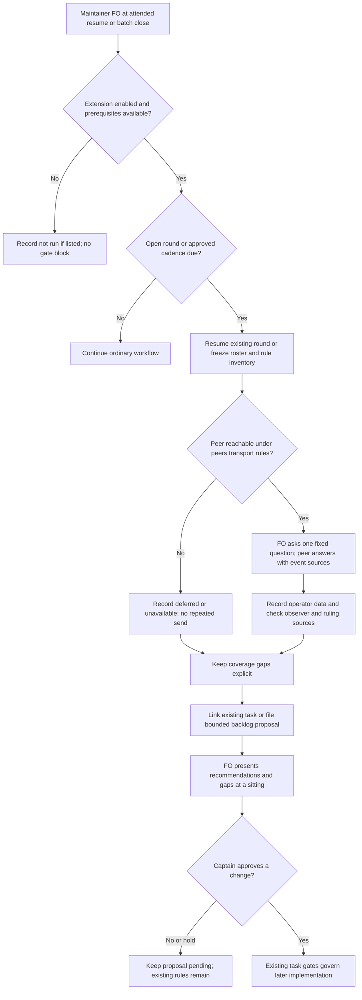

## Scope

- Source: the Captain (chat, 2026-10-26): 「紀錄一件事，等這批清完，請你訪問所有fo，跟他們了解peer ext的使用狀況，做為改進用途，任何把這個流程紀錄成一個新的ext，等於你每幾輪/批，要去訪談其他fo對於每個ext，每條規則的心得，這樣就會有兩個面向的改善資料，一個是觀察者抓犯規，一個是操作者心得。可能還可以補一個，是哪裡他們覺得現在做的很好，用來評估特殊的『核心能力』，用來改寫dev2 本身的repo readme.md。合理嗎？有沒有哪裡想補充？」
- First step he named: after batch 6 clears, interview every FO about how they use the peers extension, by hand.
- Outcome he named: an extension that has the dev2 maintainer FO, every few rounds or batches, interview the other FOs on each extension and each rule; three kinds of data: observer violations (exists), operator experience (new), and what works well, used to name dev2's core capabilities and rewrite kc-dev-flow-2/README.md.
- FO additions proposed in chat the same day (not ruled): ask about recorded events (task, date) rather than general opinions, and cross-check answers with observer reports and the decision ledger; ask which rule each FO skips or works around and why (an unenforced rule is an enforcement gap); keep a fixed short question set per extension so rounds compare; answers are data, not rulings; write one interview record per round in the state checkout and file findings as backlog tasks; run the first round by hand before building the extension.
- Upstream first: dev2 `peers` extension (how FO asks another session), `observer` agent and `learn` extension (the violation side), `decision_ledger.py`; backlog worker-knows-the-team-and-asks-early and learn-names-agents-md-candidates (related operator-side data).
- Non-goals: FOs changing each other's work; treating an interview answer as a Captain ruling.
- Ruled 2026-10-26, the Captain (chat): 「由你直接問。我問說co是因為它就是一個這樣一對多的特殊角色。但是現在先由你來問比較適合，先走幾輪看看再說。」, answering 「需要你決定：訪談由誰來問？我建議先由我直接問，用固定題目、引用具體事件來降低偏差；跑過一輪後，如果你覺得回饋太客氣，再改成由 CO 來問。」 FO's recommended shape in the same message (not ruled beyond the interviewer): name it 操作者回饋 / `fo-feedback`, not retro; a general extension like learn, used for dev2 first; one interviewer (the package maintainer) asks every FO.

## Budget

- One package PR adding an optional extension beside `learn`; no new script unless a round record needs a checker.

## Stop condition

- The extension can reproduce interview rounds 1 and 2 (fo-interviews-extension/peers-round-1.md, round-2-batch7-texts.md) as its first records; the README rewrite of core capabilities is a later task. Return to the Captain for cadence and the question set.

## FO alignment

Alignment: needed before ideation: cadence, question set and the README rewrite are the Captain's.
Result: aligned at backlog: the Captain 「准」 (chat, 2026-10-28) to FO's batch-9 backlog sitting, which asked 「決定：五張全准進入設計階段；要拿掉或換掉哪張，直接說。」, approved the outcome and bounds in this file. Cadence, the question set and the README rewrite stay his: ideation returns them as decisions at the ideation gate. His ruling of 2026-10-26 on who asks (FO, by hand first) holds.
Surfaces: none
Visible change: none
Release review: not needed: workflow maintenance, on no journey map.
Reviewer: kc-dev-flow-2:engineering-reviewer opus 2026-10-28 — do these amendments withdraw what the Captain approved, and what changes in the build?

## Design

Pilot boundary: an attended, optional operator-feedback extension beside `learn`. This stage authors only this task body; it installs nothing, interviews nobody and changes no other session's files. The backlog `Result:` authorizes design; cadence and questions below remain proposals.

### PRFAQ

**Proposition.** The dev2 package maintainer will periodically ask every known adopting First Officer (FO, workflow coordinator) what actually happened under each extension and core rule. A small, fixed question set records failures, workarounds and concrete benefits beside the independent observer's findings. Findings enter the normal backlog; answers never become Captain rulings, automatic fixes or marketing claims.

**Who asks, and where does it run?** The maintainer FO asks, as the Captain already ruled on 2026-10-26. Only the interviewing workflow opts into `fo-feedback` (operator feedback); respondents need their existing peer transport, not this extension. The initial adopter is this package's maintainer workflow, but enabling it remains a separate explicit adoption choice. It is a general extension, not a special branch inside `learn`.

**When?** Recommend every three completed, explicitly named batches, from an adoption anchor the Captain approves. A completed batch means every named member is terminal/archived or explicitly removed/deferred by the Captain; reaching ideation or validation alone is not completion. Record the membership and completion sources. Missing membership/completion evidence cannot advance the count. Early targeted rounds remain available on request and do not reset cadence unless explicitly designated. No timer, daemon, new Spacedock hook or unattended recurring operation is introduced; such an expansion would require profile reconsideration.

**What gets worse?** The maintainer reads more text and spends time interviewing; four questions per extension across all FOs can be substantial. Manual checkpoints can be forgotten, and unavailable respondents leave visible gaps. This design reports those gaps instead of promising automatic coverage or allowing interviews to block delivery.

**What changes after an answer?** Search existing tasks by outcome, link a match, or file a bounded backlog proposal using the existing admission process. Improvements still need their ordinary Captain decisions. Keep positive examples as capability candidates for the later README rewrite; this change adds only a factual extension index/learning-loop pointer to the package README, not claims about core capabilities.

### Checked chain and authority

1. **Spacedock first:** read its own 0.27.3 `skills/first-officer/references/first-officer-shared-core.md` Mod Hook Convention and `docs/site/advanced/mods-and-standing-teammates.md`. Available lifecycle hooks are startup, idle and merge; no batch-interview or extension scheduler was found in that documented mechanism. Existing split-root records and normal backlog/gates suffice. No upstream capability change is proposed.
2. **Package next:** `git fetch origin` succeeded; design base is `e57feb6eec956b74a1d4b29f26f1d0a7d1693785`, released version **0.32.1** from `origin/main:kc-dev-flow-2/.claude-plugin/plugin.json`. Read source `extensions/{learn,peers,paseo}/EXTENSION.md`, workflow Extensions, adoption, package mod, `pr_watch.py`, `decision_ledger.py` interface and extension-tier lint. Learn owns the archive/observer line; peers owns identity, one question, source checking, deferral and replies. The new extension only supplies interview content, coverage and cadence. Eight source files used for the measurements/reuse were compared byte-for-byte to the installed Codex package and matched.
3. **Third-party transport:** read Paseo's own `/Users/kent/.agents/skills/paseo/SKILL.md`, especially connected hosts and agent send semantics. Steering can fall back to interruption; neither this extension nor an adopter workaround can promise safe queue-only delivery. Defer busy-peer questions through the current peers/paseo rules. No actual transport call was made.
4. **Sibling adopters, read-only:** relay `/Users/kent/conductor/workspaces/subspace-relay/beirut-dev2` code `ab570dbe4125db7a57b27160a8d1c9e39591b3b9`, state `0650de456ad9b49680455209412695c1f98b7d74`, README marker 0.30.0, extensions learn/peers/roborev/journey-map/release-acceptance; web `/Users/kent/conductor/workspaces/subspace-web/dev2-fo` code `628c2b2e078aee63c5d5a6e682996db411324014`, state `1bb0df4ad10dc4030d99ab1dbbdb46021075fdeb`, marker 0.32.1, learn/peers/roborev; qnow `/Users/kent/conductor/repos/qnow-adopt-dev2` code `278f79ca3eb03a8c1286817f542c4ec4b744bfed`, state `cf95f6d8d7b5e83b575c8ce51669ef17bec9421d`, marker 0.27.0, roborev/codex/copilot/learn/peers/journey-map. No `fo-feedback`, `interview round` or `訪談` match appeared in their tracked state. This bounded search establishes no existing recorded interview mechanism there, not that no conversation occurred. Their extension lists do not authorize outgoing Paseo asks by this maintainer.
5. **Prior decisions:** Architecture Decision Records (ADRs) 0009 (manual improvement), 0011 (delegation boundaries), 0020 (workflow word budget), 0024 (chat-only observer limits), 0035 (required defaults and optional selection), and 0038 (peer facts versus human authority) were read at the pinned source. Relevant state `Override:` records disclose no contrary interview ruling. The earlier lifecycle-mod rejection is respected: measure passages plus instruction output, not a smaller README alone. Required learn/peers remain; no optional extension is silently enabled, no observer authority is absorbed and no new ADR number is reserved.
6. **Shared work:** all named sibling task files were read, including the folder-form `journey-server-host-pilot/index.md`; `adr-required-statement` and `comment-check-reaches-delivery-gate` contain `## Closed` despite older frontmatter. `gh pr list --repo iamcxa/kc-claude-plugins --state open --limit 40 --json number,title,headRefName` failed with `error connecting to api.github.com`. Live PR overlap is therefore unverified; local design ownership below is not a claim that remote delivery is clear.

Bounded existing-capability check: the consumer is the maintainer comparing repeated operator experience with observer findings. The documented Spacedock hooks and the package extension/learn/peers readers already provide orchestration, storage and transport policy, but none supplies an interview inventory or fixed questions. Add Markdown policy and a record template; do not add a scheduler, checker script, new role, scoring system, duplicate ledger or transport implementation.

### Proposed extension text

This exact draft is the measured candidate for `kc-dev-flow-2/extensions/fo-feedback/EXTENSION.md`. It is not installed by this task.

```markdown
# fo-feedback extension

Operator feedback complements the observer. Enable it only in the interviewing maintainer's workflow; respondents need no new extension.

- **Needs:** a named maintainer, a state checkout, peers, readable batch completion records, and an available peer transport. New Paseo asks also require paseo. Probe these read-only at adoption; failed prerequisites stay unselected.
- **Joins:** the maintainer's attended startup or resume and the close of a named batch. No hook, timer, worker instruction, merge condition or automatic send is installed.
- **FO step:** read `.notes/fo-feedback/index.md`. With no index, ask the Captain for cadence and questions before opening a round. With an interrupted round, resume its unsatisfied entries; never resend an uncertain send. At a batch close, compare distinct completed batch references against the last closed round's anchor. A repeated check of the same batch adds nothing. An unknown completion stays unknown. When due, run one round by hand. The Captain may request an earlier targeted round; it resets the cadence only if its record says so under his authority.
- **Cadence proposal:** every three completed batches, beginning at the approved adoption anchor. A partial or deferred round stays open until explicitly closed with its gaps; do not silently start a replacement. No calendar guarantee is made.
- **Read:** at round opening, use [the round template](round-template.md). Freeze the roster of all known adopting FOs and the versioned extension and rule inventory. Keep each unavailable FO, disabled extension and unobserved rule visible. For each enabled extension, ask the fixed questions one at a time through peers; include core workflow rules as a separate topic. Name the rule text or source heading with its commit. Do not infer a compliant rule from an absent example.
- **Questions proposed:** Which dated task used or needed this extension or rule, and what happened? Which rule was skipped, worked around or impossible, and why? Which concrete event saved work or prevented an error, and what should stay? Which failure or cost should change, and what evidence supports that change? Accept none recorded or unknown. Keep each extension's answers within 300 words; use source links for detail. A proposed-text or specialist round may add named questions, but must retain the fixed questions or mark them not asked; predictions are not observed outcomes.
- **Record:** save the roster, question text, per-rule coverage, sends and answers, source checks, observer and ruling-ledger comparisons, disagreement and finding dispositions in the state checkout. Commit only owned record paths through the supported state route. Answers remain operator data. The observer keeps its independent verdict; the decision ledger remains the ruling source. Missing evidence stays unverified.
- **Findings:** search existing tasks by outcome. Link a match; otherwise file a bounded backlog proposal with the event, checked evidence, expected improvement and uncertainty. Positive cases remain capability candidates, not README claims. Present unresolved recommendations at the next suitable sitting. Interviews grant no rule, adoption, implementation or delivery authority.
- **Cannot run:** record `fo-feedback not run: <reason>` with roster gaps and any unsent or uncertain question. Use peers' existing deferral and recovery rules; do not contact a busy peer outside them or repeatedly retry. An unfinished interview never blocks an unrelated gate, archive or merge.
```

Adoption adds an unchecked `fo-feedback` option to `references/sd/adoption.md`, available only after its read-only prerequisite checks. A new Paseo ask requires `paseo` as well as `peers`; report the dependency, do not enable either implicitly. No answer leaves the option off. The package README gains an optional tier row and a short learning-loop link to its single authoritative extension file. `references/sd/workflow.md`, its `[learn, peers]` default, its 5,576-word budget and all existing mods stay byte-identical.

### Record format and recovery

The interviewing workflow's state checkout owns `.notes/fo-feedback/index.md` and `.notes/fo-feedback/round-<three-digit number>.md`. These are supporting notes, not new workflow entities. The index links the adopted cadence/question grant, last closed anchor, round records and at most one open round. A round is `open`, `closed-full`, `closed-partial` or `cancelled`; deferred/unavailable is a respondent outcome, not completion. A cancelled round does not move the anchor. Explicit partial closure records its gaps and moves the anchor only under the adopted cadence policy, so it cannot silently erase missing coverage.

This is the proposed `extensions/fo-feedback/round-template.md` (read only when opening/resuming an interview):

```markdown
# Feedback round <number>

- Round identity, status, opened date, closed date, interviewer and workflow.
- Trigger, cadence grant, batch completion references, anchor before and after; an early round states whether it resets cadence.
- Package commit/version, exact extension/rule inventory, fixed question version/text and any additional questions.
- Frozen roster: confirmed identity/area, transport and outcome per FO; absent, deferred and unavailable remain visible.

## Coverage

One row per FO and extension or core-rule topic: enabled, disabled or unknown; each rule has used, skipped, unobserved or not asked plus source. Every fixed question has an answer reference, none recorded, unknown or not asked. Partial coverage never means all FOs or all rules answered.

## Exchanges

Before sending, record round, FO, topic, question and pending send. Add returned reference, response source/date and the operator's words or a clearly labelled condensation. Uncertain sends are reconciled before another send; repeated callbacks update the same exchange. Never fabricate full identities or missing originals from historical short IDs.

## Evidence comparison

For each claim: event/task/date, operator statement, checked source/revision, observer verdict/reference, ruling-ledger or original-ruling reference, uncertainty and disagreement. Predictions and measured observations are separate. A missing observer or original is unavailable, not agreement. A positive example is a capability candidate, not proof of general benefit.

## Findings and close

For each finding: existing task link or proposed backlog task, affected rule, evidence, expected improvement, tradeoff and disposition. Keep an unresolved disagreement visible. Close with answered and missing roster/coverage entries, explicit partial/full status and the next anchor. Append later corrections; preserve earlier answers. The index stores round links, current open round and the current anchor; source claims live here once.
```

Enumerate all known active adopter FOs from confirmed identities/areas at round start; the roster records its source and date and never means an unknowable global fleet. Every roster member receives coverage rows for every extension in the package index plus the core rules applicable to its adopted profile. Disabled extensions are `disabled`, not failures; newly discovered FOs/rules after the snapshot are explicit additions or next-round entries. An enabled extension's versioned rules all get a coverage state even if there is no event. Four fixed questions are asked per enabled extension/topic, one at a time, not four messages per individual rule; answers reference the rule rows. This bounds message growth while exposing unobserved rules.

The record key is round + confirmed FO identity + topic + question number. Write pending intent before a send, then its receipt and answer; a crash between send and receipt leaves an uncertain exchange, which is reconciled from available host evidence or left unresolved, never automatically resent. Duplicate callbacks update the same entry. This is an operator procedure, not atomic exactly-once transport. State conflicts stop the affected write and return to the owning FO. A single maintainer owns the index and open round; a replacement first establishes that prior ownership ended. Commit only named note paths; never include another task's staged changes.

### First three records, without rewriting history

The first records are historical-import wrappers under `.notes/fo-feedback/`, linked by the index to the existing source files below at state commit `6658c9b0c3bbaaa78d6086ffdcb95ab1ef495842`. Original files remain byte-identical, including condensed answers, missing sources and the old bundled-question practice. They are not evidence that the new policy was followed. Do not infer full host identities from the short IDs or invent a cadence anchor.

| First record | Preserved source under `fo-interviews-extension/` | Actual respondent coverage | Mapping to proposed questions and limits |
| --- | --- | --- | --- |
| `round-001.md` | `peers-round-1.md`, 2026-10-26 | five: kc-paseo, ops-inbox, web/v0, relay, qnow | Original questions 1+2 map to use/need; 3 to workarounds; 4 to benefit; 5 to failure. Only peers rules were covered, not all extensions. |
| `round-002.md` | `round-2-batch7-texts.md`, 2026-10-27 | the same five, order preserved | Original 1 is a prediction anchored on prior events; 2 is clarity/feasibility, not a complete observed-bypass inventory; 3 is missing needs. Benefit question is `not asked`. Original text A/B references are retained; a temporary path is not durable proof of the exact prompt bytes. |
| `round-003.md` | `round-3-design-director.md`, 2026-10-28 | three: web/v0, project-env/kc-paseo, relay | Original 1 supplies useful/no-value events; 2–4 cover declined findings, proposed skips and costs. Historical bypass question was not asked; qnow/ops-inbox were not interviewed in this targeted round. Keep the disputed preview-match skip unresolved. |

All three imports are `closed-partial` relative to the proposed all-extension/all-rule coverage, without downgrading their original purpose. Their cadence anchor is `not inferred`; the first future scheduled round begins from the separately approved adoption anchor. Rounds 2 and 3 retain their distinct question sets and targeted topics, not fictitious answers to the fixed set.

Round 1's qnow relayed rulings link to existing `captain-ruling-sources-checked`; round 2's worker/environment events link to the archived worker-Team task and current `paseo-codex-dispatch-practice`, rather than duplicate tasks. Round 3 already produced backlog `design-director-runs-where-it-pays`, whose source and non-goals were read. The claimed 160-run measurements retain the source record's correction from 6.3 to 7.26 hours and its unavailable `/tmp/ddscan` raw inputs; this stage did not independently reproduce those statistics. Positive events remain candidates: false-hotfix prevention, production-limit correction, vault placement, stale-ADR discovery and useful design-review findings. Do not assert general savings from one recollection.

Design-only replay in a disposable directory preserved all **13 respondent sections** and exact raw source bytes, retained historical question mappings and detected all three controls that removed one respondent. Source SHA-256 values: round 1 `cb6f28b7fefd4172039935b65be10bcc8787107cd413b760498b6b262147e693`; round 2 `b62adeae467dadeafe562e448810565526e62ebaa48f3dde9126c601d75577df`; round 3 `1711d7666da299a34029800f1ccbec30937f98d5ad2f51cff4117ce63d8b85a8`. Five cadence examples passed: duplicate batch does not count twice; two completions are not due; three are due; an interrupted round resumes; completed anchor batches do not retrigger. This tests the proposed data representation and counting examples, not an implemented extension or FO behavior.

Reproduce the import evidence with Python 3 and Git: read each pinned `git show <state-pin>:fo-interviews-extension/<file>` as bytes; select respondent headings by `^#{2,3} (?:kc-paseo-plugins|kc-ops-inbox|subspace-web|relay FO|qnow dev2 FO|subspace-relay)`; require 5/5/3; write JSON containing source, SHA-256, respondent headings, the mapping table above and the original text, reload it and compare original bytes. Remove the last respondent from each copy and require the corresponding expected-count check to fail. This representation exercise is disposable; Markdown state records are the eventual artifact, and their semantic coverage requires human review.

### Flow



The prerequisite branch includes the approved cadence/question selection: if missing, FO returns that selection to the Captain before sending. Mermaid CLI rendered the diagram and the image was inspected: maintainer initiates, peer answers, source comparison precedes recommendations, unavailability preserves gaps, and the Captain's decision precedes any later change. Initial sandbox browser launch failed; the allowed local renderer retry exited 0. The diagram source above is durable; the disposable PNG is not a teammate dependency. No actual interview, model replay or gate transition was run.

### Words FO reads at each moment

Whitespace split, same counter as package lint. The following matched fixture corpus exercises the released `pr_watch` functions with provider responses stubbed in disposable repositories, then adds the exact draft text above. It includes instruction output as well as passages. These are **bounded instruction-corpus counts, not total model context or a native FO trace**: shared upstream runtime reads, variable task data, state index contents, observer evidence and actual answers must also be reported in implementation's trace; no smaller-file or global-reading reduction is claimed.

| Moment | Base corpus + actual instruction output | Unlisted candidate | Listed candidate | New reading condition |
| --- | ---: | ---: | ---: | --- |
| Startup/resume | 6,781 | 6,781 | 7,310 | +529 extension words, plus index data if present |
| Idle on open PR | 1,089 | 1,089 | 1,089 | no interview poll or instruction |
| Idle on merged PR | 1,060 | 1,060 | 1,060 | no added merge condition |
| After an ordinary archive | 333 | 333 | 333 | learn/observer retain their own reading |
| Merge ask | 2,635 | 2,635 | 2,635 | no interview completion requirement |
| Batch completion, not yet due | 0 interview words | 0 | 529 + index/completion data | Manual checkpoint, not every archive |
| Opening/resuming a due round | 0 interview words | 0 | 802 + sources/data | Extension 529 + template 273; additionally load peers 805, paseo 290 and Paseo host skill 1,380 if needed for the selected transport |

A first Paseo exchange with none of those dependencies retained therefore reads **3,277** fixed instruction words plus variable inventory, index, evidence and answers; it is not merely a 529-word addition. If batch completion coincides with archive, add that row's interview reading to the ordinary archive reading. On a restarted due round, count startup's extension load once, then template and any dependencies actually reloaded, not a claimed free cache. Adoption also loads the optional-row wording once; final implementation must measure its actual text, not hide it in this recurring table.

All four fixture task scans exited 0; instruction output words were startup 29, idle open 29, idle merged 0 and after archive 5. The actual four-task sitting formatter produced 90 words. Existing `pr_watch` output and workflow text are unchanged by the design. The exact extension draft is 529 words and the record template is 273. No CI change or CI-cost claim is made.

Reproduction: save the two exact draft blocks as `extension.md` and `round-template.md` in a disposable directory, and run the following with Python 3, package 0.32.1 and Spacedock 0.27.3 as explicit arguments. The imported test helper supplies disposable Git repositories and stubbed provider snapshots; it sends no requests. The final implementation comparison must rerun against its actual candidate, include the adoption wording and record all additional instruction reads; these measured proposal deltas are not proof a model follows the load policy.

```python
import importlib.util,json,pathlib,sys
sys.dont_write_bytecode=True
p=pathlib.Path(sys.argv[1]);sd=pathlib.Path(sys.argv[2]);draft=pathlib.Path(sys.argv[3])
read=lambda f:(p/f).read_text()
words=lambda t:len(t.split())
def section(t,h):
 a=t.index(h);b=t.find('\n## ',a+len(h));return t[a:b if b>=0 else None]
base=read('references/sd/workflow.md')
spec=importlib.util.spec_from_file_location('test_pr_watch',p/'scripts/test_pr_watch.py');t=importlib.util.module_from_spec(spec);spec.loader.exec_module(t)
outputs={}
for moment in ['startup','idle open','idle merged','after archive']:
 case=t.TasksTests();case.setUp();case.readme('learn' if moment=='after archive' else '')
 try:
  if moment=='after archive':case.archive('task-0')
  else:case.task('task-0',pr='o/r#7')
  code,lines=case.tasks({'pr view 7':{'state':'MERGED'}} if moment=='after archive' else {},look=lambda *a,**k:t.snap(state='MERGED' if moment=='idle merged' else 'OPEN',checks='pending'))
  outputs[moment]={'exit':code,'text':'\n'.join(lines)}
 finally:case.doCleanups()
outputs['merge ask']={'exit':0,'text':'\n'.join(t.watch.sittings([dict(slug=f'task-{i}',current='validation',readiness='awaiting-captain') for i in range(4)]))}
mod=read('references/sd/mods/kc-dev-flow-2.md');pm=(sd/'mods/pr-merge.md').read_text();authority=section(base,'## Delivery authority');ext=section(base,'## Extensions')
corpus={
 'startup':base+read('skills/dev/SKILL.md')+mod+section(pm,'## Hook: startup'),
 'idle open':mod+section(pm,'## Hook: idle')+authority+ext,
 'idle merged':mod+section(pm,'## Hook: idle')+authority+ext,
 'after archive':mod+read('extensions/learn/EXTENSION.md'),
 'merge ask':authority+ext+(sd/'skills/fo-gate-lifecycle/SKILL.md').read_text()+(sd/'skills/present-gate/SKILL.md').read_text()}
e=words((draft/'extension.md').read_text());q=words((draft/'round-template.md').read_text());peers=words(read('extensions/peers/EXTENSION.md'));paseo=words(read('extensions/paseo/EXTENSION.md'))
result={'additional':{'extension':e,'template':q,'peers':peers,'paseo':paseo},'moments':{}}
for moment,v in corpus.items():
 before=words(v)+words(outputs[moment]['text']);delta=e if moment=='startup' else 0
 result['moments'][moment]={'base':before,'unlisted':before,'listed':before+delta,'delta':delta,'output_words':words(outputs[moment]['text']),'output':outputs[moment]}
print(json.dumps(result,indent=2))
```

### Needs decision

1. **Cadence:** recommend every three completed named batches, with manual checkpoints at attended resume and batch close, and one open round resumed until explicitly closed. The first new anchor is adoption, not inferred from the three historical rounds. What gets worse: stale feedback can wait three batches, manual due checks can be missed, and a partial closure carries coverage debt into the next round. Alternative: Captain-requested rounds only, with less regular coverage. FO should ask this decision first; it is not approved by backlog entry.
2. **Question set:** recommend the four fixed questions in the draft (use/need, bypass, benefit, failure/cost), one per exchange, with per-rule coverage and optional named specialist questions. What gets worse: four exchanges per enabled extension/topic take longer than one bundled message, and maintaining an all-rule inventory adds work. Historical imports preserve missing questions; they do not meet the new full-coverage standard. Ask this after cadence, as a separate decision. The README capability rewrite remains a later task, not a third decision to smuggle into this gate.

### Batch overlap

Complete proposed product changes, all under `kc-dev-flow-2/`: new `extensions/fo-feedback/EXTENSION.md`; new `extensions/fo-feedback/round-template.md`; `README.md` optional extension row and learning-loop pointer only; `references/sd/adoption.md` unchecked option and prerequisites. No production/test script, runtime hook, workflow budget, observer instruction, ADR file or shared ADR index change is planned. Existing generic extension-tier lint can check the optional row without a code change. Proposed implementation state artifacts: `.notes/fo-feedback/index.md` plus `round-001.md`, `round-002.md`, `round-003.md`; preserve the three original interview sources. Future rounds use the same note convention. This ideation changes only `fo-interviews-extension.md`.

| Named task (meaning) | Same file/check and ordering consequence |
| --- | --- |
| `reused-worker-dispatch-leaves-a-record` (record resumed-worker assignments) | No common planned product file; shares dispatch/gate evidence checks. Its eventual before-send check must apply to future interview-related workers, if any; this design introduces none. |
| `paseo-codex-dispatch-practice` (worker placement and delivery) | Owns `extensions/paseo`, read as a dependency but not edited here. Recheck its final rule before any live replay; do not copy host commands into feedback. |
| `captain-ruling-sources-checked` (verify human ruling provenance) | **Shared `references/sd/adoption.md`**; its source-schema instructions and this new option must both survive. Its design_surfaces check is shared gate verification; operator answers must never satisfy Captain-source requirements. |
| `batch-reaches-each-gate-together` (present a whole batch together) | No shared product file; semantic overlap on named batch membership and completion. A gate sitting is not a completed batch. Reuse its eventual membership records, without adding a competing batch store. |
| `fo-interviews-extension` (this operator-feedback task) | Owns the four product paths and new feedback-note paths above; existing interview records are inputs, not rewrite targets. |
| `adoption-asks-which-extensions` (historical extension applicability) | Current narrowed design changes dispatch_records/number_guards/laws and tests, **not adoption.md**. No direct collision; never judge old rounds against a later opt-in or question set. |
| `adr-required-statement` (ruling-to-ADR coverage) | Local record says Closed; its old candidate includes adoption/workflow changes. No live dependency established. If revived, reconcile adoption.md; do not reuse its old ADR number or candidate. |
| `adr-silent-undo-probe` (ADR-preservation experiment) | State-owned fictional harness; no shared file/check. Do not turn interview recollections into its experimental results. |
| `comment-check-reaches-delivery-gate` (bind comment evidence to delivery) | Local record says Closed; delivery_gate/tests/validation principles are outside this file set. Its checks still apply normally to the eventual package PR. |
| `journey-canvas-hosted-poc` (hosted canvas trial) | kc-journey-map/hosting scope, no shared file/check; no cloud/resource action belongs here. |
| `journey-server-host-pilot` (Node and Cloudflare server contract) | Folder-form task read; server/adapters and its own ADRs, no shared file or numbering change here. |
| `ops-inbox-r1-setup-and-isolation` (incident inbox and credential scope) | kc-ops-inbox/CI/ADRs, no shared file; an interview example does not change its held work or authority. |
| `pr-review-lite-value-pilot` (bounded review-value experiment) | Other worktree and review-capability evidence, no shared file/check; never reuse interview estimates as its measured costs. |
| `design-director-runs-where-it-pays` (reduce costly review passes) | Existing round-3 finding task, no direct product-file collision. It owns skip-policy decisions; preserve both sides of the disputed preview-match rule. |

Recommended order: settle cadence/questions here; let the batch task establish the named-batch contract before live cadence replay; reconcile `captain-ruling-sources-checked` on adoption.md, with whichever lands second rebasing that small hunk. Other named tasks have no confirmed direct edit collision. FO must refresh live PR ownership when GitHub is reachable; this snapshot is not permission to absorb another session's edits.

## Acceptance criteria

**AC-1 — Optional adoption and no hidden runtime.** Evidence: in a disposable copy of the candidate, exercise extension-tier lint with the optional row present and absent; selected/unselected adoption transcripts show failed prerequisites stay unchecked, no-answer preserves learn/peers and outgoing Paseo asks require its separate opt-in. Compare workflow/mod/scripts bytes to base. Falsifier: make fo-feedback required, silently add paseo, or install a new idle poll and the corresponding default/trace assertion fails. Current evidence: existing tier parser exercised in a disposable copy: base passes, missing extension file fails, optional row with file passes, required row without default fails; candidate adoption/native traces unverified.

**AC-9 — Cadence, ownership and interrupted rounds (Amended by Captain, amendment 2).** Evidence: show the live three-completed-batch cadence at the first due round, not before merge, using sourced batch membership/completion records; duplicate checks count once, two completions do not trigger, three do, and unknown membership does not count. Retain the recovery checks: one interrupted round resumes, cancellation does not advance the anchor, partial closure preserves explicit gaps, and the Captain-authorized early targeted interview round 4 does not reset the anchor without recorded authority. Falsifier: count validation sittings as completed batches, open a second round or resend an uncertain exchange and the trace fails. The early targeted round 4 supplies the operational interview evidence amendment 2 requests; the live cadence demonstration is owed at the first due round.


**AC-5 — Findings reach the backlog without acquiring authority.** Evidence: replay one observed failure, one useful event, one unverifiable relayed ruling and one operator/observer disagreement through the record template. Link the already-existing source/director tasks; a genuinely new finding creates only a bounded backlog proposal under existing admission rules. Missing observer/ledger sources stay unavailable; the useful event stays a capability candidate. Falsifier: duplicate an existing task, convert an answer to person:captain, overwrite an observer verdict or rewrite capability claims automatically and the trace fails. Current evidence: named existing finding tasks/source records were checked; fresh filing/agent behavior unverified.

**AC-6 — Measured reading and retained boundaries.** Evidence: rerun the printed corpus measurement against base and final candidate, then inspect an attended startup/due-round trace listing every additional instruction passage and instruction output (including adoption, peers, transport, record-template reads). Unlisted adds zero recurring feedback instructions; ordinary idle/merge/archive add none; opted-in startup and due rounds report their actual increases with data separated. Run applicable existing lint, design-surfaces check and whitespace checks; review final overlap against current sibling state/PRs. Falsifier: report only workflow.md size, omit a transport dependency, load the template on each ordinary archive or claim unreachable GitHub was checked and the accounting fails. Current evidence: proposal counts and four actual fixture scans plus sitting formatter ran successfully, diagram rendered/inspected; candidate full lint, native reads and live PR reconciliation remain unverified.

**AC-7 — Bundled comparable extension feedback (Amended by Captain, amendment 1).** Evidence: freeze all known adopting FOs and the versioned extension/core-topic inventory, including an unavailable FO, disabled extension, topic with no event and a topic discovered after snapshot. Review the roster/topic coverage and pending-send trace: four versioned questions in one message per enabled extension/topic; missing answers and late additions stay visible, with no per-rule coverage rows. Falsifier: drop an unavailable respondent, treat no event as compliance, require per-rule rows or split the bundle into four sends; the corresponding trace assertion fails.

**AC-8 — Original historical links (Amended by Captain, amendment 1).** Evidence: create only the state index linking the three original round records at the pinned source commit; compare original bytes/hashes and all 13 respondent sections, retaining their historical question sets, partial coverage, predictions, disputed skip reason, missing full IDs and unavailable raw measurements. Do not create historical-import wrappers or infer an anchor. Falsifier: lose a link/respondent, mark round 2's benefit question answered, claim all FOs answered round 3, or call 7.26 hours independently remeasured; the corresponding preservation/semantic assertion fails.

## Captain amendments

### Amendment 1 — 2026-10-28, ideation gate (batch-9 joint sitting)
Captain: 「照建議」 (chat, 2026-10-28)
Asked: 「決定：五張全照建議（四張准並照上面刪減，一張暫緩）；如果哪張要改，直接說。」, with the fo-interviews-extension row 「| 每幾批訪談一次各 FO | 准，刪減 | 刪掉「一次只問一題」和「每條規則都要有紀錄」。頻率定為每完成三批訪談一次，每個外掛四題，一次問完 |」; gate question: Approve the ideation of fo-interviews-extension to enter implementation? FO recommends approve with two Captain amendments and two settings; approving accepts them: drop the one-question-per-send rule and the per-rule coverage rows, replace the three historical wrappers with index links to the original round records, interview every three completed batches, and send four questions per extension bundled in one message. Implementation goes after batch-reaches-each-gate-together, which defines a completed batch.
Supersedes: AC-3, AC-4
Design:

For each enabled extension, ask the fixed questions one at a time through peers; include core workflow rules as a separate topic.

One row per FO and extension or core-rule topic: enabled, disabled or unknown; each rule has used, skipped, unobserved or not asked plus source.

An enabled extension's versioned rules all get a coverage state even if there is no event. Four fixed questions are asked per enabled extension/topic, one at a time, not four messages per individual rule; answers reference the rule rows.

The first records are historical-import wrappers under `.notes/fo-feedback/`, linked by the index to the existing source files below at state commit `6658c9b0c3bbaaa78d6086ffdcb95ab1ef495842`.

Superseded text:

**AC-3 — All known FOs, each extension and rule, comparable questions.** Evidence: freeze a fixture roster including an unavailable FO, a disabled extension, an enabled rule with no event and a new rule discovered after snapshot; review the resulting coverage table and sent-question trace. Four versioned questions appear once each per enabled topic, with one question per send; missing answers are visible. Falsifier: drop the unavailable respondent, turn an unobserved rule into compliance or bundle the four questions and the relevant trace/coverage assertion fails. Current evidence: historical 5/5/3 coverage extracted; future complete-round behavior unverified.

**AC-4 — Reproduce rounds 1–3 without fabricated evidence.** Evidence: create the three state wrappers and index against the pinned sources; compare all original bytes/hashes and all 13 respondent sections, historical question sets, partial coverage, prediction labels, disputed skip reason, absent full IDs and unavailable raw measurements. Rerun the described loss controls. Falsifier: remove a respondent, mark round 2's benefit question answered, claim all FOs in round 3 or rewrite 7.26 hours as independently remeasured and the semantic check fails. Current evidence: disposable representation round-trip and three dropped-respondent controls passed; actual state wrappers await implementation.


### Amendment 2 — 2026-10-28, validation gate (batch-9 joint delivery sitting)
Captain: 「准」 (chat, 2026-10-28)
Asked: 「決定：四張全照建議（#743 合併、#744 接著合併、#742 我補一次再驗收、#745 提早跑第 4 輪訪談並照上面修）；如果哪張要改，直接說。」; gate question: Hold fo-interviews-extension at validation until it has operational evidence? FO recommends hold; approving accepts it and these four steps: the Captain asks for an early targeted interview round 4 under the candidate extension text (one or two extensions, the five FOs, about ten bundled sends, no test agents) as the evidence validation found missing; a repair lists `fo-feedback` in this workflow's README `extensions:` and removes the 30-mutation claim from the PR body (validation inverted the policy and those fixtures still passed); AC-2's live three-batch cadence is shown at the first due round, not before merge, recorded as a Captain amendment; #745 merges after #744, whose batch rule it reads. F2 is declined (adr_lint.py --require names the ADRs a change adds or updates; #745 adds or updates none).
Supersedes: AC-2

Superseded text:

**AC-2 — Cadence, ownership and interrupted rounds.** Evidence: an attended maintainer replay uses sourced batch membership/completion records; duplicate checks count once, two completions do not trigger, three do, unknown membership does not count, one interrupted round resumes, cancellation does not advance the anchor, partial closure preserves explicit gaps, and an early targeted round does not reset the anchor without authority. Falsifier: count validation sittings as completed batches, open a second round or resend an uncertain exchange and the trace fails. Current evidence: five design-only counting examples pass; actual FO behavior and host recovery remain unverified.

## Stage Report: ideation

- DONE: A design for an optional interview extension beside learn (cadence, a fixed short question set per extension, record format in the state checkout, findings filed as backlog tasks), reproducing rounds 1 to 3 (fo-interviews-extension/peers-round-1.md, round-2-batch7-texts.md, round-3-design-director.md) as its first records; cadence and the question set returned as Captain decisions
  Design includes the optional fo-feedback draft, record schema and all three pinned imports; 13 respondent sections survive the disposable round-trip, and deleting one from each record fails its count. Cadence and questions remain separate Captain decisions.
- DONE: A `### Batch overlap` section naming each file the design would change and each other batch task (reused-worker-dispatch-leaves-a-record, paseo-codex-dispatch-practice, captain-ruling-sources-checked, batch-reaches-each-gate-together, fo-interviews-extension) and live task of other sessions (adoption-asks-which-extensions, adr-required-statement, adr-silent-undo-probe, comment-check-reaches-delivery-gate, journey-canvas-hosted-poc, journey-server-host-pilot, ops-inbox-r1-setup-and-isolation, pr-review-lite-value-pilot (driven by other sessions; read only)) that changes the same file or check, so FO can order implementation
  Batch overlap lists all four proposed product paths, four future state notes and every named sibling; adoption.md is the direct source-check collision. GitHub API lookup failed, so current remote PR ownership is unverified.
- DONE: The words FO reads at each lifecycle moment, before and after, per root learning.md "Measure the words FO reads at each moment, not one file's size"
  Actual released pr_watch fixtures produced 29/29/0/5 instruction words and the sitting formatter 90; bounded base/candidate counts include +529 opted-in startup words and 3,277 first-Paseo-round instruction words. Full native reading remains unverified.
- DONE: Acceptance criteria with reproducible evidence clauses and falsifiers, and unresolved decisions for the Captain, each with a recommendation and what gets worse under it
  Six bold acceptance declarations each include reproducible evidence and a falsifier; decision recommendations name their costs. design_surfaces.py check exits 0: design surfaces presentable. Mermaid rendered and was visually checked.
- DONE: AC-1 — optional adoption proof plan
  Existing tier parser passes optional addition and rejects missing file/required-without-default controls. Adoption/native behavior remains unverified; silently enabling the option must fail.
- DONE: AC-2 — cadence and recovery proof plan
  Five counting examples pass; duplicate batches do not trigger and an open round resumes. Real FO/transport recovery remains unverified; an automatic resend is a falsifier.
- DONE: AC-3 — coverage and fixed questions proof plan
  Historical roster sizes 5/5/3 are measured; unavailable/disabled/unobserved fixtures and future question traces are specified but not executed. Omitting a roster member must fail.
- DONE: AC-4 — first-three-record reproduction proof plan
  Three byte-preserving disposable imports retain all 13 respondents and detect all three respondent-loss controls. Actual Markdown wrappers remain implementation work; historical unanswered questions cannot become answered.
- DONE: AC-5 — backlog and authority proof plan
  Existing ruling-source, worker, dispatch-practice and director finding tasks were read and mapped. Fresh filing/native behavior remains unverified; duplicate tasks or relayed human authority must fail.
- DONE: AC-6 — lifecycle cost and boundary proof plan
  Eight measured/reused installed files match fetched origin/main, four fixture scans exit 0, diagram renders and task whitespace check passes. Final candidate lint/native trace/live PR ownership remain unverified; omitted dependency reads must fail.

### Summary

Designed a manual optional operator-feedback extension, preserving the observer and Captain authority while turning sourced operator findings into ordinary backlog proposals. The first three historical rounds are reproducible as partial imports; the proposed three-batch cadence and four fixed questions await separate Captain decisions. Only this task body changed; product implementation, adoption, real interviews and live PR reconciliation remain future work.

## Implementation evidence

Candidate: `5f9276bd` on base `e57feb6eec956b74a1d4b29f26f1d0a7d1693785`. Four package documents changed; all other tracked bytes match base. Batch semantics were read from sibling candidate `e4bd4d06a1538ed166205609002e5eef1ebf0983` (PR 744 stacked on 743); its accepted scopes/amendments recover membership, while reaching a gate alone does not complete a batch. No sibling code or workflow is edited.

### Evidence limits and manual case trace

The following recipes run executable tier/byte checks and synthetic record/cadence models. They do not invoke a fresh FO, send an interview, activate adoption, verify live batch completion, authenticate a relayed Captain ruling or alter a backlog task. Their mutation sensitivity proves those local assertions, not that an agent follows Markdown policy. Native behavior and real-host recovery remain unverified. The all-criteria-green checklist is not met by this evidence.

- Adoption procedure replay: no answer preserves learn/peers; failed transport stays unselected; selecting feedback without the separately selected Paseo transport stays unselected; all prerequisites plus separate Paseo opt-in permits the proposal, not a send. Existing tier lint actually passes candidate/absent row and refuses required-without-default/missing extension.
- Cadence fixtures: each accepted membership document names one member with a terminal fixture source. Two distinct completions are not due; three are due; duplicate adds nothing; unknown membership and validation-only add zero. Interrupted round 004 resumes; uncertain bundle stays at one send; cancellation and early rounds without reset authority preserve anchor; partial closure keeps gaps. These are synthetic batch records, not proof of live attended FO behavior.
- Roster/topic fixture: confirmed FO plus unavailable FO; enabled peers has no observed event, disabled copilot stays disabled, and a new topic is deferred explicitly. One four-question bundle; no rule rows. Actual original source records retain 5/5/3 respondents and pinned SHA-256 values; the index has three original links and no wrappers.
- Findings record rehearsal uses round 1's qnow relayed-ruling failure/benefit and round 3's preview-match disagreement. Existing source/director tasks are linked, missing originals/observer sources stay unavailable, original verdicts remain independent, and positive stale-ADR discovery stays a capability candidate. A hypothetical new event-recording gap is only a bounded proposal: investigate one missing event reference, with no implementation or admission. No fresh filing or peer/observer rerun occurred.
- Missing-round-2 benefit, targeted round 3, short IDs, disputed skip and unavailable raw 7.26-hour measurements remain explicit. Thirty local mutations were caught; scripts below name each. Their fixtures are authored expected records, not captured model/host output.
- Remote overlap was not checked via GitHub. Named sibling state was refreshed read-only: source-check task remains ideation and may share adoption.md; dispatch and batch siblings have PR 742/743/744 in state. The FO owns live provider reconciliation.

### Reading ledger

Whitespace-split bounded instruction corpus plus actual provider-stubbed pr_watch stdout: startup 6781 to 7380 when selected (+599), unlisted 6781 unchanged; idle open 1089, idle merged 1060, ordinary archive 333 and merge ask 2635 unchanged. Stdout words are 29/29/0/5/90. Adoption reference 2085 to 2182 (+97 once). The first Paseo due-round manifest totals 3356 fixed instruction words: feedback 599, template 282, peers 805, paseo 290 and host skill 1380. At a batch close before due, load feedback plus index/completion data; on resume count feedback once and each dependency actually reloaded.

Variable data is separate: state index, accepted membership/completion sources, versioned inventory, roster identity/area evidence, answers, dated event sources, observer reports and ruling sources. Unchanged shared Spacedock runtime/host reads are common to both arms but excluded from this bounded differential; they are not asserted zero. These are manual reading manifests, not a native FO trace or total model context. No interview runtime output/hook exists. Three accounting controls catch omitted transport, loading the template on ordinary archives and falsely claiming GitHub verification.

### Reproduce the executable checks

Requirements: Python 3, Git, full candidate repository, this state checkout with original history pin, selected Spacedock 0.27.3 package and the selected Paseo skill. Save each block below to a disposable `.py` file outside the repository. Run the first as `python3 -B -X pycache_prefix=<new-empty-cache-path> <proof.py> <absolute-code-worktree> <absolute-state-checkout>` and the second as `python3 -B -X pycache_prefix=<another-new-empty-cache-path> <measure.py> <absolute-code-worktree> <absolute-Spacedock-package> <absolute-Paseo-SKILL.md>`. Both produce declared disposable JSON under `/tmp`; no runtime behavior depends on those outputs. The recipes are retained here so /tmp persistence is not a verification prerequisite.

```python
import copy, hashlib, importlib.util, json, pathlib, re, shutil, subprocess, tempfile
import sys
sys.dont_write_bytecode=True
WT=pathlib.Path(sys.argv[1]).resolve()
P=WT/'kc-dev-flow-2'; S=pathlib.Path(sys.argv[2]).resolve(); BASE='e57feb6eec956b74a1d4b29f26f1d0a7d1693785'
result={'scope':'Manual fixture replay and executable checks; no model/transport/adoption execution or live batch completion claim','controls':[]}
def module(name,path):
 spec=importlib.util.spec_from_file_location(name,path); m=importlib.util.module_from_spec(spec);spec.loader.exec_module(m);return m
def git(*args,cwd=WT):return subprocess.check_output(['git','-C',str(cwd),*args])
def fail(name,fn):
 try:fn()
 except (AssertionError,ValueError):result['controls'].append(name);return
 raise AssertionError('mutation escaped: '+name)
def require(v):assert v
lint=module('lint',P/'scripts/lint-skills.py')
with tempfile.TemporaryDirectory(prefix='feedback-proof-') as td:
 root=pathlib.Path(td)/'package';shutil.copytree(P,root,ignore=shutil.ignore_patterns('__pycache__','*.pyc'))
 assert lint.extension_tier_errors(root)==[]
 readme=root/'README.md'; original=readme.read_text();row=next(x for x in original.splitlines() if x.startswith('| [fo-feedback]'))
 readme.write_text(original.replace(row+'\n',''));assert lint.extension_tier_errors(root)==[]
 readme.write_text(original.replace('| optional, requires peers | interviewing','| required | interviewing'))
 fail('AC-1 required-tier mutation',lambda:require(not lint.extension_tier_errors(root)))
 readme.write_text(original); ext=root/'extensions/fo-feedback/EXTENSION.md';text=ext.read_text();ext.unlink()
 fail('AC-1 missing-extension mutation',lambda:require(not lint.extension_tier_errors(root)));ext.write_text(text)
result['tier']='candidate and row absent pass; required-without-default and missing extension refused'
# Exercise the adopted record procedure on explicit fixture inputs, never real delivery.
def admission(prereqs,answer,paseo=False,transport='paseo'):
 names=['learn','peers']
 if answer and all(prereqs.values()) and (transport!='paseo' or paseo):
  names+=['paseo','fo-feedback'] if transport=='paseo' else ['fo-feedback']
 return names
needs=dict(maintainer=True,state=True,peers=True,records=True,transport=True)
result['adoption_transcripts']=[{'input':'no answer','selected':admission(needs,None)}, {'input':'failed transport, selected request','selected':admission(dict(needs,transport=False),True,True)}, {'input':'new Paseo ask, paseo not selected','selected':admission(needs,True)}, {'input':'all prerequisites, separate paseo opt-in','selected':admission(needs,True,True)}]
assert [x['selected'] for x in result['adoption_transcripts']]==[['learn','peers']]*3+[['learn','peers','paseo','fo-feedback']]
fail('AC-1 silent paseo enablement',lambda:require(['learn','peers','paseo']==admission(needs,None)))
# Accepted fixture scopes and terminal evidence are explicit files; not a new product batch schema.
with tempfile.TemporaryDirectory(prefix='feedback-batches-') as td:
 d=pathlib.Path(td)
 for i in range(1,4):
  (d/f'batch-{i}.md').write_text(f'# Accepted fixture batch {i}\nMembers: task-{i}\nAuthority: synthetic Captain fixture\n')
  (d/f'task-{i}.md').write_text('# Fixture task\nStatus: archived\n')
 batches=[dict(ref=f'batch-{i}',membership_source=str(d/f'batch-{i}.md'),members=[dict(source=str(d/f'task-{i}.md'),terminal=True)]) for i in range(1,4)]
 def count(records):
  return len({b['ref'] for b in records if b.get('membership_source') and pathlib.Path(b['membership_source']).exists() and b.get('members') and all(m.get('terminal') or m.get('captain_removal') for m in b['members'])})
 assert count(batches[:2])==2;assert count(batches)==3;assert count(batches+[batches[0]])==3
 unknown=dict(batches[0],ref='unknown',membership_source=None);assert count([unknown])==0
 sitting=dict(batches[0],members=[dict(terminal=False,stage='validation')]);assert count([sitting])==0
 fail('AC-2 count validation sitting',lambda:require(1==count([sitting])))
 result['cadence']={'two':'not due','three':'due','duplicate':'3 distinct','unknown':'0','validation sitting':'0','sources':'synthetic accepted membership and archived fixture files'}
# Independently written replay actions checked against the declared record boundaries.
trace=dict(open_round='004',opened=['004'],resumed='004',anchor_before='batch-3',anchor_after='batch-3',cancelled_anchor='batch-3',early_authority=None,early_anchor='batch-3',partial=dict(status='closed-partial',gaps=['unavailable FO'],anchor='batch-3'),exchanges=[dict(key=['004','confirmed-FO','peers'],state='uncertain',sends=1)])
def recovery(t):
 assert len(t['opened'])==1 and t['resumed']==t['open_round'];assert t['cancelled_anchor']==t['anchor_before'];assert t['partial']['gaps'];assert t['early_authority'] or t['early_anchor']==t['anchor_before'];assert all(x['sends']==1 for x in t['exchanges'] if x['state']=='uncertain')
recovery(trace)
for name,mutate in [('second open round',lambda t:t['opened'].append('005')),('resend uncertain bundle',lambda t:t['exchanges'][0].update(sends=2)),('cancel moves anchor',lambda t:t.update(cancelled_anchor='batch-4')),('early reset without authority',lambda t:t.update(early_anchor='batch-4')),('partial loses gaps',lambda t:t['partial'].update(gaps=[]))]:
 t=copy.deepcopy(trace);mutate(t);fail('AC-2 '+name,lambda:recovery(t))
result['recovery_trace']=trace
questions=['use/need with dated task','bypass and reason','benefit with event','failure/cost and evidence']
coverage=dict(roster=['confirmed-FO','unavailable-FO'],topics=[dict(fo='confirmed-FO',topic='peers',enabled=True,event='none recorded',compliant=None),dict(fo='confirmed-FO',topic='copilot',enabled=False),dict(fo='unavailable-FO',topic='peers',enabled=True,outcome='unavailable')],sends=[dict(fo='confirmed-FO',topic='peers',questions=questions,messages=1)],late=['new-topic: next round'],rule_rows=False)
def comparable(t):
 assert t['roster']==['confirmed-FO','unavailable-FO'];assert any(x.get('outcome')=='unavailable' for x in t['topics']);assert t['late'];assert not t['rule_rows'];assert all(x.get('compliant') is None for x in t['topics'] if x.get('event')=='none recorded');assert all(x['questions']==questions and x['messages']==1 for x in t['sends'])
comparable(coverage)
for name,mutate in [('lost unavailable respondent',lambda t:t['roster'].pop()),('no event becomes compliance',lambda t:t['topics'][0].update(compliant=True)),('per-rule rows required',lambda t:t.update(rule_rows=True)),('four separate sends',lambda t:t['sends'][0].update(messages=4)),('missing fixed question',lambda t:t['sends'][0]['questions'].pop())]:
 t=copy.deepcopy(coverage);mutate(t);fail('AC-7 '+name,lambda:comparable(t))
result['coverage_trace']=coverage
index=(S/'.notes/fo-feedback/index.md').read_text();history=[]
for name,total,digest in [('peers-round-1.md',5,'cb6f28b7fefd4172039935b65be10bcc8787107cd413b760498b6b262147e693'),('round-2-batch7-texts.md',5,'b62adeae467dadeafe562e448810565526e62ebaa48f3dde9126c601d75577df'),('round-3-design-director.md',3,'1711d7666da299a34029800f1ccbec30937f98d5ad2f51cff4117ce63d8b85a8')]:
 raw=(S/'fo-interviews-extension'/name).read_bytes(); pinned=git('show','6658c9b0c3bbaaa78d6086ffdcb95ab1ef495842:fo-interviews-extension/'+name,cwd=S);assert raw==pinned;assert hashlib.sha256(raw).hexdigest()==digest
 heads=re.findall(r'^#{2,3} (?:kc-paseo-plugins|kc-ops-inbox|subspace-web|relay FO|qnow dev2 FO|subspace-relay).+',raw.decode(),re.M);assert len(heads)==total
 fail('AC-8 lost respondent '+name,lambda:require(len(heads[:-1])==total)); fail('AC-8 lost original link '+name,lambda:require(name in index.replace(name,'')))
 history.append(dict(source=name,sha256=digest,respondents=len(heads)))
assert not list((S/'.notes/fo-feedback').glob('round-00*.md'))
result['history']=history
historical=dict(round2_benefit='not asked',round3_respondents=3,measurement='not independently remeasured',full_ids='not inferred',preview_skip='disputed')
def historical_limits(t):assert t==historical
for field,value in [('round2_benefit','answered'),('round3_respondents',5),('measurement','independently remeasured'),('full_ids','inferred'),('preview_skip','resolved')]:
 t=dict(historical);t[field]=value;fail('AC-8 fabricated '+field,lambda:historical_limits(t))
result['historical_limits']=historical
finding=dict(existing=['captain-ruling-sources-checked','design-director-runs-where-it-pays'],duplicates=[],failure='bounded backlog proposal',positive='capability candidate',relayed='unverified',observer='independent disagreeing verdict retained',ruler='operator',automatic_readme=False)
def authority(t):assert t['duplicates']==[] and t['failure']=='bounded backlog proposal' and t['positive']=='capability candidate' and t['relayed']=='unverified' and t['observer']==finding['observer'] and t['ruler']=='operator' and not t['automatic_readme']
authority(finding)
for name,change in [('duplicate existing task',dict(duplicates=['design-director-runs-where-it-pays'])),('operator becomes Captain',dict(ruler='person:captain')),('overwrite observer',dict(observer='compliant')),('automatic capability claims',dict(automatic_readme=True)),('unverified ruling promoted',dict(relayed='verified'))]:
 t=dict(finding,**change);fail('AC-5 '+name,lambda:authority(t))
result['finding_trace']=finding
# Complete diff boundary: exclude the four approved docs, require every other tracked byte unchanged.
allowed={'kc-dev-flow-2/README.md','kc-dev-flow-2/references/sd/adoption.md','kc-dev-flow-2/extensions/fo-feedback/EXTENSION.md','kc-dev-flow-2/extensions/fo-feedback/round-template.md'}
tracked=git('ls-tree','-r','--name-only',BASE).decode().splitlines()
for path in tracked:
 if path in allowed:continue
 assert (WT/path).read_bytes()==git('show',BASE+':'+path),path
result['boundaries']='all tracked bytes outside four allowed files match base, including scripts/mods/workflow/defaults/versions/CI'
# Link targets from the two new package documents are actual local files.
for path in (P/'extensions/fo-feedback').glob('*.md'):
 for target in re.findall(r'\]\(([^)]+)\)',path.read_text()):assert (path.parent/target).exists(),target
pathlib.Path('/tmp/fo-feedback-proof.json').write_text(json.dumps(result,indent=2)+'\n')
print(json.dumps({'tier':result['tier'],'mutations_caught':len(result['controls']),'respondents':sum(x['respondents'] for x in history),'scope':result['scope']},indent=2))
```

```python
import importlib.util,json,pathlib,sys,subprocess
sys.dont_write_bytecode=True
p=pathlib.Path(sys.argv[1]).resolve()/'kc-dev-flow-2'
sd=pathlib.Path(sys.argv[2]).resolve()
read=lambda f:(p/f).read_text(); words=lambda t:len(t.split())
def section(t,h):
 a=t.index(h);b=t.find('\n## ',a+len(h));return t[a:b if b>=0 else None]
base=read('references/sd/workflow.md')
spec=importlib.util.spec_from_file_location('test_pr_watch',p/'scripts/test_pr_watch.py');t=importlib.util.module_from_spec(spec);spec.loader.exec_module(t)
outputs={}
for moment in ['startup','idle open','idle merged','after archive']:
 case=t.TasksTests();case.setUp();case.readme('learn' if moment=='after archive' else '')
 try:
  if moment=='after archive':case.archive('task-0')
  else:case.task('task-0',pr='o/r#7')
  code,lines=case.tasks({'pr view 7':{'state':'MERGED'}} if moment=='after archive' else {},look=lambda *a,**k:t.snap(state='MERGED' if moment=='idle merged' else 'OPEN',checks='pending'))
  assert code==0;outputs[moment]={'exit':code,'text':'\n'.join(lines)}
 finally:case.doCleanups()
outputs['merge ask']={'exit':0,'text':'\n'.join(t.watch.sittings([dict(slug=f'task-{i}',current='validation',readiness='awaiting-captain') for i in range(4)]))}
mod=read('references/sd/mods/kc-dev-flow-2.md');pm=(sd/'mods/pr-merge.md').read_text();authority=section(base,'## Delivery authority');ext=section(base,'## Extensions')
corpus={'startup':base+read('skills/dev/SKILL.md')+mod+section(pm,'## Hook: startup'),'idle open':mod+section(pm,'## Hook: idle')+authority+ext,'idle merged':mod+section(pm,'## Hook: idle')+authority+ext,'after archive':mod+read('extensions/learn/EXTENSION.md'),'merge ask':authority+ext+(sd/'skills/fo-gate-lifecycle/SKILL.md').read_text()+(sd/'skills/present-gate/SKILL.md').read_text()}
e=words(read('extensions/fo-feedback/EXTENSION.md'));q=words(read('extensions/fo-feedback/round-template.md'));peers=words(read('extensions/peers/EXTENSION.md'));paseo=words(read('extensions/paseo/EXTENSION.md'));host=words(pathlib.Path(sys.argv[3]).read_text())
old_adoption=subprocess.check_output(['git','-C',str(p.parent),'show','e57feb6eec956b74a1d4b29f26f1d0a7d1693785:kc-dev-flow-2/references/sd/adoption.md']).decode()
result={'scope':'bounded corpus plus actual provider-stubbed pr_watch output; manual reading manifest, not total model context/native FO behavior','additional':{'extension':e,'template':q,'peers':peers,'paseo':paseo,'Paseo host skill':host},'adoption_once':{'base':words(old_adoption),'candidate':words(read('references/sd/adoption.md'))},'moments':{}}
for moment,v in corpus.items():
 before=words(v)+words(outputs[moment]['text']);delta=e if moment=='startup' else 0
 result['moments'][moment]={'base':before,'unlisted':before,'listed':before+delta,'delta':delta,'output_words':words(outputs[moment]['text']),'output':outputs[moment]}
result['due_round']={'fixed_instructions':e+q+peers+paseo+host,'manifest':['extensions/fo-feedback/EXTENSION.md','extensions/fo-feedback/round-template.md','extensions/peers/EXTENSION.md','extensions/paseo/EXTENSION.md','Paseo host skill'],'variable_data':['state feedback index','accepted batch membership/completion sources','versioned inventory','roster identity/area evidence','answers/event/observer/ruling sources'],'instruction_output':'pr_watch stdout already counted; no interview hook output exists','resume':'startup extension counted once; include each dependency actually reloaded','shared_upstream':'unchanged Spacedock first-officer runtime, mod and host instructions are common to both arms; excluded from bounded differential, not asserted zero'}
for name,mutate in [('omit transport dependency',lambda a:a.pop('paseo')),('template on archive',lambda a:a.update(archive=q)),('claim unreachable GitHub checked',lambda a:a.update(github='verified'))]:
 a=dict(result['additional']);mutate(a)
 try:
  assert a==result['additional']
 except AssertionError:result.setdefault('controls',[]).append(name)
 else:raise AssertionError(name)
pathlib.Path('/tmp/fo-feedback-measure.json').write_text(json.dumps(result,indent=2)+'\n')
print(json.dumps(result,indent=2))
```

## Stage Report: implementation

- SKIPPED: One Draft PR (Conventional Commit title scoped to the plugin) from a branch off origin/main (e57feb6eec956b74a1d4b29f26f1d0a7d1693785) implementing the approved design and acceptance criteria in the task file; Captain amendment 1 applies (drop the one-question-per-send rule and the per-rule coverage rows, replace the three historical-import wrappers with index links to the original round records, cadence every three completed batches, four questions per extension bundled in one message; AC-3 and AC-4 are superseded and you write their replacements marked 'Amended by Captain, amendment 1'); a completed batch is as defined by batch-reaches-each-gate-together (PR #744, stacked on #743), which this task reads but does not change; only the files the design names
  Four approved package paths implemented at 5f9276bd6955c66c192f74415c685b3a09f8ac16, based on e57feb6eec956b74a1d4b29f26f1d0a7d1693785 and pushed without force/-u. AC-3/4 moved verbatim under amendment 1; AC-7/8 replace them. State index links originals only. Draft PR delegated to FO: /tmp/impl-fo-interviews-extension-pr.md; no gh call, review request, version change or merge.
- SKIPPED: Every acceptance criterion green with the evidence each names; each falsifier shown failing by a mutation you run (python3 -B, caches cleared)
  Executable tier/history/boundary checks plus explicit synthetic/manual replay catch 30 local mutations with python3 -B and empty cache prefixes. Native FO/adoption/transport replay, real completed-batch counting and fresh finding filing remain unverified; the retained recipes and limits are in Implementation evidence. These checks do not satisfy the all-criteria-green claim.
- SKIPPED: kc-dev-flow-2/scripts/lint-skills.py (the repository copy CI runs), /Users/kent/.claude/plugins/cache/kc-claude-plugins/kc-dev-flow-2/0.32.1/scripts/adr_lint.py docs/adr --since <base> exit 0; /Users/kent/.claude/plugins/cache/kc-claude-plugins/kc-dev-flow-2/0.32.1/scripts/number_guards.py check exit 0; /Users/kent/.claude/plugins/cache/kc-claude-plugins/kc-dev-flow-2/0.32.1/scripts/comment_ratio.py within its maximum; roborev evidence= line; push without force and without -u; PR body written for FO; FO reads CI on the PR head; CI cost measured or stated as not measured
  Repository lint and 45 existing lint tests pass; ADR lint (40 records), number guards, design surfaces and whitespace checks exit 0. Comment ratio 0 code/0 comments, 0.0% (5% threshold not enforced below 20 code lines). RoboRev exit 3: incomplete: the roborev daemon is not running. Code push/PR text done; FO owns Draft PR, RoboRev and exact-head CI. CI cost per PR not measured; no CI changes.
- DONE: AC-1 — bounded optional-tier and unchanged-runtime checks.
  Real tier parser accepts optional/absent row and refuses required-without-default/missing-file mutations. All tracked bytes outside four approved docs match base, including defaults, workflow, mods, scripts, versions and CI; silent opt-in is caught in the synthetic admission transcript, not a native adoption run.
- SKIPPED: AC-2 — attended live-batch and host-recovery proof.
  Synthetic sourced fixtures exercise 2/3 completions, duplicate/unknown/validation-only, resume, cancellation, partial gaps and early resets; mutations fail on validation-as-completion, second open round and uncertain resend. Real attended maintainer/host execution remains unverified.
- SKIPPED: AC-5 — actual findings admission and source authentication.
  Manual source-based rehearsal links existing source/director tasks, keeps useful events as candidates, relayed authority unverified and observer disagreement independent; record mutations reject duplicates, Captain impersonation, overwritten verdicts and automatic README changes. No fresh filing/native behavior or inaccessible source verification is claimed.
- DONE: AC-7 — amended bundled-topic fixture and policy.
  Frozen fixture includes unavailable FO, disabled extension, no-event topic and late addition; one four-question bundle, no per-rule rows. Lost respondent, fake compliance, per-rule rows, split sends and missing-question mutations fail the local trace assertions; native FO behavior remains unverified.
- DONE: AC-8 — amended historical-link preservation.
  Index links three original records, pinned bytes/SHA-256 and all 5/5/3 respondents match; no wrappers or inferred anchor. Removing each link/respondent and fabricating benefit, all-FO coverage, independent remeasurement, full IDs or resolved dispute fails its local assertion.
- SKIPPED: AC-6 — full native reading trace and live PR reconciliation.
  Bounded stdout-inclusive corpus: selected startup 6781→7380 (+599), idle open/merged 1089/1060, archive 333 and merge ask 2635 unchanged; first Paseo round 3356 fixed words plus variable data, adoption +97 once. Omitted transport/archive-template/false-GitHub-verification controls fail; native total reads/live remote ownership remain unverified.
- DONE: Affected documents and retained boundaries.
  doc_impact.py base HEAD reports 0 additional documents; README/adoption are updated within scope. No ADR is added/changed/reserved; existing ADR 0005/0016 amendment, 0020 budget, 0035 optional/default and 0038 authority boundaries are retained. Sibling batch/source/dispatch state was read; no sibling bytes changed.
- DONE: Reproducible local evidence is retained without a hidden /tmp dependency.
  Implementation evidence contains parameterized proof/measurement recipes, required inputs, manual trace/variable-data ledger and exact limits. Disposable JSON output under /tmp is optional; no new production/test script or host runtime is installed.

### Summary

Implemented and pushed the optional feedback extension, round template and two package entry points at 5f9276bd6955c66c192f74415c685b3a09f8ac16; the task applies Captain amendment 1 and its state index preserves the original historical interviews. Local checks pass within their explicit fixture/byte scope; Draft PR creation, RoboRev, hosted CI and native evidence sufficiency remain with FO, so this is an implementation handoff with outstanding proof, not a claim that every acceptance criterion is green.


## Validation evidence — 2026-10-28

Candidate: `5f9276bd6955c66c192f74415c685b3a09f8ac16`; base: `e57feb6eec956b74a1d4b29f26f1d0a7d1693785`. Evaluated detached; no candidate changes retained. Profile: pilot, bounded real use; documentation/fixture success does not replace the accepted real seams. The installed Codex package at `/Users/kent/.codex/plugins/cache/kc-claude-plugins/kc-dev-flow-2/0.32.1` supplies validation scripts, as dispatched.

### Acceptance script and observed output

There is no changed application screen. The five steps in [acceptance.sh](fo-interviews-extension/validation/acceptance.sh) create an exact detached checkout, run lint/tests, rerun both retained recipes with empty cache prefixes, run the boundary checks including the expected strict ADR failure, and remove the checkout. Requirements: this full Git repository/history, Python 3, the state checkout with its original records, and the explicitly named installed package/Spacedock/Paseo files. No login, network, plugin installation, interview send or adoption is performed. This is a bounded diagnostic script, not a full acceptance pass; native adoption, batch/host recovery, findings admission and actual reading traces remain outside its proof.

Run the following in a fresh shell; it runs the five steps exactly as retained:

```bash
bash --noprofile --norc /Users/kent/conductor/workspaces/kc-claude-plugins/colombo/.context/dev2-adoption/worktree/docs/dev2/.spacedock-state/fo-interviews-extension/validation/acceptance.sh
```

Executed the identical script bytes with `bash --noprofile --norc` from the validator's temporary evidence folder. The first sandboxed launch stopped before setup because Git could not write its shared worktree metadata; the authorized retry completed with exit 0. [Observed output](fo-interviews-extension/validation/acceptance-output.txt) records every step: exact clean candidate; lint and 45 tests pass; 30 fixture mutations and 13 preserved respondents; startup +599 words and first-round 3356 words, with 3 accounting controls; baseline ADR lint 40 records/exit 0; required ADR lint exit 1; remaining checks pass; checkout removed. Script exit 0 means those expected observations reproduced, not that the candidate passed acceptance.

### Criterion decisions and limits

| Accepted criterion | Independent result and falsifier exercised |
| --- | --- |
| AC-1, optional adoption | Partial: actual tier parser accepts optional/absent rows and rejects required-without-default/missing-file controls; all tracked bytes outside the four approved docs equal base. Adoption transcripts come from a hardcoded local function, not candidate-driven adoption; silent-opt-in control tests that function only. |
| AC-2, cadence and recovery | Not established: 2/3 completions, duplicates, unknown membership, validation-only, cancellation, partial gaps, early reset and uncertain-send fixtures reproduce; second-round/uncertain-resend mutations are caught. No attended maintainer/native host replay or real batch completion evidence exists. |
| AC-5, findings and authority | Not established: existing source/director task links and historical operator/observer disagreement remain intact; duplicate-task, forged-Captain, replaced-observer and automatic-capability fixture mutations are caught. The recipe builds the expected finding dictionary itself; it does not execute filing/admission or authenticate missing sources. |
| AC-6, reading and boundaries | Partial: per-moment bounded corpus and actual stubbed pr_watch output reproduce 6781→7380 selected startup, 1089/1060 idle, 333 archive, 2635 merge, adoption 2085→2182; first round 3356. Omitted-transport/archive-template/false-GitHub controls fire. Actual native reads and live remote overlap are not established. |
| AC-7, amended bundled topics | Partial: policy has four questions in one bundle and no per-rule rows; fixture controls catch dropped unavailable FO, fake compliance, per-rule rows, split sends and missing question. Its miniature hardcoded coverage does not freeze an actual versioned package/core-topic inventory and does not demonstrate candidate-driven pending-send behavior. |
| AC-8, amended original links | PASSED: all three index links resolve; source bytes equal state pin 6658c9b0c3bbaaa78d6086ffdcb95ab1ef495842 and recorded SHA-256 values, with 5/5/3 respondents. Removed-link/respondent controls fail. Direct reading confirms round 2's benefit question absent, round 3 only three FOs, disputed preview skip, condensed/predictive answers, short identities and unavailable raw 7.26-hour measurements remain qualified; no wrapper or anchor was inferred. |

AC-3 and AC-4 are withdrawn under Captain amendment 1; their moved blocks and fresh AC-7/AC-8 markings pass design_surfaces.py. They are not failed requirements.

An additional validator-designed sensitivity probe changed only the disposable candidate's allowed documents: `every three completions`→`every four completions`; `bundle these four questions in one message`→`send these four questions in four messages`; operator data became Captain rulings/replacement observer verdicts; `No answer leaves it off`→`No answer turns it on`. The unchanged implementation proof still exited 0 with all 30 controls reported caught ([output](fo-interviews-extension/validation/policy-mutant.txt)); original bytes were restored in `finally` and Git confirmed clean. This demonstrates that the synthetic behavioral assertions are disconnected from these product policies, not that the real candidate contains those wrong policies. The three accounting controls likewise compare a dictionary with itself after mutation; they cannot prove a real agent read the stated manifest.

### Existing-record, ownership and delivery boundaries

The required command `python3 /Users/kent/.codex/plugins/cache/kc-claude-plugins/kc-dev-flow-2/0.32.1/scripts/adr_lint.py docs/adr --since e57feb6eec956b74a1d4b29f26f1d0a7d1693785` exits 0, `40 ADR file(s) checked, 0 legacy`. Adding `--require 0005 0016 0020 0035 0038` for the records named by implementation exits 1: `required ADR 0005: Decision needs a '**Recommended:**' line`. The same strict failure reproduces in a full detached base checkout; all ADR bytes are unchanged. Earlier partial-directory probes also hit missing-root/protected-file setup errors and are not the attribution proof. The full base checkout is the decisive check. No ADR repair is authorized by the four-document scope.

Number guards, comment ratio (0 code/0 comments), design surfaces, doc impact (0 additional documents), dispatch records (3 complete) and whitespace checks pass. No migration or reserved ADR is present. All added document text was reviewed; no code comment was added. The four retained changes each have a role: discoverability, explicit opt-in, interview policy, and reusable record format; no runtime/default/workflow/version/CI change is present. Minimal scope is supported; goal sufficiency is not yet demonstrated.

Local sibling state was refreshed read-only: dispatch/batch/Paseo siblings have PR 743/744/742; source-check and historical-adoption tasks remain ideation, with source-check sharing adoption.md. Batch membership/completion follows accepted scopes/amendments, not gate dates. Other named sibling records were inspected without claiming their remote PR state; notably adr-required-statement locally says validation while its design is marked CLOSED. Live PR ownership remains FO's reconciliation. No sibling work was changed.

RoboRev `evidence=roborev:1301` clean and GitGuardian, live Spacedock route gate, version parity and Python CI passes on the exact head are FO-supplied evidence from dispatch, not independently queried provider results. They close the implementation report's earlier pending provider checks only to that attributed scope; they do not supply the missing native acceptance traces. CI cost per PR was not measured; no CI change was made. Fresh filing, adoption, real interviews, source authentication, native recovery and native reading remain explicitly unverified, as the implementation report states.

## Stage Report: validation

- DONE: Independent verdict on PR #745 head 5f9276bd against every acceptance criterion in the task file, re-running each evidence command and at least one falsifier per criterion yourself, and judging each limit the implementation report states
  REJECTED at 5f9276bd6955c66c192f74415c685b3a09f8ac16: AC-8 passes; AC-1/6/7 are partial and AC-2/5 lack their accepted operational proof. Both retained recipes rerun: 30 fixture mutations plus 3 accounting controls caught; the independent wrong-policy probe still passes, exposing their bounded sensitivity.
- DONE: Captain amendment 1 applies (one-question-per-send rule and per-rule coverage rows dropped, wrappers replaced by index links, cadence every three completed batches, four questions per extension bundled; AC-3 and AC-4 superseded, replacements AC-7 and AC-8 written by implementation); RoboRev evidence=roborev:1301 clean on 5f9276bd6, run by FO; implementation reports native FO behaviour as not shown (fixture and corpus replays only)
  Amendment move/marking and actual candidate prose agree; three historical sources and 13 respondents remain byte-identical. RoboRev and hosted CI are attributed to FO; no native evidence is inferred from them.
- DONE: A minimal acceptance script the Captain can run (three to six steps, exact commands, expected output), run by you exactly as written in a fresh bash shell, with its observed output; /Users/kent/.claude/plugins/cache/kc-claude-plugins/kc-dev-flow-2/0.32.1/scripts/adr_lint.py docs/adr --since <base> with its exit code; your verdict naming the head, with findings classified by the workflow's Review-finding disposition
  Five-step validation/acceptance.sh was run unchanged in fresh bash: 45 lint tests, all bounded checks and expected strict-ADR blocker reproduced; full output retained. Installed Codex package equivalent used as instructed; baseline ADR exit 0, required-record variant exit 1, with full-base reproduction.
- FAILED: The required named-ADR validation check exits 0.
  --require 0005 0016 0020 0035 0038 fails on ADR 0005's missing Recommended line on both candidate and base; unchanged inherited record, not a newly introduced regression.
- SKIPPED: Native adoption/interview/admission execution and independent live-provider reconciliation.
  No fresh native trace was supplied; no send, adoption or external mutation performed. Recorded local/provider evidence remains bounded and attributed; accepting less proof requires Captain authority.
- F1 Needs decision: The accepted operational evidence is missing (AC-1/2/5/6/7); fixture success cannot justify delivery.
  User/workflow: adopting maintainer conducting attended interviews; harm: goal sufficiency unproven, no demonstrated product loss; boundary: value-ac[AC-2] attended cadence/recovery and value-ac[AC-6] actual reading trace (also AC-1/5/7); trigger: absent native receipts and a reversed-policy candidate still producing 30 passing fixture controls. FO must obtain the accepted proof or return an evidence-scope amendment to the Captain; do not waive it here.
- F2 Needs decision: The mandatory named-record check fails on an inherited ADR outside this task's four-document scope.
  User/workflow: validator running Decision records; harm: required gate proof cannot pass, no new product regression; boundary: contract[docs/dev2/README.md#decision-records] require every implementation-named record; trigger: identical ADR 0005 error on exact candidate and full base. FO must route ownership/repair or an explicit ruling; this validator makes no candidate edit.

### Summary

Independent verdict: REJECTED for 5f9276bd6955c66c192f74415c685b3a09f8ac16. The optional documents, amendment and historical preservation are bounded and the local suites pass, but the accepted operational evidence is absent and the required named-ADR check exposes a pre-existing failure. Return these two Needs decision findings to FO for disposition; gate approval, adoption and delivery remain pending.


## Stage Report: implementation

- DONE: In the worktree /Users/kent/conductor/workspaces/kc-claude-plugins/colombo/.context/dev2-adoption/worktree/.worktrees/spacedock-ensign-fo-interviews-extension on branch spacedock-ensign/fo-interviews-extension at 5f9276bd6955c66c192f74415c685b3a09f8ac16, list `fo-feedback` in this repository's workflow README frontmatter `extensions:` (docs/dev2/README.md), as the gate question names; change no other line of that file
  Candidate bd328daf6e64a73ad5e54f7288803295cae9ef68 changes exactly one line of docs/dev2/README.md; byte comparison reconstructs the original file by removing only fo-feedback from extensions. Any second changed line fails that comparison.
- DONE: Captain amendment 2 applies: move AC-2's block verbatim under its `Superseded text:` and write the replacement as a new criterion marked "Amended by Captain, amendment 2" that shows the three-batch cadence at the first due round, not before merge
  Original AC-2 moved byte-for-byte under amendment 2 (SHA-256 47aed7319fcd085ece0444deeeed4823e75f323056fac9f10db4eadbd5bce70a); fresh AC-9 is marked with amendment 2 and requires the live cadence at the first due round. Frontmatter and previous reports remain unchanged; design_surfaces.py rejects a still-active superseded criterion or missing replacement marking.
- DONE: Rewrite the PR text at /tmp/impl-fo-interviews-extension-pr.md without the 30-mutation claim (validation inverted the policy text and those fixture controls still passed); state the evidence as fixture replays that do not read the policy text, with the operational evidence owed by interview round 4
  /tmp/impl-fo-interviews-extension-pr.md rewritten: fixture replays do not read policy text and cannot prove FO behavior; early targeted round 4 still owes operational interview/source/recovery/reading evidence. The obsolete numeric mutation claim is absent; FO applies the body to existing PR #745.
- DONE: kc-dev-flow-2/scripts/lint-skills.py (the repository copy CI runs), /Users/kent/.claude/plugins/cache/kc-claude-plugins/kc-dev-flow-2/0.32.1/scripts/design_surfaces.py check on the task, and /Users/kent/.claude/plugins/cache/kc-claude-plugins/kc-dev-flow-2/0.32.1/scripts/dispatch_records.py on the task folder exit 0; commit and push without force and without -u; report the new full head SHA
  All three named commands exit 0: repository lint (5576/5576 workflow words), design surfaces presentable, 4 dispatch records complete (missing required record fields fail the latter). Commit bd328daf6e64a73ad5e54f7288803295cae9ef68 pushed normally to origin/spacedock-ensign/fo-interviews-extension, without force/-u; comment ratio 0 code/0 comments, 0.0%, no enforcement below 20 lines; doc impact 0 additional documents. No CI trigger changed; cost per PR not measured.

### Summary

Repair cycle 2 enables the optional feedback extension in this repository with one README-line change, applies Captain amendment 2 as AC-9 while preserving the superseded AC-2 verbatim, and corrects the PR-body evidence scope. Candidate bd328daf6e64a73ad5e54f7288803295cae9ef68 is committed and pushed; all dispatched checks pass. Operational round-4 evidence, independent validation, PR-body publication, hosted CI and RoboRev remain with FO; the task stays held at validation and the live cadence demonstration is owed at the first due round.
