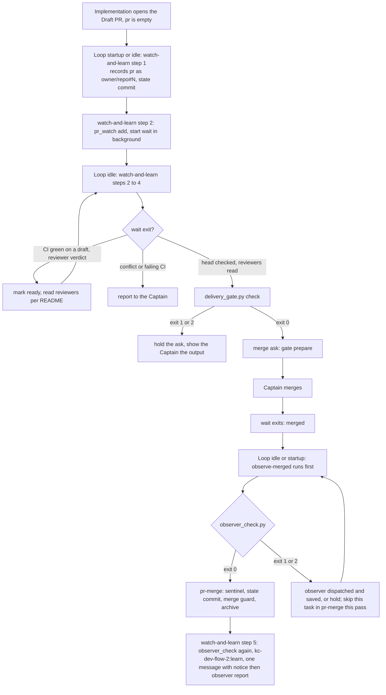

Filed on the Captain's 「開」 (2026-10-14) after an observer read of the spacedock-dev/subspace-relay FO session that delivered PR #362 (task `owner-sees-all-feedback-room`, kc-dev-flow-2 0.22.0). The FO never ran `pr_watch.py` for the PR and ran `merge guard` with no observer step and no learn. Both rules were in the adopter README, but FO read it in `sed -n` ranges up to line 480; `## Delivery authority` starts at line 492 and `## Extensions` at 538. The Captain asked whether the README is too long and whether to split or index it; the direction he approved is a mod keyed to Spacedock's lifecycle points rather than a longer README or read-sized slices.

## Scope

- Spacedock 0.27 already provides the index: mods in `{workflow_dir}/_mods/` with `## Hook: startup`, `## Hook: idle` and `## Hook: merge`, opened only at that lifecycle point and run alphabetically by filename (first-officer shared core, "Mod Hook Convention"). Adopters carry Spacedock's own `_mods/pr-merge.md`, copied unchanged; its `startup`/`idle` hooks handle a MERGED PR (sentinel, then `merge guard`) and its `merge` hook handles the PR at terminal approval.
- Candidate contents of a kc-dev-flow-2 mod:
  - `merge` (approved, before the merge ask): mark ready, wait for the post-ready Codex run, check the head against the validated candidate, `delivery_gate.py`, `pr_watch.py add`, then the merge ask.
  - `idle`: every open task PR has a `pr_watch.py wait` running in the background, else start it; advance an open learning delivery.
  - `idle`/`startup` on a MERGED PR, before the sentinel: `observer_check.py`, dispatching and saving the observer when absent.
  - after the archive: learn, with its notice and the observer report presented together.
  - `startup`: unread learn notices and open learning deliveries.
- Ordering: the observer step must run before `pr-merge`'s sentinel, so the mod's filename must sort before `pr-merge.md`; learn runs after the archive (a later pass, or a second file that sorts after it).
- The README keeps the rules as the authority and points to the mod; the FO steps moved out are expected to lower `WORKFLOW_WORD_BUDGET` (`## Delivery authority` 546 words, `## Extensions` 222 at origin/main 656543f4). How much moves is ideation's count.
- Dispatch-time rules (scope-notes lines, extension worker instructions) have no hook point and stay with script checks: tasks `followup-dispatch-records-checked` and `extension-instruction-reaches-dispatch`.
- Spacedock is not changed (the Captain's ruling); `pr-merge.md` stays an unchanged copy.
- Non-goals: to be set at ideation.

## Acceptance criteria

Replays read the relay state at `395edbd` (task `owner-sees-all-feedback-room` with its PR open: `git -C <relay state> log` 2026-10-13 23:11 +0800), the PR head `79ef8e756` and `<package>` the 0.22.1 package (origin/main `656543f4`). The design-time probes below were run 2026-10-14 with `spacedock` 0.27.2 on scratch copies outside the repository; the shipped files must reproduce them. Replay method, mod text and counts are in `## Design`.

- **AC-1** The two mod files sort around `pr-merge.md`, and `merge guard` still arms `pr-merge`. Evidence: in a scratch copy of Spacedock's `internal/status/testdata/merge-pr-workflow` fixture holding Spacedock's `mods/pr-merge.md` plus the two package files, `spacedock status --workflow-dir <w> --boot` prints `idle: observe-merged, pr-merge, watch-and-learn`, `merge: pr-merge` and `startup: observe-merged, pr-merge, watch-and-learn`, and `spacedock merge guard 020 --verdict passed --workflow-dir <w>` prints `armed: mod-block set to merge:pr-merge` (probe on the draft files: exactly these lines). The implementation puts both assertions in `kc-dev-flow-2/scripts/test_sd_dispatch.py`, already a CI step, and `git diff origin/main --stat -- '*pr-merge.md'` is empty. Falsifier: with `## Hook: merge` inside the file that sorts first (probe file `dev2-all`) the guard prints `armed: mod-block set to merge:dev2-all` and names only that hook; a `## Hook: merge` in either package file adds its name to the merge line (Captain amendment 1: the package ships no merge hook); renaming `watch-and-learn.md` to `learn-and-watch.md` moves it ahead of `pr-merge` in the idle and startup lines; the test fails on each.
- **AC-2** The README keeps the rules and loses the commands. Evidence: `python3 kc-dev-flow-2/scripts/lint-skills.py` exits 0 and prints `references/sd/workflow.md: N of M words` with N at most 5501 (5561 less 60; the drafts in `## Design` count 5483) and M equal to N after `WORKFLOW_WORD_BUDGET` is lowered with its reason line; `grep -c 'observer_check.py\|pr_watch.py\|delivery_gate.py' kc-dev-flow-2/references/sd/workflow.md` prints 0 and each name appears in a mod; the README still holds the five rules listed under `### README effect`. Falsifier: a passage copied instead of moved fails the lint's repeated-passage check (probe: four README lines copied into `references/sd/mods/` printed `repeats 55 words of references/sd/workflow.md`, exit 1); a README that still names a script fails the grep.
- **AC-3** Tests that pinned the old text follow the move, and a mod cannot name a script that does not exist. Evidence: `test_observer_check.py` (`NAMES_THE_CHECK`, `INSTRUCTION_FILES`) lists `references/sd/mods/observe-merged.md` in place of `references/sd/workflow.md`; the `pr-watch` entry of `FIXES` in `test_sd_dispatch.py`, which pins the `pr_watch.py` paragraph in `workflow.md` (`need` strings at the 'pr-watch' key), is re-pointed at `references/sd/mods/watch-and-learn.md` with the mod's wording; `test_sd_dispatch.py` fails when a `<package>/scripts/NAME` in either mod names no file under `scripts/`. Falsifier: `pr_watch.py` changed to `pr_watchh.py` in a mod turns the new test red, run under `python3 -B`; the lint does not catch it (probe: exit 0 for that typo), so this case is the only guard.
- **AC-4** Replay S1, the FO at the merge ask, starts the watch and checks the head. Evidence: Replay method, one control run (0.22.1 README, no mod files) and two mod runs, same model, same fixture; per run the record holds M1 `pr_watch.py add` ran, M2 `pr_watch.py wait` was launched with `run_in_background`, M3 `delivery_gate.py check` ran before the first `gate prepare` or message asking the Captain to merge, and the ordered tool calls to that point. Pass: M1 to M3 yes in both mod runs and at least one no in the control. Falsifier: a control that gets M1 to M3 all yes shows no bite; run two more controls, and if most controls are all-yes stop and bring that result to the Captain instead of shipping the mod as the fix. The relay run (0.22.0) is one more control datum: its first 1294 transcript lines hold no tool call naming `pr_watch`, `observer_check` or `delivery_gate`.
- **AC-5** Replay S2, the FO at the merged PR, runs the observer before the sentinel and learn after the archive. Evidence: Replay method with `gh` reporting MERGED and `observer.md` absent from the committed state, under two cues: a neutral `resume the workflow` and the Captain's words from the relay run verbatim (`合併了，你應該主動追蹤 362 是否合併`); one control and two mod runs per cue. Record M5 `observer_check.py` ran before the first `status --set <slug> pr=pr-merge:`, M6 on exit 1 a `kc-dev-flow-2:observer` dispatch (attempted, since the harness disallows `Agent`) or an `observer not run:` line committed as `observer.md` came before that `--set`, M7 a `kc-dev-flow-2:learn` call after the `merge guard` that archives, then one message with learn's notice and the observer report, M8 no `--set pr=pr-merge:` while the committed tree lacks `<slug>/observer.md`. Pass: M5 to M8 in both mod runs for both cues. Falsifier: a mod run that writes the sentinel before `observer_check.py` fails; controls that meet M5 and M6 show no bite; if only the verbatim cue fails, FO answered a chat cue without running the loop (a Limit), and the structural question goes to the Captain after at most two rewordings, per `maintain-flow`.
- **AC-6** The merge hook has bite or is deleted. Evidence: Replay S0, a fixture armed with `mod-block=merge:pr-merge`, the push granted in the prompt in the Captain's words and `gh pr create` stubbed; two mod runs record whether `pr_watch.py add` appears after `gh pr create` and before the next `merge guard`. Falsifier: if that happens in neither run (the watch starts only at idle) `## Hook: merge` is deleted from `watch-and-learn.md` and the `merge:` line in AC-1 loses it before release.
- **AC-7** Adopters receive and keep the files. Evidence: `references/sd/adoption.md` gains one step: copy `<package>/references/sd/mods/*.md` into `{workflow-dir}/_mods/` of every adopted workflow (here `docs/dev2` and `docs/dev2-poc`) in the change that re-syncs the README, then `cmp` each against the package copy and confirm the MODS lines of AC-1; running those commands on a scratch workflow gives `cmp` exit 0 and the lines. Falsifier: one appended byte makes `cmp` exit 1; deleting a copy removes its name from the MODS lines. Limit: nothing runs `cmp` by itself (decision D2).

## Captain amendments

### Amendment 1 — 2026-10-14, chat
Captain: 「1」 (chat, 2026-10-14)
Asked: 「這對 mod 的影響，二選一：1. 把早開 PR 變成正式規則（我建議這個）：刪掉 mod 的 merge hook，在 idle 步驟加一條「PR 開了就記下編號」。這保留合併前的審查，也補上合併後自動偵測的漏洞。代價是和套件原本的說明不一致，那句說明要跟著改，這個決定也應該寫成一份 ADR。 2. 改回套件原本的路：實作只做到 commit，PR 交給 merge hook 開。」
Supersedes: none
Design: the `watch-and-learn.md` `## Hook: merge` section and the flow steps that have `pr-merge`'s merge hook create the PR

### Amendment 2 — 2026-10-14, chat
Captain: 「改跑 3 次」 (chat, 2026-10-14)
Asked: 「要你決定的：剩下 9 次重跑還要跑嗎？建議不要全跑，改跑 3 次：修補完成後，跑「請你合併」那個情境有 mod 和沒 mod 各一次，再加一次中性提示的有 mod 版。」
Supersedes: none
Design: D3's remaining nine replay runs after the go signal

### Amendment 3 — 2026-10-14, chat
Captain: 「好，退回重做。」 (chat, 2026-10-14)
Asked: 「我的建議：不要在 #643 上繼續修補，讓它退回設計階段，照上面三點重做。理由是現在的設計前提「README 和 mod 各存一份」本身就是造成膨脹的原因，再怎麼修補也只會更長。已經證實有效的部分，也就是合併後先跑 observer，在重做的設計裡保留。」
Supersedes: none
Design: the whole `## Design` is redone at ideation: one home per step, script output carrying the next action, and acceptance measured on the total words FO reads at each moment

## Number guards

ADR: 0015

## FO alignment

Alignment: needed at ideation: the design changes what FO loads at three lifecycle points across every adopter.
Result: direction aligned with the Captain in chat on 2026-10-14, before filing. He asked whether the README is too long and whether to split it, index it, or chain read-sized slices with a hook index; FO answered that the reading length was not the cause (the relay FO chose `sed -n` ranges) and proposed a kc-dev-flow-2 mod on Spacedock's existing `startup`/`idle`/`merge` hook points, with the step list per point; he approved filing it (「開」) and scheduling it (「ok」). No research request; Spacedock is not changed.
Release review: not needed: workflow maintenance, on no journey map.
Surfaces: none
Visible change: none

## Design

### Chain check

- Spacedock (binary 0.27.2; plugin source read at 0.27.0, `skills/first-officer/references/first-officer-shared-core.md` "Mod Hook Convention", `fo-dispatch-core.md`, `internal/status/merge.go`, `internal/status/mutate.go` `scanMods`): mods in `{workflow_dir}/_mods/`, points `startup`, `idle`, `merge`; `hooks.run(point)` runs the registered mods "alphabetically by mod filename, exactly once at its caller boundary" and opens only registered bodies then; the boot MODS report lists names only. `idle` runs once, after the first empty `status --next`. `merge guard` arms `mergeHooks[0]`, the first merge-hook mod by name, and its output names that one hook. `spacedock:refit` compares `_mods/*.md` only with Spacedock's own `mods/`, so a package mod reads there as "custom, no action". Spacedock is not changed.
- Probe, 2026-10-14, scratch copies of `merge-pr-workflow`, entity `020`, `merge guard 020 --verdict passed`: (A) `pr-merge.md` alone arms `merge:pr-merge`. (B) a startup+idle file sorting before it and a merge+idle+startup file sorting after it: MODS `merge: pr-merge, <after file>`, still `armed: mod-block set to merge:pr-merge`. (C) one file with a merge hook sorting before it: MODS `merge: dev2-all, pr-merge`, `armed: mod-block set to merge:dev2-all — invoke the dev2-all merge hook (…/dev2-all.md …)`; `pr-merge`'s own merge hook, which creates the PR, is no longer named. The draft files below give B with their final names. The archived task `observer-before-merge-guard` measured the same arm rule on 2026-10-13 and rejected "a second mod with a merge hook" for the observer because that hook runs at PR creation; this design puts the observer on `startup`/`idle` and uses a merge hook only for the watch.
- kc-dev-flow-2 at origin/main `656543f4`: the FO steps sit in `references/sd/workflow.md` (`## Delivery authority` 546 words, `## Extensions` 222), in `extensions/*/EXTENSION.md` (per-extension FO text; the codex and copilot "Watch" lines already carry the `pr_watch.py add` flags) and in `skills/dev/SKILL.md`. The package ships no mod; its README says `pr-merge` is "installed into the adopting workflow, not vendored here" because that mod is Spacedock's. These two are the package's own, so the package is their upstream.
- Siblings: `kc-dev-flow` v1 `references/pr-merge-extension.md` appends a block to `pr-merge.md` (edits Spacedock's mod; excluded by the Captain's ruling). The dev2 workflows of relay (`docs/dev2/_mods`), this repository and qnow's `docs/dev2-poc` hold `pr-merge.md` alone (listed 2026-10-14); the ship-flow mods in carlove, qnow and here are adopter-authored and never synced, so they are no pattern for a package-owned file.
- ADRs and rulings: ADR 0003 (no harness hook shipped) does not apply, since a `_mods` file is a workflow file FO reads, not a `PreToolUse` hook. ADR 0014 accepted "a README match is a proxy, since a sync PR changes both together"; D2 reuses that proxy. `git -C <state> grep -n 'Override:'` (2026-10-14): no gate override bears on this.

### Evidence of the miss (read only)

Relay transcript `d2b0a847…jsonl`, 1443 lines, FO on `claude-opus-5-5`: the README was read in ranges whose highest line is 480 (line 311 of the transcript, `sed -n 460,480p`); `## Delivery authority` starts at 492. In its first 1294 lines no tool call names `pr_watch`, `observer_check` or `delivery_gate`. At 15:11 the FO started an ad hoc `gh pr checks 362 --watch` that ends when CI ends, not at merge. The Captain merged at 15:55:28 and told the FO at 15:55:49 (「合併了，你應該主動追蹤 362 是否合併」); the FO ran `gh pr view`, then `status --set … pr=pr-merge:362`, `state commit` and `merge guard` in one command (line 896) with no observer check, and ran the observer and learn at line 955 after being asked whether learn should run. Two corrections to the task's framing: the observer-before-sentinel sentence in the README arrived in 0.22.1 (#632); the 0.22.0 learn extension text already said "before `merge guard`", so the rule was in the package but not in the README it read. And the FO did follow the `dev` skill's entry rules (line 95: `workflow_checkout.py` and `learning.py notices`), so a rule read at the moment it applies was followed.

### PRFAQ

**Press release.** A first officer of a kc-dev-flow-2 workflow no longer has to remember its delivery steps from a 600-line README. When a PR is opened, when the loop goes idle, when a session starts, Spacedock's own hook points open a short file that names the step and its command: start the PR watch, check the head before asking to merge, run the observer before the sentinel, run learn after the archive. The README still says what is allowed; the files say when and which command.

**FAQ**

- *Why not split or index the README?* The relay FO chose ranges that stopped 12 lines short of the section; any index or slice still depends on FO choosing to read it. A hook is opened by the loop at the point.
- *Does the mod add authority?* No. Rules stay in the README and the learn extension; a mod line names a trigger, a command and where the rule is. Nothing here blocks a sentinel or an archive; Spacedock offers no such hold (`observer-before-merge-guard`, probe `p6`).
- *Why two files?* One file cannot precede `pr-merge.md` (the observer must run before its sentinel) and follow it (the PR must exist, the archive must be done). A merge hook in the first file changes what `merge guard` arms (probe C). Names are `observe-merged.md` (sorts before `pr-merge`) and `watch-and-learn.md` (after).
- *Why is the Scope's merge list not all in the merge hook?* `hooks.run("merge")` runs once, when the guard arms, before the PR exists. Mark ready, read the post-ready Codex run, check the head and ask are reactions to CI and reviewer changes, so they sit in `idle`, which the loop runs again and again. The merge hook only adds the PR to the watch.
- *Why do startup notices stay in `kc-dev-flow-2:dev`?* It already owns `learning.py notices --all` and the ack rule at entry, and the relay FO ran it (line 95). A second home would drift.
- *What if FO answers a chat cue without running the loop?* Then no hook fires; see Limits. `pr_watch.py wait` in the background is the other wake-up.

### Where each FO step goes

| FO step (task Scope) | Point | File | Command | README rule that stays |
| --- | --- | --- | --- | --- |
| add the PR to the watch | merge, and idle/startup as backstop | watch-and-learn | `pr_watch.py add` | none (paragraph removed) |
| keep a `wait` running for every open PR | idle, startup | watch-and-learn | `pr_watch.py wait` (background) | none |
| mark ready; read the post-ready Codex and Copilot runs | idle, on a `wait` exit | watch-and-learn | none new (`gh pr ready` under Delivery authority, reviewers per `## Extensions`) | ready under the Captain's authority; merge ask names unread reviewers |
| head equals the validated candidate | idle, before the merge ask | watch-and-learn | `delivery_gate.py check` | "a differing head is revalidated or told to the Captain" |
| the merge ask itself | not a hook step | README | `gate prepare` (present-gate) | whole `## Delivery authority` |
| observer check on a merged PR | idle, startup, before `pr-merge` | observe-merged | `observer_check.py` | "the sentinel waits for the committed observer report" |
| learn, notice and observer report together | idle, startup, after the archive | watch-and-learn | `observer_check.py` again, `kc-dev-flow-2:learn` | learn extension owns the exits |
| unread learn notices, open learning deliveries at entry | not moved | `kc-dev-flow-2:dev` | `learning.py notices --all` | as today |
| `merge guard --rework` after a rejected delivery | not moved | README | `merge guard --rework`, `state commit` | fires on a Captain direction, no lifecycle point |

Learn runs after the archive: `pr-merge`'s hooks archive through `merge guard`, and `watch-and-learn` sorts after them, so step 4 acts in the same hook pass on the tasks that hook reported archived. A session that dies between the archive and learn leaves no trace to scan, and learn stays a named-task operation, so that gap stays manual (Limits).

### Flow



### Mod text (the files the implementation ships; counted 155 and 305 words)

`kc-dev-flow-2/references/sd/mods/observe-merged.md`:

````markdown
---
name: observe-merged
description: kc-dev-flow-2 first-officer step: the learn observer check before pr-merge records a merged PR
---

# Observe a merged PR before its sentinel

Copied unchanged from kc-dev-flow-2 `references/sd/mods/observe-merged.md`. This file has no merge hook, and its name sorts before `pr-merge.md`: Spacedock runs a point's hooks in filename order, and `merge guard` arms the first merge hook by filename. `<package>` is the `Package root:` line of `kc-dev-flow-2:dev`.

## Hook: startup

Run the idle hook below.

## Hook: idle

Do nothing unless this README's `extensions:` lists `learn`. For each task whose `pr` is a bare reference, read the PR the way the `pr-merge` startup hook below does. For each one that is MERGED, before that hook records its sentinel, run `python3 <package>/scripts/observer_check.py <state> <slug>` and follow its exit as `<package>/extensions/learn/EXTENSION.md` ("FO step") says. On exit 1 or 2 leave that task out of the `pr-merge` hook below until a later pass shows exit 0.
````

`kc-dev-flow-2/references/sd/mods/watch-and-learn.md`:

````markdown
---
name: watch-and-learn
description: kc-dev-flow-2 first-officer steps: watch each open task PR, check the head before the merge ask, run learn after the archive
---

# Watch the PR, then learn

Copied unchanged from kc-dev-flow-2 `references/sd/mods/watch-and-learn.md`. Its name sorts after `pr-merge.md`: step 1 needs the PR that the `pr-merge` merge hook creates, and step 4 needs the archive that the `pr-merge` startup and idle hooks perform. `<package>` is the `Package root:` line of `kc-dev-flow-2:dev`.

## Hook: merge

Once the `pr-merge` merge hook has created the PR, do step 1 for it.

## Hook: startup

Do steps 1 to 3, then step 4 for each task the `pr-merge` startup hook archived.

## Hook: idle

Do steps 1 to 3, then step 4 for each task the `pr-merge` idle hook archived in this pass.

1. Watch. For each open task PR run `python3 <package>/scripts/pr_watch.py add <owner/repo>#<N>`, with the flags the "Watch" line of each listed reviewer extension names; repeating it is safe. Keep one `python3 <package>/scripts/pr_watch.py wait` running in the background: start it unless one started in this session has not exited.
2. Read an exit. A `wait` exit names the change. Act on it as this README's Delivery authority and Extensions sections say: mark ready where CI skips drafts, read each listed reviewer, report a conflict or failing CI to the Captain. A merge needs nothing here; the next idle pass runs `observe-merged`, then `pr-merge`.
3. Check the head. Before the `gate prepare` that asks for merge, run `python3 <package>/scripts/delivery_gate.py check <task> --pr <owner/repo>#<N> --text-file <question and summary>`. Exit 1 or 2 holds the ask; show the Captain what it printed.
4. Learn. Run `python3 <package>/scripts/observer_check.py <state> <slug>` once more and follow the learn extension's "FO step" for exit 1, then run `kc-dev-flow-2:learn` for the slug. Present learn's notice, then the observer report, in one message.
````

### README effect

Rules the README keeps as the authority: the observer report is committed before the sentinel (R1); a differing head is revalidated or told to the Captain (R2); Draft, ready-after-green and the Captain's authority over push, create, merge and ready; the merge ask names each listed reviewer not read; `merge guard --rework` and its `state commit`. Passages moved or removed, counted with the lint's metric (`len(text.split())`) on origin/main `656543f4`:

| Passage in `references/sd/workflow.md` | Words | Becomes | Words |
| --- | --- | --- | --- |
| Delivery authority, "Where `learn` is listed, run … together." | 31 | R1: "Where `learn` is listed, the sentinel waits for the committed observer report; the learn extension owns the check." | 18 |
| Delivery authority, "Before the `gate prepare` … told to him first." | 47 | R2: "A differing head is revalidated, or its difference told to the Captain, before the ask." | 15 |
| Delivery authority, the `pr_watch.py` paragraph | 49 | R3: "FO's steps at the startup, idle and merge points are in `_mods/observe-merged.md` and `_mods/watch-and-learn.md`, copied unchanged from `<package>/references/sd/mods/`; a missing or changed copy holds delivery, as for `pr-merge.md` above." | 29 |
| `### done`, "An archived task's state is publish-only … before the sentinel." | 13 | deleted (R1 carries the rule; `### done` already points to Delivery authority) | 0 |
| Total | 140 | | 62 |

Net minus 78: 5561 becomes 5483. `## Extensions` (222 words) holds no per-point FO step and is unchanged. The budget constant is lowered to the new count. `skills/dev/SKILL.md` keeps its observer sentence (package-owned, read at entry, as ADR 0014 argued for the README check) and `extensions/learn/EXTENSION.md` keeps the exit semantics.

### Sync

Adopters receive the two files by copy, byte for byte, in the change that re-syncs their README (a three-way merge today, `references/sd/adoption.md`): `<package>/references/sd/mods/*.md` into `{workflow-dir}/_mods/`, for `docs/dev2` and, since `poc_readme.py derive` carries Delivery authority over, `docs/dev2-poc`. Source lives under `references/sd/` so the lint's repeated-passage check covers it (probe above). `spacedock:refit` will report the files as custom and take no action; Spacedock's `fo-write-core` bars FO from writing `_mods/`, so the copy is a worker's or the maintainer's. Drift detection is D2.

### Replay method (S0, S1, S2)

`replay_dispatch.py` builds a worker dispatch from a closed task; `maintain-flow` says a rule only FO acts on cannot be replayed that way. The stated alternative is Spacedock's own live launch, as `internal/ensigncycle/claude_live_runner_test.go` (`run`, `withStubPATH`) does it: `spacedock claude --skip-compat-check -- -p "<cue>" --permission-mode bypassPermissions --output-format stream-json --verbose --model claude-opus-5-5 --disallowedTools Agent` in a scratch copy of the relay workflow (the 0.22.1 workflow text in relay's README shape, since `maintain-flow` prescribes the last release as the control and the 0.22.0 README the relay FO read lacks the observer sentence; state at `395edbd`, code at the PR head, a local bare origin for the state branch), with a stub `gh` first on `PATH` answering `pr view --json` for the fields `pr_watch.py` and `delivery_gate.py` read (state, isDraft, mergeable, headRefOid, statusCheckRollup, title) and `pr create`. Arms: control (that README, no mod files) and mod (the same README with R1 to R3 applied, the two files in `_mods/`). If the launcher drops `--disallowedTools`, run `claude --plugin-dir <spacedock checkout>` directly with the same flags. The record per run is the stream-json file and a table of M1 to M8 with the first twenty tool calls. The harness is disposable, kept outside the repository (a committed harness is a standing check, which Spacedock's rule reserves for the Captain). Cost is unmeasured until the first run; token usage is read from the stream, not the imputed `total_cost_usd`. Runs: S1 1+2, S2 two cues 1+2 each, S0 2, eleven in all, controls first.

### Limits

- Prose-enforced: a mod line is read only if FO invokes `hooks.run` at the point. In the relay run the FO answered the Captain's chat cue with `gh pr view` and the sentinel directly, never opening `pr-merge`'s idle hook (it had read that mod's merge hook, lines 631 and 724). AC-5's verbatim cue measures this; a failure there is the structural question, not a rewording.
- Nothing holds a sentinel or an archive; a task whose observer step is skipped is caught only by the post-archive `observer_check.py` in step 4.
- A session lost between the archive and learn leaves an archived task with no learn job; learn is not a scanner, so this stays a by-hand run.
- `pr_watch.py` state is a machine-local file (`~/.local/state/kc-dev-flow-2/pr-watch.json`) and its `wait` dies with the session; step 1 re-adds and relaunches at startup and idle.
- Two files to sync, and an ordering that rests on letters (`o` before `p` before `w`), pinned only by AC-1's test.

### Non-goals

Changing Spacedock or `pr-merge.md`; blocking the sentinel or archive mechanically; a drift-check script (D2); moving the FO steps keyed to gates or dispatch (review findings, decision records, number guards, scope-notes lines), which tasks `followup-dispatch-records-checked` and `extension-instruction-reaches-dispatch` own; making learn a scanner; changing `kc-dev-flow-2:dev`'s entry notices; a committed replay harness.

### Files shared with other tasks

`references/sd/workflow.md` and the `WORKFLOW_WORD_BUDGET` line of `scripts/lint-skills.py`: `followup-dispatch-records-checked` AC-6 raises the budget by about 20 words in a different paragraph; whichever merges second recomputes the number. `extension-instruction-reaches-dispatch` may edit stage text in the same file. This task also edits `references/sd/adoption.md`, `scripts/test_sd_dispatch.py`, `scripts/test_observer_check.py`, the package `README.md` row for `learn`, and adds `references/sd/mods/`.

### Existing-code check (bounded)

The README text, the learn extension and the `dev` skill already carry every step and the scripts exist; what fails is that FO does not open them at the moment (Evidence of the miss). The change moves the trigger and command to Spacedock's hook points and leaves the scripts, rules and extension text in place, and adds no script.

## Unresolved decisions for the Captain

- **D1 Two files named `observe-merged.md` and `watch-and-learn.md`, not one mod.** Recommend yes. Your direction said "a mod"; one file cannot both run the observer before `pr-merge`'s sentinel and learn after its archive, and a merge hook in the first file makes `merge guard` arm that file's name instead of `pr-merge` (probe C), which `pr-merge`'s own text and `test_sd_dispatch.py` (`hook == "pr-merge"`) read literally. Worse under yes: two files to copy to each workflow, the order rests on filename letters, and `observe-merged` tells FO to skip a task in the unchanged `pr-merge` hook's scan. Worse under one file sorted after `pr-merge`: the observer would run after the sentinel, which is today's miss.
- **D2 No new drift check; the sync is a copy plus `cmp` in `adoption.md`.** Recommend yes. A script that compares `_mods/` with the package is a standing check, which needs your approval, and ADR 0014 already accepted the README-sync-PR proxy. Worse under yes: a stale or edited copy is found only when the maintainer reads an adopter's first archived task after a release (`maintain-flow`, Observe adopters), not by a check. If you prefer the check, it is one more small script plus its tests, as a separate task.
- **D3 Replay spend: eleven headless FO sessions on `claude-opus-5-5` at validation, controls first, stop if the control already does the right thing.** Recommend yes. The model must match the relay run or the control proves nothing; cost is unmeasured until the first run and will be reported then. Worse under yes: real tokens before any merge. Worse under no: the mod ships on a reading of the text alone, which is the same evidence the README had.

Approving the design accepts D1 to D3 as recommended only if the gate question says so.

### Feedback Cycles

- Cycle 1 (FO, 2026-10-14): validation recommended PASSED on #643 33295355 (the D3 pair shows the mod's bite: the control archived with no observer report, the mod run ran `observer_check.py` first and withheld the sentinel). Codex review round 1 (review:5512425198) left two P1, both to fix (a P1 blocks in every round); investigation first, then FO fix authorization, then a fresh validation recheck. #642 merged into main meanwhile and #643 now conflicts on `references/sd/workflow.md` and `WORKFLOW_WORD_BUDGET`; the repair merges main and recomputes the budget. The validator's Polish on `skills/maintain-flow/SKILL.md` is recorded as `unaffected: names no budget value or FO step`.
  - P1 #643 `references/sd/workflow.md` (around line 522): the Draft-PR rule is declared but not wired: the implementation stage text and `skills/implementation/SKILL.md` never tell the worker to open a PR, and `Delivery authority` is not in the implementation stage's `context-sections`, so a conforming run reaches validation with no PR.
  - P1 #643 `references/sd/mods/watch-and-learn.md` (around line 22): the archive step runs the observer check and learn even when `learn` is not listed in `extensions:`.
- Cycle 2 (FO, 2026-10-14): validation cycle 2 recommended REJECTED on #643 d6a427aa on AC-4 only (the round-1 repair is sound; AC-1 to AC-3, AC-6, AC-7 hold). Replays under Captain amendment 2: S2 mod run under the neutral cue ran `observer_check.py` first and wrote no sentinel (as in cycle 1); the S1 mod run made 8 tool calls, never ran `status --boot` for `docs/dev2` and never opened a mod, under the cue 「請你合併」, which was FO's scenario label in amendment 2's question rather than a Captain utterance, so it is a weak datum; the S1 control ran `delivery_gate.py` after reading README lines 495 to 560, which name the command, while the candidate README no longer names it (a structural regression of the README move, independent of the cue). Codex review round 2 (review:5512622247) left one P1 and one P2, both to fix; the P1 needs the Captain's authority ruling, so the repair is held at the review-finding checkpoint until he rules, and the P2 joins the same repair.
  - P1 #643 `skills/implementation/principles.md` (around line 35): the worker's Draft-PR rule cannot be satisfied under the workflow's authority model, which requires the exact candidate and PR body to be presented before push and create, and neither exists at the implementation dispatch.
  - P2 #643 `references/sd/mods/watch-and-learn.md` (around line 18): after `merge guard --rework` clears `pr`, the record step's `--state all` query writes the old closed PR back, trapping the repair loop.

## Stage Report: ideation

- FAILED: A design (PRFAQ and Mermaid) for a kc-dev-flow-2 Spacedock mod with `## Hook: merge`, `## Hook: idle` and `## Hook: startup` sections (per-step placement, mod filename and order against `_mods/pr-merge.md`, learn relative to archive, README authority and counted word budget, adopter sync)
  Not started: held. `## FO alignment` records "Alignment: needed at ideation" and the task file has no `Result:` line (`grep -n "Result:"` finds none); `skills/ideation/principles.md` says to stop and report in that case, and README `### ideation` requires the `Result:` line before the worker is dispatched.
- FAILED: Acceptance criteria with reproducible evidence clauses and falsifiers, including a replay of the relay PR #362 situation with and without the mod
  Not started: held for the same reason; no `## Acceptance criteria` section was written.
- FAILED: Unresolved decisions for the Captain, each with a recommendation and what gets worse under it
  Not started: held for the same reason.

### Summary

Held before design: the alignment need is recorded without its result, and ideation principles make that a stop, not something the worker may fill from the dispatch notes. Nothing was designed, no repository file was touched, and no other session or PR was contacted. To release the hold, FO adds a `Result:` line under `## FO alignment` (or records that the backlog approval and dispatch scope notes are the alignment) and re-dispatches ideation.

## Stage Report: ideation (cycle 2)

- DONE: A design (PRFAQ and Mermaid) for a kc-dev-flow-2 Spacedock mod with `## Hook: merge`, `## Hook: idle` and `## Hook: startup` sections: for each FO step the task's Scope lists, keep it in the mod (naming the hook point, the README rule it carries and the command, for example /Users/kent/.claude/plugins/cache/kc-claude-plugins/kc-dev-flow-2/0.22.1/scripts/pr_watch.py, /Users/kent/.claude/plugins/cache/kc-claude-plugins/kc-dev-flow-2/0.22.1/scripts/observer_check.py and /Users/kent/.claude/plugins/cache/kc-claude-plugins/kc-dev-flow-2/0.22.1/scripts/delivery_gate.py) or leave it in the README with a reason; the mod filename and its order against _mods/pr-merge.md; where learn runs relative to the archive; what the README keeps as the authority and the word-budget effect, counted; and how adopters receive and keep the mod in sync
  `## Design` holds the chain check, PRFAQ, a step-by-step placement table, the Mermaid flow, both mod files in full, the counted README effect (140 words become 62, net minus 78, 5561 to 5483), sync, replay method and limits. The mod is two files, `observe-merged.md` (before `pr-merge`) and `watch-and-learn.md` (after), because one file cannot hold the observer before the sentinel and learn after the archive (probe C).
- DONE: Acceptance criteria with reproducible evidence clauses and falsifiers, including a replay of the relay PR #362 situation (an FO at the merge ask and at the merged PR) with and without the mod, using the package's replay helper /Users/kent/.claude/plugins/cache/kc-claude-plugins/kc-dev-flow-2/0.22.1/scripts/replay_dispatch.py or a stated alternative, with the measurement it records
  `## Acceptance criteria` holds AC-1 to AC-7; the helper builds worker dispatches only, so the stated alternative is a headless FO launch with a stub `gh`, measures M1 to M8 per run, eleven runs, controls first.
- DONE: Unresolved decisions for the Captain, each with a recommendation and what gets worse under it
  D1 two files, D2 no drift-check script, D3 replay spend; all three with a recommendation and what gets worse. No past `Override:` bears on them.

### Summary

The Scope's merge list does not fit the merge hook (it runs once, before the PR exists), so only the watch is added there and the rest sits in `idle`; the observer moves to `startup`/`idle` ahead of `pr-merge`, which the earlier `observer-before-merge-guard` design did not use. Two corrections to the task's framing: the observer-before-sentinel sentence reached the README only in 0.22.1 (the 0.22.0 learn extension already said "before `merge guard`"), and the relay FO did follow the `dev` skill's entry rules (transcript line 95), which supports loading a rule at the moment it applies. `design_surfaces.py check` printed `fo-lifecycle-mod.md: design surfaces presentable` (exit 0).

### Acceptance criteria: current evidence

- AC-1 order and arm target: probe on the draft files, 2026-10-14, spacedock 0.27.2, printed the three MODS lines and `armed: mod-block set to merge:pr-merge`; the one-file variant printed `merge:dev2-all`. The `test_sd_dispatch.py` assertions are not yet written.
- AC-2 README keeps rules, loses commands: word counts measured on the drafts (140 to 62, net minus 78); a four-line copy into `references/sd/mods/` failed the repeated-passage lint (exit 1, 55 words). The real edit and lint run are not yet done.
- AC-3 tests follow the move: probe showed the lint passes a mistyped script name (exit 0), so the new test is the only guard; R3 pasted into a scratch `workflow.md` passes the lint's package-path rule (exit 0 once the budget is raised); `test_sd_dispatch.py` `FIXES['pr-watch']` pins the paragraph being moved, so it is re-pointed; the tests are not yet written.
- AC-4 replay S1: not yet verified; one control datum exists (relay transcript, first 1294 lines: no `pr_watch`, `observer_check` or `delivery_gate` call).
- AC-5 replay S2: not yet verified; the relay run is one control (sentinel at line 896 with no observer check).
- AC-6 merge hook bite: not yet verified (S0 replay).
- AC-7 adopter copy and `cmp`: not yet verified; the commands are stated, nothing was run.

## Stage Report: implementation

Stopped before any code change: the merge-hook check does not match the design's flow. No file in the worktree is changed (branch spacedock-ensign/fo-lifecycle-mod is at origin/main 656543f4).

- FAILED: One Draft PR (feat(kc-dev-flow-2): ...) with the two mod files, README edits R1 to R3, budget, adoption step, package README row and tests
  Not started; blocked on the merge-hook question below (it changes `watch-and-learn.md`, R3, AC-1's `merge:` line and AC-6).
- DONE: Before writing the merge-hook line: how Spacedock's pr-merge merge hook behaves when the task's pr field is already set
  Source, 0.27.0 `internal/status/merge.go` (MergeGuard classifier): `case pr != ""` returns `signalBlocked` before `arm` is reached, so a bare `pr` at guard time means no merge hook runs at all. `mods/pr-merge.md` `## Hook: merge` has no branch for an existing PR: it pushes, runs `gh pr create`, then "Set the entity's `pr` field".
  Probe 2026-10-14, spacedock 0.27.2, scratch copy of `merge-pr-workflow` holding only `pr-merge.md`: `merge guard 020 --verdict passed` (pr empty) prints `armed: mod-block set to merge:pr-merge`; the same entity with `pr: "#42"` prints `blocked: PR #42 is pending — mod-block left intact, never finalize on an open PR.` and arms nothing.
  In this workflow the worker's Draft PR exists before delivery and `pr` is empty: `followup-dispatch-records-checked.md` has no `pr:` value at validation with #642 open and its delivery approved. So the guard arms, but pr-merge's unchanged merge hook then meets a PR that already exists, which its text does not cover.
- SKIPPED: roborev evidence= line, CI green, lint-skills.py green, CI cost
  No candidate exists.

### Summary

The design's flow (node "pr-merge drafts, asks, pushes, creates the PR", then `watch-and-learn` merge hook "once the pr-merge merge hook has created the PR") assumes the PR does not exist at the guard. Here it does, so there are two cases: `pr` empty at guard, the watch-and-learn merge hook fires after a pr-merge hook whose create step has nothing to do; `pr` already set, no merge hook fires and the watch starts only from startup/idle. FO needs to choose between rewording the hook line or deleting it now (AC-6's own fallback), before the mod text is written.

## Stage Report: implementation (cycle 2)

Resumed after Captain amendment 1. PR #643 (Draft) https://github.com/iamcxa/kc-claude-plugins/pull/643, branch spacedock-ensign/fo-lifecycle-mod, head f0f5141a off origin/main 656543f4 (commits b8ae3b08, f0f5141a).

- DONE: Apply Captain amendment 1 (delete ## Hook: merge from watch-and-learn.md, record pr at startup and idle, drop watch-and-learn from AC-1's merge line, adjust the flow)
  `watch-and-learn.md` has startup and idle only; step 1 records `pr` as owner/repo#N for a worktree branch with a PR in any state (`--state all --limit 1`: an open-only query would miss a PR merged between passes), `status --set` then `state commit`. In this task file AC-1 now reads `merge: pr-merge` and `### Flow` starts at the worker-opened PR (state commit with this report; AC-6 left as written, now moot).
- DONE: Change the references/sd/workflow.md sentence "Use SD's pending terminal approval and existing merge hook; do not invent another PR stage"
  Replaced by the implementation-opens-Draft-PR rule citing ADR 0015; counted in the budget.
- DONE: Draft ADR 0015 in docs/adr
  `0015-the-implementation-worker-opens-the-draft-pr-before-validation.md` with the Captain's 「1」 and his option text, the rejected option and the merge-guard probe; `adr_lint.py docs/adr --since 656543f4` 15 files 0 legacy; `number_guards.py check` PASS no findings.
- DONE: The original implementation checklist: mod files, README R1 to R3 and the ### done deletion, budget, adoption.md, package README row, tests; AC-1 to AC-3 and AC-7 green with each falsifier shown failing by a mutation run
  AC-1, AC-3, AC-7 green; AC-2 NOT as written: `lint-skills.py` prints 5513 of 5513 and AC-2 says N at most 5501; the 12 words over (30 over the design's 5483) are amendment 1's Draft-PR sentence, FO and validation to rule. Mutations under `python3 -B`: merge hook in either mod fails `assert lines["merge"] == "pr-merge"`, and with that line removed the guard assertion fails (`hook: observe-merged`); README passage copied into a mod fails the lint (`repeats 92 words`); `pr_watchh.py` in a mod passes the lint and fails `test_sd_dispatch.py`; reverting the `--state all` pin or the `Keep one` wording fails its FIXES entry; observe-merged without `observer_check.py` fails 2 `test_observer_check.py` subtests; omitting the `pr` set fails the blocked assertion; scratch workflow: `cmp` 0, one appended byte `cmp` 1, deleted copy drops its name from MODS. Limit: a rename of watch-and-learn.md is caught by the names assertion, not an order assertion.
  Deviations from the approved `### Mod text` beyond amendment 1: steps renumbered 1 to 5; `description:` of watch-and-learn names record; the "`merge guard` arms the first merge hook by filename" clause is dropped from observe-merged (its merge-line test replaces it); the record step uses `--state all`.
- DONE: roborev evidence= line, CI green, lint-skills.py green, CI cost measured or stated as not measured
  `evidence=roborev:653` on f0f5141a (exit 1; run 1 on b8ae3b08 was `roborev:652`, exit 1; no re-run, no finding in scope). Findings for FO: (653) a failed observer check cannot stop `pr-merge`'s own scan from writing the sentinel, the design's recorded limit; (652) the mods are not copied into `docs/dev2` and `docs/dev2-poc`, the post-release sync the brief bars. CI green on f0f5141a (`gh pr checks 643`: unit tests 46 s, version parity 1m16s, route gate, GitGuardian). `lint-skills.py` exit 0; all CI-list scripts exit 0 locally on b8ae3b08. Cost: no new job or step; main baseline not measured, so the delta is not measured.

### Summary

The package ships `observe-merged.md` and `watch-and-learn.md`, the README keeps the rules, and ADR 0015 records the Captain's ruling. Open for FO: AC-2's 5501 bound (5513), the two roborev findings above, the adopter copies after release, the AC-4/AC-5 replays (validation's), and the budget recompute by whichever of #642 and #643 merges second.

## Stage Report: implementation (cycle 3)

Applied the FO ruling on #643 f0f5141a: AC-2 kept as written. PR #643 (Draft) head 33295355, branch spacedock-ensign/fo-lifecycle-mod off origin/main 656543f4.

- DONE: Bring references/sd/workflow.md to at most 5501 words by trimming at least 12 words inside the passages this PR touches, dropping none of the five README-effect rules, the Draft-PR rule or the clause #642 adds
  `lint-skills.py` prints 5495 of 5495 (6 under the 5501 bound): removed the rationale clause "so external review runs before the delivery gate" (ADR 0015 carries it) and the sentence "The pr-merge hooks run the sentinel and `merge guard` together" (the `pr-merge` mod says it). Each rule still greps once: `sentinel waits for the`, `differing head is revalidated`, `create a Draft PR where required`, `A merge ask names each listed reviewer`, `merge guard --rework`, `opens the Draft PR before validation`. #642's clause is not in this tree (it lives on #642's branch) and I did not touch the Stages follow-up sentence.
- DONE: Lower WORKFLOW_WORD_BUDGET to the new count with its reason line, rerun the suite and the AC-2 evidence commands
  Budget 5495, reason line "# 5495: -66 net: ..." in `lint-skills.py`. `lint-skills.py` exit 0; every CI-list script exit 0 locally including `test_sd_dispatch.py` (0.27.2 binary); `grep -c 'observer_check.py\|pr_watch.py\|delivery_gate.py' references/sd/workflow.md` prints 0; each name appears in a mod.
- DONE: Commit (named files only), roborev, push without force, CI green
  Commit 33295355 (workflow.md, lint-skills.py). `evidence=roborev:654` on 33295355, exit 1: one High, the mods are not copied into `docs/dev2` and `docs/dev2-poc` (the post-release sync the brief bars; no finding in scope, no re-run). The other High, `roborev:653`, is the design's recorded limit for validation to judge. CI green on 33295355 (`gh pr checks 643`: unit tests 53 s, version parity 56 s, route gate, GitGuardian).

### Summary

AC-2's bound is met: 5495 words against 5501. AC-6 is met by the merge-hook deletion. Remaining for FO: the two roborev findings above, the adopter copies after release, the AC-4/AC-5 replays, and the budget recompute by whichever of #642 and #643 merges second.

## Stage Report: validation

Verdict PASSED for PR #643 head 33295355 (base 656543f4), on AC-1, AC-2, AC-3, AC-6 (met by the merge hook's deletion) and AC-7, with the replay go signal below and AC-4 and the full AC-5 matrix not run (Captain limited the spend to the S2 pair).

- DONE: Independent verdict on #643 head 33295355 against AC-1 to AC-3, AC-6 and AC-7, re-running each evidence command and at least one falsifier per criterion, and judging the two roborev High findings
  Ran at the candidate (throwaway worktree, since removed): `lint-skills.py` exit 0, `5495 of 5495 words` (bound 5501); grep of the three script names in `workflow.md` prints 0, each name is in a mod; `test_sd_dispatch.py --sd-plugin-root <spacedock 0.27.0 cache>` exit 0 with the mods line; `test_observer_check.py` 16 tests OK; `git diff 656543f4 33295355 -- '*pr-merge.md'` empty; `comment_ratio.py` exit 0 (1 of 42, 2.4%); `design_surfaces.py check` exit 0; `dispatch_records.py` 6 records complete. Falsifiers run on a scratch copy of the head: AC-1 a merge hook appended to either mod fails `assert lines["merge"] == "pr-merge"`; renaming `watch-and-learn.md` fails (FileNotFoundError on the file `FIXES` pins, so this rename is caught by the pinned name, not by an order assertion); AC-2 a README passage copied into a mod prints `repeats 63 words`, exit 1, and a script name added to `workflow.md` makes the grep print 1; AC-3 `delivery_gate.py` mistyped in a mod passes `lint-skills.py` (PASS) and fails `test_sd_dispatch.py` with `['watch-and-learn.md: delivery_gatee.py']`; AC-7 `cmp` exits 0 on both copies and 1 after one appended byte. Judgments, by the workflow's Review-finding disposition: roborev:653 is Deferred risk (design Limits, first two bullets: nothing holds a sentinel; in the mod run below FO ran `observer_check.py`, got exit 1 and withheld the sentinel; it becomes Material if a mod-arm run writes `pr=pr-merge:` after exit 1). roborev:654 is Deferred risk (design `### Sync` and D2: the copy is made in the README re-sync change after release, and `adoption.md` now says so; this PR changes no adopter README, so no adopter is yet told the mods exist; it becomes Material if a re-sync lands R3 without both copies, which the `cmp` step in `adoption.md` exists to catch).
- DONE: The D3 go/no-go replay as the approved design's Replay method describes it, limited to the S2 pair under the Captain's verbatim cue
  Launch, both arms: `cd <arm>/relay; PATH=/tmp/replay-s2/bin:$PATH spacedock claude --plugin-dir <spacedock 0.27.0 cache> --skip-compat-check --no-install -- -p '合併了，你應該主動追蹤 362 是否合併' --permission-mode bypassPermissions --output-format stream-json --verbose --model claude-opus-5-5 --disallowedTools Agent` (spacedock 0.27.2; `--help` confirms the launcher; `--plugin-dir` added because the live runner uses it). Harness in `/tmp/replay-s2` (`setup.sh`, `run.sh`, `extract.py`, stub `bin/gh` that answers only PR 362 of the relay repo as MERGED and exits 1 on anything else): per arm a bare origin in the scratch dir, relay `main` at 54a4e096 (0.22.1 README), state branch at 395edbd, worktree at PR head 79ef8e756, `pr: 362`, no `observer.md`; mod arm = the same tree with the candidate's `workflow.md` diff applied to that README plus both mod files. Control M5 no, M6 no, M7 no, M8 violated: 18 tool calls, `pr=pr-merge:362` then `merge guard` in one command (call 14), task archived with no `observer.md` (archive commit 7797094 in the scratch state), no `observer_check.py` call. Mod M5 yes (call 16, exit 1, after reading `observe-merged.md` and `watch-and-learn.md` at calls 11 to 13), M6 not met as written (call 18 `ToolSearch select:Agent,Task` found no tool; FO held and asked the Captain instead of an `observer not run:` line), M7 not reached (nothing archived, so no learn), M8 yes (no sentinel, task still in validation with `mod-block`). Mod first twenty calls: Skill first-officer, gh/git status, two reads of first-officer core, `status --boot`, four task/PR searches, two reads of fo-write/fo-merge core, three reads of the mods, `observer_check.py`, Skill and plugin lookups, ToolSearch for Agent, pr_watch inspection. Tokens from the stream result, opus-5-5: control input 36, cache-creation 61,155, cache-read 932,496, output 5,204 (haiku side call 1,184 in, 213 out); mod input 40, cache-creation 69,922, cache-read 1,237,906, output 5,825 (haiku 1,184 in, 20 out); 20 and 22 turns, 81 s and 92 s; `total_cost_usd` not used. Result: go for S2 on the verbatim cue (one pair, no variance estimate). The sessions ran under the Captain's real `~/.claude` config, not an isolated HOME; real `~/.local/state/kc-dev-flow-2/pr-watch*` checksums are unchanged after both runs (the mod-run FO read that file). No other replay was run.
- DONE: A minimal acceptance script the Captain can run (three to six steps), run by me exactly as written in a fresh shell from a named checkout, with its observed output
  Six steps, saved in the state checkout as `fo-lifecycle-mod/validation/acceptance.sh` (the replay's per-run tool-call lists, `gh` call logs and stub are beside it as `replay-s2-*`; raw streams are not committed), run from a copy at `/tmp/replay-s2/acceptance-643.sh` with `env -i HOME="$HOME" PATH="$PATH" TERM=dumb bash --noprofile --norc /tmp/replay-s2/acceptance-643.sh`: it adds a throwaway worktree of `/Users/kent/conductor/workspaces/kc-claude-plugins/colombo` at 33295355, then prints `5495 of 5495 words` exit 0; `0` and the four script-name lines in the two mods; `PASS: the two package mods sort around pr-merge.md in every hook line, merge guard still arms pr-merge, a recorded pr arms no hook, and no mod names a package script that does not exist` exit 0; `cmp exit 0` then `cmp exit 1`; `15 ADR file(s) checked, 0 legacy` exit 0; `cleanup done`. It does not cover FO behavior at the lifecycle points (AC-4, the second cue, the observer dispatch and learn legs) or the adopter copies.
- DONE: adr_lint.py docs/adr --since <base> and number_guards.py check run with their exit codes
  `python3 <package>/scripts/adr_lint.py docs/adr --since 656543f4` exit 0 (15 files, 0 legacy), also exit 0 with `--require 0015`; `python3 <package>/scripts/number_guards.py check --workflow-dir <dir> --task <task>` exit 0 (`PASS: no findings`, base 656543f4, head 33295355, migration guard skipped: no migrations-path).

### Findings

- Polish: `doc_impact.py 656543f4 33295355` lists `README.md` (updated), `references/sd/adoption.md` (updated) and `skills/maintain-flow/SKILL.md`; no implementation report records `updated` or `unaffected` for them. My reading: maintain-flow mentions `lint-skills.py` and its budget in general terms only, so `unaffected: names no budget value or FO step`. FO may record that or ask implementation to.
- Deferred risk: roborev:653, roborev:654 (above).
- Unverified obligations: AC-4 (S1 replay not run); AC-5 for the neutral cue and for a second mod run; the observer-dispatch (M6) and learn-after-archive (M7) legs, because the harness disallows `Agent`; behavior of `watch-and-learn` step 1 (record `pr`) and `pr_watch.py add` in a live FO; budget recompute by whichever of #642 and #643 merges second; adopter copies after release.

### Summary

All five criteria in scope hold at 33295355 with a falsifier run for each, and the S2 pair shows the bite: the control archived the task with no observer report, the mod run ran `observer_check.py` first and withheld the sentinel. Not shown: the observer dispatch and learn legs, the neutral cue, S1, and any variance. Both roborev Highs are the design's recorded limits and the post-release sync; neither is Material today.

## Stage Report: implementation (cycle 3, Codex round-1 repair)

- DONE: Investigation first, with no candidate change: reproduced both Codex round-1 P1 findings on #643 head 33295355, reported per finding with a proposed fix, merge of origin/main and the budget recomputed
  P1-1: the worker's stage definition (`show-stage-def --stage implementation`) and skills/implementation/* held no PR-opening instruction; the only source was FO's freehand scope-notes line (dispatch/implementation-1.md "Open as Draft"). P1-2: `observe-merged.md` gates on `extensions:` listing `learn`, `watch-and-learn.md` step 5 did not. Report sent to main; FO authorized the fixes.
- DONE: The fixes with tests that fail without them (shown failing by a mutation run)
  P1-1: grant-conditioned Draft-PR sentence in skills/implementation/principles.md (worker-visible layer; Delivery authority reaches no stage by design, test_sd_dispatch.py "FO-only section reached a stage"). P1-2: step 5 of watch-and-learn.md starts "Learn, only where this README's `extensions:` lists `learn`; otherwise skip this step." Mutation, `python3 -B test_sd_dispatch.py`: deleting the principles sentence fails only `worker-opens-draft-pr` (its three need strings missing); reverting the step-5 clause fails only `learn-step-needs-learn`; restored tree passes. The 20 other CI test scripts pass locally.
- DONE: Main merged in (no rebase, no force), WORKFLOW_WORD_BUDGET recomputed with its reason line, AC-2's bound re-checked
  Merge commit d6a427aa (parents 33295355, 0cdb40a7); the only conflict was the budget lines in lint-skills.py, both comment lines kept. workflow.md merged at 5515, trimmed 14 words in the touched Delivery-authority passages (dropped "as `<owner/repo>#<N>`" and ", as for `pr-merge.md` above", shortened two phrases; R1 to R3, the Draft-PR rule and #642's clause kept) to 5501; `WORKFLOW_WORD_BUDGET = 5501`, `lint-skills.py` prints `references/sd/workflow.md: 5501 of 5501 words`. AC-2's literal bound 5501 holds.
- DONE: Push to #643's branch; CI green on the new head
  Pushed 33295355..d6a427aa, no force. `gh pr checks 643`: unit tests (python3), multi-profile route gate (live Spacedock), version parity, GitGuardian all pass on d6a427aaacc21cffdcb6ee9d8652cce3eb3d5080 (run 38504617746 headSha confirmed).
- DONE: roborev gate before the push
  `roborev_gate.py --repo <worktree> --base 0cdb40a7` ran once: `findings on d6a427aaa; evidence=roborev:655`, one High, left unfixed (see below); no second run since nothing in scope to fix.

### Summary

Both P1 findings are fixed, tested with named falsifiers, and #643 is green at d6a427aa with main merged and workflow.md at 5501 words. Left for FO: the roborev High (principles.md: adopted `docs/dev2` and `docs/dev2-poc` lack the new mods, so after a plugin update an adopter whose README is not yet re-synced would have workers open the Draft PR while `pr` stays empty and `pr-merge`'s merge hook could try `gh pr create` again) is the recorded post-release sync (ADR 0015 Consequences, adoption.md), and I made no adopter copies as instructed. The trim removed the `<owner/repo>#<N>` format from workflow.md; it remains in principles.md and watch-and-learn step 1. Validation recheck not run by me.

## Stage Report: validation (cycle 2)

Verdict REJECTED for PR #643 head d6a427aa (base origin/main 0cdb40a7) on AC-4 only; the cycle-1 repair itself is sound and AC-1 to AC-3, AC-6 and AC-7 hold. The one S1 mod run missed M1 to M3, and the way back is a Captain decision, not a worker repair.

- DONE: Independent recheck of the cycle-1 repair on #643 head d6a427aa (merge of origin/main 0cdb40a7): both Codex round-1 P1 findings (the Draft-PR rule not wired into the implementation worker; the watch-and-learn archive step running without learn listed) reproduced fixed against 33295355, each new FIXES entry shown failing under a revert you run yourself, the merge with #642 correct (the #642 clause kept, AC-2's 5501 bound met), AC-1 to AC-3, AC-6 and AC-7 re-run at the new head with any change from validation cycle 1 named, and the roborev:655 High judged against ADR 0015's Consequences and the post-release sync
  P1-1 reproduced at 33295355 (throwaway worktree): no "Draft PR" or `gh pr create` text in `skills/implementation/` and none in the `### implementation` stage text; fixed at d6a427aa by a grant-conditioned sentence in `skills/implementation/principles.md`, which the implementation skill loads (Delivery authority reaches no worker stage by design). P1-2 reproduced: step 5 at 33295355 ran `observer_check.py` and `kc-dev-flow-2:learn` with no `extensions:` condition; at d6a427aa step 5 starts "Learn, only where this README's `extensions:` lists `learn`; otherwise skip this step." Reverts on scratch copies, `python3 -B test_sd_dispatch.py --sd-plugin-root <spacedock 0.27.0 cache>`: principles.md from 33295355 fails only `worker-opens-draft-pr` (three need strings missing); watch-and-learn.md from 33295355 fails only `learn-step-needs-learn`; both are text pins, so neither proves FO behavior. Merge: `merge-tree 33295355 0cdb40a7` conflicts only in `lint-skills.py` (both budget comment lines kept); #642's "including the `Package root:` line and a checklist" clause is in workflow.md once; 0cdb40a7 to d6a427aa leaves `dispatch_records.py` and `test_dispatch_records.py` unchanged; `workflow.md` 5501 words (origin/main 5581); `git diff origin/main --stat -- '*pr-merge.md'` empty. Re-runs at d6a427aa: lint exit 0 `5501 of 5501`; grep of the three script names in workflow.md prints 0; `test_sd_dispatch.py` exit 0 (43 fixes); the other 20 CI-list scripts exit 0; `comment_ratio.py` 1 of 53 (1.9%); `design_surfaces.py check` exit 0. Falsifiers: merge hook appended to a mod fails `lines["merge"]` assert; 122 README words copied into a mod prints `repeats 122 words`, exit 1; `delivery_gatee.py` in a mod passes lint (exit 0) and fails the test with `['watch-and-learn.md: delivery_gatee.py']`; `cmp` 0 then 1. Changes from cycle 1: budget 5495 to 5501, 43 fixes (two new), AC-6 still met by deletion. roborev:655 is Deferred risk: ADR 0015 Consequences names it, adoption.md owns the copy in the re-sync change, and the same state exists today because FO's freehand scope notes already have workers open the PR; it becomes Material if a release lands before docs/dev2 and docs/dev2-poc are re-synced and a task reaches `merge guard` with `pr` empty (pr-merge's merge hook would then run `gh pr create` for a branch that has one; my reading of its text, not run).
- DONE: The three replay runs of Captain amendment 2, with the harness and launch method of validation cycle 1 (stub gh, model claude-opus-5-5, Agent disallowed) on the new head: S1 at the merge ask, one control run without the mod files and one mod run (record M1 to M4 per the design); S2 under the neutral cue "resume the workflow", one mod run (record M5 to M8); per run the first twenty tool calls and the token usage read from the stream; run no other replay
  Launch as in cycle 1 (`spacedock claude --plugin-dir <spacedock 0.27.0 cache> --skip-compat-check --no-install -- -p <cue> --permission-mode bypassPermissions --output-format stream-json --verbose --model claude-opus-5-5 --disallowedTools Agent`, spacedock 0.27.2), harness copied to `/tmp/replay-c2` (`replay-c2-*` beside this report); stub `gh` now answers PR 362 as OPEN and CI green for S1 (`GH_STUB_MODE=open`) or MERGED for S2; the mod fixture is the relay README plus the candidate's workflow.md diff 0cdb40a7..d6a427aa and both mods; a `python3` shim on PATH gives only `pr_watch.py` a scratch HOME so the Captain's real watch list is not written (it never fired; real `~/.local/state/kc-dev-flow-2` checksums unchanged). S1 cue is 「請你合併」 from amendment 2, my choice of exact words. S1 control (23 calls, 26 turns, 88 s): M1 no, M2 no, M3 yes by the letter (calls 20 and 21 ran `delivery_gate.py check`, both exit 2: slug given instead of the task path, then "no passing validation report names a candidate", because the real relay report says "Verdict recommended: PASSED" and the script wants "Verdict PASSED"), the head was then compared by hand, no gate prepare, FO told the Captain to merge himself. S1 mod (8 calls, 10 turns, 40 s): M1 no, M2 no, M3 no; the FO listed `docs/dev`, never ran `status --boot` for `docs/dev2` and opened only `docs/dev/_mods/pr-merge.md`, never `docs/dev2/_mods/`, read PR 362 with `gh` and answered, citing AGENTS.md, that only the Captain merges. S2 mod, neutral cue (21 calls, 25 turns, 181 s): M5 yes (`observer_check.py` at call 17, exit 1, after reading `observe-merged.md` and `watch-and-learn.md` at call 9), M6 not met as written (calls 18 and 19 searched for an Agent tool and found none; FO held and offered `observer not run:` as the alternative), M7 not reached, M8 yes (no `status --set pr=pr-merge:`, entity still in validation, no `observer.md`). Tokens, opus-5-5 stream result: control input 48, cache-creation 83,688, cache-read 1,638,257, output 7,419; S1 mod 18 / 50,001 / 413,781 / 3,257; S2 mod 44 / 89,439 / 1,533,788 / 6,372; `total_cost_usd` not used. First twenty calls per run are in `replay-c2-<run>-tool-calls.txt`. One run per cell, no variance estimate.
- DONE: The minimal acceptance script updated to the new head, run by you exactly as written in a fresh bash shell, with its observed output
  Six steps in `fo-lifecycle-mod/validation/acceptance.sh`, run from a copy with `env -i HOME="$HOME" PATH="$PATH" TERM=dumb bash --noprofile --norc /tmp/replay-c2/acceptance-643.sh` (needs the colombo checkout, the 0.22.1 package and the spacedock 0.27.0 cache, all named in its first lines): worktree at d6a427aa; `5501 of 5501 words` exit 0; `0` and the four script-name lines; `exit 0`, the `PASS: the two package mods sort around pr-merge.md ...` line, `learn-step-needs-learn`, `worker-opens-draft-pr`; `cmp exit 0` then `cmp exit 1`; `15 ADR file(s) checked, 0 legacy` `adr_lint exit 0` and `number_guards exit 0` with `PASS: no findings`; `cleanup done`. It does not cover S1, FO behavior at the lifecycle points or the adopter copies.
- DONE: /Users/kent/.claude/plugins/cache/kc-claude-plugins/kc-dev-flow-2/0.22.1/scripts/adr_lint.py docs/adr --since <base> and /Users/kent/.claude/plugins/cache/kc-claude-plugins/kc-dev-flow-2/0.22.1/scripts/number_guards.py check run at the new head with their exit codes; verdict PASSED or REJECTED naming the head, with findings classified by the workflow's Review-finding disposition
  `adr_lint.py docs/adr --since 0cdb40a7` exit 0 (15 files, 0 legacy), also exit 0 with `--require 0015`; `number_guards.py check --repo <worktree> --workflow-dir docs/dev2 --base 0cdb40a7 --task <state>/fo-lifecycle-mod.md --head d6a427aa` exit 0 (`PASS: no findings`; migration guard skipped, no migrations-path). Verdict REJECTED for d6a427aa on AC-4.

### Findings

- Needs decision (AC-4, `value-ac[AC-4]`): AC-4 passes only when M1 to M3 are yes in the mod run and at least one is no in the control. The S1 mod run did none of M1 to M3, so the criterion is unmet; the control had M1 and M2 no, so the mod run showed no bite. On M3 the direction is against the mod on this pair: the control FO ran `delivery_gate.py` after reading README lines 495 to 560 (call 13), where 0.22.1 still names the command, while the mod README's R2 passage names none and the mod FO read no `docs/dev2` text (n=1 each). Released user and workflow: a kc-dev-flow-2 adopter's FO told in chat to merge. Harm: the PR is never added to the watch, so a later merge is again found only when told. Trigger evidence: `replay-c2-s1-mod-tool-calls.txt`, calls 1 to 8. This is the design's Limit 1 (a mod line is read only if FO runs the lifecycle point) and AC-5's rule for a chat cue: the structural question goes to the Captain, and I ran no rewording because amendment 2 allowed three runs. Options for the Captain: record AC-4 as a known limit and ship, amend AC-4, or change where the rule is loaded; any is a scope call the worker cannot own. A repair of the implementation text cannot make an FO boot a workflow it never booted.
- Deferred risk: roborev:655 (above); roborev:653 and :654 as in cycle 1. `delivery_gate.py` exits 2 on a real relay report whose verdict line reads "Verdict recommended: PASSED": the script is not in this diff; it becomes Material if a mod-driven FO is held on every such report.
- Polish: `doc_impact.py 0cdb40a7 d6a427aa` lists `skills/maintain-flow/SKILL.md` as `review`; unchanged from cycle 1: `unaffected: names no budget value or FO step` is FO's to record.
- Unverified obligations: S1 variance (one mod run, one control); M6 and M7 legs (the harness disallows Agent); behavior of `watch-and-learn` step 1 (record `pr`) and of step 5 under a README without `learn` (text pins only); the second S2 cue; budget recompute by whichever of #642 and #643 merges second; adopter copies after release.

### Summary

Both Codex P1s reproduce at 33295355 and are fixed at d6a427aa with a falsifier each, the merge with #642 is correct and workflow.md is at 5501 words. The replays split: the neutral-cue S2 run again ran the observer check first and wrote no sentinel, but the S1 mod run never opened the mods, so AC-4 is unmet and the choice of how to proceed is the Captain's.
