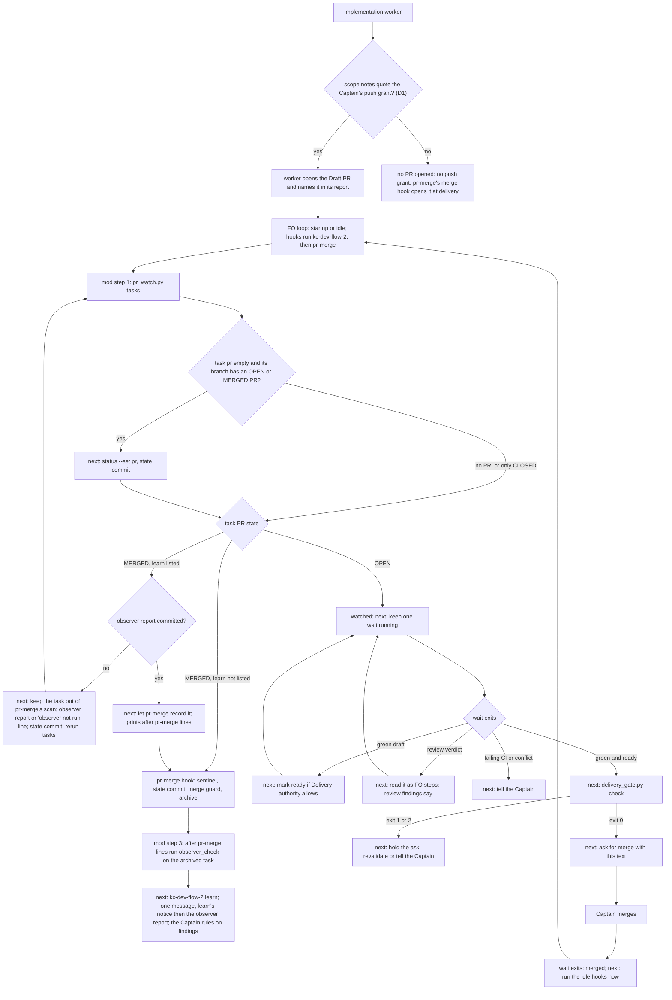

Filed on the Captain's 「開」 (2026-10-14) after an observer read of the spacedock-dev/subspace-relay FO session that delivered PR #362 (task `owner-sees-all-feedback-room`, kc-dev-flow-2 0.22.0). The FO never ran `pr_watch.py` for the PR and ran `merge guard` with no observer step and no learn. Both rules were in the adopter README, but FO read it in `sed -n` ranges up to line 480; `## Delivery authority` starts at line 492 and `## Extensions` at 538. The Captain asked whether the README is too long and whether to split or index it; the direction he approved is a mod keyed to Spacedock's lifecycle points rather than a longer README or read-sized slices.

## Scope

- Spacedock 0.27 already provides the index: mods in `{workflow_dir}/_mods/` with `## Hook: startup`, `## Hook: idle` and `## Hook: merge`, opened only at that lifecycle point and run alphabetically by filename (first-officer shared core, "Mod Hook Convention"). Adopters carry Spacedock's own `_mods/pr-merge.md`, copied unchanged; its `startup`/`idle` hooks handle a MERGED PR (sentinel, then `merge guard`) and its `merge` hook handles the PR at terminal approval.
- Candidate contents of a kc-dev-flow-2 mod:
  - `merge` (approved, before the merge ask): mark ready, wait for the post-ready Codex run, check the head against the validated candidate, `delivery_gate.py`, `pr_watch.py add`, then the merge ask.
  - `idle`: every open task PR has a `pr_watch.py wait` running in the background, else start it; advance an open learning delivery.
  - `idle`/`startup` on a MERGED PR, before the sentinel: `observer_check.py`, dispatching and saving the observer when absent.
  - after the archive: learn, with its notice and the observer report presented together.
  - `startup`: unread learn notices and open learning deliveries.
- Ordering: the observer step must run before `pr-merge`'s sentinel, so the mod's filename must sort before `pr-merge.md`; learn runs after the archive (a later pass, or a second file that sorts after it).
- The README keeps the rules as the authority and points to the mod; the FO steps moved out are expected to lower `WORKFLOW_WORD_BUDGET` (`## Delivery authority` 546 words, `## Extensions` 222 at origin/main 656543f4). How much moves is ideation's count.
- Dispatch-time rules (scope-notes lines, extension worker instructions) have no hook point and stay with script checks: tasks `followup-dispatch-records-checked` and `extension-instruction-reaches-dispatch`.
- Spacedock is not changed (the Captain's ruling); `pr-merge.md` stays an unchanged copy.
- Non-goals: to be set at ideation.

## Acceptance criteria

Amended by Captain, amendment 3 (and amendment 4 for the mod text): AC-1 to AC-7 are superseded and their text is under that entry. Today's figures read origin/main `0cdb40a7` (kc-dev-flow-2 0.22.1); design-time probes below ran 2026-10-14 with `spacedock` 0.27.2 on scratch copies outside the repository. Passages, counting rule and planned output lines are in `## Design`, `### Words FO reads at each moment`.

- **AC-8** Amended by Captain, amendment 3. One package mod sorts before `pr-merge.md`, and `merge guard` still arms `pr-merge`. Evidence: in a scratch copy of Spacedock's `internal/status/testdata/merge-pr-workflow` holding Spacedock's `mods/pr-merge.md` and the package's `references/sd/mods/kc-dev-flow-2.md`, `spacedock status --workflow-dir <w> --boot` prints `idle: kc-dev-flow-2, pr-merge`, `merge: pr-merge` and `startup: kc-dev-flow-2, pr-merge`; `spacedock merge guard 020 --verdict passed --workflow-dir <w>` prints `armed: mod-block set to merge:pr-merge`, and with `pr: "#42"` it prints `blocked: PR #42 is pending` (probe on the draft file: exactly these MODS lines and the armed line). The implementation puts these assertions in `kc-dev-flow-2/scripts/test_sd_dispatch.py` (a CI step), and `git diff origin/main --stat -- '*pr-merge.md'` is empty. Falsifier: a `## Hook: merge` appended to the package mod prints `merge: kc-dev-flow-2, pr-merge` and `armed: mod-block set to merge:kc-dev-flow-2` (probe 2026-10-14); a rename that sorts after `pr-merge` (for example `zz-dev2.md`) reorders the idle and startup lines; the test fails on each.
- **AC-9** Amended by Captain, amendment 3. Each FO step tied to a moment has one home. Evidence, at the candidate: `grep -c 'pr_watch.py\|delivery_gate.py\|observer_check.py' kc-dev-flow-2/references/sd/workflow.md` prints 0; `grep -c 'observer_check' kc-dev-flow-2/skills/dev/SKILL.md` prints 0; `grep -c '^- \*\*Watch:\*\*' kc-dev-flow-2/extensions/codex/EXTENSION.md kc-dev-flow-2/extensions/copilot/EXTENSION.md` prints 0 for each; the learn extension's `**FO step:**` bullet is at most 40 words and names `pr_watch.py tasks`; its Cannot-run bullet no longer holds the `observer not run:` commit instruction (one home: `tasks` output); the README still holds R1 (`the sentinel waits for a committed observer report`), R2 (`revalidated or its difference told to the Captain`), the Draft-PR grant sentence of D1, the unchanged authority paragraph and the `merge guard --rework` paragraph; `python3 kc-dev-flow-2/scripts/lint-skills.py` exits 0 and prints `references/sd/workflow.md: N of N words` with N at most 5481 and `WORKFLOW_WORD_BUDGET` lowered to N with its reason line (probe on the drafts applied to an origin/main export: `5476 of 5476 words`, exit 0). Falsifier: a README that still names one of the three scripts makes the first grep print 1 or more; a README passage copied into the mod fails the lint's repeated-passage check.
- **AC-10** Amended by Captain, amendment 4. The mod text follows the four writing rules. Evidence: every line under a `## Hook:` heading is a numbered step (`^[0-9]+\. `); each step has one imperative; a condition opens its sentence (`After the pr-merge hook, ...`); a one-off sentence split of the mod (`re.split(r'(?<=[.;])\s+|\n', text)`) prints no sentence over 20 words (probe on the draft: none over 20; longest 12). Falsifier: a step holding two imperatives or a 21-word sentence fails the reviewer's read or the split. Limit: run once at validation, not a standing check.
- **AC-11** Amended by Captain, amendment 3. The scripts print the next action. Evidence: behavior tests, each run under `python3 -B`, in `test_pr_watch.py` for the new `tasks <workflow dir>` subcommand with a stubbed `gh` and a scratch workflow: (a) a task with empty `pr` whose worktree branch has an OPEN PR prints the `spacedock status --set <slug> pr=<owner/repo>#<N>` and `spacedock state commit` lines; (b) a branch whose only PR is CLOSED prints no record line (Codex round 2, P2); (c) a MERGED task PR with `learn` listed and no committed `<slug>/observer.md` prints `next: keep <slug> out of pr-merge's scan in this pass.` before the observer lines; (d) the same with the report committed prints `next: let pr-merge record <slug>.` and two `after pr-merge:` lines; (e) a README without `learn` prints no observer line for a MERGED PR (Codex round 1, P1-2); (f) `codex` and `copilot` listed add the PR with those watch columns, unlisted adds neither; (g) an open PR snapshot prints `mark <ref> ready` for a green draft, the `delivery_gate.py check <task file> --pr <ref>` line for a green ready PR, and a tell-the-Captain line for failing CI or a conflict. In the same file `wait` prints each decisive change's next line; `test_delivery_gate.py` checks one next line per exit 0, 1 and 2; `test_observer_check.py` checks the archived exit 0 learn lines and the live exit 1 keep-out and `observer not run:` lines. Falsifier: deleting the CLOSED filter makes (b) print a record line; deleting the `extensions:` read makes (e) print an observer line; each test fails on the mutation of its own line.
- **AC-12** Amended by Captain, amendment 3. FO reads fewer words at every moment and in total. Evidence: validation recounts the table in `### Words FO reads at each moment` with its stated passages and rule (`len(text.split())`), today's column on origin/main `0cdb40a7`, the design column on the candidate's shipped text, and script output captured by running the shipped scripts on AC-11's scratch fixture; every moment's design count is below today's and so is the total (design-time: 436 against 513, 404 against 427, 389 against 458, 60 against 211, 396 against 423; 1685 against 2032). Falsifier: any moment where the shipped count is not below today's fails this criterion; the idle-on-an-open-PR and merge-ask margins are 23 and 27 words, so one added output sentence can fail it.
- **AC-14** Amended by Captain, amendment 3. Replay S2, FO at a merged PR, keeps the validated observer step and reaches learn. Evidence: Replay plan, one design run, `gh` reporting PR 362 MERGED and `observer.md` absent from the committed state, cue `合併了，你應該主動追蹤 362 是否合併` (the Captain's words in the relay run); record M5 `observer_check` (through `pr_watch.py tasks`) ran before the first `status --set <slug> pr=pr-merge:`, M6 an `observer not run:` line committed as `<slug>/observer.md`, or an observer dispatch attempted, before that `--set`, M7 a `kc-dev-flow-2:learn` call after the `merge guard` that archives, then one message with learn's notice then the observer report, M8 no `--set pr=pr-merge:` while the committed tree lacks `<slug>/observer.md`. Pass: M5 to M8. Falsifier: a sentinel before the observer check fails; M7 missing means the after-archive lines printed before `pr-merge` were not carried, and decision D3 applies. Controls: the relay run (sentinel at transcript line 896 with no observer check) and the cycle-1 control (archived with no `observer.md`).
- **AC-15** Amended by Captain, amendment 3. Adopters receive and keep the one file. Evidence: `references/sd/adoption.md` gains one step: in the change that re-syncs a workflow README (here `docs/dev2` and `docs/dev2-poc`), copy `<package>/references/sd/mods/kc-dev-flow-2.md` into `{workflow-dir}/_mods/`, run `cmp` against the package copy and confirm AC-8's MODS lines; on a scratch workflow `cmp` exits 0 and the lines print. Falsifier: one appended byte makes `cmp` exit 1; a deleted copy drops `kc-dev-flow-2` from the MODS lines. Limit: nothing runs `cmp` by itself (Sync).
- **AC-16** Amended by Captain, amendment 3. The worker's Draft PR follows decision D1 as recommended. Evidence: in `skills/implementation/principles.md` the sentence that replaces "Do not invoke local fallback, push the trunk, merge, or clean up an owned worktree unless the specific action is authorized." says both halves: where the scope notes quote the Captain's push grant, the worker opens the task branch's Draft PR before the stage report and names it there, otherwise it reports `no PR opened: no push grant`; and it still forbids local fallback, a trunk push, a merge and a worktree cleanup without a specific grant; a `FIXES` entry in `test_sd_dispatch.py` pins both halves; the README sentence of D1 is present (AC-9); the ADR "The implementation worker opens the Draft PR before validation" records the Captain's words for amendment 1 and D1 and passes `adr_lint.py --require` for its reserved number. Falsifier: deleting either half of the principles sentence fails that `FIXES` entry; `adr_lint.py --require` exits 1 on a record without its recommended line. If the Captain rules D1 otherwise, this criterion is replaced by amendment.
- **AC-17** Amended by Captain, amendment 3. Tests that pinned the moved text follow it, and the mod names no missing script. Evidence: `test_observer_check.py` `NAMES_THE_CHECK` drops `references/sd/workflow.md` and `skills/dev/SKILL.md` and keeps `extensions/learn/EXTENSION.md`, whose FO step names `scripts/observer_check.py`; the path from the mod to the check is tested by behavior (AC-11 c to e); `DocumentedInvocationTest.INSTRUCTION_FILES` still passes with the learn pointer naming `python3 <package>/scripts/pr_watch.py`; `FIXES['pr-watch']` is re-pointed from the README paragraph to `references/sd/mods/kc-dev-flow-2.md`; `test_sd_dispatch.py` fails when a `<package>/scripts/NAME` in the mod names no file under `scripts/`. Falsifier: `pr_watch.py` changed to `pr_watchh.py` in the mod turns that test red under `python3 -B`, while `lint-skills.py` passes it (probe in cycle 2: exit 0 for that typo).
- **AC-18** Amended by Captain, amendment 5. Replay S1, FO at the merge ask after a session start; S1 counts only runs that pass the first officer's engage prompt and reach the loop. Evidence: Replay plan, per run the record holds M1 `pr_watch.py tasks` ran, M2 `pr_watch.py wait` was launched with `run_in_background`, M3 `delivery_gate.py check` ran before the first `gate prepare` or message asking the Captain to merge, the workflow directory FO booted, and the first twenty tool calls; a run that stops at the engage prompt is recorded and not counted, and revalidation adds no re-runs. Pass: M1 to M3 yes in every counted design run (cycle 3: 1 of 1). Falsifier: a counted control with M1 to M3 all yes shows no bite, and that result goes to the Captain instead of shipping.

## Captain amendments

### Amendment 1 — 2026-10-14, chat
Captain: 「1」 (chat, 2026-10-14)
Asked: 「這對 mod 的影響，二選一：1. 把早開 PR 變成正式規則（我建議這個）：刪掉 mod 的 merge hook，在 idle 步驟加一條「PR 開了就記下編號」。這保留合併前的審查，也補上合併後自動偵測的漏洞。代價是和套件原本的說明不一致，那句說明要跟著改，這個決定也應該寫成一份 ADR。 2. 改回套件原本的路：實作只做到 commit，PR 交給 merge hook 開。」
Supersedes: none
Design: the `watch-and-learn.md` `## Hook: merge` section and the flow steps that have `pr-merge`'s merge hook create the PR

### Amendment 2 — 2026-10-14, chat
Captain: 「改跑 3 次」 (chat, 2026-10-14)
Asked: 「要你決定的：剩下 9 次重跑還要跑嗎？建議不要全跑，改跑 3 次：修補完成後，跑「請你合併」那個情境有 mod 和沒 mod 各一次，再加一次中性提示的有 mod 版。」
Supersedes: none
Design: D3's remaining nine replay runs after the go signal

### Amendment 3 — 2026-10-14, chat
Captain: 「好，退回重做。」 (chat, 2026-10-14)
Asked: 「我的建議：不要在 #643 上繼續修補，讓它退回設計階段，照上面三點重做。理由是現在的設計前提「README 和 mod 各存一份」本身就是造成膨脹的原因，再怎麼修補也只會更長。已經證實有效的部分，也就是合併後先跑 observer，在重做的設計裡保留。」
Supersedes: none
Design: the whole `## Design` is redone at ideation: one home per step, script output carrying the next action, and acceptance measured on the total words FO reads at each moment
Superseded text:

Replays read the relay state at `395edbd` (task `owner-sees-all-feedback-room` with its PR open: `git -C <relay state> log` 2026-10-13 23:11 +0800), the PR head `79ef8e756` and `<package>` the 0.22.1 package (origin/main `656543f4`). The design-time probes below were run 2026-10-14 with `spacedock` 0.27.2 on scratch copies outside the repository; the shipped files must reproduce them. Replay method, mod text and counts are in `## Design`.

- **AC-1** The two mod files sort around `pr-merge.md`, and `merge guard` still arms `pr-merge`. Evidence: in a scratch copy of Spacedock's `internal/status/testdata/merge-pr-workflow` fixture holding Spacedock's `mods/pr-merge.md` plus the two package files, `spacedock status --workflow-dir <w> --boot` prints `idle: observe-merged, pr-merge, watch-and-learn`, `merge: pr-merge` and `startup: observe-merged, pr-merge, watch-and-learn`, and `spacedock merge guard 020 --verdict passed --workflow-dir <w>` prints `armed: mod-block set to merge:pr-merge` (probe on the draft files: exactly these lines). The implementation puts both assertions in `kc-dev-flow-2/scripts/test_sd_dispatch.py`, already a CI step, and `git diff origin/main --stat -- '*pr-merge.md'` is empty. Falsifier: with `## Hook: merge` inside the file that sorts first (probe file `dev2-all`) the guard prints `armed: mod-block set to merge:dev2-all` and names only that hook; a `## Hook: merge` in either package file adds its name to the merge line (Captain amendment 1: the package ships no merge hook); renaming `watch-and-learn.md` to `learn-and-watch.md` moves it ahead of `pr-merge` in the idle and startup lines; the test fails on each.
- **AC-2** The README keeps the rules and loses the commands. Evidence: `python3 kc-dev-flow-2/scripts/lint-skills.py` exits 0 and prints `references/sd/workflow.md: N of M words` with N at most 5501 (5561 less 60; the drafts in `## Design` count 5483) and M equal to N after `WORKFLOW_WORD_BUDGET` is lowered with its reason line; `grep -c 'observer_check.py\|pr_watch.py\|delivery_gate.py' kc-dev-flow-2/references/sd/workflow.md` prints 0 and each name appears in a mod; the README still holds the five rules listed under `### README effect`. Falsifier: a passage copied instead of moved fails the lint's repeated-passage check (probe: four README lines copied into `references/sd/mods/` printed `repeats 55 words of references/sd/workflow.md`, exit 1); a README that still names a script fails the grep.
- **AC-3** Tests that pinned the old text follow the move, and a mod cannot name a script that does not exist. Evidence: `test_observer_check.py` (`NAMES_THE_CHECK`, `INSTRUCTION_FILES`) lists `references/sd/mods/observe-merged.md` in place of `references/sd/workflow.md`; the `pr-watch` entry of `FIXES` in `test_sd_dispatch.py`, which pins the `pr_watch.py` paragraph in `workflow.md` (`need` strings at the 'pr-watch' key), is re-pointed at `references/sd/mods/watch-and-learn.md` with the mod's wording; `test_sd_dispatch.py` fails when a `<package>/scripts/NAME` in either mod names no file under `scripts/`. Falsifier: `pr_watch.py` changed to `pr_watchh.py` in a mod turns the new test red, run under `python3 -B`; the lint does not catch it (probe: exit 0 for that typo), so this case is the only guard.
- **AC-4** Replay S1, the FO at the merge ask, starts the watch and checks the head. Evidence: Replay method, one control run (0.22.1 README, no mod files) and two mod runs, same model, same fixture; per run the record holds M1 `pr_watch.py add` ran, M2 `pr_watch.py wait` was launched with `run_in_background`, M3 `delivery_gate.py check` ran before the first `gate prepare` or message asking the Captain to merge, and the ordered tool calls to that point. Pass: M1 to M3 yes in both mod runs and at least one no in the control. Falsifier: a control that gets M1 to M3 all yes shows no bite; run two more controls, and if most controls are all-yes stop and bring that result to the Captain instead of shipping the mod as the fix. The relay run (0.22.0) is one more control datum: its first 1294 transcript lines hold no tool call naming `pr_watch`, `observer_check` or `delivery_gate`.
- **AC-5** Replay S2, the FO at the merged PR, runs the observer before the sentinel and learn after the archive. Evidence: Replay method with `gh` reporting MERGED and `observer.md` absent from the committed state, under two cues: a neutral `resume the workflow` and the Captain's words from the relay run verbatim (`合併了，你應該主動追蹤 362 是否合併`); one control and two mod runs per cue. Record M5 `observer_check.py` ran before the first `status --set <slug> pr=pr-merge:`, M6 on exit 1 a `kc-dev-flow-2:observer` dispatch (attempted, since the harness disallows `Agent`) or an `observer not run:` line committed as `observer.md` came before that `--set`, M7 a `kc-dev-flow-2:learn` call after the `merge guard` that archives, then one message with learn's notice and the observer report, M8 no `--set pr=pr-merge:` while the committed tree lacks `<slug>/observer.md`. Pass: M5 to M8 in both mod runs for both cues. Falsifier: a mod run that writes the sentinel before `observer_check.py` fails; controls that meet M5 and M6 show no bite; if only the verbatim cue fails, FO answered a chat cue without running the loop (a Limit), and the structural question goes to the Captain after at most two rewordings, per `maintain-flow`.
- **AC-6** The merge hook has bite or is deleted. Evidence: Replay S0, a fixture armed with `mod-block=merge:pr-merge`, the push granted in the prompt in the Captain's words and `gh pr create` stubbed; two mod runs record whether `pr_watch.py add` appears after `gh pr create` and before the next `merge guard`. Falsifier: if that happens in neither run (the watch starts only at idle) `## Hook: merge` is deleted from `watch-and-learn.md` and the `merge:` line in AC-1 loses it before release.
- **AC-7** Adopters receive and keep the files. Evidence: `references/sd/adoption.md` gains one step: copy `<package>/references/sd/mods/*.md` into `{workflow-dir}/_mods/` of every adopted workflow (here `docs/dev2` and `docs/dev2-poc`) in the change that re-syncs the README, then `cmp` each against the package copy and confirm the MODS lines of AC-1; running those commands on a scratch workflow gives `cmp` exit 0 and the lines. Falsifier: one appended byte makes `cmp` exit 1; deleting a copy removes its name from the MODS lines. Limit: nothing runs `cmp` by itself (decision D2).

### Amendment 4 — 2026-10-14, chat
Captain: 「同意兩件」 (chat, 2026-10-14)
Asked: 「mod 重做時加入這兩個方向：STE 四條：步驟編號、一步一個動作、條件寫在句首、每句最多 20 字。審查發現三條：先問能不能用程式擋；一定要加字就刪同樣多的字；新條件寫成獨立的一步。「規則清單檢查」範圍比較大，另開一個任務來做。」
Supersedes: none
Design: the redone `## Design` follows those four writing rules in the mod text and applies those three rules to every review finding

### Amendment 5 — 2026-10-14, chat
Captain: 「准」 (chat, 2026-10-14)
Asked: 「我建議改 AC-13：只計算 FO 已經過「engage」、真的進入流程的那些次數。理由是停在 engage 時 mod 根本還沒被載入，對照組也一樣停在那裡，這算不上 mod 的失敗。照這個算法，AC-13 是 1 次中 1 次成功。」 and 「核准的話：我把 AC-13 的修改記成你的第 5 次修正，派修補，重驗時不再加跑重跑。」
Supersedes: AC-13
Design: none
Superseded text:

- **AC-13** Amended by Captain, amendment 3. Replay S1, FO at the merge ask after a session start. Evidence: Replay plan, one control (0.22.1 relay README, no package mod) and two design runs, same model and fixture, cue `用 /kc-dev-flow-2:dev 然後 resume`; per run the record holds M1 `pr_watch.py tasks` ran, M2 `pr_watch.py wait` was launched with `run_in_background`, M3 `delivery_gate.py check` ran before the first `gate prepare` or message asking the Captain to merge, the workflow directory FO booted, and the first twenty tool calls. Pass: M1 to M3 yes in both design runs and at least one no in the control. Falsifier: a control with M1 to M3 all yes shows no bite, and that result goes to the Captain instead of shipping; a design run that never boots `docs/dev2` is the hook limit (FO answered without the loop), reported, not reworded.

### Amendment 6 — 2026-10-14, chat
Captain: 「同意」 (chat, 2026-10-14)
Asked: 「更好的做法：縮小範圍，先交付。保留：每次 idle 都跑 `tasks`；記下 PR 編號，worktree 不在本機時提醒 FO 去記；背景監看並叫醒 FO；合併前先跑 observer，封存後跑 learn；沒有 CI 時的判斷。拿掉：腳本不再印「請你合併」或「先別合併」，只回報事實，例如「CI 綠了」「Codex 回覆了」。請你合併之前，照舊由 FO 依 README 跑 `delivery_gate.py`。代價：README 要放回 `delivery_gate.py` 那段，約多 30 到 50 字。」
Supersedes: none
Design: the `### Script changes` items that make `pr_watch.py` print the merge-ask (`delivery_gate.py`) line or a hold line, the `### Where each FO step lives` row "head check before the merge ask" (it returns to the README), and the merge-ask row of `### Words FO reads at each moment` (recounted)

## Number guards

ADR: 0015

## FO alignment

Alignment: needed at ideation: the design changes what FO loads at three lifecycle points across every adopter.
Result: direction aligned with the Captain in chat on 2026-10-14, before filing. He asked whether the README is too long and whether to split it, index it, or chain read-sized slices with a hook index; FO answered that the reading length was not the cause (the relay FO chose `sed -n` ranges) and proposed a kc-dev-flow-2 mod on Spacedock's existing `startup`/`idle`/`merge` hook points, with the step list per point; he approved filing it (「開」) and scheduling it (「ok」). No research request; Spacedock is not changed.
Release review: not needed: workflow maintenance, on no journey map.
Surfaces: none
Visible change: none

## Design

Redone at ideation cycle 3 under Captain amendments 3 and 4; the cycle-2 design is withdrawn (its text is in this file's history and in PR #643 at d6a427aa).

### Why the cycle-2 design grew

It gave each step two homes: the README kept a rule sentence for each step, and two mod files (145 and 382 words, both read at every startup and idle pass) restated it with the command. The README shrank by 80 words while FO's reading grew by about 507. Every review round then added a clause to the mod prose. This design gives each step one home: an authority rule stays in the README, a moment-bound step goes to one short mod, and the next action is printed by the script that already runs at that moment.

### Chain check

- Spacedock 0.27.0 source, `internal/status/mutate.go` `scanMods`: a mod registers by its `## Hook: <point>` lines only (no frontmatter is read), and files sort by name. `skills/first-officer/references/first-officer-shared-core.md` "Mod Hook Convention": `hooks.run(point)` runs the registered mods "alphabetically by mod filename, exactly once at its caller boundary"; `fo-dispatch-core.md` runs `idle` once after the first empty `status --next`; `fo-merge-core.md`: the `startup`/`idle` hooks detect MERGED and record the sentinel. `internal/status/merge.go`: `merge guard` arms the first merge-hook mod by name, and a set `pr` returns `blocked` before any arm. Spacedock is not changed.
- Probe, 2026-10-14, spacedock 0.27.2, scratch copy of `merge-pr-workflow` with Spacedock's `pr-merge.md` and the draft `kc-dev-flow-2.md`: MODS `idle: kc-dev-flow-2, pr-merge`, `merge: pr-merge`, `startup: kc-dev-flow-2, pr-merge`; `merge guard 020 --verdict passed` printed `armed: mod-block set to merge:pr-merge`. With `## Hook: merge` appended: `merge: kc-dev-flow-2, pr-merge` and `armed: mod-block set to merge:kc-dev-flow-2`.
- kc-dev-flow-2 at origin/main `0cdb40a7` (0.22.1; scripts and extensions byte-equal to the installed 0.22.1 cache, checked with `cmp`): FO's moment-bound steps sit in `references/sd/workflow.md` (`### done` one sentence; Delivery authority three paragraphs), `extensions/learn/EXTENSION.md` (FO step, 205 words), `extensions/codex|copilot/EXTENSION.md` (Watch lines) and `skills/dev/SKILL.md` (observer paragraph, added 2026-10-13 in 37ed4fe7, so the relay FO on 0.22.0 never had it). `observer_check.py` already prints its remedy; `pr_watch.py` and `delivery_gate.py` print state only.
- `kc-dev-flow-2:observer` collects FO rules from the workflow README only (`skills/observer/SKILL.md`, `RULES`), so R1 and R2 stay in the README where it can quote them.
- Siblings and rulings as in cycle 2: the ship-flow mods are adopter-authored and no pattern; ADR 0003 does not apply to a `_mods` file; `git -C <state> grep -n 'Override:'` finds no override bearing on this.

### PRFAQ

**Press release.** A kc-dev-flow-2 first officer no longer carries its PR steps in memory. At every startup and idle pass, one 48-word mod runs `pr_watch.py tasks`, and the script prints what to do next: record a PR the worker opened, keep the watch running, run the observer check before `pr-merge` records a merge, then learn after the archive. When the watch wakes, its output names the next step too, up to the head check before the merge ask. The README keeps only who may do what.

**FAQ**

- *Why one file, not two?* The observer check must run before `pr-merge`'s sentinel and learn after its archive. The script prints the after-archive lines before `pr-merge` runs, and mod step 3 carries them over. A second file would cost 32 words at every pass (D3).
- *Is the validated observer step kept?* Yes. The cycle-1 and cycle-2 S2 mod runs showed it: a merged task PR gets `observer_check.py` before the sentinel, and a task without a report stays out of `pr-merge`'s scan. Its home moves from `observe-merged.md` prose to `pr_watch.py tasks` output, the file is renamed, and AC-8's MODS lines change; AC-14 re-runs it.
- *Why print steps instead of writing them?* An output line is read at the moment it applies and only when it applies; a test can fail it. Prose is read once, by choice of range, and grew with each review.
- *Does this add authority?* No. Rules stay in the README and the learn extension's Read, Cannot-run and Limits bullets; nothing here blocks a sentinel (Spacedock offers no hold).
- *What if FO answers a chat cue without running the loop?* Then no hook fires; AC-14's verbatim cue measures it, and the earlier two S2 mod runs did run the hooks.

### Where each FO step lives

| FO step | Moment | Home | README keeps |
| --- | --- | --- | --- |
| record a PR the worker opened (amendment 1) | startup, idle | `tasks` output (`--set pr`, `state commit`); OPEN or MERGED PRs only | none |
| add each open task PR to the watch, with reviewer columns | startup, idle | `tasks` (reads `extensions:`) | none |
| keep one `wait` in the background; act on its exit | startup, idle | `tasks` output, then `wait` output | none |
| mark ready on a green draft | wait exit | `wait` output | the authority paragraph (unchanged) |
| head check before the merge ask | wait exit or `tasks` snapshot | `wait`/`tasks` output, then `delivery_gate.py` output | R2: a differing head is revalidated or told to the Captain |
| observer check before the sentinel, task held out of `pr-merge` | startup, idle, MERGED PR | `tasks` output, calling `observer_check` | R1: the sentinel waits for a committed observer report |
| `observer not run:` line when the observer cannot be dispatched | same | `tasks` output (removed from the learn extension) | none |
| learn after the archive, notice then report in one message | after `pr-merge` in the same pass | `after pr-merge:` lines, mod step 3, `observer_check.py` output | none |
| unread learn notices at entry | session entry | `kc-dev-flow-2:dev` (unchanged) | none |
| `merge guard --rework`, then `state commit` | Captain direction | README (unchanged) | the paragraph |
| Draft PR opened by the worker | implementation | worker principles, under D1 | one grant sentence |

### Flow



### Mod text (the file the implementation ships; 48 words)

`kc-dev-flow-2/references/sd/mods/kc-dev-flow-2.md`, copied unchanged to `{workflow-dir}/_mods/kc-dev-flow-2.md`:

````markdown
`<package>` is the `Package root:` line of `kc-dev-flow-2:dev`.

## Hook: startup

1. Run the idle hook below.

## Hook: idle

1. Run `python3 <package>/scripts/pr_watch.py tasks <workflow dir>`.
2. Do each `next:` line it prints, in order.
3. After the `pr-merge` hook, do each `after pr-merge:` line it printed.
````

No frontmatter, title or rationale: Spacedock reads only the hook headings, and AC-8's test pins the order and the absent merge hook.

### Script changes

Each output line holds one action and at most 20 words; paths are printed absolute, from the script's own location.

1. `pr_watch.py tasks <workflow dir>` (new subcommand). Reads the README frontmatter (`state:`, `extensions:`) and each live task file's `pr` and `worktree`. For a task with empty `pr`, it reads the worktree branch and its code repository (worktree origin, as `pr-merge`'s startup hook resolves it), lists that branch's PRs (`gh pr list --head <branch> --state all`), takes the newest OPEN or MERGED one, ignores CLOSED ones, and prints the two record commands. For each task PR it reads the state with `gh pr view`. OPEN: `add`, with `--codex`/`--copilot` exactly when listed, then a next line for a decisive snapshot (green draft, green ready, failing, conflict). MERGED with `learn` listed: calls `observer_check`'s check for the slug and prints the hold lines or the let-and-after lines below. MERGED without `learn`, and CLOSED: nothing (`pr-merge` owns them). Last, when a PR is open, the keep-one-wait line and the when-it-exits line. Exit 2 with a `next: report …` line on a configuration or `gh` error. It writes no state; FO runs the printed commands.
2. `pr_watch.py wait`: each decisive change line is followed by its next line: MERGED or CLOSED, `run the idle hooks now`; green draft, `mark <ref> ready if Delivery authority allows`; green and ready, the `delivery_gate.py check <task file> --pr <ref> --text-file <merge ask>` command; failing CI or a conflict, `tell the Captain …`; a Codex or Copilot outcome, `read the … round as FO steps: review findings say`. The watch-file schema is unchanged.
3. `observer_check.py`: same exits; the remedy becomes `next:` lines. Live exit 1: keep the task out of `pr-merge`'s scan, dispatch the observer, save the report, the `observer not run: <reason>` alternative, `state commit`, rerun. Archived exit 0: run `kc-dev-flow-2:learn` for the slug, send learn's notice then the report unedited in one message, answer none of its findings. Archived exit 1: the existing archived remedy as lines, then tell the Captain the observer ran after the archive, then the learn lines.
4. `delivery_gate.py`: same exits, plus one next line: 0, `ask for merge with this text`; 1, `hold the ask; revalidate this head or tell the Captain the difference` (head) or `hold the ask until each second reviewer has an outcome`; 2, `hold the ask and show the Captain these lines`.

### Text changes, counted

Counted with the lint's rule (`len(text.split())`) on origin/main `0cdb40a7` and on the drafts.

| File, passage | Today | Design |
| --- | --- | --- |
| `references/sd/workflow.md` `### done`, "An archived task's state … runs before the sentinel." | 13 | deleted |
| Delivery authority, "Use SD's pending terminal approval … do not prove merge." | 79 | 82: "Under the Captain's grant quoted in its dispatch, the implementation worker opens the task's Draft PR before validation; that grant stands in for a presented body. Observe the actual repository-qualified PR merge before recording its landed sentinel and running SD merge guard to finalize/archive. Where `learn` is listed, the sentinel waits for a committed observer report. CI green, PR creation, gate approval and a locally manufactured sentinel do not prove merge. FO's startup and idle steps are in `_mods/kc-dev-flow-2.md`, copied from `<package>/references/sd/mods/`." |
| Delivery authority, "A PR delivers only the commit … told to him first." | 95 | 49: "A PR delivers only the commit on its head; a repair validated after the PR was opened reaches it only when that exact commit is pushed. Before the merge ask, a head other than the latest passing validation report's candidate is revalidated or its difference told to the Captain." |
| Delivery authority, "FO adds each PR it opens … waiting to be told." | 49 | deleted |
| `workflow.md` total (lint) | 5581 | 5476 (probe: `5476 of 5476 words`, exit 0) |
| `extensions/learn/EXTENSION.md` FO step | 205 | 34: "- **FO step:** the package mod runs `python3 <package>/scripts/pr_watch.py tasks <workflow dir>` at startup and idle. For a merged task PR it runs `scripts/observer_check.py` before the sentinel, and its output names each next step." |
| learn Joins bullet | 43 | 19: "- **Joins:** FO, through the package mod, before the landed sentinel of a merged task PR and after its archive." |
| learn Cannot-run, "An observer that cannot be dispatched … the Captain sees it." | 30 | deleted (home: `tasks` output) |
| `skills/dev/SKILL.md` observer paragraph | 43 | deleted (home: the startup hook) |
| codex and copilot `**Watch:**` bullets | 33 + 20 | deleted (home: `tasks` reads `extensions:`) |
| `references/sd/mods/kc-dev-flow-2.md` | 0 | 48 |
| FO-read text, all files | | net minus 377 |

Worker- and maintainer-read additions, outside FO's count: the principles sentence of D1 replaces the 21-word "Do not invoke local fallback …" sentence with one of about 45 words (net plus 24); the adoption step is about 35 words. Both are paid for by the FO-read removals above (amendment 4's second rule, counted across the diff, not per reader).

### Words FO reads at each moment

Rule: for each moment, every passage that instructs a kc-dev-flow-2 step due then, the `pr-merge` hook section FO opens then, and the output of each script the step runs, counted with `len(text.split())`. A passage runs from its first words through its last words, inclusive. `pr-merge` hooks and the authority paragraph are constants, the same in both columns. Today's outputs were captured 2026-10-14 by running the 0.22.1 scripts on a scratch state repository and a stub `gh`; design outputs are the planned lines in `### Script changes`, and AC-12 recounts the shipped ones.

| Moment and case | Today (origin/main) | Design |
| --- | --- | --- |
| Startup: restart, one open task PR, none merged | 513: pr-merge `## Hook: startup` 365; dev skill "When the README lists `learn` … hook does." 43; README "FO adds each PR … waiting to be told." 49; codex Watch 33; copilot Watch 20; `add` output 3 | 436: pr-merge startup 365; mod 48; `tasks` output 23 |
| Idle on an open PR, `wait` exit: green draft | 427: pr-merge `## Hook: idle` 100; README pr_watch paragraph 49; codex Watch 33; copilot Watch 20; authority paragraph "Project and Captain authority … explicit choice." 215; `wait` output 10 | 404: pr-merge idle 100; mod 48; `tasks` output 23; authority paragraph 215; `wait` output 18 |
| Idle on a merged PR, no observer report yet, then the rerun | 458: pr-merge idle 100; README "Use SD's pending … do not prove merge." 79; `### done` sentence 13; learn FO step 205; `wait` output 14; `observer_check` exit 1 41; rerun exit 0 6 | 389: pr-merge idle 100; mod 48; README merge paragraph 82; learn FO step 34; `wait` output 20; `tasks` with report missing 75; rerun 30 |
| After the archive | 211: learn FO step 205; `observer_check` exit 0 6 | 60: the two `after pr-merge:` lines and mod step 3, 27; `observer_check` exit 0 33 |
| The merge ask: ready PR, CI green | 423: authority paragraph 215; README "A PR delivers only … told to him first." 95; Extensions "A merge ask names each listed reviewer … not named as unread." 90; `wait` output 10; `delivery_gate` exit 0 13 | 396: authority paragraph 215; README head paragraph 49; Extensions merge-ask sentences 90; `wait` output 22; `delivery_gate` exit 0 20 |
| Total | 2032 | 1685 |

Margins: 77, 23, 69, 151, 27. The thin two (idle on an open PR, merge ask) fail if the shipped `wait` or `tasks` lines grow by about 25 words; AC-12 recounts the shipped text. In these rows `tasks` ran while checks were pending, so it printed no snapshot line; with green checks it adds one (8 words for a green draft, 14 for the `delivery_gate.py` line), and idle on an open PR becomes 412, still under 427.

### Review findings and their disposition

Amendment 4's rules: a script check or test where one can; otherwise prose with an equal number of words removed; a new condition as its own step.

| Finding | Cycle-2 absorption | Disposition now |
| --- | --- | --- |
| Codex round 1, P1: the Draft-PR rule never reaches the worker | 44-word principles sentence | prose (worker text cannot be a script): one principles sentence under D1, net plus 24 words, paid for by the removals above; pinned by `FIXES` (AC-16) |
| Codex round 1, P1: the archive learn step runs without `learn` listed | condition clause in mod step 5 | script: `tasks` reads `extensions:`; test AC-11 (e); no prose |
| Codex round 2, P1: Draft-PR authority handshake | open | Captain decision D1 |
| Codex round 2, P2: `merge guard --rework` clears `pr`, and the record step writes the old closed PR back | open | script: `tasks` ignores CLOSED PRs; test AC-11 (b); no prose |
| roborev:652, :654, :655: adopter copies of the mods are not made | adoption.md paragraph, 8 lines | one adoption step for one file (AC-15), about 35 words, paid for by the removals above; the copy is made in the README re-sync change after release |
| roborev:653: a failed observer check cannot stop `pr-merge`'s scan from writing the sentinel | Limit | script output holds the keep-out line (AC-11 c); a check over committed state history is task `dev2-laws-check`'s first law; Limit stays |
| Validation cycle 1, Polish: `doc_impact.py` lists `skills/maintain-flow/SKILL.md` | none | the implementation report records `unaffected: names no budget value or FO step`; no prose |
| Validation cycle 2, Needs decision on AC-4: the S1 mod run never opened the mods, under an FO-label cue | AC-4 unmet | AC-13: a Captain cue routed through `kc-dev-flow-2:dev`, and the head check reached through `tasks` and `wait` output at startup and idle, not through the README |
| Validation cycle 2, Deferred: `delivery_gate.py` exits 2 on a relay report reading "Verdict recommended: PASSED" | none | not absorbed: the script's verdict form is outside this task; FO may file it on the Captain's word; AC-13's S1 runs will meet it and still record M3 |

New conditions are separate lines: the `learn` and reviewer conditions live in the script, and the one condition in the mod (`After the pr-merge hook`) is its own step.

### Replay plan

Harness: the disposable cycle-2 harness under `/tmp/replay-c2` and its copies beside the validation reports (`replay-c2-setup.sh`, `-run.sh`, `-stub-gh.py`, `-python3-shim.sh`), outside the repository. Launch as in cycles 1 and 2: `spacedock claude --plugin-dir <spacedock 0.27.0 cache> --skip-compat-check --no-install -- -p <cue> --permission-mode bypassPermissions --output-format stream-json --verbose --model claude-opus-5-5 --disallowedTools Agent,SendMessage`. `SendMessage` is added because that README lists `peers`. Fixture: relay `main` at 54a4e096 with the 0.22.1 README, state at 395edbd, worktree at PR head 79ef8e756, a local bare origin. The design arm adds the candidate's README diff and `_mods/kc-dev-flow-2.md`. The fixture keeps relay's `docs/dev` beside `docs/dev2`; each record names the workflow FO booted. The stub `gh` also answers `repo view --json nameWithOwner` and `pr list --head`, since `tasks` resolves the repository and the branch's PRs. The `python3` shim gives `pr_watch.py` a scratch `HOME`.

- S1, the merge ask: stub reports PR 362 OPEN, ready, CI green. Cue: `用 /kc-dev-flow-2:dev 然後 resume`, the routing words of the Captain's relay opening (「用 /kc-dev-flow-2:dev 然後 resume 2026-10-13/22-37-50-279321 繼續 …」). The handoff id and task words are dropped because the id names a real journal entry that would load another session's context. A run that loads a session handoff anyway records it as a confound. One control, then two design runs.
- S2, the merged PR: stub reports PR 362 MERGED, no `observer.md`; cue verbatim `合併了，你應該主動追蹤 362 是否合併`. One design run, since the cycle-1 control and the relay run are the controls.
- Four runs, controls first. Cost basis, measured in cycles 1 and 2 from the stream result on claude-opus-5-5 (not the imputed `total_cost_usd`): per run 0.41M to 1.64M cache-read, 50k to 89k cache-creation, 3.3k to 7.4k output tokens, 40 s to 181 s.

### ADR draft (number reserved in `## Number guards`)

"The implementation worker opens the Draft PR before validation": the Captain's 「1」 (amendment 1) and his ruling on D1. Options: the worker opens it under a quoted grant (recommended), or FO opens it after implementation on his go. Consequence: with no grant, the worker opens nothing and `pr-merge`'s merge hook opens the PR at delivery. The cycle-2 draft on #643's branch is reused with D1 folded in.

### Sync and delivery

The package file `references/sd/mods/kc-dev-flow-2.md` is copied unchanged into `{workflow-dir}/_mods/` of `docs/dev2` and `docs/dev2-poc` (`poc_readme.py derive` carries Delivery authority over) in the change that re-syncs each README after release. `spacedock:refit` will list it as custom and change nothing. FO's write rules bar FO from writing `_mods/`, so a worker or the maintainer makes the copy. No drift check: the file holds two pointers to scripts read from the installed package, so a stale copy still runs current behavior (the cycle-2 D2 reasoning, now stronger). The implementation reuses #643's branch: merge main, delete `observe-merged.md` and `watch-and-learn.md`, and keep the ADR file.

### Limits

- A hook step runs only if FO runs `hooks.run`. In the relay run FO answered a chat cue with `gh pr view` and the sentinel directly. AC-14's verbatim cue measures this.
- The after-archive step rides on lines printed before `pr-merge` runs, carried by mod step 3. No replay has reached it yet; AC-14's M7 is its falsifier, and D3 is the fallback.
- If no idle pass falls between implementation completion and `merge guard`, `pr` is still empty at the guard. `merge guard` then arms `pr-merge`'s merge hook, which pushes and runs `gh pr create` on a branch that already has a PR. This is my reading of its text, not run (roborev:655). Trigger: FO dispatches validation and reaches the delivery gate without one empty `status --next`.
- Nothing holds a sentinel mechanically (roborev:653).
- `pr_watch.py` state is a machine-local file shared by every session (task `pr-watch-state-per-session`).
- `tasks` watches task PRs only. The deleted README paragraph covered "each PR it opens or pushes to"; a learning-delivery PR is followed by learn's own steps, and other non-task PRs are no longer named.
- The observer reads README rules only, so the moved commands leave its view. R1 and R2 stay quotable.

### Non-goals

Changing Spacedock or `pr-merge.md`; blocking a sentinel or archive mechanically; a drift-check script; per-session watch state (`pr-watch-state-per-session`); a laws file over state history (`dev2-laws-check`); dispatch-time checks (`names-check-before-dispatch`, `extension-instruction-reaches-dispatch`); making learn a scanner; changing `kc-dev-flow-2:dev`'s entry notices; `delivery_gate.py`'s verdict form; a committed replay harness.

### Files shared with other tasks

- `references/sd/workflow.md` and `WORKFLOW_WORD_BUDGET` in `scripts/lint-skills.py`: `extension-instruction-reaches-dispatch` may edit stage text there; whichever merges second recomputes the budget.
- `scripts/pr_watch.py` and `scripts/test_pr_watch.py`: `pr-watch-state-per-session` changes the default state path; this task adds `tasks` and next lines and leaves the state schema alone. Whichever lands second rebases.
- `scripts/observer_check.py` and `scripts/delivery_gate.py`: `dev2-laws-check` lists both as laws. This task changes output lines, not exits.
- `scripts/test_sd_dispatch.py`: the shared `FIXES` table.
- Also edited here: `references/sd/adoption.md`, `extensions/learn|codex|copilot/EXTENSION.md`, `skills/dev/SKILL.md`, `skills/implementation/principles.md`, the package `README.md` learn row, `scripts/test_observer_check.py`, `scripts/test_delivery_gate.py`, and new `references/sd/mods/kc-dev-flow-2.md`.

### Existing-code check (bounded)

Every step and script exists; what fails is that FO does not read the step at its moment (relay transcript; cycle-2 S1 mod run). The change moves each step to the output of the script that already runs then. It adds one subcommand to `pr_watch.py` and next lines to three scripts, and no new script. Completeness: `observer_check.py` already prints its remedy (working); `pr_watch.py` prints state without the action (incomplete for this need); `delivery_gate.py` likewise.

## Unresolved decisions for the Captain

- **D1 Who may open the Draft PR before validation, and on what grant (Codex round 2, P1).** Recommend: the worker opens it when its dispatch scope notes quote your push grant. You give that grant in a gate question that states it, normally the ideation gate ("approving also lets the implementation worker push the task branch and open a Draft PR"). That quoted grant stands in for the presented body for a Draft only. Ready and merge still need your word. Reasons: your standing rule asks no approval to push a branch and open a Draft PR on a repository you own, and FO's scope notes already have workers open PRs (validation cycle 2). With no grant the worker opens nothing, `pr` stays empty, and `pr-merge`'s own merge hook opens the PR at delivery (`internal/status/merge.go` arms it only while `pr` is empty), so either answer works. Worse under yes: the PR body is public, as a Draft, before you read it, and a gate question that forgets the grant quietly falls back to a late PR with no external review before validation. Worse under the alternative (FO presents the candidate and body after implementation and opens the PR on your go): one more message and approval from you per task.
- **D2 Replay spend: four headless FO sessions on claude-opus-5-5 at validation.** S1 is one control and two design runs; S2 is one design run. Controls run first, and the replays stop if the S1 control already does the right thing. Recommend yes. Measured cost per run in cycles 1 and 2: 0.41M to 1.64M cache-read, 50k to 89k cache-creation, 3.3k to 7.4k output tokens, 40 s to 181 s. Worse under yes: real tokens before any merge, and one S2 run gives no variance. Worse under no: the redesign ships on text and unit tests alone, and AC-4's failure showed text alone is not evidence.
- **D3 If AC-14's M7 fails (learn not run after the archive), add a second mod file sorted after `pr-merge`.** Recommend yes, decided now so a failure does not need another round. The second file holds two steps: for each task `pr-merge` archived, run `observer_check.py`, then do its next lines. It costs 32 words at every startup and idle pass. It raises idle on an open PR from 404 to 436, above today's 427, so AC-12 would be amended for that one moment. Worse under yes: one moment reads more than today. Worse under no: learn after the archive stays a by-hand run, which is the relay miss.

Approving the design accepts D1 to D3 as recommended only if the gate question says so.

### Feedback Cycles

- Cycle 1 (FO, 2026-10-14): validation recommended PASSED on #643 33295355 (the D3 pair shows the mod's bite: the control archived with no observer report, the mod run ran `observer_check.py` first and withheld the sentinel). Codex review round 1 (review:5512425198) left two P1, both to fix (a P1 blocks in every round); investigation first, then FO fix authorization, then a fresh validation recheck. #642 merged into main meanwhile and #643 now conflicts on `references/sd/workflow.md` and `WORKFLOW_WORD_BUDGET`; the repair merges main and recomputes the budget. The validator's Polish on `skills/maintain-flow/SKILL.md` is recorded as `unaffected: names no budget value or FO step`.
  - P1 #643 `references/sd/workflow.md` (around line 522): the Draft-PR rule is declared but not wired: the implementation stage text and `skills/implementation/SKILL.md` never tell the worker to open a PR, and `Delivery authority` is not in the implementation stage's `context-sections`, so a conforming run reaches validation with no PR.
  - P1 #643 `references/sd/mods/watch-and-learn.md` (around line 22): the archive step runs the observer check and learn even when `learn` is not listed in `extensions:`.
- Cycle 2 (FO, 2026-10-14): validation cycle 2 recommended REJECTED on #643 d6a427aa on AC-4 only (the round-1 repair is sound; AC-1 to AC-3, AC-6, AC-7 hold). Replays under Captain amendment 2: S2 mod run under the neutral cue ran `observer_check.py` first and wrote no sentinel (as in cycle 1); the S1 mod run made 8 tool calls, never ran `status --boot` for `docs/dev2` and never opened a mod, under the cue 「請你合併」, which was FO's scenario label in amendment 2's question rather than a Captain utterance, so it is a weak datum; the S1 control ran `delivery_gate.py` after reading README lines 495 to 560, which name the command, while the candidate README no longer names it (a structural regression of the README move, independent of the cue). Codex review round 2 (review:5512622247) left one P1 and one P2, both to fix; the P1 needs the Captain's authority ruling, so the repair is held at the review-finding checkpoint until he rules, and the P2 joins the same repair.
  - P1 #643 `skills/implementation/principles.md` (around line 35): the worker's Draft-PR rule cannot be satisfied under the workflow's authority model, which requires the exact candidate and PR body to be presented before push and create, and neither exists at the implementation dispatch.
  - P2 #643 `references/sd/mods/watch-and-learn.md` (around line 18): after `merge guard --rework` clears `pr`, the record step's `--state all` query writes the old closed PR back, trapping the repair loop.
- Cycle 3 (FO, 2026-10-14): validation of the redone design recommended REJECTED on #643 5b280387 on AC-13 only (AC-8 to AC-12 and AC-14 to AC-17 hold; FO reads 2036 to 1666 words over the five moments; S2 met M5 to M8, including learn after the archive). S1: the control and design run 1 stopped at the Spacedock first officer's `engage` prompt after `status --boot` and ran no hook; design run 2 ran the loop and met M1 to M3. AC-13's outcome is the Captain's decision. Codex review round 3 on this PR (review:5513822090) left one P1, to fix, and two P2, declined under the round-3 rule into backlog task `pr-watch-tasks-round3-followups`. FO also takes the validator's Deferred risk that `pr_watch.py tasks` exits 2 and skips the watch for a task whose `worktree:` directory is absent on the machine (three of relay's 17 tasks carry such a field, and relay records bare PR numbers), because that would leave a real adopter's PR unwatched.
  - P1 #643 `scripts/pr_watch.py` (around line 112): on a ready PR with green CI the `tasks`/`wait` output emits the `delivery_gate.py` merge-ask line while a listed Codex or Copilot review is still running, requested or carries unprocessed findings.
  - P2 (declined) `scripts/pr_watch.py` (around line 239): `extensions:` in YAML block-sequence form is read as empty.
  - P2 (declined) `scripts/pr_watch.py` (around line 261): stored reviewer flags survive the removal of that extension from the README.
- Cycle 4 (FO, 2026-10-14): the recheck of #643 5eb6bf05 did not run (validator API usage limit). Codex review round 4 on this PR (review:5514369233) left one P1, to fix, and one P2, declined under the round-3 rule into backlog task `pr-watch-tasks-round3-followups`.
  - P1 #643 `scripts/pr_watch.py` (around line 118): a PR with no check runs reports `checks=none`, which prints no readiness line and is never a decisive change, so `wait` never exits and a repository without CI is stuck.
  - P2 (declined) `scripts/pr_watch.py` (around line 271): a restart after `pr-merge` writes the sentinel but before the `after pr-merge:` lines run leaves the archived task with no observer check or learn, because `tasks` scans only live task files. Decline reason: it is the design's recorded limit (a restart between the sentinel and the archive), and the archived-task observer recovery in the learn extension still applies by hand.
- Cycle 5 (FO, 2026-10-14): Codex review round 5 on #643 bbc4a20e (review:5515174091) left one P1, to fix. It is the third round in a row whose P1 is about `pr_watch.py` deciding when to print the merge-ask line (round 3: reviewers unsettled; round 4: no CI; round 5: findings counted as settled once a `wait` reported them). FO narrows the repair rather than adding another state: the merge-ask line prints only when every listed reviewer is clean on the head; any findings print the review-finding step instead, and after FO disposes of them FO runs `delivery_gate.py` itself under Delivery authority. The validation recheck of bbc4a20e, dispatched before this finding, continues and its verdict will name the head it read.
  - P1 #643 `scripts/pr_watch.py` (around line 126): the `seen` comparison lifts the hold as soon as a `wait` has reported findings, so `tasks` prints the delivery-gate command while a repair of those findings is still running.
- Cycle 6 (FO, 2026-10-14): Codex review round 6 on #643 eb643a18 (review:5516007247) left one P1: `pr_watch.py` enables a reader for every listed reviewer, so an untriggered second reviewer or a skipped Copilot PR type holds the merge ask forever. It is the fourth P1 in a row (rounds 3 to 6) about `pr_watch.py` judging merge readiness; the round-5 narrowing did not stop the stream. FO stopped the in-flight validation and the repair loop and took the approach to the Captain under the circuit-breaker rule.
  - P1 #643 `scripts/pr_watch.py` (around line 300): watch flags come from the extension list, not from the task's reviewer applicability (second-reviewer trigger, Copilot's eligible PR types).
- Cycle 7 (FO, 2026-10-14): Codex review round 7 on #643 5e10c355 (review:5519583959) left one P1, to fix: `pr_watch.py tasks` scans only top-level `*.md`, so a task stored as `<slug>/index.md` is never seen. FO confirmed it applies here: this workflow's live tasks `journey-server-host-pilot` (validation) and `release-acceptance` (ideation) use that form. The validation of 5e10c355 dispatched before this finding continues.

## Stage Report: ideation

- FAILED: A design (PRFAQ and Mermaid) for a kc-dev-flow-2 Spacedock mod with `## Hook: merge`, `## Hook: idle` and `## Hook: startup` sections (per-step placement, mod filename and order against `_mods/pr-merge.md`, learn relative to archive, README authority and counted word budget, adopter sync)
  Not started: held. `## FO alignment` records "Alignment: needed at ideation" and the task file has no `Result:` line (`grep -n "Result:"` finds none); `skills/ideation/principles.md` says to stop and report in that case, and README `### ideation` requires the `Result:` line before the worker is dispatched.
- FAILED: Acceptance criteria with reproducible evidence clauses and falsifiers, including a replay of the relay PR #362 situation with and without the mod
  Not started: held for the same reason; no `## Acceptance criteria` section was written.
- FAILED: Unresolved decisions for the Captain, each with a recommendation and what gets worse under it
  Not started: held for the same reason.

### Summary

Held before design: the alignment need is recorded without its result, and ideation principles make that a stop, not something the worker may fill from the dispatch notes. Nothing was designed, no repository file was touched, and no other session or PR was contacted. To release the hold, FO adds a `Result:` line under `## FO alignment` (or records that the backlog approval and dispatch scope notes are the alignment) and re-dispatches ideation.

## Stage Report: ideation (cycle 2)

- DONE: A design (PRFAQ and Mermaid) for a kc-dev-flow-2 Spacedock mod with `## Hook: merge`, `## Hook: idle` and `## Hook: startup` sections: for each FO step the task's Scope lists, keep it in the mod (naming the hook point, the README rule it carries and the command, for example /Users/kent/.claude/plugins/cache/kc-claude-plugins/kc-dev-flow-2/0.22.1/scripts/pr_watch.py, /Users/kent/.claude/plugins/cache/kc-claude-plugins/kc-dev-flow-2/0.22.1/scripts/observer_check.py and /Users/kent/.claude/plugins/cache/kc-claude-plugins/kc-dev-flow-2/0.22.1/scripts/delivery_gate.py) or leave it in the README with a reason; the mod filename and its order against _mods/pr-merge.md; where learn runs relative to the archive; what the README keeps as the authority and the word-budget effect, counted; and how adopters receive and keep the mod in sync
  `## Design` holds the chain check, PRFAQ, a step-by-step placement table, the Mermaid flow, both mod files in full, the counted README effect (140 words become 62, net minus 78, 5561 to 5483), sync, replay method and limits. The mod is two files, `observe-merged.md` (before `pr-merge`) and `watch-and-learn.md` (after), because one file cannot hold the observer before the sentinel and learn after the archive (probe C).
- DONE: Acceptance criteria with reproducible evidence clauses and falsifiers, including a replay of the relay PR #362 situation (an FO at the merge ask and at the merged PR) with and without the mod, using the package's replay helper /Users/kent/.claude/plugins/cache/kc-claude-plugins/kc-dev-flow-2/0.22.1/scripts/replay_dispatch.py or a stated alternative, with the measurement it records
  `## Acceptance criteria` holds AC-1 to AC-7; the helper builds worker dispatches only, so the stated alternative is a headless FO launch with a stub `gh`, measures M1 to M8 per run, eleven runs, controls first.
- DONE: Unresolved decisions for the Captain, each with a recommendation and what gets worse under it
  D1 two files, D2 no drift-check script, D3 replay spend; all three with a recommendation and what gets worse. No past `Override:` bears on them.

### Summary

The Scope's merge list does not fit the merge hook (it runs once, before the PR exists), so only the watch is added there and the rest sits in `idle`; the observer moves to `startup`/`idle` ahead of `pr-merge`, which the earlier `observer-before-merge-guard` design did not use. Two corrections to the task's framing: the observer-before-sentinel sentence reached the README only in 0.22.1 (the 0.22.0 learn extension already said "before `merge guard`"), and the relay FO did follow the `dev` skill's entry rules (transcript line 95), which supports loading a rule at the moment it applies. `design_surfaces.py check` printed `fo-lifecycle-mod.md: design surfaces presentable` (exit 0).

### Acceptance criteria: current evidence

- AC-1 order and arm target: probe on the draft files, 2026-10-14, spacedock 0.27.2, printed the three MODS lines and `armed: mod-block set to merge:pr-merge`; the one-file variant printed `merge:dev2-all`. The `test_sd_dispatch.py` assertions are not yet written.
- AC-2 README keeps rules, loses commands: word counts measured on the drafts (140 to 62, net minus 78); a four-line copy into `references/sd/mods/` failed the repeated-passage lint (exit 1, 55 words). The real edit and lint run are not yet done.
- AC-3 tests follow the move: probe showed the lint passes a mistyped script name (exit 0), so the new test is the only guard; R3 pasted into a scratch `workflow.md` passes the lint's package-path rule (exit 0 once the budget is raised); `test_sd_dispatch.py` `FIXES['pr-watch']` pins the paragraph being moved, so it is re-pointed; the tests are not yet written.
- AC-4 replay S1: not yet verified; one control datum exists (relay transcript, first 1294 lines: no `pr_watch`, `observer_check` or `delivery_gate` call).
- AC-5 replay S2: not yet verified; the relay run is one control (sentinel at line 896 with no observer check).
- AC-6 merge hook bite: not yet verified (S0 replay).
- AC-7 adopter copy and `cmp`: not yet verified; the commands are stated, nothing was run.

## Stage Report: implementation

Stopped before any code change: the merge-hook check does not match the design's flow. No file in the worktree is changed (branch spacedock-ensign/fo-lifecycle-mod is at origin/main 656543f4).

- FAILED: One Draft PR (feat(kc-dev-flow-2): ...) with the two mod files, README edits R1 to R3, budget, adoption step, package README row and tests
  Not started; blocked on the merge-hook question below (it changes `watch-and-learn.md`, R3, AC-1's `merge:` line and AC-6).
- DONE: Before writing the merge-hook line: how Spacedock's pr-merge merge hook behaves when the task's pr field is already set
  Source, 0.27.0 `internal/status/merge.go` (MergeGuard classifier): `case pr != ""` returns `signalBlocked` before `arm` is reached, so a bare `pr` at guard time means no merge hook runs at all. `mods/pr-merge.md` `## Hook: merge` has no branch for an existing PR: it pushes, runs `gh pr create`, then "Set the entity's `pr` field".
  Probe 2026-10-14, spacedock 0.27.2, scratch copy of `merge-pr-workflow` holding only `pr-merge.md`: `merge guard 020 --verdict passed` (pr empty) prints `armed: mod-block set to merge:pr-merge`; the same entity with `pr: "#42"` prints `blocked: PR #42 is pending — mod-block left intact, never finalize on an open PR.` and arms nothing.
  In this workflow the worker's Draft PR exists before delivery and `pr` is empty: `followup-dispatch-records-checked.md` has no `pr:` value at validation with #642 open and its delivery approved. So the guard arms, but pr-merge's unchanged merge hook then meets a PR that already exists, which its text does not cover.
- SKIPPED: roborev evidence= line, CI green, lint-skills.py green, CI cost
  No candidate exists.

### Summary

The design's flow (node "pr-merge drafts, asks, pushes, creates the PR", then `watch-and-learn` merge hook "once the pr-merge merge hook has created the PR") assumes the PR does not exist at the guard. Here it does, so there are two cases: `pr` empty at guard, the watch-and-learn merge hook fires after a pr-merge hook whose create step has nothing to do; `pr` already set, no merge hook fires and the watch starts only from startup/idle. FO needs to choose between rewording the hook line or deleting it now (AC-6's own fallback), before the mod text is written.

## Stage Report: implementation (cycle 2)

Resumed after Captain amendment 1. PR #643 (Draft) https://github.com/iamcxa/kc-claude-plugins/pull/643, branch spacedock-ensign/fo-lifecycle-mod, head f0f5141a off origin/main 656543f4 (commits b8ae3b08, f0f5141a).

- DONE: Apply Captain amendment 1 (delete ## Hook: merge from watch-and-learn.md, record pr at startup and idle, drop watch-and-learn from AC-1's merge line, adjust the flow)
  `watch-and-learn.md` has startup and idle only; step 1 records `pr` as owner/repo#N for a worktree branch with a PR in any state (`--state all --limit 1`: an open-only query would miss a PR merged between passes), `status --set` then `state commit`. In this task file AC-1 now reads `merge: pr-merge` and `### Flow` starts at the worker-opened PR (state commit with this report; AC-6 left as written, now moot).
- DONE: Change the references/sd/workflow.md sentence "Use SD's pending terminal approval and existing merge hook; do not invent another PR stage"
  Replaced by the implementation-opens-Draft-PR rule citing ADR 0015; counted in the budget.
- DONE: Draft ADR 0015 in docs/adr
  `0015-the-implementation-worker-opens-the-draft-pr-before-validation.md` with the Captain's 「1」 and his option text, the rejected option and the merge-guard probe; `adr_lint.py docs/adr --since 656543f4` 15 files 0 legacy; `number_guards.py check` PASS no findings.
- DONE: The original implementation checklist: mod files, README R1 to R3 and the ### done deletion, budget, adoption.md, package README row, tests; AC-1 to AC-3 and AC-7 green with each falsifier shown failing by a mutation run
  AC-1, AC-3, AC-7 green; AC-2 NOT as written: `lint-skills.py` prints 5513 of 5513 and AC-2 says N at most 5501; the 12 words over (30 over the design's 5483) are amendment 1's Draft-PR sentence, FO and validation to rule. Mutations under `python3 -B`: merge hook in either mod fails `assert lines["merge"] == "pr-merge"`, and with that line removed the guard assertion fails (`hook: observe-merged`); README passage copied into a mod fails the lint (`repeats 92 words`); `pr_watchh.py` in a mod passes the lint and fails `test_sd_dispatch.py`; reverting the `--state all` pin or the `Keep one` wording fails its FIXES entry; observe-merged without `observer_check.py` fails 2 `test_observer_check.py` subtests; omitting the `pr` set fails the blocked assertion; scratch workflow: `cmp` 0, one appended byte `cmp` 1, deleted copy drops its name from MODS. Limit: a rename of watch-and-learn.md is caught by the names assertion, not an order assertion.
  Deviations from the approved `### Mod text` beyond amendment 1: steps renumbered 1 to 5; `description:` of watch-and-learn names record; the "`merge guard` arms the first merge hook by filename" clause is dropped from observe-merged (its merge-line test replaces it); the record step uses `--state all`.
- DONE: roborev evidence= line, CI green, lint-skills.py green, CI cost measured or stated as not measured
  `evidence=roborev:653` on f0f5141a (exit 1; run 1 on b8ae3b08 was `roborev:652`, exit 1; no re-run, no finding in scope). Findings for FO: (653) a failed observer check cannot stop `pr-merge`'s own scan from writing the sentinel, the design's recorded limit; (652) the mods are not copied into `docs/dev2` and `docs/dev2-poc`, the post-release sync the brief bars. CI green on f0f5141a (`gh pr checks 643`: unit tests 46 s, version parity 1m16s, route gate, GitGuardian). `lint-skills.py` exit 0; all CI-list scripts exit 0 locally on b8ae3b08. Cost: no new job or step; main baseline not measured, so the delta is not measured.

### Summary

The package ships `observe-merged.md` and `watch-and-learn.md`, the README keeps the rules, and ADR 0015 records the Captain's ruling. Open for FO: AC-2's 5501 bound (5513), the two roborev findings above, the adopter copies after release, the AC-4/AC-5 replays (validation's), and the budget recompute by whichever of #642 and #643 merges second.

## Stage Report: implementation (cycle 3)

Applied the FO ruling on #643 f0f5141a: AC-2 kept as written. PR #643 (Draft) head 33295355, branch spacedock-ensign/fo-lifecycle-mod off origin/main 656543f4.

- DONE: Bring references/sd/workflow.md to at most 5501 words by trimming at least 12 words inside the passages this PR touches, dropping none of the five README-effect rules, the Draft-PR rule or the clause #642 adds
  `lint-skills.py` prints 5495 of 5495 (6 under the 5501 bound): removed the rationale clause "so external review runs before the delivery gate" (ADR 0015 carries it) and the sentence "The pr-merge hooks run the sentinel and `merge guard` together" (the `pr-merge` mod says it). Each rule still greps once: `sentinel waits for the`, `differing head is revalidated`, `create a Draft PR where required`, `A merge ask names each listed reviewer`, `merge guard --rework`, `opens the Draft PR before validation`. #642's clause is not in this tree (it lives on #642's branch) and I did not touch the Stages follow-up sentence.
- DONE: Lower WORKFLOW_WORD_BUDGET to the new count with its reason line, rerun the suite and the AC-2 evidence commands
  Budget 5495, reason line "# 5495: -66 net: ..." in `lint-skills.py`. `lint-skills.py` exit 0; every CI-list script exit 0 locally including `test_sd_dispatch.py` (0.27.2 binary); `grep -c 'observer_check.py\|pr_watch.py\|delivery_gate.py' references/sd/workflow.md` prints 0; each name appears in a mod.
- DONE: Commit (named files only), roborev, push without force, CI green
  Commit 33295355 (workflow.md, lint-skills.py). `evidence=roborev:654` on 33295355, exit 1: one High, the mods are not copied into `docs/dev2` and `docs/dev2-poc` (the post-release sync the brief bars; no finding in scope, no re-run). The other High, `roborev:653`, is the design's recorded limit for validation to judge. CI green on 33295355 (`gh pr checks 643`: unit tests 53 s, version parity 56 s, route gate, GitGuardian).

### Summary

AC-2's bound is met: 5495 words against 5501. AC-6 is met by the merge-hook deletion. Remaining for FO: the two roborev findings above, the adopter copies after release, the AC-4/AC-5 replays, and the budget recompute by whichever of #642 and #643 merges second.

## Stage Report: validation

Verdict PASSED for PR #643 head 33295355 (base 656543f4), on AC-1, AC-2, AC-3, AC-6 (met by the merge hook's deletion) and AC-7, with the replay go signal below and AC-4 and the full AC-5 matrix not run (Captain limited the spend to the S2 pair).

- DONE: Independent verdict on #643 head 33295355 against AC-1 to AC-3, AC-6 and AC-7, re-running each evidence command and at least one falsifier per criterion, and judging the two roborev High findings
  Ran at the candidate (throwaway worktree, since removed): `lint-skills.py` exit 0, `5495 of 5495 words` (bound 5501); grep of the three script names in `workflow.md` prints 0, each name is in a mod; `test_sd_dispatch.py --sd-plugin-root <spacedock 0.27.0 cache>` exit 0 with the mods line; `test_observer_check.py` 16 tests OK; `git diff 656543f4 33295355 -- '*pr-merge.md'` empty; `comment_ratio.py` exit 0 (1 of 42, 2.4%); `design_surfaces.py check` exit 0; `dispatch_records.py` 6 records complete. Falsifiers run on a scratch copy of the head: AC-1 a merge hook appended to either mod fails `assert lines["merge"] == "pr-merge"`; renaming `watch-and-learn.md` fails (FileNotFoundError on the file `FIXES` pins, so this rename is caught by the pinned name, not by an order assertion); AC-2 a README passage copied into a mod prints `repeats 63 words`, exit 1, and a script name added to `workflow.md` makes the grep print 1; AC-3 `delivery_gate.py` mistyped in a mod passes `lint-skills.py` (PASS) and fails `test_sd_dispatch.py` with `['watch-and-learn.md: delivery_gatee.py']`; AC-7 `cmp` exits 0 on both copies and 1 after one appended byte. Judgments, by the workflow's Review-finding disposition: roborev:653 is Deferred risk (design Limits, first two bullets: nothing holds a sentinel; in the mod run below FO ran `observer_check.py`, got exit 1 and withheld the sentinel; it becomes Material if a mod-arm run writes `pr=pr-merge:` after exit 1). roborev:654 is Deferred risk (design `### Sync` and D2: the copy is made in the README re-sync change after release, and `adoption.md` now says so; this PR changes no adopter README, so no adopter is yet told the mods exist; it becomes Material if a re-sync lands R3 without both copies, which the `cmp` step in `adoption.md` exists to catch).
- DONE: The D3 go/no-go replay as the approved design's Replay method describes it, limited to the S2 pair under the Captain's verbatim cue
  Launch, both arms: `cd <arm>/relay; PATH=/tmp/replay-s2/bin:$PATH spacedock claude --plugin-dir <spacedock 0.27.0 cache> --skip-compat-check --no-install -- -p '合併了，你應該主動追蹤 362 是否合併' --permission-mode bypassPermissions --output-format stream-json --verbose --model claude-opus-5-5 --disallowedTools Agent` (spacedock 0.27.2; `--help` confirms the launcher; `--plugin-dir` added because the live runner uses it). Harness in `/tmp/replay-s2` (`setup.sh`, `run.sh`, `extract.py`, stub `bin/gh` that answers only PR 362 of the relay repo as MERGED and exits 1 on anything else): per arm a bare origin in the scratch dir, relay `main` at 54a4e096 (0.22.1 README), state branch at 395edbd, worktree at PR head 79ef8e756, `pr: 362`, no `observer.md`; mod arm = the same tree with the candidate's `workflow.md` diff applied to that README plus both mod files. Control M5 no, M6 no, M7 no, M8 violated: 18 tool calls, `pr=pr-merge:362` then `merge guard` in one command (call 14), task archived with no `observer.md` (archive commit 7797094 in the scratch state), no `observer_check.py` call. Mod M5 yes (call 16, exit 1, after reading `observe-merged.md` and `watch-and-learn.md` at calls 11 to 13), M6 not met as written (call 18 `ToolSearch select:Agent,Task` found no tool; FO held and asked the Captain instead of an `observer not run:` line), M7 not reached (nothing archived, so no learn), M8 yes (no sentinel, task still in validation with `mod-block`). Mod first twenty calls: Skill first-officer, gh/git status, two reads of first-officer core, `status --boot`, four task/PR searches, two reads of fo-write/fo-merge core, three reads of the mods, `observer_check.py`, Skill and plugin lookups, ToolSearch for Agent, pr_watch inspection. Tokens from the stream result, opus-5-5: control input 36, cache-creation 61,155, cache-read 932,496, output 5,204 (haiku side call 1,184 in, 213 out); mod input 40, cache-creation 69,922, cache-read 1,237,906, output 5,825 (haiku 1,184 in, 20 out); 20 and 22 turns, 81 s and 92 s; `total_cost_usd` not used. Result: go for S2 on the verbatim cue (one pair, no variance estimate). The sessions ran under the Captain's real `~/.claude` config, not an isolated HOME; real `~/.local/state/kc-dev-flow-2/pr-watch*` checksums are unchanged after both runs (the mod-run FO read that file). No other replay was run.
- DONE: A minimal acceptance script the Captain can run (three to six steps), run by me exactly as written in a fresh shell from a named checkout, with its observed output
  Six steps, saved in the state checkout as `fo-lifecycle-mod/validation/acceptance.sh` (the replay's per-run tool-call lists, `gh` call logs and stub are beside it as `replay-s2-*`; raw streams are not committed), run from a copy at `/tmp/replay-s2/acceptance-643.sh` with `env -i HOME="$HOME" PATH="$PATH" TERM=dumb bash --noprofile --norc /tmp/replay-s2/acceptance-643.sh`: it adds a throwaway worktree of `/Users/kent/conductor/workspaces/kc-claude-plugins/colombo` at 33295355, then prints `5495 of 5495 words` exit 0; `0` and the four script-name lines in the two mods; `PASS: the two package mods sort around pr-merge.md in every hook line, merge guard still arms pr-merge, a recorded pr arms no hook, and no mod names a package script that does not exist` exit 0; `cmp exit 0` then `cmp exit 1`; `15 ADR file(s) checked, 0 legacy` exit 0; `cleanup done`. It does not cover FO behavior at the lifecycle points (AC-4, the second cue, the observer dispatch and learn legs) or the adopter copies.
- DONE: adr_lint.py docs/adr --since <base> and number_guards.py check run with their exit codes
  `python3 <package>/scripts/adr_lint.py docs/adr --since 656543f4` exit 0 (15 files, 0 legacy), also exit 0 with `--require 0015`; `python3 <package>/scripts/number_guards.py check --workflow-dir <dir> --task <task>` exit 0 (`PASS: no findings`, base 656543f4, head 33295355, migration guard skipped: no migrations-path).

### Findings

- Polish: `doc_impact.py 656543f4 33295355` lists `README.md` (updated), `references/sd/adoption.md` (updated) and `skills/maintain-flow/SKILL.md`; no implementation report records `updated` or `unaffected` for them. My reading: maintain-flow mentions `lint-skills.py` and its budget in general terms only, so `unaffected: names no budget value or FO step`. FO may record that or ask implementation to.
- Deferred risk: roborev:653, roborev:654 (above).
- Unverified obligations: AC-4 (S1 replay not run); AC-5 for the neutral cue and for a second mod run; the observer-dispatch (M6) and learn-after-archive (M7) legs, because the harness disallows `Agent`; behavior of `watch-and-learn` step 1 (record `pr`) and `pr_watch.py add` in a live FO; budget recompute by whichever of #642 and #643 merges second; adopter copies after release.

### Summary

All five criteria in scope hold at 33295355 with a falsifier run for each, and the S2 pair shows the bite: the control archived the task with no observer report, the mod run ran `observer_check.py` first and withheld the sentinel. Not shown: the observer dispatch and learn legs, the neutral cue, S1, and any variance. Both roborev Highs are the design's recorded limits and the post-release sync; neither is Material today.

## Stage Report: implementation (cycle 3, Codex round-1 repair)

- DONE: Investigation first, with no candidate change: reproduced both Codex round-1 P1 findings on #643 head 33295355, reported per finding with a proposed fix, merge of origin/main and the budget recomputed
  P1-1: the worker's stage definition (`show-stage-def --stage implementation`) and skills/implementation/* held no PR-opening instruction; the only source was FO's freehand scope-notes line (dispatch/implementation-1.md "Open as Draft"). P1-2: `observe-merged.md` gates on `extensions:` listing `learn`, `watch-and-learn.md` step 5 did not. Report sent to main; FO authorized the fixes.
- DONE: The fixes with tests that fail without them (shown failing by a mutation run)
  P1-1: grant-conditioned Draft-PR sentence in skills/implementation/principles.md (worker-visible layer; Delivery authority reaches no stage by design, test_sd_dispatch.py "FO-only section reached a stage"). P1-2: step 5 of watch-and-learn.md starts "Learn, only where this README's `extensions:` lists `learn`; otherwise skip this step." Mutation, `python3 -B test_sd_dispatch.py`: deleting the principles sentence fails only `worker-opens-draft-pr` (its three need strings missing); reverting the step-5 clause fails only `learn-step-needs-learn`; restored tree passes. The 20 other CI test scripts pass locally.
- DONE: Main merged in (no rebase, no force), WORKFLOW_WORD_BUDGET recomputed with its reason line, AC-2's bound re-checked
  Merge commit d6a427aa (parents 33295355, 0cdb40a7); the only conflict was the budget lines in lint-skills.py, both comment lines kept. workflow.md merged at 5515, trimmed 14 words in the touched Delivery-authority passages (dropped "as `<owner/repo>#<N>`" and ", as for `pr-merge.md` above", shortened two phrases; R1 to R3, the Draft-PR rule and #642's clause kept) to 5501; `WORKFLOW_WORD_BUDGET = 5501`, `lint-skills.py` prints `references/sd/workflow.md: 5501 of 5501 words`. AC-2's literal bound 5501 holds.
- DONE: Push to #643's branch; CI green on the new head
  Pushed 33295355..d6a427aa, no force. `gh pr checks 643`: unit tests (python3), multi-profile route gate (live Spacedock), version parity, GitGuardian all pass on d6a427aaacc21cffdcb6ee9d8652cce3eb3d5080 (run 38504617746 headSha confirmed).
- DONE: roborev gate before the push
  `roborev_gate.py --repo <worktree> --base 0cdb40a7` ran once: `findings on d6a427aaa; evidence=roborev:655`, one High, left unfixed (see below); no second run since nothing in scope to fix.

### Summary

Both P1 findings are fixed, tested with named falsifiers, and #643 is green at d6a427aa with main merged and workflow.md at 5501 words. Left for FO: the roborev High (principles.md: adopted `docs/dev2` and `docs/dev2-poc` lack the new mods, so after a plugin update an adopter whose README is not yet re-synced would have workers open the Draft PR while `pr` stays empty and `pr-merge`'s merge hook could try `gh pr create` again) is the recorded post-release sync (ADR 0015 Consequences, adoption.md), and I made no adopter copies as instructed. The trim removed the `<owner/repo>#<N>` format from workflow.md; it remains in principles.md and watch-and-learn step 1. Validation recheck not run by me.

## Stage Report: validation (cycle 2)

Verdict REJECTED for PR #643 head d6a427aa (base origin/main 0cdb40a7) on AC-4 only; the cycle-1 repair itself is sound and AC-1 to AC-3, AC-6 and AC-7 hold. The one S1 mod run missed M1 to M3, and the way back is a Captain decision, not a worker repair.

- DONE: Independent recheck of the cycle-1 repair on #643 head d6a427aa (merge of origin/main 0cdb40a7): both Codex round-1 P1 findings (the Draft-PR rule not wired into the implementation worker; the watch-and-learn archive step running without learn listed) reproduced fixed against 33295355, each new FIXES entry shown failing under a revert you run yourself, the merge with #642 correct (the #642 clause kept, AC-2's 5501 bound met), AC-1 to AC-3, AC-6 and AC-7 re-run at the new head with any change from validation cycle 1 named, and the roborev:655 High judged against ADR 0015's Consequences and the post-release sync
  P1-1 reproduced at 33295355 (throwaway worktree): no "Draft PR" or `gh pr create` text in `skills/implementation/` and none in the `### implementation` stage text; fixed at d6a427aa by a grant-conditioned sentence in `skills/implementation/principles.md`, which the implementation skill loads (Delivery authority reaches no worker stage by design). P1-2 reproduced: step 5 at 33295355 ran `observer_check.py` and `kc-dev-flow-2:learn` with no `extensions:` condition; at d6a427aa step 5 starts "Learn, only where this README's `extensions:` lists `learn`; otherwise skip this step." Reverts on scratch copies, `python3 -B test_sd_dispatch.py --sd-plugin-root <spacedock 0.27.0 cache>`: principles.md from 33295355 fails only `worker-opens-draft-pr` (three need strings missing); watch-and-learn.md from 33295355 fails only `learn-step-needs-learn`; both are text pins, so neither proves FO behavior. Merge: `merge-tree 33295355 0cdb40a7` conflicts only in `lint-skills.py` (both budget comment lines kept); #642's "including the `Package root:` line and a checklist" clause is in workflow.md once; 0cdb40a7 to d6a427aa leaves `dispatch_records.py` and `test_dispatch_records.py` unchanged; `workflow.md` 5501 words (origin/main 5581); `git diff origin/main --stat -- '*pr-merge.md'` empty. Re-runs at d6a427aa: lint exit 0 `5501 of 5501`; grep of the three script names in workflow.md prints 0; `test_sd_dispatch.py` exit 0 (43 fixes); the other 20 CI-list scripts exit 0; `comment_ratio.py` 1 of 53 (1.9%); `design_surfaces.py check` exit 0. Falsifiers: merge hook appended to a mod fails `lines["merge"]` assert; 122 README words copied into a mod prints `repeats 122 words`, exit 1; `delivery_gatee.py` in a mod passes lint (exit 0) and fails the test with `['watch-and-learn.md: delivery_gatee.py']`; `cmp` 0 then 1. Changes from cycle 1: budget 5495 to 5501, 43 fixes (two new), AC-6 still met by deletion. roborev:655 is Deferred risk: ADR 0015 Consequences names it, adoption.md owns the copy in the re-sync change, and the same state exists today because FO's freehand scope notes already have workers open the PR; it becomes Material if a release lands before docs/dev2 and docs/dev2-poc are re-synced and a task reaches `merge guard` with `pr` empty (pr-merge's merge hook would then run `gh pr create` for a branch that has one; my reading of its text, not run).
- DONE: The three replay runs of Captain amendment 2, with the harness and launch method of validation cycle 1 (stub gh, model claude-opus-5-5, Agent disallowed) on the new head: S1 at the merge ask, one control run without the mod files and one mod run (record M1 to M4 per the design); S2 under the neutral cue "resume the workflow", one mod run (record M5 to M8); per run the first twenty tool calls and the token usage read from the stream; run no other replay
  Launch as in cycle 1 (`spacedock claude --plugin-dir <spacedock 0.27.0 cache> --skip-compat-check --no-install -- -p <cue> --permission-mode bypassPermissions --output-format stream-json --verbose --model claude-opus-5-5 --disallowedTools Agent`, spacedock 0.27.2), harness copied to `/tmp/replay-c2` (`replay-c2-*` beside this report); stub `gh` now answers PR 362 as OPEN and CI green for S1 (`GH_STUB_MODE=open`) or MERGED for S2; the mod fixture is the relay README plus the candidate's workflow.md diff 0cdb40a7..d6a427aa and both mods; a `python3` shim on PATH gives only `pr_watch.py` a scratch HOME so the Captain's real watch list is not written (it never fired; real `~/.local/state/kc-dev-flow-2` checksums unchanged). S1 cue is 「請你合併」 from amendment 2, my choice of exact words. S1 control (23 calls, 26 turns, 88 s): M1 no, M2 no, M3 yes by the letter (calls 20 and 21 ran `delivery_gate.py check`, both exit 2: slug given instead of the task path, then "no passing validation report names a candidate", because the real relay report says "Verdict recommended: PASSED" and the script wants "Verdict PASSED"), the head was then compared by hand, no gate prepare, FO told the Captain to merge himself. S1 mod (8 calls, 10 turns, 40 s): M1 no, M2 no, M3 no; the FO listed `docs/dev`, never ran `status --boot` for `docs/dev2` and opened only `docs/dev/_mods/pr-merge.md`, never `docs/dev2/_mods/`, read PR 362 with `gh` and answered, citing AGENTS.md, that only the Captain merges. S2 mod, neutral cue (21 calls, 25 turns, 181 s): M5 yes (`observer_check.py` at call 17, exit 1, after reading `observe-merged.md` and `watch-and-learn.md` at call 9), M6 not met as written (calls 18 and 19 searched for an Agent tool and found none; FO held and offered `observer not run:` as the alternative), M7 not reached, M8 yes (no `status --set pr=pr-merge:`, entity still in validation, no `observer.md`). Tokens, opus-5-5 stream result: control input 48, cache-creation 83,688, cache-read 1,638,257, output 7,419; S1 mod 18 / 50,001 / 413,781 / 3,257; S2 mod 44 / 89,439 / 1,533,788 / 6,372; `total_cost_usd` not used. First twenty calls per run are in `replay-c2-<run>-tool-calls.txt`. One run per cell, no variance estimate.
- DONE: The minimal acceptance script updated to the new head, run by you exactly as written in a fresh bash shell, with its observed output
  Six steps in `fo-lifecycle-mod/validation/acceptance.sh`, run from a copy with `env -i HOME="$HOME" PATH="$PATH" TERM=dumb bash --noprofile --norc /tmp/replay-c2/acceptance-643.sh` (needs the colombo checkout, the 0.22.1 package and the spacedock 0.27.0 cache, all named in its first lines): worktree at d6a427aa; `5501 of 5501 words` exit 0; `0` and the four script-name lines; `exit 0`, the `PASS: the two package mods sort around pr-merge.md ...` line, `learn-step-needs-learn`, `worker-opens-draft-pr`; `cmp exit 0` then `cmp exit 1`; `15 ADR file(s) checked, 0 legacy` `adr_lint exit 0` and `number_guards exit 0` with `PASS: no findings`; `cleanup done`. It does not cover S1, FO behavior at the lifecycle points or the adopter copies.
- DONE: /Users/kent/.claude/plugins/cache/kc-claude-plugins/kc-dev-flow-2/0.22.1/scripts/adr_lint.py docs/adr --since <base> and /Users/kent/.claude/plugins/cache/kc-claude-plugins/kc-dev-flow-2/0.22.1/scripts/number_guards.py check run at the new head with their exit codes; verdict PASSED or REJECTED naming the head, with findings classified by the workflow's Review-finding disposition
  `adr_lint.py docs/adr --since 0cdb40a7` exit 0 (15 files, 0 legacy), also exit 0 with `--require 0015`; `number_guards.py check --repo <worktree> --workflow-dir docs/dev2 --base 0cdb40a7 --task <state>/fo-lifecycle-mod.md --head d6a427aa` exit 0 (`PASS: no findings`; migration guard skipped, no migrations-path). Verdict REJECTED for d6a427aa on AC-4.

### Findings

- Needs decision (AC-4, `value-ac[AC-4]`): AC-4 passes only when M1 to M3 are yes in the mod run and at least one is no in the control. The S1 mod run did none of M1 to M3, so the criterion is unmet; the control had M1 and M2 no, so the mod run showed no bite. On M3 the direction is against the mod on this pair: the control FO ran `delivery_gate.py` after reading README lines 495 to 560 (call 13), where 0.22.1 still names the command, while the mod README's R2 passage names none and the mod FO read no `docs/dev2` text (n=1 each). Released user and workflow: a kc-dev-flow-2 adopter's FO told in chat to merge. Harm: the PR is never added to the watch, so a later merge is again found only when told. Trigger evidence: `replay-c2-s1-mod-tool-calls.txt`, calls 1 to 8. This is the design's Limit 1 (a mod line is read only if FO runs the lifecycle point) and AC-5's rule for a chat cue: the structural question goes to the Captain, and I ran no rewording because amendment 2 allowed three runs. Options for the Captain: record AC-4 as a known limit and ship, amend AC-4, or change where the rule is loaded; any is a scope call the worker cannot own. A repair of the implementation text cannot make an FO boot a workflow it never booted.
- Deferred risk: roborev:655 (above); roborev:653 and :654 as in cycle 1. `delivery_gate.py` exits 2 on a real relay report whose verdict line reads "Verdict recommended: PASSED": the script is not in this diff; it becomes Material if a mod-driven FO is held on every such report.
- Polish: `doc_impact.py 0cdb40a7 d6a427aa` lists `skills/maintain-flow/SKILL.md` as `review`; unchanged from cycle 1: `unaffected: names no budget value or FO step` is FO's to record.
- Unverified obligations: S1 variance (one mod run, one control); M6 and M7 legs (the harness disallows Agent); behavior of `watch-and-learn` step 1 (record `pr`) and of step 5 under a README without `learn` (text pins only); the second S2 cue; budget recompute by whichever of #642 and #643 merges second; adopter copies after release.

### Summary

Both Codex P1s reproduce at 33295355 and are fixed at d6a427aa with a falsifier each, the merge with #642 is correct and workflow.md is at 5501 words. The replays split: the neutral-cue S2 run again ran the observer check first and wrote no sentinel, but the S1 mod run never opened the mods, so AC-4 is unmet and the choice of how to proceed is the Captain's.

## Stage Report: ideation (cycle 3)

- DONE: A redone design (PRFAQ and Mermaid) under Captain amendments 3 and 4: for each FO step tied to a lifecycle moment, exactly one home (the mod for moment-bound steps, the README for authority rules) with the README keeping at most a one-line pointer; where a package script already runs at that moment (/Users/kent/.claude/plugins/cache/kc-claude-plugins/kc-dev-flow-2/0.22.1/scripts/observer_check.py, /Users/kent/.claude/plugins/cache/kc-claude-plugins/kc-dev-flow-2/0.22.1/scripts/delivery_gate.py, /Users/kent/.claude/plugins/cache/kc-claude-plugins/kc-dev-flow-2/0.22.1/scripts/pr_watch.py), the next action carried in the script's own output instead of prose, naming each script change; the mod text written to the four STE rules (numbered steps, one action per step, condition first, at most 20 words per sentence); keep the observe-merged step validation already showed works; carry the two open Codex round-2 items (the Draft-PR authority handshake, as a Captain decision with a recommendation; the stale closed PR re-recorded after merge guard --rework)
  `## Design` replaced: one 48-word mod `kc-dev-flow-2.md` sorting before `pr-merge` (probe: `idle: kc-dev-flow-2, pr-merge`, `merge: pr-merge`, guard arms `pr-merge`); `### Where each FO step lives` gives each step one home; `### Script changes` names four (`pr_watch.py tasks` and `wait` next lines, `observer_check.py` and `delivery_gate.py` next lines); README keeps R1, R2 and one pointer sentence; the validated observer step is kept, its home moved to `tasks` output (FAQ); handshake is D1; the closed-PR item is a script filter with test AC-11 (b).
- DONE: A measured word table per moment (startup, idle on an open PR, idle on a merged PR, after the archive, the merge ask): the words FO must read at that moment today on origin/main and under the design (README passages plus mod plus script output), with the design lower at every moment and in total; acceptance criteria with reproducible evidence clauses and falsifiers, and a replay plan whose cue is a Captain utterance (not an FO label) with its run count stated for the Captain to approve
  `### Words FO reads at each moment`: 513/436, 427/404, 458/389, 211/60, 423/396, total 2032/1685, with passages and rule; FO-read text net minus 377. AC-8 to AC-17; AC-1 to AC-7 moved verbatim under amendment 3. Replay plan: S1 cue 「用 /kc-dev-flow-2:dev 然後 resume」 (trimmed from the relay opening, reason stated), S2 cue verbatim; four runs (D2).
- DONE: For every review finding the old design absorbed (Codex rounds 1 and 2, roborev, validation cycles 1 and 2 under ### Feedback Cycles), the disposition under amendment 4's three rules: a script check or test instead of prose where one can, otherwise prose with an equal number of words removed, and any new condition as its own step
  `### Review findings and their disposition`: nine rows; three go to script output with tests (learn gating, closed PR, the S1 head check), two stay prose paid for by named removals (worker Draft-PR sentence, adoption step), one is D1, one keeps a script-output hold and goes to `dev2-laws-check` (roborev:653), one is a report record (doc_impact), one is left out of scope with a reason (delivery_gate verdict form).
- DONE: Unresolved decisions for the Captain, each with a recommendation and what gets worse under it
  D1 Draft-PR grant (worker under a quoted grant), D2 four replay runs, D3 second mod file if M7 fails; each states what gets worse. No `Override:` line bears on them: `git -C <state> grep -n 'Override:'` (2026-10-14) hits 18 files, all prose in earlier tasks' decision lists and observer reports, none a gate ruling.

### Acceptance criteria: current evidence

- AC-8: probe on the draft file, 2026-10-14, spacedock 0.27.2: the three MODS lines and `armed: mod-block set to merge:pr-merge`; the merge-hook falsifier printed `merge: kc-dev-flow-2, pr-merge` and `armed: … merge:kc-dev-flow-2`. Test not yet written.
- AC-9: the four README edits applied to an origin/main export: `lint-skills.py` printed `references/sd/workflow.md: 5476 of 5476 words; no unlisted passage repeats it`, exit 0. Greps and extension edits not yet made.
- AC-10: one-off split of the draft mod: longest sentence 12 words; every hook line numbered. Not yet run on shipped text.
- AC-11: not yet verified; no script is changed.
- AC-12: design-time table measured (today from origin/main texts and 0.22.1 script runs on a scratch repository; design from planned lines). Not yet verified on shipped text.
- AC-13: not yet verified; no replay run.
- AC-14: not yet verified; prior data: two mod runs (cycles 1 and 2) ran the observer check first and wrote no sentinel; M7 never reached.
- AC-15: not yet verified.
- AC-16: not yet verified; depends on D1.
- AC-17: not yet verified; the cycle-2 probe showed the lint passes a mistyped script name.

### Summary

The redesign puts FO's PR steps in one 48-word mod whose two steps run `pr_watch.py tasks` and follow its printed lines; the README keeps the authority rules and one pointer; the scripts print each next action. FO reads less at every moment (total 2032 to 1685). The novel risk is learn after the archive, carried by lines printed before `pr-merge`; AC-14's M7 tests it and D3 is the fallback. `design_surfaces.py check` printed `fo-lifecycle-mod.md: design surfaces presentable` (exit 0). For FO: amendment 3's `Supersedes:` line reads `none` while its entry now holds AC-1 to AC-7's moved text.

## Stage Report: implementation (cycle 4)

PR #643 (Draft, title and body redone) head 5b280387 on spacedock-ensign/fo-lifecycle-mod, built on d6a427aa with new commits (ca3d1427, 8b83f12a, 4deecb22, 5b280387), no rebase, no force; origin/main still 0cdb40a7.

- DONE: The approved cycle-3 design built on PR #643's branch with new commits (no rebase, no force): the one mod kc-dev-flow-2/references/sd/mods/kc-dev-flow-2.md (and the two cycle-2 mod files removed), the tasks subcommand and the next: lines in /Users/kent/.claude/plugins/cache/kc-claude-plugins/kc-dev-flow-2/0.22.1/scripts/pr_watch.py, /Users/kent/.claude/plugins/cache/kc-claude-plugins/kc-dev-flow-2/0.22.1/scripts/observer_check.py and /Users/kent/.claude/plugins/cache/kc-claude-plugins/kc-dev-flow-2/0.22.1/scripts/delivery_gate.py as kc-dev-flow-2/scripts/ changes, the counted README, learn extension, dev skill, codex and copilot text changes, the worker principles sentence of D1, the adoption step, ADR 0015 updated to the redone design, WORKFLOW_WORD_BUDGET set to the new count with its reason line; the PR title and body updated to the redone change
  Mod is the 48-word design text (`wc -w` 48), both cycle-2 files `git rm`ed; `workflow.md` 5581 to 5476 words with `WORKFLOW_WORD_BUDGET = 5476` and its reason line (`lint-skills.py`: `5476 of 5476 words`); ADR 0015 holds the Captain's 「1」 and 「准」 with options and `**Recommended:**` (`adr_lint.py docs/adr --since 0cdb40a7 --require 0015` exit 0). The learn FO step is 35 words, one over the design's 34, because `lint-skills.py` refuses `scripts/observer_check.py` without `<package>/` and the doc test wants `python3` before it. `tasks` writes the machine-local watch file (the `add`), not task state. PR title `feat(kc-dev-flow-2): one lifecycle mod; scripts print FO's next step`, body redone, still Draft.
- DONE: AC-8 to AC-17 that implementation owns green with each falsifier shown failing by a mutation run, including AC-12's recount of the words FO reads at each moment from the shipped script output and text, every moment at or under the design's column
  Each under `python3 -B`, one test failing per mutation: AC-8 a `## Hook: merge` fails `lines["merge"]`, a rename to `zz-dev2.md` (test names and pin following it) fails `lines["idle"]`; AC-9 greps print 0, 0, 0, 0 and a script name in the README prints 1, a README passage copied into the mod prints `repeats 50 words`, the learn FO step 35 words; AC-10 mod text: every step numbered, longest sentence 11 words, a 21-word step reads 24 (run once, not standing); AC-11 (a) to (g) in `test_pr_watch.py`: deleting the CLOSED filter fails (b), the `learn` gate fails (e), the `extensions:` read fails (f), the keep-out line fails (c), the after lines fail (d), the draft mark line fails (g), dropping `wait`'s next lines fails all eight cases, `test_delivery_gate.py` fails without the exit-0 next line, `test_observer_check.py` fails without the learn lines or the idle-hooks line; AC-12 below; AC-15 `cmp` exit 0, one appended byte exit 1, MODS lines asserted by AC-8; AC-16 deleting either half of the principles sentence fails only `worker-opens-draft-pr`, an ADR without its recommended line makes `--require` exit 1; AC-17 `pr_watchh.py` in the mod passes `lint-skills.py` and fails `test_sd_dispatch.py` (with the pin removed, `assert mod_scripts_missing() == []` fails alone). AC-12 from the shipped scripts on a stub-`gh` fixture, `implementation/recount.py` beside this report: today, shipped, design column: startup 513, 435, 436; idle on an open PR 427, 403, 404 (411 with `tasks` run on a green draft, column 412); merged PR without report 462, 377, 389; after the archive 211, 55, 60; merge ask 423, 396, 396; total 2036, 1666, 1685. Mutation: two words added to the keep-wait line gives 437 and 405, over, exit 1. Margins on startup and idle are one word. Every CI-list script exits 0 locally and in CI. AC-13 and AC-14 replays not launched (validation's).
- DONE: roborev evidence= line, CI green on the PR head, kc-dev-flow-2/scripts/lint-skills.py green, and the CI cost per PR measured or stated as not measured
  `findings on 4deecb22b; evidence=roborev:669` (exit 1, no re-run): one High, the mod is not copied into `docs/dev2` and `docs/dev2-poc`, which the dispatch bars (README re-sync change after release). CI green on 5b280387 (`gh pr checks 643`: unit tests 48 s, version parity 41 s, route gate, GitGuardian; run 38520851215); the run on 4deecb22 failed in `test_pr_watch.py` (my wait-loop stop used a generator throw), fixed in 5b280387. `lint-skills.py` exit 0. CI cost: no new job or step, more cases in files already run; no main baseline compared, so the delta is not measured. `comment_ratio.py`: 456 code lines, 2 comment lines, 0.4%, exit 0. `number_guards.py check` PASS no findings, base 0cdb40a7. `design_surfaces.py check` exit 0. ADR numbers added or changed: 0015. `doc_impact.py 0cdb40a7 HEAD`: `kc-dev-flow-2/README.md` updated; `kc-dev-flow-2/references/sd/adoption.md` updated; `kc-dev-flow-2/skills/maintain-flow/SKILL.md` unaffected: names no budget value or FO step.

### Summary

The redone design is built: one 48-word mod, `pr_watch.py tasks` and the other scripts print each next step, and FO reads fewer words at all five moments (2036 to 1666, design 1685). One file outside the design's list changed, `scripts/test_observer_recovery.py` (own commit ca3d1427; it read the late-report command from the learn extension, which the design shortens); I told `main` and kept the commit separable. Limits: after-archive lines are printed on the pass that sees MERGED with the report committed, so a restart between the sentinel and the archive does not print them; the startup and idle margins are one word.

## Stage Report: validation (cycle 3)

Verdict REJECTED for PR #643 head 5b280387 (base origin/main 0cdb40a7) on AC-13 only: one of the two S1 design runs never reached the loop. AC-8 to AC-12, AC-14 to AC-17 hold, each with a falsifier I ran. The way back is a Captain decision, not a worker repair.

- DONE: Independent verdict on #643 head 5b280387 (the redone cycle-3 design) against AC-8 to AC-17, re-running each evidence command and at least one falsifier per criterion yourself, including AC-12's recount of the words FO reads at each moment from the shipped text and script output, and judging the one file outside the design's list (kc-dev-flow-2/scripts/test_observer_recovery.py, commit ca3d1427) and the roborev:669 High against the post-release sync
  Throwaway worktree of the head, removed after; every CI-list script exit 0 under `python3 -B` (22 runs incl. `test_sd_dispatch.py` with the 0.27.0 root and `test_observer_recovery.py` with spacedock 0.27.2); `lint-skills.py` `5476 of 5476 words`. Falsifiers, each on a scratch copy and each red: AC-8 a merge hook appended fails `lines["merge"]`, a rename to `zz-dev2.md` (pin and names following) fails `lines["idle"]`; AC-9 a script name in the README makes the grep print 1, 137 README words copied into the mod print `repeats 137 words`, learn FO step 35 words (bound 40); AC-10 mod longest sentence 11 words, a lengthened step reads 27; AC-11 (b) CLOSED filter removed, (e) `learn` gate removed, (f) `extensions:` read removed, (c) keep-out line, (d) after lines, (g) draft mark line, and `wait` next lines each fail only their test(s), `delivery_gate.py` without its exit-0 next line and `observer_check.py` without its archived learn lines fail theirs; AC-12 two words added to the keep-wait line prints 437 and 405, OVER the design column (still under today's), exit 1; AC-15 `cmp` 0, one appended byte `cmp` 1, deleted copy leaves `idle: pr-merge` (run on the relay fixture with `status --boot`; AC-8's three lines printed); AC-16 deleting either half of the principles sentence fails only `worker-opens-draft-pr`, an ADR without its `**Recommended:**` line makes `adr_lint.py --require 0015` exit 1; AC-17 `pr_watchh.py` in the mod passes `lint-skills.py` and `mod_scripts_missing()` returns `['kc-dev-flow-2.md: pr_watchh.py']`. AC-12 recount (`implementation/recount.py`, today on an export of 0cdb40a7, shipped scripts behind a stub gh, `len(text.split())`): startup 513 to 435, idle on an open PR 427 to 403 (411 with `tasks` on a green draft), merged PR without report 462 to 377, after the archive 211 to 55, merge ask 423 to 396, total 2036 to 1666, every moment below today's; I hand-counted the 22-word `tasks` pending output (12 + 10) and the 12-word mod step 3, and rechecked pr-merge startup 365 and idle 100, authority 215, README passages 82 and 49 separately. Counting limit: a second idle pass (`run the idle hooks again`) is not counted; if FO re-read the hook texts it would add 148 words to the merged-PR row (377 to 525, over 462), but S2 call 16 reran `tasks` without re-reading the mod. `test_observer_recovery.py`: the base version fails against the shipped text (`expected one documented late-report commit span, found []`, because the learn extension no longer carries the git command), the shipped version passes, so it is the same class as AC-17 (a test pinning moved text follows it) and needed in CI; keep. roborev:669 (mod not copied into `docs/dev2` and `docs/dev2-poc`) is Deferred risk, the same object as 652, 654 and 655: `### Sync and delivery` and `adoption.md` give the copy to the README re-sync change after release, and AC-15's `cmp` step is the check.
- DONE: The four replay runs of D2 as the design's Replay plan states them (stub gh, model claude-opus-5-5, Agent and SendMessage disallowed, harness copied from /tmp/replay-c2): S1 at the merge ask under the cue 「用 /kc-dev-flow-2:dev 然後 resume」, one control run first and then two design runs, stopping if the control already does the right thing; S2 at the merged PR under the cue 「合併了，你應該主動追蹤 362 是否合併」, one design run; per run the M measurements the design names, the first twenty tool calls and the token usage read from the stream; run no other replay
  Launch (spacedock 0.27.2, `--help` confirmed): `cd <arm>/relay; PATH=/tmp/val643-replay/bin:$PATH spacedock claude --plugin-dir <spacedock 0.27.0 cache> --skip-compat-check --no-install -- -p <cue> --permission-mode bypassPermissions --output-format stream-json --verbose --model claude-opus-5-5 --disallowedTools Agent,SendMessage [--plugin-dir /tmp/val643-replay/pkg/kc-dev-flow-2] < /dev/null`; the bracket is on design arms only. Deltas from the plan: the candidate package is loaded as a second session plugin because 0.22.1 has no `pr_watch.py tasks` (a probe printed `Package root: /tmp/val643-replay/pkg/kc-dev-flow-2`, so `<package>` is the candidate, dev skill and learn extension included); one mod file, not two; fixture additions after my first smoke (below): placeholder worktrees for the three other relay tasks that carry a `worktree:` field and a stub answer for `pr view 360` (OPEN, checks pending). The sessions ran under the real `~/.claude`; `gh` was the stub throughout; the real `~/.local/state/kc-dev-flow-2/pr-watch*` shas are unchanged. Artifacts beside this report as `replay-c3-*`. S1 control (10 calls, 13 turns, 38 s; in 20, cache-creation 67,491, cache-read 494,878, out 3,064): M1 no (0.22.1 has no `tasks`, so no by construction), M2 no, M3 no; booted `docs/dev2` at call 10 and stopped asking for `engage`. S1 design 1 (10 calls, 39 s; 20, 59,150, 486,978, 3,049): M1 no, M2 no, M3 no; booted `docs/dev2` at call 10, ran no hook, stopped asking for `engage` like the control. S1 design 2 (29 calls, 30 turns, 102 s; 50, 81,010, 1,616,721, 8,818): M1 yes (call 13 `pr_watch.py tasks docs/dev2`), M2 yes (call 16, `run_in_background`), M3 yes (call 25 `delivery_gate.py check`, before any `gate prepare` or merge message); the check exited 2 on the relay report's "Verdict recommended: PASSED" and FO held the ask. S2 design (25 calls, 29 turns, 88 s; 52, 77,181, 1,694,916, 6,971): M5 yes (`tasks` at call 16, `--set pr=pr-merge:` at call 19), M6 yes (call 15 committed `observer not run:` as `observer.md`, since `Agent` is disallowed), M7 yes (the `after pr-merge:` command ran at call 20, `kc-dev-flow-2:learn` at call 23, one message with learn's notice then the observer line), M8 yes. Limits: the design 2 S1 stream has a second result frame because I killed its background `wait` by PID to end the session (not counted); in S2 the FO wrote the waiver before the first `tasks` run (from the README rule R1), so the `tasks` keep-out lines were not exercised in a replay; the observer dispatch leg is unreached under the harness. AC-13: not met as written (M1 to M3 yes in one of two design runs; the control had all no). AC-14: met.
- DONE: A minimal acceptance script the Captain can run (three to six steps, exact commands, expected output), run by you exactly as written in a fresh bash shell from a named checkout, with its observed output
  `fo-lifecycle-mod/validation/acceptance-643-5b280387.sh`, six steps, run from a copy as `env -i HOME="$HOME" PATH="$PATH" TERM=dumb bash --noprofile --norc <copy>` (exit 0; observed output in `acceptance-643-5b280387.out`): worktree of `/Users/kent/conductor/workspaces/kc-claude-plugins/colombo` at 5b280387; `5476 of 5476 words`, grep `0`, mod `48` words; the `PASS: the package mod sorts before pr-merge.md ...` line; `Ran 40`, `Ran 13`, `Ran 19` tests `OK`; the recount table, every moment `OK`, total 1666; `cmp exit 0` then `cmp exit 1`, `adr_lint exit 0`, `number_guards exit 0`, `cleanup done`. It needs the colombo checkout, the spacedock 0.27.0 cache, the installed 0.22.1 package and the state checkout's `implementation/recount.py`, all named in its first lines. It does not cover FO behavior at the lifecycle points (S1, S2), the observer dispatch and learn legs, or the adopter copies.
- DONE: /Users/kent/.claude/plugins/cache/kc-claude-plugins/kc-dev-flow-2/0.22.1/scripts/adr_lint.py docs/adr --since <base> and /Users/kent/.claude/plugins/cache/kc-claude-plugins/kc-dev-flow-2/0.22.1/scripts/number_guards.py check run with their exit codes; verdict PASSED or REJECTED naming the head, with findings classified by the workflow's Review-finding disposition
  `adr_lint.py docs/adr --since 0cdb40a7` exit 0 (15 files, 0 legacy), also exit 0 with `--require 0015`; `number_guards.py check --repo <worktree> --workflow-dir docs/dev2 --base 0cdb40a7 --task <state>/fo-lifecycle-mod.md --head 5b280387` exit 0 (`PASS: no findings`; migration guard skipped, no migrations-path). Also exit 0: `comment_ratio.py` (2 of 461 lines, 0.4%; both lines read, each states a fact the code does not), `design_surfaces.py check`, `dispatch_records.py` (12 records complete). `doc_impact.py` lists three documents; the cycle-4 report records `updated` for two and `unaffected: names no budget value or FO step` for `maintain-flow`. Verdict REJECTED for 5b280387 on AC-13, findings below.

### Findings

- Needs decision (`value-ac[AC-13]`): AC-13 passes only if M1 to M3 are yes in both design runs. Design run 1 stopped at the Spacedock first-officer's `engage` prompt after `status --boot` and ran no hook, exactly as the control did; design run 2 ran the whole loop. Released user and workflow: a kc-dev-flow-2 adopter's FO told to resume through `/kc-dev-flow-2:dev`. Harm: a resume that stops at `engage` adds no PR to the watch, the relay miss. Trigger evidence: `replay-c3-s1-mod1-tool-calls.txt` (10 calls, no `tasks`) against `replay-c3-s1-mod2-tool-calls.txt` (29 calls, `tasks` at call 13). This is the design's Limit 1 and AC-13's own falsifier: reported, not reworded, and no repair of the text makes an FO leave the prompt. Options for the Captain: record AC-13 as a known limit and ship (one run of two reached the loop; control zero of one); amend AC-13 (for example count a run only after `engage`, or add `engage` to the cue); or change where the rule loads. n=2 design runs gives no variance estimate. Note the pass is not overstated: the control's M1 is no by construction, so its bite shows in M2 and M3.
- Deferred risk: `pr_watch.py tasks` exits 2 and prints `next: report <slug> to the Captain: fatal: cannot change to '<worktree>'` for every task whose `worktree:` directory is absent from this checkout, and then does not watch that task's PR. Reproduced (non-mutating) on the replay fixture before I added placeholder worktrees; three of the relay's 17 tasks carry such a field, and no `spacedock-ensign-*` worktree of this relay is listed on this machine (`git worktree list`, 2026-10-14). Relay records PRs as bare `#360` or `362`, which `tasks` resolves through the worktree's origin. Becomes Material if an adopter FO runs on a machine without a bare-PR task's worktree, which split-root state shared through origin permits, and that task's PR goes unwatched. Not in AC-8 to AC-17.
- Deferred risk: `delivery_gate.py` exits 2 on a relay report reading "Verdict recommended: PASSED" (unchanged from cycle 2, outside this diff); in S1 design run 2 it held the merge ask. Becomes Material if a mod-driven FO is held on every such report.
- Deferred risk: roborev:669, roborev:653 (nothing mechanically holds a sentinel; replays so far withheld it), AC-12's uncounted second hook pass (above).
- Polish: none open.
- Unverified obligations: the `tasks` keep-out lines under a live FO; the observer dispatch and learn legs (the harness disallows `Agent`); S1 variance; budget recompute by whichever of #642 and #643 merges second; adopter copies after release.

### Summary

The static criteria all hold at 5b280387 with a falsifier run for each; FO reads fewer words at all five moments (2036 to 1666) and the after-archive learn leg, the thing D3 feared, worked in S2. The replays split: one S1 design run ran the loop and met M1 to M3, the other stopped at the first officer's engage prompt as the control did, so AC-13 as written is unmet and the choice is the Captain's.

## Stage Report: implementation (cycle 4, Codex round-3 repair)

PR #643 head 5eb6bf05 on spacedock-ensign/fo-lifecycle-mod, one new commit on 5b280387, no rebase, no force; origin/main still 0cdb40a7.

- DONE: Captain amendment 5 applied first: move AC-13's block verbatim into the amendment entry under a Superseded text: line and write its replacement as a new AC id saying "Amended by Captain, amendment 5" (S1 counts only runs that pass the first officer's engage prompt and reach the loop), so design_surfaces.py check exits 0
  AC-13 block moved byte-for-byte under amendment 5; replacement is AC-18; `design_surfaces.py check` exit 0; state commit 52d15c26.
- DONE: Investigation, with no candidate change: reproduce on #643 head 5b280387 (1) the Codex round-3 P1 and (2) the validator's Deferred risk, send FO the reproduction and the proposed fix for each, then wait for FO's fix authorization message
  Both reproduced from scratch scripts outside the repo (`/tmp/repro643`): (1) `tasks` and `wait` print the `delivery_gate.py` line beside codex running/not-reviewed/findings and copilot requested; (2) `tasks` exits 2 for bare `#7`, bare `7` and empty `pr:` with the worktree directory removed. Reported to `main`; FO authorized both with one change (an empty `pr:` with an absent worktree prints a `next:` line, not silence).
- DONE: After FO's fix authorization only: both fixes in kc-dev-flow-2/scripts/ with tests that fail without them (shown failing by a mutation run), AC-12's recount still at or under the design column at every moment, roborev evidence= line, push to #643's branch without force, CI green on the new head, stage report appended
  Commit 5eb6bf05 (pr_watch.py, test_pr_watch.py; eight new cases, 48 run, all pass under `python3 -B`). Fix 1: `next_for` prints `next: do not ask to merge <ref>; <reviewers> not read on its head yet.` instead of the gate line when a watched reviewer is codex running/not-reviewed, copilot requested, or an outcome differing from the stored `seen` snapshot; `tasks` passes the stored entry, `wait_next` passes `old`. Fix 2: bare refs read the repository from the workflow checkout's toplevel; empty `pr:` with an absent worktree prints `next: record <slug>'s PR with status --set <slug> pr=<owner/repo>#<N>; its worktree is not on this machine.`, exit 0; no `worktree:` field stays silent.
  Mutations, each run alone under `python3 -B`, only the named tests fail: hold line removed fails the tasks and wait hold tests; `seen` comparison removed fails the same two; `tasks` not passing `seen` fails `test_findings_a_wait_has_reported_no_longer_hold_the_merge_ask`; `wait_next` not passing `old` fails `test_a_round_an_earlier_wait_reported_does_not_hold_the_merge_ask_line`; the watch-flag condition removed fails the two unlisted-reviewer tests; bare ref resolved through the worktree again fails `test_a_bare_pr_is_resolved_from_the_workflow_checkout_when_its_worktree_is_gone`; record line dropped fails `test_an_empty_pr_whose_worktree_is_gone_says_to_record_it_and_one_with_no_worktree_field_stays_silent`.
  AC-12 `recount.py` on 5eb6bf05 against the origin/main export: startup 435 (436), idle 403 (404), idle with `tasks` on the green draft 411 (412), merged 377 (389), after the archive 55 (60), merge ask 396 (396), total 1666 (1685), every row OK, exit 0 (its fixture lists no codex or copilot, so the hold line is not in a counted moment).
  `roborev_gate.py` exit 0: `clean on 5eb6bf056; evidence=roborev:673`. CI green on 5eb6bf05: unit tests 53 s (run 38527048602), version parity 55 s, route gate 6 s, GitGuardian. Also exit 0: every CI-list script locally including `test_sd_dispatch.py` (0.27.0 root) and `test_observer_recovery.py`; `lint-skills.py` `5476 of 5476 words`; `adr_lint.py docs/adr --since 0cdb40a7 --require 0015`; `number_guards.py check` PASS; `comment_ratio.py` under 5% (this commit adds no comment line); `doc_impact.py` lists the same three documents as at 5b280387, none touched by this commit, records unchanged (`updated`, `updated`, `unaffected: names no budget value or FO step`).

### Summary

Both repairs are in one commit with tests whose mutations fail only the intended cases, and FO's reading stays under the design at every counted moment. Limits for FO and the Captain: AC-11(g)'s wording "the `delivery_gate.py check` line for a green ready PR" now holds only when no listed reviewer is unsettled (its fixture lists none, so its evidence is unchanged); the PR body does not mention the hold and record lines; a task with `worktree:` set, empty `pr:` and the directory absent prints the record line on every idle pass until FO records a PR, as FO specified. The two Codex P2 stay declined under `pr-watch-tasks-round3-followups`.

## Stage Report: implementation (cycle 4, Codex round-4 repair)

PR #643 head bbc4a20e on spacedock-ensign/fo-lifecycle-mod, one new commit on 5eb6bf05, no rebase, no force; origin/main unchanged.

- DONE: Investigation, with no candidate change: reproduce on #643 head 5eb6bf05 the Codex round-4 P1, state how the existing no-applicable-checks rule in the learn delivery section could carry over, and send FO the reproduction and the proposed fix, then wait for FO's fix authorization message
  Reproduced from `/tmp/repro-p1/repro.py` (TasksTests harness, nothing changed in the worktree): on an open ready PR with `statusCheckRollup=[]`, `tasks` prints no readiness line and `wait` is still looping after 5 polls with empty stdout; a Draft is stuck the same way. Reported to `main`; FO authorized items 1 to 5 plus one addition (the reviewer hold on the no-CI path).
- DONE: After FO's fix authorization only: the fix in kc-dev-flow-2/scripts/pr_watch.py with tests that fail without it (shown failing by a mutation run), AC-12's recount at or under the design column at every moment, roborev evidence= line, push to #643's branch without force, CI green on the new head, stage report appended
  Commit bbc4a20e (pr_watch.py, test_pr_watch.py; six new cases, 54 run, all pass under `python3 -B`). `settle()` stores `none-since` per (draft, head), sets `unchecked=settled` after 60 seconds with `mergeStateStatus` not BLOCKED; `next_for` treats it like green (Draft: mark ready; ready: a disclosure line then the `delivery_gate.py` line, or the existing hold line while a listed reviewer is unsettled); `wait` wakes on the `unchecked` change; the 60-second limit is in the module docstring.
  Mutations, each run alone under `python3 -B` with a 45 s cap: sweep skips `settle` hangs the wait test (the original bug); threshold 600, BLOCKED ignored, head or draft left out of the timer key, `tasks` skips `settle`, `wait_next` ignores `unchecked`, `unchecked` not an outcome, disclosure line removed, timer never reused each fail the named tests; hold skipped on the none path fails `test_a_pr_with_no_check_runs_is_held_for_a_reviewer_that_has_not_settled` (FO's added test). All 11 killed.
  AC-12 `recount.py` on bbc4a20e against the origin/main export: startup 435 (436), idle 403 (404), idle with `tasks` on the green draft 411 (412), merged 377 (389), after the archive 55 (60), merge ask 396 (396), total 1666 (1685), every row OK, exit 0 (the fixture has no no-CI case, so the new disclosure line is outside the counted moments and adds no word to a counted path).
  `roborev_gate.py` exit 1: `findings on bbc4a20e2; evidence=roborev:676`. One High finding: the lifecycle mod is not copied into `docs/dev2/_mods/` and `docs/dev2-poc/_mods/`. Not fixed: this dispatch bars adopter copies and the finding does not touch `pr_watch.py` (reported, not repaired; the repair rounds are for findings inside scope). CI green on bbc4a20e: unit tests 54 s (run 38535125240), version parity 55 s, route gate 13 s, GitGuardian. Locally exit 0: `lint-skills.py`, `test_comment_ratio.py` and `comment_ratio.py` (5% met), `test_delivery_gate.py`, `test_observer_check.py`, `test_design_surfaces.py`, `test_number_guards.py`, `test_learning.py` (47 tests).

### Summary

A PR with no check runs now reaches the merge ask (or mark-ready for a Draft) after 60 quiet seconds, through the same reviewer hold as the green path, and `wait` exits on it. Limits: the 60 seconds is a bound, not a proof (a check starting later is missed, and its later green is still reported); a BLOCKED no-CI PR prints nothing until it is not BLOCKED; roborev's adopter-copies finding stays open for FO to disposition.

## Stage Report: implementation (cycle 5, Codex round-5 repair)

PR #643 head eb643a18 on spacedock-ensign/fo-lifecycle-mod, one new commit on bbc4a20e, no rebase, no force; origin/main unchanged.

- DONE: Recovery first: the previous worker stalled mid phase 2 and left uncommitted edits to pr_watch.py and test_pr_watch.py; run git status and git diff, keep what matches the authorization and redo or discard the rest
  The 76/27 diff matched implementation-12 and was kept (all 54 old tests plus its 3 new ones passed); I added the fourth new test and rewrote nothing else in pr_watch.py.
- DONE: The FO-authorized round-5 fix (implementation-12): merge-ask line only when every listed reviewer passes; findings print the review-step line with the review id; Copilot answered is always the review step; running, not-reviewed, requested and error keep the hold line; the seen-based release and its parameters removed; four changed and four new tests
  Commit eb643a18 (pr_watch.py, test_pr_watch.py; 58 tests run, all pass under `python3 -B`). `CLEAR` (codex clean or absent reader; copilot not-run or absent reader) is the only pass set; `FINDINGS` (codex findings, copilot answered) prints `round_line` with the evidence id; every other watched word prints the existing hold line. `unsettled`, `HOLDS` and the `seen` and `old` parameters of `next_for` and `wait_next` are gone. Changed: hold test (adds codex error, copilot not-reviewed and error; findings moved out), the findings-after-a-wait test (now still holds on every pass), the WaitNext case table and the earlier-wait test (both name the review id). New: findings with green print the review step in `tasks` (codex, copilot, codex plus copilot requested), clear reviewers reach the gate line, findings and green in one sweep print the review step once, an answered Copilot beside an absent codex reader is the review step.
  Mutations, each alone under `python3 -B` with a 45 s cap and cleared caches, each red (red tests named): answered copilot in CLEAR fails the findings-step test and the answered-copilot wait test; codex findings out of FINDINGS fails the findings-step, the every-pass hold, the earlier-wait and one-sweep tests; review line without the id fails the case table and the findings tests; codex error in CLEAR fails the hold test; codex running and not-reviewed in CLEAR fail the hold tests, the no-CI hold test and the wait hold test; watch flag ignored fails the unlisted-reviewer tests; gate line printed beside findings fails the findings-step and one-sweep tests; copilot requested, not-reviewed and error in CLEAR fail the hold and no-CI hold tests. 8 mutations, 8 red; the file restored byte-for-byte (`cmp`). My first draft of the fourth new test was itself red on the unmutated file (a clean codex after `-` is a decisive change); I fixed the test and reran all mutations, so the table above is from the fixed test.
- DONE: AC-12 recount at or under the design column
  `recount.py` on eb643a18 against a `git archive 0cdb40a7` export: startup 435 (436), idle 403 (404), idle with `tasks` on a green draft 411 (412), merged 377 (389), after the archive 55 (60), merge ask 396 (396), total 1666 (1685), every row OK, exit 0. The fixture lists no codex or copilot, so the review-step line is outside the counted moments.
- DONE: Commit with named files only, the roborev gate, push to #643's branch without force, CI green on the new head, stage report appended
  `roborev_gate.py` exit 1: `findings on eb643a181; evidence=roborev:678`, one High finding, the same as roborev:676 on bbc4a20e: the mod is not copied into `docs/dev2/_mods/` and `docs/dev2-poc/_mods/`. Not fixed: this dispatch bars adopter copies and the finding does not touch `pr_watch.py` (Deferred risk, adoption copy belongs to the README re-sync change). Pushed eb643a18 without force. CI green on eb643a18: unit tests 46 s (run 38543597134), version parity 1m6s, route gate 5 s, GitGuardian. Also exit 0 locally: `lint-skills.py` (`5476 of 5476 words`), `test_comment_ratio.py`, `comment_ratio.py` (0 comment lines of 74 added), `test_delivery_gate.py`, `test_observer_check.py`.

### Summary

The merge-ask line now prints only when every listed reviewer passes on the head; findings, whether or not a `wait` already reported them, print the review-step line with the review id, so FO runs `delivery_gate.py` itself after disposing of them. Limit for FO: AC-11(g)'s "the `delivery_gate.py check` line for a green ready PR" holds only with no listed reviewer outstanding (its fixture lists none); the PR body does not mention the hold and review-step lines. roborev's adopter-copies finding stays open for FO to disposition.

## Stage Report: implementation (cycle 6, amendment 6)

Head 5e10c355 on spacedock-ensign/fo-lifecycle-mod (one commit on eb643a18), pushed without force; PR #643 still Draft.

- DONE: Captain amendment 6 applied on #643 (head eb643a18): kc-dev-flow-2/scripts/pr_watch.py stops printing any merge-ask (delivery_gate) line or reviewer hold line; tasks and wait report facts only (state, draft, checks, reviewer outcomes with their review id) plus the kept steps (record a PR, keep one wait, observer before the sentinel, learn after the archive, mark ready on a green or settled-unchecked draft); remove the code and tests that only served the removed lines, and keep or adapt the tests for the kept behaviour, including the no-CI settle
  `tasks` prints one `fact: <ref> <state> draft=.. checks=.. [unchecked=settled] [codex=<word> <review id>]` line per open task PR; `next_for` lost the gate, `do not ask` and `merge ask states` lines, `reviews()`, `FINDINGS`, `CLEAR` and the `task` parameter; settle, BLOCKED guard and `unchecked` wake-up kept. Kept on purpose: the conflict and failing-CI `tell the Captain` lines and `wait`'s codex/copilot `read the round` line (neither is a merge-ask or hold line); dropped from `tasks` the findings round line (the fact line carries it). Tests: 7 deleted (served only hold/ask lines), 6 adapted to assert the settled fact instead of the ask line, 3 added (no snapshot prints a gate or hold line; no wait exit prints one; fact line carries reviewer outcome with id). `test_pr_watch.py` 53 tests OK; `delivery_gate.py` untouched (its exits keep their `next:` lines).
- DONE: Restore in kc-dev-flow-2/references/sd/workflow.md the FO rule that before the merge-ask gate prepare FO runs /Users/kent/.claude/plugins/cache/kc-claude-plugins/kc-dev-flow-2/0.22.1/scripts/delivery_gate.py check with its exit handling, in at most the words amendment 6 allows (about 30 to 50), and set WORKFLOW_WORD_BUDGET to the new count with its reason line; AC-9's grep and AC-11 are amended by amendment 6's Design line, so say in the report which assertions changed
  +35 words appended to the head paragraph (`Before the gate prepare that asks for merge, FO runs python3 <package>/scripts/delivery_gate.py check ... exit 1 or 2 holds the ask and FO shows the Captain what it printed`); `lint-skills.py` prints `5511 of 5511 words`, budget 5511 with its reason line; pinned by a new `need` and swap in `FIXES['readme-keeps-delivery-rules']`. Assertions changed: AC-9's first grep now prints 1 (`delivery_gate.py`; `pr_watch.py` and `observer_check.py` still 0); AC-11 g's `delivery_gate.py check` line for a green ready PR is gone and replaced by the fact line, and the hold cases and the no-CI `merge ask states` line are gone (settle is asserted on the fact line and the watch file); AC-11's `wait` green-and-ready case prints no next line.
- DONE: Mutations for the kept behaviour each shown red; AC-12 recount with the merge-ask row recounted from the shipped text; roborev evidence= line; push without force; CI green; stage report appended
  Mutations (python3 -B, caches cleared, 15 of 15 red, pr_watch.py restored by cmp): CLOSED filter; `extensions:` read; SETTLE_SECONDS 60 to 0; BLOCKED guard; idle-hooks line; mark-ready line; settled-unchecked as green; facts line; reviewer outcome in facts; observer keep-out line; `after pr-merge:` lines; keep-one-wait lines; wait's codex round line; `unchecked` as a wake-up outcome; and re-adding a gate line (fails `test_no_snapshot_prints_a_merge_ask_or_hold_line` and `test_no_wait_exit_prints_a_merge_ask_or_hold_line`, the amendment's falsifier). roborev `evidence=roborev:679`, exit 1, one High: the mod is not copied into docs/dev2 and docs/dev2-poc; out of scope (adopter copies are barred here and made after release), so no fix loop ran and it is left open. CI on 5e10c355 by run id: kc-dev-flow-2 tests 38579914854 success, marketplace version parity 38579914977 success, kc-dev-flow release gate 38579914916 success. PR body corrected (stale 5476 count, recount, roborev id, falsifier list, hold-line claims).

### AC-12 recount (shipped text, stub-gh fixture, `len(text.split())`, today = origin/main 0cdb40a7)

Merge ask: 215 authority + 84 head paragraph (49 plus the 35 restored) + 90 Extensions + 10 `wait` change line + 20 `delivery_gate` exit 0 with its next line = 419 against 423 (margin 4; today 215+95+90+10+13). Startup 440 against 513 (365 + 48 + `tasks` 27). Idle on an open PR, green draft 408 against 427 (100 + 48 + 27 + 215 + `wait` 18). Rows for a merged PR (377 against 462) and after the archive (55 against 211) have unchanged scripts and text, so their cycle-4 counts stand. Total 1699 against 2036. Every moment is below today's; a single added output word fails the merge-ask row only after 4 more.

### Summary

pr_watch.py now reports facts and the kept steps and no longer decides the merge ask; FO again runs `delivery_gate.py` under the README, which cost 35 words (budget 5511). All CI-list suites pass locally and in CI on 5e10c355. Open for FO: roborev:679 (mod not in the adopter workflows, by design after release), and the merge-ask margin of 4 words.

## Stage Report: validation (cycle 4)

Verdict PASSED for PR #643 head 5e10c355 (base origin/main 0cdb40a7, merge-base equal). One Needs decision for the gate question (delivery_gate.py's own lines), no Material finding. No replay run.

- DONE: Independent verdict on #643 head 5e10c355 after Captain amendment 6 (the script reports facts and keeps the validated steps; the merge-ask decision returns to the README with /Users/kent/.claude/plugins/cache/kc-claude-plugins/kc-dev-flow-2/0.22.1/scripts/delivery_gate.py): confirm no merge-ask or hold line remains in kc-dev-flow-2/scripts/pr_watch.py output, the kept steps (record a PR or remind to record it, keep one wait, observer before the sentinel, learn after the archive, mark ready on a green or settled-unchecked draft, the no-CI settle with its BLOCKED guard) each work with a falsifier you run yourself, the restored README rule, AC-8 to AC-12 and AC-14 to AC-18 as amended, AC-12's recount from the shipped text (every moment at or under today's count), and whether the Codex round-6 P1 (reviewer applicability) is moot under amendment 6
  Throwaway worktree of the head, removed after; all 22 CI-list scripts exit 0 under `python3 -B` (`test_sd_dispatch.py` with the spacedock 0.27.0 root, `test_observer_recovery.py` with the 0.27.2 binary); `lint-skills.py` `5511 of 5511 words`. No merge-ask or hold line: `grep -i 'merge ask|ask for merge|do not ask|hold' pr_watch.py` finds only the docstring saying it prints none, and the six-case probe (stub gh first on PATH, scratch HOME, scratch workflow) prints no such line for a green ready PR with codex and copilot listed (the case round 3 to 6 held). Kept steps, 16 mutations on a scratch copy, each alone, each red by its own test: CLOSED filter removed fails the closed-PR test; `extensions:` read removed fails 4 tests; settle window 60 to 0 fails 4; BLOCKED guard removed fails the BLOCKED test; settled-unchecked not green fails the mark-ready test; mark-ready line removed fails 3; keep-one-wait lines removed fails the facts-and-wait test; observer keep-out line removed fails the merged-no-report test; after-pr-merge lines removed fails the report-committed test; record lines removed fails 2; worktree-absent reminder removed fails its test; `unchecked` not a wake-up fails the wait test; idle-hooks line removed fails the next-line table; facts reviewer outcome dropped fails its test; a merge-ask line re-added fails 5; a hold line re-added fails `test_no_snapshot_prints_a_merge_ask_or_hold_line` and `test_no_wait_exit_prints_a_merge_ask_or_hold_line`. Probe cases a to h (record, CLOSED-only, worktree absent, merged with and without report, no-learn, green draft and ready, failing, conflict, no-CI first look, settled after a seeded 100 s, BLOCKED not settled) print the expected lines. Restored README rule: head paragraph ends "FO runs `python3 <package>/scripts/delivery_gate.py check <task> --pr <owner/repo>#<N> --text-file <question and summary>`; exit 1 or 2 holds the ask and FO shows the Captain what it printed", R1 and R2 and the Draft-PR grant sentence present, deleting the sentence fails the `FIXES` check in `test_sd_dispatch.py`. AC-8 a merge hook appended fails `lines["merge"]`; AC-9 greps print pr_watch 0, observer_check 0, delivery_gate 1 (the amended count), learn FO step 35 words, a README word added makes lint exit 1 and a script name added prints the "named without <package>/scripts/" failure; AC-10 mod sentences max 11 words, every hook line numbered; AC-11 by the mutations above (its gate-line cases are replaced by the fact line, as amendment 6's Design line says); AC-15 `cmp` 0, one appended byte `cmp` 1; AC-16 deleting the `no PR opened` half fails the `FIXES` check in `test_sd_dispatch.py`; AC-17 `pr_watchh.py` in the mod fails `test_sd_dispatch.py` and passes `lint-skills.py`. AC-14: mod, `observer_check.py` and `extensions/` are byte-identical to 5b280387 (diff 0 lines) and probe cases d and e reproduce the keep-out, `let pr-merge record` and `after pr-merge:` lines, so the cycle-3 S2 run (M5 to M8) still describes them. AC-18: M1 and M2 are the unchanged `tasks` and `wait` lines (probe: fact line, keep-one-wait lines); M3 now rests on the README sentence, as in the 0.22.1 control, and was not re-measured here (no replay). AC-12 recount from the shipped text (`recount-643-5e10c355.py`, `len(text.split())`, scripts behind a stub gh): startup 513 to 440, idle on an open PR 427 to 408 (416 with `tasks` on the green draft), merged PR without report 462 to 377, after the archive 211 to 55, merge ask 423 to 419 (authority 215, head paragraph 84, Extensions 90, `wait` 10, `delivery_gate` exit 0 with its line 20), total 2036 to 1699, every moment below today's; adding 5 words to the gate's exit-0 line prints 424 and exit 1. Codex round-6 P1 is moot for `pr_watch.py`: it no longer judges merge readiness, so an untriggered second reviewer or a skipped Copilot PR type yields at most a fact (`codex=error`, probe) and one wake, never a hold; applicability stays in the README's `second reviewer: not triggered` record and `delivery_gate.py`'s reviewer check, unchanged. Not a finding: `implementation/recount.py` (state checkout, outside the repo) still ends the head passage at the first "told to the Captain." and so prints 384 and OK for the merge ask; it is unchanged, and the corrected copy is the new `validation/recount-643-5e10c355.py`, which the acceptance script uses.
- DONE: A minimal acceptance script the Captain can run (three to six steps, exact commands, expected output), run by you exactly as written in a fresh bash shell, with its observed output
  `fo-lifecycle-mod/validation/acceptance-643-5e10c355.sh`, six steps, run as `env -i HOME="$HOME" PATH="$PATH" TERM=dumb bash --noprofile --norc <copy>` (46 s, exit 0; output in `acceptance-643-5e10c355.out`): throwaway worktree at 5e10c355; `5511 of 5511 words`, README names delivery_gate.py once, pr_watch.py and observer_check.py 0, mod 48 words; the `PASS: the package mod sorts before pr-merge.md ...` line; `Ran 53`, `Ran 13`, `Ran 19` tests OK; the six-case probe `PASS`; the recount table, every moment OK, total 2036 to 1699; `cmp` 0 then 1, `adr_lint` 0, `number_guards` 0, `cleanup done`. It needs the colombo checkout, the spacedock 0.27.0 cache and a `spacedock` on PATH, the installed 0.22.1 package and the two helper scripts beside it. It does not cover FO behavior at the lifecycle points (S1, S2), the observer dispatch and learn legs, a live gh, or the adopter copies.
- DONE: /Users/kent/.claude/plugins/cache/kc-claude-plugins/kc-dev-flow-2/0.22.1/scripts/adr_lint.py docs/adr --since <base> and /Users/kent/.claude/plugins/cache/kc-claude-plugins/kc-dev-flow-2/0.22.1/scripts/number_guards.py check run with their exit codes; verdict PASSED or REJECTED naming the head, with findings classified by the workflow's Review-finding disposition; run no replay
  `adr_lint.py docs/adr --since 0cdb40a7` exit 0 (15 files, 0 legacy), exit 0 with `--require 0015`; `number_guards.py check --repo <worktree> --workflow-dir docs/dev2 --base 0cdb40a7 --task <state>/fo-lifecycle-mod.md --head 5e10c355` exit 0 (`PASS: no findings`). Also exit 0: `comment_ratio.py` (3 of 615 lines, 0.5%; each read), `design_surfaces.py check`, `dispatch_records.py` (25 records complete), `doc_impact.py` (README and adoption.md `updated`; `maintain-flow` carries the earlier `unaffected` record). Verdict PASSED for 5e10c355; no replay was run; scratch harness under /tmp outside the repository, stub gh first on PATH, no real workflow or learning store touched.

### Findings

- Needs decision (`captain-ruling[2026-10-14]`, amendment 6 "腳本不再印「請你合併」或「先別合併」"): `delivery_gate.py` still prints `next: ask for merge with this text.` on exit 0 and `next: hold the ask ...` on exit 1 and 2 (Script changes item 4, accepted by amendment 3 and not named by amendment 6's Design line, which lists only the `pr_watch.py` items). Harm now: none observed; the lines match the restored README rule. Material only if the Captain meant every script: removal is the three lines in `delivery_gate.py` and their `test_delivery_gate.py` asserts, and would lower the merge-ask count by 7. Put one line in the gate question.
- Deferred risk: AC-18's M3 (delivery_gate ran before the ask) rests on the README sentence at this head and has no run; becomes Material if an FO at a merge ask skips the gate (the 0.22.1 baseline path, where the cycle-2 control ran it after reading that paragraph).
- Deferred risk: roborev:679 High (mod not copied into `docs/dev2/_mods` and `docs/dev2-poc/_mods`); AC-15 puts the copy in the README re-sync change after release. Material only if an adopter README is re-synced without the copy.
- Polish: the two `lint-skills.py` budget reason lines cite "Captain amendment 6" and "ADR 0015"; `comment_ratio.py` does not match that wording. The merge-ask margin is 4 words (419 against 423): one added output sentence fails AC-12.
- Unverified obligations: S1 and S2 at this head (no replay by instruction); the observer dispatch and learn legs under a live FO; `test_sd_dispatch.py` against the 0.27.2 source tag CI pins (run here with the 0.27.0 root and the 0.27.2 binary); adopter copies after release.

### Summary

At 5e10c355 `pr_watch.py` prints facts and the kept steps and no merge-ask or hold line, every kept step has a falsifier I ran that fails only its own test, the README again carries the `delivery_gate.py` rule, and FO reads fewer words at every moment (2036 to 1699, merge ask 423 to 419). The Codex round-6 P1 is moot because `pr_watch.py` no longer decides readiness. Recommend PASSED, with the one question about `delivery_gate.py`'s own lines at the gate.
