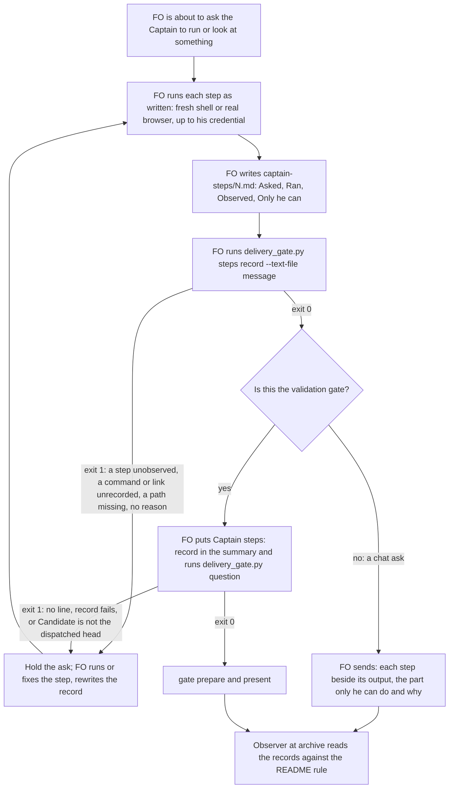

## Scope

- Source: intake from the subspace-relay dev2 FO (Paseo agent 1671c3a9, 2026-10-21), quoting the Captain there (relayed, not a ruling in this session): 「都准。但注意，412 你以後應該要自己先測試過才轉給我 UAT，這是 dev2 規範有缺，還是寫得不夠好沒有讓你執行？」 and 「可以，提給 dev2 fo」; an earlier instance on 2026-10-13 (relay task agent-review-identity): 「之後你要我跑的東西你應該要自己跑過一次」.
- Bite: relay PR #412 (task room-modals-try-copy, profile pilot): FO did not run the validator's acceptance script as written before the gate, which breaks the existing rule in kc-dev-flow-2 0.27.0 `skills/validation/principles.md` ("FO runs it as written before the gate"); separately FO asked the Captain for a browser UAT step (open an owner link, sign in as owner) that neither FO nor the validator had driven.
- The gap reported: the rule covers only the acceptance script. Nothing covers an ad-hoc check FO asks of the Captain outside it (a browser flow, an extra command, a token step), so FO can hand him an untried step and stay compliant.
- Shape proposed by the relaying FO (its wording, not the Captain's): before FO asks the Captain to run or look at anything, it runs that step itself as far as it goes without his credentials (for a UI flow, a real browser up to the step that needs his account or token), shows the observed output, and names the one step only he can do and why.
- First ideation step: check whether the miss is a missing rule or an unenforced one (the acceptance-script half is an existing rule FO did not follow), and where a check could catch it (the gate presentation, delivery_gate.py's ask text, the observer).
- Upstream first: validation principles, the README's FO steps and Delivery authority, delivery_gate.py, the observer; relay's state record for the evidence.
- Batch 13: the Captain 「可以」 (chat, 2026-11-03), answering 「決定：這批加入那 3 張，共 7 張一起進 backlog gate 嗎？」, which named this task.
- Further bite: the agent-observatory report on the qnow FO, 2026-11-03 (sampled; not yet checked against the source): a handbook command the FO handed the Captain, seed-captain-fixtures.py, failed with No such file or directory.

## Non-goals
- FO using the Captain's own credentials or account to finish a step; a new stage.

## Budget
- One package PR. Workflow word budget unchanged unless the design names a raise for the Captain.

## Stop condition
- Replays of relay #412 and the qnow handbook step are caught before the ask reaches the Captain, and a step FO ran itself, shown with its observed output and the one step only he can do, passes.

## FO alignment

Alignment: needed at ideation; whether a new rule or an enforcement point is the answer is the Captain's call.
Result: aligned at backlog: Batch 13 backlog sitting, the Captain 「進」 (chat, 2026-11-03), answering 「決定：這批七張（A 權限、B 同症狀計數、C 改寫條件比對原話、D release 驗收不在正式站、來源標註、FO 先自己試、release 驗收到期提醒）都用 Pilot，照各自寫下的範圍、預算與停止條件進入構思嗎？要改哪張直接說。」, approved the outcome and bounds in this file.
Surfaces: none
Visible change: none
Release review: not needed: workflow maintenance, on no journey map.

## Design

### First step: a missing rule or an unenforced one

Both, one per half, checked against the sources on 2026-11-03.

- **The acceptance-script half is an existing rule nobody checks.** The README's validation gate bullet ("FO runs the stage's minimal acceptance script exactly as written in a fresh shell, then presents every step in full beside its observed output") and `skills/validation/principles.md` ("FO runs it as written before the gate") were born together in a592e8b72 (2026-10-13); `git merge-base --is-ancestor a592e8b72 kc-dev-flow-2-v0.25.0` succeeds, so relay ran a package that had the rule. No script reads FO's run, and ADR 0024 D3 (Captain 「照建議」, 2026-10-19) put "presents every step in full beside its observed output" on the observer's chat-only list, so the observer does not judge it either. Relay `room-modals-try-copy` (origin/spacedock-state/dev2, `_archive/room-modals-try-copy/`): the validator ran `accept-412.sh` under `env -i` at b7732d43, but the only FO run in state is `evidence/fo-run-e623efd2/accept-412-preview.txt`, at a later head; the b7732d43 gate question (briefing `validation/briefing-1`) relied on "the Captain's own sign-in from an owner link on the preview", a step nobody drove; the observer report marks the FO-run rule `can't tell`. The Captain answered 「都准。但注意，412 你以後應該要自己先測試過才轉給我 UAT…」 (gate reason, 5a20e7be).
- **The ad-hoc half is a missing rule.** Package text names only "the stage's minimal acceptance script" at the validation gate (`git grep -n 'as written' origin/main -- kc-dev-flow-2 ':!*CHANGELOG*'`: the README line and test fixtures only). Nothing covers a command, a link, a sign-in or a card FO hands over in chat.
- **The qnow handbook evidence, checked against the source.** The observatory report (F5, sampled) is correct in substance and imprecise in one word: the "handbook" is `validation-6/captain-card.md` of qnow task `schedule-settings-match-design`, written by its validator while the task was active. Its step 2 runs `python3 /Users/kent/conductor/repos/qnow-adopt-dev2/docs/dev2/.spacedock-state/schedule-settings-match-design/validation-6/seed-captain-fixtures.py`. The task was archived at 2026-11-01 16:02 UTC (qnow state commit d5ab7e823, "archive schedule-settings-match-design (merge guard)"), which moved the folder under `_archive/`. At 16:20 UTC the qnow FO pointed the Captain at that card's line 13 to sign in on staging, and said it had not checked whether the test number has shop access there (qnow FO transcript, session 9ddabfa9, the assistant turn at 2026-11-01T16:20:03Z). He ran step 2 at 2026-11-02 03:30 UTC and got `[Errno 2] No such file or directory`; FO then found the script under `_archive/` and nothing listening on port 4431 (the turn at 03:30:40Z). Neither the moved path nor the missing runtime was tried before the ask.

The catch point is the script FO already runs before an ask, per ADR 0027 ("checked by the script FO already runs at that write where a structured record exists"): `delivery_gate.py` holds the validation gate question and the merge ask today. It gains a `steps` check for any ask, and the validation `question` requires its record.

### Chain checked (upstream first)

- **Spacedock 0.27.3:** `skills/` and `references/` hold no rule on FO trying a step before handing it to the captain (grep for "observed output", "as written", "captain to run"; the one "as written" hit is the ensign's launcher invariant).
- **kc-dev-flow-2 0.34.0 (origin/main):** the two sentences above; `delivery_gate.py question|check` check gate text clauses, reviewers and declines, not Captain steps; the observer lists the step rule as not judged (ADR 0024).
- **Adopters:** subspace-relay `AGENTS.md` added, on 2026-10-27 (2e5637d8), a product rule to walk a visible change on its Deploy Preview with a real sign-in before the merge ask, a local answer to the same bite. qnow `AGENTS.md` "Acceptance environment" says where acceptance runs, not that FO tries it first. Neither covers chat asks; the package rule below generalizes relay's and leaves its preview rule in place.

### PRFAQ

**Press release.** Before FO asks the Captain to run or look at anything, an acceptance script, a command, a link, a sign-in or a card of steps, it runs each step as written in a fresh shell or a real browser as far as it goes without his credentials, and writes what it ran and saw into `<task>/captain-steps/<N>.md`. `delivery_gate.py steps` reads that record against the message FO is about to send and holds the ask when a step has no observation, a command or link in the message is not a recorded step, a named file does not exist, or a step left to him gives no reason. At the validation gate, `delivery_gate.py question` also holds until the summary's `Captain steps:` line names a passing record for the candidate head. The Captain gets steps that have already worked once, each beside its output, and one named part that is his.

**FAQ**
- *Does FO use his account?* No (Non-goals). A step stops where his credential, account, device or judgment is needed, and the record says so on an `Only he can:` line with the reason. Test credentials written in a card are not his: FO uses them.
- *Does the check run FO's commands?* No. It reads the record and the message, and tests that each absolute path they name exists. A step with side effects (a seed into a throwaway database) is FO's to run, and it records the run.
- *What does this not catch?* A chat ask FO sends without running `steps`: nothing in the package sees FO's chat (Needs decision 1). A prose ask with no command, link or file in it ("sign in on the preview"), unless FO lists it as a step. Whether `Observed:` is true: the check reads its form, as `delivery_gate.py` reads `Necessity:` today.
- *Why not a new script?* `delivery_gate.py` already owns the checks before an ask to the Captain (`question`, `check`); a third subcommand reuses its task, candidate and README readers.

### Record and check

Record `<task>/captain-steps/<N>.md`, N counting up per task (the form `steps` prints on failure; no README text needed for it):

```
Candidate: <40-hex head the steps ran against, or none for a step with no candidate>

### Step 1
Asked: <the step exactly as the message states it>
Ran: <what FO ran, where (fresh shell, real browser), UTC time>
Observed: <the output, or a path in the task folder holding it>
Only he can: <what is left> — <why: his credential, account, device or judgment>
```

`python3 <package>/scripts/delivery_gate.py steps <record> --text-file <message>` exits 1 and names the step for each of:
- S1: a step whose `Asked:` text, whitespace-normalized, is not in the message;
- S2: a step with no `Observed:` (or an empty one), unless its `Ran:` is `none — <reason>` and it has an `Only he can:` line;
- S3: an `Only he can:` line with no reason of two or more words after the dash;
- S4: an absolute path (`/…` or `~/…`, a `:N` line suffix dropped, a `<placeholder>` skipped) in an `Asked:` line or in the message that does not exist on this machine;
- S5: a fenced command block, an `http(s)://` link, or a fenced block inside a Markdown file the message names by path, that is in no step's `Asked:` text.
It exits 2 on an unreadable input, and prints `captain steps complete: <n> steps, <m> left to him` and exits 0 otherwise.

`question` gains: when the gate text (summary, or combined text for a legacy call without `--summary-file`) has no `Captain steps: <record path>` clause, when that record fails `steps` against the gate text plus the task file's latest validation report, or when its `Candidate:` is not the latest dispatched `Candidate:` (`dispatched_candidates`), it holds preparation and prints the one problem and a `next:` line.



### Changes

- `kc-dev-flow-2/scripts/delivery_gate.py`: the `steps` subcommand (S1–S5) and the `Captain steps:` requirement in `question`.
- `kc-dev-flow-2/scripts/test_delivery_gate.py`: the replays and mutations in the criteria.
- `kc-dev-flow-2/references/sd/workflow.md`: a `## Captain steps` section after `## Stages` (86 words), and the validation gate bullet's 64-word acceptance-script passage replaced by 33 words; net +55 (5781 to 5836). Draft section text: "Before asking the Captain to run or look at anything (an acceptance script, a command, a link, a sign-in, a file of steps), FO runs each step as written, in a fresh shell or a real browser, as far as it goes without his credentials, and records it in `<task>/captain-steps/<N>.md`. `python3 <package>/scripts/delivery_gate.py steps <record> --text-file <message>` prints the record's form; nonzero holds the ask. The message shows each step beside its observed output and names the step only he can do, and why." Validation bullet replacement: "Before the gate, FO runs the stage's minimal acceptance script under Captain steps, names its record on the summary's `Captain steps:` line, and returns an output that differs from the script through feedback."
- `kc-dev-flow-2/scripts/lint-skills.py`: one `WORKFLOW_BUDGET_STEPS` entry, `delta=55`, carrying the Captain's quoted ruling (ADR 0020).
- `kc-dev-flow-2/skills/observer/SKILL.md`: drop "presents every step in full beside its observed output" from the chat-only list; the record now witnesses it, and `lint-skills.py` fails if the phrase stays listed after the README loses it.
- ADR, no number (FO reserves it at implementation dispatch): "FO runs a step before asking the Captain to run it, and records it", amending ADR 0024 D3 under its own reopen clause (the Captain found the listed rule broken on relay #412).
- Not changed: `skills/validation/principles.md` (the worker's script-writing rule stands), `pr_watch.py`, the mod, `observer_check.py`, any adopter file.

### Existing-code check

Use or repair what exists: `delivery_gate.py` is the script FO runs before the two asks it already checks, and it holds the task, README and candidate readers this needs. Observation that a change is needed: replaying both bites on 0.34.0, nothing holds either ask: the relay b7732d43 question has no clause `question` reads about steps, and the qnow chat ask passes through no package script. Implementation reruns both replays as AC-2 and AC-5.

### Profile check

Pilot holds: no production data, credentials, unattended operation or SLO. A published upgrade changes adopters' validation gates: an in-flight gate holds at its next `question` run until FO writes the record, as ADR 0024's clause hold did at its first ask; the release note says so.

### Words FO reads at each moment

Whitespace split, the counter `lint-skills.py` uses; base origin/main 0.34.0, candidate the draft text above (implementation recounts with an independent copy, per root learning.md).

| Moment | Base | Candidate |
| --- | --- | --- |
| Startup (workflow.md, mod 48 words) | 5781 + 48 | 5836 + 48 (+55) |
| Idle on an open PR, idle on a merged PR, after the archive (`pr_watch.py tasks` output) | unchanged | unchanged |
| Validation gate preparation (validation bullet + `question` output) | 64-word passage; `gate text complete` on a pass | 33-word passage plus the 86-word section; same pass line; one problem line and one `next:` line when the record is missing or fails |
| Any other ask to the Captain (chat) | 0 words instruct a step | the 86-word section (read at startup) plus `steps` output: 8 words on a pass, one line per defect |
| Merge ask (`delivery_gate.py check`) | unchanged | unchanged |

### Batch overlap

Files this design changes: `kc-dev-flow-2/scripts/delivery_gate.py` (new `steps` subcommand, `question()`, `main()` argparse, module docstring), `kc-dev-flow-2/scripts/test_delivery_gate.py` (new class), `kc-dev-flow-2/references/sd/workflow.md` (new section, validation bullet), `kc-dev-flow-2/scripts/lint-skills.py` (`WORKFLOW_BUDGET_STEPS`), `kc-dev-flow-2/skills/observer/SKILL.md` (chat-only list), and one unnumbered ADR in `docs/adr/`.

| Task | Same file, check or numbered record | Order |
| --- | --- | --- |
| claims-name-their-source (batch 13) | its Scope names `delivery_gate.py`; design not written | recheck when its design lands; textual conflicts at most |
| fo-answers-own-worker-permissions-by-listed-id (batch 13) | Paseo and peers extensions; no shared file | none |
| diagnosis-rounds-count-toward-step-back (batch 13) | `role_triggers.py`, `pr_watch.py`; no shared file | none |
| rewritten-criteria-checked-against-captain-words (batch 13) | `design_surfaces.py`, `dispatch_records.py`, the amendments rules in `workflow.md`; shares `workflow.md` and the budget list if it adds words | serialize `WORKFLOW_BUDGET_STEPS` entries |
| release-walk-off-production-before-release (batch 13) | release-acceptance extension, `adoption.md`; a release walk is an ask to the Captain, so its walk record meets this rule; no shared file | none; its design should name the `steps` record for the walk |
| release-walk-due-trigger (batch 13) | `pr_watch.py`, a README `journeys:` key; shares `workflow.md` and the budget list | serialize budget entries |
| comment-check-reaches-delivery-gate (live) | `delivery_gate.py` (`check()`, docstring, `write_record`) and `test_delivery_gate.py`; no `workflow.md` change | before this task; different functions |
| fo-write-checks-parse-top-level (live) | `delivery_gate.py` (`DECLINE_END`, `declined_items`, docstring), `test_delivery_gate.py` | before this task; different functions |
| captain-ruling-sources-checked (live) | `design_surfaces.py`, peers extension, `adoption.md`, an ADR | ADR numbering only |
| archive-waits-for-observer-report (live) | mod, learn extension, `adoption.md`, an ADR; no shared file | ADR numbering only |
| adoption-asks-which-extensions (live) | `dispatch_records.py`, `number_guards.py`, `laws.md`; no shared file | none |
| dispatch-carries-reserved-adr-number, ops-inbox-r1-setup-and-isolation, adr-required-statement (closed design), journey-canvas-hosted-poc, journey-server-host-pilot (no top-level task file at state b0e245e50), adr-silent-undo-probe, picky-reviewers-may-run-on-gemini, pr-review-lite-value-pilot, seed-check-requires-alignment-result | none of the six files; ADR-numbering tasks share the `docs/adr/` index | ADR numbers reserved at dispatch, never guessed |

Recommended order: comment-check-reaches-delivery-gate, then fo-write-checks-parse-top-level, then this task (all three edit `delivery_gate.py`'s docstring and `main()`); serialize every `workflow.md` budget raise in the batch in one order FO names.

## Acceptance criteria

**AC-1** `delivery_gate.py steps` holds a record whose step has no observation. Evidence: a test writes a record with `Asked:` and `Ran:` but no `Observed:` and a message holding the step; `steps` exits 1 and names step 1. The same step with `Ran: none — his phone` and no `Only he can:` exits 1. Falsifier: remove the S2 test from `steps`; both cases exit 0 and the test fails.

**AC-2** The qnow replay is held before the ask. Evidence: a test builds a message pointing at a card file (`…/captain-card.md:13`) whose fenced step runs `python3 <tmp>/schedule-settings-match-design/validation-6/seed-captain-fixtures.py`, with the script present only under `<tmp>/_archive/…`; a record that copies that step exits 1 naming the missing path (S4), and a record without the step exits 1 naming the unrecorded command (S5). Creating the file at the named path makes the first case pass. Falsifier: drop S4 or S5; the matching case exits 0.

**AC-3** A command or link the message asks for must be a recorded step. Evidence: a message with one fenced command and one `https://` link, and a record holding only the command, exits 1 naming the link; recording the link exits 0. Falsifier: drop S5's link match; the first case exits 0.

**AC-4** A step left to the Captain names why. Evidence: `Only he can: sign in` (no dash and reason) exits 1 (S3); `Only he can: sign in — his WorkOS account` exits 0. Falsifier: drop S3.

**AC-5** The relay #412 replay is held at the validation gate. Evidence: a test task whose latest validation dispatch record has `Candidate:` b7732d43 (40-hex) and a summary with no `Captain steps:` line: `question` exits 1 with one problem line and one `next:` line; a record whose `Candidate:` is the later e623efd2 head exits 1 naming the mismatch; a passing record at b7732d43 exits 0. Falsifier: remove the clause requirement from `question`; the first case exits 0.

**AC-6** A step FO ran itself passes. Evidence: a record with three steps, each with `Ran:` and `Observed:`, the third ending `Only he can: enter his password at the sign-in page — his account`, and a message showing all three beside their output: `steps` exits 0 and prints `captain steps complete: 3 steps, 1 left to him`.

**AC-7** The README carries the rule, the budget raise is recorded, and the observer judges the rule. Evidence: `python3 kc-dev-flow-2/scripts/lint-skills.py` exits 0 and prints `references/sd/workflow.md: 5836 of 5836 words` (or the base plus 55 if a sibling lands first); the new `WORKFLOW_BUDGET_STEPS` entry carries the Captain's quoted ruling; `skills/observer/SKILL.md`'s chat-only list no longer holds the step phrase. Falsifier: leave the phrase on the list; `lint-skills.py` fails with "chat-only rule ... is not in references/sd/workflow.md".

**AC-8** Existing callers stay green apart from the intended hold. Evidence: the package test suite (`python3 -m unittest discover -s kc-dev-flow-2/scripts -p 'test_*.py'`) passes, with existing `QuestionTests` fixtures given a `Captain steps:` line and a record; the hold on a fixture without one is AC-5's case.

**AC-9** The words FO reads per moment match the table above at the candidate. Evidence: an independent recount of each moment, base and candidate, saved in the validation folder; startup rises by exactly the recorded raise, and idle, archive and merge-ask moments are unchanged.

## Needs decision

1. **Chat asks are held only when FO runs `steps`.** Nothing in kc-dev-flow-2 sees FO's chat, so the qnow replay is caught only if FO follows the README sentence and runs the check; the observer then reads the records at archive. Recommend accepting that for this task: the rule, the check FO runs, and the observer, with no hook. Worse under it: an FO that skips both the record and the script for a chat ask leaves nothing for any reader but the Captain. Alternative: a host hook on FO's outgoing message (a Paseo plugin or a Claude Code hook) is another product's work, and a Codex FO would need its own; file it as a follow-up only if he wants one.
2. **Raise the workflow word budget by 55 (5781 to 5836) under ADR 0020.** Recommend yes: the chat-ask moment has no script output, so the README at startup is the only text FO reads before it; the validation passage shrinks by 31 to pay part of it. Worse: every FO startup reads 55 more words. Alternative with no raise: rewrite only the validation bullet in its 64 words with the record line; chat asks stay uncovered and the qnow replay is not caught.
3. **Reverse ADR 0024 D3 (Captain 「照建議」, 2026-10-19: the acceptance steps in full stay chat-only).** Recommend reversing it under that ADR's own reopen clause: the Captain found the rule broken on relay #412, and the record now has a reader (`question`, the observer), which D3 lacked. Worse: one more file per ask in each task folder, and every validation gate writes one.

## Stage Report: ideation

- DONE: Start with the task's First ideation step (missing rule or unenforced one) and check the qnow handbook evidence against its source; then name the point that catches an untried step before the ask reaches the Captain
  Design "First step": acceptance-script half is an existing unenforced rule (a592e8b72, in 0.25.0; ADR 0024 D3 lists it chat-only; relay FO run only at e623efd2, gate at b7732d43); ad-hoc half is missing; qnow card path moved by archive d5ab7e823 before the 16:20Z chat ask (transcript 9ddabfa9). Catch point: `delivery_gate.py steps` plus a `Captain steps:` requirement in `question` (ADR 0027).
- DONE: A `### Batch overlap` section naming each file the design would change and each other batch task and live task that changes the same file or check, so FO can order implementation
  Six files listed; delivery_gate.py shared with comment-check-reaches-delivery-gate and fo-write-checks-parse-top-level (order: those two first); workflow.md budget list shared with rewritten-criteria and release-walk-due-trigger; claims-name-their-source to recheck; ADR index shared.
- DONE: The words FO reads at each lifecycle moment, before and after, per root learning.md "Measure the words FO reads at each moment, not one file's size"
  Table in Design: startup +55 (5781 to 5836); idle, archive, merge ask unchanged; validation passage 64 to 33 plus 86-word section; chat ask 0 to the section plus an 8-word pass line. Draft counts from /tmp/fo-tries-words.py; implementation recounts independently (AC-9).
- DONE: Acceptance criteria with reproducible evidence clauses and falsifiers, and unresolved decisions for the Captain, each with a recommendation and what gets worse under it
  AC-1 to AC-9 each with evidence and a falsifier; three Needs decision items (chat asks FO-run only, +55 budget raise, reversing ADR 0024 D3), each with a recommendation and what gets worse.
- DONE: AC-1 (steps holds an unobserved step): not yet verified, test planned.
  Implementation evidence; falsifier stated.
- DONE: AC-2 (qnow replay held): not yet verified; replay inputs checked against the qnow transcript and state commit d5ab7e823.
  Implementation evidence.
- DONE: AC-3 (unrecorded command or link held): not yet verified.
  Implementation evidence.
- DONE: AC-4 (Only he can names why): not yet verified.
  Implementation evidence.
- DONE: AC-5 (relay #412 replay held at the gate): not yet verified; replay heads b7732d43 and e623efd2 read from relay state.
  Implementation evidence.
- DONE: AC-6 (a step FO ran itself passes): not yet verified.
  Implementation evidence.
- DONE: AC-7 (README rule, budget raise, observer list): not yet verified; depends on Needs decision 2 and 3.
  Implementation evidence.
- DONE: AC-8 (existing callers green): not yet verified.
  Implementation evidence.
- DONE: AC-9 (words per moment): draft counts only; independent recount owed at validation.
  Implementation evidence.
- DONE: design_surfaces.py check
  `python3 <package>/scripts/design_surfaces.py check fo-tries-what-it-asks-the-captain.md` printed "design surfaces presentable", exit 0 (Surfaces: none; PRFAQ and Mermaid present).

### Summary

The miss is both: the acceptance-script half is a rule nobody checks (ADR 0024 put it on the observer's not-judged list), and the chat-ask half has no rule. The design adds `delivery_gate.py steps`, which reads a `captain-steps/<N>.md` record (what FO ran, what it saw, the part only he can do) against the outgoing message and holds on a missing observation, an unrecorded command or link, a missing path or a missing reason; the validation `question` requires the record for the candidate head. Both replays are criteria. Open for the Captain: chat asks rely on FO running the check, a +55-word budget raise, and reversing ADR 0024 D3. No repository file was written.
