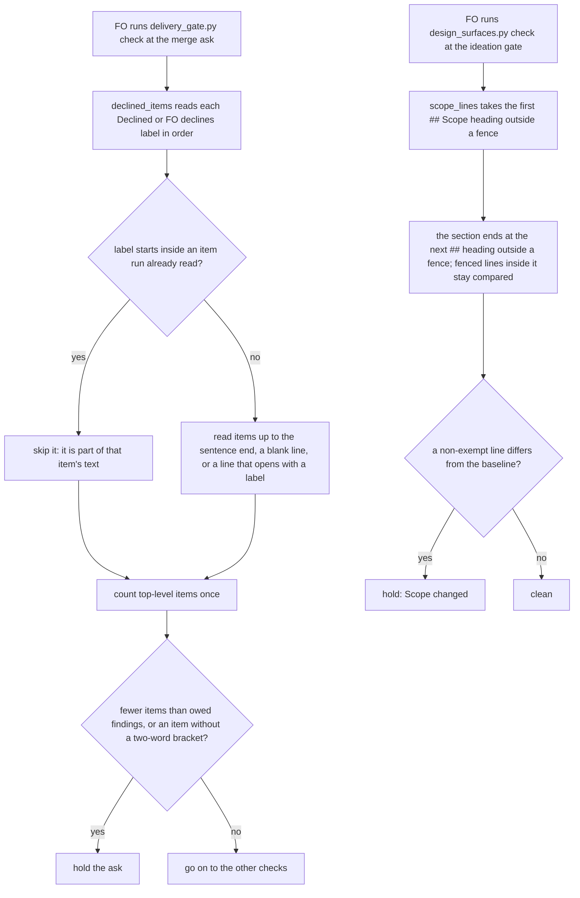

## Scope

- Source: Codex round 3 on iamcxa/kc-claude-plugins#687 at head 2b86a62490de623faf7365ef29931a9d5c35e3f9 (evidence=review:5587635979, 2026-10-20), two P2 findings that FO declined in the fo-write-rules-checked validation gate summary under the README round-3 rule ("From round 3 a finding that is neither does not start a repair cycle … files it as a new backlog task").
- Finding 1, `kc-dev-flow-2/scripts/delivery_gate.py` `declined_items()`: a decline reason that itself mentions another `Declined:` or `FO declines:` label yields overlapping items for the outer and nested match, so one real item can satisfy two F-numbered findings and the gate proceeds with one finding undisposed. Count only non-overlapping top-level items.
- Finding 2, `kc-dev-flow-2/scripts/design_surfaces.py`: the Scope search selects a fenced `## Scope` example placed before the real section; the example is unchanged in baseline and working copy, so real Scope edits compare equal and the hold returns clean. Parse the unfenced document, as the amendment parser already does.
- Decline reason at the gate: neither is P1 or Material; both need a crafted text (a nested decline label, a fenced Scope example ahead of the real one) that no task in the four measured state checkouts holds — to re-measure at ideation.
- Bite: none observed beyond the reviewer's constructed examples.
- Non-goals: any other change to the two scripts.

## FO alignment

Alignment: not needed before ideation; both findings name their fix.
Surfaces: none
Visible change: none
Release review: not needed: workflow maintenance, on no journey map.

## Design

Ideation of 2026-10-21 against origin/main c27e7659 (kc-dev-flow-2 0.27.0). Profile: pilot. The Scope above is untouched.

### PRFAQ

**Press line.** FO's two ask-time checks stop trusting text shape they cannot read: `delivery_gate.py check` counts each declined item once even when a reason quotes another `Declined:` label, and `design_surfaces.py check` finds the real `## Scope` even when a fenced example of that heading comes first.

**Who uses it, and what breaks without it.** FO, at the merge ask and at the ideation gate, both steps it already runs. Without the first fix, a declined-item count inflated by one nested label satisfies the "declined items are fewer than the validation report's Deferred risk and Polish findings" hold, so one finding goes undisposed. Without the second, a Scope edit after the backlog gate compares equal and the ideation gate prints no hold. Neither has bitten a real task: 0 changed verdicts and 0 hits in the corpus below, so the bite is the reviewer's two constructed examples only, as the Scope says.

**FAQ.**
- Why not rewrite the parsers? Each is one function: `declined_items` (with `DECLINE_END`) in `delivery_gate.py` and `scope_lines` in `design_surfaces.py`. Both repairs are local.
- Why does the first fix also change `DECLINE_END`? Skipping a nested label alone makes a bulleted decline list newly undercount (measured below, 2 items become 1), so a line that opens with a label must end the previous item run. Decision D2 asks the Captain to accept that.
- Does the second fix read fenced text inside the real Scope? Yes, as today. Only a heading inside a fence is ignored. Decision D1.
- What stays out? Every other change to the two scripts (Scope non-goal), including the sibling defect named under Follow-up proposal.

### Existing-code check (chain order)

- Spacedock 0.27.2: `spacedock gate --help` lists prepare, withdraw, record and consume; none parses a decline text or a task's Scope, so there is nothing upstream to reuse.
- kc-dev-flow-2: both functions exist and are the owners. `unfenced()` with `FENCE` in `design_surfaces.py` is the precedent for ignoring fenced text (`amendment_entries`, the `Surfaces:` count); the Scope fix reuses `FENCE`, not a new fence definition.
- Adopters (relay, web, qnow): `git ls-files | grep -E 'delivery_gate|design_surfaces'` finds no copy in any of the three checkouts, so no local fork needs the same change.

### Mechanism

1. `declined_items`: remember where the last label's item run ended and skip a later `DECLINE_START` match that begins before it. The run ends where `DECLINE_END` matches, or at the end of the text. `DECLINE_END` gains one alternative, a line break followed by an optional list marker, at most one word (a finding id such as `V10`), and `Declined` or `FO declines`, so each bulleted decline stays its own run. The module docstring's sentence on where an item run ends names the new end.
2. `scope_lines`: walk the lines once; a line matching `FENCE` toggles an inside-fence flag; the first `## Scope` heading outside a fence opens the section and the next `## ` heading outside a fence closes it. Fenced lines between them are kept, so an edit inside a fenced block of the real Scope still holds, as today. The `design_surfaces.py` docstring says the heading is read outside fences.
3. Prototype, not the deliverable: `fo-write-checks-parse-top-level/ideation/prototype.diff` in the state checkout. Reproduce: `git archive origin/main kc-dev-flow-2/scripts | tar -x -C <dir>`, then in `<dir>/kc-dev-flow-2/scripts` run `patch -p3 < prototype.diff`. The existing suites pass on it (`python3 -B -m unittest`, 2026-10-21): `test_design_surfaces` 144 tests OK, `test_delivery_gate` 80 tests OK.

### Measured today (2026-10-21)

Corpus: every task file (top-level and `_archive/`) in the four dev2 state checkouts at heads kc-claude-plugins e5aec638e18d, qnow 0fd4f5b64fa8, subspace-relay 55e447aa04b5, subspace-web 4a51160e6f1f: 305 files, 747 committed revisions of them, 735 gate questions (the `question` field of every `review/*/briefing-*/index.json`). The harness is `ideation/measure.py` beside the task (`python3 -B -I measure.py <base-scripts-dir> <candidate-scripts-dir>`, about 8 minutes; `--gate-only` about 3 seconds). It reads the checkouts read-only, loads both script sets from their own directories, and compares per file `design_surfaces.py check` and `check --seed` (exit code and printed text), `scope_lines` at every committed revision, and `declined_items` plus `unreasoned_items` over every gate question and every task body.

| Comparison | Files or texts | Verdict changes |
| --- | --- | --- |
| `check` and `check --seed`, exit code and text | 305 files x 2 modes | 0 |
| `scope_lines` at every committed revision | 747 revisions | 0 |
| `declined_items` and `unreasoned_items` over gate questions | 735 | 0 |
| the same over whole task bodies (stress input, not gate text) | 305 | 4 files: this task and `fo-write-checks`, `fo-write-rules-checked` (prose quoting `Declined:` in backticks) and relay `account-publish-ceiling` (adjacent `Vn Declined, low:` report bullets: base folded V10's text into V8's run and read it again as its own run; the candidate gives V10 its own run only) |

Probes (`ideation/probe_dg.py`, `ideation/probe_ds.py`, each `<base> <candidate>`): a nested label with its own bracket counts 4 items in base and 2 in the candidate (the false pass: 2 real items satisfy 3 owed findings in base); two labels in one sentence 3 and 2; a nested label without its own bracket 4 and 2; bulleted declines 2 and 2 with the `DECLINE_END` alternative and 2 and 1 without it; a bullet with no reason, hidden by the next bullet's bracket in base (0 unreasoned), is refused in the candidate (1); a label on a new line inside a bracket splits the item and holds (fail closed, base 4 items and 0 unreasoned, candidate 3 and 1). `scope_lines`: a fenced `## Scope` example ahead of the real section returns the example in base and the real lines in the candidate; a fenced `## ` line inside the real Scope truncates it in base and does not in the candidate; a fenced block with no heading inside the real Scope is identical; the unfenced, EOF and no-newline shapes are identical.

Known limits, not fixed here: an unclosed fence before `## Scope` hides the whole section from the candidate (base reads it); the same hides a section from the amendment parser today, no committed revision has one (0 changes in 747), and a malformed fence is a task defect to repair. A label that opens a sentence inside a bracket still ends the outer run early; that item is refused for having no reason, so the gate holds rather than passes.

### Follow-up proposal (not adopted, not in this design)

`check_criteria` in `design_surfaces.py` calls `section(lines, AC_HEADING)` on raw lines, so a fenced `## Acceptance criteria` example holding a `**AC-1**` line satisfies the criteria requirement (probed 2026-10-21 on origin/main: returns `{'AC-1'}`, no error, with the real section empty). Same fence-blind class, one more function. FO files it as its own backlog task if the Captain wants it; widening this one breaks the Scope non-goal.

### Batch overlap

Files this design would change: `kc-dev-flow-2/scripts/delivery_gate.py` (`DECLINE_END`, `declined_items`, the module docstring's sentence on item runs), `kc-dev-flow-2/scripts/design_surfaces.py` (`scope_lines`, one docstring clause), `kc-dev-flow-2/scripts/test_delivery_gate.py` (`FoWriteRuleTests`), `kc-dev-flow-2/scripts/test_design_surfaces.py` (`ScopeCheckTests`). No README, skill, reference, extension, ADR or version file.

| Task | State | Same file or check? | What FO needs |
| --- | --- | --- | --- |
| merge-ask-holds-missing-clauses | batch 5, ideation | yes: `delivery_gate.py` `check()`, the clause table and docstring, and `test_delivery_gate.py` | implement first, as the Captain's Scope here says; this one rebases onto it |
| comment-check-reaches-delivery-gate | live, ideation (not in the batch list) | yes: `delivery_gate.py` `check()`, docstring, `test_delivery_gate.py` | implement before this one if both are approved; different functions, textual conflicts in the docstring and at the test file's end |
| idle-names-failing-seeds | batch 5, ideation | reads the same check: it runs `design_surfaces.py check --seed` from `pr_watch.py`; edits neither script | none; `--seed` returns before `scope_hold`, and the corpus shows 0 `check --seed` changes |
| new-work-starts-from-a-story-map | batch 5, ideation held | possibly: touchpoint (4) is a backlog-gate notice that could land in `design_surfaces.py` | re-check after its design; no edit to `scope_lines` is likely |
| agent-reads-governing-adr, codex-reader-reads-receipt-marker | batch 5, ideation | no: hooks and instruction files, and `extensions/codex/codex_review.py` | none |
| kc-decision-log-p1, kc-decision-log-cli, kc-decision-log-handoff-trial, pr-review-lite-value-pilot, release-acceptance, journey-canvas-hosted-poc, journey-server-host-pilot (other sessions, read only) | live | they only run `design_surfaces.py check`; none edits either script (grep of each task file) | none; 0 verdict changes in the corpus, so none of their task files changes verdict |
| chat-only-evidence-observer-blind-followups (`clause()`), amendment-form-check-round3-followups and override-reaches-gate-and-criteria-wait (`check_amendments`), design-surfaces-task-dir-crash (`main`) | backlog | same files, different functions | order only if one is pulled forward |

Suggested implementation order: merge-ask-holds-missing-clauses, then comment-check-reaches-delivery-gate if approved, then this task.

### Words FO reads at each lifecycle moment

Counted per root `learning.md` "Measure the words FO reads at each moment": every passage and script output that instructs a step due at that moment, base (0.27.0) against candidate. `grep -n -E 'delivery_gate|design_surfaces' kc-dev-flow-2/references/sd/workflow.md` on origin/main names the two scripts at four places: the seed check before `gate prepare`, the ideation gate, the implementation and validation runs, and the merge ask. The change edits no README, skill, reference, mod or extension text (AC-6), so every passage is equal by construction, and script output is equal on every corpus input (table above).

| Moment | Words FO reads, base | Candidate | Change |
| --- | --- | --- | --- |
| startup, idle on an open PR, idle on a merged PR, after the archive | neither script is named at these steps | same | 0 |
| seed check before `gate prepare` | one `check --seed` line | same: `--seed` returns before `scope_hold` | 0 on 305 files |
| ideation gate | `check` output; a Scope hold is 52 words plus the quoted line (at most 80 characters) when it prints | same text; it prints in more cases (a Scope edit behind a fenced example) | 0 on 305 files; at most 52 plus the line on a newly caught edit |
| merge ask | `delivery_gate.py check` output; the "fewer declined items" hold is 31 words | same text; it prints in more cases (a nested label no longer inflates the count) | 0 on 735 gate questions; at most 31 on a newly caught one |

No moment rises on the corpus, and a newly refusing input adds only an existing hold line. No passage is removed, so no moment falls either.

### Decisions for the Captain

Past rulings read (2026-10-21): ADR 0010 (a round-three declined finding becomes its own backlog task, which is why this task exists) and ADR 0025 (a declined item carries a bracketed reason; it chose a bracket proof, not reason quality). `git -C <state checkout> grep -n 'Override:'` hits only prose in archived designs, observer reports and ADR 0009 and 0011; none touches decline parsing or the Scope hold, so no ruling went against a similar recommendation.

**D1: does the Scope fix keep comparing fenced lines inside the real Scope?**
Options: A, find the heading outside fences and keep every line of the section, fenced or not (chosen); B, read the Scope from the unfenced document only, as the finding words it, so fenced lines inside Scope drop out.
**Recommended:** A. What gets worse under A: the Scope reader no longer matches the amendment parser's "unfenced" reading line for line. What gets worse under B: an edit inside a fenced block of the real Scope stops holding, a detection the check has today (A reads the same lines as base there; B cannot see them by construction).

**D2: does the decline fix add a "line that opens with a label ends the run" rule to `DECLINE_END`?**
Options: A, add it (chosen); B, only skip a label that starts inside an earlier run.
**Recommended:** A. What gets worse under A: `DECLINE_END` carries a third alternative and the docstring one more clause, and a text that hid a reasonless bullet behind the next bullet's bracket is now refused (correct, but a changed verdict). What gets worse under B: a bulleted decline list counts 1 where base counts 2, so a gate text with two real bullets can meet a "fewer than owed" hold with nothing wrong; no gate question of the 735 changed under B (measured with the skip alone, before the `DECLINE_END` alternative), so B costs nothing measured and A guards a form FO may adopt.

Coupling: none; the Captain can rule on them in either order. The Scope's non-goal "any other change to the two scripts" is why D2 is asked at all: A is the one change beyond the two named fixes.

## Acceptance criteria` example holding a `**AC-1**` line satisfies the criteria requirement (probed 2026-10-21 on origin/main: returns `{'AC-1'}`, no error, with the real section empty). Same fence-blind class, one more function. FO files it as its own backlog task if the Captain wants it; widening this one breaks the Scope non-goal.

### Batch overlap

Files this design would change: `kc-dev-flow-2/scripts/delivery_gate.py` (`DECLINE_END`, `declined_items`, the module docstring's sentence on item runs), `kc-dev-flow-2/scripts/design_surfaces.py` (`scope_lines`, one docstring clause), `kc-dev-flow-2/scripts/test_delivery_gate.py` (`FoWriteRuleTests`), `kc-dev-flow-2/scripts/test_design_surfaces.py` (`ScopeCheckTests`). No README, skill, reference, extension, ADR or version file.

| Task | State | Same file or check? | What FO needs |
| --- | --- | --- | --- |
| merge-ask-holds-missing-clauses | batch 5, ideation | yes: `delivery_gate.py` `check()`, the clause table and docstring, and `test_delivery_gate.py` | implement first, as the Captain's Scope here says; this one rebases onto it |
| comment-check-reaches-delivery-gate | live, ideation (not in the batch list) | yes: `delivery_gate.py` `check()`, docstring, `test_delivery_gate.py` | implement before this one if both are approved; different functions, textual conflicts in the docstring and at the test file's end |
| idle-names-failing-seeds | batch 5, ideation | reads the same check: it runs `design_surfaces.py check --seed` from `pr_watch.py`; edits neither script | none; `--seed` returns before `scope_hold`, and the corpus shows 0 `check --seed` changes |
| new-work-starts-from-a-story-map | batch 5, ideation held | possibly: touchpoint (4) is a backlog-gate notice that could land in `design_surfaces.py` | re-check after its design; no edit to `scope_lines` is likely |
| agent-reads-governing-adr, codex-reader-reads-receipt-marker | batch 5, ideation | no: hooks and instruction files, and `extensions/codex/codex_review.py` | none |
| kc-decision-log-p1, kc-decision-log-cli, kc-decision-log-handoff-trial, pr-review-lite-value-pilot, release-acceptance, journey-canvas-hosted-poc, journey-server-host-pilot (other sessions, read only) | live | they only run `design_surfaces.py check`; none edits either script (grep of each task file) | none; 0 verdict changes in the corpus, so none of their task files changes verdict |
| chat-only-evidence-observer-blind-followups (`clause()`), amendment-form-check-round3-followups and override-reaches-gate-and-criteria-wait (`check_amendments`), design-surfaces-task-dir-crash (`main`) | backlog | same files, different functions | order only if one is pulled forward |

Suggested implementation order: merge-ask-holds-missing-clauses, then comment-check-reaches-delivery-gate if approved, then this task.

### Words FO reads at each lifecycle moment

Counted per root `learning.md` "Measure the words FO reads at each moment": every passage and script output that instructs a step due at that moment, base (0.27.0) against candidate. The change edits no README, skill, reference, mod or extension text (AC-6), so passages are equal by construction; script output is equal on every corpus input (table above).

| Moment | Base words FO reads | Candidate | Change |
| --- | --- | --- | --- |
| startup | README and mods as adopted | same files | 0 |
| idle on an open PR | `pr_watch.py` output | not touched | 0 |
| idle on a merged PR | `pr_watch.py` output | not touched | 0 |
| after the archive | learn and observer text | not touched | 0 |
| ideation gate | `design_surfaces.py check` output; a Scope hold line is 52 words when it prints | same text; the hold prints in more cases (a Scope edit behind a fenced example) | 0 on 305 files; at most 52 words on a newly caught edit |
| merge ask | `delivery_gate.py check` output; the "fewer declined items" hold is 31 words | same text; prints in more cases (nested labels no longer inflate the count) | 0 on 735 gate questions; at most 31 words on a newly caught one |

Every moment is at or below base only on the corpus; a newly refusing input adds its existing hold line. No moment's total can fall, because no passage is removed.

## Acceptance criteria

**AC-1**: `declined_items` counts non-overlapping items only: a label that begins inside an item run already read adds no item. Evidence: a new `FoWriteRuleTests` case runs `declined_items` on "Declined: F1 a (see Declined: F9 x (y z)); F2 b (two words)." and gets 2 items (origin/main gets 4), and `findings_join` on a validation report with 3 `- F<N> Deferred risk:` bullets and that text returns the "declined items (2) are fewer than ... (3)" hold (origin/main returns none). Falsifier: deleting the `if start.start() < stop: continue` line turns that case red, shown by a mutation test in the style of the existing `variant_of` cases.

**AC-2**: A bulleted decline list keeps its count and each bullet keeps its own reason check. Evidence: new cases for "- Declined: F1 a (two words).\n- Declined: F2 b (two words)." and the same with `- V8 Declined, low:` finding ids both give 2 items and 0 unreasoned; "- Declined: F1 a\n- Declined: F2 b (two words)" gives 1 unreasoned item (origin/main: 0); the four `LATE_DECLINES` counts (3, 4, 4, 5) in `test_the_four_late_declined_texts_parse_in_full_and_every_item_has_a_reason` still hold. Falsifier: removing the new `DECLINE_END` alternative turns the first two cases red (count 1).

**AC-3**: `scope_lines` reads the first `## Scope` heading outside a fence. Evidence: a new `ScopeCheckTests` case commits a task whose body has a fenced `## Scope` example before the real section, closes the backlog gate, adds a line to the real Scope, and `scope_hold` returns `hold` (origin/main returns `clean`); `design_surfaces.py check` exits 1 with the existing hold line. Falsifier: restoring the old `re.search` turns it clean, shown by a `mutated` case.

**AC-4**: Fenced lines inside the real Scope stay compared, and a fenced `## ` line inside it does not end it. Evidence: two new cases, an added line inside a fenced block of the real Scope holds, and a fenced `## Not a heading` line followed by an added real line holds (origin/main: the second returns `clean`). Falsifier: a mutation that drops fenced lines from the section (the `unfenced()` reading) turns the first clean.

**AC-5**: No unexplained verdict change over the four state checkouts. Evidence: the implementation report runs `ideation/measure.py` (or a copy it names) from origin/main and from the candidate head over every task file of the four checkouts, records each checkout's head, and states per differing row whether it is intended. Required: 0 changes in the `check`, `check --seed` and `scope_lines` rows and in the gate-question row, as measured today; any other row is listed with its reason. Falsifier: the same harness over a base that carries a nested label or a fenced Scope example shows a difference, proving it can fail.

**AC-6**: Nothing else changes. Evidence: `git diff --name-only origin/main...HEAD` lists exactly `kc-dev-flow-2/scripts/delivery_gate.py`, `design_surfaces.py`, `test_delivery_gate.py` and `test_design_surfaces.py`; `python3 kc-dev-flow-2/scripts/lint-skills.py` exits 0 with the same word budget; both suites pass in full (`kc-dev-flow-2-tests.yml` already runs them, so no new CI job). Falsifier: any other path in the diff list, or a budget change.

**AC-7**: The words FO reads at each moment are at or below base. Evidence: the table above, recounted by the implementation report from the candidate head with an independent count of the two hold lines (52 words plus the quoted line, and 31 words, today). Falsifier: any passage or output line added to a moment, or a changed hold text.

## Stage Report: ideation

- DONE: Design both parser fixes and measure them by a base-versus-candidate verdict comparison over every task file in the four state checkouts, per root learning.md on newly refusing checkers; order it after merge-ask-holds-missing-clauses, which edits the same script
  Design in `## Design`; `ideation/measure.py` over 305 task files, 747 revisions and 735 gate questions found 0 changed verdicts in `check`, `check --seed`, `scope_lines` and the gate-question rows, and 4 explained rows in task-body prose. The pure skip regressed bulleted declines (2 items to 1), which is why the design adds the `DECLINE_END` line rule (D2). Order: after merge-ask-holds-missing-clauses.
- DONE: A `### Batch overlap` section naming each file the design would change and each other batch task and live task of other sessions that changes the same file or check, so FO can order implementation
  `### Batch overlap`: four files named; merge-ask-holds-missing-clauses and comment-check-reaches-delivery-gate (not in the batch list) edit `delivery_gate.py`; the rest read or do not touch either script.
- DONE: The words FO reads at each lifecycle moment, before and after, per root learning.md "Measure the words FO reads at each moment, not one file's size"
  `### Words FO reads at each lifecycle moment`: no README, skill or reference text changes, output identical on all corpus inputs; the two hold lines (52 words plus the quoted line, 31 words) print in more cases only.
- DONE: Acceptance criteria with reproducible evidence clauses and falsifiers, and unresolved decisions for the Captain, each with a recommendation and what gets worse under it
  `## Acceptance criteria` AC-1 to AC-7 as bold declarations; `### Decisions for the Captain` D1 (fenced lines inside Scope) and D2 (the `DECLINE_END` line rule). Per criterion, current evidence:
  AC-1: prototype probe shows 4 items in base and 2 in the candidate on the nested-label text; the unit test and its mutation are not yet written.
  AC-2: prototype probe shows bulleted texts at 2 items in base and in the candidate, 1 without the alternative; the unit cases and mutation are not yet written.
  AC-3: prototype probe shows base reads the fenced example and the candidate the real section; the committed-task test is not yet written.
  AC-4: prototype probe shows a fenced block inside Scope identical to base and a fenced `## ` line no longer truncating; the tests are not yet written.
  AC-5: measured today on the prototype (table in `### Measured today`); the implementation report reruns it on the candidate head.
  AC-6: not yet verified; the prototype diff touches only `delivery_gate.py` and `design_surfaces.py`, and `test_delivery_gate` 80 and `test_design_surfaces` 144 pass on it.
  AC-7: current counts in the table; recount belongs to the implementation report.
- DONE: `python3 <package>/scripts/design_surfaces.py check <task>` output cited
  `fo-write-checks-parse-top-level.md: design surfaces presentable`, exit 0, from both the 0.27.0 and the 0.26.0 package roots (the skill loaded from 0.26.0, the dispatch names 0.27.0; both print the same line).

### Summary

Both fixes are one function each, `declined_items` with `DECLINE_END` in `delivery_gate.py` and `scope_lines` in `design_surfaces.py`; the prototype passes both existing suites and changes no verdict on 305 task files, 747 revisions or 735 gate questions. Two choices need the Captain: keep fenced lines inside the real Scope compared (recommended), and add a line-opens-with-a-label end to `DECLINE_END` so a bulleted decline list is not undercounted (recommended). A third finding, `check_criteria` being fence-blind, is a follow-up proposal and not in this design. Ideation wrote no repository file, branch or commit; the prototype and harness sit under `fo-write-checks-parse-top-level/ideation/` in the state checkout.
