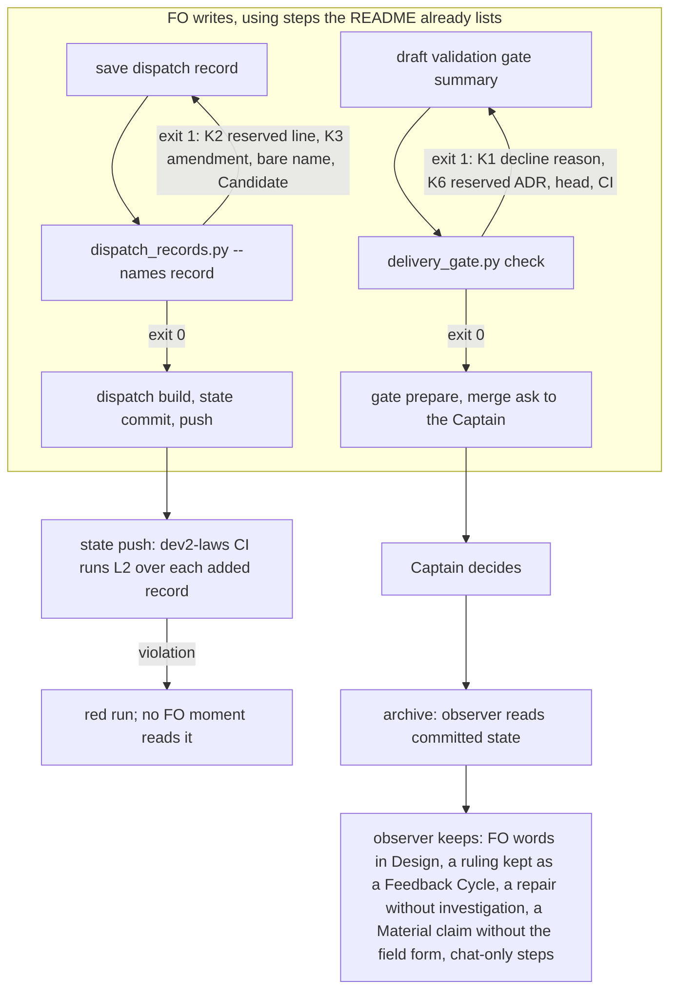

Filed for batch 3 on the Captain's 「先走批次三規劃」 (chat, 2026-10-19), after FO reported at the batch-2 close that its own process mistakes repeat across tasks and should move from reminders into a script; the Captain enabled the state laws check on this repository the same day (「可以那就只開啟這個repo」).

## Scope

- Measured from the six batch-2 observer reports (2026-10-17 to 10-19): a decline in the gate summary with no reason, 4 of 6 tasks; the reserved `ADR: NNNN` line missing from the dispatch scope notes, 3 of 6; amendment-form breaks (amendment not named in the next dispatch's checklist, FO's own words in the `Design:` line, a Captain ruling recorded as a Feedback Cycle instead of an amendment), 3 of 6; a repair without a worker investigation phase, 1; a Material claim without the `value-ac[...]` field form, 1; a delivery gate presented while `adr_lint --require` exits 1, 1.
- Upstream first: what `laws_check.py` (L1, L2), `dispatch_records.py`, `delivery_gate.py`, `design_surfaces.py` and `observer_check.py` already check, and which of these rules one of them can absorb with no new FO words, so the check fires when FO writes (dispatch build, gate prepare, state push) rather than at archive.
- Bite: each class above, with the observer report that names it.
- Non-goals: to be set at ideation.

## FO alignment

Alignment: not needed before ideation; the Captain approved planning batch 3.
Release review: not needed: workflow maintenance, on no journey map.
Surfaces: none
Visible change: none

## Design

### PRFAQ

**Headline.** The scripts FO already runs when it writes a dispatch record or a merge-ask summary now refuse four of the six classes of mistake the batch-2 observer reports found, at the moment of writing; the observer keeps the rest.

**Press release.** FO runs `dispatch_records.py --names <record>` before `dispatch build` and `delivery_gate.py check` before the merge ask (README, Stages and Delivery authority). Those two runs gain four checks: the reserved `ADR:` or `Migration:` line is in the first implementation record's scope notes (K2), a Captain amendment is named in a dispatch checklist (K3), the reserved ADR exists at the PR head (K6), and each declined finding in the gate summary carries a reason (K1). A failure prints one `next:` line that carries the rule, so the README gains no word. The existing `dev2-laws` CI step (L2) runs the same record checks on every state push as a backstop.

**FAQ.**
- *Which six reports?* `_archive/<slug>/observer.md` of merge-gatekeeper, worker-loads-declared-package, prod-security-validation-gate, special-role-triggers, ui-design-review-in-ideation, workflow-budget-ratchet (windows 2026-10-17 to 10-19). Their counts equal the Scope's: decline without reason 4 (merge-gatekeeper, special-role-triggers, ui-design-review-in-ideation, workflow-budget-ratchet); `ADR: NNNN` missing from scope notes 3 (prod-security-validation-gate, ui-design-review-in-ideation, workflow-budget-ratchet); amendment-form breaks 3, in two tasks (special-role-triggers: checklist and FO's own `Design:` words; merge-gatekeeper: a ruling kept as a Feedback Cycle); repair without investigation 1 and Material claim without `value-ac[...]` 1 (both ui-design-review-in-ideation); delivery gate presented with `adr_lint --require` at exit 1, 1 (merge-gatekeeper).
- *Why not a new law?* L2 already judges "a record added in this push" and already runs `dispatch_records.py` in `--names` mode over exactly the records the push added. K2 and K3 are per-record-add judgments, so L2 only needs the task file beside the records (it copies `dispatch/` alone today) and a wider message pattern. A new L3 would repeat L2's walk.
- *Is a law the moment FO writes?* No. A law reports after the push and "does not block" (`laws.md`); nothing in FO's lifecycle reads that run. The FO-run script is the moment; L2 is the backstop. `dev2-laws.yml` on the state branch pins the package at `2775096a`, so L2 judges the new checks for this adopter only after a re-pin.
- *Why does K1 need the Captain?* "Has a reason" is meaning; only a form can be checked. D1 below.

### Chain checked first

- **Spacedock 0.27.2:** `spacedock dispatch build --help` lists no pre-dispatch hook (`--validate-only` checks request JSON shape) and `spacedock gate prepare --help` lists no pre-gate hook. names-check-before-dispatch D2 (ask Spacedock for a hook) is unfiled by decision, so the checks stay in package scripts.
- **kc-dev-flow-2 0.25.0 (origin/main c60e89e1):** already present: L1/L2 in `laws_check.py`; `dispatch_records.py` folder, `--names`, `--newest` modes; `delivery_gate.py check` with `--text-file`, `point:` lines and a per-ask record; `design_surfaces.py check_amendments` (headings read case-insensitively through `GO_SPACE`, fences skipped). Not present: any read of `## Number guards` by `dispatch_records.py`, any amendment-to-checklist link, any ADR-at-head read in `delivery_gate.py`, any parse of declined items.
- **Siblings:** `git grep` of `docs` and `.github` at HEAD of subspace-relay and qnow for `dispatch_records|laws_check|delivery_gate` finds no adopter-local copy (2026-10-19); ss-web is not cloned here, so unchecked.
- **Open PRs:** #668 (Codex dispatch) touches `README.md`, `references/`, `scripts/codex_dispatch.py`, `skills/dev/SKILL.md`; none of this design's files.

### Existing-code check (bounded)

Completeness, `dispatch_records.py --names`: working (a bare-name and Candidate scan, tests in `test_dispatch_records.py`); need for K2/K3: the observer found the rule broken (3 and 1 cases) and no script reads the task file. `delivery_gate.py check`: working through the merge ask; need for K1/K6: 4 and 1 cases. `design_surfaces.py check_amendments`: working for entry form; the README itself says it "cannot see ... FO's words in `Design:`". Searches: `git grep -n 'Number guards' -- kc-dev-flow-2/scripts` and `git grep -n 'Captain amendments' -- kc-dev-flow-2/scripts` (two distinct reads, 2026-10-19) show only `number_guards.py`, `design_surfaces.py` and `role_triggers.py` read those sections. Unknown: dormant consumers in adopters other than relay and qnow.

### Flow

### The three-way sort

| Class (batch-2 count) | Verdict | Where | Why |
| --- | --- | --- | --- |
| Reserved `ADR:`/`Migration:` line missing from scope notes (3) | check, no new FO word | `dispatch_records.py --names`, and L2 | Replay: 3 of 3 caught, 0 of 3 clean tasks flagged |
| Amendment not named in the next checklist (1) | check, no new FO word | `dispatch_records.py --names`, and L2 | Replay: 1 caught, 0 false in 237 record adds |
| Delivery gate with the reserved ADR absent (1) | check, no new FO word | `delivery_gate.py check` | Replay: 1 of 18 reservations missing at head, it is the observed one |
| Decline without reason (4) | check once the Captain picks a form | `delivery_gate.py check` on `--text-file` | Replay: 6 of 6 violation tasks flagged; D1 |
| FO's own words in `Design:` (1) | observer | none | Already ruled in amendment-form-check (34 of 35 non-`none` values were FO prose). The README lets `Design:` name what is redone; 14 of 18 existing `Design:` lines are not a verbatim task paragraph, so a verbatim rule holds most legitimate entries |
| A Captain ruling kept as a Feedback Cycle (1) | observer | none | Whether a ruling changes what he accepted is judgment; waivers and plain approvals also appear as rulings in cycles |
| Repair without a worker investigation phase (1) | observer | none | The one bite record (`ui-design-review-in-ideation` implementation-9) carries neither "Phase 1" nor "fix authorization"; 58 records carry "fix authorization" and the 10-13 to 10-15 ones use other wording |
| Material claim without `value-ac[...]` (1) | observer | none | 0 of 58 fix-authorization records carry a field-3 token; the four-field assessment lives in FO's gate reasoning, not in a record a script reads |
| The steps the reports mark `can't tell` (FO runs a script, presents in chat) | not this task | none | Owned by chat-only-evidence-observer-blind |

### Replay (prototype, not the future scripts)

Scripts: `fo-write-checks/ideation/replay_dispatch.py`, `k1_forms.py`, `k4_scan.py`, `k6_replay.py`, each `python3 -I <script> <state checkout>` (`k6_replay.py` also takes `iamcxa/kc-claude-plugins` and reads GitHub through `gh api`, read-only). Run 2026-10-19 on state `4e635405`:

- K2 and K3 and the K5 probe (`replay_dispatch.py`): 237 record adds replayed. K2 on `implementation-1` records whose task reserved a line: 7, flagged 4: workflow-budget-ratchet `220255c5`, prod-security-validation-gate `d96a508b`, ui-design-review-in-ideation `46c7fe82` (the three batch-2 cases) and journey-map-dev2-contract `c24697d1` (2026-10-13, in no observer report); clean: copilot-quota-refusal-is-not-a-review `e3736568`, workflow-checkout-must-match-trunk-readme `869e93c4`, merge-gatekeeper `3b2c06be`. Applied to every record instead (`replay_dispatch.py` prints it), K2 flags 91 records (later implementation and validation records the rule does not bind), which is why the event is `implementation-1` only. K3: 1 record add, special-role-triggers implementation-2 `f4bb51b3`, amendment 1 named in no checklist (implementation-3 names it later). K5 probe: 58 records contain "fix authorization", 0 carry `value-ac[`, `captain-ruling[` or `contract[`.
- K6 (`k6_replay.py`): 18 reserved ADR numbers on merged PRs, 1 missing at the PR head: merge-gatekeeper #666 head `a05b18a0`, ADR 0023. Reading the PR's changed-file list instead would also hold journey-map-dev2-contract #628 (0012 landed in #627) and release-review #540 (0006 landed in #538); reading the directory at the head holds neither.
- K4 (`k4_scan.py`): 18 `Design:` lines over all amendment entries; 14 are not a verbatim paragraph of the task.
- K1 (`k1_forms.py`): items are the `;`-separated parts, outside brackets, after `Declined...:` or `FO declines...:` in 9 validation briefings with an observer verdict on the decline rule (6 violation, 3 ok; 36 items). The observer report of dev2-laws-check also records a violation, but its gate summary has no decline text for any form to read, so it is outside these 9.

| Form of a declined item | Observer-violation tasks flagged | Observer-ok tasks flagged | Items flagged (violation / ok, of 36) |
| --- | --- | --- | --- |
| A: reason in brackets, 2 or more words | 6 of 6 | 2 of 3 | 12 / 3 |
| B: brackets, or after `because` or `since` | 6 of 6 | 2 of 3 | 12 / 3 |
| C: dash form, `<finding> — <reason>` | 6 of 6 | 3 of 3 | 25 / 11 |

The 3 items form A flags in ok tasks: names-check-before-dispatch "FO saves one record per commit, so not triggered now" (a reason after `;`, split off) and "Polish, ... wording only, the line names the file so FO can tell"; prod-security-validation-gate "Deferred risk, Opus and Fable one run each and no real refusal yet". Form A passes worker-loads-declared-package's Polish item only because it holds "(line 1)", which is no reason: the form proves a bracket exists, not that it is a reason.

### Batch overlap

Files this design would change, all under `kc-dev-flow-2/` of `iamcxa/kc-claude-plugins`: `scripts/dispatch_records.py` and `scripts/test_dispatch_records.py` (K2, K3, in `--names` mode); `scripts/delivery_gate.py` and `scripts/test_delivery_gate.py` (K1, K6); `scripts/laws_check.py` and `scripts/test_laws_check.py` (L2 copies the task file, wider message pattern); `references/sd/laws.md` (L2 Rule, Event, Bit lines). Not changed: `references/sd/workflow.md`, `design_surfaces.py`, `skills/observer/SKILL.md`, any mod.

| Other batch-3 task | Shares | Order for FO |
| --- | --- | --- |
| chat-only-evidence-observer-blind | `delivery_gate.py` and `dispatch_records.py` if it makes FO leave a line in a gate summary or record; its question "should a rule name the record FO leaves" is the same question as D1 | after fo-write-checks, or both after D1 is ruled |
| captain-question-load | `delivery_gate.py` (`check()`, its `--text-file` read) and the README Delivery authority passage, if a delivery gate carries the merge grant by default | fo-write-checks first: its change is additive (two problem lines and one function); rebase the other onto it |
| number-guards-readme-shrink | The README Reserve bullet and `number_guards.py` messages. K2 enforces the bullet's last sentence (25 words) and K3 the amendment sentence (9 words), which are shrink candidates once K2 and K3 land. K2 does not cover a number reserved after `implementation-1` (prod-security-review-gates 0018 then 0019), which is that task's bite | fo-write-checks first, so the shrink can point at the script message; no file conflict |

### Words FO reads at each lifecycle moment

Counted with `len(text.split())` on origin/main `c60e89e1` (workflow.md 5429 words, the budget). This design edits no README word, so every row's README part is unchanged; a check adds output only while it fires.

| Moment | Text FO reads | Before | After, nothing fires | After, a check fires |
| --- | --- | --- | --- | --- |
| dispatch build | Stages dispatch paragraph 368 + `--names` output (empty when clean) | 368 + 0 | 368 + 0 | + 20 (K2) or 19 (K3) per failing record |
| number reservation | Reserve bullet 84 | 84 | 84 | n/a |
| ideation gate prep | `### ideation` + `design_surfaces.py check` output | unchanged | unchanged | unchanged |
| merge ask | paragraph 39 + review-findings step 2 (84) + decision-records passage (115) + `delivery_gate.py` output | 238 + output | 238 + output | + 18 and 22 (K6), or 15 per item and 19 (K1) |
| state push | CI only, FO reads nothing synchronously | 0 | 0 | 0 |

No moment falls; this task cannot lower one. It makes a later net-negative README edit possible (the 25-word and 9-word sentences above), which belongs to number-guards-readme-shrink and needs no budget raise.

### Limits

- The replay reimplements the checks in `/tmp`-style prototypes now kept in `fo-write-checks/ideation/`; no real script has run on these records. AC-1 to AC-5 require that run.
- K1's item split and bracket test were written after reading these 9 briefings. Nine tasks are the only per-item ground truth the observer reports give; that is not a measured rate.
- K1 reads only text after `Declined...:` or `FO declines...:`. A summary that declines in other words passes unread; a summary that omits the finding (dev2-laws-check) stays the observer's.
- K6 checks only that the reserved number exists at the head. Whether the lint's other checks pass runs in validation (`adr_lint.py`).
- Cost: the `dev2-laws` run is 9 to 14 s per push (`gh run list --workflow dev2-laws`, 2026-10-19); the added file reads were not measured. No new workflow or job.

### Unresolved decisions for the Captain

**D1: what form must a declined item carry?** Recommend A: `<class>, <finding> (<reason>)`, enforced as a hold at `delivery_gate.py check`, with the form stated only in the failure line. Options: (A) bracketed reason; (B) bracket or `because`; (C) a dash form; (D) leave it to the observer. Under A the check flags all 6 observer-violation tasks and 3 items in observer-ok tasks, FO pays one rewrite when it fires, and an FO can satisfy it with a bracket that is no reason, so the observer still reads reason quality. Under C every legacy summary fails. Under D the Captain keeps approving declines whose reasons he cannot see, found days later at archive. `git -C <state> grep -n 'Override: recommended'` (2026-10-19) finds no line, so no past override bears on this class. Two approved designs bear on it and this recommendation follows them: amendment-form-check (ADR 0005 area, PR #650) kept `Design:` with the observer because 34 of 35 non-`none` values were FO prose, and dev2-laws-check kept "whether a record means the right thing" with the observer; A checks a form, not meaning.

**D2: may a reserved ADR stay unlanded when the PR merges?** Recommend no: K6 holds, and FO either lands the file or deletes the `ADR:` line, noting the successor in the task. Option: a written `parked` form that K6 accepts. merge-gatekeeper kept ADR 0023 reserved by amendment 1 so a POC task in another workflow could land it. Under the hold, deleting the line frees 0023 for the next `number_guards.py reserve` in this workflow, which cannot see the other workflow's task, so a collision becomes possible until the successor lands. Under the parked form the README gains words and K6 must read the form.

## Acceptance criteria

**AC-1** `dispatch_records.py --names <record>` holds an `implementation-1.md` whose scope notes lack a line the task reserved under `## Number guards`.
Verified by: in a clone of this state branch at `4e635405`, at each commit that adds an `implementation-1.md` for a task with a reserved line, write the task file and the record beside each other as `laws_check.py` L2 does and run `python3 <package>/scripts/dispatch_records.py --names <record>`: exit 1 with `reserved line 'ADR: NNNN' missing from scope notes` at `220255c5`, `d96a508b`, `46c7fe82` (batch 2) and `c24697d1`, exit 0 at `e3736568`, `869e93c4`, `3b2c06be`; the prototype `python3 -I fo-write-checks/ideation/replay_dispatch.py <state>` prints those 4 FLAG and 3 pass today. A record whose task file is absent is not judged.
Falsifier: judge every record instead of `implementation-1` only and the run flags 91 records (`replay_dispatch.py` prints the count), among them `fo-lifecycle-mod` implementation-3 (`607df7e7`), which must stay clean; match the number anywhere in the record instead of its scope notes and a number named only in a checklist passes.

**AC-2** `dispatch_records.py --names <record>` holds a record when a Captain amendment in the task is named in no dispatch checklist of that task, this record included.
Verified by: at `f4bb51b3` (special-role-triggers implementation-2) exit 1 with `Captain amendment 1 named in no dispatch checklist`; with "Captain amendment 1" added to that checklist, exit 0; across the 237 record adds in the replay exactly this one is flagged, and "amendments 3 and 4" in a checklist (fo-lifecycle-mod ideation-3) names both. A task whose `## Captain Amendments` heading is cased or indented differently is still judged, and a fenced `### Amendment 1` is not (the section read reuses `design_surfaces.py`'s heading and fence helpers).
Falsifier: match the heading as a case-sensitive literal and a `## CAPTAIN AMENDMENTS` task passes unflagged; match the plain words "amendment 3" and ideation-3's "amendments 3 and 4" is flagged though it names it.

**AC-3** `delivery_gate.py check` holds the merge ask when a reserved `ADR: NNNN` has no `<adr-path>/NNNN-*.md` at the PR head.
Verified by: `python3 -I fo-write-checks/ideation/k6_replay.py <state> iamcxa/kc-claude-plugins` prints 18 reservations and 1 missing (merge-gatekeeper #666, 0023); `test_delivery_gate.py` with a stub `gh` returning a head listing that lacks the number gives exit 1 and the `next:` line, and a listing that has it gives the existing exit 0; `adr-path:` from the README is honored.
Falsifier: read the PR's changed-file list instead of the head directory and journey-map-dev2-contract #628 and release-review #540 are held; they must pass.

**AC-4** (after D1) `delivery_gate.py check` holds the ask when a declined item in the `--text-file` has no reason in the form the Captain chose.
Verified by: with D1 = A, `test_delivery_gate.py` over the committed gate texts of the 9 briefings in `fo-write-checks/ideation/k1_forms.py` (stub `gh`): exit 1 with a `declined item has no reason` line for each of the 6 observer-violation tasks (12 items) and for names-check-before-dispatch and prod-security-validation-gate (3 items), exit 0 for worker-loads-declared-package; a fixture in which every item has a bracketed reason exits 0.
Falsifier: drop the bracket test and the 6 violation fixtures exit 0; accept a one-word bracket and a fixture item `(none)` passes though it has no reason (the check may only claim a bracket of 2 or more words exists).

**AC-5** L2 in `laws_check.py` judges AC-1 and AC-2 on each push and still exits 2 on a message it cannot parse.
Verified by: `test_laws_check.py` on a throwaway clone of the state branch: the push range holding `f4bb51b3` prints an `L2 dispatch-record-complete` violation naming `Captain amendment 1` and exits 1; the range holding `220255c5` prints one naming `ADR: 0020`; a fake `dispatch_records.py` printing an unknown message shape exits 2; `laws.md` lists the two messages and the test that compares its list with the registry passes.
Falsifier: stop copying the task file into the tempdir and neither range reports (the test asserts both do).

**AC-6** The README gains no word and no moment's printed text rises while nothing fires.
Verified by: `python3 -c "print(len(open('kc-dev-flow-2/references/sd/workflow.md').read().split()))"` on the candidate is at most 5429, the base on `c60e89e1`; `python3 <package>/scripts/lint-skills.py` exits 0 with its budget unchanged; `python3 <package>/scripts/dispatch_records.py --names` on a complete record and `delivery_gate.py check` on a clean fixture print the same lines as on `c60e89e1`.
Falsifier: put the decline form into the README Review-finding disposition and the count passes 5429, so `lint-skills.py` exits 1.

**AC-7** The classes this design leaves to the observer stay unautomated, with the replay numbers that justify it kept in this task.
Verified by: `git diff --stat origin/main...HEAD` over the candidate lists only `scripts/dispatch_records.py`, `scripts/delivery_gate.py`, `scripts/laws_check.py`, their three test files and `references/sd/laws.md`; none of `scripts/design_surfaces.py`, `skills/observer/SKILL.md`, `references/sd/workflow.md`; `python3 -I fo-write-checks/ideation/k4_scan.py <state>` still prints 14 of 18 and `replay_dispatch.py` 58 and 0 for the K5 probe.
Falsifier: a `Design:` verbatim rule in `design_surfaces.py` fails `test_design_surfaces.py` on the 14 legitimate entries, and any diff in the three excluded files fails this criterion.

**AC-8** The added CI cost is measured, or stated as not measured.
Verified by: after the `dev2-laws.yml` pin is raised to the release holding this change, `gh run list --workflow dev2-laws --limit 10` run durations are listed beside the 9 to 14 s of 2026-10-19; or the stage report says not measured.
Falsifier: a number given with no `gh run list` output beside it.

## Number guards

ADR: 0025

### Feedback Cycles

- Cycle 1 (FO, 2026-10-19): Codex review on #671 03a05f8f (review:5565983098) left two P2, to fix (rounds 1 and 2 fix every finding); investigation first, then FO fix authorization, then a fresh validation recheck.
  - P2 (1) `kc-dev-flow-2/scripts/delivery_gate.py` unreasoned_items() drops a declined item with fewer than three tokens, so 'Declined: Polish, typo.' passes without a bracketed reason; (2) `kc-dev-flow-2/scripts/dispatch_records.py` K2 searches the scope notes unanchored, so a prose mention such as 'This does not use ADR: 0020 because ...' counts as the reserved line.

## Stage Report: ideation

- DONE: A design (PRFAQ and Mermaid) for mechanical checks for the FO-write rules the six batch-2 observer reports found broken (the classes and counts are in Scope), each placed in an existing script that runs when FO writes (kc-dev-flow-2/scripts/laws_check.py as a new law, kc-dev-flow-2/scripts/dispatch_records.py, kc-dev-flow-2/scripts/delivery_gate.py on the gate text, kc-dev-flow-2/scripts/design_surfaces.py), with a replay on the batch-2 archived tasks showing each check would have caught its observed case; which rules stay with the observer and why
  `## Design`: K2, K3 in `dispatch_records.py --names` (L2 extended, no new law), K6 and K1 in `delivery_gate.py`; `design_surfaces.py` gets nothing; replay on state `4e635405` catches 3 of 3, 1 of 1, 1 of 1 and 6 of 6 tasks; four classes stay with the observer, each with its replay number.
- DONE: A `### Batch overlap` section naming each file the design would change and each other batch-3 task (fo-write-checks, chat-only-evidence-observer-blind, captain-question-load, number-guards-readme-shrink) that changes the same file or check, so FO can order implementation
  `### Batch overlap`: seven files named; three other tasks with shared file or question and an order for each.
- DONE: The words FO reads at each lifecycle moment, before and after, per root learning.md "Measure the words FO reads at each moment, not one file's size"
  `### Words FO reads at each lifecycle moment`: README unchanged at 5429 words; no moment falls, none rises unless a check fires (15 to 22 words per line, counted).
- DONE: Acceptance criteria with reproducible evidence clauses and falsifiers, and unresolved decisions for the Captain, each with a recommendation and what gets worse under it
  AC-1 to AC-8 each with `Verified by` and `Falsifier`; D1 (decline form) and D2 (a reserved ADR left unlanded), each with a recommendation and a worse-under line.
- DONE: AC-1 reserved line in scope notes
  Prototype replay (`fo-write-checks/ideation/replay_dispatch.py`): 4 FLAG (3 batch-2 plus journey-map-dev2-contract) and 3 pass; the real `--names` check is not yet written, so the real-script run is not verified.
- DONE: AC-2 amendment named in a checklist
  Prototype: 1 of 237 record adds flagged, the observed `f4bb51b3`; fenced and case-variant headings are tested only by the future script, not verified.
- DONE: AC-3 reserved ADR at the PR head
  `k6_replay.py` read GitHub on 2026-10-19: 18 reservations, 1 missing (merge-gatekeeper #666); the stub-`gh` test is not yet written.
- DONE: AC-4 decline reason form (after D1)
  `k1_forms.py`: form A flags 6 of 6 violation tasks and 3 items in 2 of 3 ok tasks; depends on D1, the real check is not yet written.
- DONE: AC-5 L2 backstop
  Not yet verified: needs the L2 change and `test_laws_check.py`; the design names the tempdir and message-pattern changes from reading `laws_check.py`.
- DONE: AC-6 no README word
  Base `workflow.md` is 5429 words (`len(text.split())` on origin/main `c60e89e1`); the candidate count is not yet measured.
- DONE: AC-7 observer classes stay unautomated
  `k4_scan.py`: 14 of 18 `Design:` lines are not verbatim; K5 probe: 58 fix-authorization records, 0 with a field-3 token; the diff-stat check is future.
- DONE: AC-8 CI cost
  Baseline 9 to 14 s per `dev2-laws` run from `gh run list` on 2026-10-19; the after figure is future.
- DONE: `python3 <package>/scripts/design_surfaces.py check <task>` run
  "fo-write-checks.md: design surfaces presentable", exit 0 (package 0.25.0).

### Summary

Four of the six classes get a check in a script FO already runs at the moment it writes: three need no new FO word (reserved line in the first implementation record, amendment named in a checklist, reserved ADR at the PR head) and decline reasons need a form the Captain picks (D1). The other classes stay with the observer: replay shows a `Design:` verbatim rule flags 14 of 18 legitimate entries, and no record marks a repair or a field-3 claim. The replay scripts are prototypes kept in `fo-write-checks/ideation/`; no repository file, branch or PR was touched, and the laws CI judges the new checks for this adopter only after its package pin is raised.

## Stage Report: implementation

- DONE: One Draft PR (feat(kc-dev-flow-2): ...) from a branch off origin/main implementing D1 and D2 as recommended: in kc-dev-flow-2/scripts/dispatch_records.py --names, the reserved ADR or Migration line in implementation-1's scope notes and a Captain amendment named in a dispatch checklist; in kc-dev-flow-2/scripts/delivery_gate.py check, the reserved ADR present at the PR head (read the directory at the head, not the file list) and a bracketed reason on every declined item of the gate text; kc-dev-flow-2/scripts/laws_check.py L2 extended as the backstop; no README word; every acceptance criterion in the task file green, each falsifier shown failing by a mutation you run (python3 -B, caches cleared)
  Draft PR https://github.com/iamcxa/kc-claude-plugins/pull/671, branch spacedock-ensign/fo-write-checks at 03a05f8f from origin/main c60e89e1. D1 = A and D2 = no parked form. AC-1: real `laws_check.py` over the whole state history at `4e635405` flags `220255c5` `d96a508b` `46c7fe82` `c24697d1` and not `e3736568` `869e93c4` `3b2c06be`. AC-2: only `f4bb51b3` is flagged in the full history. AC-3: real `adr_names` over GitHub gives 18 reservations, 1 missing (#666, 0023), #628 and #540 pass. AC-4: `DeclineAndAdrTests` over the 9 briefing excerpts, 6 of 6 violation tasks and 2 of 3 ok tasks held; the item count is 13 in the violation tasks where AC-4 says 12 (the prototype's label list missed `Process notes:` and hid one reasonless item), 3 items in the ok tasks. AC-5: `L2Test` new cases. AC-6: `workflow.md` 5429 of 5429 words, `lint-skills.py` exit 0. AC-7: diff is three scripts, three tests and `laws.md`; the K4 and K5 prototypes read the unchanged `Design:` and fix-authorization records. Mutations, `python3 -B` with `__pycache__` removed first, each failing only its own tests: K2 judges every record (1 test), K2 matches the number anywhere in the record (1), K3 case-sensitive heading (heading test), K3 not skipping fences (1), K3 plain "amendment N" (1), K6 reads the PR file list (4), K1 without the bracket test (10), K1 accepts a one-word bracket (2), L2 not copying the task file (1), L2 pattern without the new shapes (1).
- DONE: No FO-read word added beyond the design; the candidate's own kc-dev-flow-2/scripts/lint-skills.py exits 0; roborev evidence= line; push without force; CI green on the PR head; CI cost measured or stated as not measured
  `workflow.md` 5429 of 5429; `lint-skills.py` exit 0; `evidence=roborev:866` (`clean on 03a05f8f3`); pushed without force; CI green on head 03a05f8f (`gh pr checks 671`: unit tests 1m36s, version parity 51s, route gate 7s, GitGuardian pass). Cost of the change: no new workflow or job; the unit-tests job time has no before figure measured, and the 9 to 14 s `dev2-laws` baseline has no after figure until `dev2-laws.yml` is re-pinned, so both are not measured.
- DONE: `comment_ratio.py` and `doc_impact.py`
  `comment_ratio.py origin/main HEAD`: code lines 319, comment lines 2, 0.6%, exit 0. `doc_impact.py` lists root `learning.md`: unaffected: this change updates the one parser of `--names` output (`laws_check.py`, with a test feeding both new lines) and leaves `--newest` and its consumer `pr_watch.py` unchanged, which is the practice that entry records.
- DONE: `design_surfaces.py check` and decision records
  "fo-write-checks.md: design surfaces presentable", exit 0. No ADR written: the task reserves no `ADR:` number (no `## Number guards`), AC-7 limits the diff to seven files, and D1 and D2 are recorded in `## Design`; FO decides whether a record is wanted.

### Summary

The four checks (K2, K3 in `--names`; K6, K1 in `delivery_gate.py check`) and the L2 backstop are in PR #671, verified with the real scripts on the state history at `4e635405` and by ten mutations. One deviation for FO: K1 counts 13 flagged items in the six observer-violation tasks, AC-4 says 12, because the generic segment-end rule (a sentence opening with a label and a colon) splits off `Process notes:` where the prototype's fixed list did not; task-level results are identical. Limits: a bracket of two words proves a bracket, not a reason; `dev2-laws.yml` pins an older tag so L2 judges these checks only after a re-pin.

## Stage Report: validation

- DONE: Independent verdict on PR #671 head 03a05f8f against every acceptance criterion in the task file, re-running each evidence command and at least one falsifier per criterion yourself, and judging each limit the implementation report states
  Head 03a05f8f387a0f202f3741dd35c65a464da356ff (base c60e89e1 = origin/main), `gh pr view 671`: Draft, 4 checks SUCCESS. Suites in a throwaway checkout: test_dispatch_records 45, test_delivery_gate 54, test_laws_check 40, all OK. AC-1: candidate `laws_check.py` on state clone: `220255c5` `d96a508b` `46c7fe82` `c24697d1` print `reserved line 'ADR: NNNN' missing`; `3b2c06be` 0 violated; `e3736568` and `869e93c4` print only old bare-script-name lines, no reserved-line line. AC-2: `f4bb51b3` exit 1, with 'Captain amendment 1' added exit 0, ideation-3 'amendments 3 and 4' exit 0, `## CAPTAIN AMENDMENTS` flagged, indented heading judged, fenced entry not judged. AC-3: real `adr_names` over GitHub, 18 reservations, 1 missing (#666 ADR 0023 at a05b18a0), #628/#540 pass; real `delivery_gate.py check` on #666 prints the reserved-ADR problem and its `next:` line. AC-4: real `declined_items` over the 9 committed validation briefings: 6 of 6 violation tasks flagged (13 items), 2 of 3 ok tasks (3 items), worker-loads-declared-package 0. AC-5: fake `dispatch_records.py` printing an unknown shape gives `laws_check.py` exit 2; L2 flags `f4bb51b3` and `220255c5`. AC-6: workflow.md 5429 and 5429 at base, `lint-skills.py` exit 0; `--names` over all 263 committed records prints every base line unchanged and adds only the new lines. AC-7: `git diff --stat origin/main...HEAD` lists the 7 allowed files only; `k4_scan.py` 14 of 18, K5 probe 58 and 0. AC-8: stage report says not measured, which the AC allows. Falsifiers I ran, each failing only its own tests (python3 -B, caches cleared, copies not the candidate): K2 every record (1 test), K2 number anywhere in record (1), K3 plain 'amendment N' (1), K3 case-sensitive heading (2), K3 no fence skip (1), K6 never holds (4), K6 ignores README adr-path (1), K1 no bracket test (10), K1 one-word bracket (2), L2 not copying the task file (1), L2 pattern without new shapes (1). Limits judged below (findings 1 to 5).
- DONE: first validation; AC-4 counts 13 flagged items where the AC says 12 (the prototype's label list missed 'Process notes:'; the real check uses a generic label rule): judge whether that is a deviation or the AC's own miscount; no ADR was written though D1 (decline form) and D2 (a reserved ADR lands or is released) are Captain rulings later work must respect: judge whether an ADR is owed under the Decision records rule; dev2-laws.yml pins an older tag, so the L2 change reaches this repository only after a re-pin
  13 vs 12 is the AC's miscount, not a deviation: amendment-form-check's briefing has `Declined, with reasons in that backlog task: ...; Polish, year read as amendment number, case-sensitive phrase, failing-path word counts. Process notes: ... (remote-tracking refs only, no file changed).` The prototype read the later sentence's bracket into the third item and hid it; that item has no reason, so the real check is right (finding 2). An ADR is owed (finding 1). The pin is confirmed: state `dev2-laws.yml` `ref: 2775096a...` (finding 3).
- DONE: A minimal acceptance script the Captain can run (three to six steps, exact commands, expected output), run by you exactly as written in a fresh bash shell, with its observed output; /Users/kent/.claude/plugins/cache/kc-claude-plugins/kc-dev-flow-2/0.25.0/scripts/adr_lint.py docs/adr --since <base> with its exit code; your verdict naming the head, with findings classified by the workflow's Review-finding disposition
  Script below, run with `env -i HOME=$HOME PATH=$PATH bash --noprofile --norc`, output as listed. `python3 /Users/kent/.claude/plugins/cache/kc-claude-plugins/kc-dev-flow-2/0.25.0/scripts/adr_lint.py docs/adr --since c60e89e1` in the candidate: "22 ADR file(s) checked, 0 legacy", exit 0 (nothing was required: the task reserves no number). `comment_ratio.py origin/main HEAD`: 319 code lines, 2 comment lines (both read: they state the 9-briefing result the test data comes from, a fact the code does not), 0.6%, exit 0. `dispatch_records.py <task folder>`: 3 records complete, exit 0. `design_surfaces.py check`: presentable, exit 0. Verdict PASSED for 03a05f8f; finding 1 is a Needs decision FO routes before delivery.

### Findings (Review-finding disposition)

1. Needs decision, no ADR for D1 and D2. My judgment: owed. The Decision records rule and implementation principles write one ADR per decision with the decider's words; D1 (bracketed reason, form A) and D2 (no parked ADR) were accepted at the 2026-10-19 ideation gate (「照建議」) and bind chat-only-evidence-observer-blind and the merge hold. `adr_lint.py` exit 0 cannot show this: it requires only reserved numbers and the task reserved none. The task cannot own it: FO reserves the number (`number_guards.py reserve`) before the next dispatch, and 0023 is held by merge-gatekeeper in the other workflow. Routes: FO reserves a number and a repair worker writes the record(s) through feedback, or the Captain waives with the reason recorded.
2. Polish, AC-4 text says 12 and the true count is 13. No code change; the AC text is the miscount. Task-level result (6 of 6, 2 of 3) is identical.
3. Deferred risk, L2 reaches this repository only after `dev2-laws.yml` is re-pinned to a release holding this change; until then the FO-run scripts are the only moment. Material if FO skips the `--names` or `check` run and the laws run is the only reader.
4. Deferred risk, form A proves a bracket of two words, not a reason (`(none yet)` passes); Captain chose D1 = A knowing the observer keeps reason quality. Material if the observer's next batch still finds reasonless declines behind brackets.
5. Deferred risk, read from the regex and not run: the amendment check is satisfied by any `amendment N` phrase in any checklist of the folder, and `amendments 3 to 5` names 3 and 5 only. Material if a later amendment is left unnamed because an unrelated checklist phrase matched. Also informational: the new checks flag 13 `Captain amendment 1` and 8 reserved-line records when run over all committed state, legacy records written before the form; L2 judges only added records, so no new red run follows.

### Minimal acceptance script

Needs: `git`, `python3`, `gh` signed in, and the commit in `/Users/kent/conductor/workspaces/kc-claude-plugins/colombo` (it is the PR head). Covers the two record checks, the decline form and the ADR-at-head read; does not cover L2 in CI (needs the re-pin) or a full `delivery_gate.py check` on a live PR.

    D=$(mktemp -d)
    git -C /Users/kent/conductor/workspaces/kc-claude-plugins/colombo archive 03a05f8f387a0f202f3741dd35c65a464da356ff | tar -x -C "$D"
    S=$D/kc-dev-flow-2/scripts
    mkdir -p "$D/t/dispatch"
    printf -- '---\ntitle: x\n---\n\n## Number guards\n\nADR: 0042\n\n## Captain amendments\n\n### Amendment 1 — 2026-10-19, chat\nCaptain: x\n' > "$D/t.md"
    printf '## Checklist\n\nDo the work.\n\n## Scope notes\n\nnone\n' > "$D/t/dispatch/implementation-1.md"
    (cd "$D" && python3 -B "$S/dispatch_records.py" --names t/dispatch/implementation-1.md; echo "exit $?")
    printf '## Checklist\n\nDo the work under Captain amendment 1.\n\n## Scope notes\n\nADR: 0042\n' > "$D/t/dispatch/implementation-1.md"
    (cd "$D" && python3 -B "$S/dispatch_records.py" --names t/dispatch/implementation-1.md; echo "exit $?")
    python3 -B -c "
    import sys; sys.path.insert(0, '$S')
    import delivery_gate as g
    print(g.unreasoned_items('Declined: Polish, wording only for line one; Polish, a stale count (the count is not read by any gate). Second reviewer: none.'))"
    python3 -B -c "
    import sys; sys.path.insert(0, '$S')
    import delivery_gate as g
    h = g.gh('api', 'repos/iamcxa/kc-claude-plugins/pulls/666', '--jq', '.head.sha').strip()
    print('head', h[:8], 'files named 0023-:', sum(n.startswith('0023-') for n in g.adr_names('iamcxa/kc-claude-plugins', h, 'docs/adr')))"
    (cd "$D" && python3 -B "$S/lint-skills.py"; echo "exit $?")
    rm -rf "$D"

Expected, observed in a fresh shell: (1) two lines, `reserved line 'ADR: 0042' missing from scope notes; ...` and `Captain amendment 1 named in no dispatch checklist; ...`, then `exit 1`; (2) no line, `exit 0`; (3) `['Polish, wording only for line one']`; (4) `head a05b18a0 files named 0023-: 0`; (5) `PASS: ...`, `references/sd/workflow.md: 5429 of 5429 words; ...`, `exit 0`. The python `-c` bodies are indented here for the report; paste them with no leading spaces.

### Summary

PR #671 head 03a05f8f meets AC-1 to AC-8 on the real scripts and ten-plus mutations I ran; verdict PASSED. The 13-vs-12 count is the AC's own miscount (the check is right), the pin limit is real and deferred, and one item needs FO: an ADR for D1 and D2 is owed and not written. Throwaway worktree, clone and mutation copies are removed; nothing in the candidate, its worktree or any PR was touched.

## Stage Report: implementation (cycle 2, phase 1)

- DONE: Phase 1 only: reproduce the two Codex P2 on #671 head 03a05f8f (review:5565983098) as a failing test, and propose the smallest fix; report and stop, with no commit or push, until FO authorizes the fix
  Both reproduced in a throwaway `git archive` of 03a05f8f (worktree `git status` clean, HEAD unchanged, nothing committed or pushed): a new `test_codex_p2.py` fails 2 of 4 on the candidate, `unreasoned_items("Declined: Polish, typo.")` is `[]` (expected `['Polish, typo']`) and a scope-notes prose line "This does not use ADR: 0020 or Migration: 0007 because it is unrelated." exits 0 (expected 1). The other 2 tests (a `none`/`nothing` decline passes; own-line, bulleted, `ADR: 0020 (reserved; ...)` and `Number guards: ADR: 0020` forms pass) are controls and pass on the candidate.
- DONE: proposed fix, probed in the same throwaway copy
  (1) `delivery_gate.py declined_items`: replace `len(item.split()) >= 3` with `item and item.lower() not in ("none", "nothing", "n/a")`. (2) `dispatch_records.py check_task_facts`: match `(?m)^[ \t]*(?:[-*][ \t]+)?(?:Number guards:[ \t]*)?{kind}:[ \t]*0*{n}\b` instead of the unanchored `\b{kind}:...`; the `Number guards:` prefix is kept because the committed merge-gatekeeper record (AC-1's must-pass `3b2c06be`) writes "Number guards: ADR: 0023" on one line. With both, `test_codex_p2` 4/4, `test_delivery_gate` 54, `test_dispatch_records` 45, `test_laws_check` 40 all OK. `--names` over every committed record under the state checkout prints the same 22 reserved-line/amendment lines before and after (diff empty), so no record changes verdict.
- DONE: ADR for D1 and D2 proposed in the handback to FO (number 0025), not written
  Text is in the completion report; writing `docs/adr/0025-*.md` waits for FO authorization.

### Summary

Both Codex P2 are real and reproduce; the two-line fix keeps every existing test and every committed record's verdict. Nothing was committed or pushed; this report is the only change, in the state checkout, uncommitted.

## Stage Report: implementation (cycle 2, repair)

- DONE: both Codex P2 on #671 03a05f8f fixed with FO's authorization (the newest record `implementation-2.md` was the only one in the dispatch folder; the message named `implementation-3.md`, which does not exist, so I worked from the message)
  Commit 08f06ac3 pushed without force to spacedock-ensign/fo-write-checks. `delivery_gate.declined_items` judges every item except `none`/`nothing`/`n/a`; `dispatch_records` matches the reserved line only at line start, optionally bulleted or after `Number guards:` (kept, as FO ruled). `--names` over all committed dispatch records printed the same 22 lines before and after the fix.
- DONE: reproductions moved into the permanent tests, with mutations
  `test_delivery_gate` 55, `test_dispatch_records` 46, `test_laws_check` 40, all OK. New: `test_a_short_declined_item_is_judged_and_a_none_form_is_not_an_item` asserts `Declined: Polish, typo.` is held and none forms pass; `test_a_reserved_number_named_inside_a_prose_line_is_missing_and_the_line_forms_FO_writes_pass` asserts a prose mention is missing and four line forms pass. Mutations (python3 -B, caches cleared), each failing only the named tests: old `>= 3` filter (the short-item test); no none-form exclusion (that test and the bracket-reason test); unanchored search (the prose test); no `Number guards:` prefix (prose test, that subTest); no bullet form (prose test, that subTest).
- DONE: ADR 0025
  `docs/adr/0025-a-declined-item-carries-a-bracketed-reason-and-a-reserved-adr-lands-or-is-released.md`, text as proposed in phase 1; `adr_lint.py docs/adr --since c60e89e1` 23 files, exit 0. It adds an eighth file to the diff that AC-7 listed as seven (FO's call, validation-1 F1).
- DONE: gates
  `workflow.md` 5429 of 5429, `lint-skills.py` exit 0; `comment_ratio.py origin/main HEAD` under 5%; `evidence=roborev:868` (`clean on 08f06ac35`); CI green on 08f06ac3 (`gh pr checks 671`: unit tests 1m17s, version parity 47s, route gate 6s, GitGuardian pass); PR still Draft, no PR comment. CI cost not measured beyond those run times.

### Summary

Both P2 fixed in one commit with tests and mutations, plus ADR 0025; ready for the fresh validation recheck. The two-word bracket limit from validation finding 4 is unchanged.
