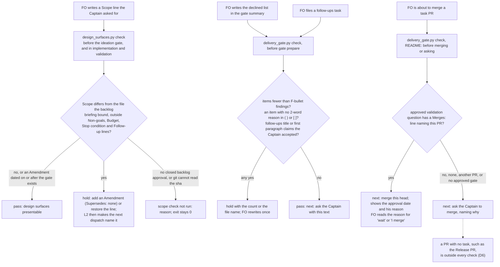
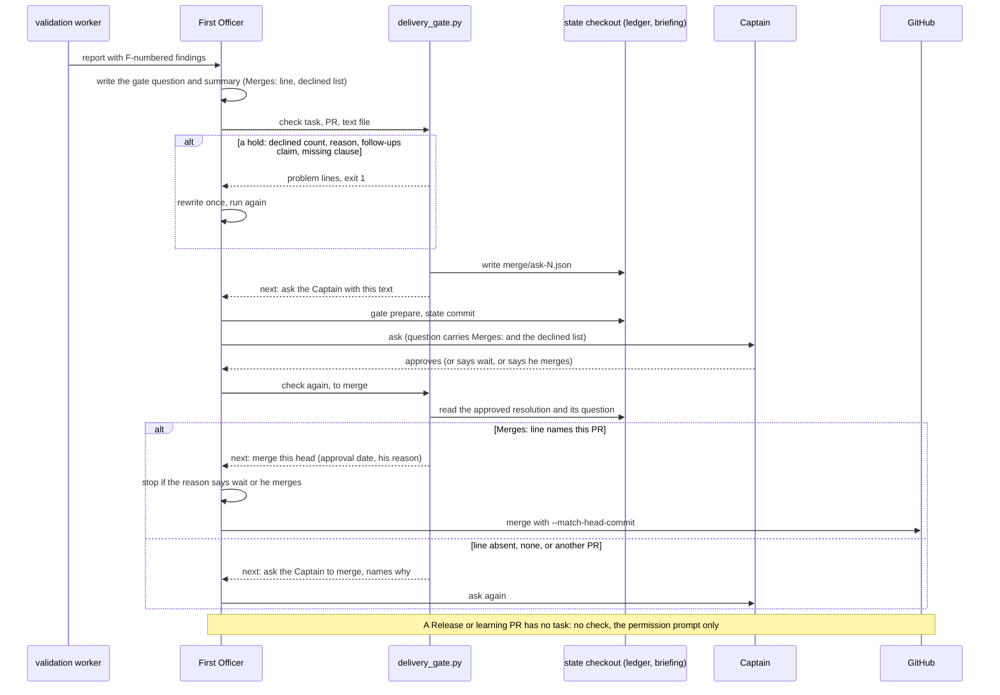

## Scope

- Source: issue iamcxa/kc-claude-plugins#684 (filed 2026-10-20 at the Captain's 「同意」 from the batch-3 observer reports); batch 4 approved 2026-10-20 (「按你建議」).
- Bite, the four rules and where batch 3 broke them (observer reports in the archived tasks): a Captain ruling written before its question was put (delivery-gate-settles-skipped-checks); a two-part finding declined with one part's reason (chat-only-evidence-observer-blind, special-role-calls-fire-when-needed); a Captain scope change after a closed gate kept outside `## Captain amendments` (special-role-calls-fire-when-needed); a merge made on a gate whose recorded question did not name it (Release PR #672 on the #682 approval).
- Consumer: the Captain, whose authority these rules protect, and the observer.
- Upstream first: the FO-write checks from #671 (`dispatch_records.py`, `delivery_gate.py`, laws L2) and the special-role triggers from #682; extend them before adding any script.
- Batch overlap: comment-check-reaches-delivery-gate also edits `delivery_gate.py`; implement after it merges.
- Non-goals: see `### Non-goals` under `## Design`.

## Design

Profile pilot. Not repository files: this section is the design; implementation lands it. Sources read 2026-10-20: kc-dev-flow-2 0.26.0 at origin/main `ad44f0cb` (`scripts/{delivery_gate,design_surfaces,dispatch_records,laws_check,role_triggers,decision_ledger,pr_watch,lint-skills,test_sd_dispatch}.py`, `references/sd/{workflow,laws}.md`, `references/sd/mods/kc-dev-flow-2.md`, `skills/validation/principles.md`), ADRs 0005, 0014, 0017, 0020, 0023, 0024, 0025 and 0026, Spacedock 0.27.2 (`spacedock --help`, `gate --help`, `merge guard --help`, and the 0.27.0 plugin's `hooks.json` and `docs/specs/gate-resolution-frontmatter-contract.md`), issue #684, the three batch-3 observer reports (`_archive/{delivery-gate-settles-skipped-checks,chat-only-evidence-observer-blind,special-role-calls-fire-when-needed}/observer.md`), `fo-write-checks-followups.md`, and the other batch-4 and live tasks as they stand. Corpus, pinned: this workflow's state branch `spacedock-state/dev2` at `c770d45f` (1712 commits, 83 task files, 148 gate resolutions, 165 briefings of which 57 are validation briefings); read-only and at the local branch tips, with no fetch, subspace-relay `1e22e52d` (1626 commits, 191 resolutions), subspace-web `96a54eef` (645, 96) and qnow `8ce9bd76` (2224, 222). Measurement files are in `fo-write-rules-checked/measure/`: `replay.py` (the R1 to R4 tables; one output per corpus, `replay-output-<repo>.txt`), `proto_gate.py` and `proto_scope.py` (prototypes of the new checks, run against the real checkout: `proto-gate-output.txt`, `proto-scope-output.txt`), `words.py` with its two source copies (`words-output.txt`). Each file's docstring gives its command. "Rule 1" to "rule 4" below are the four items of issue #684 in its order.

### Chain check

- **Spacedock 0.27.2:** nothing runs when FO writes a task file. The plugin's `hooks.json` holds one `SessionStart` hook (a compact reminder), and `gate prepare`, `gate record`, `state commit` and `new` print their own result and fire nothing (`spacedock --help`, `gate --help`, 2026-10-20). The gate lifecycle spec fixes the order prepare, commit, present, record, so a recorded resolution always follows its committed briefing; the resolution's `at` is the time FO ran `gate record`, so "a ruling written before its question" cannot be read off a gate record. Every check below therefore sits at a script FO is already told to run; ADR 0014 accepts the same limit ("prose-enforced" until Spacedock gains a pre-write hook, which has not happened).
- **kc-dev-flow-2 0.26.0:** every record and every script to extend exists. `delivery_gate.py check` already reads the gate text and the task (`declined_items`, `clause`, `VALIDATION_SECTION`) and writes `merge/ask-N.json`; `design_surfaces.py check` already parses `## Captain amendments` and runs before every ideation gate; `decision_ledger.py` (`gate_entries`, `question`) already reads each gate resolution and the question of its briefing; `laws_check.py` L2 already makes an amendment be named in the next dispatch checklist; `role_triggers.py` owes a call only for an amendment whose `Supersedes:` or `Design:` is not `none` (run on a scope amendment with both `none`: "0 event(s) read", exit 0, 2026-10-20). The 0.26.0 package was published 2026-10-20T03:07:16Z (`gh release list`): #671's decline check merged 2026-10-19T08:10:12Z, and #675's carried-merge `next:` line 2026-10-19T14:22:14Z, so the batch-3 declines and merges (#675, #679, #680 and #682, each merged under the login `iamcxa`; state cannot say whether FO or the Captain typed it) were written before any installed package carried either.
- **Siblings (read-only, pinned above):** none has a check for these four. relay and web write no `Declined…:` label in 125 validation briefings, so the #671 decline check reads nothing there, although 30 of 85 and 15 of 40 mention Deferred risk or Polish in prose; relay and web have no follow-ups task and qnow has one; no briefing in any of the three carries a merge in its question (the carried-merge sentence is this repository's, ADR 0023). A live task is the future structured field for rule 1: `adr-required-statement` (in validation) adds a `## Captain rulings` ledger whose lines each cite a gate attempt or an amendment (its AC-1); if it lands, rule 1 can be read from that ledger (D4).

### Where each rule is written, and the check that sits there

| Rule (README wording) | FO writes | Script FO already runs there | Signal read | Phrase-free |
| --- | --- | --- | --- | --- |
| 1 A Captain ruling is his reply to the question it settles, given after it was put | a follow-ups task, filed with the delivery gate | `delivery_gate.py check`, before the merge ask | `<task>-followups.md` beside the task: its title and first paragraph | no: four verbs, because no structured field exists (D4) |
| 2 A decline names the finding, reason, revision and evidence | the declined list in the gate summary | `delivery_gate.py check` | declined items against the `- F<N> <Class>:` bullets of the newest validation report; reasons in `( )` or `[ ]` | yes for the join; the reason is presence only (ADR 0025) |
| 3 A change he makes to what he has accepted is an amendment | a Scope line | `design_surfaces.py check`, before the ideation gate and when implementation and validation run it | `## Scope` at the sha the backlog briefing's artifact binds, against now; `### Amendment N — <date>` | yes: a git object and a dated heading; four label prefixes the README defines are exempt |
| 4 Approval of a validation gate is not permission to merge, except as follows | the merge of a task PR | `delivery_gate.py check`, which the README already runs "before merging or asking" | the approved validation resolution's question (`decision_ledger.gate_entries`, `question`): its `Merges:` line | yes |

The two live items of `fo-write-checks-followups` are rule 4's: the carried-merge `next:` line printed without reading the approved question or a hold, and printed when the check's own verdict is `ask`.

### Measurement

What the replay says, per rule, before the detail (details and commands below; "false hold" is a hold on an event I judge legitimate, and an adopter's events are judged from state alone, not from chat):

| Rule | Batch-3 violation | Held by the candidate check | False holds over the replay | Not reached |
| --- | --- | --- | --- | --- |
| 1 ruling before its question | `delivery-gate-settles-skipped-checks-followups`, "accepted at the #680 delivery gate", `4866e197` | yes | 0 of 26 follow-ups files here, 0 of 1 in qnow, relay and web have none | a ruling claimed in any other place; chat |
| 2 decline with half its reason | special-role-calls (Polish F5, one part declined) and chat-only-evidence-observer-blind (one Deferred risk, parts (a) and (b)) | special-role-calls yes (4 items for 5 findings); chat-only no (one finding), unless the validator writes one bullet per part (D5). The shipped check false-holds 3 of 3 later gates; the parse fix removes those | join 0 in this repository, 0 of 2 F-bullet reports in qnow | clauses inside one finding; reports without F ids (31 of 35 decline-bearing briefings); relay and web, which write no label |
| 3 Scope change outside amendments | special-role-calls `8b5d694b`, a Captain scope addition after the backlog gate | yes | 0 clear; 15 held events on or after 2026-09-30 across the four repositories, 10 name the Captain's words and 5 do not (relay 2, web 3), which state cannot show were authorized | a Captain change recorded anywhere but Scope; chat |
| 4 merge on a gate whose question did not name it | Release PR #672, merged on the #682 approval | no: it has no task and no check ran (D6). The task-PR half is covered: a question without a `Merges:` line makes the next line an ask | a hold here is an ask line, never a block; 5 approvals carry the merge today and would ask once more for lack of the line | every PR with no task; a merge FO makes without running the check |

Replay of each candidate check over the committed history (`replay.py <repo> <pin> <package scripts> [r1 r2 r3 r4]`, each commit read at its own commit). A "hold" is the check firing on an event; a hold on an event I judge legitimate is a false hold.

**Rule 1: a follow-ups task that claims the Captain's acceptance in its title or first paragraph.** This repository: 26 follow-ups tasks, 1 held (`delivery-gate-settles-skipped-checks-followups`, commit `4866e197`: "accepted at the #680 delivery gate", 16 s before that gate's briefing existed); 24 of the 26 open with "Declined…", one opens with a heading. False holds: 0. relay 0 of 0, web 0 of 0, qnow 0 of 1. Falsified alternative: order. A follow-ups task cites its PR's gate before that gate is approved by design ("Declined by FO at the #666 delivery gate"): 24 of 24 that cite a task PR were filed before that task's validation approval, so "claim precedes the gate's resolution" would hold 24 of 24. Falsified alternative 2: any line with an acceptance verb beside a Captain or gate word that cites a PR whose validation gate is still open: 203 such added lines across the history, 4 cite an open gate, and 3 of those 4 are not violations (two worker stage reports, one follow-up bullet that cites its amendment 2); so the check reads a follow-ups task's title and first paragraph only.

**Rule 2: the decline check as shipped, and a join to the validator's findings.**

| Count over the 57 validation briefings of this repository | |
| --- | --- |
| briefings carrying a `Declined…:` or `FO declines…:` label | 23 |
| of those, the shipped 0.26.0 check would hold the presented text | 19 |
| of those, whose bound sha was committed after #671 merged (2026-10-19T08:10:12Z) | 3 (captain-question-load, chat-only, special-role-calls); the shipped check holds all 3 |
| of the 3, a reason written in `[ ]` | 3 (`brackets()` reads `( )` only) |
| a decline sentence cut early by `e.g.` (chat-only: 1 item parsed of 4) | 1 |
| after reading `[ ]` and not ending an item at `e.g.` | 0 of the 3 held (`proto_gate.py`: unreasoned 2→0, 1→0, 3→0; fo-write-checks's own text, written minutes before the check merged: 5→0) |
| validation reports that state findings as `- F<N> <Class>:` bullets | 2 of 23 (merge-gatekeeper, special-role-calls); qnow 2 of 12 |
| the join "declined items fewer than Deferred risk and Polish F-bullets" | holds 1: special-role-calls (4 items, 5 findings), the observer's rule-2 violation; 0 false holds on the other 3 F-bullet reports |
| the same join over every countable form (class bullets, `Class (N)` counts) | holds 1 in this repository and 3 of 9 in qnow, which I judge false (findings carried or settled in earlier cycles, items grouped on a `;`): so the join reads F ids only |
| briefings that mention Deferred risk, Polish or declin* with no label the check reads | relay 30 of 85, web 15 of 40: the check is vacuous there |

The shape of chat-only-evidence-observer-blind (one Deferred risk with parts (a) and (b), a reason for (a) only) is held by none of these: the validator wrote one finding. It is held only if the validator writes one bullet per part (D5). In qnow, 12 briefings carry a decline, written as one grouped sentence per class, and the join over its 2 F-bullet reports holds 0.

**Rule 3: a `## Scope` line added or removed after the backlog gate closed, outside the lines the README defines for later filling** (`Non-goals`, `Budget`, `Stop condition`, `Follow-up:`), unless an `### Amendment N — <date>` dated on or after the gate exists.

| Corpus | Events after the gate, any date | On or after 2026-09-30 (the amendment rule's day) | of those, an amendment exists | held | held lines that name the Captain or quote 「」 |
| --- | --- | --- | --- | --- | --- |
| this repository | 5 in 5 tasks | 2 | 0 | 2 | 2 (special-role-calls, the observer's rule-3 violation; release-review, a peer-handed line) |
| subspace-relay | 4 in 4 | 4 | 0 | 4 | 2 |
| subspace-web | 5 in 4 | 4 | 0 | 4 | 1 |
| qnow | 52 in 19 | 7 | 2 | 5 | 5 (3 record a Captain `revise` at the open ideation gate) |

Three trigger shapes fell out of the replay. Scope lines the README itself defines for later filling are exempt: `Non-goals`, `Budget` and `Stop condition` (filled at ideation) and `Follow-up:` (Review-finding disposition); without the exemption the check false-holds 12 of this repository's 17 events (9 of the 11 on or after 2026-09-30) and 9 of qnow's 16 on or after that day. The same check over `## Acceptance criteria` and `## Design` false-holds worker repairs (b92233d9, a recount after a Codex P2): not used. A scan for any 「」 quote added to a task after a closed gate finds 174 hits in this repository, 37 of them in `## Captain amendments` and the rest design text, criteria and stage reports quoting him: not used. Prototype over the real checkout (`proto_scope.py`, all 83 task files at the pin, reading the briefing's `git-root://state/<sha>/` locator with `git show`, in a linked worktree whose `.git` is a file): 43 clean, 7 held (2 on or after 2026-09-30), 1 passed by an amendment, 32 not judged (no closed backlog approval: follow-ups, POC and patch tasks). Separately, 9 of 44 tasks that passed ideation still carry the seed line "Non-goals: to be set at ideation" in Scope (4 of the 5 batch-3 tasks): observed, not this task's rule.

**Rule 4: does the approved question carry the merge?**

| Count | this repository | relay | web | qnow |
| --- | --- | --- | --- | --- |
| validation approvals / by the Captain | 43 / 34 | 58 / 58 | 29 / 29 | 94 / 73 |
| the approved question carries the merge (the ADR 0023 sentence) | 5 | 0 | 0 | 0 |
| the question says FO asks him to merge | 23 | 0 | 0 | 0 |
| a `pr-merge:` sentinel and no carried merge | 38 | 57 | 28 | 94 |
| saved merge asks (`class`, `verdict`) | 13 of 13 `never`, `ask` | none | none | none |

Falsified alternative: a law on the sentinel ("a task PR merged on an approval whose question did not name it", the L1 event shape) would fire on 38 of 43 approvals here and on 57 of 58, 28 of 29 and 94 of 94 in relay, web and qnow, because most merges follow a separate ask in chat. And the 13 of 13 `never`/`ask` records say the carried-merge line (`ASK` in 0.26.0) has been printed for every recorded ask: `class: never` is every kc-dev-flow-2 change (`NEVER_PATH` holds `kc-dev-flow-2/scripts/`), so the one-line fix of live item 2, "print the carried line only when `verdict == merge`", would end the carried merge in this repository and turn the 5 approvals whose question carries the merge into asks. The Release PR (#672) had no task and no `delivery_gate.py` run: it is outside every record in state, and the design does not claim to reach it (D6). Prototype (`proto_gate.py`, the real approved question of special-role-calls): the new `next:` line prints "ask the Captain to merge; the question he approved names no merge of iamcxa/kc-claude-plugins#682"; with `Merges: iamcxa/kc-claude-plugins#682` appended it prints the carried line with the approval date and the first 100 characters of his reason; `Merges: none` and `Merges: iamcxa/kc-claude-plugins#672` print the ask line, which is the #672 case.

### PRFAQ

**Press release (future).** From the next kc-dev-flow-2 release, each of the four things the batch-3 observers found broken after the fact is stopped by the script FO already runs at the moment of the write. FO adds a Captain scope change to the approved Scope and the ideation gate will not prepare until the change is an amendment. FO writes a follow-ups task that says the Captain accepted what only the gate can record and the merge ask holds. FO declines four findings out of five and the merge ask holds with the count. FO's merge `next:` line stops saying "merge if the approved question named the merge" and reads the approved question: it prints the carried merge only when the question's `Merges:` line names that PR, and shows his recorded reason beside it so a "wait" or "I merge" is in front of FO when it acts. No new script, no new law, no README word.

**FAQ.**
- *Why not a law on every push (L3 to L5)?* A law reports after the push and cannot block (ADR 0017). Rule 4's natural law, on the sentinel, false-fires on 38 of 43 merges. Rule 3's check already runs at the gate it protects, before the Captain sees the design. The same replay that proves each check also shows the order: a law adds a second report of what FO is told once.
- *Why a `Merges:` line and not the sentence ADR 0023 uses?* The sentence is phrase-matched by FO's memory, and that is how "hold Release PR #672 until this merges" read as a merge. A line that lists PRs is read the way `Sufficiency:` and `Necessity:` are: `clause()`. It fails safe: a question without it is asked again, as ADR 0023 already says.
- *Does FO read more?* The README is unchanged in words (one phrase swapped, 12 words for 12). The ask run prints a shorter last line (14 or 23 words against 27); the merge run that carries a merge prints a longer one (40 words, with his reason echoed), which is the point of live item 1. The hold lines are 26 to 30 words each, once per occurrence.
- *Is every rule now enforced?* No. What stays outside, stated so nobody counts it: a merge FO makes without running the check, and every merge of a PR with no task (Release PR, learning PR); a half-reason inside one validator finding; a Captain ruling stated in prose anywhere but a follow-ups title or first paragraph; chat. The check is FO's own script run; an FO that skips it leaves a missing `merge/ask-N.json`, which the observer already reads.
- *What do adopters see?* After a plugin update their first carried merge asks once more until the question carries the line (the 0.23.0 `Candidate:` line did the same to relay). relay's and web's validation briefings carry no `Declined…:` label, so the decline checks stay silent there.

### Mermaid

### What changes

1. **`kc-dev-flow-2/scripts/delivery_gate.py`** (about 70 lines; prototype `measure/proto_gate.py`). (a) Rule 2 parse: `declined_items` stops an item at a sentence label only when the text before it is not `e.g.` or `i.e.`; `brackets` reads `[ ]` as well as `( )`. (b) Rule 2 join: `findings_join(task_text, gate_text)` counts `- F<N> <Deferred risk|Polish>:` bullets (also bold `**F<N>**`) in the newest `## Stage Report: validation` section; fewer declined items prints `declined items (3) are fewer than the validation report's Deferred risk and Polish findings (5): add a declined item or a stated fix for each, then run this check again.` and the existing `next: hold the ask; …` line, exit 1. A report with no F bullets is not joined and prints nothing. (c) Rule 1: `followups_claim(task)` reads `<task stem>-followups.md` beside the task; a title or first paragraph with `accepted`, `approved`, `waived` or `ruled` prints `<file> claims the Captain's acceptance ("<word>") before the gate that records it: say what FO declined and cite no ruling.`, exit 1. (d) Rule 4 and the two live items: `approved(task)` takes the last validation resolution with `decision: approve` (`decision_ledger.gate_entries`) and its question (`decision_ledger.question`); `ASK` becomes three lines: no approved gate, `next: ask the Captain with this text; nothing is carried until he approves it.` (14 words; 23 when the text has no `Merges:` line, which adds `to carry the merge, first add a 'Merges: <owner/repo>#<N>' line naming this PR to the question`); approved and the `Merges:` line names `--pr`, `next: merge this head; the question he approved on <date> names <ref> in its Merges: line. Ask instead if his reason (<first 100 characters>) says he merges or holds.` (40 words); approved and no such line, `next: ask the Captain to merge; the question he approved names no merge of <ref>.` The class line gains `(verdict ask)` when the saved verdict is `ask`, so item 2 is visible, not silent (D3). The saved record gains `merges` (the refs read). The docstring gains the `Merges:` clause.
2. **`kc-dev-flow-2/scripts/design_surfaces.py`** (about 45 lines; prototype `measure/proto_scope.py`): `scope_after_backlog(task)` imports `decision_ledger`, takes the last backlog resolution with `decision: approve`, reads its briefing's `artifacts[0].uri` (`git-root://state/<sha>/<path>`), runs `git -C <task dir> show <sha>:<path>` and compares the `## Scope` lines, exempting lines that open with `Non-goals`, `Budget`, `Stop condition` or `Follow-up:`, and a task with an `### Amendment N — <date>` dated on or after the approval's day. A held task prints `Scope changed after the backlog gate (<8-hex>): "<first changed line, 80 characters>": if the Captain asked for it, add an '### Amendment N' with 'Supersedes: none'; otherwise restore the line.` and exits 1. No closed backlog approval, no briefing or a sha git cannot read prints `scope check not run: <why>` and leaves the exit code alone, so the observer's temp-directory replays of `check` at each briefing's bound sha (ADR 0024) still exit 0. It reads the archived file too: the observer can run it on an archived task at the state HEAD.
3. **`kc-dev-flow-2/scripts/test_delivery_gate.py`, `test_design_surfaces.py`**: the cases in AC-1 to AC-4, AC-6 and AC-7, each with the mutation named there; the fixture for rules 3 and 4 is a linked git worktree (its `.git` is a file), as the state checkout is.
4. **`kc-dev-flow-2/references/sd/workflow.md`**, one phrase in `## Captain amendments`: "whether at a gate approval, during implementation or at a validation gate" becomes "whether at a gate approval, between gates or at a validation gate" (12 words for 12; ideation falls between gates, which is what rule 3's report said the sentence did not name). Nothing else in the README, so `WORKFLOW_BUDGET_STEPS` gets no step and `test_sd_dispatch.py` pins are untouched (`git grep` for the old phrase finds no pin). The adopter copies `docs/dev2/README.md` and `docs/dev2-poc/README.md` follow by the next sync, not by this change.
5. **`kc-dev-flow-2/skills/validation/principles.md`**, one sentence (about 30 words, read by the validation worker): a validation report lists findings as `- F<N> <Class>: …`, one bullet per finding, and a finding with parts is one bullet per part. It is what lets rule 2's join see a part (D5).
6. **ADR draft (no number; FO reserves it at implementation dispatch):** ruling "a first officer's write that an observer would otherwise find broken days later is checked by the script FO already runs at that write, on a structured record where one exists: a Scope change after the backlog gate is an amendment, a decline is counted against the validator's F-numbered findings, a carried merge is named in a `Merges:` line of the approved question, and a follow-ups task states what FO declined, never what he accepted"; short title `fo-write-rules-are-checked-by-the-script-fo-runs-at-the-write`. It amends ADR 0005 (between gates), ADR 0023 (its reopen condition, "a merge lands on an approval whose question did not name it", fired on 2026-10-20 with #672; the mechanism moves from a sentence to a line) and ADR 0025 (reasons in `[ ]`; the join). Reopen if an observer finds one of the four broken again with the check present and run, or if Spacedock gains a pre-write hook (ADR 0014).
7. **Not changed, and why:** `laws_check.py` and `laws.md` (the replay above falsifies the sentinel law; the other three checks run at their gate); `role_triggers.py` (a scope amendment with `Supersedes: none` and `Design: none` owes no call, run 2026-10-20); `dispatch_records.py` (L2 already makes the next dispatch name a new amendment); `pr_watch.py`; the observer skill (rule 4 becomes readable from the approved question's `Merges:` line without a change to it); `lint-skills.py` (no README word moves).

### Words FO reads at each moment

Counted with `str.split()` over the passages and script output that instruct a step due at that moment (`measure/words.py`, `words-output.txt`, base and candidate from the 0.26.0 sources). The goal is not to cut FO's reading, so the criterion is "no moment rises on its normal path". `point:` lines (up to 12 on a pass) are in both columns and left out.

| Moment | Base | Candidate |
| --- | --- | --- |
| startup and resume (README read whole, 5374, plus the 48-word mod) | 5422 | 5422 (one phrase swapped, 12 words for 12) |
| idle on an open PR, idle on a merged PR, after the archive (mod and `pr_watch.py tasks` output) | unchanged | unchanged: no file FO reads at these moments is in the diff |
| dispatch (Stages passage and `dispatch_records.py` output) | unchanged | unchanged |
| ideation gate, pass path (Gate content 167, "design surfaces presentable" 3) | 170 | 170 |
| ideation gate, first run after a Scope edit | 170 | 200 (the hold line, 30 words, once) |
| merge ask, ask run, text with a `Merges:` line (Gate content 153, Delivery authority 215, `delivery_gate` sentence 39, pass output) | 451 | 438 |
| merge ask, ask run, text without the line | 451 | 447 |
| merge, run that carries the merge | 451 | 466 (+15: his reason is echoed, the point of live item 1) |
| merge, run that asks instead | 451 | 441 |
| a hold on the ask (rules 1, 2), once per occurrence | | +26 and +30 |
| the validation worker (not FO): `skills/validation/principles.md` | | about +30 |

### Non-goals

No Spacedock change and no request for one; no new law, no new script; no change to `role_triggers.py`, `dispatch_records.py` or `pr_watch.py`; no README word beyond the one swapped phrase (a `Merges:` sentence in the README would cost 8 words and an ADR 0020 ruling; the ask run teaches the line instead); no check of whether a stated reason is a reason (ADR 0025) or whether a reason a decline names is true; no attempt to reach a merge FO makes without running the check, or any PR with no task (D6); no backfill of the 9 tasks that still carry "Non-goals: to be set at ideation", or of any archived task; no change to what the observer reads or to its chat-only list; the exemptions of rule 3 are the README's own four forms and no others.

### Needs decision

Past rulings read: ADR 0005, 0014, 0017, 0020, 0023, 0024, 0025, 0026; the ledger (`decision_ledger.py`, 2026-10-20) holds 0 `Override:` among 148 resolutions, so no gate override exists in this area. If the Captain's reply to the gate question accepts the recommendations, the ADR draft above takes his words as its Words line.

- **D1 (rule 3): is a Captain change to the approved Scope, made after the backlog gate, an amendment?** Recommend yes: the README phrase "during implementation" becomes "between gates" (word-neutral), a Scope change with no amendment holds at the ideation gate, and he is asked nothing new. Issue #684 notes the rule names no ideation moment and its `revise` path covers only a gate still open; the replay finds the gap in all four repositories (2 held here, 4 relay, 4 web, 5 qnow, 3 of qnow's being a `revise` at the open ideation gate). Worse under yes: each Captain scope addition between gates costs FO one entry (about 30 words, once) and, through L2, the next dispatch checklist must name it, so a worker already running needs a message or a re-dispatch; a `revise` that touches Scope is now an amendment where the README today sends it to the stage's worker as rework. Under no: the 15 events (2 + 4 + 4 + 5) stay unrecorded, and an observer reads them as violations of a rule that does not name them.
- **D2 (rule 4): the carried merge is read from a `Merges: <owner/repo>#<N>` line in the approved question, in place of the sentence ADR 0023 uses, and the ask run teaches the line (no README sentence)?** Recommend yes. The sentence is how "hold Release PR #672 until this merges" read as a merge; a line is read as `Sufficiency:` and `Necessity:` are, and a question without it is asked again. Worse: the first approval after the update whose question lacks the line is asked a second time; the carried `next:` line is 40 words against 27; the check reads that the line names the PR, not that he meant it; and the README keeps saying "the question says" without naming the line (a README sentence would cost 8 words and an ADR 0020 ruling, which I did not take). Amends ADR 0023, whose reopen condition fired on 2026-10-20.
- **D3 (live item 2): the carried merge stays printed when the saved verdict is `ask`, and the class line says `(verdict ask)`?** Recommend yes. All 13 saved asks are `class: never`, `verdict: ask` (every kc-dev-flow-2 change is `never`), so printing the carried line only for `verdict: merge` would end the carried merge here and turn the 5 approvals whose question carries the merge into asks; ADR 0023 already keeps him asked, in the delivery question. Worse: a script, workflow or ADR change merges on his approval of the question alone, as in all 5 so far, and the printed `(verdict ask)` is the only reminder. Under no: the extra ask returns, 5 in the last two days. Coupled to D2: both change the same last line, and a no here makes the `Merges:` line moot for `class: never`.
- **D4 (rule 1): a narrow phrase check on the follow-ups task, or none until a structured field exists?** Recommend the check. No structured field exists today: order cannot discriminate (24 of 24 follow-ups that cite a task PR were filed before the approval they cite), and the hold reads four verbs in a title and first paragraph: 1 of 26 files held, 0 false. Worse: it is a phrase check, it covers the one shape seen, a rewording ("agreed at") passes, and it adds 26 words to FO's reading once per hold. Reopen it as a ledger read if `adr-required-statement` lands its `## Captain rulings` ledger, which would make the claim a structured line. Under no: rule 1 is unchecked, and a second occurrence is a second observer finding.
- **D5 (rule 2): fix the shipped parse, join declined items to F-numbered findings, and ask validators for one bullet per finding and per part?** Recommend all three. The shipped check holds 3 of the 3 declined texts written after it merged, though each carries reasons (they use `[ ]`, and `e.g.` cut one text to 1 item of 4); the join holds the one observed rule-2 violation that has F-bullets (special-role-calls, 4 items for 5 findings) and no false one; the validator sentence is what lets the join see a part, which is chat-only-evidence-observer-blind's shape. Worse: the join sees 4 of the 35 decline-bearing briefings in the two repositories that decline in this form (the F-bullet reports), a half-reason inside one finding still passes, and a validation worker reads 30 more words. Under parse-fix only: the shipped check stops false-holding, and the observed violation still passes.
- **D6 (rule 4 residual): accept that a merge of a PR with no task, such as the Release PR (#672) or a learning PR, is outside every check, and record it in the ADR?** Recommend yes. Those merges are asked one at a time (ADR 0023 D2) and the only stop on `gh pr merge` is the Captain's permission prompt; nothing in state records a Release PR merge, so no script can read one. Worse: the #672 shape can recur with no trace in state. The alternative is an adopter-owned PreToolUse hook on `gh pr merge` (the pattern ADR 0003 uses for secrets), which is a separate task and not designed here.

### Batch overlap

Files this design would change, and the other batch-4 tasks and live tasks of other sessions that change the same file or check (from their task files as they stand; the four other batch-4 seeds have no design yet, so each entry is what the seed's Scope names):

- **`kc-dev-flow-2/scripts/delivery_gate.py`, `test_delivery_gate.py`:** comment-check-reaches-delivery-gate (its Scope names `delivery_gate.py` as the merge ask that could require the comment line bound to the dispatched Candidate head: a new hold in `check`, and the test fixture `text=` default). This task's Scope already says to implement after it. The two edits are different functions of one `check`; whichever lands second rebases the fixture default. fo-batch-sittings, db-surface-without-migrations and commissioned-by-names-spacedock name no line of either file.
- **`kc-dev-flow-2/scripts/design_surfaces.py`, `test_design_surfaces.py`:** no batch-4 task and no live task names them (the five live task files read 2026-10-20; `journey-server-host-pilot` mentions the 0.21.0 copy of `design_surfaces.py` as a cited input, not a change).
- **`kc-dev-flow-2/references/sd/workflow.md`:** one phrase in `## Captain amendments`. Other editors: fo-batch-sittings and db-surface-without-migrations (the Number guards passage), commissioned-by-names-spacedock (frontmatter line 2, and the `docs/dev2*/README.md` copies), adr-required-statement (in validation: § Decision records, the task template and `adoption.md`; about 57 lines of this file on its branch) and release-acceptance (in ideation: its Scope names this file and `references/sd/release-acceptance.md`). The regions differ; the shared line is the exact-word budget `WORKFLOW_BUDGET_STEPS` in `lint-skills.py`, which every editor that moves the count appends to. This design moves no word, so it appends nothing and has no rebase there.
- **`kc-dev-flow-2/skills/validation/principles.md`:** none of the five.
- **`docs/adr/`:** one new file; FO reserves its number at the implementation dispatch (Number guards). fo-batch-sittings carries the open question of when numbers are reserved; adr-required-statement lands its own ADR.
- **`laws_check.py`, `laws.md`, `role_triggers.py`, `dispatch_records.py`, `pr_watch.py`, `lint-skills.py`:** not changed here. fo-batch-sittings' interim "one follow-up task per delivered task" rule is the object rule 1's check reads (`<task>-followups.md`), so if it renames that file the check follows it.
- **Live tasks of other sessions, read only:** adr-required-statement shares `workflow.md` and bears on rule 1 (D4); pr-review-lite-value-pilot (kc-pr-flow), journey-canvas-hosted-poc and journey-server-host-pilot (kc-journey-map) name no file of this design; release-acceptance shares `workflow.md` only.

Suggested order for FO: comment-check-reaches-delivery-gate first (it owns the `delivery_gate.py` fixture change), then this task; adr-required-statement before or after, with D4's reopen noted; the README budget needs no recount for this task (its phrase swap is word-neutral), only for whichever other editor moves a word.

## Acceptance criteria

Evidence is what the validator runs; "done now" marks what ideation already measured.

**AC-1** `delivery_gate.py check` decides its last `next:` line from the approved validation question: carried only when that question's `Merges:` line names `--pr`.
- Evidence: in `test_delivery_gate.py`, on a fixture task in a linked git worktree with a `gates:` frontmatter and `review/validation/briefing-1/index.json`: no approved validation gate prints the ask-run line (14 words); a question with `Merges: <ref>` for `--pr` prints the carried line with the approval date and the first 100 characters of the reason; the same question with `Merges: none`, with another PR, and with no line prints `…names no merge of <ref>.`; a question that names the PR in a sentence ("hold Release PR #672 until this merges") and lists only #682 in `Merges:` prints the ask line for #672. Mutation: replace the `Merges` clause read with a search for the PR anywhere in the question and the #672 case turns red. Done now: `python3 -I -B measure/proto_gate.py <package> <state checkout>` prints the ask line on the real special-role-calls question and the carried, none and other-PR lines on three rewrites (`proto-gate-output.txt`).
- Falsifier: a carried line for a question with no `Merges:` line naming the PR; or an ask line for one that names it; or the mutation leaves the suite green.

**AC-2** The class line reads `class: <class> (verdict ask)` when the saved record's verdict is `ask`, and the carried line still prints when `Merges:` names the PR.
- Evidence: `test_delivery_gate.py` asserts the class line for a `never`/`ask` record and the carried line beside it; the saved `ask-N.json` keeps its keys and gains `merges`. If the Captain rules D3 the other way, this criterion is replaced by one that prints the ask line whenever the verdict is `ask`.
- Falsifier: the class line omits the verdict, or a `verdict: ask` record changes the carried line without D3.

**AC-3** `delivery_gate.py` reads a reason written in `[ ]` or `( )` and does not end a declined item at `e.g.` or `i.e.`.
- Evidence: tests built from the presented texts of the gates written after #671 merged, extracted from the state branch at the pin (`review/validation/briefing-1/index.json` question plus artifact summary), with fo-write-checks's own, written minutes before it merged: chat-only-evidence-observer-blind parses 4 items (shipped: 1); unreasoned items 2, 1, 3 and 5 become 0 (captain-question-load, chat-only, special-role-calls, fo-write-checks; `proto-gate-output.txt`); an item whose bracket holds one word (`(none)`, `[none]`) still holds. `replay.py <state> <pin> <package> r2` prints `late: bracket-fixed check holds it: 0`. Mutation: restore the shipped end-of-item pattern and the chat-only case returns 1 item; restore `( )` only and special-role-calls returns 3 unreasoned.
- Falsifier: any of the four held after the change, or a one-word bracket accepted.

**AC-4** With `- F<N> <Deferred risk|Polish>:` bullets in the newest validation report, fewer declined items than those bullets holds the ask with both counts; a report with no such bullets is not joined.
- Evidence: tests on fixtures taken from the state branch at the pin: special-role-calls (5 bullets, 4 items) exits 1 printing `(4)` and `(5)`; merge-gatekeeper (3 bullets, 4 items) exits 0; a report with class bullets and no F ids exits 0; a fixture with equal counts exits 0 (mutation `<` to `<=` turns it red); a report whose lettered part is split into two bullets, with one item for both, holds. Done now: `replay.py … r2` prints `join on F-id form would hold: 1` over this repository and `0` over qnow; `proto_gate.py` prints the special-role-calls hold.
- Falsifier: special-role-calls passes, an equal-count report holds, or a report with no F bullets prints a hold.

**AC-5** `skills/validation/principles.md` asks for one `- F<N> <Class>: …` bullet per finding and per part.
- Evidence: `git diff` shows one sentence of at most 40 words in that file and nothing else in it; `python3 -B <package>/scripts/lint-skills.py` exits 0. Not yet verified, a future check: the next batch's validation reports, counted with `replay.py … r2` (`F-id bullets` against `with a decline`); the expectation is every report of that batch.
- Falsifier: the diff touches another line, lint fails, or a report of the next batch has a decline and no F bullets.

**AC-6** `design_surfaces.py check <task>` exits 1 with the hold line when `## Scope` differs from the file the backlog briefing bound, outside the four exempt label prefixes, and no amendment is dated on or after the approval.
- Evidence: tests in a linked git worktree (the state checkout is one; a clone-only fixture does not count): an added Captain line exits 1 printing the 8-hex sha and the line; the same plus `### Amendment 1 — <approval day>` exits 0; a `Non-goals`, `Budget`, `Stop condition` or `Follow-up:` fill exits 0; an edit to `## Acceptance criteria` or `## Design` alone exits 0; no closed backlog approval, a missing briefing and an unreadable sha each print `scope check not run: <why>` and exit 0. Mutation: remove the exempt prefixes and the fill cases turn red; compare against the file at HEAD instead of the bound sha and the special-role-calls fixture passes silently. Done now: `proto_scope.py` over the 83 task files at the pin: 43 clean, 7 held (special-role-calls among them), 1 passed by an amendment, 32 not run. At validation: the archived `chat-only-evidence-observer-blind/measure/replay.sh` over the six batch-2 slugs still prints 12 lines with `exit=0` (a temp extraction has no git history, so the scope check does not run).
- Falsifier: special-role-calls exits 0; a Non-goals-only fill exits 1; a replay line changes its exit code.

**AC-7** `delivery_gate.py check` holds when `<task>-followups.md` beside the task claims the Captain's acceptance in its title or first paragraph.
- Evidence: tests: the bytes of `delivery-gate-settles-skipped-checks-followups.md` at `4866e197` exit 1 naming the file and the word `accepted`; three real "Declined by FO at the #N delivery gate…" files and one that opens with a heading exit 0; no follow-ups file exits 0; a bullet further down that says "Waived by the Captain at … amendment 2" exits 0. Mutation: drop one of the four verbs and its case turns red. Done now: `replay.py … r1` over the four corpora holds 1 of 26 files here and 0 elsewhere; `proto_gate.py` holds the one file at the pin.
- Falsifier: the one file passes, a "Declined by FO" file holds, or the hold reads a line past the first paragraph.

**AC-8** The change adds no script, no law and no README word, and moves no moment FO reads above its base on the normal path.
- Evidence: `git diff --name-only <base>` lists only `kc-dev-flow-2/scripts/{delivery_gate,design_surfaces}.py`, their two test files, `kc-dev-flow-2/references/sd/workflow.md`, `kc-dev-flow-2/skills/validation/principles.md` and the ADR; `lint-skills.py` prints `5374 of 5374` (the budget has no new step); `python3 -I -B measure/words.py workflow-0.26.0.md mod-0.26.0.md` rerun on the candidate sources prints startup 5422, ideation pass 170, and merge-ask moments 438, 447, 441 and 466 for the four runs, each below 451 except the run that carries the merge; `role_triggers.py` on a fixture with a scope amendment (`Supersedes: none`, `Design: none`) prints `0 event(s) read` and exits 0 (done now); `test_sd_dispatch.py`, `test_lint_skills.py` and `unittest discover -s kc-dev-flow-2/scripts` pass.
- Falsifier: any other file in the diff, a README word count other than 5374, a moment above its base other than the carrying merge run, or the amendment fixture owing a call.

**AC-9** The README phrase in `## Captain amendments` reads "between gates" in place of "during implementation", with nothing else changed in that file.
- Evidence: `git diff origin/main -- kc-dev-flow-2/references/sd/workflow.md` shows that one hunk, 12 words for 12; `git grep -n 'during implementation or at a validation gate' -- kc-dev-flow-2` finds no test pin.
- Falsifier: a second hunk, or a changed word count.

**AC-10** An ADR with the short title `fo-write-rules-are-checked-by-the-script-fo-runs-at-the-write` lands in the same change, with the number FO reserves at the implementation dispatch, amends ADR 0005, 0023 and 0025 by name, and records D6's limit.
- Evidence: `python3 <package>/scripts/adr_lint.py docs/adr --since <base>` and `--require <reserved number>` exit 0 at validation; its Words line quotes the Captain's gate reply to D1 to D6.
- Falsifier: the file is absent or has no Words line, so `--require` exits 1; or it omits the three ADRs or the D6 limit.

**AC-11** The tables of this design can be re-derived.
- Evidence: `python3 -I -B measure/replay.py <repo> <pin> <package scripts>` prints, at the pins in `## Design`, for this repository: follow-ups 26 seen and 2 hits in 1 file; 57 briefings, 23 with a decline, 19 held by the shipped check, 3 of 3 late ones held and 0 of 3 after the fix, `join on F-id form would hold: 1`; Scope events 5 (2 on or after 2026-09-30); 43 approvals, 5 carrying the merge, 38 sentinels with none, 13 saved asks `never`/`ask`. relay, web and qnow match their `replay-output-<repo>.txt`.
- Falsifier: any number differs at the same pin.

### Open points

Six decisions for the Captain are listed under `### Needs decision`: D1 (rule 3, amendment between gates), D2 (rule 4, the `Merges:` line), D3 (live item 2, verdict `ask`), D4 (rule 1, the narrow check), D5 (rule 2, parse fix, join and validator form) and D6 (rule 4, non-task merges). Each carries a recommendation and what gets worse. AC-1 and AC-2 follow D2 and D3, AC-3 to AC-5 follow D5, AC-6 and AC-9 follow D1, AC-7 follows D4, and AC-10 records D6; a different answer replaces the criterion it names.

## FO alignment

Alignment: not needed before ideation; the Captain approved batch 4.
Release review: not needed: workflow maintenance, on no journey map.
Surfaces: none
Visible change: none

## Stage Report: ideation

- DONE: Fresh dispatch: the ideation-1 worker stopped when the session ended and wrote nothing. A design (PRFAQ and Mermaid) for checking the four rules in Scope at the moment FO writes, extending the #671 checks (kc-dev-flow-2/scripts/dispatch_records.py, kc-dev-flow-2/scripts/delivery_gate.py, laws L2) and #682's kc-dev-flow-2/scripts/role_triggers.py before any new script, measured as a replay over every committed task, briefing and gate record of this workflow (which of the four would have been held, and false holds), avoiding phrase matching where a structured field exists, per the Captain's 2026-10-20 direction on special-role triggers; also take in the two live items of fo-write-checks-followups (the carried-merge next: line printed without reading the approved question or a hold, and printed even when the check's own verdict is ask)
  `## Design`: Chain check (Spacedock 0.27.2, 0.26.0, relay/web/qnow read-only), per-rule replay at pinned state c770d45f (1712 commits, 148 resolutions, 57 validation briefings; held and false holds in a summary table), PRFAQ, two Mermaid diagrams, change list. Rules 1, 2, 4 and both live items go to `delivery_gate.py`, rule 3 to `design_surfaces.py`; no new script or law, `role_triggers.py` and L2 unchanged (L2 already forces an amendment into the next checklist; a `Supersedes: none` amendment owes no call, run 2026-10-20). Structured signals everywhere except rule 1's four-verb check (D4). `design_surfaces.py check` on this file: "design surfaces presentable", exit 0.
- DONE: A `### Batch overlap` section naming each file the design would change and each other batch-4 task (commissioned-by-names-spacedock, db-surface-without-migrations, comment-check-reaches-delivery-gate, fo-write-rules-checked, fo-batch-sittings) and live task of other sessions (adr-required-statement, pr-review-lite-value-pilot, release-acceptance, journey-canvas-hosted-poc, journey-server-host-pilot (driven by other sessions; read only)) that changes the same file or check, so FO can order implementation
  Per file: `delivery_gate.py` and its test (comment-check first), `design_surfaces.py` (none), `workflow.md` (five editors, regions differ, shared line is the word budget), `skills/validation/principles.md` (none), `docs/adr/` (one file); suggested order stated.
- DONE: The words FO reads at each lifecycle moment, before and after, per root learning.md "Measure the words FO reads at each moment, not one file's size"
  `### Words FO reads at each moment`, from `measure/words.py` on the 0.26.0 sources: startup 5422 both ways, ideation pass 170 both ways, merge ask 451 against 438, 447, 441 and 466 (the run that carries a merge rises 15 on purpose), idle, archive and dispatch unchanged.
- DONE: Acceptance criteria with reproducible evidence clauses and falsifiers, and unresolved decisions for the Captain, each with a recommendation and what gets worse under it
  AC-1 to AC-11, each with an evidence clause, a falsifier and, where a mutation applies, the mutation; "done now" marks what the prototypes already showed. `### Needs decision` D1 to D6, each with a recommendation and what gets worse.

### Limits and flags for FO

- 0.26.0 was published 2026-10-20T03:07:16Z, after the batch-3 declines and the #675, #679, #680 and #682 merges, so none of them was written with the shipped decline check or the carried `next:` line installed. The shipped check holds 3 of the 3 later declined texts although each carries reasons (`[ ]` brackets, `e.g.`).
- Nothing is implemented. `measure/proto_gate.py` and `measure/proto_scope.py` run the new logic against the real checkout (a linked worktree) and print the numbers cited; the join rule has 10 countable reports here and 9 in qnow, in-sample. relay, web and qnow were read at their local branch tips with no fetch; "names the Captain" is a text proxy, and whether the 5 unattributed Scope edits were authorized is outside state.
- The Scope line "Non-goals: to be set at ideation." is replaced by a pointer to `### Non-goals`, as the backlog gate left it for ideation to fill. Frontmatter untouched. No message to any session, no comment on any PR or issue, no git config write. Temporary directories made by `replay.py` under the system temp area were removed.

### Summary

The four rules are each checked by the script FO already runs at the write: a Scope change after the backlog gate by `design_surfaces.py check`, a half-counted decline, a premature "the Captain accepted" in a follow-ups task, and a merge that no recorded question names by `delivery_gate.py check`, which now reads the approved question's `Merges:` line. The replay holds the observed rule 1, rule 3 and (partly) rule 2 violations with no false hold judged, cannot hold chat-only's one-finding shape without a validator form (D5), and cannot reach the Release PR merge (D6). Six decisions are for the Captain; the largest cost is D2, a `Merges:` line the first carried merge after the update will ask once more for.
