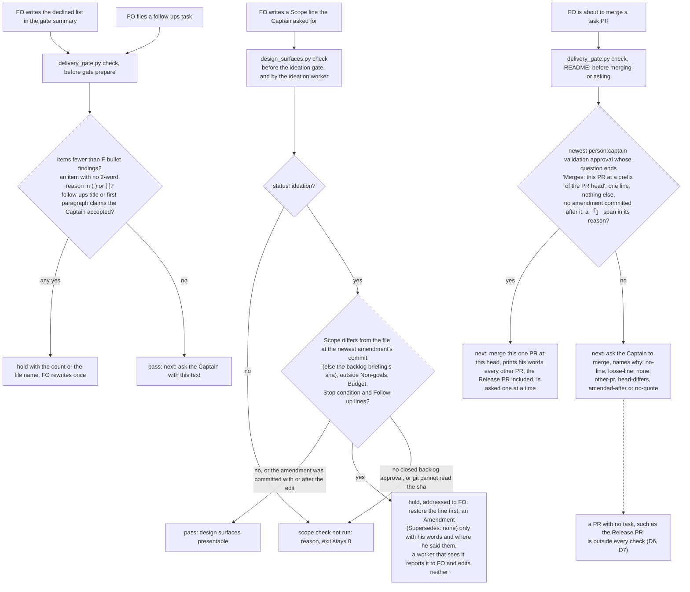
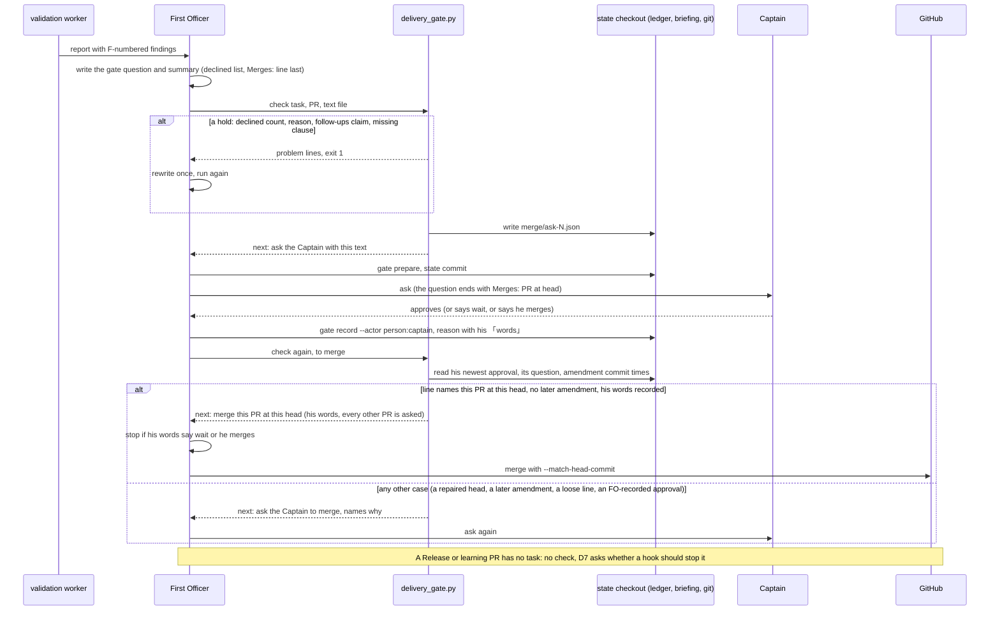

## Scope

- Source: issue iamcxa/kc-claude-plugins#684 (filed 2026-10-20 at the Captain's 「同意」 from the batch-3 observer reports); batch 4 approved 2026-10-20 (「按你建議」).
- Bite, the four rules and where batch 3 broke them (observer reports in the archived tasks): a Captain ruling written before its question was put (delivery-gate-settles-skipped-checks); a two-part finding declined with one part's reason (chat-only-evidence-observer-blind, special-role-calls-fire-when-needed); a Captain scope change after a closed gate kept outside `## Captain amendments` (special-role-calls-fire-when-needed); a merge made on a gate whose recorded question did not name it (Release PR #672 on the #682 approval).
- Consumer: the Captain, whose authority these rules protect, and the observer.
- Upstream first: the FO-write checks from #671 (`dispatch_records.py`, `delivery_gate.py`, laws L2) and the special-role triggers from #682; extend them before adding any script.
- Batch overlap: comment-check-reaches-delivery-gate also edits `delivery_gate.py`; implement after it merges.
- Non-goals: see `### Non-goals` under `## Design`.

## Design

Profile pilot. Not repository files: this section is the design; implementation lands it. Cycle 2 (2026-10-20) folds the engineering-reviewer report (`fo-write-rules-checked/reviews/engineering-reviewer-1.md`: opus, read-only; adjust on D1, D2 and D3, escalate on D6); `### Engineering-reviewer fold` maps each of its conditions to the place that carries it. Sources read 2026-10-20: kc-dev-flow-2 0.26.0 at origin/main `ad44f0cb`, unchanged since (`git fetch origin` 2026-10-20: `scripts/{delivery_gate,design_surfaces,dispatch_records,laws_check,role_triggers,decision_ledger,pr_watch,lint-skills,test_sd_dispatch}.py`, `references/sd/{workflow,laws}.md`, `references/sd/mods/kc-dev-flow-2.md`, `skills/{ideation,validation}/principles.md`, `skills/observer/SKILL.md`), ADRs 0003, 0005, 0014, 0017, 0020, 0023, 0024, 0025 and 0026, Spacedock 0.27.2 (`spacedock --help`, `gate --help`, `merge guard --help`, and the 0.27.0 plugin's `hooks.json` and `docs/specs/gate-resolution-frontmatter-contract.md`), issue #684, the three batch-3 observer reports (`_archive/{delivery-gate-settles-skipped-checks,chat-only-evidence-observer-blind,special-role-calls-fire-when-needed}/observer.md`), `fo-write-checks-followups.md`, the Captain's user settings (read-only, D6) and the other batch-4 and live tasks as they stand. Corpus, pinned: this workflow's state branch `spacedock-state/dev2` at `c770d45f` (1712 commits, 83 task files, 148 gate resolutions, 165 briefings of which 57 are validation briefings); read-only and at the local branch tips, with no fetch, subspace-relay `1e22e52d` (1626 commits, 191 resolutions), subspace-web `96a54eef` (645, 96) and qnow `8ce9bd7674ba` (2224, 222). Cycle-2 cases that need git history or an edited file run at state `8eda9070` in a scratch clone with a linked worktree (`/tmp/fwrc-work/state-wt`, its `.git` a file, as the state checkout's is): `git init S && git -C S fetch --no-tags <state checkout> 8eda9070b102163561d0a5e24f2c44442a625d97 && git -C S checkout --detach FETCH_HEAD && git -C S worktree add --detach W HEAD` makes it, and the prototypes take `W`; each case edits one tracked file there and restores it with `git checkout`, so the live state checkout is not touched. Measurement files are in `fo-write-rules-checked/measure/`: `replay.py` (the R1 to R4 tables; one output per corpus, `replay-output-<repo>.txt`; r3 gained a window column and reproduces every earlier number), `proto_gate.py` (`proto-gate-output.txt`) and `proto_scope.py` (`proto-scope-output.txt` for the census, `proto-scope-fixtures-output.txt` for the cases) are prototypes of the new checks, `carry_sim.py` (`carry-sim-output.txt`) replays the carried-merge rule over the Captain's approvals, `words.py` (`words-output.txt`; its two inputs are written by the `git show` lines in its docstring). Each file's docstring gives its command. "Rule 1" to "rule 4" below are the four items of issue #684 in its order.

### Chain check

- **Spacedock 0.27.2:** nothing runs when FO writes a task file. The plugin's `hooks.json` holds one `SessionStart` hook (a compact reminder), and `gate prepare`, `gate record`, `state commit` and `new` print their own result and fire nothing (`spacedock --help`, `gate --help`, 2026-10-20). The gate lifecycle spec fixes the order prepare, commit, present, record, so a recorded resolution always follows its committed briefing; the resolution's `at` is the time FO ran `gate record`, so "a ruling written before its question" cannot be read off a gate record. Every check below therefore sits at a script FO is already told to run; ADR 0014 accepts the same limit ("prose-enforced" until Spacedock gains a pre-write hook, which has not happened).
- **kc-dev-flow-2 0.26.0:** every record and every script to extend exists. `delivery_gate.py check` already reads the gate text and the task (`declined_items`, `clause`, `VALIDATION_SECTION`) and writes `merge/ask-N.json`; `design_surfaces.py check` already parses `## Captain amendments` and runs before every ideation gate; `decision_ledger.py` (`gate_entries`, `question`) already reads each gate resolution and the question of its briefing; `laws_check.py` L2 already makes an amendment be named in the next dispatch checklist; `role_triggers.py` owes a call only for an amendment whose `Supersedes:` or `Design:` is not `none` (run on a scope amendment with both `none`: "0 event(s) read", exit 0, 2026-10-20). The 0.26.0 package was published 2026-10-20T03:07:16Z (`gh release list`): #671's decline check merged 2026-10-19T08:10:12Z, and #675's carried-merge `next:` line 2026-10-19T14:22:14Z, so the batch-3 declines and merges (#675, #679, #680 and #682, each merged under the login `iamcxa`; state cannot say whether FO or the Captain typed it) were written before any installed package carried either.
- **Siblings (read-only, pinned above):** none has a check for these four. relay and web write no `Declined…:` label in 125 validation briefings, so the #671 decline check reads nothing there, although 30 of 85 and 15 of 40 mention Deferred risk or Polish in prose; relay and web have no follow-ups task and qnow has one; no briefing in any of the three carries a merge in its question (the carried-merge sentence is this repository's, ADR 0023). A live task is the future structured field for rule 1: `adr-required-statement` (in validation) adds a `## Captain rulings` ledger whose lines each cite a gate attempt or an amendment (its AC-1); if it lands, rule 1 can be read from that ledger (D4).

- **What a Captain resolution can carry (Spacedock gate spec, read 2026-10-20):** `gate record` asserts the actor it is given and "records the cited grant without authenticating chat", and "a citation is refused on `person:captain` resolutions" (`docs/specs/gate-resolution-frontmatter-contract.md`, Command surface). So `conn_quote` exists only on FO-recorded resolutions: 0 of the 34 Captain validation approvals here carry one (`decision_ledger.py`, 2026-10-20), and the only words of his on a Captain resolution are the ones FO typed into `reason` (30 of 34 put them in 「」). Every check below that reads a Captain resolution therefore proves what state says, and the ADR says so (D2).
- **What stops `gh pr merge` on this machine (read 2026-10-20, `~/.claude/settings.json` through a script that prints only the `permissions` and `hooks` keys):** `permissions.defaultMode` is `auto`; 144 `allow` rules, none for `gh pr merge` (the only `gh` rule is `Bash(gh run list:*)`); 0 `ask` rules and 0 `deny` rules; the three `PreToolUse` hooks are a large-file read guard, `rtk hook claude` and `block-secret-reads.py`. No `.claude/` directory exists at origin/main of this repository, and no other settings file was found. So no rule stops a merge deterministically; whether a prompt fires is auto mode's decision, and nothing in state records whether one fired for Release PR #672 (D6, D7).

### Engineering-reviewer fold

The report's verdict was: D1 safe with conditions (a) to (d); D2 and D3 safe with conditions 1 to 6; D6 escalated, because its stated premise was unverified. Where each condition lands, and the run that shows it (outputs in `measure/`):

| Condition | Folded as | Shown by |
| --- | --- | --- |
| D1 (a) the hold addresses FO; a worker that sees it reports it | the hold line opens "FO:" and ends "A worker that sees this line reports it to FO and edits neither Scope nor amendments"; the Scope check runs only while the task's `status:` is `ideation` | AC-12; all 15 held events landed while the ideation gate was open (R3) |
| D1 (b) restore first; an amendment only with his verbatim words and where he said them | the line says "restore the line" before it names an amendment, and names the words and where; `design_surfaces.py` already errors on an amendment with no `Captain:` line | AC-12 asserts the order of the clauses |
| D1 (c) compare against Scope at the newest amendment's commit | `introducing_commit` finds the commit that added the newest `### Amendment N` line; an uncommitted newest amendment covers the uncommitted edit | AC-6; `proto-scope-fixtures-output.txt`: an edit after the amendment holds (added line and removed line) |
| D1 (d) restate the claim as "Scope changed with no record" | R3 below counts 15 events of that kind: 9 record a Captain ruling or his words, 6 do not | `replay-output-*.txt` |
| D2/D3 1 read `Merges:` only from a `person:captain` resolution | `approved()` takes the newest validation approval with `by: person:captain`; an FO-recorded approval supplies nothing | AC-1 shape A |
| D2/D3 2 bind the head | `Merges: <owner/repo>#<N> at <sha>`; the sha must be a prefix of the PR head; the carried line prints the full `--match-head-commit` value | AC-1 shape B |
| D2/D3 3 strict grammar | the line is the last sentence of the question, appears once, holds refs with heads or `none`, and nothing else | AC-1 shape D (five variants) |
| D2/D3 4 no carried line after a later amendment | an amendment whose introducing commit is newer than the approval's `at` blocks it; by commit time, not by date | AC-1 shape C; `carry-sim-output.txt` (1 of 34 by commit time, 10 of 34 by date) |
| D2/D3 5 echo his words, not FO's reason | adapted: Spacedock refuses `conn_quote` on a `person:captain` resolution, so the line echoes the 「」 spans of `reason` and a resolution with no span is asked again (D2) | AC-1 no-quote case |
| D2/D3 6 the ADR states the bounded claim | the ADR says the check reads the briefing FO bound, the `by:` FO asserted and the reason FO wrote, not what he was shown or said in chat | AC-10 |
| D6 real premise; (a) the named-carry sentence; (b) its own decision | D6 rewritten on the settings read above; the carried line ends with the sentence naming every other PR; the `gh pr merge` guard is D7 | `## Design` Chain check; AC-13 |
| AC cases | shapes A to D, the worker-run hold and the edit after an amendment, each on the prototypes against the real fixtures named in AC-1, AC-6 and AC-12, each with a mutation only its guard stops | `proto-gate-output.txt`, `proto-scope-fixtures-output.txt` |

### Where each rule is written, and the check that sits there

| Rule (README wording) | FO writes | Script FO already runs there | Signal read | Phrase-free |
| --- | --- | --- | --- | --- |
| 1 A Captain ruling is his reply to the question it settles, given after it was put | a follow-ups task, filed with the delivery gate | `delivery_gate.py check`, before the merge ask | `<task>-followups.md` beside the task: its title and first paragraph | no: four verbs, because no structured field exists (D4) |
| 2 A decline names the finding, reason, revision and evidence | the declined list in the gate summary | `delivery_gate.py check` | declined items against the `- F<N> <Class>:` bullets of the newest validation report; reasons in `( )` or `[ ]` | yes for the join; the reason is presence only (ADR 0025) |
| 3 A change he makes to what he has accepted is an amendment | a Scope line | `design_surfaces.py check`, before the ideation gate and when the ideation worker runs it (only while `status: ideation`) | `## Scope` at the sha the backlog briefing's artifact binds, or at the commit that added the newest amendment, against now; `### Amendment N — <date>` | yes: git objects and a dated heading; four label prefixes the README defines are exempt |
| 4 Approval of a validation gate is not permission to merge, except as follows | the merge of a task PR | `delivery_gate.py check`, which the README already runs "before merging or asking" | the newest `person:captain` validation approval and its question (`decision_ledger.gate_entries`, `question`): a last-sentence `Merges: <ref> at <sha>` line, no later amendment, a 「」 span in the reason | yes for the line; the 「」 span is a typing convention of the reason (D2) |

The two live items of `fo-write-checks-followups` are rule 4's: the carried-merge `next:` line printed without reading the approved question or a hold, and printed when the check's own verdict is `ask`.

### Measurement

What the replay says, per rule, before the detail (details and commands below; "false hold" is a hold on an event I judge legitimate, and an adopter's events are judged from state alone, not from chat):

| Rule | Batch-3 violation | Held by the candidate check | False holds over the replay | Not reached |
| --- | --- | --- | --- | --- |
| 1 ruling before its question | `delivery-gate-settles-skipped-checks-followups`, "accepted at the #680 delivery gate", `4866e197` | yes | 0 of 26 follow-ups files here, 0 of 1 in qnow, relay and web have none | a ruling claimed in any other place; chat |
| 2 decline with half its reason | special-role-calls (Polish F5, one part declined) and chat-only-evidence-observer-blind (one Deferred risk, parts (a) and (b)) | special-role-calls yes (4 items for 5 findings); chat-only no (one finding), unless the validator writes one bullet per part (D5). The shipped check false-holds 3 of 3 later gates; the parse fix removes those | join 0 in this repository, 0 of 2 F-bullet reports in qnow | clauses inside one finding; reports without F ids (31 of 35 decline-bearing briefings); relay and web, which write no label |
| 3 Scope change outside amendments | special-role-calls `8b5d694b`, a Captain scope addition after the backlog gate | yes | 0 clear; 15 held events on or after 2026-09-30 across the four repositories, all 15 landed while the ideation gate was open; 9 record a Captain ruling or his words and 6 do not (release-review, relay 2, web 3), which state cannot show were authorized | an edit after the ideation gate (none observed); a Captain change recorded anywhere but Scope; chat |
| 4 merge on a gate whose question did not name it | Release PR #672, merged on the #682 approval | no: it has no task and no check ran (D6, D7). The task-PR half is covered: a question that does not end with a `Merges:` line naming the PR at its head makes the next line an ask | a hold here is an ask line, never a block; 5 approvals carry the merge today and would ask once more for lack of the line; had all 34 Captain approvals ended with the line, 27 carry, 1 asks (amendment after), 1 asks (no word of his), 5 name no head or PR | every PR with no task; a merge FO makes without running the check |

Replay of each candidate check over the committed history (`replay.py <repo> <pin> <package scripts> [r1 r2 r3 r4]`, each commit read at its own commit). A "hold" is the check firing on an event; a hold on an event I judge legitimate is a false hold.

**Rule 1: a follow-ups task that claims the Captain's acceptance in its title or first paragraph.** This repository: 26 follow-ups tasks, 1 held (`delivery-gate-settles-skipped-checks-followups`, commit `4866e197`: "accepted at the #680 delivery gate", 16 s before that gate's briefing existed); 24 of the 26 open with "Declined…", one opens with a heading. False holds: 0. relay 0 of 0, web 0 of 0, qnow 0 of 1. Falsified alternative: order. A follow-ups task cites its PR's gate before that gate is approved by design ("Declined by FO at the #666 delivery gate"): 24 of 24 that cite a task PR were filed before that task's validation approval, so "claim precedes the gate's resolution" would hold 24 of 24. Falsified alternative 2: any line with an acceptance verb beside a Captain or gate word that cites a PR whose validation gate is still open: 203 such added lines across the history, 4 cite an open gate, and 3 of those 4 are not violations (two worker stage reports, one follow-up bullet that cites its amendment 2); so the check reads a follow-ups task's title and first paragraph only.

**Rule 2: the decline check as shipped, and a join to the validator's findings.**

| Count over the 57 validation briefings of this repository | |
| --- | --- |
| briefings carrying a `Declined…:` or `FO declines…:` label | 23 |
| of those, the shipped 0.26.0 check would hold the presented text | 19 |
| of those, whose bound sha was committed after #671 merged (2026-10-19T08:10:12Z) | 3 (captain-question-load, chat-only, special-role-calls); the shipped check holds all 3 |
| of the 3, a reason written in `[ ]` | 3 (`brackets()` reads `( )` only) |
| a decline sentence cut early by `e.g.` (chat-only: 1 item parsed of 4) | 1 |
| after reading `[ ]` and not ending an item at `e.g.` | 0 of the 3 held (`proto_gate.py`: unreasoned 2→0, 1→0, 3→0; fo-write-checks's own text, written minutes before the check merged: 5→0) |
| validation reports that state findings as `- F<N> <Class>:` bullets | 2 of 23 (merge-gatekeeper, special-role-calls); qnow 2 of 12 |
| the join "declined items fewer than Deferred risk and Polish F-bullets" | holds 1: special-role-calls (4 items, 5 findings), the observer's rule-2 violation; 0 false holds on the other 3 F-bullet reports |
| the same join over every countable form (class bullets, `Class (N)` counts) | holds 1 in this repository and 3 of 9 in qnow, which I judge false (findings carried or settled in earlier cycles, items grouped on a `;`): so the join reads F ids only |
| briefings that mention Deferred risk, Polish or declin* with no label the check reads | relay 30 of 85, web 15 of 40: the check is vacuous there |

The shape of chat-only-evidence-observer-blind (one Deferred risk with parts (a) and (b), a reason for (a) only) is held by none of these: the validator wrote one finding. It is held only if the validator writes one bullet per part (D5). In qnow, 12 briefings carry a decline, written as one grouped sentence per class, and the join over its 2 F-bullet reports holds 0.

**Rule 3: a `## Scope` line added or removed after the backlog gate closed, outside the lines the README defines for later filling** (`Non-goals`, `Budget`, `Stop condition`, `Follow-up:`), unless the newest `### Amendment N — <date>` dated on or after the gate was committed at or after the edit.

| Corpus | Events after the gate, any date | On or after 2026-09-30 (the amendment rule's day) | of those, an amendment exists | held | held while the ideation gate was open | held lines that record a Captain ruling or his words |
| --- | --- | --- | --- | --- | --- | --- |
| this repository | 5 in 5 tasks | 2 | 0 | 2 | 2 | 1 (special-role-calls, the observer's rule-3 violation; release-review's line says "Captain not yet ruled") |
| subspace-relay | 4 in 4 | 4 | 0 | 4 | 4 | 2 |
| subspace-web | 5 in 4 | 4 | 0 | 4 | 4 | 1 |
| qnow | 52 in 19 | 7 | 2 | 5 | 5 | 5 (3 record a Captain `revise` at the open ideation gate) |

The window column is new (`replay.py r3`: the gate that was still open when the commit landed). The 2 qnow events that landed after the ideation gate (`vehicle-based-pricing`, at the validation gate) already had amendments. Three trigger shapes fell out of the replay. Scope lines the README itself defines for later filling are exempt: `Non-goals`, `Budget` and `Stop condition` (filled at ideation) and `Follow-up:` (Review-finding disposition); without the exemption the check false-holds 12 of this repository's 17 events (9 of the 11 on or after 2026-09-30) and 9 of qnow's 16 on or after that day. The same check over `## Acceptance criteria` and `## Design` false-holds worker repairs (b92233d9, a recount after a Codex P2): not used. A scan for any 「」 quote added to a task after a closed gate finds 174 hits in this repository, 37 of them in `## Captain amendments` and the rest design text, criteria and stage reports quoting him: not used.

Cycle 2 changes the baseline and the stage, after the reviewer's defects 1 to 3. **Baseline:** the first cycle's rule, "any amendment dated on or after the gate exempts every later edit", passed an edit made after the amendment (defect 2). The baseline is now the file at the commit that added the newest such amendment (`introducing_commit`: `git log --follow -G'^### Amendment N — '`, oldest hit), so a Scope edit made before or with the newest amendment is covered and one made after it holds; an uncommitted newest amendment is its own baseline, so an edit made in the same write is covered. The bound it leaves: an amendment covers every earlier unrecorded edit, and the check cannot tell whether the amendment is about that edit. **Stage:** the check runs only while `status: ideation`. A worker in implementation or validation therefore never sees a hold it cannot repair (defect 1); the ideation worker, which also runs the check, reads a line addressed to FO. What the stage gate leaves out is a Scope edit after the ideation gate, none observed in 15 held events. **Count (defect 3):** the first cycle's text proxy counted release-review's line, which says the Captain has not ruled; 9 of the 15 held lines record a Captain ruling or his words and 6 do not (release-review; relay 2; web 3). All 15 are "Scope changed with no record"; whether the 6 were authorized is outside state.

Prototype over the real checkout (`proto_scope.py`, all 83 task files at `8eda9070`, stage gate off to replay what the check would have said at the ideation gate; `proto-scope-output.txt`): 44 clean (30 against the backlog sha, 14 against an amendment commit), 7 held (the same 7 as the first cycle: canvas-document-popup, learning-serialize-evaluation, migration-and-number-guards, release-please-exclude-paths, release-review, review-cadence, special-role-calls), 32 not run (no closed backlog approval: follow-ups, POC and patch tasks). ideation-gaps, which the first cycle counted as passed by an amendment, is clean against its amendment's commit `cfa03ada`. The reviewer's run at `55783f69`, 16 commits past the pin, found 0 new holds; mine at `8eda9070` finds the same 7, so the exemptions tuned on the replay still hold out of sample (one more batch, not yet read). Cases (`proto-scope-fixtures-output.txt`, in the scratch linked worktree): special-role-calls holds; ideation-gaps is clean; ideation-gaps with a Scope line added after its amendment holds, and with a line removed holds; a `Non-goals` line added after the amendment is clean; an uncommitted amendment 2 beside an uncommitted Scope line is clean; the same file at `status: done` prints `not run`; the observer's `git archive` extraction (ADR 0024) prints `not run: not in a git checkout`. Mutations: the first cycle's rule turns the edit-after-amendment case clean; the bound-sha baseline holds ideation-gaps. Separately, 9 of 44 tasks that passed ideation still carry the seed line "Non-goals: to be set at ideation" in Scope (4 of the 5 batch-3 tasks): observed, not this task's rule.

**Rule 4: does the approved question carry the merge, and can the line be trusted?**

| Count | this repository | relay | web | qnow |
| --- | --- | --- | --- | --- |
| validation approvals / by the Captain | 43 / 34 | 58 / 58 | 29 / 29 | 94 / 73 |
| the approved question carries the merge (the ADR 0023 sentence) | 5 | 0 | 0 | 0 |
| the question says FO asks him to merge | 23 | 0 | 0 | 0 |
| a `pr-merge:` sentinel and no carried merge | 38 | 57 | 28 | 94 |
| saved merge asks (`class`, `verdict`) | 13 of 13 `never`, `ask` | none | none | none |

Falsified alternative: a law on the sentinel ("a task PR merged on an approval whose question did not name it", the L1 event shape) would fire on 38 of 43 approvals here and on 57 of 58, 28 of 29 and 94 of 94 in relay, web and qnow, because most merges follow a separate ask in chat. And the 13 of 13 `never`/`ask` records say the carried-merge line (`ASK` in 0.26.0) has been printed for every recorded ask: `class: never` is every kc-dev-flow-2 change (`NEVER_PATH` holds `kc-dev-flow-2/scripts/`), so the one-line fix of live item 2, "print the carried line only when `verdict == merge`", would end the carried merge in this repository and turn the 5 approvals whose question carries the merge into asks. The Release PR (#672) had no task and no `delivery_gate.py` run: it is outside every record in state, and the design does not claim to reach it (D6, D7).

Cycle 2: the reviewer showed that reading the newest approval, whoever recorded it, does not support "FO cannot merge a PR the Captain did not name". The shapes, each run on a real record (`proto_gate.py`, `proto-gate-output.txt`; each case appends a `Merges:` clause to one briefing's question in the scratch worktree and restores it; PR head and ref are the real ones):

| Shape | Real record | Case | Result |
| --- | --- | --- | --- |
| A FO's own approval supplies the line | review-cadence validation-2 and dispatch-and-report-hygiene validation-3, both `agent:first-officer`, each after a Captain `revise` and with no Captain approval | a `Merges:` clause appended to the FO-recorded question | ask (`no-captain-approval`). Synthetic, labelled: extension-instruction-reaches-dispatch validation-2 re-recorded as FO with the line, his first approval has none: ask (`no-line`) |
| B an approval of an earlier head | extension-instruction-reaches-dispatch (#652): his approval of `8d051de7` (10-16), later heads up to `ef7a360e`, his approval of `ef7a360e` (10-17) | window as of 10-17T00:30Z, `Merges: #652 at 8d051de7`, PR head `ef7a360e`; and after his second approval, `at ef7a360e` | ask (`head-differs`); carried |
| C an amendment after the approval | the same task: amendment 1 committed 10-17T01:50Z, after the 10-16T08:55Z approval and before the 10-17T02:15Z one | his first approval, `at 8d051de7`, PR head `8d051de7` | ask (`amended-after`). The 0.26.0 date rule (`amended_after`) blocks his second approval too, a false ask; the commit-time rule carries it |
| D loose grammar | special-role-calls (#682) | `Merges: #682 at f4447396; hold #672 until this merges`; two `Merges:` clauses; a sentence after the line; `Merges:` mid-sentence; refs with no head | ask (`loose-line`) in all five |
| condition 5 | prod-security-validation-gate (#659): the reason quotes him in ASCII quotes | `Merges: #659 at fce79ed7` | ask (`no-quote`) |
| control | special-role-calls as approved; the line `at f4447396`; `none`; `#672 at f4447396` (the #672 slip); `#682 at 0123abc` | | ask (`no-line`, with the teaching clause); carried, echoing 「合併」; ask (`none`); ask (`other-pr`); ask (`head-differs`) |

Mutations, each switching off one guard (`proto-gate-output.txt`): without the `by:` filter the synthetic shape-A case carries (the two real FO approvals still stop at `no-quote`, because FO's reason holds no 「」, which makes two guards for them); without the grammar guard shape D carries; without the head compare the `0123abc` case carries; without the amendment check shape C carries; without the quote guard the `prod-security-validation-gate` case carries. The window case of shape B is stopped by the head compare and by the amendment guard; with the head compare alone off it still asks (`amended-after`), with both off it carries, so the isolating case for the head compare is the `0123abc` one.

Numbers behind the costs in D2 (`carry_sim.py`, `carry-sim-output.txt`): of the 34 Captain validation approvals, if each question had ended with its `Merges:` line at the head it names, 27 would carry, 1 asks for an amendment committed after the approval, 1 asks for no word of his, and 5 name no head or PR (the question form before the head was written in). By the 0.26.0 date rule only 18 would carry and 10 would ask for an amendment, 9 of them wrongly. The head a question names equals the last dispatched Candidate in 18 of 19 tasks with dispatch records (the one difference is shape B). All 9 FO-recorded validation approvals (2026-09-30 and 10-01, before the Delivery authority grant of ADR 0023) have no earlier Captain approval, so no repair approval under his grant is on record. The echo takes only the 「」 spans of `reason`: for #682 it prints 「合併」 and not FO's paraphrase, which said the briefing stated that Release PR #672 would be merged (the observer's rule-4 finding).

### PRFAQ

**Press release (future).** From the next kc-dev-flow-2 release, each of the four things the batch-3 observers found broken after the fact is stopped by the script FO already runs at the moment of the write. FO adds a Captain scope change to the approved Scope and, while the task is in ideation, the ideation gate will not prepare until FO has restored the line or recorded his words as an amendment; the hold line is addressed to FO, so a worker that meets it reports it. FO writes a follow-ups task that says the Captain accepted what only the gate can record and the merge ask holds. FO declines four findings out of five and the merge ask holds with the count. FO's merge `next:` line stops saying "merge if the approved question named the merge" and reads the Captain's approved question: it prints a carried merge only when the question ends with `Merges: <owner/repo>#<N> at <sha>` naming this PR at this head, no amendment was committed after he approved, and his own quoted words from the approval are in front of FO; it names the one PR it carries and says every other PR, the Release PR included, is asked one at a time. No new script, no new law, no README word beyond one swapped phrase.

**FAQ.**
- *Why not a law on every push (L3 to L5)?* A law reports after the push and cannot block (ADR 0017). Rule 4's natural law, on the sentinel, false-fires on 38 of 43 merges. Rule 3's check already runs at the gate it protects, before the Captain sees the design. The same replay that proves each check also shows the order: a law adds a second report of what FO is told once.
- *Why a `Merges:` line with a head and not the sentence ADR 0023 uses?* The sentence is phrase-matched by FO's memory, and that is how "hold Release PR #672 until this merges" read as a merge. A line that lists PRs with heads is read the way `Sufficiency:` and `Necessity:` are, with a stricter grammar: it must be the last sentence of the question, appear once and hold nothing else, so a clause that names a second PR in prose cannot be read as a grant. The head makes it the grant of one commit, which is what ADR 0023's title says. It fails safe: a question without it is asked again, as ADR 0023 already says.
- *Can FO's own question or a repair approval open a merge?* Not through this line: only a `by: person:captain` validation approval is read, an approval FO records under his grant supplies nothing, and a repaired head no longer matches the head in his line. What the check cannot see: Spacedock records the `by:` FO asserts and does not authenticate chat (gate spec, Command surface), so an FO that records a Captain approval he did not give still opens the line. The ADR states that limit (D2).
- *Does FO read more?* The README is unchanged in words (one phrase swapped, 12 words for 12). The ask run prints a shorter last line (14 words with the line in the text, 24 with the teaching clause, against 27). The merge run that carries a merge prints 52 words against 27, which is the point: his words and the named-carry sentence are in front of FO when it acts. A merge run that is not carried prints 21 words, or 32 for a question with no line. Hold lines are 26, 36 and 62 words each, once per occurrence.
- *Is every rule now enforced?* No. What stays outside, stated so nobody counts it: a merge FO makes without running the check, and every merge of a PR with no task (Release PR, learning PR); a half-reason inside one validator finding; a Captain ruling stated in prose anywhere but a follow-ups title or first paragraph; a Scope edit after the ideation gate; an amendment that covers an earlier unrecorded edit it is not about; chat. The check is FO's own script run; an FO that skips it leaves a missing `merge/ask-N.json`, which the observer already reads.
- *What do adopters see?* After a plugin update their first carried merge asks once more until the question ends with the line (the 0.23.0 `Candidate:` line did the same to relay). relay's and web's validation briefings carry no `Declined…:` label, so the decline checks stay silent there. The Scope check is silent outside `status: ideation`.

### Mermaid

### What changes

1. **`kc-dev-flow-2/scripts/delivery_gate.py`** (about 100 lines, of which about 25 replace existing ones; prototype `measure/proto_gate.py`). (a) Rule 2 parse: `declined_items` stops an item at a sentence label only when the text before it is not `e.g.` or `i.e.`; `brackets` reads `[ ]` as well as `( )`. (b) Rule 2 join: `findings_join(task_text, gate_text)` counts `- F<N> <Deferred risk|Polish>:` bullets (also bold `**F<N>**`) in the newest `## Stage Report: validation` section; fewer declined items prints `declined items (3) are fewer than the validation report's Deferred risk and Polish findings (5): add a declined item for each, naming the fix as its reason when FO fixed it, then run this check again.` and the existing `next: hold the ask; …` line, exit 1. A report with no F bullets is not joined and prints nothing. (c) Rule 1: `followups_claim(task)` reads `<task stem>-followups.md` beside the task; a title or first paragraph with `accepted`, `approved`, `waived` or `ruled` prints `<file> claims the Captain's acceptance ("<word>") before the gate that records it: say what FO declined and cite no ruling.`, exit 1. (d) Rule 4 and the two live items: `approved(task)` takes the newest validation resolution with `decision: approve` and `by: person:captain` (`decision_ledger.gate_entries`) and its question (`decision_ledger.question`). `merges(question)` reads `Merges: none` or `Merges: <owner/repo>#<N> at <7 to 40 hex>[, …]` as the last sentence of the question, once, and nothing else after it; anything else is `loose-line`. `amended_after(task, entry)` asks `design_surfaces.introducing_commit` for each `### Amendment N` and compares the commit's time with the approval's `at` (an amendment whose commit git cannot find counts as after, so the line fails safe). `ASK` becomes: no Captain-approved gate, `next: ask the Captain with this text; nothing is carried until he approves it.` (14 words; 24 with `to carry the merge, end the question with 'Merges: <owner/repo>#<N> at <head>' naming this PR and head` when `--text-file` has no `Merges:` clause); approved and carried, `next: merge <ref> at <12 hex> with --match-head-commit <full head> and no other PR; the question he approved on <date> ends with that in its Merges: line, and his words were 「<the 「」 spans of his reason, 100 characters>」. Ask instead if they say he merges or holds. Every other PR, the Release PR included, is asked one at a time.` (52 words); approved and not carried, `next: ask the Captain to merge; the question he approved does not carry the merge of <ref> at this head (<why>).` where `<why>` is `no-line`, `loose-line`, `none`, `other-pr`, `head-differs`, `amended-after` or `no-quote` (21 words; 32 for `no-line`, which adds the teaching clause). The class line gains `(verdict ask)` when the saved verdict is `ask`, so live item 2 is visible, not silent (D3). The saved record gains `merges` (the refs and heads read) and `not_carried` (the `<why>`, or null). The docstring gains the `Merges:` clause.
2. **`kc-dev-flow-2/scripts/design_surfaces.py`** (about 65 lines; prototype `measure/proto_scope.py`): `introducing_commit(task, number)` (`git log --follow -G'^### Amendment N — '`, oldest hit; shared with `delivery_gate.py`, which already imports this module) and `scope_hold(task)`: while the task's frontmatter says `status: ideation`, import `decision_ledger`, take the last backlog resolution with `decision: approve`, read its briefing's `artifacts[0].uri` (`git-root://state/<sha>/<path>`), and compare the `## Scope` lines of the working copy with the file at the commit that added the newest `### Amendment N — <date>` dated on or after the approval's day (the working copy itself when that heading is uncommitted), else with the file at the bound sha, exempting lines that open with `Non-goals`, `Budget`, `Stop condition` or `Follow-up:`. A held task prints `Scope changed after <the backlog gate|the newest amendment> (<8-hex>): "<first changed line, 80 characters>". FO: restore the line; add an '### Amendment N' with 'Supersedes: none' only if the Captain asked for it, with his words verbatim and where he said them. A worker that sees this line reports it to FO and edits neither Scope nor amendments.` (62 words) and exits 1. Any other stage, no closed backlog approval, no briefing, a sha git cannot read, or no git checkout prints `scope check not run: <why>` and leaves the exit code alone, so the observer's temp-directory replays of `check` at each briefing's bound sha (ADR 0024) still exit 0. It is silent on an archived task (`status: done`); the history replay of rule 3 stays `proto_scope.py` with the stage gate off, and the observer skill is not changed.
3. **`kc-dev-flow-2/scripts/test_delivery_gate.py`, `test_design_surfaces.py`**: the cases in AC-1 to AC-4, AC-6, AC-7, AC-12 and AC-13, each with the mutation named there; the fixture for rules 3 and 4 is a linked git worktree (its `.git` is a file), as the state checkout is, with commits dated by `GIT_COMMITTER_DATE`.
4. **`kc-dev-flow-2/references/sd/workflow.md`**, one phrase in `## Captain amendments`: "whether at a gate approval, during implementation or at a validation gate" becomes "whether at a gate approval, between gates or at a validation gate" (12 words for 12; ideation falls between gates, which is what rule 3's report said the sentence did not name). Nothing else in the README, so `WORKFLOW_BUDGET_STEPS` gets no step and `test_sd_dispatch.py` pins are untouched (`git grep` for the old phrase finds no pin). The adopter copies `docs/dev2/README.md` and `docs/dev2-poc/README.md` follow by the next sync, not by this change.
5. **`kc-dev-flow-2/skills/validation/principles.md`**, one sentence (about 30 words, read by the validation worker), in the paragraph that begins "Report verdict, artifact identity": a validation report lists findings as `- F<N> <Class>: …`, one bullet per finding, and a finding with parts is one bullet per part. It is what lets rule 2's join see a part (D5).
6. **ADR draft (no number; FO reserves it at implementation dispatch):** ruling "a first officer's write that an observer would otherwise find broken days later is checked by the script FO already runs at that write, on a structured record where one exists: a Scope change after the backlog gate, found at the ideation gate, is an amendment or is restored; a decline is counted against the validator's F-numbered findings; a carried merge is named in a last-sentence `Merges: <ref> at <head>` line of a `person:captain` approved question, with his quoted words printed and the other PRs named as asked one at a time; and a follow-ups task states what FO declined, never what he accepted"; short title `fo-write-rules-are-checked-by-the-script-fo-runs-at-the-write`. It amends ADR 0005 (between gates), ADR 0023 (its reopen condition, "a merge lands on an approval whose question did not name it", fired on 2026-10-20 with #672; the mechanism moves from a sentence to a line with a head) and ADR 0025 (reasons in `[ ]`; the join). It states the bounded claims: the check reads the briefing FO bound to the gate, the `by:` FO asserted when it ran `gate record` and the reason FO wrote, not what the Captain was shown or said in chat; an amendment covers every earlier unrecorded Scope edit; and, from D6, that on the machine read on 2026-10-20 no rule stops `gh pr merge` deterministically. Reopen if an observer finds one of the four broken again with the check present and run, or if Spacedock gains a pre-write hook (ADR 0014).
7. **Not changed, and why:** `laws_check.py` and `laws.md` (the replay above falsifies the sentinel law; the other three checks run at their gate); `role_triggers.py` (a scope amendment with `Supersedes: none` and `Design: none` owes no call, run 2026-10-20); `dispatch_records.py` (L2 already makes the next dispatch name a new amendment); `decision_ledger.py` (imported read-only); `pr_watch.py`; the observer skill (rule 4 becomes readable from the approved question's `Merges:` line without a change to it); `lint-skills.py` (no README word moves); any Claude Code or Codex setting (D7).

### Words FO reads at each moment

Counted with `str.split()` over the passages and script output that instruct a step due at that moment (`measure/words.py`, `words-output.txt`, base and candidate from the 0.26.0 sources; the candidate's script lines are the strings `proto_gate.py` and `proto_scope.py` print). The goal is not to cut FO's reading: root learning.md asks each moment to fall below its base, and three moments rise on purpose, each the Captain's to accept at the gate: the run that carries a merge (his words and the named-carry sentence), the not-carried merge run of a question with no `Merges:` line (the teaching clause, once per adopter question) and the ideation-gate run after a Scope edit (the hold line, once). `point:` lines (up to 12 on a pass) are in both columns and left out.

| Moment | Base | Candidate |
| --- | --- | --- |
| startup and resume (README read whole, 5374, plus the 48-word mod) | 5422 | 5422 (one phrase swapped, 12 words for 12) |
| idle on an open PR, idle on a merged PR, after the archive (mod and `pr_watch.py tasks` output) | unchanged | unchanged: no file FO reads at these moments is in the diff |
| dispatch (Stages passage and `dispatch_records.py` output) | unchanged | unchanged |
| ideation gate, pass path (Gate content 167, "design surfaces presentable" 3) | 170 | 170 |
| ideation gate, first run after a Scope edit | 170 | 232 (the hold line, 62 words, once) |
| merge ask, ask run, text with a `Merges:` line (Gate content 153, Delivery authority 215, `delivery_gate` sentence 39, pass output) | 451 | 438 |
| merge ask, ask run, text without the line | 451 | 448 |
| merge, run that carries the merge | 451 | 478 (+27: his words, the head and the named-carry sentence) |
| merge, run that asks instead, question has a line that does not carry | 451 | 447 |
| merge, run that asks instead, question has no line | 451 | 458 (+7: the teaching clause) |
| a hold on the ask (rules 1, 2), once per occurrence | | +26 and +36 |
| the validation worker (not FO): `skills/validation/principles.md` | | about +30 |

### Non-goals

No Spacedock change and no request for one; no new law, no new script; no change to `role_triggers.py`, `dispatch_records.py`, `decision_ledger.py` or `pr_watch.py`; no README word beyond the one swapped phrase (a `Merges:` sentence in the README would cost a sentence of its words and an ADR 0020 ruling; the ask run teaches the line instead); no check of whether a stated reason is a reason (ADR 0025) or whether a reason a decline names is true; no authentication of `by: person:captain` or of what he said in chat; no hook or Claude Code setting (D7 asks whether to file one as its own task); no attempt to reach a merge FO makes without running the check, or any PR with no task; no Scope check after the ideation gate; no backfill of the 9 tasks that still carry "Non-goals: to be set at ideation", or of any archived task; no change to what the observer reads or to its chat-only list; the exemptions of rule 3 are the README's own four forms and no others.

### Needs decision

Past rulings read: ADR 0003, 0005, 0014, 0017, 0020, 0023, 0024, 0025, 0026; the ledger (`decision_ledger.py`, 2026-10-20) holds 0 `Override:` among 148 resolutions, so no gate override exists in this area. If the Captain's reply to the gate question accepts the recommendations, the ADR draft above takes his words as its Words line. Cycle 2 changed D1, D2, D3 and D6 after the engineering-reviewer report and added D7; D4 and D5 are unchanged.

- **D1 (rule 3): is a Captain change to the approved Scope, made after the backlog gate, an amendment, checked at the ideation gate?** Recommend yes: the README phrase "during implementation" becomes "between gates" (word-neutral), and while a task is in ideation a Scope change with no record holds with a line addressed to FO (restore first; an amendment only with his words verbatim and where he said them). He is asked nothing new. Issue #684 notes the rule names no ideation moment and its `revise` path covers only a gate still open; the replay finds the gap in all four repositories (2 held here, 4 relay, 4 web, 5 qnow, 3 of qnow's being a `revise` at the open ideation gate), and all 15 landed while the ideation gate was open. Worse under yes: each Captain scope addition between gates costs FO one entry (about 30 words, once) and, through L2, the next dispatch checklist must name it, so a worker already running needs a message or a re-dispatch; a `revise` that touches Scope is now an amendment where the README today sends it to the stage's worker as rework; the amendment must be committed with or after the Scope line (the other order holds); the newest amendment covers every earlier unrecorded edit, and the check cannot tell whether an amendment is about the edit or whether the words in it are his (it requires a `Captain:` line, not truth); a Scope edit after the ideation gate is not checked (none observed). Under no: the 15 events stay unrecorded, and an observer reads them as violations of a rule that does not name them.
- **D2 (rule 4): the carried merge is read from a last-sentence `Merges: <owner/repo>#<N> at <sha>` line in the question of his newest `person:captain` validation approval, with his 「」 words printed, in place of the sentence ADR 0023 uses; the ask run teaches the line (no README sentence)?** Recommend yes. The sentence is how "hold Release PR #672 until this merges" read as a merge; the line is read as `Sufficiency:` and `Necessity:` are, bound to one head, with a grammar that rejects a clause naming a second PR, and a question without it is asked again. The reviewer's four ways to open a merge he did not name (an FO-recorded approval, an earlier head, an amendment after the approval, a loose line) are each closed and each shown on a real record (Measurement, rule 4). One condition could not be met as written: Spacedock refuses `conn_quote` on a `person:captain` resolution (0 of 34 carry one), so the words printed are the 「」 spans FO typed into `reason`, and an approval with none (4 of 34) is asked again. Worse: the first approval after the update whose question lacks the line is asked a second time; had all 34 approvals ended with the line, 27 carry and 2 ask (1 for an amendment, 1 for no quoted word), and 5 older questions name no head or PR and could not be simulated; the carried `next:` line is 52 words against 27, and the not-carried line of a question with no line is 32 against 27; the check reads that the line names this PR at this head and that his reason holds a quote, not that he meant it; `by: person:captain` is what FO asserted when it ran `gate record`, so an FO that records an approval he did not give still opens the line, and the ADR says so; every repair FO lands under his grant (ADR 0023: recorded as `agent:first-officer`, pushed to the PR branch) changes the head, so the carried line turns into an ask for the repaired head (0 such repairs are on record, all 9 FO-recorded approvals predate the grant), which is the fail-safe I intend, because he has not seen the repaired head, and a reversal of the flow ADR 0023 describes that he accepts or refuses here; the README keeps saying "the question says" without naming the line. Amends ADR 0023, whose reopen condition fired on 2026-10-20.
- **D3 (live item 2): the carried merge stays printed when the saved verdict is `ask`, and the class line says `(verdict ask)`?** Recommend yes. All 13 saved asks are `class: never`, `verdict: ask` (every kc-dev-flow-2 change is `never`), so printing the carried line only for `verdict: merge` would end the carried merge here and turn the 5 approvals whose question carries the merge into asks; ADR 0023 already keeps him asked, in the delivery question. Worse: a script, workflow or ADR change merges on his approval of the question alone, as in all 5 so far, and the printed `(verdict ask)` is the only reminder. Under no: the extra ask returns, 5 in the last two days. Coupled to D2: both change the same last line, and a no here makes the `Merges:` line moot for `class: never`.
- **D4 (rule 1): a narrow phrase check on the follow-ups task, or none until a structured field exists?** Recommend the check. No structured field exists today: order cannot discriminate (24 of 24 follow-ups that cite a task PR were filed before the approval they cite), and the hold reads four verbs in a title and first paragraph: 1 of 26 files held, 0 false. Worse: it is a phrase check, it covers the one shape seen, a rewording ("agreed at") passes, and it adds 26 words to FO's reading once per hold. Reopen it as a ledger read if `adr-required-statement` lands its `## Captain rulings` ledger, which would make the claim a structured line. Under no: rule 1 is unchecked, and a second occurrence is a second observer finding.
- **D5 (rule 2): fix the shipped parse, join declined items to F-numbered findings, and ask validators for one bullet per finding and per part?** Recommend all three. The shipped check holds 3 of the 3 declined texts written after it merged, though each carries reasons (they use `[ ]`, and `e.g.` cut one text to 1 item of 4); the join holds the one observed rule-2 violation that has F-bullets (special-role-calls, 4 items for 5 findings) and no false one; the validator sentence is what lets the join see a part, which is chat-only-evidence-observer-blind's shape. Worse: the join sees 4 of the 35 decline-bearing briefings in the two repositories that decline in this form (the F-bullet reports), a half-reason inside one finding still passes, a validation worker reads 30 more words, and a finding FO fixes after the report (special-role-calls F4, the PR title) is written as a declined item with the fix as its reason. Under parse-fix only: the shipped check stops false-holding, and the observed violation still passes.
- **D6 (rule 4 residual): accept that a merge of a PR with no task, such as the Release PR (#672) or a learning PR, is outside every check, record the real reason in the ADR, and have the carried line name the one PR it carries and say every other PR is asked one at a time?** Recommend yes. The first-cycle reason, "the only stop on `gh pr merge` is the Captain's permission prompt", was unverified and is withdrawn: on this machine (read 2026-10-20) `defaultMode` is `auto`, no `ask` or `deny` rule exists and none of 144 `allow` rules names `gh pr merge`, so whether a prompt fired for #672 is auto mode's decision and state does not record it. Nothing in state records a Release PR merge, so no script can read one. The named-carry sentence ("Every other PR, the Release PR included, is asked one at a time", ADR 0023 D2, 13 words) speaks at the moment the #672 slip happened. Worse: it is read by FO and not enforced; the #672 shape can recur with no trace in state; and #672 is the only observed rule-4 violation, which this design leaves unreached on purpose. Coupled to D7.
- **D7 (new, from the reviewer): file a separate task to design an adopter-owned `PreToolUse` guard on `gh pr merge`?** Recommend yes: file it, design nothing here. The guard would allow a merge only when a task's newest `merge/ask-N.json` carries that PR and its saved `head` equals the `--match-head-commit` value, and would otherwise leave the decision to the permission prompt; it is the only mechanism that reaches both residuals, the Release PR and "a merge FO makes without running the check". Worse: ADR 0003 is the precedent and its limits apply: a package-shipped hook fires in every project where the plugin is enabled and is Claude-only (Codex has no `PreToolUse` equivalent), so the guard would be a user- or adopter-level file kept per machine; a guard that matches command text can refuse a harmless command that only mentions `gh pr merge`; and until the task lands the residual stands. Under no: D6's sentence is the whole protection against the #672 shape. This task adds nothing under either answer.

### Batch overlap

Files this design would change, and the other batch-4 tasks and live tasks of other sessions that change the same file or check (from their task files as they stand on 2026-10-20; the four other batch-4 tasks now carry designs or seeds, and each entry is what the task file says):

- **`kc-dev-flow-2/scripts/delivery_gate.py`, `test_delivery_gate.py`:** comment-check-reaches-delivery-gate (its design adds one function and a docstring paragraph to `check`, one key in `write_record`, and `file_pages` entries that gain an optional `patch` in the test fixture). This task's Scope already says to implement after it. The two edits are different functions of one `check`; this design adds `merges` and `not_carried` keys to the same `write_record` dictionary, so whichever lands second rebases that line and the fixture default. fo-batch-sittings, db-surface-without-migrations and commissioned-by-names-spacedock name no line of either file.
- **`kc-dev-flow-2/scripts/design_surfaces.py`, `test_design_surfaces.py`:** no batch-4 task and no live task changes them. adr-required-statement lists "fixing `design_surfaces.py check` on POC `ui` tasks" as a Non-goal; fo-batch-sittings and commissioned-by-names-spacedock report that `check` exits 1 on their own FO-alignment record ("Visible change … has no 'ui'"), which they leave to FO and which this design does not touch; `journey-server-host-pilot` cites the 0.21.0 copy as an input.
- **`kc-dev-flow-2/scripts/decision_ledger.py`:** imported read-only (`gate_entries`, `question`, `split_task`, `AMENDMENT`), not edited. fo-batch-sittings adds an additive `--sittings` flag to it; no shared line.
- **`kc-dev-flow-2/references/sd/workflow.md`:** one phrase in `## Captain amendments`. Other editors: fo-batch-sittings and db-surface-without-migrations (the Number guards passage), commissioned-by-names-spacedock (frontmatter line 2, and the `docs/dev2*/README.md` copies), adr-required-statement (in validation: § Decision records, the task template and `adoption.md`) and release-acceptance (in ideation: the Release review bullet and `references/sd/release-acceptance.md`). The regions differ; the shared line is the exact-word budget `WORKFLOW_BUDGET_STEPS` in `lint-skills.py`, which every editor that moves the count appends to. This design moves no word, so it appends nothing and has no rebase there.
- **`kc-dev-flow-2/skills/validation/principles.md`:** comment-check-reaches-delivery-gate replaces one sentence in the paragraph that measures comments (its AC-7); this design adds one sentence in the paragraph that begins "Report verdict, artifact identity". Different paragraphs of one file: the second to land rebases.
- **`docs/adr/`:** one new file; FO reserves its number at the implementation dispatch (Number guards). fo-batch-sittings carries the open question of when numbers are reserved; adr-required-statement lands its own ADR.
- **`laws_check.py`, `laws.md`, `role_triggers.py`, `dispatch_records.py`, `pr_watch.py`, `lint-skills.py`:** not changed here. fo-batch-sittings' interim "one follow-up task per delivered task" rule is the object rule 1's check reads (`<task>-followups.md`), so if it renames that file the check follows it.
- **Live tasks of other sessions, read only:** adr-required-statement shares `workflow.md` and bears on rule 1 (D4); pr-review-lite-value-pilot (kc-pr-flow), journey-canvas-hosted-poc and journey-server-host-pilot (kc-journey-map) name no file of this design; release-acceptance shares `workflow.md` only.

Suggested order for FO: comment-check-reaches-delivery-gate first (it owns the `delivery_gate.py` fixture change and the `principles.md` measuring sentence), then this task; adr-required-statement before or after, with D4's reopen noted; the README budget needs no recount for this task (its phrase swap is word-neutral), only for whichever other editor moves a word.

## Acceptance criteria

Evidence is what the validator runs; "done now" marks what ideation already measured.

**AC-1** `delivery_gate.py check` decides its last `next:` line from the newest `person:captain` validation approval: it prints the carried merge only when that approval's question ends with a `Merges:` line naming `--pr` at a prefix of the PR head, no amendment was committed after the approval, and its `reason` holds a 「」 span.
- Evidence: in `test_delivery_gate.py`, on a fixture task in a linked git worktree (commits dated with `GIT_COMMITTER_DATE`) with a `gates:` frontmatter and `review/validation/briefing-N/index.json`, one case per row; the real record each is modelled on and the result `measure/proto_gate.py` printed (`proto-gate-output.txt`, `python3 -I -B proto_gate.py <package scripts> <scratch worktree>`) are named:
  - no approved gate: the 14-word ask-run line, or the 24-word line with the teaching clause when the text has no `Merges:` clause (this task; both printed).
  - the special-role-calls question as approved (no line): ask, `no-line`, with the clause; the same question ending `Merges: iamcxa/kc-claude-plugins#682 at f4447396` with PR head `f4447396265e…`: carried, printing 「合併」 and the full head; `Merges: none`: `none`; `Merges: …#672 at f4447396` (the #672 slip): `other-pr`; `Merges: …#682 at 0123abc`: `head-differs`.
  - shape A, FO's approval: review-cadence validation-2 and dispatch-and-report-hygiene validation-3 (both `agent:first-officer`, after a Captain `revise`, no Captain approval) with a line appended: `no-captain-approval`. Synthetic, labelled in the test: extension-instruction-reaches-dispatch validation-2 re-recorded as `agent:first-officer`, with the line: `no-line` (his first approval has none).
  - shape B, an earlier head: extension-instruction-reaches-dispatch (#652), as of 2026-10-17T00:30Z, `Merges: …#652 at 8d051de7`, PR head `ef7a360e…`: `head-differs`; after his second approval, `at ef7a360e`: carried.
  - shape C, an amendment after the approval: the same task, his 10-16 approval, `at 8d051de7`, PR head `8d051de7…`, as of 10-17T01:55Z (amendment 1 was committed 10-17T01:50Z): `amended-after`. The same carried case of shape B with the 0.26.0 date rule instead (positive control) asks, `amended-after`.
  - shape D, loose grammar: special-role-calls with `Merges: …#682 at f4447396; hold …#672 until this merges`, with two `Merges:` clauses, with a sentence after the line, with `Merges:` mid-sentence, and with a ref and no head: `loose-line` five times.
  - no quoted word: prod-security-validation-gate (#659), reason quotes him in ASCII quotes, with the line: `no-quote`.
  - Mutations, each switching off one guard (`proto-gate-output.txt`, MUTATION lines), each turning only the case named: drop the `by: person:captain` filter, the synthetic shape-A case carries (the two real FO approvals still ask, `no-quote`: two guards); read the line with a pattern search for the rest of the question, the `;`-clause shape-D case carries; drop the head compare, the `0123abc` case carries (the shape-B window case still asks, `amended-after`; with the amendment check also off it carries); drop the amendment check, the shape-C case carries; drop the quote requirement, the `no-quote` case carries.
  Done now: all of the above, from `proto-gate-output.txt`; `carry_sim.py` prints 27 carried, 1 `amended-after`, 1 `no-quote`, 5 naming no head or PR over the 34 Captain approvals.
- Falsifier: a carried line for any case marked ask; an ask for a case marked carried; or a mutation leaves the suite green.

**AC-2** The class line reads `class: <class> (verdict ask)` when the saved record's verdict is `ask`, and the carried line still prints when the question's `Merges:` line names the PR at the head.
- Evidence: `test_delivery_gate.py` asserts the class line for a `never`/`ask` record and the carried line beside it; the saved `ask-N.json` keeps its keys and gains `merges` and `not_carried`. If the Captain rules D3 the other way, this criterion is replaced by one that prints the ask line whenever the verdict is `ask`.
- Falsifier: the class line omits the verdict, or a `verdict: ask` record changes the carried line without D3.

**AC-3** `delivery_gate.py` reads a reason written in `[ ]` or `( )` and does not end a declined item at `e.g.` or `i.e.`.
- Evidence: tests built from the presented texts of the gates written after #671 merged, extracted from the state branch at the pin (`review/validation/briefing-1/index.json` question plus artifact summary), with fo-write-checks's own, written minutes before it merged: chat-only-evidence-observer-blind parses 4 items (shipped: 1); unreasoned items 2, 1, 3 and 5 become 0 (captain-question-load, chat-only, special-role-calls, fo-write-checks; `proto-gate-output.txt`); an item whose bracket holds one word (`(none)`, `[none]`) still holds. `replay.py <state> <pin> <package> r2` prints `late: bracket-fixed check holds it: 0`. Mutation: restore the shipped end-of-item pattern and the chat-only case returns 1 item; restore `( )` only and special-role-calls returns 3 unreasoned.
- Falsifier: any of the four held after the change, or a one-word bracket accepted.

**AC-4** With `- F<N> <Deferred risk|Polish>:` bullets in the newest validation report, fewer declined items than those bullets holds the ask with both counts; a report with no such bullets is not joined.
- Evidence: tests on fixtures taken from the state branch at the pin: special-role-calls (5 bullets, 4 items) exits 1 printing `(4)` and `(5)`; merge-gatekeeper (3 bullets, 4 items) exits 0; a report with class bullets and no F ids exits 0; a fixture with equal counts exits 0 (mutation `<` to `<=` turns it red); a report whose lettered part is split into two bullets, with one item for both, holds; a finding FO fixed, written as an item with the fix in its bracket, exits 0. Done now: `replay.py … r2` prints `join on F-id form would hold: 1` over this repository and `0` over qnow; `proto_gate.py` prints the special-role-calls hold.
- Falsifier: special-role-calls passes, an equal-count report holds, or a report with no F bullets prints a hold.

**AC-5** `skills/validation/principles.md` asks for one `- F<N> <Class>: …` bullet per finding and per part.
- Evidence: `git diff` shows one sentence of at most 40 words in that file and nothing else in it; `python3 -B <package>/scripts/lint-skills.py` exits 0. Not yet verified, a future check: the next batch's validation reports, counted with `replay.py … r2` (`F-id bullets` against `with a decline`); the expectation is every report of that batch.
- Falsifier: the diff touches another line, lint fails, or a report of the next batch has a decline and no F bullets.

**AC-6** `design_surfaces.py check <task>` exits 1 with the hold line when `## Scope` differs, outside the four exempt label prefixes, from the file at the commit that added the newest amendment dated on or after the backlog approval (else from the file at the sha the backlog briefing binds).
- Evidence: tests in a linked git worktree (the state checkout is one; a clone-only fixture does not count), with `status: ideation` in the frontmatter, built on the real tasks named, results from `measure/proto_scope.py --fixtures` (`proto-scope-fixtures-output.txt`) and the census (`proto-scope-output.txt`):
  - special-role-calls (a Captain scope line added after the backlog gate, no amendment): exit 1 naming `291825e9` and the line.
  - ideation-gaps (its Scope change is recorded by amendment 1, commit `cfa03ada`): exit 0. The same file with a Scope line added after the amendment, uncommitted: exit 1 naming `cfa03ada`; with a Scope line removed: exit 1.
  - the same file with a `Non-goals`, `Budget`, `Stop condition` or `Follow-up:` line added after the amendment: exit 0; with an uncommitted `### Amendment 2` beside an uncommitted Scope line: exit 0; an edit to `## Acceptance criteria` or `## Design` alone: exit 0.
  - no closed backlog approval, a missing briefing, an unreadable sha and a task outside a git checkout (the observer's `git archive` extraction, ADR 0024) each print `scope check not run: <why>` and exit 0.
  - Mutations: the first cycle's rule (any amendment exempts every later edit) turns the edit-after-amendment case green (`proto-scope-fixtures-output.txt`); the bound-sha baseline holds ideation-gaps; removing the exempt prefixes turns the fill cases red.
  - Done now: the census over the 83 task files at `8eda9070`: 44 clean (30 against the backlog sha, 14 against an amendment commit), 7 held (special-role-calls among them), 32 not run. At validation: the archived `chat-only-evidence-observer-blind/measure/replay.sh` over the six batch-2 slugs still prints 12 lines with `exit=0` (a temp extraction has no git history, so the scope check does not run).
- Falsifier: special-role-calls exits 0; the edit after amendment 1 exits 0; a Non-goals-only fill exits 1; a replay line changes its exit code.

**AC-7** `delivery_gate.py check` holds when `<task>-followups.md` beside the task claims the Captain's acceptance in its title or first paragraph.
- Evidence: tests: the bytes of `delivery-gate-settles-skipped-checks-followups.md` at `4866e197` exit 1 naming the file and the word `accepted`; three real "Declined by FO at the #N delivery gate…" files and one that opens with a heading exit 0; no follow-ups file exits 0; a bullet further down that says "Waived by the Captain at … amendment 2" exits 0. Mutation: drop one of the four verbs and its case turns red. Done now: `replay.py … r1` over the four corpora holds 1 of 26 files here and 0 elsewhere; `proto_gate.py` holds the one file at the pin.
- Falsifier: the one file passes, a "Declined by FO" file holds, or the hold reads a line past the first paragraph.

**AC-8** The change adds no script, no law and no README word, and moves no moment FO reads above its base except the three named in `### Words FO reads at each moment`.
- Evidence: `git diff --name-only <base>` lists only `kc-dev-flow-2/scripts/{delivery_gate,design_surfaces}.py`, their two test files, `kc-dev-flow-2/references/sd/workflow.md`, `kc-dev-flow-2/skills/validation/principles.md` and the ADR; `lint-skills.py` prints `5374 of 5374` (the budget has no new step); the last `next:` line of `delivery_gate.py check` on the AC-1 fixtures, split on whitespace, has 14, 24, 52, 21 and 32 words with the one-word quote 「合併」 (ask run with the clause, ask run without, carried, not carried, not carried with no line) and the Scope hold line 62; `measure/words.py` rerun prints startup 5422, ideation pass 170, ideation after a Scope edit 232 and merge moments 438, 448, 478, 447 and 458 against a base of 451, so only 232, 478 and 458 are above base; `role_triggers.py` on a fixture with a scope amendment (`Supersedes: none`, `Design: none`) prints `0 event(s) read` and exits 0 (done now); `test_sd_dispatch.py`, `test_lint_skills.py` and `unittest discover -s kc-dev-flow-2/scripts` pass.
- Falsifier: any other file in the diff, a README word count other than 5374, a moment above its base other than the three named, or the amendment fixture owing a call.

**AC-9** The README phrase in `## Captain amendments` reads "between gates" in place of "during implementation", with nothing else changed in that file.
- Evidence: `git diff origin/main -- kc-dev-flow-2/references/sd/workflow.md` shows that one hunk, 12 words for 12; `git grep -n 'during implementation or at a validation gate' -- kc-dev-flow-2` finds no test pin.
- Falsifier: a second hunk, or a changed word count.

**AC-10** An ADR with the short title `fo-write-rules-are-checked-by-the-script-fo-runs-at-the-write` lands in the same change, with the number FO reserves at the implementation dispatch, amends ADR 0005, 0023 and 0025 by name, and states its bounded claims.
- Evidence: `python3 <package>/scripts/adr_lint.py docs/adr --since <base>` and `--require <reserved number>` exit 0 at validation; its Words line quotes the Captain's gate reply to D1 to D7; reading the file shows (1) the check reads the briefing FO bound, the `by:` FO asserted and the reason FO wrote, not what he was shown or said in chat; (2) an amendment covers every earlier unrecorded Scope edit; (3) the premise of D6, that on the machine read on 2026-10-20 no rule stops `gh pr merge` deterministically, with the settings read it rests on; (4) D7's outcome.
- Falsifier: the file is absent or has no Words line, so `--require` exits 1; or it omits the three ADRs, or any of the four statements.

**AC-11** The tables of this design can be re-derived.
- Evidence: `python3 -I -B measure/replay.py <repo> <pin> <package scripts>` prints, at the pins in `## Design`, for this repository: follow-ups 26 seen and 2 hits in 1 file; 57 briefings, 23 with a decline, 19 held by the shipped check, 3 of 3 late ones held and 0 of 3 after the fix, `join on F-id form would hold: 1`; Scope events 5 (2 on or after 2026-09-30) and `window of each held or amended event … {'ideation-gate-open': 2}`; 43 approvals, 5 carrying the merge, 38 sentinels with none, 13 saved asks `never`/`ask`. relay (window `{'ideation-gate-open': 4}`), web (`{'ideation-gate-open': 4}`) and qnow (`{'ideation-gate-open': 5, 'validation-gate-open': 2}`) match their `replay-output-<repo>.txt`. In a scratch clone of the state branch at `8eda9070` with a linked worktree: `proto_scope.py` prints `{'clean': 44, 'HOLD': 7, 'not run': 32}`; `carry_sim.py` prints 27 carried, 1 `amended-after`, 1 `no-quote` and 5 naming no head or PR, and 18, 10, 1 and 5 under the date rule; `words.py` prints the Words table.
- Falsifier: any number differs at the same pin.

**AC-12** The Scope hold is addressed to FO and appears only while the task is in ideation.
- Evidence: `test_design_surfaces.py` on the AC-6 special-role-calls fixture: with `status: ideation` the printed line contains "FO: restore the line" before "Amendment", contains "his words verbatim and where he said them", and ends "A worker that sees this line reports it to FO and edits neither Scope nor amendments."; with `status: implementation` or `validation` the same file prints `scope check not run: stage is <stage>, not ideation` and exits 0, so the implementation and validation runs of `design_surfaces.py check` named in the README never see it (`proto-scope-fixtures-output.txt`: ideation-gaps at `status: done` prints `not run`). Mutation: print the hold in every stage and the implementation-stage case turns red; move "Amendment" before "restore" and the order assertion turns red. Done now: all 15 held events of the replay landed while the ideation gate was open (`replay-output-*.txt`, window column).
- Limit, stated: the test proves what the line says and where it prints; that a worker obeys it is prose-enforced (ADR 0014).
- Falsifier: the hold prints at an implementation or validation run, or the line tells a worker to add an amendment.

**AC-13** The carried line names the one PR it carries, prints his quoted words and says every other PR is asked one at a time.
- Evidence: `test_delivery_gate.py` asserts the carried line of AC-1 contains `--match-head-commit <full head>`, `and no other PR`, the 「」 span of the reason and "Every other PR, the Release PR included, is asked one at a time."; it does not contain the unquoted part of the reason (the special-role-calls reason's paraphrase naming #672 is absent: `proto-gate-output.txt` prints only 「合併」). Mutation: echo the whole `reason` and the paraphrase assertion turns red.
- Falsifier: the carried line names a second PR, omits the sentence, or prints FO's paraphrase.

### Open points

Seven decisions for the Captain are listed under `### Needs decision`: D1 (rule 3, amendment between gates, checked at the ideation gate), D2 (rule 4, the `Merges: … at <sha>` line), D3 (live item 2, verdict `ask`), D4 (rule 1, the narrow check), D5 (rule 2, parse fix, join and validator form), D6 (rule 4, the real premise of the non-task-merge residual) and D7 (whether to file a `gh pr merge` guard task). Each carries a recommendation and what gets worse. AC-1, AC-2 and AC-13 follow D2 and D3, AC-3 to AC-5 follow D5, AC-6, AC-9 and AC-12 follow D1, AC-7 follows D4, and AC-10 records D6 and D7; a different answer replaces the criterion it names.

## FO alignment

Alignment: not needed before ideation; the Captain approved batch 4.
Release review: not needed: workflow maintenance, on no journey map.
Surfaces: none
Visible change: none
Reviewer: engineering-reviewer opus 2026-10-20 — do D1 (a Captain Scope change between gates becomes an amendment) and D2/D3/D6 (the carried merge read from a Merges: line, printed on verdict ask, PRs with no task outside every check) keep the Captain's merge and approval authority, or open a merge he did not authorize? Called under the special-role combination the Captain agreed (「同意這個組合」, 2026-10-20): a change to merge, authority or approval rules calls the engineering-reviewer.

## Stage Report: ideation

- DONE: Fresh dispatch: the ideation-1 worker stopped when the session ended and wrote nothing. A design (PRFAQ and Mermaid) for checking the four rules in Scope at the moment FO writes, extending the #671 checks (kc-dev-flow-2/scripts/dispatch_records.py, kc-dev-flow-2/scripts/delivery_gate.py, laws L2) and #682's kc-dev-flow-2/scripts/role_triggers.py before any new script, measured as a replay over every committed task, briefing and gate record of this workflow (which of the four would have been held, and false holds), avoiding phrase matching where a structured field exists, per the Captain's 2026-10-20 direction on special-role triggers; also take in the two live items of fo-write-checks-followups (the carried-merge next: line printed without reading the approved question or a hold, and printed even when the check's own verdict is ask)
  `## Design`: Chain check (Spacedock 0.27.2, 0.26.0, relay/web/qnow read-only), per-rule replay at pinned state c770d45f (1712 commits, 148 resolutions, 57 validation briefings; held and false holds in a summary table), PRFAQ, two Mermaid diagrams, change list. Rules 1, 2, 4 and both live items go to `delivery_gate.py`, rule 3 to `design_surfaces.py`; no new script or law, `role_triggers.py` and L2 unchanged (L2 already forces an amendment into the next checklist; a `Supersedes: none` amendment owes no call, run 2026-10-20). Structured signals everywhere except rule 1's four-verb check (D4). `design_surfaces.py check` on this file: "design surfaces presentable", exit 0.
- DONE: A `### Batch overlap` section naming each file the design would change and each other batch-4 task (commissioned-by-names-spacedock, db-surface-without-migrations, comment-check-reaches-delivery-gate, fo-write-rules-checked, fo-batch-sittings) and live task of other sessions (adr-required-statement, pr-review-lite-value-pilot, release-acceptance, journey-canvas-hosted-poc, journey-server-host-pilot (driven by other sessions; read only)) that changes the same file or check, so FO can order implementation
  Per file: `delivery_gate.py` and its test (comment-check first), `design_surfaces.py` (none), `workflow.md` (five editors, regions differ, shared line is the word budget), `skills/validation/principles.md` (none), `docs/adr/` (one file); suggested order stated.
- DONE: The words FO reads at each lifecycle moment, before and after, per root learning.md "Measure the words FO reads at each moment, not one file's size"
  `### Words FO reads at each moment`, from `measure/words.py` on the 0.26.0 sources: startup 5422 both ways, ideation pass 170 both ways, merge ask 451 against 438, 447, 441 and 466 (the run that carries a merge rises 15 on purpose), idle, archive and dispatch unchanged.
- DONE: Acceptance criteria with reproducible evidence clauses and falsifiers, and unresolved decisions for the Captain, each with a recommendation and what gets worse under it
  AC-1 to AC-11, each with an evidence clause, a falsifier and, where a mutation applies, the mutation; "done now" marks what the prototypes already showed. `### Needs decision` D1 to D6, each with a recommendation and what gets worse.

### Limits and flags for FO

- 0.26.0 was published 2026-10-20T03:07:16Z, after the batch-3 declines and the #675, #679, #680 and #682 merges, so none of them was written with the shipped decline check or the carried `next:` line installed. The shipped check holds 3 of the 3 later declined texts although each carries reasons (`[ ]` brackets, `e.g.`).
- Nothing is implemented. `measure/proto_gate.py` and `measure/proto_scope.py` run the new logic against the real checkout (a linked worktree) and print the numbers cited; the join rule has 10 countable reports here and 9 in qnow, in-sample. relay, web and qnow were read at their local branch tips with no fetch; "names the Captain" is a text proxy, and whether the 5 unattributed Scope edits were authorized is outside state.
- The Scope line "Non-goals: to be set at ideation." is replaced by a pointer to `### Non-goals`, as the backlog gate left it for ideation to fill. Frontmatter untouched. No message to any session, no comment on any PR or issue, no git config write. Temporary directories made by `replay.py` under the system temp area were removed.

### Summary

The four rules are each checked by the script FO already runs at the write: a Scope change after the backlog gate by `design_surfaces.py check`, a half-counted decline, a premature "the Captain accepted" in a follow-ups task, and a merge that no recorded question names by `delivery_gate.py check`, which now reads the approved question's `Merges:` line. The replay holds the observed rule 1, rule 3 and (partly) rule 2 violations with no false hold judged, cannot hold chat-only's one-finding shape without a validator form (D5), and cannot reach the Release PR merge (D6). Six decisions are for the Captain; the largest cost is D2, a `Merges:` line the first carried merge after the update will ask once more for.

## Stage Report: ideation (cycle 2)

- DONE: Fold the engineering-reviewer report at fo-write-rules-checked/reviews/engineering-reviewer-1.md into the design and criteria: D1 conditions (a) to (d) (hold addresses FO and workers report it, restore first, amendment only with the Captain's verbatim words and where he said them, compare against Scope at the newest amendment's commit, claim restated as Scope changed with no record)
  `### Engineering-reviewer fold` maps each condition. The hold line opens "FO: restore the line", ends with the worker sentence, and prints only while `status: ideation` (all 15 held events of the replay landed while that gate was open). Baseline is the file at the commit that added the newest amendment (`introducing_commit`); the count is restated: 9 of 15 held lines record a Captain ruling or his words, 6 do not.
- DONE: D2/D3 conditions 1 to 6 (Merges: read only from a person:captain validation resolution, head bound as Merges: <owner/repo>#<N> at <sha>, strict line grammar, no carried line after an amendment dated after the approval, echo conn_quote not FO's reason, ADR states the bounded claim)
  Conditions 1 to 4 and 6 as stated (`approved()`, `merges()`, `amended_after()`, AC-10). Condition 4 reads commit time, not date: 1 of 34 approvals blocked, 10 by date, 9 of them wrongly. Condition 5 is adapted, not met as written: Spacedock refuses `conn_quote` on `person:captain` (0 of 34 carry one), so the line echoes the 「」 spans of `reason` and an approval with none asks (D2).
- DONE: D6 rewritten on the real premise (no deterministic stop on gh pr merge under auto mode), adopting the named-carry sentence (a) and putting the gh pr merge PreToolUse guard (b) to the Captain as its own decision
  Premise verified read-only on `~/.claude/settings.json` (2026-10-20): `defaultMode` auto, 0 ask and 0 deny rules, none of 144 allow rules names `gh pr merge`. Sentence (a) is the last clause of the 52-word carried line (AC-13); the guard is D7, recommendation yes (file a task, design nothing here).
- DONE: AC cases for shapes A to D, the worker-run hold and an edit after an amendment, each run on the prototypes against the named real fixtures with the result recorded
  AC-1 (A: review-cadence, dispatch-and-report-hygiene, plus one labelled synthetic; B and C: extension-instruction-reaches-dispatch; D: special-role-calls, five variants; no-quote: prod-security-validation-gate), AC-6 (edit after ideation-gaps' amendment, added and removed line), AC-12 (worker-run hold). Results in `measure/proto-gate-output.txt` and `proto-scope-fixtures-output.txt`; five mutations on AC-1, two on AC-6, each turning only its case (shape A and B each have a second guard, shown).
- DONE: A `### Batch overlap` section naming each file the design would change and each other batch-4 task (commissioned-by-names-spacedock, db-surface-without-migrations, comment-check-reaches-delivery-gate, fo-write-rules-checked, fo-batch-sittings) and live task of other sessions (adr-required-statement, pr-review-lite-value-pilot, release-acceptance, journey-canvas-hosted-poc, journey-server-host-pilot (driven by other sessions; read only)) that changes the same file or check, so FO can order implementation
  New since cycle 1: comment-check-reaches-delivery-gate also replaces one sentence of `skills/validation/principles.md` and edits `write_record`, where this design adds two keys; `decision_ledger.py` is imported read-only (fo-batch-sittings adds a flag). Order unchanged: comment-check first.
- DONE: The words FO reads at each lifecycle moment, before and after, per root learning.md "Measure the words FO reads at each moment, not one file's size"
  `measure/words.py` rerun: startup 5422 both ways, ideation pass 170 both ways, merge ask 451 against 438 and 448, merge run 478 carried (+27), 447 and 458 not carried (+7 with the teaching clause), ideation after a Scope edit 232 (+62 once). Three rises, named for the Captain.
- DONE: Acceptance criteria with reproducible evidence clauses and falsifiers, and unresolved decisions for the Captain, each with a recommendation and what gets worse under it
  AC-1 to AC-13 (AC-1, 2, 6, 8, 10 to 13 rewritten or new); `### Needs decision` D1 to D7. `design_surfaces.py check` on this file: "design surfaces presentable", exit 0.

### Limits and flags for FO

- This fold has not gone back to the engineering-reviewer. It adds surface the reviewer has not read: the commit-time amendment rule, the stage gate, the 「」 adaptation of condition 5, the teaching variant of the ask-run line and the `no-quote` guard. A second read on D2 is FO's call.
- Three moments rise (232, 478 and 458 words, against 170 and 451): root learning.md asks every moment to fall, so the Captain accepts them at the gate or the lines shrink.
- The head compare and the shape-B window case share a second guard (the amendment check); the isolating head case is the `0123abc` one. Nothing here proves `by: person:captain` is true: Spacedock does not authenticate chat, and the ADR says so.
- Prototype runs need a scratch clone with a linked worktree (recreate command in `## Design`); `/tmp/fwrc-work` is removed at the end of this stage. Nothing is implemented, and no repository file, branch, PR or issue was touched. The mermaid blocks were checked by eye, not rendered.

### Summary

The reviewer's conditions are folded: the Scope check now reads the file at the newest amendment's commit, runs only at ideation and speaks to FO; the carried merge is read only from a Captain approval, bound to one head and one PR by a strict last-sentence line, blocked by a later amendment, and prints his quoted words and the named-carry sentence. Condition 5 had to change because Spacedock refuses a quote on a Captain resolution; D6's premise is now verified and its guard is D7. Seven decisions are for the Captain, the largest cost being the first carried merge after the update asks again.
