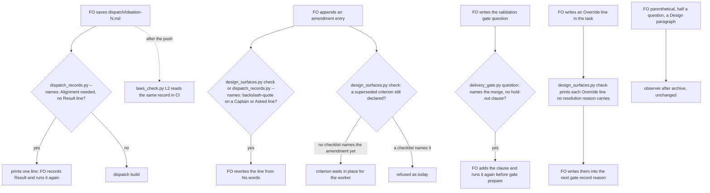

## Scope

- Source: handed over by the kc-adr FO (Paseo session 1bcf070c), 2026-10-25, relaying the Captain's 「開，但是直接轉交給dev2 fo不要開issue」 answering 「要不要開這三個 issue？」 (relayed; no GitHub issues). Filed here as one task; ideation may split it.
- Gap 1, amendment entries carry FO words. README `## Captain amendments`: "FO adds no words of its own"; `Asked:` is verbatim. Seen: `_archive/kc-adr-format-source/observer.md` (FO parenthetical on `Captain:`, half a question with JSON `\"` escapes on `Asked:`, a `Design:` naming a Scope non-goal); `_archive/release-acceptance/observer.md` (FO prose on `Asked:` of Amendments 1 to 3); `_archive/release-walk-picky-reviewers-and-director/observer.md` (Amendment 1 `Design:`). The existing amendment-form check (`design_surfaces.py check`) reads moved criteria and `Supersedes:`, not these lines.
- Gap 2, `Alignment: needed` dispatched with no `Result:` line. README `## Stages` (ideation): "FO records the alignment result as a `Result:` line before dispatching the worker." Seen: `_archive/adr-protected-path-guard/observer.md`, and this batch's `release-review-staleness-held-at-dispatch`, `release-acceptance`, `kc-adr-tools-with-dev2-copy` and `release-walk-picky-reviewers-and-director` observer reports. `dispatch build --stamp` does not refuse; `dispatch_records.py --names` does not read it.
- Gap 3, the delivery gate question lacks "unless he says he merges or holds". README `## Delivery authority`. Seen: `_archive/adr-protected-path-guard/observer.md`. `delivery_gate.py check` requires only the `Sufficiency:` and `Necessity:` clauses, second-reviewer outcomes and bracketed declines (2026-10-25, 0.29.0 `CONFIRMATIONS`); `gate prepare` reads no question text.
- Bite: each was caught only by the observer after merge; about 25 FO record errors this batch (FO count, 2026-10-23 to 2026-10-25); record reliability is the main risk for the autopilot path.
- Upstream first: dev2 scripts `design_surfaces.py` (amendment form, FO alignment), `delivery_gate.py`, `dispatch_records.py`, `role_triggers.py`; Spacedock `dispatch build` and `gate prepare` take no FO-text precondition (0.27.x).
- Non-goals: any other FO-write rule; changing what the README requires.
- Measured 2026-10-25 over the 14 most recent `_archive/*/observer.md` files (`grep -c '^violation'`, then the rule text grouped): 46 violations. By rule: missing `Result:` line before an alignment-needed dispatch 6; FO words in amendment entries 4; `Override:` placed outside the gate resolution reason 5 (two wordings); a ruling bound to a question put after it 3; `role_triggers.py` calls owed and not made before the merge ask 2; approved budget or stop condition not kept in the body 2; one each for eight other rules. The first three gaps above cover 10 of 46; the `Override:` placement and the owed role calls (7 more) are the next candidates for the same kind of check.
- Batch 6 (2026-10-25): the Captain 「可以」 (chat, 2026-10-25), answering 「需要你決定：這份第 6 批的清單可以嗎？」 about FO's batch-6 list, which placed this task first and folded into it override-reaches-gate-and-criteria-wait, override-recorded-when-captain-departs and the stalled ideation task fo-write-checks-parse-top-level (same scripts, `delivery_gate.py` and `design_surfaces.py`); their Scopes are this task's input, read from their own files.

## FO alignment

Alignment: needed before ideation: which checks run where (dispatch, gate, observer) is a design choice the Captain may want to see.
Result: aligned 2026-10-25 on the outcome by the Captain's 「全准」 answering this task's backlog briefing-1 question, which named the four line classes to check; where each check runs (dispatch, gate prepare, delivery_gate.py, observer) is put to him as a decision at the ideation gate. Recorded after the first ideation dispatch, which held for its absence (FO error, the gap this task closes).
Surfaces: none
Visible change: none
Release review: not needed: workflow maintenance, on no journey map.

## Stage Report: ideation

- FAILED: Design checks for the four FO-written line classes under ## Scope (Result line before an alignment-needed dispatch, FO words in Captain amendment entries, the delivery question's merges-or-holds clause, Override placement in the gate resolution reason), reading the folded tasks from their own files; say where each check runs, what it refuses, and the falsifier; name every file and the evidence each criterion needs
  Held, no design started: `## FO alignment` records `Alignment: needed before ideation` and the task has no `Result:` line (`grep -n Result` on this file hits only Scope lines 35 and 40, which quote the rule). The ideation stage text and `skills/ideation/principles.md` say to stop and report in that case.
- FAILED: A `### Batch overlap` section naming each file the design would change and each other batch or live task
  Not started; depends on the design.
- FAILED: The words FO reads at each lifecycle moment, before and after, per root learning.md "Measure the words FO reads at each moment, not one file's size"
  Not started; depends on the design.
- FAILED: Acceptance criteria with reproducible evidence clauses and falsifiers, and unresolved decisions for the Captain, each with a recommendation and what gets worse under it
  Not started; no `## Acceptance criteria` section written.

### Summary

This task was dispatched into ideation while it is itself an instance of Gap 2 (alignment needed, no `Result:` line), so the package rule held the worker. To release it, FO records a `Result:` line under `## FO alignment` (the alignment question is "which checks run where: dispatch, gate prepare, observer"; the Captain's batch-6 「可以」 and backlog 「全准」 are the only recorded words, and neither is a Result). Then FO re-dispatches ideation or messages this worker to continue. No other file was changed.

## Design

Ideation of 2026-10-25 against origin/main 33da2e3e (kc-dev-flow-2 0.30.0; the dispatch named 0.28.0 and the session loaded 0.29.0, so the scripts below are read at 0.30.0). Profile: pilot. The Scope above is untouched. The three folded tasks are read from their own files; the `## FO alignment` Result line is FO's, recorded after the first ideation dispatch held for its absence.

### PRFAQ

**Press line.** Each line FO writes that an observer used to find after the merge is now read by the script FO already runs at that write, and the words no script can judge are named as the observer's.

**Who uses it, and what breaks without it.** FO, at the ideation dispatch, the ideation and validation gate preparation, and the gate record. Replayed over the four dev2 state checkouts (2026-10-25): 16 of the 24 ideation records of alignment-needed tasks were saved with no `Result:` line, 7 of the 24 validation questions that name the merge lack the hold-out clause, 16 `Override:` lines in 9 tasks sit in no gate resolution reason, and one amendment line carries a JSON backslash. Today each is found after the merge by the observer, and two of them cannot be repaired then: Spacedock records the resolution reason and the approved question and does not edit them.

**FAQ.**
- Why not check the words FO adds to an amendment? 150 amendment entries were read. A bound of 8 words after the quote on the `Captain:` line would refuse 38 of 148 lines in the corpus, 1 of them reported; only 2 of 106 `Asked:` lines equal a committed gate question, so no script can tell a verbatim quote from a paraphrase. The Captain ruled the same on 2026-10-20 (ADR 0027, D4: matching words cannot stop that class of error) and on 2026-10-21 (「第 3 點留給觀察者」). The design checks only the part a script can decide.
- Why a new `delivery_gate.py question` command? The hold-out clause belongs in the question the Captain approves, so it must be read before `gate prepare`; `check` runs after the approval and reads the ask text, not the approved question.
- Why no new script and no new hook? Spacedock 0.27.2 has no text precondition on `dispatch build` or `gate prepare`, and mod hooks are startup, idle, merge and shutdown only; ADR 0027 places each check in a script FO already runs, and every one below is a function in an existing script.
- Does it stop an FO that skips the script? No. The record FO saved on 2026-10-23 for adr-protected-path-guard failed `--names` with a bare script name, so a skipped run is real. Only the Result line has a second reader that does not depend on FO: `laws_check.py` L2 judges the same record in CI where the adopter installed the laws workflow (this state branch only, of four). The other three classes stay with FO's run and then the observer.
- What does the Captain see differently? Nothing at a gate unless a check fires; then one existing-style line.

### Existing-code check (chain order)

- Spacedock 0.27.2: `spacedock dispatch build --help` lists no precondition flag; `spacedock gate` usage lists prepare, withdraw, record and consume with free `--question`, `--summary` and `--reason` text; the 0.27.3 plugin cache documents mod hooks `startup`, `idle`, `merge`, `shutdown` only. Nothing to reuse; ADR 0014 and 0027 hold that these writes are prose-enforced until Spacedock gains a pre-write hook.
- kc-dev-flow-2 owns every piece: `dispatch_records.py` `check_task_facts` already reads the task beside a record in `--names` (reserved ADR numbers, amendments named in no checklist); `design_surfaces.py` has `split_fo`, `unfenced`, `amendment_entries` and `check_amendments`; `delivery_gate.py` has the clause table `CONFIRMATIONS` and the text-only checks; `decision_ledger.py` has the `OVERRIDE` pattern and `gate_entries`; `laws_check.py` L2 already runs `dispatch_records.py --names` over history.
- One consumer would break: `laws_check.py` L2 raises `cannot judge ... output this runner does not parse` on any new `--names` line. Shown 2026-10-25 by running it over commit c63387d8 (kc-adr-tools-with-dev2-copy ideation-1) with the prototype's `dispatch_records.py` and the unchanged `laws_check.py`: exit 2. With the regex extended it prints `1 violated`; with the base scripts `0 violated`.
- Adopters: `git ls-files | grep -E 'delivery_gate|design_surfaces|dispatch_records|laws_check'` finds no copy in the qnow, subspace-relay or subspace-web checkouts.

### Mechanism

Prototype, not the deliverable: `fo-written-lines-checked-before-dispatch/ideation/prototype.diff` in the state checkout (4 files, 117 lines added and 22 removed, no added comment line). Reproduce: `git archive 33da2e3e kc-dev-flow-2/scripts | tar -x -C <dir>`, then in `<dir>/kc-dev-flow-2/scripts` run `patch -p2 < prototype.diff`. The point-2 change below was added after that file's first measurement and is part of it. `probe.py <scripts dir>` runs the fixtures; `measure.py <scripts dir>` replays the four state checkouts read only; `amendments.py` prints the amendment census.

| # | The FO write | Script that reads it, and when | Refuses | Does not judge | Falsifier |
| --- | --- | --- | --- | --- | --- |
| 1 | `Result:` line before an alignment-needed ideation dispatch | `dispatch_records.py --names <ideation-N.md>` before `dispatch build`; `laws_check.py` L2 on the pushed record | the record when the task's unfenced `## FO alignment` has an `Alignment: needed` line and no `Result: <text>` line | any other spelling of the alignment line (qnow writes `Needed at ideation:`), whether the Result is true, and whether it was written before the dispatch inside one state commit | a case with the line absent exits 0 when the call is removed |
| 2 | Captain amendment entry | `design_surfaces.py check` (FO before the ideation and ui validation gates, and the implementation and validation workers) and `dispatch_records.py --names` when a record is saved | a `\"` on a `Captain:` or `Asked:` line outside a `Superseded text:` block | an FO parenthetical, a half question, a `Design:` paragraph, any FO prose that is well formed | the same text inside a moved criterion exits 0; removing the skip turns it red |
| 3 | The validation gate question | new `delivery_gate.py question <task> --text-file <question and summary>` before `gate prepare` | text with `--match-head-commit` and no `unless` or `if` clause naming "merges" or "holds" in one sentence; the same text-only checks `check` already runs (Sufficiency, Necessity, second reviewer, declined brackets) | a merge grant worded without `--match-head-commit`; the question as approved (the merge-time `check` is unchanged) | text without the clause exits 1, with it exits 0; weakening the clause pattern to any "merge" turns the first green |
| 4 | `Override: recommended ...; Captain chose ...; area: ...` | `design_surfaces.py check` at each gate preparation, printed with its other notes | nothing: it prints each body `Override:` line whose `chose` text prefix no gate resolution reason carries, while the gate the ruling belongs to is still open and the reason can carry it | an Override FO never wrote anywhere, a revise or hold ruling (no option pair), and which gate a line belongs to; the placeholder forms `Override: recommended <option>` and `Override: recommended ...` quoted in prose | a task whose reason carries the line prints nothing; each placeholder form prints nothing |
| 5 | A superseded criterion at a gate where no worker runs | `design_surfaces.py check` | the "supersedes AC-N but it is still declared" error only once a dispatch checklist names that amendment (the worker was told to move it) | whether the worker moved it after the checklist names it: that error stays | a task with no checklist naming amendment 1 exits 0, with one naming it exits 1 |

Why one class is a note and not a refusal (row 4): a resolution reason is recorded by Spacedock and not editable, so a refusal could only block a gate whose fault cannot be repaired, and holding it would hold a ruling the Captain already gave. The note is useful only before the record, when FO can still put the line in the reason of the gate it belongs to. Two limits: the ledger reads `override` per resolution, so a line printed at a later gate (the ruling's own gate already recorded) must not be moved into that later reason, where it would land on the wrong stage; the ledger stays `null` for the gate where it happened. And notes print only on a clean run: when `check` also prints a defect, FO sees the note on the rerun.

Row 5 is the folded task's point 2. FO "does not move or rewrite a criterion" (README, Captain amendments) and the check made it delete one (the observer found it twice); the rule waits for the worker, so the check waits too. It reads `<task folder>/dispatch/*.md` the way `dispatch_records.py` already reads them for "named in no dispatch checklist".

Folded tasks: override-reaches-gate-and-criteria-wait is rows 4 and 5 (its point 3, FO words in `Design:`, stays with the observer under the Captain's 2026-10-21 ruling). override-recorded-when-captain-departs: the part a script can see is row 4; its two named causes, a revise with no option pair and a revised recommendation the Captain approves, need a README change and a scorer over the ledger, which the Scope here excludes (D4). fo-write-checks-parse-top-level was closed by the Captain on 2026-10-21 (「關掉」) and folded back on 2026-10-25; its prototype applies cleanly to 33da2e3e (`patch -p3 --dry-run` over a 33da2e3e archive, 2026-10-25), its two suites pass on the combined copy (prototype plus the folded prototype; counts under Measured, the six expected failures included), and its replay of 2026-10-21 repeats: 0 changes in `check --seed`, `scope_lines` over 992 revisions and the 913 gate questions (1021 and 914 on today's last run), 8 rows in 4 task bodies that quote `Declined:` as prose (D5).

### Measured today (2026-10-25)

Corpus: the four dev2 state checkouts read only (heads in `ideation/measured.txt`), 395 task files, 1021 committed revisions, 914 gate questions (the first runs saw 392, 992 and 913; heads moved). Test suites on the combined copy (prototype plus the folded prototype, `python3 -B -m unittest <module>`, 2026-10-25): delivery_gate 86 OK, dispatch_records 49 OK, laws_check 40 OK, pr_watch 109 OK, design_surfaces 173 run with 6 failing cases that row 5 changes on purpose (named below).

| Check | Replay | Result |
| --- | --- | --- |
| 1 Result | the task as committed with each ideation record, first add of each record | this workflow: 89 records, 24 of alignment-needed tasks, 16 without a Result (12 tasks, 2026-10-14 to 2026-10-25, 3 of them dispatched today); qnow, relay, web: 0 alignment-needed lines in their spelling, 0 refused |
| 2 backslash | task files at head, `Captain:`/`Asked:` lines outside moved criteria | 1 line (kc-adr-format-source amendment 2); merge-gatekeeper's `\n` sits in a moved criterion and is skipped |
| 3 hold-out | validation gate questions that name `--match-head-commit` | 24 in this workflow, 7 lack the clause (2026-10-20 to 2026-10-23), 0 of 331 elsewhere name the merge; the clause pattern accepts both wordings in use: "unless he says he merges or holds" and "If the Captain says he merges or holds" |
| 4 Override | body `Override: recommended` lines against the reasons of the same task's resolutions, matched on the `chose` prefix | 18 body lines in 10 tasks; 16 lines in 9 tasks (8 here, 1 in relay) match no reason and would print, 2 lines in 1 task match one and print nothing |
| 5 waits | `waits.txt`: every committed revision of a task with an amendments section, the dispatch records read at the same commit | base prints "still declared" on 78 revisions (this workflow 31, qnow 33, relay 12, web 2), the candidate on 12 of them (the ones where a checklist already names the amendment); qnow stops 33 of 33 because its checklists name no amendment, a case `dispatch_records.py` already flags ("named in no dispatch checklist"). The two commits where the observer saw FO delete a criterion (82632167, d3825cab) show no error at their parents, because the amendment and the deletion were one commit; only the probe fixture shows that case |
| verdicts | `measure.py` (from `fo-write-checks-parse-top-level/ideation/`) base against the combined candidate over 395 task files x `check` and `check --seed`, `scope_lines` over 1021 revisions and 914 gate texts (heads moved since the first run) | 20 changed rows: 9 `check` rows only add the Override note (exit 0 both), 1 changes exit 0 to 1 (the backslash line, an archived task), 2 stay exit 1 and lose one "still declared" line (a live task of another session, kc-decision-log-handoff-trial, and an archived qnow task), 8 are the folded task's task-body stress rows; `check --seed`, `scope_lines` and gate-question rows 0. Full rows: `ideation/verdicts.txt` |

Existing tests that change on purpose: three tests in `test_design_surfaces.py` (`test_a_superseded_id_still_declared_is_refused_including_a_redeclared_id`, `test_mutation_dropping_the_disjointness_rule_fails_its_case`, `test_the_amendments_heading_matches_in_any_case_and_with_surrounding_space`, 6 failing cases in all) build an amendment with no dispatch record and expect "still declared"; with row 5 each needs a record naming the amendment.

Known limits, not fixed here: the alignment line is read only in the form `Alignment: needed`; Result presence is checked, not its truth or its time inside one state commit; the hold-out check reads the question FO writes, not the one approved; an Override FO never wrote cannot be seen; the laws workflow exists on one of four state branches.

### Words FO reads at each lifecycle moment

Counted per root `learning.md` "Measure the words FO reads at each moment, not one file's size": passages and script output that instruct a step due at the moment, base (33da2e3e) against the prototype. Words are `len(text.split())`.

| Moment | Words FO reads, base | Candidate | Change |
| --- | --- | --- | --- |
| startup and resume | `workflow.md` 5385 words (the lint budget) | 5399: one sentence in Delivery authority, "Before the validation `gate prepare`, FO runs `<package>/scripts/delivery_gate.py question <task> --text-file <question and summary>`." (14 words) | +14, a budget raise that needs the Captain's quoted words (D3) |
| idle on an open PR, on a merged PR, after the archive | `pr_watch.py` output | untouched | 0 |
| ideation dispatch | `dispatch_records.py` prints nothing on a complete `--names` run | same; one 28-word line per owed Result, 24 per backslash line | 0 clean, +28 once when owed |
| ideation gate preparation | `design_surfaces.py check` output; the "still declared" error is 18 words and appears while a criterion waits | clean run same; backslash error 26 words; Override note 12 words plus the quoted line (at most 120 characters) per owed line; the "still declared" error (18 words) is gone until a checklist names the amendment | 0 clean, -18 while waiting |
| validation gate preparation | no script output about the question | `delivery_gate.py question` prints `gate text complete` (3 words), or up to 35 words per hold | +3 each |
| merge ask | `delivery_gate.py check` output | same text | 0 |
| the observer and the laws CI (not FO's load) | `laws.md` L2 and `observer` text | L2 Rule and Judged-by sentences name the two new lines | outside FO's reads |

No moment rises on a clean input except the 14 README words and the 3-word pass line; every other added word prints only when a check fires.

### Decisions for the Captain

Past rulings read (2026-10-25): ADR 0027 (a FO-write rule is checked by the script FO already runs at the write; D4: no phrase check for FO words in an amendment, he chose no check on FO's revised recommendation), ADR 0023 (a delivery gate question may carry the merge; a missing sentence fails safe because he is asked again), ADR 0025 (a bracketed reason is proof of presence), ADR 0010 (a round-three declined finding becomes its own task, which is why the parse-top-level task existed). `git -C <state checkout> grep -n 'Override:'` shows the D4 override above and the 2026-10-21 narrowing in override-reaches-gate-and-criteria-wait Scope (points 1 and 2, not 3); no ruling went against a recommendation like the ones below.

**D1: where each check runs.** This is the alignment question FO's Result line left open.
Options: A, the table under Mechanism (chosen): Result and backslash at the record, Result again in `laws_check.py`, the hold-out at a new `delivery_gate.py question` before `gate prepare`, Override and waits in `design_surfaces.py check`; B, leave all four with the observer.
**Recommended:** A. What gets worse under A: four classes still depend on FO running the script (one skipped `--names` run is on record), so the gain is real only for the Result line, where CI is a second reader; and `design_surfaces.py check` prints a note some FO will skim past. What gets worse under B: the same 16 / 7 / 16 / 1 findings keep surfacing after the merge, 1 to 3 days later, where nothing can be repaired.

**D2: how much of the amendment entry a script judges.**
Options: A, only the backslash-quote (chosen); B, A plus a bound on the words after the quote on the `Captain:` line (8 words refuses 38 of 148 lines in the corpus, 37 of them with no reported fault); C, a helper that writes the entry from files FO supplies, so the escape and the paraphrase cannot happen.
**Recommended:** A. What gets worse under A: the three observed faults (an FO parenthetical, half a question, a `Design:` that restates the Scope) are still found only by the observer; the check catches one line in 150. What gets worse under B: 37 refusals of entries nobody reported; under C: one more script FO must remember, for a fault seen once in 150 entries.

**D3: add the `question` command and 14 README words.** The Scope's non-goal says "changing what the README requires"; the sentence adds a README step, so it is yours to rule.
Options: A, the new command and a sentence bound to the validation gate, with a `WORKFLOW_BUDGET_STEPS` raise of 14 carrying your quoted words and the moment it is loaded (startup and resume; validation gate preparation) (chosen); B, the command with no README sentence, so FO learns of it only from `pr_watch.py` output (no word budget, but nothing tells FO to run it before the gate); C, no command, and `delivery_gate.py check` holds the merge when the approved question lacks the clause (fixable only by asking him again).
**Recommended:** A. What gets worse under A: 14 more words every startup; the stage-report-correction-path task also raises the ledger, so whichever merges second re-measures. What gets worse under B: the check exists but FO is not told to run it.

**D4: how far to go on Override.**
Options: A, the note at gate preparation (chosen); B, A plus widening the README rule so a revise or hold that departs from FO's recommendation also writes an Override line; C, B plus a scorer over the decision ledger.
**Recommended:** A. What gets worse under A: an Override FO never writes stays invisible, and the ledger still reads `override: null` for a revise (the cause the peer measured: 0 overrides in 239 rulings). B and C change what the README requires and need a design of their own; the Scope here excludes both.

**D5: carry fo-write-checks-parse-top-level.**
Options: A, carry its prototype as a separate commit in this task's implementation (chosen); B, keep it closed.
**Recommended:** A, because you folded it back on 2026-10-25 and the prototype is measured (0 changed verdicts over 992 revisions and 913 gate questions) and applies cleanly. What gets worse under A: two parser changes with no observed bite ride along, the reason you closed it on 2026-10-21; its reopen condition (a committed shape the parser misjudges) is still unmet. What gets worse under B: nothing measured; the two fence-blind cases stay as the reviewer constructed them.

Coupling: D3 depends on D1 (the command exists only if the hold-out check runs at the gate). D2, D4 and D5 are independent of it and of each other.

### Batch overlap

State read 2026-10-25 after `git pull --rebase origin spacedock-state/dev2`; package read at origin/main 33da2e3e. The six batch tasks the dispatch named are not in contention except as stated: new-work-starts-from-a-story-map (#705), codex-reader-reads-receipt-marker (#693), merge-ask-holds-missing-clauses (#703), idle-names-failing-seeds (#694) and agent-reads-governing-adr (#698) are archived and merged, so their work is in the base; fo-write-checks-parse-top-level is folded here.

Files this design would change: `kc-dev-flow-2/scripts/dispatch_records.py` (`check_task_facts`, docstring), `design_surfaces.py` (`alignment_owes_result`, `escaped_amendment_lines`, `owed_overrides`, `dispatched_amendments`, `check_amendments`, `check_task`, and `scope_lines` from D5), `delivery_gate.py` (`text_problems`, `question`, `main`, docstring, and `declined_items`/`DECLINE_END` from D5), `laws_check.py` (the L2 `--names` pattern), their four test files (`test_dispatch_records.py`, `test_design_surfaces.py`, `test_delivery_gate.py`, `test_laws_check.py`), `references/sd/laws.md` (L2 Rule, Judged by, Bit), `references/sd/workflow.md` (one sentence) and `scripts/lint-skills.py` (one `WORKFLOW_BUDGET_STEPS` entry). Not changed: `pr_watch.py`, `role_triggers.py`, `decision_ledger.py`, any skill, the package README, any adopter file.

| Task | State | Same file or check? | What FO needs |
| --- | --- | --- | --- |
| delivery-gate-reads-folder-tasks | ideation, other batch-6 session | yes: `delivery_gate.py` `check`, argument parser, docstring, `test_delivery_gate.py`; and `dispatch_records.py` `check_task_facts` (its D2) | it names this task as the one that orders against it; implement it first, then this one reads folder tasks in `question` and `check_task_facts` through its path rule |
| comment-check-reaches-delivery-gate | ideation | yes: `delivery_gate.py` `check`, docstring, `write_record`, `test_delivery_gate.py` | textual conflicts only (docstring, end of the test file); either order |
| adoption-asks-which-extensions | ideation | yes: `dispatch_records.py` `main`/`extension_errors`, `test_dispatch_records.py`, `test_laws_check.py`, `laws.md` L2 | adjacent edits in `dispatch_records.py` and the same L2 section of `laws.md`; its design adds `frontmatter_text`, mine adds a call inside `check_task_facts`; textual rebase, either order |
| stage-report-correction-path | ideation | yes: `workflow.md`, `lint-skills.py` `WORKFLOW_BUDGET_STEPS` tail | it raises the ledger by 22 (5385 to 5407); whichever merges second re-measures and appends its step |
| adr-required-statement | validation, other session | `workflow.md` and the README count if it raises the ledger | read its merged count before this one's raise |
| role-triggers-owe-ce-on-review-drift | ideation | `delivery_gate.py` only if its D2 reverses; `pr_watch.py`, not mine | independent unless D2 reverses |
| codex-review-hang-detected | ideation | no: `pr_watch.py`, `extensions/codex` | none |
| override-reaches-gate-and-criteria-wait, override-recorded-when-captain-departs | backlog, folded | the same checks; they close when this merges | close both at merge |
| amendment-form-check-round3-followups, chat-only-evidence-observer-blind-followups, design-surfaces-task-dir-crash | backlog | `design_surfaces.py` `check_amendments`, `clause()`, `main` (different functions) | order only if one is pulled forward |
| kc-decision-log-handoff-trial, pr-review-lite-value-pilot (other sessions) | backlog, implementation | none: their task files name none of the files above (grep, 2026-10-25) | none |
| journey-canvas-hosted-poc, journey-server-host-pilot (other sessions, read only) | ideation, validation | they run `design_surfaces.py check` only; none of their task files triggers a new line (no body Override line, no backslash, no amendment section waiting) | journey-server-host-pilot is a folder task: its ask needs delivery-gate-reads-folder-tasks first |

Recommended order: delivery-gate-reads-folder-tasks first, then comment-check-reaches-delivery-gate, then this task; stage-report-correction-path and adr-required-statement land in whichever order they reach the ledger, and this task re-measures the README count after both.

## Acceptance criteria

Criteria AC-1 to AC-8 and AC-10 hold under every option of D1 to D4 as recommended; AC-9 holds only if D5 is A. A different ruling removes the named criterion before implementation. All commands run from a candidate checkout of `kc-dev-flow-2/scripts`; `<fixtures>` are the cases in `ideation/probe.py`.

**AC-1** A saved ideation record is refused when its task owes a `Result:` line. Evidence: `python3 -B -I <scripts>/dispatch_records.py --names <task>/dispatch/ideation-N.md` exits 1 and prints one line naming the missing `Result:` line when the task's unfenced `## FO alignment` holds an `Alignment: needed` line and no `Result: <text>` line; it exits 0 with the Result line present, with `Alignment: not needed`, with `Alignment: needed` only inside a code fence, and with the other spelling `Needed at ideation:` (the bounded claim). `probe.py` section 1 reproduces the five rows (origin/main exits 0 on all five); new cases in `test_dispatch_records.py` carry the same fixtures. Falsifier: removing the `alignment_owes_result` call from `check_task_facts` turns the first row to exit 0, shown by a mutation case in the style of the existing `mutated` cases.

**AC-2** The laws runner judges the same record instead of failing on it. Evidence: `python3 <scripts>/laws_check.py <state> --before c63387d8956d^ --after c63387d8956d --readme <README>` on this workflow's state branch prints `L2 dispatch-record-complete: 1 events judged ..., 1 violated` and a `violation:` line naming the missing `Result:` line, exit 1; the base scripts print `0 violated`. A new `test_laws_check.py` case builds a state with one record added with the Result line and one without. `references/sd/laws.md` L2 (Rule, Judged by, Bounds) names the Result line, the backslash line and the spellings not judged. Falsifier: reverting the added `laws_check.py` pattern alternatives turns the case into `cannot judge: ... output this runner does not parse`, exit 2 (shown 2026-10-25).

**AC-3** A JSON backslash-quote on an amendment line is refused. Evidence: `design_surfaces.py check <task>` exits 1 naming the amendment and the key (`Captain` or `Asked`) when that line holds `\"`, and `dispatch_records.py --names` prints the same defect for a record saved after it; the same text inside a `Superseded text:` block exits 0; a clean line exits 0 (`probe.py` section 2). Corpus: 1 line of 395 task files (kc-adr-format-source amendment 2). Falsifier: deleting the `Superseded text:` skip turns the moved-criterion row red; deleting the check turns the first row to exit 0.

**AC-4** A validation question that names the merge without the hold-out clause is refused before the gate is prepared, and `check` is unchanged. Evidence: `delivery_gate.py question <task> --text-file <file>` exits 1 and prints the clause problem for text with `--match-head-commit` and no clause; exits 0 for "unless he says he merges or holds", for "If the Captain says he merges or holds", and for text that names no merge (`probe.py` section 3); the existing 86 `test_delivery_gate.py` cases pass, and a new case runs `check` on the clause-less text and finds no clause line (the merge-time text is not judged). Corpus: 7 of 24 merge-naming questions lack the clause. Falsifier: widening the clause pattern to any "merge" turns the first row to exit 0; calling `text_problems` from `check` with `at_gate=True` changes a `check` line and fails the unchanged-output case.

**AC-5** An Override line in the task that no gate resolution reason carries is printed at gate preparation, and nothing else changes. Evidence: `design_surfaces.py check <task>` prints one note per such line after its normal output, exit code unchanged; it prints nothing when a resolution reason carries the same `chose` text (first 18 characters), and nothing for the placeholder forms `Override: recommended <option>` and `Override: recommended ...` quoted in prose (`probe.py` section 4; this task's own Mechanism table tripped the first prototype until the second form was excluded). Corpus: 16 lines in 9 tasks. Falsifier: removing the placeholder test makes the third or fourth row print a note; matching the first 80 characters of the whole line, not the `chose` prefix, prints 18 lines on the corpus against 16 (shown 2026-10-25).

**AC-6** A superseded criterion waits in place until a dispatch checklist names the amendment. Evidence: `design_surfaces.py check <task>` exits 0 when amendment 1 supersedes AC-1, AC-1 is still declared and no `dispatch/*.md` `## Checklist` names `amendment 1`; exits 1 with the existing message once one does (`probe.py` section 5; origin/main exits 1 on both). Replay (`ideation/waits.py`, 2026-10-25): base prints the message on 78 revisions of the four checkouts, the candidate on 12 (a checklist already named the amendment); the full list is `ideation/waits.txt`. The three tests named under Measured are rewritten to carry a record that names the amendment. Falsifier: removing the `waits` test turns the first row to exit 1.

**AC-7** No unexplained verdict change over the four state checkouts. Evidence: the implementation report runs `ideation/measure.py` from `fo-write-checks-parse-top-level/ideation/` (base from origin/main, candidate from the head) and `ideation/waits.py`, records each checkout's head, and lists every differing row with its reason. Required: 0 changes in `check --seed`, `scope_lines` and gate-question rows; the `check` rows differ only by the Override note (exit 0 both, 9 today), by the one backslash line (exit 0 to 1) and by 2 rows that stay exit 1 and lose a "still declared" line; the task-body stress rows are the 4 files of 2026-10-21 (fo-write-checks, fo-write-rules-checked, fo-write-checks-parse-top-level, and relay's account-publish-ceiling). Falsifier: the same harness over a base that carries a backslash or a body Override line shows a difference, so it can fail.

**AC-8** The words FO reads rise only by the one README sentence (14 words, bound to the validation gate) and the pass line. Evidence: `python3 <scripts>/lint-skills.py` exits 0 with `workflow.md` at 5399 words and a `WORKFLOW_BUDGET_STEPS` entry of 14 carrying the Captain's quoted words from the ideation gate and the moment it is loaded; a recount of the table under "Words FO reads at each lifecycle moment" from the candidate head gives the same figures (28, 24, 26, 12 plus the quoted line, 17 plus 18, 3, 18). Falsifier: without the budget entry the lint exits 1 with "5399 words exceeds the budget of 5385"; any added passage or changed hold text changes a figure.

**AC-9** (only if D5 is A) The folded parser fixes hold. Evidence: the folded task's prototype applies to the implementation base with `patch -p3`, and its AC-1 to AC-4 evidence clauses (nested `Declined:` label counted once; bulleted declines keep their count and reason check; the real `## Scope` found past a fenced example; fenced lines inside Scope stay compared) pass with their own falsifiers, read from `fo-write-checks-parse-top-level.md` `## Acceptance criteria`. Falsifier: those clauses' own mutations.

**AC-10** Nothing else changes, and the cost stays where it is. Evidence: `git diff --name-only origin/main...HEAD` lists exactly the files under "Batch overlap" (scripts, their four test files, `laws.md`, `workflow.md`, `lint-skills.py`); `python3 -B -m unittest` passes for `test_design_surfaces`, `test_delivery_gate`, `test_dispatch_records`, `test_laws_check`, `test_pr_watch`; `.github/workflows/kc-dev-flow-2-tests.yml` is untouched (it already runs these suites on a PR that touches `kc-dev-flow-2/**`, so no new job). New test time is not measured here. The PR title is `feat(kc-dev-flow-2): ...` so release-please sees it. Falsifier: any other path in the diff list.

## Stage Report: ideation

- DONE: Design checks for the four FO-written line classes under ## Scope (Result line before an alignment-needed dispatch, FO words in Captain amendment entries, the delivery question's merges-or-holds clause, Override placement in the gate resolution reason), reading the folded tasks override-reaches-gate-and-criteria-wait, override-recorded-when-captain-departs and fo-write-checks-parse-top-level from their own files; say where each check runs (dispatch, gate prepare, kc-dev-flow-2/scripts/delivery_gate.py), what it refuses, and the falsifier; name every file and the evidence each criterion needs
  `## Design` Mechanism table rows 1 to 5: script, moment, what it refuses, what it does not judge, falsifier. The three folded tasks were read from their own files (rows 4 and 5 fold the two Override tasks, D5 the parse-top-level task). Files are under `### Batch overlap`. `ideation/prototype.diff` applies to origin/main 33da2e3e with `patch -p2` (verified 2026-10-25) and `ideation/probe.py` runs the fixtures on it.
- DONE: A `### Batch overlap` section naming each file the design would change and each other batch task (new-work-starts-from-a-story-map, codex-reader-reads-receipt-marker, merge-ask-holds-missing-clauses, fo-write-checks-parse-top-level, idle-names-failing-seeds, agent-reads-governing-adr) and live task of other sessions (kc-decision-log-p1, kc-decision-log-cli, kc-decision-log-handoff-trial, pr-review-lite-value-pilot, release-acceptance, journey-canvas-hosted-poc, journey-server-host-pilot (driven by other sessions; read only)) that changes the same file or check, so FO can order implementation
  `### Batch overlap`, last section of `## Design`: files named; the batch-5 tasks are archived and merged (#705, #693, #703, #694, #698) and parse-top-level is folded; delivery-gate-reads-folder-tasks, comment-check-reaches-delivery-gate, adoption-asks-which-extensions and stage-report-correction-path share files or the word ledger; the other-session tasks were read by grep and none triggers a new line; ends with a `Recommended order:` line.
- DONE: The words FO reads at each lifecycle moment, before and after, per root learning.md "Measure the words FO reads at each moment, not one file's size"
  `### Words FO reads at each lifecycle moment`: startup +14 README words (5385 to 5399, a budget raise that needs the Captain's quote, D3; the lint failure without the step and the pass with it were run on a patched copy), validation gate preparation +3 on a pass, every other added word prints only when a check fires; message lengths counted with `len(text.split())`.
- DONE: Acceptance criteria with reproducible evidence clauses and falsifiers, and unresolved decisions for the Captain, each with a recommendation and what gets worse under it
  `## Acceptance criteria` AC-1 to AC-10 as bold declarations; `### Decisions for the Captain` D1 to D5 with options, a recommendation and what gets worse. Current evidence per criterion:
  AC-1: `probe.py` section 1 on the patched archive: row 1 exits 1, rows 2 to 5 exit 0 (origin/main exits 0 on all five); replay: 16 of 24 alignment-needed ideation records in this workflow lack the Result; unit cases and the mutation case not yet written.
  AC-2: `laws_check.py` over c63387d8956d prints `1 violated` with the pattern extended, `cannot judge` exit 2 without it, `0 violated` on the base scripts; the `test_laws_check.py` case and the `laws.md` text are not yet written.
  AC-3: `probe.py` section 2: backslash on `Asked:` exits 1, clean exits 0, inside a moved criterion exits 0; corpus 1 line in 395 files; unit cases and mutation not yet written.
  AC-4: `probe.py` section 3: no clause exits 1, both wordings exit 0, no grant exits 0; corpus 7 of 24 merge-naming questions lack the clause; the existing `test_delivery_gate` 86 pass on the combined copy; the new cases are not yet written.
  AC-5: `probe.py` section 4: a body Override with no matching reason prints one note, a carried line and both placeholder forms print none; corpus 16 lines in 9 tasks; unit cases not yet written.
  AC-6: `probe.py` section 5: exit 0 with no checklist naming the amendment, exit 1 once one does (origin/main exits 1 on both); `waits.txt` 78 revisions to 12; the three tests to rewrite are named; not yet implemented in the repository.
  AC-7: `ideation/verdicts.txt` (2026-10-25, 395 files): 20 changed rows, each explained in the Measured table; `check --seed`, `scope_lines` and gate-question rows 0; the implementation report reruns it at the candidate head, not yet run.
  AC-8: message lengths counted (28, 24, 26, 12 plus line, 17 and 18, 3, 18) and the sentence is 14 words; on a patched copy `lint-skills.py` fails with "5399 words exceeds the budget of 5385" and passes the word check with a raise step of 14; the real README edit is not yet made.
  AC-9: the folded prototype applies to 33da2e3e (`patch -p3`) and its two suites pass on the combined copy (design_surfaces with the 6 expected failures); its own unit cases were never written because that task closed at ideation; not yet verified in the repository.
  AC-10: the prototype touches 4 scripts (117 lines added, 22 removed); combined copy: delivery_gate 86 OK, dispatch_records 49 OK, laws_check 40 OK, pr_watch 109 OK, design_surfaces 173 with 6 expected failures; the full file list and the PR title are not yet verified.
- DONE: `python3 <package>/scripts/design_surfaces.py check <task>` output cited
  `fo-written-lines-checked-before-dispatch.md: design surfaces presentable`, exit 0, from `/Users/kent/.claude/plugins/cache/kc-claude-plugins/kc-dev-flow-2/0.29.0/scripts/design_surfaces.py`, run on the task after the design was appended.

### Summary

This report supersedes the held `## Stage Report: ideation` above, which stopped for the missing `Result:` line before any design; FO has since recorded it. Each FO-written line is read by the script FO already runs at that write (ADR 0027): the Result line in `dispatch_records.py --names` and `laws_check.py` L2, a JSON backslash on an amendment line in `design_surfaces.py check`, a merge-with-no-hold-out question in a new `delivery_gate.py question` before the validation `gate prepare`, and an unplaced Override line as a note in `design_surfaces.py check`; a superseded criterion waits for its worker (the folded task's second point). Replayed over four state checkouts: 16 of 24 Result lines absent, 7 of 24 hold-out clauses absent, 16 Override lines in 9 tasks, 1 backslash line. The words only an observer can judge (an FO parenthetical, a half question, a `Design:` paragraph) stay with the observer. Five decisions need the Captain: where each check runs, how much of an amendment a script judges, the 14 README words, how far to go on Override, and whether to carry the closed parse-top-level fixes. Origin/main is 0.30.0, not the 0.28.0 the dispatch named, and the session loaded the 0.29.0 scripts; implementation should dispatch from 33da2e3e or newer.
