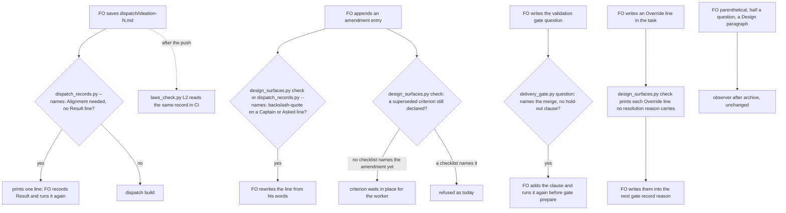

## Scope

- Source: handed over by the kc-adr FO (Paseo session 1bcf070c), 2026-10-25, relaying the Captain's 「開，但是直接轉交給dev2 fo不要開issue」 answering 「要不要開這三個 issue？」 (relayed; no GitHub issues). Filed here as one task; ideation may split it.
- Gap 1, amendment entries carry FO words. README `## Captain amendments`: "FO adds no words of its own"; `Asked:` is verbatim. Seen: `_archive/kc-adr-format-source/observer.md` (FO parenthetical on `Captain:`, half a question with JSON `\"` escapes on `Asked:`, a `Design:` naming a Scope non-goal); `_archive/release-acceptance/observer.md` (FO prose on `Asked:` of Amendments 1 to 3); `_archive/release-walk-picky-reviewers-and-director/observer.md` (Amendment 1 `Design:`). The existing amendment-form check (`design_surfaces.py check`) reads moved criteria and `Supersedes:`, not these lines.
- Gap 2, `Alignment: needed` dispatched with no `Result:` line. README `## Stages` (ideation): "FO records the alignment result as a `Result:` line before dispatching the worker." Seen: `_archive/adr-protected-path-guard/observer.md`, and this batch's `release-review-staleness-held-at-dispatch`, `release-acceptance`, `kc-adr-tools-with-dev2-copy` and `release-walk-picky-reviewers-and-director` observer reports. `dispatch build --stamp` does not refuse; `dispatch_records.py --names` does not read it.
- Gap 3, the delivery gate question lacks "unless he says he merges or holds". README `## Delivery authority`. Seen: `_archive/adr-protected-path-guard/observer.md`. `delivery_gate.py check` requires only the `Sufficiency:` and `Necessity:` clauses, second-reviewer outcomes and bracketed declines (2026-10-25, 0.29.0 `CONFIRMATIONS`); `gate prepare` reads no question text.
- Bite: each was caught only by the observer after merge; about 25 FO record errors this batch (FO count, 2026-10-23 to 2026-10-25); record reliability is the main risk for the autopilot path.
- Upstream first: dev2 scripts `design_surfaces.py` (amendment form, FO alignment), `delivery_gate.py`, `dispatch_records.py`, `role_triggers.py`; Spacedock `dispatch build` and `gate prepare` take no FO-text precondition (0.27.x).
- Non-goals: any other FO-write rule; changing what the README requires.
- Measured 2026-10-25 over the 14 most recent `_archive/*/observer.md` files (`grep -c '^violation'`, then the rule text grouped): 46 violations. By rule: missing `Result:` line before an alignment-needed dispatch 6; FO words in amendment entries 4; `Override:` placed outside the gate resolution reason 5 (two wordings); a ruling bound to a question put after it 3; `role_triggers.py` calls owed and not made before the merge ask 2; approved budget or stop condition not kept in the body 2; one each for eight other rules. The first three gaps above cover 10 of 46; the `Override:` placement and the owed role calls (7 more) are the next candidates for the same kind of check.
- Batch 6 (2026-10-25): the Captain 「可以」 (chat, 2026-10-25), answering 「需要你決定：這份第 6 批的清單可以嗎？」 about FO's batch-6 list, which placed this task first and folded into it override-reaches-gate-and-criteria-wait, override-recorded-when-captain-departs and the stalled ideation task fo-write-checks-parse-top-level (same scripts, `delivery_gate.py` and `design_surfaces.py`); their Scopes are this task's input, read from their own files.

## FO alignment

Alignment: needed before ideation: which checks run where (dispatch, gate, observer) is a design choice the Captain may want to see.
Result: aligned 2026-10-25 on the outcome by the Captain's 「全准」 answering this task's backlog briefing-1 question, which named the four line classes to check; where each check runs (dispatch, gate prepare, delivery_gate.py, observer) is put to him as a decision at the ideation gate. Recorded after the first ideation dispatch, which held for its absence (FO error, the gap this task closes).
Surfaces: none
Visible change: none
Release review: not needed: workflow maintenance, on no journey map.
FO ruling 2026-10-26 on validation F5 (ADR need): D2 (a script judges only the backslash-quote) and D4 (Override gets a note only) govern only this task's checks and stay in the task; D1, D3 and D5 rest on ADR 0027, ADR 0020 and ADR 0010, which the validation report names. No new ADR.

### Feedback Cycles

- Cycle 1 (FO, 2026-10-26): Codex review on #724 5b7c0b2e (review:5644681449) left 1 P2, to fix (rounds 1 and 2 fix every finding; a P1 blocks in every round); investigation first, then FO fix authorization, then a fresh validation recheck.
  - P2 kc-dev-flow-2/scripts/design_surfaces.py: the escaped-quote check flags any amendment line before Superseded text (Design:, Supersedes:, an Asked: continuation), though D2 applies it only to Captain: and Asked: lines; the resulting diagnostic does not match kc-dev-flow-2/scripts/laws_check.py L2, so CI aborts with an unparseable-output error. Restrict the check to the Captain: and Asked: lines (validation F2 names the same).

## Stage Report: ideation

- FAILED: Design checks for the four FO-written line classes under ## Scope (Result line before an alignment-needed dispatch, FO words in Captain amendment entries, the delivery question's merges-or-holds clause, Override placement in the gate resolution reason), reading the folded tasks from their own files; say where each check runs, what it refuses, and the falsifier; name every file and the evidence each criterion needs
  Held, no design started: `## FO alignment` records `Alignment: needed before ideation` and the task has no `Result:` line (`grep -n Result` on this file hits only Scope lines 35 and 40, which quote the rule). The ideation stage text and `skills/ideation/principles.md` say to stop and report in that case.
- FAILED: A `### Batch overlap` section naming each file the design would change and each other batch or live task
  Not started; depends on the design.
- FAILED: The words FO reads at each lifecycle moment, before and after, per root learning.md "Measure the words FO reads at each moment, not one file's size"
  Not started; depends on the design.
- FAILED: Acceptance criteria with reproducible evidence clauses and falsifiers, and unresolved decisions for the Captain, each with a recommendation and what gets worse under it
  Not started; no `## Acceptance criteria` section written.

### Summary

This task was dispatched into ideation while it is itself an instance of Gap 2 (alignment needed, no `Result:` line), so the package rule held the worker. To release it, FO records a `Result:` line under `## FO alignment` (the alignment question is "which checks run where: dispatch, gate prepare, observer"; the Captain's batch-6 「可以」 and backlog 「全准」 are the only recorded words, and neither is a Result). Then FO re-dispatches ideation or messages this worker to continue. No other file was changed.

## Design

Ideation of 2026-10-25 against origin/main 33da2e3e (kc-dev-flow-2 0.30.0; the dispatch named 0.28.0 and the session loaded 0.29.0, so the scripts below are read at 0.30.0). Profile: pilot. The Scope above is untouched. The three folded tasks are read from their own files; the `## FO alignment` Result line is FO's, recorded after the first ideation dispatch held for its absence.

### PRFAQ

**Press line.** Each line FO writes that an observer used to find after the merge is now read by the script FO already runs at that write, and the words no script can judge are named as the observer's.

**Who uses it, and what breaks without it.** FO, at the ideation dispatch, the ideation and validation gate preparation, and the gate record. Replayed over the four dev2 state checkouts (2026-10-25): 16 of the 24 ideation records of alignment-needed tasks were saved with no `Result:` line, 7 of the 24 validation questions that name the merge lack the hold-out clause, 16 `Override:` lines in 9 tasks sit in no gate resolution reason, and one amendment line carries a JSON backslash. Today each is found after the merge by the observer, and two of them cannot be repaired then: Spacedock records the resolution reason and the approved question and does not edit them.

**FAQ.**
- Why not check the words FO adds to an amendment? 150 amendment entries were read. A bound of 8 words after the quote on the `Captain:` line would refuse 38 of 148 lines in the corpus, 1 of them reported; only 2 of 106 `Asked:` lines equal a committed gate question, so no script can tell a verbatim quote from a paraphrase. The Captain ruled the same on 2026-10-20 (ADR 0027, D4: matching words cannot stop that class of error) and on 2026-10-21 (「第 3 點留給觀察者」). The design checks only the part a script can decide.
- Why a new `delivery_gate.py question` command? The hold-out clause belongs in the question the Captain approves, so it must be read before `gate prepare`; `check` runs after the approval and reads the ask text, not the approved question.
- Why no new script and no new hook? Spacedock 0.27.2 has no text precondition on `dispatch build` or `gate prepare`, and mod hooks are startup, idle, merge and shutdown only; ADR 0027 places each check in a script FO already runs, and every one below is a function in an existing script.
- Does it stop an FO that skips the script? No. The record FO saved on 2026-10-23 for adr-protected-path-guard failed `--names` with a bare script name, so a skipped run is real. Only the Result line has a second reader that does not depend on FO: `laws_check.py` L2 judges the same record in CI where the adopter installed the laws workflow (this state branch only, of four). The other three classes stay with FO's run and then the observer.
- What does the Captain see differently? Nothing at a gate unless a check fires; then one existing-style line.



### Existing-code check (chain order)

- Spacedock 0.27.2: `spacedock dispatch build --help` lists no precondition flag; `spacedock gate` usage lists prepare, withdraw, record and consume with free `--question`, `--summary` and `--reason` text; the 0.27.3 plugin cache documents mod hooks `startup`, `idle`, `merge`, `shutdown` only. Nothing to reuse; ADR 0014 and 0027 hold that these writes are prose-enforced until Spacedock gains a pre-write hook.
- kc-dev-flow-2 owns every piece: `dispatch_records.py` `check_task_facts` already reads the task beside a record in `--names` (reserved ADR numbers, amendments named in no checklist); `design_surfaces.py` has `split_fo`, `unfenced`, `amendment_entries` and `check_amendments`; `delivery_gate.py` has the clause table `CONFIRMATIONS` and the text-only checks; `decision_ledger.py` has the `OVERRIDE` pattern and `gate_entries`; `laws_check.py` L2 already runs `dispatch_records.py --names` over history.
- One consumer would break: `laws_check.py` L2 raises `cannot judge ... output this runner does not parse` on any new `--names` line. Shown 2026-10-25 by running it over commit c63387d8 (kc-adr-tools-with-dev2-copy ideation-1) with the prototype's `dispatch_records.py` and the unchanged `laws_check.py`: exit 2. With the regex extended it prints `1 violated`; with the base scripts `0 violated`.
- Adopters: `git ls-files | grep -E 'delivery_gate|design_surfaces|dispatch_records|laws_check'` finds no copy in the qnow, subspace-relay or subspace-web checkouts.

### Mechanism

Prototype, not the deliverable: `fo-written-lines-checked-before-dispatch/ideation/prototype.diff` in the state checkout (4 files, 117 lines added and 22 removed, no added comment line). Reproduce: `git archive 33da2e3e kc-dev-flow-2/scripts | tar -x -C <dir>`, then in `<dir>/kc-dev-flow-2/scripts` run `patch -p2 < prototype.diff`. The point-2 change below was added after that file's first measurement and is part of it. `probe.py <scripts dir>` runs the fixtures; `measure.py <scripts dir>` replays the four state checkouts read only; `amendments.py` prints the amendment census.

| # | The FO write | Script that reads it, and when | Refuses | Does not judge | Falsifier |
| --- | --- | --- | --- | --- | --- |
| 1 | `Result:` line before an alignment-needed ideation dispatch | `dispatch_records.py --names <ideation-N.md>` before `dispatch build`; `laws_check.py` L2 on the pushed record | the record when the task's unfenced `## FO alignment` has an `Alignment: needed` line and no `Result: <text>` line | any other spelling of the alignment line (qnow writes `Needed at ideation:`), whether the Result is true, and whether it was written before the dispatch inside one state commit | a case with the line absent exits 0 when the call is removed |
| 2 | Captain amendment entry | `design_surfaces.py check` (FO before the ideation and ui validation gates, and the implementation and validation workers) and `dispatch_records.py --names` when a record is saved | a `\"` on a `Captain:` or `Asked:` line outside a `Superseded text:` block | an FO parenthetical, a half question, a `Design:` paragraph, any FO prose that is well formed | the same text inside a moved criterion exits 0; removing the skip turns it red |
| 3 | The validation gate question | new `delivery_gate.py question <task> --text-file <question and summary>` before `gate prepare` | text with `--match-head-commit` and no `unless` or `if` clause naming "merges" or "holds" in one sentence; the same text-only checks `check` already runs (Sufficiency, Necessity, second reviewer, declined brackets) | a merge grant worded without `--match-head-commit`; the question as approved (the merge-time `check` is unchanged) | text without the clause exits 1, with it exits 0; weakening the clause pattern to any "merge" turns the first green |
| 4 | `Override: recommended ...; Captain chose ...; area: ...` | `design_surfaces.py check` at each gate preparation, printed with its other notes | nothing: it prints each body `Override:` line whose `chose` text prefix no gate resolution reason carries, while the gate the ruling belongs to is still open and the reason can carry it | an Override FO never wrote anywhere, a revise or hold ruling (no option pair), and which gate a line belongs to; the placeholder forms `Override: recommended <option>` and `Override: recommended ...` quoted in prose | a task whose reason carries the line prints nothing; each placeholder form prints nothing |
| 5 | A superseded criterion at a gate where no worker runs | `design_surfaces.py check` | the "supersedes AC-N but it is still declared" error only once a dispatch checklist names that amendment (the worker was told to move it) | whether the worker moved it after the checklist names it: that error stays | a task with no checklist naming amendment 1 exits 0, with one naming it exits 1 |

Why one class is a note and not a refusal (row 4): a resolution reason is recorded by Spacedock and not editable, so a refusal could only block a gate whose fault cannot be repaired, and holding it would hold a ruling the Captain already gave. The note is useful only before the record, when FO can still put the line in the reason of the gate it belongs to. Two limits: the ledger reads `override` per resolution, so a line printed at a later gate (the ruling's own gate already recorded) must not be moved into that later reason, where it would land on the wrong stage; the ledger stays `null` for the gate where it happened. And notes print only on a clean run: when `check` also prints a defect, FO sees the note on the rerun.

Row 5 is the folded task's point 2. FO "does not move or rewrite a criterion" (README, Captain amendments) and the check made it delete one (the observer found it twice); the rule waits for the worker, so the check waits too. It reads `<task folder>/dispatch/*.md` the way `dispatch_records.py` already reads them for "named in no dispatch checklist".

Folded tasks: override-reaches-gate-and-criteria-wait is rows 4 and 5 (its point 3, FO words in `Design:`, stays with the observer under the Captain's 2026-10-21 ruling). override-recorded-when-captain-departs: the part a script can see is row 4; its two named causes, a revise with no option pair and a revised recommendation the Captain approves, need a README change and a scorer over the ledger, which the Scope here excludes (D4). fo-write-checks-parse-top-level was closed by the Captain on 2026-10-21 (「關掉」) and folded back on 2026-10-25; its prototype applies cleanly to 33da2e3e (`patch -p3 --dry-run` over a 33da2e3e archive, 2026-10-25), its two suites pass on the combined copy (prototype plus the folded prototype; counts under Measured, the six expected failures included), and its replay of 2026-10-21 repeats: 0 changes in `check --seed`, `scope_lines` over 992 revisions and the 913 gate questions (1021 and 914 on today's last run), 8 rows in 4 task bodies that quote `Declined:` as prose (D5).

### Measured today (2026-10-25)

Corpus: the four dev2 state checkouts read only (heads in `ideation/measured.txt`), 395 task files, 1021 committed revisions, 914 gate questions (the first runs saw 392, 992 and 913; heads moved). Test suites on the combined copy (prototype plus the folded prototype, `python3 -B -m unittest <module>`, 2026-10-25): delivery_gate 86 OK, dispatch_records 49 OK, laws_check 40 OK, pr_watch 109 OK, design_surfaces 173 run with 6 failing cases that row 5 changes on purpose (named below).

| Check | Replay | Result |
| --- | --- | --- |
| 1 Result | the task as committed with each ideation record, first add of each record | this workflow: 89 records, 24 of alignment-needed tasks, 16 without a Result (12 tasks, 2026-10-14 to 2026-10-25, 3 of them dispatched today); qnow, relay, web: 0 alignment-needed lines in their spelling, 0 refused |
| 2 backslash | task files at head, `Captain:`/`Asked:` lines outside moved criteria | 1 line (kc-adr-format-source amendment 2); merge-gatekeeper's `\n` sits in a moved criterion and is skipped |
| 3 hold-out | validation gate questions that name `--match-head-commit` | 24 in this workflow, 7 lack the clause (2026-10-20 to 2026-10-23), 0 of 331 elsewhere name the merge; the clause pattern accepts both wordings in use: "unless he says he merges or holds" and "If the Captain says he merges or holds" |
| 4 Override | body `Override: recommended` lines against the reasons of the same task's resolutions, matched on the `chose` prefix | 18 body lines in 10 tasks; 16 lines in 9 tasks (8 here, 1 in relay) match no reason and would print, 2 lines in 1 task match one and print nothing |
| 5 waits | `waits.txt`: every committed revision of a task with an amendments section, the dispatch records read at the same commit | base prints "still declared" on 78 revisions (this workflow 31, qnow 33, relay 12, web 2), the candidate on 12 of them (the ones where a checklist already names the amendment); qnow stops 33 of 33 because its checklists name no amendment, a case `dispatch_records.py` already flags ("named in no dispatch checklist"). The two commits where the observer saw FO delete a criterion (82632167, d3825cab) show no error at their parents, because the amendment and the deletion were one commit; only the probe fixture shows that case |
| verdicts | `measure.py` (from `fo-write-checks-parse-top-level/ideation/`) base against the combined candidate over 395 task files x `check` and `check --seed`, `scope_lines` over 1021 revisions and 914 gate texts (heads moved since the first run) | 20 changed rows: 9 `check` rows only add the Override note (exit 0 both), 1 changes exit 0 to 1 (the backslash line, an archived task), 2 stay exit 1 and lose one "still declared" line (a live task of another session, kc-decision-log-handoff-trial, and an archived qnow task), 8 are the folded task's task-body stress rows; `check --seed`, `scope_lines` and gate-question rows 0. Full rows: `ideation/verdicts.txt` |

Existing tests that change on purpose: three tests in `test_design_surfaces.py` (`test_a_superseded_id_still_declared_is_refused_including_a_redeclared_id`, `test_mutation_dropping_the_disjointness_rule_fails_its_case`, `test_the_amendments_heading_matches_in_any_case_and_with_surrounding_space`, 6 failing cases in all) build an amendment with no dispatch record and expect "still declared"; with row 5 each needs a record naming the amendment.

Known limits, not fixed here: the alignment line is read only in the form `Alignment: needed`; Result presence is checked, not its truth or its time inside one state commit; the hold-out check reads the question FO writes, not the one approved; an Override FO never wrote cannot be seen; the laws workflow exists on one of four state branches.

### Words FO reads at each lifecycle moment

Counted per root `learning.md` "Measure the words FO reads at each moment, not one file's size": passages and script output that instruct a step due at the moment, base (33da2e3e) against the prototype. Words are `len(text.split())`.

| Moment | Words FO reads, base | Candidate | Change |
| --- | --- | --- | --- |
| startup and resume | `workflow.md` 5385 words (the lint budget) | 5399: one sentence in Delivery authority, "Before the validation `gate prepare`, FO runs `<package>/scripts/delivery_gate.py question <task> --text-file <question and summary>`." (14 words) | +14, a budget raise that needs the Captain's quoted words (D3) |
| idle on an open PR, on a merged PR, after the archive | `pr_watch.py` output | untouched | 0 |
| ideation dispatch | `dispatch_records.py` prints nothing on a complete `--names` run | same; one 28-word line per owed Result, 24 per backslash line | 0 clean, +28 once when owed |
| ideation gate preparation | `design_surfaces.py check` output; the "still declared" error is 18 words and appears while a criterion waits | clean run same; backslash error 26 words; Override note 12 words plus the quoted line (at most 120 characters) per owed line; the "still declared" error (18 words) is gone until a checklist names the amendment | 0 clean, -18 while waiting |
| validation gate preparation | no script output about the question | `delivery_gate.py question` prints `gate text complete` (3 words), or up to 35 words per hold | +3 each |
| merge ask | `delivery_gate.py check` output | same text | 0 |
| the observer and the laws CI (not FO's load) | `laws.md` L2 and `observer` text | L2 Rule and Judged-by sentences name the two new lines | outside FO's reads |

No moment rises on a clean input except the 14 README words and the 3-word pass line; every other added word prints only when a check fires.

### Decisions for the Captain

Past rulings read (2026-10-25): ADR 0027 (a FO-write rule is checked by the script FO already runs at the write; D4: no phrase check for FO words in an amendment, he chose no check on FO's revised recommendation), ADR 0023 (a delivery gate question may carry the merge; a missing sentence fails safe because he is asked again), ADR 0025 (a bracketed reason is proof of presence), ADR 0010 (a round-three declined finding becomes its own task, which is why the parse-top-level task existed). `git -C <state checkout> grep -n 'Override:'` shows the D4 override above and the 2026-10-21 narrowing in override-reaches-gate-and-criteria-wait Scope (points 1 and 2, not 3); no ruling went against a recommendation like the ones below.

**D1: where each check runs.** This is the alignment question FO's Result line left open.
Options: A, the table under Mechanism (chosen): Result and backslash at the record, Result again in `laws_check.py`, the hold-out at a new `delivery_gate.py question` before `gate prepare`, Override and waits in `design_surfaces.py check`; B, leave all four with the observer.
**Recommended:** A. What gets worse under A: four classes still depend on FO running the script (one skipped `--names` run is on record), so the gain is real only for the Result line, where CI is a second reader; and `design_surfaces.py check` prints a note some FO will skim past. What gets worse under B: the same 16 / 7 / 16 / 1 findings keep surfacing after the merge, 1 to 3 days later, where nothing can be repaired.

**D2: how much of the amendment entry a script judges.**
Options: A, only the backslash-quote (chosen); B, A plus a bound on the words after the quote on the `Captain:` line (8 words refuses 38 of 148 lines in the corpus, 37 of them with no reported fault); C, a helper that writes the entry from files FO supplies, so the escape and the paraphrase cannot happen.
**Recommended:** A. What gets worse under A: the three observed faults (an FO parenthetical, half a question, a `Design:` that restates the Scope) are still found only by the observer; the check catches one line in 150. What gets worse under B: 37 refusals of entries nobody reported; under C: one more script FO must remember, for a fault seen once in 150 entries.

**D3: add the `question` command and 14 README words.** The Scope's non-goal says "changing what the README requires"; the sentence adds a README step, so it is yours to rule.
Options: A, the new command and a sentence bound to the validation gate, with a `WORKFLOW_BUDGET_STEPS` raise of 14 carrying your quoted words and the moment it is loaded (startup and resume; validation gate preparation) (chosen); B, the command with no README sentence, so FO learns of it only from `pr_watch.py` output (no word budget, but nothing tells FO to run it before the gate); C, no command, and `delivery_gate.py check` holds the merge when the approved question lacks the clause (fixable only by asking him again).
**Recommended:** A. What gets worse under A: 14 more words every startup; the stage-report-correction-path task also raises the ledger, so whichever merges second re-measures. What gets worse under B: the check exists but FO is not told to run it.

**D4: how far to go on Override.**
Options: A, the note at gate preparation (chosen); B, A plus widening the README rule so a revise or hold that departs from FO's recommendation also writes an Override line; C, B plus a scorer over the decision ledger.
**Recommended:** A. What gets worse under A: an Override FO never writes stays invisible, and the ledger still reads `override: null` for a revise (the cause the peer measured: 0 overrides in 239 rulings). B and C change what the README requires and need a design of their own; the Scope here excludes both.

**D5: carry fo-write-checks-parse-top-level.**
Options: A, carry its prototype as a separate commit in this task's implementation (chosen); B, keep it closed.
**Recommended:** A, because you folded it back on 2026-10-25 and the prototype is measured (0 changed verdicts over 992 revisions and 913 gate questions) and applies cleanly. What gets worse under A: two parser changes with no observed bite ride along, the reason you closed it on 2026-10-21; its reopen condition (a committed shape the parser misjudges) is still unmet. What gets worse under B: nothing measured; the two fence-blind cases stay as the reviewer constructed them.

Coupling: D3 depends on D1 (the command exists only if the hold-out check runs at the gate). D2, D4 and D5 are independent of it and of each other.

### Batch overlap

State read 2026-10-25 after `git pull --rebase origin spacedock-state/dev2`; package read at origin/main 33da2e3e. The six batch tasks the dispatch named are not in contention except as stated: new-work-starts-from-a-story-map (#705), codex-reader-reads-receipt-marker (#693), merge-ask-holds-missing-clauses (#703), idle-names-failing-seeds (#694) and agent-reads-governing-adr (#698) are archived and merged, so their work is in the base; fo-write-checks-parse-top-level is folded here.

Files this design would change: `kc-dev-flow-2/scripts/dispatch_records.py` (`check_task_facts`, docstring), `design_surfaces.py` (`alignment_owes_result`, `escaped_amendment_lines`, `owed_overrides`, `dispatched_amendments`, `check_amendments`, `check_task`, and `scope_lines` from D5), `delivery_gate.py` (`text_problems`, `question`, `main`, docstring, and `declined_items`/`DECLINE_END` from D5), `laws_check.py` (the L2 `--names` pattern), their four test files (`test_dispatch_records.py`, `test_design_surfaces.py`, `test_delivery_gate.py`, `test_laws_check.py`), `references/sd/laws.md` (L2 Rule, Judged by, Bit), `references/sd/workflow.md` (one sentence) and `scripts/lint-skills.py` (one `WORKFLOW_BUDGET_STEPS` entry). Not changed: `pr_watch.py`, `role_triggers.py`, `decision_ledger.py`, any skill, the package README, any adopter file.

| Task | State | Same file or check? | What FO needs |
| --- | --- | --- | --- |
| delivery-gate-reads-folder-tasks | ideation, other batch-6 session | yes: `delivery_gate.py` `check`, argument parser, docstring, `test_delivery_gate.py`; and `dispatch_records.py` `check_task_facts` (its D2) | it names this task as the one that orders against it; implement it first, then this one reads folder tasks in `question` and `check_task_facts` through its path rule |
| comment-check-reaches-delivery-gate | ideation | yes: `delivery_gate.py` `check`, docstring, `write_record`, `test_delivery_gate.py` | textual conflicts only (docstring, end of the test file); either order |
| adoption-asks-which-extensions | ideation | yes: `dispatch_records.py` `main`/`extension_errors`, `test_dispatch_records.py`, `test_laws_check.py`, `laws.md` L2 | adjacent edits in `dispatch_records.py` and the same L2 section of `laws.md`; its design adds `frontmatter_text`, mine adds a call inside `check_task_facts`; textual rebase, either order |
| stage-report-correction-path | ideation | yes: `workflow.md`, `lint-skills.py` `WORKFLOW_BUDGET_STEPS` tail | it raises the ledger by 22 (5385 to 5407); whichever merges second re-measures and appends its step |
| adr-required-statement | validation, other session | `workflow.md` and the README count if it raises the ledger | read its merged count before this one's raise |
| role-triggers-owe-ce-on-review-drift | ideation | `delivery_gate.py` only if its D2 reverses; `pr_watch.py`, not mine | independent unless D2 reverses |
| codex-review-hang-detected | ideation | no: `pr_watch.py`, `extensions/codex` | none |
| override-reaches-gate-and-criteria-wait, override-recorded-when-captain-departs | backlog, folded | the same checks; they close when this merges | close both at merge |
| amendment-form-check-round3-followups, chat-only-evidence-observer-blind-followups, design-surfaces-task-dir-crash | backlog | `design_surfaces.py` `check_amendments`, `clause()`, `main` (different functions) | order only if one is pulled forward |
| kc-decision-log-handoff-trial, pr-review-lite-value-pilot (other sessions) | backlog, implementation | none: their task files name none of the files above (grep, 2026-10-25) | none |
| journey-canvas-hosted-poc, journey-server-host-pilot (other sessions, read only) | ideation, validation | they run `design_surfaces.py check` only; none of their task files triggers a new line (no body Override line, no backslash, no amendment section waiting) | journey-server-host-pilot is a folder task: its ask needs delivery-gate-reads-folder-tasks first |

Recommended order: delivery-gate-reads-folder-tasks first, then comment-check-reaches-delivery-gate, then this task; stage-report-correction-path and adr-required-statement land in whichever order they reach the ledger, and this task re-measures the README count after both.

## Acceptance criteria

Criteria AC-1 to AC-8 and AC-10 hold under every option of D1 to D4 as recommended; AC-9 holds only if D5 is A. A different ruling removes the named criterion before implementation. All commands run from a candidate checkout of `kc-dev-flow-2/scripts`; `<fixtures>` are the cases in `ideation/probe.py`.

**AC-1** A saved ideation record is refused when its task owes a `Result:` line. Evidence: `python3 -B -I <scripts>/dispatch_records.py --names <task>/dispatch/ideation-N.md` exits 1 and prints one line naming the missing `Result:` line when the task's unfenced `## FO alignment` holds an `Alignment: needed` line and no `Result: <text>` line; it exits 0 with the Result line present, with `Alignment: not needed`, with `Alignment: needed` only inside a code fence, and with the other spelling `Needed at ideation:` (the bounded claim). `probe.py` section 1 reproduces the five rows (origin/main exits 0 on all five); new cases in `test_dispatch_records.py` carry the same fixtures. Falsifier: removing the `alignment_owes_result` call from `check_task_facts` turns the first row to exit 0, shown by a mutation case in the style of the existing `mutated` cases.

**AC-2** The laws runner judges the same record instead of failing on it. Evidence: `python3 <scripts>/laws_check.py <state> --before c63387d8956d^ --after c63387d8956d --readme <README>` on this workflow's state branch prints `L2 dispatch-record-complete: 1 events judged ..., 1 violated` and a `violation:` line naming the missing `Result:` line, exit 1; the base scripts print `0 violated`. A new `test_laws_check.py` case builds a state with one record added with the Result line and one without. `references/sd/laws.md` L2 (Rule, Judged by, Bounds) names the Result line, the backslash line and the spellings not judged. Falsifier: reverting the added `laws_check.py` pattern alternatives turns the case into `cannot judge: ... output this runner does not parse`, exit 2 (shown 2026-10-25).

**AC-3** A JSON backslash-quote on an amendment line is refused. Evidence: `design_surfaces.py check <task>` exits 1 naming the amendment and the key (`Captain` or `Asked`) when that line holds `\"`, and `dispatch_records.py --names` prints the same defect for a record saved after it; the same text inside a `Superseded text:` block exits 0; a clean line exits 0 (`probe.py` section 2). Corpus: 1 line of 395 task files (kc-adr-format-source amendment 2). Falsifier: deleting the `Superseded text:` skip turns the moved-criterion row red; deleting the check turns the first row to exit 0.

**AC-4** A validation question that names the merge without the hold-out clause is refused before the gate is prepared, and `check` is unchanged. Evidence: `delivery_gate.py question <task> --text-file <file>` exits 1 and prints the clause problem for text with `--match-head-commit` and no clause; exits 0 for "unless he says he merges or holds", for "If the Captain says he merges or holds", and for text that names no merge (`probe.py` section 3); the existing 86 `test_delivery_gate.py` cases pass, and a new case runs `check` on the clause-less text and finds no clause line (the merge-time text is not judged). Corpus: 7 of 24 merge-naming questions lack the clause. Falsifier: widening the clause pattern to any "merge" turns the first row to exit 0; calling `text_problems` from `check` with `at_gate=True` changes a `check` line and fails the unchanged-output case.

**AC-5** An Override line in the task that no gate resolution reason carries is printed at gate preparation, and nothing else changes. Evidence: `design_surfaces.py check <task>` prints one note per such line after its normal output, exit code unchanged; it prints nothing when a resolution reason carries the same `chose` text (first 18 characters), and nothing for the placeholder forms `Override: recommended <option>` and `Override: recommended ...` quoted in prose (`probe.py` section 4; this task's own Mechanism table tripped the first prototype until the second form was excluded). Corpus: 16 lines in 9 tasks. Falsifier: removing the placeholder test makes the third or fourth row print a note; matching the first 80 characters of the whole line, not the `chose` prefix, prints 18 lines on the corpus against 16 (shown 2026-10-25).

**AC-6** A superseded criterion waits in place until a dispatch checklist names the amendment. Evidence: `design_surfaces.py check <task>` exits 0 when amendment 1 supersedes AC-1, AC-1 is still declared and no `dispatch/*.md` `## Checklist` names `amendment 1`; exits 1 with the existing message once one does (`probe.py` section 5; origin/main exits 1 on both). Replay (`ideation/waits.py`, 2026-10-25): base prints the message on 78 revisions of the four checkouts, the candidate on 12 (a checklist already named the amendment); the full list is `ideation/waits.txt`. The three tests named under Measured are rewritten to carry a record that names the amendment. Falsifier: removing the `waits` test turns the first row to exit 1.

**AC-7** No unexplained verdict change over the four state checkouts. Evidence: the implementation report runs `ideation/measure.py` from `fo-write-checks-parse-top-level/ideation/` (base from origin/main, candidate from the head) and `ideation/waits.py`, records each checkout's head, and lists every differing row with its reason. Required: 0 changes in `check --seed`, `scope_lines` and gate-question rows; the `check` rows differ only by the Override note (exit 0 both, 9 today), by the one backslash line (exit 0 to 1) and by 2 rows that stay exit 1 and lose a "still declared" line; the task-body stress rows are the 4 files of 2026-10-21 (fo-write-checks, fo-write-rules-checked, fo-write-checks-parse-top-level, and relay's account-publish-ceiling). Falsifier: the same harness over a base that carries a backslash or a body Override line shows a difference, so it can fail.

**AC-8** The words FO reads rise only by the one README sentence (14 words, bound to the validation gate) and the pass line. Evidence: `python3 <scripts>/lint-skills.py` exits 0 with `workflow.md` at 5399 words and a `WORKFLOW_BUDGET_STEPS` entry of 14 carrying the Captain's quoted words from the ideation gate and the moment it is loaded; a recount of the table under "Words FO reads at each lifecycle moment" from the candidate head gives the same figures (28, 24, 26, 12 plus the quoted line, 17 plus 18, 3, 18). Falsifier: without the budget entry the lint exits 1 with "5399 words exceeds the budget of 5385"; any added passage or changed hold text changes a figure.

**AC-9** (only if D5 is A) The folded parser fixes hold. Evidence: the folded task's prototype applies to the implementation base with `patch -p3`, and its AC-1 to AC-4 evidence clauses (nested `Declined:` label counted once; bulleted declines keep their count and reason check; the real `## Scope` found past a fenced example; fenced lines inside Scope stay compared) pass with their own falsifiers, read from `fo-write-checks-parse-top-level.md` `## Acceptance criteria`. Falsifier: those clauses' own mutations.

**AC-10** Nothing else changes, and the cost stays where it is. Evidence: `git diff --name-only origin/main...HEAD` lists exactly the files under "Batch overlap" (scripts, their four test files, `laws.md`, `workflow.md`, `lint-skills.py`); `python3 -B -m unittest` passes for `test_design_surfaces`, `test_delivery_gate`, `test_dispatch_records`, `test_laws_check`, `test_pr_watch`; `.github/workflows/kc-dev-flow-2-tests.yml` is untouched (it already runs these suites on a PR that touches `kc-dev-flow-2/**`, so no new job). New test time is not measured here. The PR title is `feat(kc-dev-flow-2): ...` so release-please sees it. Falsifier: any other path in the diff list.

## Stage Report: ideation

- DONE: Design checks for the four FO-written line classes under ## Scope (Result line before an alignment-needed dispatch, FO words in Captain amendment entries, the delivery question's merges-or-holds clause, Override placement in the gate resolution reason), reading the folded tasks override-reaches-gate-and-criteria-wait, override-recorded-when-captain-departs and fo-write-checks-parse-top-level from their own files; say where each check runs (dispatch, gate prepare, kc-dev-flow-2/scripts/delivery_gate.py), what it refuses, and the falsifier; name every file and the evidence each criterion needs
  `## Design` Mechanism table rows 1 to 5: script, moment, what it refuses, what it does not judge, falsifier. The three folded tasks were read from their own files (rows 4 and 5 fold the two Override tasks, D5 the parse-top-level task). Files are under `### Batch overlap`. `ideation/prototype.diff` applies to origin/main 33da2e3e with `patch -p2` (verified 2026-10-25) and `ideation/probe.py` runs the fixtures on it.
- DONE: A `### Batch overlap` section naming each file the design would change and each other batch task (new-work-starts-from-a-story-map, codex-reader-reads-receipt-marker, merge-ask-holds-missing-clauses, fo-write-checks-parse-top-level, idle-names-failing-seeds, agent-reads-governing-adr) and live task of other sessions (kc-decision-log-p1, kc-decision-log-cli, kc-decision-log-handoff-trial, pr-review-lite-value-pilot, release-acceptance, journey-canvas-hosted-poc, journey-server-host-pilot (driven by other sessions; read only)) that changes the same file or check, so FO can order implementation
  `### Batch overlap`, last section of `## Design`: files named; the batch-5 tasks are archived and merged (#705, #693, #703, #694, #698) and parse-top-level is folded; delivery-gate-reads-folder-tasks, comment-check-reaches-delivery-gate, adoption-asks-which-extensions and stage-report-correction-path share files or the word ledger; the other-session tasks were read by grep and none triggers a new line; ends with a `Recommended order:` line.
- DONE: The words FO reads at each lifecycle moment, before and after, per root learning.md "Measure the words FO reads at each moment, not one file's size"
  `### Words FO reads at each lifecycle moment`: startup +14 README words (5385 to 5399, a budget raise that needs the Captain's quote, D3; the lint failure without the step and the pass with it were run on a patched copy), validation gate preparation +3 on a pass, every other added word prints only when a check fires; message lengths counted with `len(text.split())`.
- DONE: Acceptance criteria with reproducible evidence clauses and falsifiers, and unresolved decisions for the Captain, each with a recommendation and what gets worse under it
  `## Acceptance criteria` AC-1 to AC-10 as bold declarations; `### Decisions for the Captain` D1 to D5 with options, a recommendation and what gets worse. Current evidence per criterion:
  AC-1: `probe.py` section 1 on the patched archive: row 1 exits 1, rows 2 to 5 exit 0 (origin/main exits 0 on all five); replay: 16 of 24 alignment-needed ideation records in this workflow lack the Result; unit cases and the mutation case not yet written.
  AC-2: `laws_check.py` over c63387d8956d prints `1 violated` with the pattern extended, `cannot judge` exit 2 without it, `0 violated` on the base scripts; the `test_laws_check.py` case and the `laws.md` text are not yet written.
  AC-3: `probe.py` section 2: backslash on `Asked:` exits 1, clean exits 0, inside a moved criterion exits 0; corpus 1 line in 395 files; unit cases and mutation not yet written.
  AC-4: `probe.py` section 3: no clause exits 1, both wordings exit 0, no grant exits 0; corpus 7 of 24 merge-naming questions lack the clause; the existing `test_delivery_gate` 86 pass on the combined copy; the new cases are not yet written.
  AC-5: `probe.py` section 4: a body Override with no matching reason prints one note, a carried line and both placeholder forms print none; corpus 16 lines in 9 tasks; unit cases not yet written.
  AC-6: `probe.py` section 5: exit 0 with no checklist naming the amendment, exit 1 once one does (origin/main exits 1 on both); `waits.txt` 78 revisions to 12; the three tests to rewrite are named; not yet implemented in the repository.
  AC-7: `ideation/verdicts.txt` (2026-10-25, 395 files): 20 changed rows, each explained in the Measured table; `check --seed`, `scope_lines` and gate-question rows 0; the implementation report reruns it at the candidate head, not yet run.
  AC-8: message lengths counted (28, 24, 26, 12 plus line, 17 and 18, 3, 18) and the sentence is 14 words; on a patched copy `lint-skills.py` fails with "5399 words exceeds the budget of 5385" and passes the word check with a raise step of 14; the real README edit is not yet made.
  AC-9: the folded prototype applies to 33da2e3e (`patch -p3`) and its two suites pass on the combined copy (design_surfaces with the 6 expected failures); its own unit cases were never written because that task closed at ideation; not yet verified in the repository.
  AC-10: the prototype touches 4 scripts (117 lines added, 22 removed); combined copy: delivery_gate 86 OK, dispatch_records 49 OK, laws_check 40 OK, pr_watch 109 OK, design_surfaces 173 with 6 expected failures; the full file list and the PR title are not yet verified.
- DONE: `python3 <package>/scripts/design_surfaces.py check <task>` output cited
  `fo-written-lines-checked-before-dispatch.md: design surfaces presentable`, exit 0, from `/Users/kent/.claude/plugins/cache/kc-claude-plugins/kc-dev-flow-2/0.29.0/scripts/design_surfaces.py`, run on the task after the design was appended.

### Summary

This report supersedes the held `## Stage Report: ideation` above, which stopped for the missing `Result:` line before any design; FO has since recorded it. Each FO-written line is read by the script FO already runs at that write (ADR 0027): the Result line in `dispatch_records.py --names` and `laws_check.py` L2, a JSON backslash on an amendment line in `design_surfaces.py check`, a merge-with-no-hold-out question in a new `delivery_gate.py question` before the validation `gate prepare`, and an unplaced Override line as a note in `design_surfaces.py check`; a superseded criterion waits for its worker (the folded task's second point). Replayed over four state checkouts: 16 of 24 Result lines absent, 7 of 24 hold-out clauses absent, 16 Override lines in 9 tasks, 1 backslash line. The words only an observer can judge (an FO parenthetical, a half question, a `Design:` paragraph) stay with the observer. Five decisions need the Captain: where each check runs, how much of an amendment a script judges, the 14 README words, how far to go on Override, and whether to carry the closed parse-top-level fixes. Origin/main is 0.30.0, not the 0.28.0 the dispatch named, and the session loaded the 0.29.0 scripts; implementation should dispatch from 33da2e3e or newer.

## Stage Report: implementation

- FAILED: One Draft PR (Conventional Commit title scoped to the plugin) from a branch off origin/main (d7eb99c6682a3dd11821ace26bb7a53d3a977d37) implementing the approved design and acceptance criteria in the task file; with the Captain's decisions as recommended: D1 the Result line and a backslash-quote on Captain:/Asked: lines refused by kc-dev-flow-2/scripts/dispatch_records.py --names, the Result line again in kc-dev-flow-2/scripts/laws_check.py, the merges-or-holds clause by a new kc-dev-flow-2/scripts/delivery_gate.py question command, Override placement and waiting criteria as notes from kc-dev-flow-2/scripts/design_surfaces.py check; D2 backslash-quote only; D3 the 14 README words with the budget raise 5385 to 5399; D4 Override note only; D5 the fo-write-checks-parse-top-level fixes ride along; base on origin/main after #720 (delivery-gate-reads-folder-tasks) landed, and rebase over #721 if it lands first; only the files the design names
  no PR opened: `git push origin spacedock-ensign/fo-written-lines-checked-before-dispatch` was refused by the permission check (auto-mode classifier, "Create Public Surface"); not worked around. Work is committed locally in the worktree on that branch: 4 commits off origin/main 454e5bfc (rebased over #721 after fetch; #720 is in the base): be56ccc7 D5, e9013364 the four checks, 0cc731f1 test_sd_dispatch.py fixture, 5b7c0b2e hold-out tightening. D1-D5 as recommended, README raise is 14 words (5407 after #721 to 5421; the 5385 to 5399 in the checklist is the pre-#721 figure). Suggested title: `feat(kc-dev-flow-2): check the Result line, amendment backslashes, the merge hold-out clause and Override placement before FO writes them`. One file outside the design list, with FO's yes in this session: `kc-dev-flow-2/scripts/test_sd_dispatch.py` (the "still declared" fixture also writes a dispatch record naming Captain amendment 1; base passes, head without the edit failed at the "still declared" assert, exit 0 not 1, verified 2026-10-26 with Spacedock 0.27.3). Also: `dispatch_records.py` now imports `dispatched_amendments` from `design_surfaces.py` and drops its own copy of `AMENDMENT_NAMED`.
- DONE: Every acceptance criterion green with the evidence each names; each falsifier shown failing by a mutation you run (python3 -B, caches cleared)
  AC-1 `probe.py` section 1 on the head: row 1 exit 1, rows 2-5 exit 0; AC-2 `laws_check.py` over c63387d8956d prints `1 violated` naming the missing Result line; AC-3 probe section 2 (3 rows right) and AC-4 section 3 (exit 1, 0, 0, 0); AC-5 section 4; AC-6 section 5 (0 then 1). Suites at the rebased head: design_surfaces 181, dispatch_records 54, laws_check 43, lint_skills 43, delivery_gate 101, pr_watch 113, validation_security 5, all OK; `test_sd_dispatch.py --sd-plugin-root <spacedock 0.27.3>` exit 0; the others CI runs (replay_dispatch, decision_ledger, observer_check, role_triggers, learning, number_guards, comment_ratio, package_version, adr_doc_checks, poc_readme, workflow_checkout) OK before the rebase.
  Mutations (`/tmp/fwl-mut/run.py`, PYTHONDONTWRITEBYTECODE, caches removed, each restored): drop the `alignment_owes_result` call -> 2 tests red (AC-1); revert the `laws_check.py` pattern -> 3 red (AC-2); drop the `Superseded text:` skip -> 1 red, drop the backslash check -> 3 red, drop it in `--names` -> 1 red (AC-3); widen HOLD_OUT to `merge` -> 4 red, `check` calling `text_problems(at_gate=True)` -> 1 red (AC-4); drop the placeholder test -> 3 red, never-carried -> 2 red (AC-5); drop `waits` -> 1 red (AC-6); drop the budget step (delta 14 to 0) -> lint exit 1 (AC-8); remove the overlap skip -> 2 red, remove the `DECLINE_END` alternative -> 3 red, ignore fences in `scope_lines` -> 2 red (AC-9). Run before the HOLD_OUT tightening of 5b7c0b2e, which `QuestionTests` re-covers with its own variant.
  AC-7 (`measure.py` from fo-write-checks-parse-top-level, base = origin/main d7eb99c6 scripts, candidate = head, 2026-10-26; heads kc-claude-plugins 91257c1496cf, qnow f6c39f040823, subspace-relay bde6bc05b92c, subspace-web 068f35bb80fd; 396 files, 1099 revisions, 933 gate texts): 21 changed rows, 0 in `check --seed`, `scope_lines` and gate-question rows. 9 `check` rows add only the Override note (exit 0 both); 1 exit 0 to 1 (the backslash line, kc-adr-format-source); 2 stay exit 1 and lose "still declared" lines (kc-decision-log-handoff-trial, qnow office-header-shows-phone); 8 task-body stress rows (the four files of 2026-10-21). Difference from the design's 20: 1 row exit 1 to 0, stage-report-correction-path (a live task of another session whose only errors were "still declared"; it now waits, as AC-6 intends). `waits.py`: base prints the message on 80 revisions (33+33+12+2), candidate on 12.
  AC-8 `lint-skills.py` exit 0, `workflow.md` 5421 of 5421 (5407 + 14, step carries 「全准」 (chat, 2026-10-25) and the moment loaded). AC-10 `git diff --name-only origin/main...HEAD` lists the 11 design files plus `test_sd_dispatch.py` (above); `.github/workflows` untouched. Corpus at 2026-10-26: Result owed 16 of 24 (kc-claude-plugins), qnow 3 of 3 alignment-needed records from 2026-10-25 (new since the design measured 0; their tasks carry a Result at head, so FO wrote it after the dispatch), relay and web 0.
- DONE: kc-dev-flow-2/scripts/lint-skills.py (the repository copy CI runs), /Users/kent/.claude/plugins/cache/kc-claude-plugins/kc-dev-flow-2/0.30.0/scripts/adr_lint.py docs/adr --since <base> exit 0; /Users/kent/.claude/plugins/cache/kc-claude-plugins/kc-dev-flow-2/0.30.0/scripts/number_guards.py check exit 0; /Users/kent/.claude/plugins/cache/kc-claude-plugins/kc-dev-flow-2/0.30.0/scripts/comment_ratio.py within its maximum; roborev evidence= line; push without force and without -u; CI green on the PR head; CI cost measured or stated as not measured
  lint-skills exit 0; adr_lint 36 files exit 0 (--since d7eb99c6; no ADR written, the design and AC-10 list none and the task has no Number guards); number_guards check exit 0 (PASS, no findings, base 454e5bfc); comment_ratio `code lines 384, comment lines 0, 0.0%`, maximum 5% met; doc_impact lists 4 documents: docs/adr/0020 unaffected: the raise carries a quoted ruling and a loaded moment as it requires; kc-dev-flow-2/README.md unaffected: names only the lint's tier check and run command; skills/maintain-flow/SKILL.md unaffected: describes the budget rule, not changed; learning.md unaffected: its `--names` consumer practice was applied (the only parser is laws_check.py, updated and tested; pr_watch.py uses `--newest`, which prints none of the new lines). roborev: round 1 `evidence=roborev:1185` found one High (hold-out regex accepted any `if`/`unless` with merge or hold), fixed in 5b7c0b2e (requires "says"); round 2 `clean on 740634769; evidence=roborev:1186` (pre-rebase SHA of the same change). Push: refused, see item 1, so CI has not run and "CI green on the PR head" is not met. CI cost: not measured; no job added, `.github/workflows/kc-dev-flow-2-tests.yml` already runs these suites on a `kc-dev-flow-2/**` PR.

### Summary

The four FO-written-line checks, the two FO-read notes, the new `delivery_gate.py question` command, the 14-word README step and the D5 parser fixes are implemented and committed on `spacedock-ensign/fo-written-lines-checked-before-dispatch` (head 5b7c0b2e), every falsifier shown red by a mutation. The push was refused by the permission check, so there is no PR and no CI result; FO needs to push (or grant it) and open the Draft PR. Two things differ from the design: `test_sd_dispatch.py` needed a test-only edit (FO approved), and the hold-out clause now requires the word "says" after a roborev High finding.

## Stage Report: implementation

- DONE: One Draft PR (Conventional Commit title scoped to the plugin) from a branch off origin/main (d7eb99c6682a3dd11821ace26bb7a53d3a977d37) implementing the approved design and acceptance criteria in the task file; with the Captain's decisions as recommended: D1 the Result line and a backslash-quote on Captain:/Asked: lines refused by kc-dev-flow-2/scripts/dispatch_records.py --names, the Result line again in kc-dev-flow-2/scripts/laws_check.py, the merges-or-holds clause by a new kc-dev-flow-2/scripts/delivery_gate.py question command, Override placement and waiting criteria as notes from kc-dev-flow-2/scripts/design_surfaces.py check; D2 backslash-quote only; D3 the 14 README words with the budget raise 5385 to 5399; D4 Override note only; D5 the fo-write-checks-parse-top-level fixes ride along; base on origin/main after #720 (delivery-gate-reads-folder-tasks) landed, and rebase over #721 if it lands first; only the files the design names
  My own push was refused by the permission check ("Create Public Surface"). FO then pushed `spacedock-ensign/fo-written-lines-checked-before-dispatch` at 5b7c0b2e with `git push origin <branch>` (no -u, no force) under the Captain's grant (「授權推」, 2026-10-26) and opened PR iamcxa/kc-claude-plugins#724. Four commits off origin/main 454e5bfc (rebased over #721; #720 is in the base): be56ccc7 D5, e9013364 the four checks (D1-D4), 0cc731f1 `test_sd_dispatch.py` fixture, 5b7c0b2e hold-out tightening. D1-D5 as recommended; the README raise is 14 words (5407 after #721 to 5421). One file outside the design list, with FO's yes: `kc-dev-flow-2/scripts/test_sd_dispatch.py` (the "still declared" fixture also writes a dispatch record naming Captain amendment 1; base passes, the head without the edit failed that assert, verified 2026-10-26 with Spacedock 0.27.3).
- DONE: Every acceptance criterion green with the evidence each names; each falsifier shown failing by a mutation you run (python3 -B, caches cleared)
  AC-1 to AC-6 by `probe.py` on the head and `laws_check.py` over c63387d8956d (`1 violated`, missing Result line). Suites at the rebased head: design_surfaces 181, dispatch_records 54, laws_check 43, lint_skills 43, delivery_gate 101, pr_watch 113, validation_security 5, all OK; `test_sd_dispatch.py --sd-plugin-root <spacedock 0.27.3>` exit 0.
  Mutations (`/tmp/fwl-mut/run.py`, no bytecode, caches removed, each restored), each turns its tests red: drop the `alignment_owes_result` call, 2 red (AC-1); revert the `laws_check.py` pattern, 3 red (AC-2); drop the `Superseded text:` skip, 1 red, drop the backslash check, 3 red, drop it in `--names`, 1 red (AC-3); widen HOLD_OUT, 4 red, `check` calling `text_problems(at_gate=True)`, 1 red (AC-4); drop the placeholder test, 3 red, never-carried, 2 red (AC-5); drop `waits`, 1 red (AC-6); budget step delta 14 to 0, lint exit 1 (AC-8); remove the overlap skip, 2 red, remove the `DECLINE_END` alternative, 3 red, ignore fences in `scope_lines`, 2 red (AC-9). These ran before the HOLD_OUT tightening of 5b7c0b2e, which `QuestionTests` covers with its own variant.
  AC-7 (`measure.py`, base origin/main d7eb99c6, candidate the head, 2026-10-26; heads kc-claude-plugins 91257c1496cf, qnow f6c39f040823, subspace-relay bde6bc05b92c, subspace-web 068f35bb80fd): 21 changed rows, 0 in `check --seed`, `scope_lines` and gate-question rows; 9 add only the Override note, 1 is the backslash line (exit 0 to 1), 2 stay exit 1 and lose "still declared" lines, 8 are task-body stress rows, and 1 is exit 1 to 0 on stage-report-correction-path (a live task whose only errors were "still declared"; it now waits, as AC-6 intends). `waits.py`: base 80 revisions, candidate 12. AC-8: `lint-skills.py` exit 0, 5421 of 5421. AC-10: the diff lists the 11 design files plus `test_sd_dispatch.py`; `.github/workflows` untouched.
- DONE: kc-dev-flow-2/scripts/lint-skills.py (the repository copy CI runs), /Users/kent/.claude/plugins/cache/kc-claude-plugins/kc-dev-flow-2/0.30.0/scripts/adr_lint.py docs/adr --since <base> exit 0; /Users/kent/.claude/plugins/cache/kc-claude-plugins/kc-dev-flow-2/0.30.0/scripts/number_guards.py check exit 0; /Users/kent/.claude/plugins/cache/kc-claude-plugins/kc-dev-flow-2/0.30.0/scripts/comment_ratio.py within its maximum; roborev evidence= line; push without force and without -u; CI green on the PR head; CI cost measured or stated as not measured
  lint-skills exit 0; adr_lint 36 files exit 0 (no ADR written: the design and AC-10 list none, and the task has no Number guards); number_guards check exit 0 (PASS, base 454e5bfc); comment_ratio `code lines 384, comment lines 0, 0.0%`, maximum 5% met. roborev: round 1 `evidence=roborev:1185` found one High (the hold-out regex accepted any `if`/`unless` clause with merge or hold), fixed in 5b7c0b2e; round 2 `clean on 740634769; evidence=roborev:1186` (pre-rebase SHA of the same change). Push: FO pushed without -u and without force (above). CI on 5b7c0b2e, as FO reported it: 4 of 4 SUCCESS (multi-profile route gate, GitGuardian, unit tests (python3), version parity). CI cost: not measured; no job added, `.github/workflows/kc-dev-flow-2-tests.yml` already runs these suites on a `kc-dev-flow-2/**` PR. doc_impact listed 4 documents, each unaffected: docs/adr/0020 (the raise carries a quoted ruling and a loaded moment as it requires), kc-dev-flow-2/README.md and skills/maintain-flow/SKILL.md (they describe the lint's tier check and budget rule, not changed), learning.md (its `--names` consumer practice was applied: laws_check.py is the only parser, updated and tested; pr_watch.py uses `--newest`).

### Summary

This report supersedes the earlier `## Stage Report: implementation`, whose first item was FAILED only because my push was refused. FO pushed branch `spacedock-ensign/fo-written-lines-checked-before-dispatch` at 5b7c0b2e under the Captain's grant (「授權推」, 2026-10-26) and opened PR iamcxa/kc-claude-plugins#724, with CI 4 of 4 SUCCESS on that head. Every checklist item is now DONE; the code and its evidence are unchanged from the earlier report, with the one file outside the design (`test_sd_dispatch.py`, approved by FO) and the hold-out regex tightened after roborev round 1.

## Stage Report: validation

- DONE: Independent verdict on PR #724 head 5b7c0b2e against every acceptance criterion in the task file, re-running each evidence command and at least one falsifier per criterion yourself, and judging each limit the implementation report states
  Verdict PASSED at 5b7c0b2e0217f53037b1724b9e77ad65995ca9dc (PR open, base 454e5bfc, CI 4 of 4 SUCCESS), checked out detached in a throwaway worktree (removed after). AC-1 to AC-6 and AC-9: `probe.py` sections 1 to 5 on head versus base (base exit 0 or an invalid `question` command on every changed row), and my own mutations on a copy, each red: dropping the `alignment_owes_result` call (probe row 1 exit 0), JSON_QUOTE never matching (3 red), dropping the `Superseded text:` skip (1 red), HOLD_OUT without `says` (1 red in `QuestionTests`), dropping the placeholder test (3 red), the `chose`-prefix match (2 red), `waits = False` (1 red); AC-2 `laws_check.py` over c63387d8956d: head `1 violated` naming the Result line, base `0 violated`, head `dispatch_records.py` with base `laws_check.py` `cannot judge`; AC-9 nested label 2 items (base 4), bullets 2 and 0 unreasoned, bullet missing a reason 1 unreasoned (base 0), fenced Scope example skipped (base read the fence). AC-7 `measure.py` base against head, 398 files, 1102 revisions, 936 gate texts, heads kc-claude-plugins 5b5ea9cbfeaf, qnow aee508d4542f, relay bde6bc05b92c, web e85779731eb8: 21 changed rows, 0 in `check --seed`, `scope_lines` and gate-question rows (9 Override notes, 1 backslash exit 0 to 1, 3 lose "still declared" lines, 8 task-body stress rows). AC-8 `lint-skills.py` exit 0, 5421 of 5421. AC-10 `git diff --name-only 454e5bfc 5b7c0b2e` is the 11 design files plus `test_sd_dispatch.py`, no workflow file. Suites at the head: design_surfaces 181, delivery_gate 101, dispatch_records 54, laws_check 43, lint_skills 43, pr_watch 113, validation_security 5, learning 47 and the other CI suites OK; `test_sd_dispatch.py --sd-plugin-root` Spacedock 0.27.3 exit 0, and with the base copy of that file it fails the "still declared" assert, so the edit is needed. Implementation limits judged: push refusal (resolved by FO, #724 exists); CI cost not measured (accepted, no job added); laws workflow on one of four state branches (accepted, Result line only); hold-out reads the question FO writes, not the approved one (accepted, F3).
- DONE: Judge the four checks against D1 to D5, the extra kc-dev-flow-2/scripts/test_sd_dispatch.py fixture edit, the roborev High fix (the hold-out clause must contain says), and the 21-row verdict replay including the three qnow records it would refuse
  D1 holds: each check sits in a script FO already runs (`dispatch_records.py --names`, `delivery_gate.py question`, `design_surfaces.py check`), no new hook. D2 holds: only the backslash-quote, no word bound (but see F2, it reaches more lines than AC-3 names). D3 holds: the 14-word sentence and the raise carry the Captain's quoted 「全准」. D4 holds: Override is a note, exit code unchanged. D5 holds: the folded parser fixes behave as AC-9 states. `test_sd_dispatch.py` edit is the necessary consequence of AC-6 (shown above). Roborev fix: `unless he says he holds` and `if he says he merges or holds` pass, `unless the CI fails ...; the PR merges` and `unless he says otherwise` are refused; removing `says?` turns `QuestionTests` red. Qnow records: I read the task at each record's commit (operator-secret-hardening 297e598d2, rls-census-covers-bypasses b42b37aea, billing-plan-model 857a364fb): each had `Alignment: needed at ideation: ...` and no `Result:` line, so the three refusals are true positives (the design measured 0 in qnow because it read another spelling; the check judges `Alignment: needed` followed by any text).
- DONE: A minimal acceptance script the Captain can run (three to six steps, exact commands, expected output), run by you exactly as written in a fresh bash shell, with its observed output; /Users/kent/.claude/plugins/cache/kc-claude-plugins/kc-dev-flow-2/0.30.0/scripts/adr_lint.py docs/adr --since <base> with its exit code; your verdict naming the head, with findings classified by the workflow's Review-finding disposition
  Script and observed output under `### Acceptance script`, run with `env -i HOME PATH bash --noprofile --norc` on 2026-10-26; all five steps matched. `adr_lint.py docs/adr --since 454e5bfc` exit 0, `36 ADR file(s) checked, 0 legacy` (the 0.30.0 and the skill's 0.29.0 copy agree). Also: comment_ratio `code lines 384, comment lines 0, 0.0%`; number_guards PASS; dispatch_records `3 dispatch record(s) complete`; design_surfaces on this task presentable. Verdict PASSED at 5b7c0b2e; no Material finding.
  F1 Polish: `doc_impact.py 454e5bfc 5b7c0b2e` lists 5 documents and the implementation report records 4; `kc-dev-flow-2/references/sd/adoption.md` has no `updated` or `unaffected` line (it names `test_sd_dispatch.py --sd-plugin-root` and that command is unchanged: unaffected).
  F2 Deferred risk: `escaped_amendment_lines` flags a backslash-quote on any line of an amendment entry before `Superseded text:` (a `Design:`, a `Supersedes:` or a second line of `Asked:`), wider than AC-3's Captain and Asked lines. On such a line `dispatch_records.py --names` prints `Captain amendment 1 Design line ...` (a continuation line prints its own text as the key), which the `laws_check.py` L2 pattern `(?:Captain|Asked)` does not parse, and L2 reports `cannot judge`, exit 2 (reproduced on a two-commit repo). Trigger not observed: 0 such lines in 398 task files. Material if: an amendment with a backslash-quote outside the `Captain:` and `Asked:` first lines is pushed to a state branch that runs the laws workflow.
  F3 Deferred risk: the hold-out pattern proves a sentence of the form `if|unless ... say(s) ... merge(s)|hold(s)`, not that it concerns the Captain: `If the review says it holds, stop.` passes (reproduced). Unobserved: the 7 observed omissions had no such sentence. Material if: an FO writes an unrelated if-sentence of that shape and the Captain approves a merge he did not mean.
  F4 Deferred risk: the AC-6 wait means `design_surfaces.py check` no longer reports a superseded criterion that no dispatch checklist ever names (archived `stage-report-correction-path`, AC-1 and AC-5 still declared, now exit 0; `dispatch_records.py` still names the missing checklist when a record is saved). Accepted by AC-6; material if: a task merges with an amendment and no later dispatch, leaving the criterion declared.
  F5 Needs decision: the implementation stage text says one ADR file per decision; D1 to D5 were Captain rulings and no ADR was written (AC-10 lists none, ADR 0027, 0020 and 0010 cover D1, D3 and D5 by their placement rules); `adr_lint.py` exit 0 cannot see a record that was never required. FO or the Captain rules whether D4 or D5 need one.

### Acceptance script

Saved as `/tmp/acc724/accept.sh` and run by `env -i HOME="$HOME" PATH="$PATH" bash --noprofile --norc /tmp/acc724/accept.sh` (needs git, network access to github.com, python3):

```bash
set -u
D=$(mktemp -d /tmp/accept-724.XXXXXX); cd "$D"
# 1. Fetch the candidate and confirm its head
git clone --quiet --branch spacedock-ensign/fo-written-lines-checked-before-dispatch https://github.com/iamcxa/kc-claude-plugins.git c
git -C c rev-parse HEAD   # expect 5b7c0b2e0217f53037b1724b9e77ad65995ca9dc
S="$D/c/kc-dev-flow-2/scripts"
# 2. A saved ideation record whose task says Alignment: needed with no Result: line is refused, then accepted
mkdir -p t/dispatch
printf '%s\n' '---' 'title: x' 'profile: pilot' 'status: ideation' '---' '' '## FO alignment' '' 'Alignment: needed before ideation: which checks run where' 'Surfaces: none' > t.md
printf '%s\n' '## Scope notes' '' 'Package root: /abs' > t/dispatch/ideation-1.md
python3 -B -I "$S/dispatch_records.py" --names t/dispatch/ideation-1.md; echo "exit $?"   # expect a line "records alignment as needed with no 'Result:' line", exit 1
printf '%s\n' 'Result: aligned 2026-10-26 by the Captain' >> t.md
python3 -B -I "$S/dispatch_records.py" --names t/dispatch/ideation-1.md; echo "exit $?"   # expect no output, exit 0
# 3. A validation question that names the merge but not the hold-out clause is refused, then accepted
printf '%s\n' 'Sufficiency: met AC-1.' 'Necessity: each change maps to AC-1.' 'Approval covers merging with --match-head-commit.' > q.txt
python3 -B -I "$S/delivery_gate.py" question t.md --text-file q.txt; echo "exit $?"   # expect "names the merge with --match-head-commit but not 'unless he says he merges or holds'", exit 1
printf '%s\n' 'Approval covers merging with --match-head-commit unless he says he merges or holds.' >> q.txt
python3 -B -I "$S/delivery_gate.py" question t.md --text-file q.txt; echo "exit $?"   # expect "gate text complete", exit 0
# 4. A JSON backslash-quote on an amendment Asked: line is refused, then accepted
printf '%s\n' '---' 'title: x' 'profile: pilot' 'status: implementation' '---' '' '## Scope' '' '- a' '' '## FO alignment' '' 'Alignment: not needed' 'Surfaces: none' 'Visible change: none' 'Release review: not needed: x' '' '## Acceptance criteria' '' '**AC-1** Works. Evidence: run it. Falsifier: remove it.' '' '## Captain amendments' '' '### Amendment 1 — 2026-10-26, chat' 'Captain: 「ok」 (chat)' 'Asked: did you say \"yes\"?' 'Supersedes: none' > a.md
python3 -B -I "$S/design_surfaces.py" check a.md; echo "exit $?"   # expect "Asked line holds a backslash-quote copied from JSON", exit 1
sed -i.bak 's/\\"/"/g' a.md
python3 -B -I "$S/design_surfaces.py" check a.md; echo "exit $?"   # expect "design surfaces presentable", exit 0
# 5. The changed suites pass
cd "$S" && python3 -B -m unittest test_delivery_gate test_dispatch_records test_laws_check test_design_surfaces 2>&1 | grep -E '^(Ran|OK|FAILED)'   # expect Ran 379 tests ... OK
```

Observed output (2026-10-26): step 1 `5b7c0b2e0217f53037b1724b9e77ad65995ca9dc`; step 2 the missing-`Result:` line then `exit 1`, then `exit 0` with no output; step 3 `the gate text names the merge with --match-head-commit but not 'unless he says he merges or holds'`, a `next:` line, `exit 1`, then `gate text complete`, `exit 0`; step 4 `a.md: '### Amendment 1 — 2026-10-26, chat' Asked line holds a backslash-quote copied from JSON; ...`, `exit 1`, then `a.md: design surfaces presentable`, `exit 0`; step 5 `Ran 379 tests in 109.789s` `OK`. Not covered: the Override note, the superseded-criterion wait, the README sentence and word budget (lint), the laws runner, the Spacedock transport test, and any adopter other than the replayed corpus.

### Summary

PASSED at 5b7c0b2e0217f53037b1724b9e77ad65995ca9dc: every AC-1 to AC-10 evidence command reproduced, each falsifier red under my own mutation, the 21-row replay matches the design (3 qnow Result refusals are true positives). No Material finding; one Polish (adoption.md needs an `unaffected` line), three Deferred risks (backslash check wider than AC-3 and unparseable by laws L2 on such lines; hold-out proves a sentence shape; an amendment no dispatch names now waits silently) and one Needs decision (ADRs for D4 and D5). Package: the skill loaded 0.29.0 while the dispatch named 0.30.0; adr_lint ran from both, the other scripts from 0.30.0 and 0.29.0 with the same output.

## Stage Report: implementation

- DONE: Apply the proposed one-line fix in kc-dev-flow-2/scripts/design_surfaces.py exactly (the escaped-quote check runs only on lines that start with Captain: or Asked:), and commit it with your three new tests and the changed moved-criterion fixture in kc-dev-flow-2/scripts/test_design_surfaces.py, kc-dev-flow-2/scripts/test_dispatch_records.py and kc-dev-flow-2/scripts/test_laws_check.py; leave kc-dev-flow-2/scripts/laws_check.py unchanged; name the bounded limit (a second line of a multi-line Asked: value is not checked) in your stage report
  Commit d58198bc: `design_surfaces.py` `escaped_amendment_lines` now tests `line.startswith(("Captain:", "Asked:")) and JSON_QUOTE.search(line)`; `git diff --name-only 5b7c0b2e HEAD` lists exactly the four files named (laws_check.py unchanged). Three tests: `AmendmentTests.test_a_backslash_quote_on_any_other_amendment_line_is_not_judged` (a Design:, Supersedes: or continuation line with a backslash-quote gives no error and no entry; fails 3 cases without the fix), the extended `TaskFactTests.test_a_backslash_quote_on_an_amendment_line_is_refused_unless_it_sits_in_a_moved_criterion` (the same lines give `--names` exit 0; fails 2 cases without the fix), and `L2Test.test_a_backslash_quote_on_a_design_or_continuation_line_is_no_l2_event_and_does_not_abort_the_runner` (a two-commit repo; the runner judges with exit 0, and printed `cannot judge ... does not parse`, exit 2, without the fix). The moved-criterion fixture of `test_a_backslash_quote_on_a_captain_or_asked_line_is_refused_outside_a_moved_criterion` now carries an `Asked:` line with a backslash-quote, so its `Superseded text:` skip mutation still turns red. Bounded limit: a second line of a multi-line `Asked:` value, or any other line not starting `Captain:` or `Asked:`, is not checked for a backslash-quote; the observer still reads it.
- DONE: Push with `git push origin spacedock-ensign/fo-written-lines-checked-before-dispatch`; if the permission check refuses it, stop and report, and FO pushes under the Captain's 「授權推」 for this PR
  The push was not refused: `git push origin spacedock-ensign/fo-written-lines-checked-before-dispatch` (no -u, no force) moved the branch 5b7c0b2e to d58198bc; `gh pr view 724` reports headRefOid d58198bc28a6820b63d65a94a8e1e331a2c4a2ab. I did not comment on the PR, request reviews or mark it ready.
- DONE: All package test files pass; push with an explicit remote and branch, no -u; CI green on the new head; commit the stage report
  All 25 test files that `kc-dev-flow-2-tests.yml` runs exit 0 at d58198bc (scripts: adr_doc_checks 9, comment_ratio 14, decision_ledger 8, delivery_gate 101, design_surfaces 182, dispatch_records 54, laws_check 44, learning 47, lint_skills 43, number_guards 28, observer_check 19, observer_recovery, package_version 6, poc_readme 6, pr_watch 113, replay_dispatch 8, role_triggers 25, sd_dispatch with Spacedock 0.27.3, validation_security 5, workflow_checkout 13; extensions: codex 29, copilot 15, journey-map 23, release-acceptance 78, roborev 5); `lint-skills.py` exit 0, 5421 of 5421 words; comment_ratio `code lines 402, comment lines 0, 0.0%`; adr_lint 36 files exit 0; number_guards PASS. CI on d58198bc, read with `gh pr checks 724`: unit tests (python3) pass 2m20s, version parity pass, multi-profile route gate pass, GitGuardian pass. CI cost: not measured; no job added. roborev: `roborev_gate.py --base 454e5bfc` exit 1, `findings on d58198bc2; evidence=roborev:1193`, one High on `delivery_gate.py` `HOLD_OUT`, which my repair did not touch: it accepts an unrelated actor ("if CI says it merges or holds"). I left it for FO because this repair was authorized as the one-line fix only; the ready patch is `HOLD_OUT = re.compile(r"\b(?:unless|if)\b\s+(?:he|the\s+captain|captain)\s+says?\b[^.;\n]{0,30}\b(?:merges?|holds?)\b", re.I)` plus a `QuestionTests` case for "if CI says it merges or holds" (both wordings in use still match). This is the second round on the same regex (round 1 required "says"). The state report is committed with `spacedock state commit`.

### Summary

This report supersedes the earlier `## Stage Report: implementation`. The Cycle 1 repair for Codex review 5644681449 (validation F2) is committed and pushed as d58198bc: the escaped-quote check runs only on lines starting `Captain:` or `Asked:`, so the diagnostic always matches `laws_check.py` L2 and CI no longer reports cannot-judge. The bounded limit is that a second line of a multi-line `Asked:` value is not checked. All package tests pass and CI is 4 of 4 green on d58198bc. One roborev High on the unchanged `HOLD_OUT` regex remains open for FO to rule on, with a patch ready.

## Stage Report: implementation

- DONE: Apply your ready HOLD_OUT patch in kc-dev-flow-2/scripts/delivery_gate.py (the clause must name he, the Captain or Captain before says) with the new QuestionTests case for "if CI says it merges or holds" in kc-dev-flow-2/scripts/test_delivery_gate.py; confirm both wordings in use still match; this closes roborev High evidence=roborev:1193 inside the task's scope (the clause concerns the Captain, validation F3 named the same)
  Commit 5d0fa209: `HOLD_OUT` is now `\b(?:unless|if)\b\s+(?:he|you|the\s+captain|captain)\s+says?\b[^.;\n]{0,30}\b(?:merges?|holds?)\b`. I added `you` to the ready patch after re-running the corpus replay (`measure.py` check 3, 2026-10-26): without it 10 of 29 merge-naming questions lacked the clause, because three questions of 2026-10-20 (chat-only-evidence-observer-blind, delivery-gate-settles-skipped-checks, special-role-calls-fire-when-needed) say "unless you say you merge or hold", the question's own address to him; with `you` the count is 7, as before. `QuestionTests`: the wordings "unless he says he merges or holds", "If the Captain says he merges or holds" and "unless you say you merge or hold" all pass (`HOLD_OUT_TAIL`); "unless CI says it merges or holds" and ", if CI is green; the merge holds until then." are refused, and the widened-pattern variant (`merge` only) accepts both (`test_mutation_accepting_any_merge_word_lets_the_clause_less_question_pass`). The docstring of `delivery_gate.py` names the three actors.
- DONE: Push with `git push origin spacedock-ensign/fo-written-lines-checked-before-dispatch`; if refused, stop and report
  Not refused: `git push origin spacedock-ensign/fo-written-lines-checked-before-dispatch` (no -u, no force) moved the branch d58198bc to 5d0fa209; `gh pr view 724` reports headRefOid 5d0fa209c89701c9bb09b772ea7f867434988e8b. I did not comment on the PR, request reviews or mark it ready.
- DONE: All package test files pass; push with an explicit remote and branch, no -u; CI green on the new head; commit the stage report
  All 25 test files `kc-dev-flow-2-tests.yml` runs exit 0 at 5d0fa209 (delivery_gate 101, design_surfaces 182, dispatch_records 54, laws_check 44, and the rest as in the earlier report; sd_dispatch with Spacedock 0.27.3); `lint-skills.py` 5421 of 5421 words. roborev: `roborev_gate.py --base 454e5bfc` exit 0, `clean on 5d0fa209c; evidence=roborev:1194` (roborev:1193 is closed). CI on 5d0fa209, read with `gh pr checks 724`: unit tests (python3) pass 2m11s, version parity pass, multi-profile route gate pass, GitGuardian pass. CI cost: not measured; no job added. The state report is committed with `spacedock state commit`. Bounded limits unchanged: a second line of a multi-line `Asked:` value is not checked for a backslash-quote, and the hold-out clause is judged by wording (a named actor, `say`, then merge or hold), not by who is asked.

### Summary

This report supersedes the earlier `## Stage Report: implementation`. The HOLD_OUT regex now requires `he`, `you`, the Captain or Captain before `says`, so "if CI says it merges or holds" no longer passes (roborev:1193, validation F3); `you` is accepted because three recorded validation questions address him that way, and the corpus replay returns to 7 lacking the clause. Pushed as 5d0fa209, roborev clean (roborev:1194), all 25 package test files pass and CI is 4 of 4 green.

## Stage Report: validation

- DONE: Independent verdict on PR #724 head 5d0fa209 against every acceptance criterion in the task file, re-running each evidence command and at least one falsifier per criterion yourself, and judging each limit the implementation report states
  Verdict PASSED at 5d0fa209c89701c9bb09b772ea7f867434988e8b (PR open, `gh pr view 724` headRefOid matches, base main; checked out detached in a throwaway worktree, removed after). The head adds 2 commits to the 5b7c0b2e I passed: `git diff --name-only 5b7c0b2e HEAD` is 6 files (`delivery_gate.py`, `design_surfaces.py` and the four test files), nothing else; `git diff --name-only 454e5bfc HEAD` is still the 11 design files plus `test_sd_dispatch.py`, no workflow file. Because the earlier head's AC-1 to AC-10 evidence ran on code these 6 files do not touch, I re-ran only what they can move: suites at the head (delivery_gate 101, design_surfaces 182, dispatch_records 54, laws_check 44, lint_skills 43, pr_watch 113, all OK), `lint-skills.py` exit 0 (5421 of 5421), `comment_ratio.py` `code lines 405, comment lines 0, 0.0%` exit 0, corpus replay of check 3 (`measure.py` section 3, 2026-10-26): 83 questions in this workflow, 29 name the merge, 7 lack the clause (the same 7 as in the design), 0 of 281 elsewhere name the merge. Falsifiers (my own mutations on a copy, no bytecode, each restored): see item 2. Limits judged: a second line of a multi-line `Asked:` value is not checked (accepted: bounded, observer still reads it, no observed case in 398 task files); the hold-out clause is judged by wording (a named actor, `say`, merge or hold), not by who is asked (accepted, same as F3 before, now narrower); CI cost not measured (accepted, no job added).
- DONE: Recheck the Cycle 1 repair: the Codex P2 (escaped-quote check limited to Captain: and Asked: lines) and the roborev High (HOLD_OUT requires he, you, the Captain or Captain before says) are resolved at this head, nothing else changed since 5b7c0b2e, and the 7 of 29 merge-naming question count holds
  Codex P2 resolved: `escaped_amendment_lines` tests `line.startswith(("Captain:", "Asked:")) and JSON_QUOTE.search(line)`; reverting that one condition turns red `test_dispatch_records` `test_a_backslash_quote_on_an_amendment_line_is_refused_unless_it_sits_in_a_moved_criterion` (2 subtests, Design and continuation lines) and `test_laws_check` `test_a_backslash_quote_on_a_design_or_continuation_line_is_no_l2_event_and_does_not_abort_the_runner` (2 subtests), and design_surfaces' own new test; (the other red cases in that mutation run are 35 failures and 3 errors in `test_dispatch_records` and 5 failures and 2 errors in `test_laws_check` that this mutation also causes through its shared fixtures, and I did not separate them: the three named tests are the ones that carry this change). The step 4 below shows a Design: line with a backslash-quote exits 0 and an Asked: line exits 1. Roborev High resolved: `HOLD_OUT` is `\b(?:unless|if)\b\s+(?:he|you|the\s+captain|captain)\s+says?\b[^.;\n]{0,30}\b(?:merges?|holds?)\b`; widening it back to the 5b7c0b2e pattern turns red `test_mutation_accepting_any_merge_word_lets_the_clause_less_question_pass` (1 red); dropping `you` turns red `test_both_wordings_in_use_and_a_question_that_names_no_merge_pass` [unless you say you merge or hold] (2 red with the mutation test); acceptance step 3 shows "unless CI says it merges or holds" refused and "unless he says he merges or holds" accepted. Nothing else changed since 5b7c0b2e: the 6-file diff above, read in full (13 changed lines of product code in 2 files, tests only elsewhere). 7 of 29 holds, as in the implementation report; `you` is what keeps it at 7 (10 without it, per the implementation report; I did not re-run that variant).
- DONE: A minimal acceptance script the Captain can run (three to six steps, exact commands, expected output), run by you exactly as written in a fresh bash shell, with its observed output; /Users/kent/.claude/plugins/cache/kc-claude-plugins/kc-dev-flow-2/0.30.0/scripts/adr_lint.py docs/adr --since <base> with its exit code; your verdict naming the head, with findings classified by the workflow's Review-finding disposition
  Script and observed output under `### Acceptance script` (run `env -i HOME PATH bash --noprofile --norc` on 2026-10-26, all five steps matched). `adr_lint.py docs/adr --since 454e5bfc` exit 0, `36 ADR file(s) checked, 0 legacy` (0.30.0 and 0.29.0 copies agree). Also: number_guards not rerun (no task Number guards, no migration; the earlier PASS covers files this head does not touch); `doc_impact.py 454e5bfc 5d0fa209` lists 5 documents. Verdict PASSED at 5d0fa209; no Material finding.
  F1 Polish: `doc_impact.py` lists 5 documents and the implementation report records 4; `kc-dev-flow-2/references/sd/adoption.md` has no `updated` or `unaffected` line (it names `test_sd_dispatch.py --sd-plugin-root`, unchanged: unaffected). Unchanged from my earlier report.
  F2 resolved: the escaped-quote reach beyond Captain: and Asked: lines is closed at d58198bc (Cycle 1 P2), shown above.
  F3 resolved: the hold-out pattern now names the actor, so "If the review says it holds" no longer passes (roborev:1193, closed by 5d0fa209); the residual is a `he|you|Captain says` sentence that is not about the merge, accepted as wording-level.
  F4 Deferred risk: unchanged. `design_surfaces.py check` no longer reports a superseded criterion that no dispatch checklist ever names; `dispatch_records.py` still does when a record is saved. Material if: a task merges with an amendment and no later dispatch, leaving the criterion declared.
  F5 Needs decision: settled by FO's ruling of 2026-10-26 recorded under `## FO alignment` (D2 and D4 stay in the task; D1, D3, D5 rest on ADR 0027, 0020, 0010; no new ADR).

### Acceptance script

Saved as `/tmp/acc724b/accept.sh` and run by `env -i HOME="$HOME" PATH="$PATH" bash --noprofile --norc /tmp/acc724b/accept.sh` (needs git, network access to github.com, python3):

```bash
set -u
D=$(mktemp -d /tmp/accept-724.XXXXXX); cd "$D"
# 1. Fetch the candidate and confirm its head
git clone --quiet --branch spacedock-ensign/fo-written-lines-checked-before-dispatch https://github.com/iamcxa/kc-claude-plugins.git c
git -C c rev-parse HEAD   # expect 5d0fa209c89701c9bb09b772ea7f867434988e8b
S="$D/c/kc-dev-flow-2/scripts"
# 2. A saved ideation record whose task says Alignment: needed with no Result: line is refused, then accepted
mkdir -p t/dispatch
printf '%s\n' '---' 'title: x' 'profile: pilot' 'status: ideation' '---' '' '## FO alignment' '' 'Alignment: needed before ideation: which checks run where' 'Surfaces: none' > t.md
printf '%s\n' '## Scope notes' '' 'Package root: /abs' > t/dispatch/ideation-1.md
python3 -B -I "$S/dispatch_records.py" --names t/dispatch/ideation-1.md; echo "exit $?"   # expect a line "records alignment as needed with no 'Result:' line", exit 1
printf '%s\n' 'Result: aligned 2026-10-26 by the Captain' >> t.md
python3 -B -I "$S/dispatch_records.py" --names t/dispatch/ideation-1.md; echo "exit $?"   # expect no output, exit 0
# 3. A validation question that names the merge is refused without a hold-out clause naming him, refused when an unrelated actor "says", accepted with the clause
printf '%s\n' 'Sufficiency: met AC-1.' 'Necessity: each change maps to AC-1.' 'Approval covers merging with --match-head-commit.' > q.txt
python3 -B -I "$S/delivery_gate.py" question t.md --text-file q.txt; echo "exit $?"   # expect "names the merge with --match-head-commit but not 'unless he says he merges or holds'", exit 1
printf '%s\n' 'Approval covers merging with --match-head-commit unless CI says it merges or holds.' >> q.txt
python3 -B -I "$S/delivery_gate.py" question t.md --text-file q.txt; echo "exit $?"   # expect the same problem line, exit 1
printf '%s\n' 'Approval covers merging with --match-head-commit unless he says he merges or holds.' >> q.txt
python3 -B -I "$S/delivery_gate.py" question t.md --text-file q.txt; echo "exit $?"   # expect "gate text complete", exit 0
# 4. A backslash-quote on an amendment Asked: line is refused; the same on a Design: line is not judged
printf '%s\n' '---' 'title: x' 'profile: pilot' 'status: implementation' '---' '' '## Scope' '' '- a' '' '## FO alignment' '' 'Alignment: not needed' 'Surfaces: none' 'Visible change: none' 'Release review: not needed: x' '' '## Acceptance criteria' '' '**AC-1** Works. Evidence: run it. Falsifier: remove it.' '' '## Captain amendments' '' '### Amendment 1 — 2026-10-26, chat' 'Captain: 「ok」 (chat)' 'Asked: did you say \"yes\"?' 'Supersedes: none' > a.md
python3 -B -I "$S/design_surfaces.py" check a.md; echo "exit $?"   # expect "Asked line holds a backslash-quote copied from JSON", exit 1
sed -i.bak 's/^Asked: .*/Asked: did you say yes?/; s/^Supersedes: none/Design: the \\"old\\" paragraph.\nSupersedes: none/' a.md
python3 -B -I "$S/design_surfaces.py" check a.md; echo "exit $?"   # expect "design surfaces presentable", exit 0
# 5. The changed suites pass
cd "$S" && python3 -B -m unittest test_delivery_gate test_dispatch_records test_laws_check test_design_surfaces 2>&1 | grep -E '^(Ran|OK|FAILED)'   # expect Ran 381 tests ... OK
```

Observed output (2026-10-26): step 1 `5d0fa209c89701c9bb09b772ea7f867434988e8b`; step 2 `t/dispatch/ideation-1.md:1: '## FO alignment' records alignment as needed with no 'Result:' line; ...` then `exit 1`, then `exit 0` with no other output; step 3 `the gate text names the merge with --match-head-commit but not 'unless he says he merges or holds'`, a `next:` line, `exit 1`, the same two lines and `exit 1` after the "unless CI says" sentence, then `gate text complete`, `exit 0`; step 4 `a.md: '### Amendment 1 — 2026-10-26, chat' Asked line holds a backslash-quote copied from JSON; FO writes his words and the question as they were said`, `exit 1`, then with the backslash-quote moved to a `Design:` line `a.md: design surfaces presentable`, `exit 0` (both runs also print `scope check not run: stage is implementation, not ideation`); step 5 `Ran 381 tests in 125.642s` `OK`. Not covered: the Override note, the superseded-criterion wait, the README sentence and word budget (lint), the laws runner on a real state branch, the Spacedock transport test, and any adopter other than the replayed corpus.

### Summary

PASSED at 5d0fa209c89701c9bb09b772ea7f867434988e8b: the Codex P2 and the roborev High are resolved, each shown red when its one change is reverted; nothing changed since 5b7c0b2e except the 6 files named; the 7 of 29 merge-naming count holds; the five-step script ran as written and matched. No Material finding; one Polish (F1, adoption.md needs an `unaffected` line), one Deferred risk (F4) and F5 settled by FO's ruling. I did not rerun the AC-7 corpus replay at this head (the 6 files touch neither `check --seed`, `scope_lines` nor the Override code), and I did not run the full CI list (CI on the head: see FO's `gh pr checks`; I ran the six suites above).
