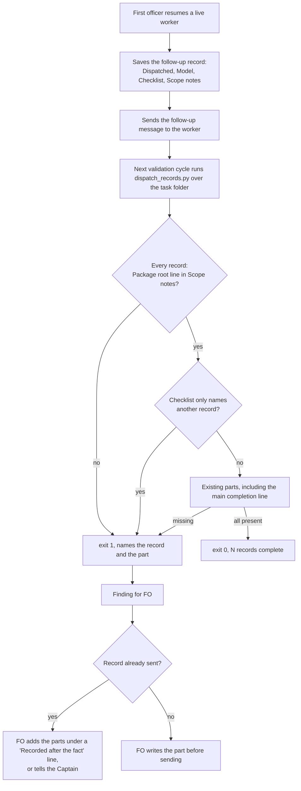

Filed from a learn package-issue candidate the Captain approved on 2026-10-13 (「按建議1,3」), after the observer report on task `learn-delivery-follow-through` (PR #639) found follow-up dispatch records `implementation-3.md`, `-5.md` and `-7.md` with no `Package root:` line and a checklist that reads "Same checklist as implementation-N." The README Stages rules already require both parts on a follow-up message's record, and learn judged it no-change for that reason: the rule exists and was not followed.

## Scope

- The gap is enforcement: `dispatch_records.py` (origin/main 544d1743) reports "12 dispatch record(s) complete", exit 0, on `_archive/learn-delivery-follow-through`, including the three records above (checked 2026-10-13 with `git show origin/main:kc-dev-flow-2/scripts/dispatch_records.py` run against that directory).
- Candidate fix: the check fails a record without a `Package root:` line and a record whose checklist only points at another record. Whether follow-up records may point instead of copying is a design question for ideation.
- Non-goals: to be set at ideation.

## Acceptance criteria

Replays read the state checkout at `e778504f` (`<state>`), archived tasks under `<state>/_archive/`, with `<package>` the 0.22.1 package (origin/main `656543f4`; `dispatch_records.py` there is byte-identical to the 0.22.1 cache copy, `git show` diff, 2026-10-14). A disposable prototype outside the repository (the 0.22.1 script plus the two rules below) gave the stated results on 2026-10-14; the shipped script must reproduce them.

- **AC-1** `python3 <package>/scripts/dispatch_records.py <task folder>` exits 1 and prints `<record>.md: needs a 'Package root:' line with an absolute path in its scope notes` for each record whose `## Scope notes` section has no line that starts with `Package root:` followed by `/` and a non-space character. Evidence: on `<state>/_archive/learn-delivery-follow-through` it prints that line for `implementation-3.md`, `implementation-5.md` and `implementation-7.md` and for no other record, exit 1 (prototype run; the 0.22.1 script prints "12 dispatch record(s) complete", exit 0). Falsifier: with the rule removed the same run exits 0 again; a copy of `implementation-2.md` with its `Package root:` line deleted exits 1 only under the rule, and a copy with the line moved above `## Checklist` or written `Package root: kc-dev-flow-2/0.21.0` also exits 1 (prototype mutations, all three).
- **AC-2** The same command exits 1 and prints `<record>.md: needs a checklist of its own, not only a reference to another dispatch record` for a record whose `## Checklist` section is non-blank and in which every non-blank line names another record of the same `dispatch/` folder (a stem such as `implementation-2`, not preceded or followed by a word character or `-`). Evidence: the AC-1 run prints it for the same three records and no other (each reads "Same checklist as implementation-N."); a copy of `implementation-2.md` whose checklist is two lines both naming `implementation-1` also exits 1. Falsifier: a rule that fails a record naming ANY sibling in its checklist also fails `_archive/worker-completion-goes-to-main/dispatch/validation-2.md`, whose first checklist line cites `implementation-2` beside two lines that do not (the first prototype did, 1 false positive of 77); a copy of `implementation-2.md` with one pointer line plus its real checklist exits 0, a known limit (Limits).
- **AC-3** Compliant records still pass. Evidence: on `learn-delivery-follow-through` the nine other records (`ideation-1`, `implementation-1`, `-2`, `-4`, `-6`, `validation-1` to `-4`) print no line; across the 77 records in the state checkout 45 print no line under the new rules. Falsifier: the AC-2 over-broad rule turns `worker-completion-goes-to-main/validation-2.md` into a failure.
- **AC-4** The parts the current script already enforces keep failing for the same reasons, and a follow-up is judged by the same parts as a first dispatch. Evidence: `python3 kc-dev-flow-2/scripts/test_dispatch_records.py` passes with its present cases unchanged (the `COMPLETE` fixture already carries a `Package root:` line), `test_replay_dispatch.py` still reads `PARTS["a scope-notes line naming main as the completion recipient"]`, and the three named records still pass the existing main-line check (each ends "completion to `main`."), so only the two new rules fail them. No record marker is read. Run against a copy of the 0.22.1 package with the prototype in place of the script, `test_dispatch_records.py` (10 tests) and `test_replay_dispatch.py` pass. Falsifier: a marker rule ("a record whose header says follow-up is judged") depends on free text that FO may omit; the 15 pointer records each carry such a word today, and a record without it would escape the pointer rule while a first dispatch under the same rule would not.
- **AC-5** The cost is stated and handled. Evidence: over the 77 records in the state checkout (64 under 7 archived tasks, 13 under 4 active tasks), failing records go from 19 to 32; 13 newly fail (all archived: `copilot-quota-refusal-is-not-a-review` 1, `journey-map-dev2-contract` 2, `learn-delivery-follow-through` 3, `observer-before-merge-guard` 4, `worker-completion-goes-to-main` 1, `workflow-checkout-must-match-trunk-readme` 2), none fails that failed before, 5 archived tasks flip from exit 0 to exit 1, 0 active tasks flip (the three active tasks with a failing record already fail on the main-line check). On the other adopter's state (`qnow-adopt-dev2`, 63 records, all 63 already failing the main-line check) the new rules add 4 lines for Package root and none for a pointer. Handling: no archived record is edited and none is re-run (nothing runs the check on `_archive/`); a live task whose sent record fails is a validation finding for FO, per the existing sentence in `skills/validation/principles.md`, and FO repairs the record with an honest `Recorded: <date>, after the fact by FO` line (the form `journey-map-dev2-contract` already uses) or tells the Captain; the script gets no cutoff date and no exemption list. Falsifier: counts that differ from these on the same state commit mean the shipped rules are not the designed ones.
- **AC-6** (only if D1 is accepted) `references/sd/workflow.md` Stages paragraph gains the clause `, including the `Package root:` line and a checklist of the items that message asks, never a pointer to another record` after "its record carries the same parts", `WORKFLOW_WORD_BUDGET` rises by the added words (about 20, counted at implementation) with a comment line giving that reason, and `python3 kc-dev-flow-2/scripts/lint-skills.py` exits 0. Evidence: that exit code at the candidate. Falsifier: the file is at its budget (5561 of 5561 words on origin/main), so the clause without the raise makes the lint refuse, as `test_lint_skills.py` already shows for an over-budget file.
- **AC-7** New tests fail without the rules. Evidence: `test_dispatch_records.py` gains one case per rule (AC-1 delete, move and relative-path mutations; AC-2 pointer, two-line pointer, and a record citing a sibling beside real lines passing) and each case is shown red by removing its rule, with the mutation run under `python3 -B`; the file is already a CI step (`.github/workflows/kc-dev-flow-2-tests.yml`, step `test_dispatch_records.py`), so no CI step is added and per-PR cost does not change. Falsifier: a case that stays green with its rule removed.

## Design

### Chain check

- Spacedock 0.27.2 (`spacedock dispatch --help`, 2026-10-14): `dispatch build` takes the checklist and scope notes as files, `--validate-only` checks a JSON dispatch, `show-stage-def` prints a stage; none reads the saved record under `<task>/dispatch/`. No Spacedock capability applies.
- `kc-dev-flow-2` at origin/main (0.22.1): `scripts/dispatch_records.py` already checks five things per record (full-SHA `Dispatched:` line, `Model:` line, non-empty `## Checklist`, non-empty `## Scope notes`, and since #633 a scope-notes line naming `main` as the completion recipient) and has `--names`; `lint-skills.py` has `PACKAGE_ROOT = ^Package root: \S` but applies it to skill files, not records. The validation worker runs the check over the whole task folder at every cycle (the learn task's validation reports record "3", "6", "9", "12 records complete"), so the new rules reach a follow-up record at the next validation after it is written. Nothing else reads a record's `Package root:` line or the shape of a checklist. Extend this script; build nothing new.
- Sibling adopters: `qnow-adopt-dev2` (`/Users/kent/conductor/repos/qnow-adopt-dev2`, state at `f9ac86d7d`) has 63 dispatch records, and its `docs/dev2` tree holds only `README.md` and `_mods` (listed 2026-10-14), so it carries no record checker of its own; I ran the 0.22.1 script and the prototype over its records (AC-5). No other adopter was searched.
- Existing-code check (bounded): the script is complete and unit-tested but its parts list lacks the two parts the observer found missing; the need is shown by 15 of 77 records (replay above).

### PRFAQ

**Press release.** A first officer that resumes a worker with a follow-up message writes a record of it. Today that record can leave out the package path and say "Same checklist as implementation-2", and the check still prints "12 dispatch records complete". From the next release the check fails such a record at the next validation and names the missing part, so a follow-up record says on its own what the worker was told to do.

**FAQ**

- *Is a follow-up record allowed to point at an earlier checklist?* No (D1). The record exists so that "the instruction a worker followed outlives the session that wrote it" (README, Stages). A pointer to `implementation-2` is wrong exactly when it matters: that checklist told the worker to stop after investigation, while the follow-up authorised the fix. The follow-up record lists the items that message asks.
- *Which parts does the check enforce?* The table below. Two are new: the `Package root:` line and a checklist that is not only a pointer.
- *How is a follow-up told apart from a first dispatch?* It is not, and no marker is added. Every record owes the same parts (README: a follow-up "is a dispatch too, and its record carries the same parts"), and a first dispatch can never lawfully point at a sibling, so one rule serves both. A marker would only add a way to opt out.
- *Does the check read the package path's value?* Only its shape: an absolute path. Whether it is the package the session loaded is not decided here; the records name old versions on purpose (`0.21.0` in archived tasks).
- *What happens to old tasks?* Nothing runs the check on archived tasks, so nothing changes for them (AC-5). A task still in flight whose sent record fails gets a validation finding.

| Part of a record | Rule | Enforced today | This task |
| --- | --- | --- | --- |
| `Dispatched:` line with a full SHA, `Model:` line | present | yes | unchanged |
| `## Scope notes` non-empty | present | yes | unchanged |
| `Package root:` line, absolute path, inside `## Scope notes` | present on every record | no | **new (AC-1)** |
| `## Checklist` non-empty, not only a pointer to a sibling record | present and own | non-empty only | **new (AC-2)** |
| Scope-notes line naming `main` as the completion recipient | present on every record | yes (#633) | unchanged; the three named records pass it, so only the two new rules fail them |

### Flow

The diagram matches the prose: one rule for every record, the check at validation (the run point that exists today), FO owning the repair, the Captain told only when FO cannot repair honestly.

### Files

Edited at implementation: `kc-dev-flow-2/scripts/dispatch_records.py` (one entry in `PARTS`, one function for the pointer rule, about 15 lines; the module docstring names the new parts), `kc-dev-flow-2/scripts/test_dispatch_records.py`, and with D1 `kc-dev-flow-2/references/sd/workflow.md` and the `WORKFLOW_WORD_BUDGET` line in `kc-dev-flow-2/scripts/lint-skills.py`. The adopter README (`docs/dev2/README.md`) changes by the usual sync PR after release.

### Non-goals

- No pre-send run point and no single-record mode (D2).
- No check that `Package root:` equals the loaded package, and no check of any other path in a record.
- No marker, cutoff date or exemption list; no edit to any archived record.
- No attempt to judge a pointer written without a record name (Limits).

### Limits

- The pointer rule is a shape filter on the one form seen 15 times of 15: every checklist line names a sibling record. A paraphrase ("Same checklist as the first one.") or a pointer line beside one real line passes (prototype, both exit 0). It still closes the observed class; it does not prove a checklist is the instruction the worker got.
- The check runs at validation, after the follow-up was sent. A bad record is flagged one validation cycle late and cannot be corrected before the worker reads it (D2).
- Prototype results come from one workflow's 77 records and a second adopter's 63 (where every record already fails the main-line check, so it shows only the 4 Package-root lines); the replays say nothing about records written under a newer FO.

## Unresolved decisions for the Captain

Checked: `docs/adr` at origin/main (only ADR 0014 mentions dispatch records, as a missed rule, and does not touch this question) and `git -C <state> grep -n 'Override:'` (the hits are prose in earlier tasks' decision lists, none a ruling against a similar recommendation). Approving accepts a recommendation only if the gate question says so.

- **D1 may a follow-up record point at an earlier record's checklist?** Recommend no: it carries the items that message asks, enforced by the pointer rule, with one clause added to the workflow README so FO learns the rule before the check fires (coupled: the README says only "the same parts", which a pointer arguably satisfies, and the file is at its word budget, so the clause also needs a budget raise of about 20 words). Worse under no: FO writes two or three more lines per follow-up, and the README grows by the clause.
- **D2 run the check only at validation, or also before FO sends the follow-up?** Recommend validation only for this task: it is the run point that exists, it costs no new mode, and it already catches the three records. Worse under that: a bad follow-up is flagged one cycle late, and the sent record needs an after-the-fact repair. A pre-send run needs a single-record mode (a folder run would fail on older records of the same task) and another README step; file it as its own task if the late catch bites again.

## FO alignment

Alignment: not needed before ideation; the Captain approved filing it.
Release review: not needed: workflow maintenance, on no journey map.
Surfaces: none
Visible change: none

## Stage Report: ideation

- DONE: A design (PRFAQ and Mermaid) for making /Users/kent/.claude/plugins/cache/kc-claude-plugins/kc-dev-flow-2/0.22.1/scripts/dispatch_records.py fail a follow-up dispatch record that lacks the parts the README Stages rules require: decide whether a follow-up record may point at an earlier record's checklist or must carry it, name each part the check enforces (Package root line, checklist, scope notes, main completion line) and how a follow-up record is told apart from a first dispatch, or why no marker is needed
  `## Design`: chain check, PRFAQ, parts table (two new, three unchanged), flowchart, limits. Must carry (D1); no marker, one uniform rule (FAQ, AC-4). `design_surfaces.py check` on 0.22.0 and 0.22.1: "presentable", exit 0.
- DONE: Acceptance criteria with reproducible evidence clauses and falsifiers, replayed against the three archived records named in the task (each must fail) and against compliant records from the same folder (each must pass), plus the count of currently archived and active records the new check would fail and how that cost is handled
  AC-1..AC-7 with falsifiers; prototype replay: the three named records fail both new rules, the nine others in the folder pass; 19 -> 32 of 77 records fail (13 new, all archived), 5 archived tasks flip, 0 active; handling in AC-5.
- DONE: Unresolved decisions for the Captain, each with a recommendation and what gets worse under it
  D1 (carry, not point, with a README clause) and D2 (validation-time check only); each has a recommendation and a worse-under line.

### Acceptance criteria, current evidence
- AC-1 Package root rule: prototype replay fails `implementation-3/-5/-7` and no other record of the folder; three mutations (delete, move, relative path) fail. Shipped script not written (ideation writes no repository file).
- AC-2 pointer rule: same three fail; two-line pointer fails; `worker-completion-goes-to-main/dispatch/validation-2.md` passes (the first, over-broad prototype failed it, which is why the rule is "every line").
- AC-3 compliant records: nine pass in the folder; 45 of 77 pass across the state checkout.
- AC-4 unchanged parts: prototype copied into a copy of the 0.22.1 package, `test_dispatch_records.py` 10 tests OK and `test_replay_dispatch.py` OK.
- AC-5 cost: counts above measured 2026-10-14 at state `e778504f`; qnow second corpus adds 4 Package-root lines, 0 pointers. Handling is a design rule, not yet exercised.
- AC-6 README clause and budget raise: not yet verified (implementation; file is at 5561 of 5561 words today).
- AC-7 new tests red without their rules: not yet verified (implementation).

### Summary
The check gets two rules and no marker: every record needs an absolute `Package root:` line inside `## Scope notes`, and a checklist in which not every line names a sibling record. A record-naming-any-sibling rule was tried first and wrongly failed one compliant record, so the rule is "every line". Prototype scripts live in /tmp/ideation-dr (disposable; no repository file written). Notes: the ideation skill loaded from the 0.22.0 cache path while the dispatch and origin/main are 0.22.1 (the 0.22.0 `dispatch_records.py` differs; I designed against 0.22.1). A paraphrased pointer and a pointer beside one real line still pass (Limits). The "main completion line" part is already enforced since #633 and is unchanged.
