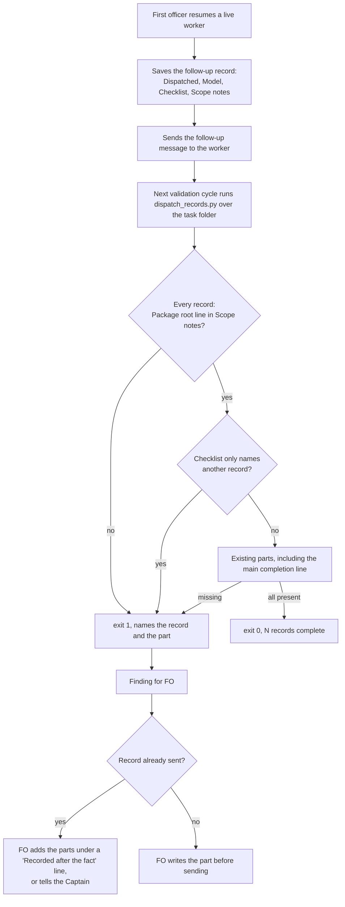

Filed from a learn package-issue candidate the Captain approved on 2026-10-13 (「按建議1,3」), after the observer report on task `learn-delivery-follow-through` (PR #639) found follow-up dispatch records `implementation-3.md`, `-5.md` and `-7.md` with no `Package root:` line and a checklist that reads "Same checklist as implementation-N." The README Stages rules already require both parts on a follow-up message's record, and learn judged it no-change for that reason: the rule exists and was not followed.

## Scope

- The gap is enforcement: `dispatch_records.py` (origin/main 544d1743) reports "12 dispatch record(s) complete", exit 0, on `_archive/learn-delivery-follow-through`, including the three records above (checked 2026-10-13 with `git show origin/main:kc-dev-flow-2/scripts/dispatch_records.py` run against that directory).
- Candidate fix: the check fails a record without a `Package root:` line and a record whose checklist only points at another record. Whether follow-up records may point instead of copying is a design question for ideation.
- Non-goals: to be set at ideation.

## Acceptance criteria

Replays read the state checkout at `e778504f` (`<state>`), archived tasks under `<state>/_archive/`, with `<package>` the 0.22.1 package (origin/main `656543f4`; `dispatch_records.py` there is byte-identical to the 0.22.1 cache copy, `git show` diff, 2026-10-14). A disposable prototype outside the repository (the 0.22.1 script plus the two rules below) gave the stated results on 2026-10-14; the shipped script must reproduce them.

- **AC-1** `python3 <package>/scripts/dispatch_records.py <task folder>` exits 1 and prints `<record>.md: needs a 'Package root:' line with an absolute path in its scope notes` for each record whose `## Scope notes` section has no line that starts with `Package root:` followed by `/` and a non-space character. Evidence: on `<state>/_archive/learn-delivery-follow-through` it prints that line for `implementation-3.md`, `implementation-5.md` and `implementation-7.md` and for no other record, exit 1 (prototype run; the 0.22.1 script prints "12 dispatch record(s) complete", exit 0). Falsifier: with the rule removed the same run exits 0 again; a copy of `implementation-2.md` with its `Package root:` line deleted exits 1 only under the rule, and a copy with the line moved above `## Checklist` or written `Package root: kc-dev-flow-2/0.21.0` also exits 1 (prototype mutations, all three).
- **AC-2** The same command exits 1 and prints `<record>.md: needs a checklist of its own, not only a reference to another dispatch record` for a record whose `## Checklist` section is non-blank and in which every non-blank line names another record of the same `dispatch/` folder (a stem such as `implementation-2`, not preceded or followed by a word character or `-`). Evidence: the AC-1 run prints it for the same three records and no other (each reads "Same checklist as implementation-N."); a copy of `implementation-2.md` whose checklist is two lines both naming `implementation-1` also exits 1. Falsifier: a rule that fails a record naming ANY sibling in its checklist also fails `_archive/worker-completion-goes-to-main/dispatch/validation-2.md`, whose first checklist line cites `implementation-2` beside two lines that do not (the first prototype did, 1 false positive of 77); a copy of `implementation-2.md` with one pointer line plus its real checklist exits 0, a known limit (Limits).
- **AC-3** Compliant records still pass. Evidence: on `learn-delivery-follow-through` the nine other records (`ideation-1`, `implementation-1`, `-2`, `-4`, `-6`, `validation-1` to `-4`) print no line; across the 77 records in the state checkout 45 print no line under the new rules. Falsifier: the AC-2 over-broad rule turns `worker-completion-goes-to-main/validation-2.md` into a failure.
- **AC-4** The parts the current script already enforces keep failing for the same reasons, and a follow-up is judged by the same parts as a first dispatch. Evidence: `python3 kc-dev-flow-2/scripts/test_dispatch_records.py` passes with its present cases unchanged (the `COMPLETE` fixture already carries a `Package root:` line), `test_replay_dispatch.py` still reads `PARTS["a scope-notes line naming main as the completion recipient"]`, and the three named records still pass the existing main-line check (each ends "completion to `main`."), so only the two new rules fail them. No record marker is read. Run against a copy of the 0.22.1 package with the prototype in place of the script, `test_dispatch_records.py` (10 tests) and `test_replay_dispatch.py` pass. Falsifier: a marker rule ("a record whose header says follow-up is judged") depends on free text that FO may omit; the 15 pointer records each carry such a word today, and a record without it would escape the pointer rule while a first dispatch under the same rule would not.
- **AC-5** The cost is stated and handled. Evidence: over the 77 records in the state checkout (64 under 7 archived tasks, 13 under 4 active tasks), failing records go from 19 to 32; 13 newly fail (all archived: `copilot-quota-refusal-is-not-a-review` 1, `journey-map-dev2-contract` 2, `learn-delivery-follow-through` 3, `observer-before-merge-guard` 4, `worker-completion-goes-to-main` 1, `workflow-checkout-must-match-trunk-readme` 2), none fails that failed before, 5 archived tasks flip from exit 0 to exit 1, 0 active tasks flip (the three active tasks with a failing record already fail on the main-line check). On the other adopter's state (`qnow-adopt-dev2`, 63 records, all 63 already failing the main-line check) the new rules add 4 lines for Package root and none for a pointer. Handling: no archived record is edited and none is re-run (nothing runs the check on `_archive/`); a live task whose sent record fails is a validation finding for FO, per the existing sentence in `skills/validation/principles.md`, and FO repairs the record with an honest `Recorded: <date>, after the fact by FO` line (the form `journey-map-dev2-contract` already uses) or tells the Captain; the script gets no cutoff date and no exemption list. Falsifier: counts that differ from these on the same state commit mean the shipped rules are not the designed ones.
- **AC-6** (only if D1 is accepted) `references/sd/workflow.md` Stages paragraph gains the clause `, including the `Package root:` line and a checklist of the items that message asks, never a pointer to another record` after "its record carries the same parts", `WORKFLOW_WORD_BUDGET` rises by the added words (about 20, counted at implementation) with a comment line giving that reason, and `python3 kc-dev-flow-2/scripts/lint-skills.py` exits 0. Evidence: that exit code at the candidate. Falsifier: the file is at its budget (5561 of 5561 words on origin/main), so the clause without the raise makes the lint refuse, as `test_lint_skills.py` already shows for an over-budget file.
- **AC-7** New tests fail without the rules. Evidence: `test_dispatch_records.py` gains one case per rule (AC-1 delete, move and relative-path mutations; AC-2 pointer, two-line pointer, and a record citing a sibling beside real lines passing) and each case is shown red by removing its rule, with the mutation run under `python3 -B`; the file is already a CI step (`.github/workflows/kc-dev-flow-2-tests.yml`, step `test_dispatch_records.py`), so no CI step is added and per-PR cost does not change. Falsifier: a case that stays green with its rule removed.

## Design

### Chain check

- Spacedock 0.27.2 (`spacedock dispatch --help`, 2026-10-14): `dispatch build` takes the checklist and scope notes as files, `--validate-only` checks a JSON dispatch, `show-stage-def` prints a stage; none reads the saved record under `<task>/dispatch/`. No Spacedock capability applies.
- `kc-dev-flow-2` at origin/main (0.22.1): `scripts/dispatch_records.py` already checks five things per record (full-SHA `Dispatched:` line, `Model:` line, non-empty `## Checklist`, non-empty `## Scope notes`, and since #633 a scope-notes line naming `main` as the completion recipient) and has `--names`; `lint-skills.py` has `PACKAGE_ROOT = ^Package root: \S` but applies it to skill files, not records. The validation worker runs the check over the whole task folder at every cycle (the learn task's validation reports record "3", "6", "9", "12 records complete"), so the new rules reach a follow-up record at the next validation after it is written. Nothing else reads a record's `Package root:` line or the shape of a checklist. Extend this script; build nothing new.
- Sibling adopters: `qnow-adopt-dev2` (`/Users/kent/conductor/repos/qnow-adopt-dev2`, state at `f9ac86d7d`) has 63 dispatch records, and its `docs/dev2` tree holds only `README.md` and `_mods` (listed 2026-10-14), so it carries no record checker of its own; I ran the 0.22.1 script and the prototype over its records (AC-5). No other adopter was searched.
- Existing-code check (bounded): the script is complete and unit-tested but its parts list lacks the two parts the observer found missing; the need is shown by 15 of 77 records (replay above).

### PRFAQ

**Press release.** A first officer that resumes a worker with a follow-up message writes a record of it. Today that record can leave out the package path and say "Same checklist as implementation-2", and the check still prints "12 dispatch records complete". From the next release the check fails such a record at the next validation and names the missing part, so a follow-up record says on its own what the worker was told to do.

**FAQ**

- *Is a follow-up record allowed to point at an earlier checklist?* No (D1). The record exists so that "the instruction a worker followed outlives the session that wrote it" (README, Stages). A pointer to `implementation-2` is wrong exactly when it matters: that checklist told the worker to stop after investigation, while the follow-up authorised the fix. The follow-up record lists the items that message asks.
- *Which parts does the check enforce?* The table below. Two are new: the `Package root:` line and a checklist that is not only a pointer.
- *How is a follow-up told apart from a first dispatch?* It is not, and no marker is added. Every record owes the same parts (README: a follow-up "is a dispatch too, and its record carries the same parts"), and a first dispatch can never lawfully point at a sibling, so one rule serves both. A marker would only add a way to opt out.
- *Does the check read the package path's value?* Only its shape: an absolute path. Whether it is the package the session loaded is not decided here; the records name old versions on purpose (`0.21.0` in archived tasks).
- *What happens to old tasks?* Nothing runs the check on archived tasks, so nothing changes for them (AC-5). A task still in flight whose sent record fails gets a validation finding.

| Part of a record | Rule | Enforced today | This task |
| --- | --- | --- | --- |
| `Dispatched:` line with a full SHA, `Model:` line | present | yes | unchanged |
| `## Scope notes` non-empty | present | yes | unchanged |
| `Package root:` line, absolute path, inside `## Scope notes` | present on every record | no | **new (AC-1)** |
| `## Checklist` non-empty, not only a pointer to a sibling record | present and own | non-empty only | **new (AC-2)** |
| Scope-notes line naming `main` as the completion recipient | present on every record | yes (#633) | unchanged; the three named records pass it, so only the two new rules fail them |

### Flow

The diagram matches the prose: one rule for every record, the check at validation (the run point that exists today), FO owning the repair, the Captain told only when FO cannot repair honestly.

### Files

Edited at implementation: `kc-dev-flow-2/scripts/dispatch_records.py` (one entry in `PARTS`, one function for the pointer rule, about 15 lines; the module docstring names the new parts), `kc-dev-flow-2/scripts/test_dispatch_records.py`, and with D1 `kc-dev-flow-2/references/sd/workflow.md` and the `WORKFLOW_WORD_BUDGET` line in `kc-dev-flow-2/scripts/lint-skills.py`. The adopter README (`docs/dev2/README.md`) changes by the usual sync PR after release.

### Non-goals

- No pre-send run point and no single-record mode (D2).
- No check that `Package root:` equals the loaded package, and no check of any other path in a record.
- No marker, cutoff date or exemption list; no edit to any archived record.
- No attempt to judge a pointer written without a record name (Limits).

### Limits

- The pointer rule is a shape filter on the one form seen 15 times of 15: every checklist line names a sibling record. A paraphrase ("Same checklist as the first one.") or a pointer line beside one real line passes (prototype, both exit 0). It still closes the observed class; it does not prove a checklist is the instruction the worker got.
- The check runs at validation, after the follow-up was sent. A bad record is flagged one validation cycle late and cannot be corrected before the worker reads it (D2).
- Prototype results come from one workflow's 77 records and a second adopter's 63 (where every record already fails the main-line check, so it shows only the 4 Package-root lines); the replays say nothing about records written under a newer FO.

## Unresolved decisions for the Captain

Checked: `docs/adr` at origin/main (only ADR 0014 mentions dispatch records, as a missed rule, and does not touch this question) and `git -C <state> grep -n 'Override:'` (the hits are prose in earlier tasks' decision lists, none a ruling against a similar recommendation). Approving accepts a recommendation only if the gate question says so.

- **D1 may a follow-up record point at an earlier record's checklist?** Recommend no: it carries the items that message asks, enforced by the pointer rule, with one clause added to the workflow README so FO learns the rule before the check fires (coupled: the README says only "the same parts", which a pointer arguably satisfies, and the file is at its word budget, so the clause also needs a budget raise of about 20 words). Worse under no: FO writes two or three more lines per follow-up, and the README grows by the clause.
- **D2 run the check only at validation, or also before FO sends the follow-up?** Recommend validation only for this task: it is the run point that exists, it costs no new mode, and it already catches the three records. Worse under that: a bad follow-up is flagged one cycle late, and the sent record needs an after-the-fact repair. A pre-send run needs a single-record mode (a folder run would fail on older records of the same task) and another README step; file it as its own task if the late catch bites again.

## FO alignment

Alignment: not needed before ideation; the Captain approved filing it.
Release review: not needed: workflow maintenance, on no journey map.
Surfaces: none
Visible change: none

### Feedback Cycles

- Cycle 1 (FO, 2026-10-14): validation recommended PASSED on #642 12670427 with no Material finding. Codex review round 1 (review:5511481463) left one P2, to fix (rounds 1 and 2 fix every finding); investigation first, then FO fix authorization, then a fresh validation recheck. The validator's Polish on the added `lint-skills.py` comment is fixed in the same repair (a comment that narrates the change is deleted); its Polish on `references/sd/adoption.md` is recorded as `unaffected: names only the test_sd_dispatch.py command`.
  - P2 #642 `scripts/dispatch_records.py` (around line 38): the pointer rule fails a follow-up whose only checklist line is a complete action that names a sibling record for context ("Verify the fix requested in validation-1 satisfies AC-1"), because it tests only for the sibling stem.
- Cycle 2 (FO, 2026-10-14): Codex review round 2 (review:5511597658) on #642 5567b82c left one P2, to fix (rounds 1 and 2 fix every finding); investigation reproduced it (a `.md`, backtick, Markdown-link or path-prefixed sibling name leaves a word outside POINTER_WORDS, so the pointer passes), FO authorized the widened stem match, then a fresh validation recheck. The validation recheck of 5567b82c, dispatched before this finding, is superseded by the new head.
  - P2 #642 `scripts/dispatch_records.py` (around line 42): "Same checklist as validation-1.md." passes the pointer rule.
- Cycle 3 (FO, 2026-10-14): Codex review round 3 (review:5511647035) on #642 4b59d1ea left one P2 and no P1, declined under the round-3 rule and filed as a backlog task.
  - P2 (declined) `scripts/dispatch_records.py` (around line 42): a checklist line whose only words besides the sibling name are non-ASCII ("驗證 validation-1 的修復。") is failed as pointer-only, because the word match is ASCII-only. Decline reason: it fails closed (the record is refused with a message, never silently passed), and dispatch records are repository-facing text written in English under the language rule; no real record has hit it.

## Stage Report: ideation

- DONE: A design (PRFAQ and Mermaid) for making /Users/kent/.claude/plugins/cache/kc-claude-plugins/kc-dev-flow-2/0.22.1/scripts/dispatch_records.py fail a follow-up dispatch record that lacks the parts the README Stages rules require: decide whether a follow-up record may point at an earlier record's checklist or must carry it, name each part the check enforces (Package root line, checklist, scope notes, main completion line) and how a follow-up record is told apart from a first dispatch, or why no marker is needed
  `## Design`: chain check, PRFAQ, parts table (two new, three unchanged), flowchart, limits. Must carry (D1); no marker, one uniform rule (FAQ, AC-4). `design_surfaces.py check` on 0.22.0 and 0.22.1: "presentable", exit 0.
- DONE: Acceptance criteria with reproducible evidence clauses and falsifiers, replayed against the three archived records named in the task (each must fail) and against compliant records from the same folder (each must pass), plus the count of currently archived and active records the new check would fail and how that cost is handled
  AC-1..AC-7 with falsifiers; prototype replay: the three named records fail both new rules, the nine others in the folder pass; 19 -> 32 of 77 records fail (13 new, all archived), 5 archived tasks flip, 0 active; handling in AC-5.
- DONE: Unresolved decisions for the Captain, each with a recommendation and what gets worse under it
  D1 (carry, not point, with a README clause) and D2 (validation-time check only); each has a recommendation and a worse-under line.

### Acceptance criteria, current evidence
- AC-1 Package root rule: prototype replay fails `implementation-3/-5/-7` and no other record of the folder; three mutations (delete, move, relative path) fail. Shipped script not written (ideation writes no repository file).
- AC-2 pointer rule: same three fail; two-line pointer fails; `worker-completion-goes-to-main/dispatch/validation-2.md` passes (the first, over-broad prototype failed it, which is why the rule is "every line").
- AC-3 compliant records: nine pass in the folder; 45 of 77 pass across the state checkout.
- AC-4 unchanged parts: prototype copied into a copy of the 0.22.1 package, `test_dispatch_records.py` 10 tests OK and `test_replay_dispatch.py` OK.
- AC-5 cost: counts above measured 2026-10-14 at state `e778504f`; qnow second corpus adds 4 Package-root lines, 0 pointers. Handling is a design rule, not yet exercised.
- AC-6 README clause and budget raise: not yet verified (implementation; file is at 5561 of 5561 words today).
- AC-7 new tests red without their rules: not yet verified (implementation).

### Summary
The check gets two rules and no marker: every record needs an absolute `Package root:` line inside `## Scope notes`, and a checklist in which not every line names a sibling record. A record-naming-any-sibling rule was tried first and wrongly failed one compliant record, so the rule is "every line". Prototype scripts live in /tmp/ideation-dr (disposable; no repository file written). Notes: the ideation skill loaded from the 0.22.0 cache path while the dispatch and origin/main are 0.22.1 (the 0.22.0 `dispatch_records.py` differs; I designed against 0.22.1). A paraphrased pointer and a pointer beside one real line still pass (Limits). The "main completion line" part is already enforced since #633 and is unchanged.

## Stage Report: implementation

- DONE: One Draft PR (fix(kc-dev-flow-2): ...) from a branch off origin/main with the two new rules in kc-dev-flow-2/scripts/dispatch_records.py (an absolute Package root: line inside ## Scope notes; a checklist in which not every line names a sibling record), their tests in test_dispatch_records.py, the one references/sd/workflow.md clause from D1 and the lint-skills.py WORKFLOW_WORD_BUDGET raise by the words it adds (reason stated)
  PR https://github.com/iamcxa/kc-claude-plugins/pull/642 (Draft), branch spacedock-ensign/followup-dispatch-records-checked, commit 56c9f6ad off origin/main 656543f4; clause adds 20 words, budget 5561 to 5581 with a reason comment line.
- DONE: AC-1 to AC-7 green with each falsifier shown failing by a mutation run
  test_dispatch_records.py 13 tests OK; under `python3 -B`: Package root rule removed fails 3 subtests (delete, above checklist, relative); pointer rule removed fails 2 (one line, two lines); `all` to `any` fails the beside-real-lines case; boundary `(?<![\w-])` loosened to `(?<![\w])` fails the `my-validation-1` case; absolute `/` requirement dropped fails the relative case; own name not excluded fails the own-name case. lint-skills.py exits 0 at 5581 of 5581 and the clause under the old 5561 prints FAIL "5581 words exceeds the budget of 5561". test_replay_dispatch.py and test_lint_skills.py OK.
- DONE: the replays against the archived records reproducing the design's results (the three named records fail, the nine others in that folder pass, the counts in AC-5 re-measured at the state HEAD you read)
  State HEAD e081c5f2: learn-delivery-follow-through prints Package root and pointer lines for implementation-3/-5/-7 only, exit 1. Counts: 80 records (design 77; +3 added since, `followup-dispatch-records-checked/implementation-1` passes, `journey-server-host-pilot/implementation-6` and `validation-3` already fail), failing 21 to 34, 13 newly fail (all archived, same per-task counts as AC-5), 5 archived tasks flip, 0 active flip. qnow-adopt-dev2 state 350d8ca0a: 66 records, 4 new Package-root lines, 0 pointer lines.
- FAILED: roborev_gate.py evidence= line, CI green on the PR head, lint-skills.py green, and the CI cost per PR measured or stated as not measured
  roborev `clean on 56c9f6ad6; evidence=roborev:641`; lint-skills.py green; CI cost: no step added, runtime not measured. CI NOT green: `unit tests (python3)` step `test_sd_dispatch.py` fails on PR head 56c9f6ad (run 38486533066); `test_observer_recovery.py` skipped after it. Other checks pass.

### Return to FO: a file outside the design's list
`kc-dev-flow-2/scripts/test_sd_dispatch.py` FIXES["resumed-dispatch"] pins the workflow.md sentence by regex `...carries the same parts\. ` and asserts it matches once; the D1 clause changes that sentence, so `at_0_10_1` raises `AssertionError: ('resumed-dispatch', ..., 0)`. Proposed one-line repair: end the swap regex with `parts(?:, including [^.]*)?\. ` (keeps the pin on the sentence, tolerates the clause). That file is not in the design's Files list, so I stopped and did not edit it. Alternative that stays inside the list: reword the clause as its own sentence after "same parts. " (departs from AC-6's wording). Rulings needed from FO: which one.

### Affected documents
- kc-dev-flow-2/README.md: unaffected: mentions only running lint-skills.py, not the budget value.
- kc-dev-flow-2/skills/maintain-flow/SKILL.md: unaffected: describes the word-budget rule, not its number.

### Other evidence
- comment_ratio.py: code lines 42, comment lines 1, 2.4%, maximum 5% met, exit 0.
- design_surfaces.py check on this task: presentable, exit 0. number_guards: not applicable (Surfaces: none, no Number guards section).

### Summary
Both rules, tests, the D1 clause and the budget raise are implemented and reproduce the design's replays; PR #642 is Draft. CI is red on one pinned-sentence test in a file outside the design's list, returned to FO with a one-line proposed repair.

## Stage Report: implementation (cycle 2)

- DONE: FO ruling on #642: end the FIXES["resumed-dispatch"] swap regex in test_sd_dispatch.py with `parts(?:, including [^.]*)?\. `, keep AC-6's wording
  Commit 12670427 (`fix(kc-dev-flow-2): test_sd_dispatch pin tolerates the follow-up record clause`), one line in kc-dev-flow-2/scripts/test_sd_dispatch.py; pushed without force.
- DONE: Show the pin still fails when the sentence is removed
  With the whole "A follow-up message ... same parts, including ..." sentence deleted from references/sd/workflow.md, test_sd_dispatch.py raises AssertionError listing the wording-fix gaps; workflow.md restored by git checkout.
- DONE: run test_sd_dispatch.py and the full local suite
  test_sd_dispatch.py (`--sd-plugin-root` spacedock 0.27.0 cache, binary 0.27.2) all PASS; test_dispatch_records.py (13), test_replay_dispatch.py, test_lint_skills.py OK; lint-skills.py exit 0 at 5581 of 5581.
- DONE: roborev_gate.py again
  `clean on 12670427e; evidence=roborev:642` (base 656543f4).
- DONE: CI green on the PR head including test_observer_recovery.py
  PR head 12670427, run 38487042985: unit tests (python3) pass with test_sd_dispatch.py, test_observer_check.py, test_observer_recovery.py success; version parity, multi-profile route gate, GitGuardian pass. PR #642 stays Draft.

### Summary
The pinned-sentence failure is repaired in the one file FO added to the change; all checks on #642 are green at 12670427. The first cycle's FAILED item (CI green) is now met.

## Stage Report: validation

- DONE: Independent verdict on #642 head 12670427 against AC-1 to AC-7, re-running each evidence command and at least one falsifier per criterion yourself (replays against the archived and active records with the counts re-measured, the default folder mode otherwise unchanged, the lint budget and the README clause), and judging the implementation's one change to the design's file list (the FIXES["resumed-dispatch"] regex in kc-dev-flow-2/scripts/test_sd_dispatch.py of the candidate, authorized by FO after CI failed)
  Verdict PASSED at 12670427 (detached worktree, removed after). AC-1/2: on archived `learn-delivery-follow-through` the candidate prints the Package-root and pointer lines for implementation-3/-5/-7 only, exit 1; 0.22.1 script (byte-identical to origin/main 656543f4) prints "12 dispatch record(s) complete", exit 0. Mutations on copies of implementation-2: Package-root line deleted, moved above `## Checklist`, relative path -> exit 1; two-line pointer -> exit 1; one pointer beside a real checklist -> exit 0 (the stated limit); `worker-completion-goes-to-main` validation-2 -> no line. AC-3/5 at state e778504f (77 records, archive extracted): failing records 19 -> 32, 13 newly failing (copilot-quota 1, journey-map-dev2-contract 2, learn-delivery 3, observer-before-merge-guard 4, worker-completion 1, workflow-checkout 2), 0 records fail at base but pass at candidate, 5 archived tasks flip 0 -> 1, 0 active flip (follow-up task 0 -> 0; the other active tasks already fail); 45 pass. qnow-adopt-dev2 current state: 68 records, 4 new Package-root lines, 0 pointer lines (design: 66 records at an older commit). AC-4: test_dispatch_records 13 OK, test_replay_dispatch OK (still reads PARTS["a scope-notes line naming main as the completion recipient"]), test_lint_skills OK; no record marker is read (diff). AC-6: lint-skills.py exit 0 at 5581 of 5581; same file with the budget back at 5561 prints FAIL "5581 words exceeds the budget of 5561"; clause text equals AC-6 and adds 20 words. AC-7 on a scratch copy under `python3 -B`: Package-root rule removed -> the 3 subtests fail; pointer rule disabled -> the 2 subtests fail; `all` -> `any` -> beside-real-lines case fails; own name not excluded -> `validation-2` own-name case fails. test_sd_dispatch change (one line, FIXES["resumed-dispatch"] swap regex `parts(?:, including [^.]*)?\. `): test_sd_dispatch.py with `--sd-plugin-root` spacedock 0.27.0 (binary 0.27.2) all PASS; on a scratch copy with the whole follow-up sentence deleted it fails with the wording-gap assertion, so the pin still holds the sentence. It does not pin the clause: dropping only the clause leaves it green (Deferred risk below). The change is necessary (CI was red on the clause without it), one line, and stays inside the pin's purpose; the alternative of a separate sentence would depart from AC-6.
- DONE: A minimal acceptance script the Captain can run (three to six steps, exact commands, expected output), run by you exactly as written in a fresh shell from a named checkout, with its observed output
  Script below, run as `env -i HOME=$HOME PATH=$PATH /bin/bash /tmp/accept-642.sh`, output as shown; step 4's pipe was then made shell-portable and re-run under `zsh -f` (exit 0, same line).
- DONE: /Users/kent/.claude/plugins/cache/kc-claude-plugins/kc-dev-flow-2/0.22.1/scripts/adr_lint.py docs/adr --since <base> run with its exit code; verdict PASSED or REJECTED naming the head, with findings classified by the workflow's Review-finding disposition
  `adr_lint.py docs/adr --since 656543f4` at 12670427: "14 ADR file(s) checked, 0 legacy", exit 0 (the candidate adds no ADR). comment_ratio.py 656543f4 12670427: code lines 43, comment lines 1, 2.3%, maximum 5% met, exit 0. doc_impact.py lists 3 documents. dispatch_records.py over this task's own folder: complete, exit 0 (1 record). Number guards: not applicable (Surfaces: none). CI on 12670427 (`gh pr checks 642`): unit tests (python3), multi-profile route gate, version parity, GitGuardian all pass. PASSED at 12670427 with the findings below, none Material.

### Findings (Review-finding disposition)

- Polish: the implementation report's Affected documents lists 2 of the 3 documents `doc_impact.py` reports; `kc-dev-flow-2/references/sd/adoption.md` has no `updated` / `unaffected` line. I read it: line 147 only names the `test_sd_dispatch.py --sd-plugin-root` command, so it is unaffected. Nothing is lost; FO may record `unaffected: names only the test command` if it wants the record whole.
- Polish: the one added comment in `lint-skills.py` ("5581: +20 for the follow-up record clause ... which FO reads only here") partly narrates the change; AC-6 asked for a reason line and the measured ratio is 2.3%, exit 0. No user-visible loss.
- Deferred risk: the workflow.md clause is not pinned. `test_sd_dispatch.py` pins the sentence "...carries the same parts" and tolerates the clause as optional, and the word budget is a ceiling, so a later edit that drops the clause alone passes every check. It becomes Material if FO then writes pointer records; the script rule still fails them at the next validation.
- Deferred risk (design Limits, restated): a paraphrased pointer or a pointer beside one real line passes; the check runs at validation, one cycle after a follow-up is sent (D2).

### Minimal acceptance script (`/tmp/accept-642.sh`, bash or zsh)

Needs: the repository checkout at `/Users/kent/conductor/workspaces/kc-claude-plugins/colombo` (to fetch commit 12670427), the installed package at `/Users/kent/.claude/plugins/cache/kc-claude-plugins/kc-dev-flow-2/0.22.1`, and the archived task folder in the dev2 state checkout. Python 3 only.

    git -C /Users/kent/conductor/workspaces/kc-claude-plugins/colombo worktree add --detach /tmp/accept-642 12670427
    cd /tmp/accept-642 && python3 -B kc-dev-flow-2/scripts/dispatch_records.py /Users/kent/conductor/workspaces/kc-claude-plugins/colombo/.context/dev2-adoption/worktree/docs/dev2/.spacedock-state/_archive/learn-delivery-follow-through; echo "exit=$?"
    python3 -B /Users/kent/.claude/plugins/cache/kc-claude-plugins/kc-dev-flow-2/0.22.1/scripts/dispatch_records.py /Users/kent/conductor/workspaces/kc-claude-plugins/colombo/.context/dev2-adoption/worktree/docs/dev2/.spacedock-state/_archive/learn-delivery-follow-through; echo "exit=$?"
    cd /tmp/accept-642 && python3 -B kc-dev-flow-2/scripts/test_dispatch_records.py 2>&1 | tail -3
    cd /tmp/accept-642 && python3 -B kc-dev-flow-2/scripts/lint-skills.py > /tmp/lint642.out; echo "exit=$?"; grep 'of 5581' /tmp/lint642.out
    git -C /Users/kent/conductor/workspaces/kc-claude-plugins/colombo worktree remove --force /tmp/accept-642 && echo removed

Expected and observed, in order: (1) `HEAD is now at 12670427 fix(kc-dev-flow-2): test_sd_dispatch pin tolerates the follow-up record clause`; (2) three lines `implementation-3.md`, `-5.md`, `-7.md: needs a 'Package root:' line with an absolute path in its scope notes`, three lines `...: needs a checklist of its own, not only a reference to another dispatch record`, then `exit=1`; (3) the installed 0.22.1 script prints `12 dispatch record(s) complete` then `exit=0`; (4) `Ran 13 tests` then `OK`; (5) `exit=0` and `references/sd/workflow.md: 5581 of 5581 words; no unlisted passage repeats it`; (6) `removed`. Step 5 writes `/tmp/lint642.out` (harmless). If `/tmp/accept-642` already exists from an interrupted run, remove it first with the last command.

Does not cover: the other 74 records' replays and the 19 -> 32 counts (re-measured above, not in the script), a live FO writing a follow-up record, the pre-send run point (D2, out of scope), and the adopter README sync after release.

### Summary

PASSED at 12670427. The two rules reproduce the design's replays exactly (three named records fail, nine others pass, 19 -> 32 failing records, 0 active tasks flip), each rule is shown red by a mutation, the lint budget and README clause match AC-6, and the one-line test_sd_dispatch repair is necessary and keeps the sentence pinned. No Material finding; two Polish and two Deferred-risk items are recorded above. Not verified: a real FO run under the new rules, other adopters beyond qnow, and CI beyond reading `gh pr checks`.

## Stage Report: implementation (cycle 3)

- DONE: Investigation first, with no candidate change: reproduce the Codex round-1 P2 on #642 head 12670427, measure how the archived and active records split between pure pointers and actions that name a sibling, send FO the result and your proposed rule, then wait for FO's fix authorization message
  Reproduced on throwaway copies: a one-line "Verify the fix requested in validation-1 satisfies AC-1." and a two-line action checklist both failed. Of 85 records, 15 are flagged, all one line "Same checklist as <sibling>." (15 of 15 pure pointers, 0 actions); 2 name a sibling beside other lines and pass. Sent to main before any edit.
- DONE: After FO's fix authorization only: the fix with tests that fail without it (shown failing by a mutation run), the AC-1/AC-2 replays still failing implementation-3, -5 and -7 and passing the other nine
  Commit 04b62f7e: `is_pointer(line, others)` plus POINTER_WORDS; the known limit ("Reuse the checklist of implementation-2." passes) is in the module docstring. test_dispatch_records.py 15 tests OK (was 13). Under `python3 -B`: stem-only rule fails 3 subtests (the "Reuse ..." line, one action, two actions); empty POINTER_WORDS fails 5 (both pointer shapes, "Identical to ...", "- see ...", "The same items as in ..."); adding "verify" to the set fails the "Verify validation-1." subtest (first run stayed green, so I added that case); dropping the stem-hit requirement fails "Same items as in the checklist.". Replay on learn-delivery-follow-through: Package root and pointer lines for implementation-3, -5, -7 only, exit 1; whole state: the same 15 flagged. lint-skills.py exit 0 (5581 of 5581), test_replay_dispatch.py and test_lint_skills.py OK.
- DONE: the added comment in kc-dev-flow-2/scripts/lint-skills.py reduced to the fact the code cannot state
  Kept as it is, by FO ruling in the fix authorization (same one-line reason as every earlier raise in that block); no edit to lint-skills.py.
- DONE: push to #642's branch; CI green on the new head
  Pushed 04b62f7e without force. `gh pr checks 642`: unit tests (python3), version parity, multi-profile route gate and GitGuardian all pass (runs 384885234xx-384885235xx). PR stays Draft.
- DONE: roborev gate
  `clean on 04b62f7ee; evidence=roborev:643` (base 12670427).

### Left for FO
- One existing test line changed: "See validation-1 for the items." became "See the items in validation-1." because "for" is not in the authorized word set; adding "for" to POINTER_WORDS is the alternative if FO prefers.
- The validator's Polish on the lint-skills.py comment is declined by FO ruling; fresh validation recheck of 04b62f7e is next.

### Summary
The pointer rule now needs a record name plus only pointer words, so an action that names a sibling is a checklist of its own; the 15 archived pointer records still fail and the AC-1/AC-2 replays are unchanged. CI is green on 04b62f7e.

## Stage Report: implementation (cycle 4)

- DONE: FO ruling on #642 04b62f7e: restore the existing test line to "See validation-1 for the items." and add "for" to POINTER_WORDS
  Commit 5567b82c (2 lines: "for" added to POINTER_WORDS, the test line restored); pushed without force.
- DONE: Show the restored test red when "for" is removed from the set (one mutation)
  Under `python3 -B`, with "for" out of the set the restored line fails test_a_checklist_that_only_names_other_records_fails_but_one_citing_a_sibling_beside_real_lines_passes [two lines] (the record passes instead of failing as pointer-only); with "for" in, 15 tests OK.
- DONE: rerun the suite and the replays
  test_dispatch_records.py 15 OK, test_replay_dispatch.py and test_lint_skills.py OK, lint-skills.py exit 0. Replay on learn-delivery-follow-through: implementation-3, -5, -7 fail on both rules, the nine others print nothing; the state checkout flags the same 15 pointer records (87 records now).
- DONE: roborev gate, then CI green
  `clean on 5567b82c3; evidence=roborev:644` (base 12670427). CI on 5567b82c: unit tests (python3), version parity, multi-profile route gate and GitGuardian pass (run 38488888627 and siblings). PR stays Draft.

### Summary
"for" is a pointer word again and the original test wording is restored; the flagged set and the AC-1/AC-2 replays are unchanged.

## Stage Report: implementation (cycle 5)

- DONE: Phase 1 for Codex round-2 P2 (review:5511597658): reproduce the `.md` and link forms on 5567b82c, check real records, send FO the fix
  Six forms ("... as validation-1.md.", backticked, `[validation-1](validation-1.md)`, `./`, `./dispatch/`, `../dispatch/` link) passed as actions; 0 of 89 real records use them. Sent to main before any edit.
- DONE: After FO's authorization: widen the stem pattern in `is_pointer` (optional directory prefix, optional `.md` suffix, boundaries kept), two tests, three mutations each shown red
  Commit 4b59d1ea. test_dispatch_records.py 17 tests OK (was 15). Under `python3 -B`: dropping the `.md` suffix fails 6 subtests (all six forms); dropping the directory prefix fails 2 (`./dispatch/...`, `../dispatch/...` link); widening the suffix to `\.md\w*` fails the `validation-1.mdx` subtest of the not-a-pointer test.
- DONE: rerun the replays
  learn-delivery-follow-through: implementation-3, -5, -7 fail on both rules, the nine others print nothing; the state checkout (90 records) flags the same 15 pointer records as before. test_replay_dispatch.py, test_lint_skills.py OK, lint-skills.py exit 0.
- DONE: roborev gate, push, CI green
  `clean on 4b59d1ea1; evidence=roborev:645` (base 12670427). Pushed without force; unit tests (python3), version parity, multi-profile route gate and GitGuardian pass on 4b59d1ea. PR stays Draft.

### Summary
A record named with a path, `.md` suffix or link now counts as a pointer name, so the six forms fail as pointer-only while a link beside a verb, `my-validation-1.md` and `validation-1.mdx` still pass. The flagged set and the AC-1/AC-2 replays are unchanged.

## Stage Report: validation (cycle 2)

- DONE: Independent recheck of the cycle-1 and cycle-2 repairs on #642 head 4b59d1ea: both Codex P2 findings (a complete action that names a sibling record is failed as pointer-only; a .md, backtick, Markdown-link or path-prefixed pointer passes) reproduced fixed against 12670427 and 5567b82c, the new tests shown failing under mutations you run yourself, the plain pointer wording still failing, the stated limit ("Reuse the checklist of implementation-2." passes) confirmed, and AC-1 to AC-7 re-run at the new head with any change from validation cycle 1 named
  Probe on a folder holding real records plus one follow-up whose checklist is the line under test (three detached worktrees, removed after): "Verify the fix requested in validation-1 satisfies AC-1." fails at 12670427 (P2 round 1) and passes at 5567b82c and 4b59d1ea; "Same checklist as validation-1.md.", `[validation-1](validation-1.md)`, `./dispatch/validation-1.md` and `../dispatch/validation-1.md` pass at 5567b82c (P2 round 2) and fail at 4b59d1ea; "Same checklist as implementation-1." and "See validation-1 for the items." fail at all three; "Reuse the checklist of implementation-1." passes at 5567b82c and 4b59d1ea (the stated limit); `my-validation-1.md` and `validation-1.mdx` pass. Mutations (full-package copy, `python3 -B`, one at a time): drop `.md` suffix -> 6 subtests red; drop directory prefix -> 2 red; widen suffix to `\.md\w*` -> `validation-1.mdx` red; pointer-word test removed -> 7 red; drop "for" -> "two lines" red; add "verify" -> "one verb" red; drop the record-name-hit requirement -> "Same items as in the checklist." red; Package root rule off -> 3 red; absolute `/` dropped -> `relative` red. Two mutations stay green: `all(...)` -> `any(...)` in `only_points_at_records` (17 tests OK) and the own record not excluded from `others` (17 OK); see the first Deferred risk. AC-1/2/3 on archived learn-delivery-follow-through: 3 Package root lines and 3 pointer lines (implementation-3/-5/-7), exit 1, nothing for the nine others; the 0.22.1 script prints "12 dispatch record(s) complete", exit 0; `worker-completion-goes-to-main` validation-2 prints nothing. AC-4: test_dispatch_records 17 OK, test_replay_dispatch OK, test_lint_skills OK, test_sd_dispatch.py with `--sd-plugin-root` spacedock 0.27.0 all PASS. AC-5 at state e778504f (extracted): 77 records, failing 19 -> 32, 13 newly failing with the same per-task counts, 0 records fail at base but pass at candidate, tasks with exit 1 4 -> 9; the pointer-flagged set (15 records over the state HEAD and e778504f) is identical at 12670427, 5567b82c and 4b59d1ea; qnow-adopt-dev2 state 2ab61ab09: 70 records, all 70 already fail the base, 4 Package root lines and 0 pointer lines. AC-6: lint-skills.py exit 0 at 5581 of 5581, clause text unchanged from validation cycle 1. AC-7: see the mutations above. Changes from validation cycle 1: pointer rule is now a record name plus only POINTER_WORDS (was: any line naming a sibling), so the `all`/own-name cases no longer discriminate; the record-name pattern accepts a directory prefix and `.md`; test count 13 -> 17; every other result is unchanged.
- DONE: The minimal acceptance script updated to the new head, run by you exactly as written in a fresh bash shell and in a fresh zsh shell, with its observed output
  Script below (also `/tmp/accept-642-4b59d1ea.sh`), run as `env -i HOME=$HOME PATH=$PATH /bin/bash` and `/bin/zsh -f` on that file; both printed identical output matching Expected (zsh exit status of the whole script 0 apart from my own trailing `grep -c`), the worktree removed at step 6.
- DONE: /Users/kent/.claude/plugins/cache/kc-claude-plugins/kc-dev-flow-2/0.22.1/scripts/adr_lint.py docs/adr --since <base> run at the new head with its exit code; verdict PASSED or REJECTED naming the head, with findings classified by the workflow's Review-finding disposition
  `adr_lint.py docs/adr --since 656543f4` at 4b59d1ea: "14 ADR file(s) checked, 0 legacy", exit 0. comment_ratio.py 656543f4 4b59d1ea --workflow-dir: code lines 82, comment lines 1, 1.2%, maximum 5% met, exit 0. doc_impact.py lists 3 documents (README, adoption.md, maintain-flow SKILL), each carries an `unaffected` line in the implementation report or the Feedback Cycles. `dispatch_records.py` over this task's own folder: 11 records complete, exit 0. Number guards: not applicable (Surfaces: none). CI on 4b59d1ea (`gh pr checks 642`): unit tests (python3), multi-profile route gate, version parity, GitGuardian pass; PR is Draft and open, headRefOid 4b59d1ea. Verdict PASSED at 4b59d1ea; no Material finding.

### Findings (Review-finding disposition)

- Deferred risk: AC-7's case "a record citing a sibling beside real lines passing" no longer exercises the "every line" rule. Since the pointer rule became "record name plus only POINTER_WORDS", its fixture line "Repeat the check from validation-1" is already not a pointer, so changing `all` to `any` in `only_points_at_records` leaves 17 of 17 tests green (it was red at 12670427). Likewise `test_a_record_name_inside_a_longer_name_or_the_records_own_name_is_not_a_pointer` no longer fails when the record's own name is not excluded from `others`. Neither changes behaviour at 4b59d1ea (the 32 failing records are identical under `any`; I checked). Trigger evidence: my mutation runs; it becomes Material if a later edit changes the quantifier or the exclusion and ships. Inputs that go red under the mutation and pass at the head, run by me: "Same checklist as validation-1." followed by "2. Independent verdict on the exact candidate" in validation-2 (want exit 0; `any` gives 1), and "Same checklist as validation-2." inside validation-2 (want exit 0; own name included gives 1). FO may treat this as AC-7's falsifier ("a case that stays green with its rule removed") and send it back as a two-case test repair; I did not, because no behaviour at the head is wrong and the disposition's four fields do not establish supported-workflow harm.
- Deferred risk (carried from validation cycle 1, unchanged): the workflow.md clause is not pinned by `test_sd_dispatch.py`; a paraphrased pointer ("Reuse the checklist of implementation-2.") or a pointer beside one real line passes (design Limits, confirmed above); the check runs at validation, one cycle after a follow-up is sent (D2). The pointer-word set is a shape filter: an action written only with those words and a record name (for example "See validation-1 for the items.") is still read as a pointer.
- Polish: none new. Validation cycle 1's two Polish items were handled by FO (adoption.md recorded `unaffected`; the lint-skills.py comment kept by FO ruling).

### Minimal acceptance script (`/tmp/accept-642-4b59d1ea.sh`, bash or zsh)

Needs: the repository checkout at `/Users/kent/conductor/workspaces/kc-claude-plugins/colombo` (to fetch commit 4b59d1ea), the installed package at `/Users/kent/.claude/plugins/cache/kc-claude-plugins/kc-dev-flow-2/0.22.1`, and the archived task folder in the dev2 state checkout. Python 3, awk and git only. If `/tmp/accept-642` exists from an interrupted run, remove it first with the last command.

    git -C /Users/kent/conductor/workspaces/kc-claude-plugins/colombo worktree add --detach /tmp/accept-642 4b59d1ea
    cd /tmp/accept-642 && python3 -B kc-dev-flow-2/scripts/dispatch_records.py /Users/kent/conductor/workspaces/kc-claude-plugins/colombo/.context/dev2-adoption/worktree/docs/dev2/.spacedock-state/_archive/learn-delivery-follow-through; echo "exit=$?"
    python3 -B /Users/kent/.claude/plugins/cache/kc-claude-plugins/kc-dev-flow-2/0.22.1/scripts/dispatch_records.py /Users/kent/conductor/workspaces/kc-claude-plugins/colombo/.context/dev2-adoption/worktree/docs/dev2/.spacedock-state/_archive/learn-delivery-follow-through; echo "exit=$?"
    for L in "Verify the fix requested in implementation-2 satisfies AC-1." "Same checklist as implementation-2." "Same checklist as implementation-2.md." "Same checklist as [implementation-2](./implementation-2.md)." "Reuse the checklist of implementation-2."; do d=$(mktemp -d); mkdir "$d/dispatch"; A=/Users/kent/conductor/workspaces/kc-claude-plugins/colombo/.context/dev2-adoption/worktree/docs/dev2/.spacedock-state/_archive/learn-delivery-follow-through/dispatch; cp "$A/implementation-2.md" "$d/dispatch/"; awk -v L="$L" '/^## Checklist/{print; print ""; print L; print ""; skip=1; next} /^## Scope notes/{skip=0} !skip' "$A/implementation-2.md" > "$d/dispatch/implementation-3.md"; echo "--- checklist: $L"; python3 -B /tmp/accept-642/kc-dev-flow-2/scripts/dispatch_records.py "$d"; echo "exit=$?"; rm -rf "$d"; done
    cd /tmp/accept-642 && python3 -B kc-dev-flow-2/scripts/test_dispatch_records.py 2>&1 | tail -3; python3 -B kc-dev-flow-2/scripts/lint-skills.py > /tmp/lint642.out; echo "lint exit=$?"; grep 'of 5581' /tmp/lint642.out
    git -C /Users/kent/conductor/workspaces/kc-claude-plugins/colombo worktree remove --force /tmp/accept-642 && echo removed

Expected and observed, in order, identical in bash and zsh: (1) `HEAD is now at 4b59d1ea fix(kc-dev-flow-2): dispatch_records.py reads a path, .md suffix or link as a record name in a pointer line`; (2) three lines `implementation-3.md`, `-5.md`, `-7.md: needs a 'Package root:' line with an absolute path in its scope notes`, three lines `...: needs a checklist of its own, not only a reference to another dispatch record`, then `exit=1`; (3) the installed 0.22.1 script prints `12 dispatch record(s) complete` then `exit=0`; (4) five blocks: "Verify the fix requested in implementation-2 satisfies AC-1." -> `2 dispatch record(s) complete`, `exit=0`; "Same checklist as implementation-2.", "...implementation-2.md." and the Markdown-link form -> `implementation-3.md: needs a checklist of its own, not only a reference to another dispatch record`, `exit=1`; "Reuse the checklist of implementation-2." -> `2 dispatch record(s) complete`, `exit=0` (the stated limit); (5) `Ran 17 tests` then `OK`, `lint exit=0`, `references/sd/workflow.md: 5581 of 5581 words; no unlisted passage repeats it`; (6) `removed`. Step 5 writes `/tmp/lint642.out` (harmless).

Does not cover: the other 74 records' replays and the 19 -> 32 counts (re-measured above, not in the script), the backtick pointer form (covered by the unit tests), a live FO writing a follow-up record, the pre-send run point (D2, out of scope), and the adopter README sync after release.

### Summary

PASSED at 4b59d1ea. Both Codex P2s are fixed (an action naming a sibling passes; `.md`, link and path-prefixed pointers fail), the plain pointer wording still fails, the stated limit holds, and AC-1 to AC-6 reproduce the design's results unchanged. AC-7 has one gap I found by mutation: `all` to `any` and the own-name exclusion are no longer caught by the tests since the pointer-word rule landed; recorded as a Deferred risk with two inputs that would close it, for FO to take or decline. Not verified: a real FO run under the new rules, other adopters beyond qnow, and CI beyond reading `gh pr checks`.

## Stage Report: implementation (cycle 6)

- DONE: Add tests only for the AC-7 gap (validation cycle 2): a pointer line followed by a real line passes; validation-2 with "Same checklist as validation-2." passes
  Commit 3a981251, test_dispatch_records.py only (+9 lines, no rule change); 19 tests OK (was 17).
- DONE: Show each red under its mutation and the full suite green
  Under `python3 -B`: `all(...)` to `any(...)` in `only_points_at_records` fails test_a_pointer_line_followed_by_a_real_line_is_a_checklist_of_its_own (the record is flagged); dropping `if name != path.stem` from the `others` list in `main` fails test_a_record_naming_itself_in_a_pointer_line_is_not_a_pointer. Both mutations were restored (file identical to 4b59d1ea). The earlier beside-real-lines and own-name cases stayed green under them because their lines are not pointers by the allowlist, so neither exercised the mutated line.
- DONE: rerun the replays
  learn-delivery-follow-through: implementation-3, -5, -7 fail on both rules, the nine others print nothing; the state checkout (92 records) flags the same 15 pointer records. test_replay_dispatch.py, test_lint_skills.py OK, lint-skills.py exit 0.
- DONE: roborev gate, push, CI green
  `clean on 3a9812512; evidence=roborev:646` (base 12670427). Pushed without force; unit tests (python3), version parity, multi-profile route gate and GitGuardian pass on 3a981251. PR stays Draft.

### Summary
Two tests now fail under the `any` and own-name mutations that the validator found green; the rule is unchanged and the 15 flagged records and the AC-1/AC-2 replays are the same.

## Stage Report: validation (cycle 3)

- DONE: Independent recheck of #642 head 3a981251, which adds two tests to kc-dev-flow-2/scripts/test_dispatch_records.py after validation cycle 2 at 4b59d1ea: confirm the diff from 4b59d1ea touches that test file only, run the two mutations yourself (all-to-any in only_points_at_records; own name not excluded from others) and show each turns exactly its new test red, the full suite and the replays green and unchanged, and AC-7 now met
  `git diff --stat 4b59d1ea 3a981251`: `kc-dev-flow-2/scripts/test_dispatch_records.py | 9 +++++++++`, one commit, no other file. Mutations on a full-plugin scratch copy under `python3 -B` (a bare scripts copy adds an unrelated red in `test_names_runs_against_the_real_package`, so I used the plugin layout): baseline 19 OK; `all(is_pointer` -> `any(is_pointer` fails only `test_a_pointer_line_followed_by_a_real_line_is_a_checklist_of_its_own` (failures=1); `[name for name in names if name != path.stem]` -> `names` fails only `test_a_record_naming_itself_in_a_pointer_line_is_not_a_pointer` (failures=1); restored copy 19 OK, byte-identical to the candidate. Suite at the head: test_dispatch_records 19 OK, test_replay_dispatch OK, test_lint_skills 26 OK, lint-skills.py exit 0 (5581 of 5581), test_sd_dispatch.py (`--sd-plugin-root` spacedock 0.27.0) all PASS. Replays over every `dispatch/` folder in the state checkout (93 records, 12 task folders; scripts from `git show` at 656543f4, 4b59d1ea, 3a981251): outputs at 4b59d1ea and 3a981251 are byte-identical (expected, the diff is test-only); against base failing records 21 -> 34, 13 newly failing (copilot-quota 1, journey-map-dev2-contract 2, learn-delivery 3, observer-before-merge-guard 4, worker-completion 1, workflow-checkout 2), 0 fail at base and pass at head, 15 pointer lines, tasks with a failing record 4 -> 9, all 13 in archived tasks, no active task flips (`journey-server-host-pilot` already failed every record at base). Same per-task counts as validation cycles 1 and 2 (record total grew 77 -> 93 as the state grew). AC-7: its falsifier ("a case that stays green with its rule removed") no longer holds for either gap named in cycle 2; AC-1 to AC-6 unchanged because no rule file changed. AC-7 met.
- DONE: The minimal acceptance script from validation cycle 2 updated to the new head, run by you exactly as written in a fresh bash shell, with its observed output
  Script below (also `/tmp/accept-642-3a981251.sh`), run as `env -i HOME=$HOME PATH=$PATH /bin/bash /tmp/accept-642-3a981251.sh` (exit 0) and again under `/bin/zsh -f` (exit 0); both outputs are identical apart from test timings; worktree removed at step 6.
- DONE: /Users/kent/.claude/plugins/cache/kc-claude-plugins/kc-dev-flow-2/0.22.1/scripts/adr_lint.py docs/adr --since <base> run at the new head with its exit code; verdict PASSED or REJECTED naming the head, with findings classified by the workflow's Review-finding disposition
  `adr_lint.py docs/adr --since 656543f4` at 3a981251: "14 ADR file(s) checked, 0 legacy", exit 0 (no ADR added). comment_ratio.py 656543f4 3a981251: code lines 89, comment lines 1, 1.1%, maximum 5% met, exit 0 (the new tests add no comment). doc_impact.py lists the same 3 documents as cycle 2, each already carries `unaffected`. `dispatch_records.py` over this task's own folder: 13 records complete, exit 0. `gh pr checks 642`: unit tests (python3), multi-profile route gate, version parity, GitGuardian pass; PR open, Draft, headRefOid 3a981251. Verdict PASSED at 3a981251; no Material finding.

### Findings (Review-finding disposition)

- Closed: validation cycle 2's Deferred risk on AC-7 (`all` -> `any` and the own-name exclusion stayed green): each mutation now turns exactly one new test red, shown above.
- Deferred risk (carried, unchanged): the workflow.md clause is not pinned by `test_sd_dispatch.py`; a paraphrased pointer ("Reuse the checklist of implementation-2.") or a pointer beside one real line passes (design Limits; step 4 of the script shows it); the check runs at validation, one cycle after a follow-up is sent (D2). The pointer-word set is a shape filter: an action written only with those words and a record name ("See validation-1 for the items.") is read as a pointer.
- Declined by FO and not re-reported: the non-ASCII checklist line failing as pointer-only (Feedback Cycles, cycle 3).
- Polish: none.

### Minimal acceptance script (`/tmp/accept-642-3a981251.sh`, bash or zsh)

Needs: the repository checkout at `/Users/kent/conductor/workspaces/kc-claude-plugins/colombo` (to fetch commit 3a981251), the installed package at `/Users/kent/.claude/plugins/cache/kc-claude-plugins/kc-dev-flow-2/0.22.1`, and the archived task folder in the dev2 state checkout. Python 3, awk and git only. If `/tmp/accept-642` exists from an interrupted run, remove it first with the last command.

    git -C /Users/kent/conductor/workspaces/kc-claude-plugins/colombo worktree add --detach /tmp/accept-642 3a981251
    cd /tmp/accept-642 && python3 -B kc-dev-flow-2/scripts/dispatch_records.py /Users/kent/conductor/workspaces/kc-claude-plugins/colombo/.context/dev2-adoption/worktree/docs/dev2/.spacedock-state/_archive/learn-delivery-follow-through; echo "exit=$?"
    python3 -B /Users/kent/.claude/plugins/cache/kc-claude-plugins/kc-dev-flow-2/0.22.1/scripts/dispatch_records.py /Users/kent/conductor/workspaces/kc-claude-plugins/colombo/.context/dev2-adoption/worktree/docs/dev2/.spacedock-state/_archive/learn-delivery-follow-through; echo "exit=$?"
    for L in "Verify the fix requested in implementation-2 satisfies AC-1." "Same checklist as implementation-2." "Same checklist as implementation-2.md." "Same checklist as [implementation-2](./implementation-2.md)." "Reuse the checklist of implementation-2."; do d=$(mktemp -d); mkdir "$d/dispatch"; A=/Users/kent/conductor/workspaces/kc-claude-plugins/colombo/.context/dev2-adoption/worktree/docs/dev2/.spacedock-state/_archive/learn-delivery-follow-through/dispatch; cp "$A/implementation-2.md" "$d/dispatch/"; awk -v L="$L" '/^## Checklist/{print; print ""; print L; print ""; skip=1; next} /^## Scope notes/{skip=0} !skip' "$A/implementation-2.md" > "$d/dispatch/implementation-3.md"; echo "--- checklist: $L"; python3 -B /tmp/accept-642/kc-dev-flow-2/scripts/dispatch_records.py "$d"; echo "exit=$?"; rm -rf "$d"; done
    cd /tmp/accept-642 && python3 -B kc-dev-flow-2/scripts/test_dispatch_records.py 2>&1 | tail -3; python3 -B kc-dev-flow-2/scripts/lint-skills.py > /tmp/lint642.out; echo "lint exit=$?"; grep 'of 5581' /tmp/lint642.out
    for P in "all(is_pointer(line, others)|any(is_pointer(line, others)" "[name for name in names if name != path.stem]|names"; do m=$(mktemp -d); cp -R /tmp/accept-642/kc-dev-flow-2 "$m/"; python3 -c 'import sys;p=sys.argv[1];a,b=sys.argv[2].split("|");t=open(p).read();assert a in t;open(p,"w").write(t.replace(a,b))' "$m/kc-dev-flow-2/scripts/dispatch_records.py" "$P"; echo "--- mutation: $P"; (cd "$m/kc-dev-flow-2/scripts" && python3 -B test_dispatch_records.py 2>&1 | grep -E '^(FAIL|Ran|OK|FAILED)'); rm -rf "$m"; done
    git -C /Users/kent/conductor/workspaces/kc-claude-plugins/colombo worktree remove --force /tmp/accept-642 && echo removed

Expected and observed, in order, identical in bash and zsh: (1) `HEAD is now at 3a981251 test(kc-dev-flow-2): dispatch_records.py pointer rule tests catch any() and an unexcluded own name`; (2) three lines `implementation-3.md`, `-5.md`, `-7.md: needs a 'Package root:' line with an absolute path in its scope notes`, three lines `...: needs a checklist of its own, not only a reference to another dispatch record`, then `exit=1`; (3) the installed 0.22.1 script prints `12 dispatch record(s) complete` then `exit=0`; (4) five blocks: "Verify the fix requested in implementation-2 satisfies AC-1." -> `2 dispatch record(s) complete`, `exit=0`; "Same checklist as implementation-2.", "...implementation-2.md." and the Markdown-link form -> `implementation-3.md: needs a checklist of its own, not only a reference to another dispatch record`, `exit=1`; "Reuse the checklist of implementation-2." -> `2 dispatch record(s) complete`, `exit=0` (the stated limit); (5) `Ran 19 tests` then `OK`, `lint exit=0`, `references/sd/workflow.md: 5581 of 5581 words; no unlisted passage repeats it`, then two mutation blocks: `any(...)` -> `FAIL: test_a_pointer_line_followed_by_a_real_line_is_a_checklist_of_its_own`, `Ran 19 tests`, `FAILED (failures=1)`; own name not excluded -> `FAIL: test_a_record_naming_itself_in_a_pointer_line_is_not_a_pointer`, `Ran 19 tests`, `FAILED (failures=1)`; (6) `removed`. Step 5 writes `/tmp/lint642.out` (harmless) and each mutation runs on a temporary copy that it removes.

Does not cover: the replays over the other records and the 21 -> 34 counts (re-measured above, not in the script), the backtick pointer form (unit tests), a live FO writing a follow-up record, the pre-send run point (D2, out of scope), and the adopter README sync after release.

### Summary

PASSED at 3a981251. The diff from 4b59d1ea is the one test file (+9 lines); the two mutations cycle 2 found green each turn exactly one new test red, so AC-7 is met; the suite and the state-checkout replays are green and identical to 4b59d1ea, and CI is green on the Draft PR. No Material finding; one carried Deferred risk. Not verified: a real FO run under the new rules, adopters beyond the ones read earlier, and CI beyond reading `gh pr checks`.
