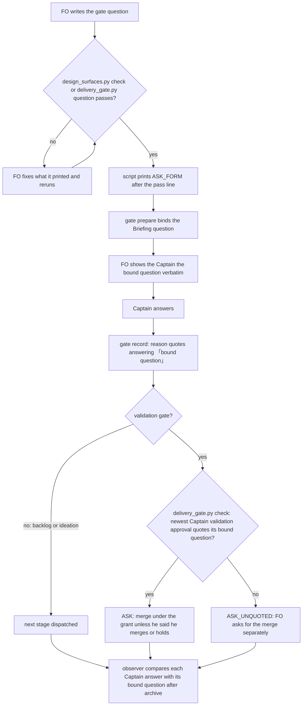

## Scope

- Source: the Captain 「都開」 (chat, 2026-10-23), answering FO's 「要不要把這三項各開成一張待辦任務？我建議開。」, after his 「另外看一下我的 user scrope claude.md 有沒有特別適合 dev2 的部分可以移植的？」; FO read his global ~/.claude/CLAUDE.md and grepped the kc-dev-flow-2 0.28.0 package for each theme (2026-10-23).
- Port: from his global instructions, "One decision", "No undefined nouns", "Conclusion first" and "Open in plain language", plus a dev2 rule his file does not hold: the chat presentation carries the bound gate question's "approving accepts …" sentence verbatim.
- Bite: observers on four dev2 tasks (codex-reader-reads-receipt-marker, agent-reads-governing-adr, merge-ask-holds-missing-clauses, codex-reader-counts-code-review-only) recorded that the chat question the Captain answered did not carry the bound acceptance sentence; the Captain asked what an FO term meant several times in the 2026-10-21 to 10-23 sittings. The package holds none of these rules (grep of the 0.28.0 markdown for "conclusion first", "one decision", "eight words", "plain language": 0 files).
- Upstream first: Spacedock present-gate skill (render the gate once, name entity, stage, briefing, one recommendation and the decision); kc-dev-flow-2 README Gate content and FO steps.
- Non-goals: his personal language and status-block preferences.
- Rechecked 2026-11-05: grep of the 0.35.0 markdown for the same four phrases still finds 0 files.
- Batch 14: the Captain 「可以」 (chat, 2026-11-05), answering 「這 5 張當下一批，可以嗎？」, which named this task.

## Budget
- One package PR. Workflow word budget unchanged unless the design names a raise for the Captain.

## Stop condition
- The design names where the four rules and the verbatim acceptance sentence live and what reads them; if it proposes a check, replays of the four observed presentations that lacked the acceptance sentence are held.

## FO alignment

Alignment: needed at ideation; where the rules live (README, a skill, or the Spacedock presenter) is his to accept.
Result: aligned at backlog: Batch 14 backlog sitting, the Captain 「准」 (chat, 2026-11-05), answering 「決定：這批五張（派工交代句的檢查、退一步答案欄位、漏寫 Override、婉拒要寫明、閘門一次問一件事）都用 Pilot，照各自寫下的範圍、預算與停止條件進入構思嗎？其中「婉拒要寫明」照我提的三項範圍（沒寫 Declined 標籤的婉拒、沒有 F 條目的審查者、沒指明接手任務）。要改哪張直接說。」, approved the outcome and bounds in this file.
Surfaces: none
Visible change: none
Release review: not needed: workflow maintenance, on no journey map.

## Design

Pilot boundary: one package PR on `Surfaces: none`. It adds a printed reminder to two gate scripts FO already runs, one narrower merge line in a third, one observer paragraph and one ADR. `references/sd/workflow.md` and its word budget do not change. No new gate, hook, CLI or adopter migration.

### PRFAQ

**Press line.** When First Officer (FO, the workflow coordinator) writes a gate question, the check it runs just before `gate prepare` reminds it how to write it: one decision, the decision and recommendation first, plain words with new terms expanded, and a sentence saying what approving accepts. FO shows the Captain that bound question word for word and records his answer as `answering 「<that question>」`. When his recorded validation answer quotes some other text, `delivery_gate.py check` no longer tells FO to merge under the grant; FO asks for the merge on its own.

**Why print it instead of adding README text?** FO reads the README once at startup (5754 words, VALIDATION.md's recorded recount, not rerun); the rule is needed at the moment FO writes the question. ADR 0055 set this pattern: a written rule printed by the gate scripts, no refusal. The README budget stays exact (ADR 0020 needs a Captain ruling to raise it).

**Why check only the merge?** The merge is where the acceptance sentence hands FO an action without asking again (ADR 0023: approval covers merging the full head "unless he says he merges or holds"). If he never saw that sentence, the grant has no basis. Falling back to a separate merge ask is today's behavior for a question that names no merge, so nothing in flight gets stuck. Backlog and ideation answers are compared by the observer after archive (decision D2).

**Why not check the four writing rules?** No script can tell a plain sentence from jargon, and ADR 0027 D4 (Captain override) rejected a word-matching check because "matching words cannot stop that class of error". Only the quote comparison is mechanical: two recorded strings, the Briefing `question` and the reason's quoted ask.

**Does a match prove he read it?** No. It proves FO recorded that the question he answered is the bound one. FO can still misquote. The observer and the Captain's own reading remain the check on that.

### Chain checked

1. **Spacedock 0.27.3** `skills/present-gate/SKILL.md` (675 words, read): render after the prepared room and binding commit, name entity, stage, Briefing snapshot, "one recommendation, and the decision ask". It does not say: conclusion first, define terms, plain words, or quote the bound question; and it treats a chat summary as acceptable ("exact headings are not required"). `spacedock-dev/spacedock` is not Kent's repository, so the rules stay in the package; this design changes nothing upstream. `fo-gate-lifecycle` (958 words) records the reason text but does not read it.
2. **kc-dev-flow-2 0.35.0** (origin/main, fetched 2026-11-05): `delivery_gate.py question` checks validation question text (`text_problems`: reviewer outcomes, declines, Sufficiency/Necessity, hold-out clause) and prints `CLAIM_SOURCE` on entry; nothing compares the chat ask with the bound question. `delivery_gate.py check` ends with the fixed `ASK` line. `decision_ledger.py` `task_rows` already returns each resolution's `by`, `at`, `decision`, `reason` and bound `question` (from the Briefing `index.json`); this design reuses it. `design_surfaces.py check` prints one pass line. The README's "His plain approval accepts that recommendation only when the gate question says so" (FO steps: review findings) is the acceptance-sentence rule; nothing says the chat ask must equal the bound question. Grep of the 0.35.0 markdown for "conclusion first", "one decision", "eight words", "plain language": 0 files (FO, Scope).
3. **Siblings, read-only:** relay, web and qnow adopt this workflow template (captain-ruling-sources-checked's report, Chain item 3, 2026-10-28 snapshots). Their READMEs were not re-read for this design, so a local presentation rule there is not ruled out.
4. **Past rulings:** ADR 0020 (README budget raise needs a ruling: avoided), 0023 (merge grant: narrowed, not widened), 0024 (chat-only rules are listed, not judged: the four writing rules stay unjudged), 0027 D4 (no word-matching check: followed), 0055 (print the rule at gate scripts: followed). `git -C <state> grep -n 'Override:'` (2026-11-05) finds no Override about gate-question form or presentation.

### Measured bite

Replay script `/tmp/gp_sub.py` (substring match of `answering 「<Briefing question>」` in the `person:captain` resolution reason, whitespace removed), state checkout dc91fa798, run 2026-11-05:

| Captain answers | quote the bound question | quote other text | quote nothing |
| --- | --- | --- | --- |
| All time, backlog | 6 | 13 | 104 |
| All time, ideation | 0 | 31 | 102 |
| All time, validation | 0 | 18 | 86 |
| Since 2026-11-02, validation | 0 | 10 | 2 |

The four observed tasks are the four validation gates: #693, #698, #703, #702. Each reason quotes a short Chinese chat ask (for example 「#703（合併提問補漏）要合併嗎？我建議合併。」) while the bound question carries "approving accepts that recommendation, covers later external-review rounds on this PR, merging this full head …" and the merge command. In each, the post-approval `delivery_gate.py check` (`merge/ask-2.json`) ran 6 to 20 seconds after the resolution, so the check sees the recorded answer. The current form (batch 13, for example rewritten-criteria-checked-against-captain-words) binds 「決定：…嗎？」 followed by an English "Approval also covers later external-review rounds …" sentence and records only the Chinese part as answered. One batch-13 ideation answer (fo-tries-what-it-asks-the-captain) quotes a question with a changed D7 that differs from the bound one. The package's own reader agrees: `decision_ledger.py` JSON over the same checkout, with the same substring test, gives 6 backlog matches, 0 ideation, 0 validation, and false for all four tasks (2026-11-05). Only the observer report on codex-reader-reads-receipt-marker states the missing sentence; the other three observers marked the bound question `ok` and the chat side `can't tell` or a binding "after the fact" (FO's Scope overstates the observer record; the replay above is the evidence).

### Where each rule lives and what reads it

| Rule | Home | Read by, when |
| --- | --- | --- |
| One decision; decision and recommendation first; plain words, new terms in eight words or fewer; the sentence saying what approving accepts; show the bound question verbatim; record `answering 「…」` | Constant `ASK_FORM` printed by `design_surfaces.py check` and `check --seed` after the pass line only when the task's `status:` is `backlog` or `ideation` (the full check also runs at implementation amendment handling and ui validation), and by `delivery_gate.py question` after `gate text complete` | FO, just before `gate prepare` of the backlog, ideation and validation gates; an ideation worker running the check |
| A merge grant applies only when the newest `person:captain` validation approval quotes its bound question | `delivery_gate.py check` chooses `ASK` or `ASK_UNQUOTED` with a helper in `decision_ledger.py` (`quotes_bound_question`) | FO, at the merge ask |
| Every Captain gate answer quotes its bound question (backlog, ideation and validation) | `skills/observer/SKILL.md`, one paragraph using the same helper's rule | Observer, after archive |
| The ruling | `docs/adr/<reserved>-a-gate-approval-grants-what-its-quoted-bound-question-says.md` | Later designers |

`ASK_FORM` (62 words): "next: before gate prepare, write the question the Captain answers: one decision; its first sentence says what he decides and what you recommend; plain words before ids and paths, and any term he has not seen expanded in eight words or fewer; one sentence saying what approving accepts. Show him this bound question verbatim and record his answer as `answering 「<that question>」`."

`ASK_UNQUOTED` (39 words, replaces the 40-word `ASK` only in that case): "next: ask for merge with this text: his recorded validation answer does not quote its bound question as `answering 「…」`, so that approval grants no merge. Every other PR, the Release PR included, is asked one at a time."

Exact rules for the implementation:
- `quotes_bound_question(row)`: true when `"answering 「" + question + "」"` is a substring of `reason` with all whitespace removed from both. A substring, not a `「(.*?)」` parse: bound questions hold nested 「」 (this task's backlog question holds 「婉拒要寫明」).
- `check` judges the newest `person:captain` `approve` resolution at stage `validation`, and only when the latest validation gate attempt has a resolution (the pre-ask run has none and keeps `ASK`). An `agent:first-officer` repair resolution under the grant is not judged; the Captain approval it rests on is. The saved `merge/ask-<N>.json` `next` holds whichever line was printed. No new exit code: the PR checks and holds are unchanged.
- FO binds the question without surrounding 「」. A bound question that already begins with 「 (the batch-13 form) is still recorded whole inside one more pair: `answering 「「決定：…」 Approval also covers …」`.
- The print goes after the pass line, so failing output and `pr_watch.py` `seeds` (which reads the exit code, and the last line on exit 2) are unchanged.

### Flow

### Existing-code check

Bounded search: `delivery_gate.py` (`ASK`, `check`, `question`, `CLAIM_SOURCE`), `decision_ledger.py` (`task_rows`, `question`), `dispatch_records.py` (`captain_records`, `check_validation_rulings`), `design_surfaces.py` (`main`), `pr_watch.py` (`seeds`). No existing code compares a resolution reason with its Briefing question; `task_rows` already loads both, so the helper is added beside it and its JSON output is unchanged. Observation: the replay above (0 of 12 recent validation answers match) shows the comparison is absent in practice, not only in code.

### Words FO reads at each moment

Startup, idle, after-archive, merge-ask and presentation counts are VALIDATION.md's recorded recount at origin/main (its report, not rerun here); gate-prepare counts are runs on 2026-11-05 of the 0.35.0 scripts on this task (seed check pass: 7 words; full check pass: 4; `delivery_gate.py question` pass: 27 `CLAIM_SOURCE` + 3).

| Moment | Base | Candidate |
| --- | --- | --- |
| Startup (README, mods, entry) | 6959 | 6959 |
| Idle, open PR / merged PR | 862 / 833 | 862 / 833 (`pr_watch` prints no check stdout on pass) |
| After archive | 333 | 333 |
| Backlog gate prepare (seed check pass) | 7 | 69 |
| Ideation gate prepare (full check pass) | 4 | 66 |
| Validation gate prepare (`question` pass; ui tasks also run the full check) | 30 (34 ui) | 92 (96 ui: the full check prints no `ASK_FORM` at `status: validation`) |
| Implementation amendment handling (full check pass) | 4 | 4 |
| Merge ask (`check` pass) | 2408 | 2408 when quoted; 2407 when not |
| Gate presentation (Spacedock present-gate + lifecycle) | 1633 | 1633 |

Each gate-prepare moment rises by 62 words; no moment falls. Added once per gate, not at startup. The implementation recounts both columns with an independent script.

### Batch overlap

Files this design would change: `kc-dev-flow-2/scripts/delivery_gate.py` (`ASK_UNQUOTED`, `ASK_FORM`, `check`, `question`, module docstring), `kc-dev-flow-2/scripts/test_delivery_gate.py`, `kc-dev-flow-2/scripts/design_surfaces.py` (`main`), `kc-dev-flow-2/scripts/test_design_surfaces.py`, `kc-dev-flow-2/scripts/decision_ledger.py` (`quotes_bound_question`), `kc-dev-flow-2/scripts/test_decision_ledger.py`, `kc-dev-flow-2/skills/observer/SKILL.md`, one `docs/adr/<reserved>-a-gate-approval-grants-what-its-quoted-bound-question-says.md`. Not changed: `references/sd/workflow.md`, `lint-skills.py` budget, `dispatch_records.py`, `pr_watch.py`.

| Task (plain meaning) | Shared file, check or record | Effect |
| --- | --- | --- |
| gate-summary-names-each-decline (declines name finding, reason, receiving task) | `delivery_gate.py` decline parsing in `text_problems`, run by `question` and `check`; tests | Same file, different functions; textual rebase only |
| step-back-answer-has-a-record-line (step-back reminder stops once answered) | `delivery_gate.py check` forwards `role_triggers.py` `next:` lines before the record and ASK | Same output tail; keep ASK last |
| override-recorded-when-captain-departs (Override line when he departs) | Resolution reason format; possibly `decision_ledger.py` if it builds the scorer | Both define what a reason holds: `<words> (chat, <date>), answering 「…」; Override: …`; same file if (b) |
| extension-instruction-check-sees-every-listed-extension (every listed extension's scope line checked) | `dispatch_records.py` | None under D2 option A; same file under option B |
| captain-ruling-sources-checked (Captain ruling sources declared, live) | `design_surfaces.py` `main`/`check_task`; its `Asked:` field records the question asked | Same file; its gate-resolution `Asked:` should equal the bound question; whichever lands second reuses the other's comparison |
| comment-check-reaches-delivery-gate (comment count at merge ask, live) | `delivery_gate.py check`, tests | Same file and function |
| fo-write-checks-parse-top-level (checks ignore fenced text, live) | `delivery_gate.py`, `design_surfaces.py`, tests | Same files |
| archive-waits-for-observer-report (archive waits for observer, live) | observer flow, not `skills/observer/SKILL.md` per its file list | None |
| adoption-asks-which-extensions, adr-required-statement, adr-silent-undo-probe, dispatch-carries-reserved-adr-number, journey-canvas-hosted-poc, journey-server-host-pilot, picky-reviewers-may-run-on-gemini, seed-check-requires-alignment-result, ops-inbox-r1-setup-and-isolation, pr-review-lite-value-pilot | none of the files above (each task's own file list or a grep of its task file, 2026-11-05); ADR number allocation is shared | None beyond FO reserving the ADR number |

Recommended order: after fo-write-checks-parse-top-level and comment-check-reaches-delivery-gate if either is already in implementation (both edit `delivery_gate.py check`); otherwise first in batch 14, since it touches only the pass branches and the final ASK line; gate-summary-names-each-decline and step-back-answer-has-a-record-line rebase on it.

## Acceptance criteria

**AC-1** The reminder reaches FO at each gate-prepare moment and changes no failing output. Verified by: CLI tests in `test_design_surfaces.py` and `test_delivery_gate.py` asserting `ASK_FORM` is the last stdout line of a passing `check --seed`, full `check` and `question`; absent from full `check` on a `status: implementation` or `status: validation` task; absent from every failing run, whose last line is unchanged; and the existing `test_pr_watch.py` seed tests pass. Falsifiers: print on entry (failing last line changes), drop the status condition (ui validation prints it twice, amendment handling prints it), drop the print (pass tests fail).

**AC-2** The four observed validation answers lose the merge grant. Verified by: `delivery_gate.py check` with stubbed `gh`, run on copies of codex-reader-reads-receipt-marker, agent-reads-governing-adr, merge-ask-holds-missing-clauses and codex-reader-counts-code-review-only as committed at their validation resolution (task file, Briefing `index.json`, validation dispatch record), prints `ASK_UNQUOTED` as its last line and saves it in `ask-<N>.json`; the 0.35.0 script prints `ASK` on the same copies. One copy of rewritten-criteria-checked-against-captain-words (Chinese part quoted, English sentence not) also gets `ASK_UNQUOTED`. Falsifiers: compare only a prefix; accept any reason containing 「; judge the oldest resolution.

**AC-3** A quoted answer and the pre-ask run keep the grant. Verified by: the same tests with the reason rewritten to `answering 「<bound question>」` (with changed line breaks and spaces) print `ASK`; a latest validation attempt with no resolution prints `ASK`; an `agent:first-officer` repair resolution after a quoting Captain approval prints `ASK`. Falsifiers: exact-whitespace comparison; judging the agent resolution.

**AC-4** Nested brackets compare correctly. Verified by: a `test_decision_ledger.py` case on a copy of this task's backlog gate record (bound question holds 「婉拒要寫明」) returns true; `ledger` JSON over the state checkout at a pinned revision is byte-identical before and after. Falsifier: replace the substring test with a `「(.*?)」` parse.

**AC-5** The observer reports every Captain gate answer. Verified by: the observer paragraph names the comparison and its three outcomes (`ok` quoting both texts' first words when one quote matches, `violation` when quotes exist and none matches, `can't tell` when the reason quotes nothing); one observer run on fo-tries-what-it-asks-the-captain, on the model-roster row, reports its ideation answer (a changed D7, not the bound question) as a violation. One run proves the instruction is followable, not a rate. Falsifier: the run reports `ok` or omits the row.

**AC-6** Reading cost is as tabled. Verified by: an independent recount at base and candidate of each moment in "Words FO reads at each moment"; startup, idle and after-archive identical; each gate-prepare moment +62; `references/sd/workflow.md` byte-identical and `lint-skills.py` passes. Falsifier: a README edit, or `ASK_FORM` reaching `pr_watch.py tasks` output.

**AC-7** The ruling lands with his words and the suites pass. Verified by: the ADR quotes the Captain's ideation answer and the question he answered, `adr_lint.py docs/adr --since <base>` exits 0, and `test_delivery_gate.py`, `test_design_surfaces.py`, `test_decision_ledger.py`, `test_pr_watch.py` pass at the candidate. Falsifier: an ADR with FO's words as the ruling.

## Unresolved decisions for the Captain

**D1. Language of the validation question.** Recommend: FO shows the bound question exactly as bound, so the English "approval also covers … unless he says he merges or holds" sentence appears in the Chinese ask; backlog and ideation questions may be bound wholly in Chinese. What gets worse: every merge ask carries one English sentence of about 30 words, and the ask is longer than today's one-line 「#NNN 要合併嗎？」. Alternative: teach `delivery_gate.py question` a Chinese hold-out sentence; costs a second-language pattern to maintain for every adopter language.

**D2. Where backlog and ideation mismatches are caught.** Recommend: the observer reports them after archive; no hold. What gets worse: a design approval given to a different text than the bound one (the batch-13 D7 case) is dispatched and only reported later. Alternative: `dispatch_records.py --names` holds `<stage>-1.md` until the approval that let the task in quotes its bound question; stronger, but a consumed answer has no supported repair route, so a held task waits on a new route that this task does not design.

## Number guards

ADR: 0060

## Stage Report: ideation

- DONE: Decide where the four plain-language rules and the verbatim acceptance sentence live (README, a skill, or Spacedock present-gate) and what reads them, checking Spacedock present-gate and the question check in /Users/kent/.claude/plugins/cache/kc-claude-plugins/kc-dev-flow-2/0.35.0/scripts/delivery_gate.py first
  Printed `ASK_FORM` from `design_surfaces.py check` and `delivery_gate.py question` at gate prepare; merge grant narrowed in `delivery_gate.py check`; observer paragraph; README and present-gate unchanged (Design, "Where each rule lives").
- DONE: A `### Batch overlap` section naming each file the design would change and each other batch task (extension-instruction-check-sees-every-listed-extension, step-back-answer-has-a-record-line, override-recorded-when-captain-departs, gate-summary-names-each-decline) and live task of other sessions (adoption-asks-which-extensions, adr-required-statement, adr-silent-undo-probe, captain-ruling-sources-checked, comment-check-reaches-delivery-gate, dispatch-carries-reserved-adr-number, fo-write-checks-parse-top-level, journey-canvas-hosted-poc, journey-server-host-pilot, picky-reviewers-may-run-on-gemini, seed-check-requires-alignment-result, archive-waits-for-observer-report, ops-inbox-r1-setup-and-isolation, pr-review-lite-value-pilot (stalled or driven by other sessions; read only)) that changes the same file or check, so FO can order implementation
  Eight files named; shared `delivery_gate.py` with three tasks, `design_surfaces.py` with two, reason format with override task; recommended order given. journey-server-host-pilot has no flat task file; judged from captain-ruling-sources-checked's overlap table.
- DONE: The words FO reads at each lifecycle moment, before and after, per root learning.md "Measure the words FO reads at each moment, not one file's size"
  Table in Design: startup, idle and after-archive unchanged; each gate-prepare moment +62; merge ask -1 when unquoted. Non-gate counts repeat VALIDATION.md, not rerun.
- DONE: Acceptance criteria with reproducible evidence clauses and falsifiers, and unresolved decisions for the Captain, each with a recommendation and what gets worse under it
  AC-1 to AC-7 each with a verification and falsifiers; D1 (language of the validation ask) and D2 (observer vs dispatch hold).
- DONE: AC-1 reminder at gate prepare: not yet verified (implementation tests); base pass outputs measured (7, 4, 30 words).
- DONE: AC-2 four replays lose the merge grant: not yet verified by the script; `/tmp/gp_sub.py` replay at dc91fa798 shows all four reasons quote text other than the bound question, and each `ask-2.json` postdates its resolution by 6 to 20 s.
- DONE: AC-3 quoted answer keeps the grant: not yet verified; current state holds 6 matching answers, all backlog, none validation.
- DONE: AC-4 nested brackets: not yet verified; this task's backlog reason matches its bound question by substring (replay, 2026-11-05).
- DONE: AC-5 observer row: not yet verified; needs one observer run on fo-tries-what-it-asks-the-captain.
- DONE: AC-6 reading cost: not yet verified by an independent recount; design arithmetic only.
- DONE: AC-7 ADR and suites: not yet verified; ADR named without a number.
- DONE: `design_surfaces.py check` on this task file
  `gate-presentation-asks-one-thing-plainly.md: design surfaces presentable`, exit 0 (2026-11-05).

### Summary

The four writing rules and "show the bound question verbatim, record `answering 「…」`" become one 62-word reminder printed by the checks FO runs before each `gate prepare`; the README budget is untouched. The only mechanical check compares two recorded strings: when the Captain's recorded validation answer does not quote the bound question, `delivery_gate.py check` withholds the merge grant and FO asks for the merge on its own. The replay shows the gap is current practice, not history: 0 of 12 validation answers since 2026-11-02 quote their bound question. D1 (English sentence inside the Chinese ask) and D2 (observer only for backlog and ideation) are the Captain's.

## Stage Report: implementation

- DONE: Implement the approved design and D1/D2 in only the eight named files, locally from origin/main.
  Branch spacedock-ensign/gate-presentation-asks-one-thing-plainly; base d37c6dc653e0f45d6ca630c2faa6121c0863a57e; candidate 3196dd4c3c0de7d211972dfcdd48a56f0ae0c753; clean assigned worktree; decision_ledger.py only gains quotes_bound_question; no version bump.
- DONE: AC-1 — reminder reaches passing gate preparation, stays last, and is absent from failures, implementation and validation full checks.
  Required CLI cases and watcher seed cases pass; entry-print, missing-status and dropped-print mutants fail; /tmp/opencode/gate-presentation/{design_surfaces.json,delivery_gate.json,mutations.json}.
- DONE: AC-2 — the four observed validation answers and the later Chinese-only answer lose the merge grant.
  HistoricalBoundQuestionTests replays the five pinned resolution commits with their task, Briefing and dispatch bytes, stubbed gh and synthetic valid summaries; base prints ASK, candidate prints/saves ASK_UNQUOTED; prefix-only, any-quote and oldest-approval mutants fail; historical-replays.json.
- DONE: AC-3 — whole-question answers, whitespace changes, unanswered latest attempts and FO repair resolutions retain ASK.
  BoundApprovalTests plus all five historical quoted controls pass; exact-whitespace and agent-resolution mutants fail; delivery_gate.json and mutations.json.
- DONE: AC-4 — nested brackets compare and ledger JSON stays byte-identical at a frozen state revision.
  State 79fb4abf3f9c751c83e8d70dcfeaa654ff8774c4: actual nested backlog matches; 399 rows, 420525 bytes, sha256 aff64d3b888718ad96bc809dce9203a613b5a0826c64049989c827eab52cfd75; nested-regex mutant fails; ledger-proof.json.
- DONE: AC-5 — observer instructions cover every Captain gate answer and the configured role reports the changed ideation ask as violation.
  FO supplied the Claude Sonnet Observer run, unedited /tmp/ac5-observer-report.md, copied byte-identically to observer-report.md; observer-proof.json rejects both an ok replacement and an omitted ideation row. Existing outer brackets must be enclosed again per the approved Exact rules, so the reported historical formatting mismatches require no code repair.
- DONE: AC-6 — independent recount at the current base and candidate preserves startup/idle/archive costs and adds 62 words at each gate preparation.
  reading.json: startup 7151/7151; idle open 906/906, merged 860/860; archive 333/333; backlog 7/69, ideation 4/66, validation 30/92, ui-validation 43/105; normal merge 2429/2429; unquoted line 40/39. Design's older absolute baseline is stale (reported to FO); workflow bytes match. README-edit and idle-output mutants are caught.
- DONE: AC-7 — ADR 0060 quotes the Captain's ideation answer and Asked text; the four required suites pass.
  154 delivery + 213 design + 10 ledger + 134 watcher tests = 507 passed, four pre-existing optional design corpus skips; required five historical snapshots ran. ADR provenance rejects FO words; suite-summary.json and adr-provenance.json.
- DONE: Repository skill lint, ADR lint --since base --require 0060, number guards and the task design check exit 0.
  skills-lint.log, adr-lint.log, number-guards.log and task-design-check.log; number guard checked candidate 3196dd4c3c0d against base d37c6dc653e0, no migration path declared.
- DONE: comment_ratio.py is within its maximum.
  comment-ratio.log: 208 code lines, 3 comment lines, 1.4%, maximum 5%; all added code, tests and ADR pointers map to the approved criteria or falsifiers.
- DONE: doc_impact.py base candidate reviewed every listed document.
  docs/adr/0011 unaffected: ledger JSON schema and delegation unchanged; 0041 unaffected: seed field holds unchanged; 0044 unaffected: legacy/summary checks retained; 0051 unaffected: round-count checks retained; 0057 unaffected: amendment comparison untouched.
  kc-dev-flow-2/skills/maintain-flow/SKILL.md unaffected: its ledger command and output are unchanged; docs/adr/0060-a-gate-approval-grants-what-its-quoted-bound-question-says.md and kc-dev-flow-2/skills/observer/SKILL.md updated. doc-impact.json lists all eight documents.
- DONE: Prepared Conventional Commit PR title/body for FO.
  /tmp/impl-gate-presentation-asks-one-thing-plainly-pr.md; no product push; live GitHub branch query found no open PR. Local acceptance scripts, captured output and JSON evidence are in /tmp/opencode/gate-presentation.
- SKIPPED: Product push, one Draft PR, independent validation, RoboRev, and CI.
  FO owns publication and review; FO explicitly superseded the worker RoboRev command on 2026-11-05 and directed “record RoboRev as delegated to FO, not run”; no clean review is claimed.
- SKIPPED: CI cost measurement.
  No CI trigger changed; cost per PR not measured.

### Summary

The local candidate prints the approved gate-writing reminder and withholds the carried merge grant when the recorded Captain approval omits the whole bound question. The five historical replays, configured Observer run and mutation controls support that bounded change; chat fidelity, publication, independent validation, RoboRev and hosted CI remain FO-owned. Reproduce delivery replays with GATE_PRESENTATION_STATE set to this state checkout, GATE_PRESENTATION_BASE=d37c6dc653e0f45d6ca630c2faa6121c0863a57e and GATE_PRESENTATION_EVIDENCE set to an external directory, then python3 -B -m unittest discover -s kc-dev-flow-2/scripts -p test_delivery_gate.py; the other required suites use test_design_surfaces.py, test_decision_ledger.py and test_pr_watch.py.

## Stage Report: implementation

- DONE: Confirm and repair the High finding FO reported from RoboRev job 1514 on 3196dd4c3.
  Released workflow: FO checks a recorded validation approval before merge; harm: a withdrawn quoted approval restores ASK over an active unquoted approval; boundary: contract[kc-dev-flow-2/references/sd/workflow.md#delivery-authority] requires an effective Captain grant; trigger: three assertion failures against 3196dd4c3 in /tmp/opencode/gate-presentation-repair/red.log.
- DONE: Implement the authorized repair within the approved eight-file scope, without changing profile, version or ruling.
  Only delivery_gate.py and test_delivery_gate.py changed since 3196dd4c3; withdrawn attempts are excluded from both Captain selection and effective-resolution checks; missing effective grant asks separately, while a fresh unanswered attempt and an active quoting grant retain ASK. ASK_UNQUOTED now states the missing effective grant accurately and remains 39 words.
- DONE: Commit locally on the assigned branch from the original origin/main base.
  Branch spacedock-ensign/gate-presentation-asks-one-thing-plainly; base d37c6dc653e0f45d6ca630c2faa6121c0863a57e; previous 3196dd4c3c0de7d211972dfcdd48a56f0ae0c753; new candidate 73db59bef6d1327e8b8c810b4f57601664aee1ef; clean assigned worktree, no product push by this worker; candidate.json binds paths and identity.
- DONE: AC-1 — reminder placement, pass/failure output and watcher seed behavior remain covered.
  Fresh 213-test design and 134-test watcher suites pass; original entry-print, missing-status and dropped-print controls fail at this repair; original-controls/mutations.json under the repair evidence directory.
- DONE: AC-2 — the five committed historical validation snapshots still ask separately and save ASK_UNQUOTED.
  Fresh HistoricalBoundQuestionTests ran with GATE_PRESENTATION_STATE, GATE_PRESENTATION_BASE and GATE_PRESENTATION_EVIDENCE declared; base/repair outputs and saved next fields are in historical-replays.json; prefix, any-quote and oldest-approval mutations are caught.
- DONE: AC-3 — quoted, whitespace, pre-ask and FO repair cases pass, with withdrawal regressions added.
  Three new regression test methods exercise real parsing, printed next and saved next: revoked quote masking active unquoted approval, no remaining grant with/without FO repair, active quoting grants in both withdrawal orders and a fresh unanswered attempt. green.log passes; all three repair mutants fail, including restoring withdrawn rows, treating withdrawal as pending and defaulting a missing grant to merge.
- DONE: AC-4 — nested brackets and ledger output compatibility remain satisfied.
  Fresh 10-test ledger suite passes. decision_ledger.py is byte-identical to 3196dd4c3, so the previous frozen-state proof is retained: state 79fb4abf3f9c751c83e8d70dcfeaa654ff8774c4, 399 rows/420525 bytes, sha256 aff64d3b888718ad96bc809dce9203a613b5a0826c64049989c827eab52cfd75. Nested-regex mutant rerun is caught; no new ledger schema or helper change.
- DONE: AC-5 — retain the configured Observer's ideation violation evidence.
  FO's unedited Claude Sonnet report /tmp/ac5-observer-report.md is retained, not rerun; observer instructions and comparison helper are byte-identical to the previously exercised candidate. The changed ideation question remains its violation, and double outer brackets remain the approved rule.
- DONE: AC-6 — reading costs remain the approved deltas on the current base.
  Fresh recount-candidate.json matches the previous candidate's normal outputs byte-for-byte after the same path normalization; ASK_FORM remains 62 words, ASK_UNQUOTED 39. reading-proof.json retains current startup 7151, idle 906/860, archive 333, normal merge 2429 and gate-prepare +62; the old design table's absolute baseline remains stale.
- DONE: AC-7 — rerun all four suites and ADR lint at the repair.
  157 delivery + 213 design + 10 ledger + 134 watcher = 510 passed and four existing optional design-corpus skips; required five historical snapshots ran. tests.json and suite-summary.json hold results; adr-lint.log checks 59 ADR files including required 0060, exit 0. ADR bytes and Captain provenance are unchanged.
- DONE: Run falsifiers with python3 -B and caches cleared.
  mutations.json records 3/3 repair mutants caught; original-controls/mutations.json records 12/12 original code mutants caught. These are expected failing runs, separate from the green suites.
- DONE: Repository skill lint, task design check, number guards and comment ratio pass.
  skills-lint.log, task-design-check.log and number-guards.log exit 0; guard binds d37c6dc653e0 to 73db59bef6d1. comment-ratio.log: 229 code lines, 3 comment lines, 1.3%, within 5%; no migration path declared.
- DONE: Rerun doc_impact.py and review every listed document.
  docs/adr/0011 unaffected: ledger/delegation unchanged; 0041 unaffected: seed holds unchanged; 0044 unaffected: legacy/summary checks retained; 0051 unaffected: round-count check retained; 0057 unaffected: amendment comparison untouched.
  kc-dev-flow-2/skills/maintain-flow/SKILL.md unaffected: ledger command/output unchanged; docs/adr/0060-a-gate-approval-grants-what-its-quoted-bound-question-says.md and kc-dev-flow-2/skills/observer/SKILL.md remain updated by the original task and unchanged by this repair. doc-impact.json lists all eight.
- DONE: Update the prepared Conventional Commit PR title/body for FO.
  /tmp/impl-gate-presentation-asks-one-thing-plainly-pr.md names the new candidate, repair and fresh evidence. Repair artifacts are /tmp/opencode/gate-presentation-repair; original unchanged acceptance evidence remains /tmp/opencode/gate-presentation.
- SKIPPED: Product push, PR publication/update, fresh RoboRev, independent validation and hosted CI.
  FO explicitly owns these steps and reported pushing 3196dd4c3; this worker has not pushed 73db59bef. Job 1514 is a reported finding on the prior candidate, not a clean review of this repair.
- SKIPPED: CI cost measurement.
  No CI trigger changed; cost per PR not measured.

### Summary

The High finding is confirmed and repaired: withdrawn validation attempts cannot supply a merge grant or make a revoked attempt count as an answered effective approval. This complete report supersedes the earlier implementation report for candidate 3196dd4c3; the current candidate is 73db59bef6d1327e8b8c810b4f57601664aee1ef. Fresh suites and 15 code mutation controls pass their required outcomes; FO retains publication, RoboRev rerun, independent validation and hosted CI ownership.
