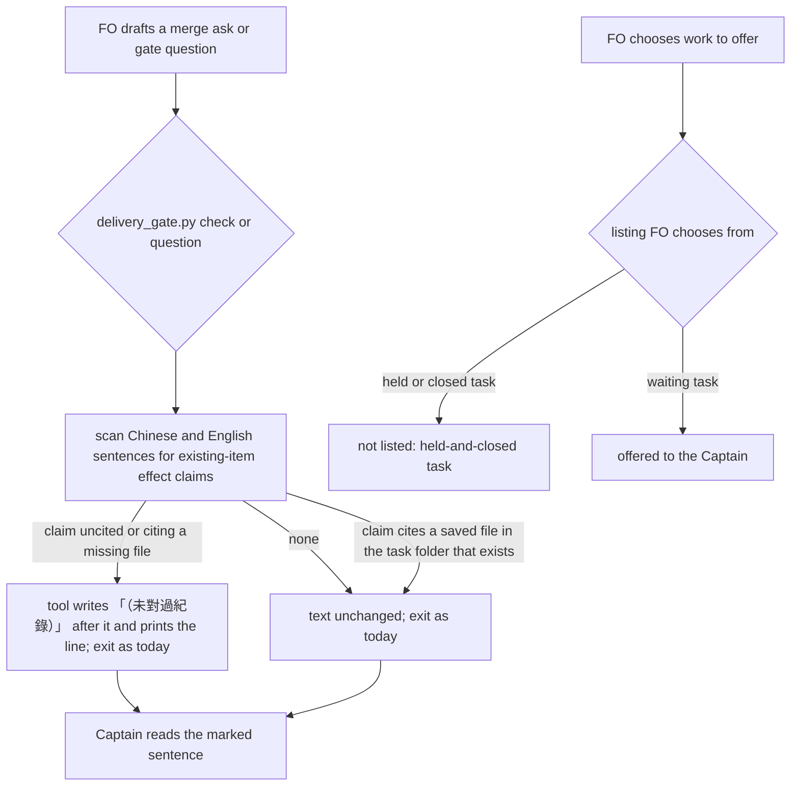

## Scope

- Source: FO's own misses, filed by FO with no Captain ruling yet; the backlog gate confirms it.
- Bite, three times in two days, each found after the Captain had answered: the #843 merge ask said already-filed tasks would not be asked to add a Story line, while the approved design has the idle look name them (observer report, 2026-11-11); the #841 merge ask said only designs not yet through the design gate would be refused, while release 0.39.0 refused approved ones and an adopter found it after release (2026-11-11); a question of 2026-11-12 described five tasks as waiting in design when the Captain had held or closed all five.
- What exists: the delivery check counts unchecked numbers in gate text and the workflow says each claim names the command and date that produced it; none of the three claims was a number, and the check passed each time.
- Outcome: a sentence in a gate or decision question that says what a change does or what state a task is in either names the record or run that shows it, or is marked as unverified where the Captain reads it.
- Open for the design: whether this can be checked at all by a script, or is a step with a record; what the cheapest version is that would have caught the three cases; what it costs FO per question in words and minutes.
- Non-goals: checking the Captain's own words; a second reviewer for every question; rewriting the question form.

## Budget
1 cycle per stage, in one package PR.

## Stop condition
- Replaying the three questions named under Bite at their recorded state, the candidate flags each false sentence, and three questions that were true are not flagged. Return to the Captain if the design finds no mechanism cheaper than a second agent reading every question.

## FO alignment

Alignment: not needed: one observed defect with one outcome; whether and how it can be checked is compared in the design and ruled at the ideation gate.
Surfaces: none
Visible change: none
Release review: not needed: workflow maintenance, on no journey map.

## Captain amendments

### Amendment 1 — 2026-11-12, host question dialog
Captain: 「四張都允許（建議）」 (host question dialog, 2026-11-12)
Asked: 「要不要允許實驗裡這四張任務的實作各多寫一份決策紀錄檔，記下你在設計關卡裁的決定？我建議允許。四張是：收尾清理（已經停下來等這個答案）、計時紀錄、擱置的任務、問題裡的事實。這是修改你已核准的設計範圍，會記成各張任務的一筆修正案；決策紀錄只寫你在關卡上核准的內容，不加新的決定。收尾清理那張我用追加訊息讓原本的工人接著做，不算新的一次派工。變差的是：四張任務各多一個檔，而且實驗要記上「設計核准後改範圍」四筆，其中三筆是我預先處理、還沒真的發生。」
Supersedes: none

### Amendment 2 — 2026-11-12, host question dialog
Captain: 「一次授權，跑完（建議）」 (host question dialog, 2026-11-12)
Asked: 「實驗裡還沒過驗證的三張任務（收尾清理、問題裡的事實、擱置的任務）要怎麼走完？我建議一次給足授權讓它們跑完：一、這三張的預算都改成「1 implementation and 2 validation cycles」，退回後用追加訊息修正、再驗一次；第二次驗證再被退回就停下來回到你這裡。二、收尾清理那條「收尾後整個 repo 的暫存工作目錄是零」的驗收條件，改成只看這次派工自己的暫存資料夾，不為了湊到零去刪別的派工的資料夾。三、問題裡的事實那條要拿「擱置的任務」成品重播的條件不改，等那張的成品出來後補跑。這些會記成三張任務各一筆修正案。變差的是：三張各多一輪驗證（每輪約 15 到 20 分鐘），今天會跑到晚上；而且這段期間我不會再為「程式缺陷修完重驗」回來問你。」
Supersedes: none
Budget: 1 implementation and 2 validation cycles

### Feedback Cycles

- Cycle 1 (FO, 2026-11-12): validation-1 on #855 head 8d083d3b9 recommended REJECTED with one finding, Needs decision (kind evidence or form): AC-1's replay against the candidate of held-and-closed-tasks-leave-the-design-queue was not run because that candidate did not exist. The Captain kept the criterion (amendment 2); the replay is run when that candidate exists.

## Design

Proof-of-concept branch: `poc/gate-question-facts-are-checked-before-the-captain-reads-them`, commit `e56b2e6c36f846349acc780175a0691b63a177ae` (parent `39fb7ccfa`, base origin/main `8ce0eb605`), local only, in the workflow checkout's `.worktrees/poc-gate-question-facts`. It adds one throwaway file, `kc-dev-flow-2/scripts/gate_facts.py`, with three readers: `state`, `effect` (one model call per sentence) and `scope`. Saved runs are under `gate-question-facts-are-checked-before-the-captain-reads-them/ideation-1/`; `ideation-1/run-evidence.sh <POC worktree> <state checkout>` reruns every deterministic criterion in about 5 seconds.

### PRFAQ

**Proposition.** When FO's merge ask or gate question tells the Captain that a change does or does not affect existing tasks, designs or records, the sentence either names the saved run in the task folder that shows it, or the delivery check itself writes 「（未對過紀錄）」 after it in the text he reads. A task FO offers him as waiting work is not one he has held or closed, because the listing FO chooses work from no longer shows held tasks (owned by held-and-closed-tasks-leave-the-design-queue).

- **Why not let a model read every question against the record?** It was measured and it failed (below): it missed both false merge-ask sentences and flagged true ones.
- **Why mark instead of hold?** ADR 0072 is the nearest ruling: the Captain replaced a gate hold with a disclosure the tool writes itself. ADR 0055 and ADR 0027 D4 rejected holds that match words, because matching words cannot stop this class of error. A mark makes the claim visible as unchecked; it does not make it true.
- **What does FO pay?** On the 111 questions FO asked in this session (2026-11-10 to 2026-11-12), 11 of 505 sentences in 9 questions are existing-item sentences. Each needs a cited saved run or carries the mark.

### What the proof of concept showed

The six questions are saved verbatim in `ideation-1/questions/`, each with its ask time and the state commit before it. Each run reads records only at that commit through `git show`. False: case1-843 (2026-11-11T07:48Z), case2-841 (08:55Z) and case3-five-tasks (2026-11-12T03:06Z). True controls of the same kinds: control-839 and control-849 (merge asks), and control-five-new-tasks (the 04:59Z question on the five new tasks).

- **Task state is mechanical.** At `c59bfffd6` all five tasks case 3 offered carry a Captain `hold` at ideation (dated 2026-10-21 to 2026-11-05). `state` flags 5 of 5 and exits 1. On the control at `2c60d50f3` it flags 0 of 5 and exits 0 (`evidence/ac1-*.log`).
- **Both false merge-ask sentences are contradicted by a saved record. Neither is merely unsupported.** Case 1: AC-13 of the approved design says "The idle look names a backlog task with no story record, and on the replays it names 31 relay and 11 qnow tasks". Case 2: `validation-2/legacy-design.json` shows the candidate refusing an old design with "stage is validation, not ideation". So the run that would have shown the truth existed in each task folder.
- **A model reading the extracted record does not catch them** (`runs/effect-*.json`, prompt in `gate_facts.py` PROMPT, raw output saved per call). Haiku, 3 runs: case 1's false sentence was flagged 0 of 3 times and case 2's 1 of 3. A true sentence was flagged 3 of 3 in each of control-839 and control-849, and a true limit in case 2 was flagged 3 of 3. Sonnet, 1 run: it called both false sentences SUPPORTED and flagged one true control sentence. Each call took 4.5–12 s and read 4.8k–7.6k input tokens. This rules out the second-reader route at this cost.
- **A deterministic existing-item scan marks exactly the false sentence in cases 1 and 2**, and nothing in control-839. It also marks one true sentence in control-849: the PR's own title, which cites nothing. With the task's saved replay cited (`validation/acceptance-result.json`), control-849 passes. A cited file absent from the folder is still marked.
- **On the whole session corpus**, the scan marks 11 sentences, and 4 of them are false. The fourth false one was not named in the Bite: the 10:23Z release question repeated case 2's claim. The other 7 describe the #849 fix itself. Corpus, run and labels: `questions/corpus-fo-session-8fcbee7d.jsonl`, `evidence/ac3-corpus.log`.
- **The existing count disclosure is blind to these questions.** `count_tokens.count_sentences` finds 0 count sentences in all 111 Chinese questions, including case 2's 「15 個同類檢查漏洞」 (`evidence/count-scan-on-chinese-questions.log`). The Scope's "What exists" check never reads what the Captain reads in the dialog.

### Existing-code check and chain

- **Spacedock 0.27.2:** `gate prepare` takes `--question`, `--summary` and `--reference` and checks no claim (`spacedock gate prepare --help`, 2026-11-12). Nothing to reuse.
- **kc-dev-flow-2 0.39.1 at origin/main `8ce0eb605`:** `delivery_gate.py` prints `CLAIM_SOURCE` (ADR 0055), and `count_disclosure` writes `Unchecked counts: N` (ADR 0072) in both `check` and `question`. That disclosure is the seam to extend: the same place, the same no-hold rule, the same "cites a file resolving within the task folder" test. A replacement is not needed.
- **Adopters:** relay, web and qnow use the same `delivery_gate.py`. Reading qnow's FO question history was refused by this session's permission classifier, so no adopter corpus was read.

### Expansion plan (POC to Pilot)

1. Move the scan into `delivery_gate.py` beside `count_disclosure`, using `count_tokens.prose_lines` and a sentence split that also splits on 。；？ and 一、…十、. It runs in `check` (ask text plus PR body) and in `question` (question plus summary). It writes 「（未對過紀錄）」 after each uncited existing-item sentence in the file FO passes, and prints `scope claims: N cited, M marked` plus one line per marked sentence. It prints nothing when no such sentence exists, and adds no new hold or exit code.
2. A citation counts only if it names a file that resolves inside the task folder, the same rule as `named_file` in `count_problems`. Reuse that, not the POC's `git show`.
3. Make the existing count scan see Chinese sentences, through the same split. Today it finds none (above). Units such as 張, 個, 次 and 項 join `NOUN`.
4. Drop the PyYAML dependency and the model reader. The state reader goes no further than a replay test against held-and-closed's listing (D2).
5. Tests in `test_delivery_gate.py` use the saved fixtures, with the three falsifiers in `run-evidence.sh` as mutants. Write an ADR draft extending ADR 0072: "existing-item effect claims cite saved output or carry the tool's mark".

The Stop condition's first clause is met for cases 1 and 2 by the scan, and for case 3 by the state reader on the POC. Its second clause is met for 2 of 3 controls on recorded text. control-849 is marked once, on a true but uncited sentence, and passes once its saved run is cited. Its return clause does not fire: the mechanism found costs no model call and about 1 s per corpus pass, not a second agent.

### Worth questions

- **Existing-item scan and tool mark (merge ask, gate question).**
  - Serves: the Scope's Outcome and Bite, FO's filing confirmed by the Captain's backlog approval 「核准，照這個分組（建議）」.
  - Without it: the three-time miss stays invisible. The count disclosure reads no Chinese sentence, so nothing marks the sentence that misled him (evidence above).
  - Premise that would make it unneeded: "FO would have noticed by citing a run". A cheap check now: in both cases the contradicting saved record already existed in the task folder, and FO still wrote the false sentence. The premise is false.
- **Count scan reading Chinese (expansion item 3).**
  - Serves: the Scope's "What exists" sentence, which assumes the count check runs on these questions.
  - Without it: numbers in every Chinese question stay unchecked (0 of 111 found).
  - This part serves no Captain words directly. It is for the Captain to keep or cut.
- **Task-state check (case 3).**
  - Serves: the Bite's third case.
  - Without it here: nothing, if held-and-closed ships its listing. Its Stop condition removes the 10 held tasks from the command FO uses to choose work.
  - Premise that would make it unneeded: held-and-closed lands. Check held-and-closed's design at its gate.

### Words FO reads at each moment

Base, from origin/main `8ce0eb605`: the workflow.md merge and gate passage is 80 words, and `CLAIM_SOURCE` printed on each call is 27 (`ideation-1/words/word-counts.txt`, `wc -w`).

| Moment | Base | Candidate |
| --- | --- | --- |
| Startup, idle on an open PR, idle on a merged PR, after the archive | unchanged | unchanged: no README or mod text is added |
| Merge ask (`check`) and gate question (`question`), no existing-item sentence | 27 printed | +0 |
| Same, with a marked sentence | 27 printed | +6 words for the `scope claims:` line, plus 2 words and up to 12 of the sentence for each marked sentence |

Measured rate: 9 of 111 questions would print the line. The candidate rises above base only at those calls. This task does not aim to cut words.

### Decisions for the Captain

- **D1, how an existing-item sentence is checked.** Recommended: the tool writes 「（未對過紀錄）」 itself and nothing is held, following ADR 0072's ruling and ADR 0055 / ADR 0027 D4.
  - Alternatives: a hold until FO cites or marks it, which those rulings rejected; or a model reader, measured above at 1 of 6 catches and repeated false flags.
  - Worse under the recommendation: a false sentence still reaches you, marked. In two days 7 of the 11 marks fell on true sentences. The word list was tuned on these same two days, and a false claim worded without 舊/已開/既有-type words passes unmarked.
- **D2, who owns case 3.** Recommended: held-and-closed-tasks-leave-the-design-queue owns it. This task adds no state check and only replays case 3 against that task's listing at implementation.
  - Alternative: this task ships the state reader for a question that names task slugs.
  - Worse under the recommendation: a plain dialog question has no script on its path, so a state claim FO writes without consulting the listing stays unchecked. This task's Stop condition for case 3 then depends on another task landing first.

## Acceptance criteria

Every evidence command below was run once on 2026-11-12 (Asia/Taipei 13:34) at POC commit `e56b2e6c3`, through `bash ideation-1/run-evidence.sh <POC worktree> <state checkout>`. That script records the head in `ideation-1/evidence/identity.txt` and writes `ideation-1/evidence/<name>.log`, each log ending with its exit code. `<gf>` below is `<POC worktree>/kc-dev-flow-2/scripts/gate_facts.py`, and `Q` is `ideation-1/questions`. At implementation, the same fixtures are replayed against the candidate's `delivery_gate.py`. For AC-1, they are replayed against the listing held-and-closed ships, per D2.

**AC-1** — Task-state replay. Case 3's question, read at state `c59bfffd6`, flags all five offered tasks as held. The control question at `2c60d50f3` flags none.
- Evidence: `python3 -B <gf> state --state <state> --question Q/case3-five-tasks.json` exits 1 with `5 of 5 tasks flagged` (`evidence/ac1-case3.log`). The same command on `Q/control-five-new-tasks.json` exits 0 with `0 of 5` (`evidence/ac1-control.log`).
- Falsifier: dropping `hold` from the stop decisions makes case 3 exit 0 (`evidence/falsifier-ac1-no-hold.log`, exit 0).

**AC-2** — Existing-item scan on the recorded false merge asks. Each recorded question gets exactly one marked sentence, and it is the false one: case 1's 「已經開好的舊任務不會被要求補標」 and case 2's 「升級後，還沒過設計關卡…的舊設計會被擋下」.
- Evidence: `python3 -B <gf> scope --state <state> --question Q/case1-843.json` exits 1 (`evidence/ac2-scope-case1-843.log`). The same command on `Q/case2-841.json` exits 1 (`evidence/ac2-scope-case2-841.log`).
- Falsifier: an English-only trigger (`existing`) leaves case 1 unmarked, exit 0 (`evidence/falsifier-ac2-english-only.log`).

**AC-3** — Controls, citation and mark.
- control-839 is not marked: exit 0 (`evidence/ac2-scope-control-839.log`).
- control-849 as recorded marks its one uncited title sentence: exit 1 (`evidence/ac2-scope-control-849.log`).
- control-849 with that sentence citing its task's saved `validation/acceptance-result.json` passes: exit 0 (`evidence/ac2-scope-control-849-cited.log`).
- Citing a file absent from the task folder at that state is still marked: exit 1 (`evidence/ac2-scope-control-849-badcite.log`).
- Case 2's sentence carrying 「（未驗證）」 passes: exit 0 (`evidence/ac2-scope-case2-841-marked.log`).
- Falsifier: accepting any cited name without checking that the file exists lets the bad citation pass, exit 0 (`evidence/falsifier-ac2-no-exists.log`).

**AC-4** — Cost on the session corpus. The scan reads 111 questions with 505 sentences and finds 11 existing-item sentences in 9 questions. The 4 false ones among them (07:48Z, 08:52Z, 08:55Z, 10:23Z on 2026-11-11) are all marked.
- Evidence: `python3 -B <gf> scope --question Q/corpus-fo-session-8fcbee7d.jsonl` exits 1, and its last line reads `scope: 111 questions, 505 sentences, 11 existing-item sentences, 9 questions flagged` (`evidence/ac3-corpus.log`). The falsity labels come from case 1's AC-13 and case 2's `validation-2/legacy-design.json`; the 10:23Z sentence repeats case 2.
- Falsifier: the english-only mutant above marks none of the four.

### Not provable now

- The tool writing 「（未對過紀錄）」 into the text file in `delivery_gate.py check` and `question`, with exit codes unchanged. There is no candidate yet; the implementation proves it with the fixtures above.
- The scan on a second corpus. Reading qnow FO's question history was refused by this session's permission classifier on 2026-11-12, and the word list was tuned on the same two days it was measured on.
- Whether a marked sentence changes the Captain's answer. This is behaviour, observable only in use.
- Case 3 on a plain dialog question. No script runs on that path; the fix lives in held-and-closed's listing (D2).
- The model reader as a criterion. A model call is neither deterministic nor free of machine dependency (CLI login). Its measured runs are decision evidence, not a criterion.

### Batch overlap

- **merge-ask-tests-the-merge-result:** likely changes `kc-dev-flow-2/scripts/delivery_gate.py` `check` (merge-ask hold) and `test_delivery_gate.py`, the same files this design changes (`count_disclosure` neighbourhood, `count_tokens.py`).
- **held-and-closed-tasks-leave-the-design-queue:** owns the listing case 3 depends on (D2). No shared file unless it chooses `pr_watch.py` or a state reader this task would replay.
- **each-task-records-stage-time-revises-and-interruptions, dispatch-close-out-archives-evidence-and-removes-scratch:** no shared file found in their current task files.
- **comment-check-reaches-delivery-gate** (held): its design changes `delivery_gate.py check` and `test_delivery_gate.py`.
- **adoption-asks-which-extensions** (held): names `delivery_gate.py` four times in its design.
- **adr-required-statement, ops-inbox-r1-setup-and-isolation, adr-silent-undo-probe, journey-canvas-hosted-poc:** they touch `design_surfaces.py` or `number_guards.py`, not files this design changes.
- **pr-review-lite-value-pilot:** no shared file found.
- **journey-server-host-pilot:** not a live task file in this state at `eae5ea47c`.
- **ADR list:** one ADR draft extending ADR 0072. Its number is reserved by FO at dispatch, so it shares the index with every task that lands an ADR.

Recommended order: held-and-closed-tasks-leave-the-design-queue first (it owns case 3), merge-ask-tests-the-merge-result before this task (both edit `delivery_gate.py check`; this task rebases onto it), then this task.

## Number guards

ADR: 0082

## Stage Report: ideation

- DONE: The Captain's experiment for this task (his words are in the task's backlog gate record): ideation is a proof of concept plus an expansion plan. First build a working throwaway proof of concept of this task's outcome on a local branch poc/gate-question-facts-are-checked-before-the-captain-reads-them in a worktree you create under the workflow checkout's .worktrees/ from origin/main, commit it locally, never push it and open no PR; run it against the real cases the task's Bite names and save what it showed in the task folder. Then write the design as what the proof of concept showed, the expansion plan (what it lacks to meet the Pilot bar and the task's Stop condition), and the acceptance criteria. Record the branch name and commit in the design so the implementation worker can start from it. For every acceptance criterion, run its evidence command or procedure once now and write beside the criterion the exact command, its exit and the path of its saved output in the task folder; a criterion whose proof cannot be run now is not written under Acceptance criteria but under a 'Not provable now' list with the reason, for the Captain to see at the design gate, run on the proof of concept
  Branch poc/gate-question-facts-are-checked-before-the-captain-reads-them at e56b2e6c3 (local, `--no-track`, unpushed, no PR) in `.worktrees/poc-gate-question-facts`. All three Bite cases plus three true controls were replayed at pinned state commits. The runs, fixtures and `run-evidence.sh` are in `ideation-1/`, and 5 items are listed under Not provable now.
- DONE: A `### Batch overlap` section naming each file the design would change and each other batch task (merge-ask-tests-the-merge-result, held-and-closed-tasks-leave-the-design-queue, each-task-records-stage-time-revises-and-interruptions, dispatch-close-out-archives-evidence-and-removes-scratch, gate-question-facts-are-checked-before-the-captain-reads-them) and live task of other sessions (adoption-asks-which-extensions, adr-required-statement, adr-silent-undo-probe, comment-check-reaches-delivery-gate, journey-canvas-hosted-poc, journey-server-host-pilot, ops-inbox-r1-setup-and-isolation, pr-review-lite-value-pilot (driven by other sessions; read only)) that changes the same file or check, so FO can order implementation
  Shared `delivery_gate.py check` with merge-ask-tests-the-merge-result, comment-check-reaches-delivery-gate and adoption-asks-which-extensions. Case 3 depends on held-and-closed. Recommended order: held-and-closed first, then merge-ask, then this task.
- DONE: The words FO reads at each lifecycle moment, before and after, per root learning.md "Measure the words FO reads at each moment, not one file's size"
  `### Words FO reads at each moment`: +0 at startup, idle and archive, and +0 at the merge ask and gate question unless a sentence is marked. A marked call adds 6 words plus 2 and up to 12 per marked sentence; 9 of 111 questions would mark. Counts are in `ideation-1/words/word-counts.txt`.
- DONE: Acceptance criteria with reproducible evidence clauses and falsifiers, and unresolved decisions for the Captain, each with a recommendation and what gets worse under it
  AC-1: `evidence/ac1-case3.log` exit 1 (5 of 5 held), `ac1-control.log` exit 0; falsifier-ac1-no-hold exit 0.
  AC-2: `ac2-scope-case1-843.log` and `ac2-scope-case2-841.log` exit 1, each on the false sentence only; falsifier-ac2-english-only exit 0.
  AC-3: control-839 exit 0; control-849 exit 1 (one true, uncited sentence); cited exit 0; badcite exit 1; marked exit 0; falsifier-ac2-no-exists exit 0.
  AC-4: `ac3-corpus.log` exit 1, with 11 sentences in 9 of 111 questions, all 4 false ones marked.
  D1 (mark, no hold; follows ADR 0072 and ADR 0055 / ADR 0027 D4) and D2 (case 3 owned by held-and-closed) each state what gets worse. `design_surfaces.py check` exit 0, "design surfaces presentable" (`evidence/design-surfaces-check.log`).

### Summary

The proof of concept shows that a task-state claim is checkable mechanically: case 3 flags 5 of 5 held tasks, and the control flags 0. A model reading the record does not catch the false merge-ask sentences: haiku caught 1 of 6, sonnet 0 of 2, and both flagged true sentences. A deterministic scan for sentences about existing items, with a cited saved file or a tool-written 「（未對過紀錄）」, marks both false sentences, all 4 false ones in two days of questions, and one true but uncited control sentence.

It also found that the existing count disclosure reads no Chinese sentence: 0 of 111 questions. The design therefore extends that seam, marking without a hold per ADR 0072, and leaves case 3 to held-and-closed.

Timing (Asia/Taipei): the proof of concept ran 13:23:51 to about 13:34 (about 11 minutes, including the model runs and evidence script). The design and report ran about 13:34 to 13:38 (about 4 minutes), after about 6 minutes of orientation from 13:17:46.

## Stage Report: implementation

- DONE: Implement the approved design and amendment 1 from the local proof of concept on the PR #853 base; named product files only, no version bump.
  Branch `spacedock-ensign/gate-question-facts-are-checked-before-the-captain-reads-them`, base `d79053d0836c558a9269f9cf1ba222933935b820`, candidate `8d083d3b9b2c48c10e32cee3e5ef693b374c6183`; `implementation-1/identity.json` binds the four net changed files. POC commits cherry-picked as `29441bf05` and `57e479c6a`; scope predicates kept, runtime/citations/split rewritten, standalone 235-line POC with model/state readers removed.
- DONE: ADR 0082 records only the Captain's ideation ruling and amendment 1's permission to add the record.
  `docs/adr/0082-existing-item-effect-claims-cite-output-or-carry-a-tool-mark.md`; required ADR lint exits 0 (`implementation-1/adr-lint.log`). No older ADR edited.
- SKIPPED: Every acceptance criterion green with its evidence and falsifier: AC-1 task-state replay against held-and-closed's listing.
  Not run, including its hold-removal mutation: FO's `dispatch/implementation-1-message-1.md` says that candidate will not exist in this dispatch because it waits for another task's merge; finish independent work and report this here.
- DONE: AC-2 false merge-ask sentences, AC-3 controls/citation/mark, AC-4 session corpus, and the runnable items under Not provable now.
  `implementation-1/replay-final.json`: case 1 and case 2 each write exactly one mark on the named false sentence; control 839 writes none; control 849 writes one, cited writes none, missing citation writes one, pre-marked case 2 writes none. Real question CLI exits equal baseline (0); PR-body check writes one mark and preserves exit 0. Repeats preserve bytes. Corpus: 111 questions, 11 matches in 9 questions, all 4 known false ones marked; shared line/English split yields 549 spans versus POC's 505, without changing these matches.
- DONE: Run the applicable falsifiers with python3 -B and caches cleared; compare the goal without the change.
  One code cache directory cleared; `implementation-1/run-evidence.py` compiles mutants in memory. English-only matching and accepting a missing cited file each lose the warning and fail one acceptance assertion; English mutant catches 0 of 4 known false questions. Actual base has 0 marks on the false-claim probe, candidate 1 (`replay-final.json`).
- SKIPPED: Remaining Not provable now: second corpus, Captain answers, plain dialog and model-reader claim.
  FO's same message confirms second corpus and Captain answers remain not verified; no authorized independent corpus or observed use. Plain dialog has no script; held-and-closed owns the listing. The model reader is excluded by the approved design and was not rerun.
- DONE: Candidate behavior tests, repository lint, number guards, comment maximum and design-surface check.
  `implementation-1/tests.json`: delivery 230 tests (1 optional historical-state replay skipped), learning 50 and ADR docs 9; all pass. `lint-final.log`, `adr-lint.log`, `number-guards-authorized.log`, `comments.log`, `design-surfaces.log`: exit 0. Number guard's initial sandbox FETCH_HEAD denial is retained; the authorized rerun refreshes refs with no warning. Comment ratio: 2/163, 1.2%, maximum 5%.
- DONE: The words FO reads at each lifecycle moment, base versus candidate; CI cost stated.
  `replay-final.json` measures check output: no match 89→89 words; one Chinese match 89→98 (+9). Startup/idle/archive and workflow instruction files unchanged; +0 there. Matching summary line adds 6 words plus 2 and up to 12 per marked sentence. CI cost per PR not measured; no CI definition changed.
- DONE: Affected-document disposition for every doc_impact result.
  `implementation-1/doc-impact.json`: 0082 updated; 0044 unaffected: optional summary/reviewer-location rules retained; 0051 unaffected: external-round hold retained; 0062 unaffected: quoted-approval comparison retained; 0071 unaffected: head/clause/reference binding retained; 0072 unaffected: existing disclosure/reference rules retained, Chinese matching extended by 0082; 0078 unaffected: inherited merge-result command/head/trunk rules retained. These are the `docs/adr/NNNN-*.md` paths in that JSON; immutable older rulings are not rewritten.
- DONE: Commit locally and prepare the PR text and reproducible acceptance commands; keep public evidence aggregate-only.
  `/tmp/impl-gate-question-facts-are-checked-before-the-captain-reads-them-pr.md` contains scoped Conventional Commit title/body; `implementation-1/acceptance.sh CODE STATE PACKAGE OUTPUT` repeats the checked commands at the pinned candidate. Raw private corpus/records are not copied to implementation evidence or PR text.
- SKIPPED: Product push, opening the one Draft PR, RoboRev, and hosted CI.
  Delegated to FO by dispatch; not run, never claimed clean. Product branch remains local; no PR opened: no push grant.
- DONE: Remove scratch and list exact paths; retain the requested PR text for FO cleanup.
  `implementation-1/cleanup.json` lists both replay scratch roots and verified absence; both scripts remove their own temporary tree in finally. No /tmp scratch remains except the required `/tmp/impl-gate-question-facts-are-checked-before-the-captain-reads-them-pr.md`, intentionally retained.

### Summary

The approved deterministic scope scan now writes its disclosure through check and question without a new content hold, reuses task-folder citation resolution and shares the Chinese-aware count split. All independent local checks pass at the candidate; AC-1's dependent listing replay and the two observational checks remain explicitly not run per FO. Publication, local RoboRev, hosted CI and workflow progression remain FO-owned.

## Stage Report: validation

- DONE: Independent verdict on PR #855 head 8d083d3b against every acceptance criterion in the task file, re-running each evidence command and at least one falsifier per criterion yourself, and judging each limit the implementation report states
  REJECTED at `8d083d3b9b2c48c10e32cee3e5ef693b374c6183`, compared only with prerequisite `d79053d0836c558a9269f9cf1ba222933935b820`; `validation-1/assessment.md`, `identity.json`, `replay.json` and `implementation-rerun.json` retain independent aggregate-only evidence and limits.
- FAILED: AC-1 task-state replay against the dependent candidate and its hold-removal falsifier.
  F1 Needs decision, kind evidence or form: prototype rerun is 5/5 held versus 0/5 control and loses detection without hold; the actual dependent candidate is still not supplied, so its replay is not met. FO's implementation skip instruction did not supersede AC-1; `validation-1/replay.json`.
- DONE: Judge only this task's own change on top of PR #853; verify goal sufficiency and minimal necessity.
  Four net files in `validation-1/identity.json`; prerequisite adds 0 marks, candidate 1 for each tested false claim, exit unchanged; no product edits. Sufficiency remains blocked by F1; retained scanner, shared count split, tests and authorized ADR each serve an accepted outcome.
- DONE: Captain amendment 1 (one decision-record file, ADR 0082) records only what the Captain approved at the ideation gate.
  Exact ruling quote and approved D1/D2 plus expansion item 3 checked against task records; one new ADR, no new decision; `validation-1/assessment.md`.
- DONE: Replay the three questions the task's Bite names and three true ones yourself; judge every Not provable now item.
  `validation-1/replay.json`: false effect questions mark 1 each; state-only false question marks 0, owned by dependent listing. True controls mark 0/1/0; the accepted false positive clears with an existing citation. Missing-file and English-only mutants lose warnings; actual question/summary writes and check path preserve exits and repeats.
- DONE: AC-4 corpus replay and its falsifier; correct the implementation's measurement limits.
  `validation-1/replay.json`: 111 questions, prototype 505 spans / candidate 549, 11 matches in 9 questions; 4 known false occurrences marked, English mutant 0/4. Two primary historical records re-read; no private text retained. No generalization or Captain-answer improvement inferred.
- SKIPPED: Dependent listing candidate, independent second corpus, real Captain answers and plain-dialog enforcement.
  F1 retains the first obligation. The others remain explicit unknowns or the accepted D2 path limit; the model reader was explicitly excluded, not silently treated as proven. `validation-1/assessment.md` judges all five Not provable now items and the initial implementation limits.
- DONE: A minimal acceptance script the Captain can run (three to six steps, exact commands, expected output), run by you exactly as written in a fresh bash shell, with its observed output; ADR lint with its exit code; verdict and classified findings.
  Four-step `validation-1/acceptance.sh`, fresh `/bin/bash --noprofile --norc`, exit 0; `captain-acceptance.log`, `captain-replay.json`, `captain-tests.log`, `captain-adr.log`. It explicitly says AC-1 remains NOT RUN; exact command and exclusions are in `assessment.md`.
- DONE: Candidate affected suites and required stage checks.
  `validation-1/tests.json`: delivery 230 discovered, 229 pass / 1 optional skip; learning 50 pass; ADR docs 9 pass. `checks.json`: lint, guards, design surfaces, dispatch records, document impact and diff check exit 0. Required ADR lint `docs/adr --since d79053d0836c558a9269f9cf1ba222933935b820 --require 0082` exits 0, 72 records / 0 legacy; fresh-ref number check retained after initial sandbox warning.
- DONE: Affected-document dispositions, added comments, word cost and private evidence boundary.
  All 7 `validation-1/doc-impact.json` documents checked against implementation dispositions; `assessment.md` gives each. `comments.log`: 2/163, 1.2%, maximum 5%. `replay.json` check words 89→89 without a match, 89→98 with one; CI cost not measured, no CI changed. Only aggregates retained from private inputs.
- DONE: Record publication boundary and exact scratch cleanup.
  `validation-1/pr-status.json`: pinned head still open/Draft; provider checks are observed only, not merge or delivery. Product push, reviews and merge remain FO-owned. `cleanup.json` records exact owned roots; candidate exports will be removed after evidence commit, with absence recorded in the cleanup commit.

### Summary

REJECTED for the whole task at `8d083d3b9b2c48c10e32cee3e5ef693b374c6183`: owned behavior passes, but AC-1's explicitly required integration evidence is missing. F1 Needs decision (kind: evidence or form) returns the missing candidate/replay to FO or the acceptance amendment to the Captain; it is not authorization to add a state reader or repair product code. Checks, report and evidence are confined to this task; private source content is not published.

- F1 Needs decision (kind: evidence or form): `value-ac[AC-1]` lacks the dependent-candidate listing replay and falsifier; supply that evidence or seek a Captain amendment. Primary trigger and boundary fields: `validation-1/assessment.md#finding`.

## Stage Report: implementation

- DONE: Implement the approved design and amendment 1 from the local proof of concept on the PR #853 base; named product files only, no version bump.
  Product remains `8d083d3b9b2c48c10e32cee3e5ef693b374c6183`, base `d79053d0836c558a9269f9cf1ba222933935b820`; `implementation-1/ac1-followup/identity.json` verifies the same four product-file hashes. No product change, amendment, or new product commit was needed in this continuation.
- DONE: ADR 0082 records the Captain's approved D1/D2 and amendment 1's permission to add the record.
  Its bytes are unchanged; `implementation-1/ac1-followup/adr-lint.log` exits 0 with --since d79053d0836c558a9269f9cf1ba222933935b820 --require 0082. Amendment 2 preserves AC-1 and changes the task budget, already recorded in this task; no new ruling or ADR was added here.
- DONE: Every acceptance criterion green with the evidence each names; applicable falsifiers exercised with python3 -B and caches absent.
  AC-1 is now exercised against PR #856's actual listing at `455846c6d30d4ab650c1c4503bc591722231586d`, not the POC: `implementation-1/ac1-followup/result.json` and `run.log`. AC-2/3/4 remain PASSED in the independent validation-1 assessment at the unchanged product head; the earlier English-only and missing-file falsifiers remain in `implementation-1/replay-final.json`.
- DONE: Run AC-1's replay at the two historical states against the sibling candidate's held-task line in pr_watch.py tasks.
  Each fixture copies its five original task files byte-for-byte from state c59bfffd6 or 2c60d50f3 into an isolated committed state repository. Real Spacedock 0.27.2 queries return 5 and 0 held rows; actual `python3 -B pr_watch.py --state <scratch>/watch.json tasks <workflow>` processes exit 0 and print 1 and 0 held-fact lines, naming 5/5 and 0/5 offered tasks. The criterion's flag adapter exits 1 and 0 respectively; these are distinct from the CLI exits.
- DONE: Run AC-1's hold-removal falsifier against that same pinned listing.
  The scratch-only mutant filters hold-resolution rows out of held_rows' native-query results. Native query still reports 5; the mutated CLI exits 0, names 0/5, and its flag adapter exits 0; the unchanged five-required acceptance assertion fails (exit 1). Control remains 0/5. No upstream binary, live state, sibling branch, or product worktree was mutated; the isolated clone has no bytecode cache and every Python process disables cache writes.
- DONE: Retain the replay's evidence boundary and public-data limit.
  `result.json` contains counts, public source identity and binary digest only. The native held query and listing are unmocked; the fixture includes the five offered tasks only, unchanged gate/stage configuration, and disables unrelated extensions to omit review/learning work. Neither fixture contains PR/worktree fields; no GitHub or model call is needed. No private task names, rulings or raw runtime output were copied into public evidence.
- DONE: Repository lint, ADR lint, number guards, comment maximum and design-surface check exit 0.
  Fresh logs in `implementation-1/ac1-followup/`: lint.log, adr-lint.log, number-guards.log, comments.log and design-surfaces.log. Number guard refreshed refs without warning; comments are still 2/163, 1.2%, within 5%. Diff check is clean.
- SKIPPED: Repeat the unaffected behavior suites and per-document scan.
  No product bytes changed. Prior affected suites remain 230 delivery tests discovered (229 pass, 1 optional historical-state skip), 50 learning passes and 9 ADR-documentation passes, with independent validation-1 rerun evidence; this is not a whole-repository suite claim. `implementation-1/doc-verdicts.json` remains applicable: 0082 updated; 0044 summary location, 0051 rounds, 0062 quoted approval, 0071 check-record binding, 0072 prior disclosure law and 0078 inherited merge-result rules unaffected.
- DONE: Preserve lifecycle-word and cost reporting.
  No new product/workflow text this round. Earlier measured check output remains 89→89 words without a match and 89→98 for one Chinese claim (`implementation-1/replay-final.json`); startup/idle/archive unchanged. CI cost per PR not measured; no CI definition changed.
- SKIPPED: Second corpus, Captain answers, plain-dialog coverage and model-reader evidence.
  Still not verified or excluded as validation-1 records: no independent authorized corpus or observed Captain use; plain dialog has no script and D2 relies on consulting the listing; the approved design excludes the model reader. AC-1's listing proof now closes the missing integration evidence without claiming those outcomes.
- DONE: Commit aggregate replay evidence, then remove the exact owned scratch root and record cleanup.
  Evidence committed as `f37ef8166` before deletion; `implementation-1/ac1-followup/cleanup.json` lists the removed worktree-local root and verified absence. No /tmp root was created in this continuation. Only this task's entity/evidence paths are state-committed.
- SKIPPED: Product push, opening or changing PR #855, RoboRev, hosted CI and validation stage progression.
  PR #855 already exists as Draft at the dispatched head; none of those external actions were run by this worker. No push or amend was made to the product branch. FO owns the second validation; the earlier prepared PR text is retained for FO.

### Summary

This complete report supersedes the earlier implementation report. The missing AC-1 replay and hold-removal falsifier now pass their acceptance assertions against sibling head 455846c6d; the product remains 8d083d3b9 with no code defect or repair established. The two observational unknowns and plain-dialog limit remain explicit, and FO must dispatch the second independent validation before acceptance.

## Stage Report: validation

- DONE: Independent verdict on PR #855 head 8d083d3b against every acceptance criterion in the task file, re-running each evidence command and at least one falsifier per criterion yourself, and judging each limit the implementation report states
  PASSED at 8d083d3b9b2c48c10e32cee3e5ef693b374c6183; validation-2/assessment.md distinguishes all four criteria, their falsifiers and observational limits.
- DONE: Recheck after Feedback Cycle 1, allowed by Captain amendment 2 (budget 1 implementation and 2 validation cycles; AC-1 kept): the product head is unchanged; judge the AC-1 replay and falsifier the implementation has now run against PR #856's head 455846c6d (task folder implementation-1/ac1-followup), rerunning them yourself; this PR stays stacked on PR #853; Captain amendment 1 (ADR 0082) stays in scope
  validation-2/ac1/result.json and captain-ac1/result.json record 5/5 versus 0/5 held offers at pinned sibling head 455846c6d; removing hold rows makes the unchanged acceptance fail. Prior F1 (Needs decision, kind evidence or form) is resolved.
- DONE: A minimal acceptance script the Captain can run (three to six steps, exact commands, expected output), run by you exactly as written in a fresh bash shell, with its observed output; /Users/kent/.claude/plugins/cache/kc-claude-plugins/kc-dev-flow-2/0.39.1/scripts/adr_lint.py docs/adr --since <base> with its exit code; your verdict naming the head, with findings classified by the workflow's Review-finding disposition
  validation-2/acceptance.sh ran unchanged in /bin/bash --noprofile --norc: four steps, exit 0 (captain-acceptance.log). ADR lint --since d79053d0836c558a9269f9cf1ba222933935b820 --require 0082 exits 0; loaded-package and dispatch-package script bytes match (identity.json).
- DONE: Reproduce the false asks, controls and corpus, including a known-error mutation per criterion.
  validation-2/captain-replay.json: one new mark per false ask; English-only matching loses both; missing-file acceptance loses its warning; corpus catches 4/4 false occurrences, English-only 0/4. Candidate spans 549 versus prototype 505.
- DONE: Rerun affected suites, required guards, comment review and document dispositions.
  validation-2/tests.json: delivery 230 discovered (229 passed, one optional skip), learning 50 passed, ADR-documentation nine passed. checks.json and number-guards-fresh.log exit 0; comments.log is 2/163, 1.2%; doc-verdicts.json covers seven documents.
- DONE: Assess bounded goal sufficiency and minimal necessity against the approved design and both amendments.
  validation-2/assessment.md: disclosure and sibling-listing integration pass; base emits no scope mark; count-necessity.json changes 0 to 4 Chinese count sentences. Output words remain 89 without a match and change 89 to 98 with one; CI cost per PR unmeasured, CI definition unchanged.
- SKIPPED: Second independent corpus, actual Captain-answer effects, plain-dialog enforcement and model-reader trials.
  Remain not verified or excluded by approval; no broader accuracy, truth guarantee or observed adopter improvement is claimed.
- DONE: Prepare aggregate-only public evidence and commit it before owned-scratch cleanup.
  validation-2/scratch.json names the sole owned root; privacy-check.json retains no historical private source. Post-commit removal and verified absence are recorded in validation-2/cleanup.json.
- SKIPPED: Product push, PR comments, review requests, ready/merge/release, gate progression and RoboRev.
  validation-2/pr-status.json and sibling-pr-status.json show both open Drafts at their pinned heads; FO/Captain own subsequent delivery work.

### Summary

This cycle-2 report supersedes the earlier validation report: PASSED at unchanged head 8d083d3b9b2c48c10e32cee3e5ef693b374c6183. The missing sibling-listing replay is now independently observed and its hold-removal mutant rejected; no product repair was established or made. Historical private evidence is retained only as counts; second-corpus, Captain-behavior and plain-dialog limits remain explicit.
