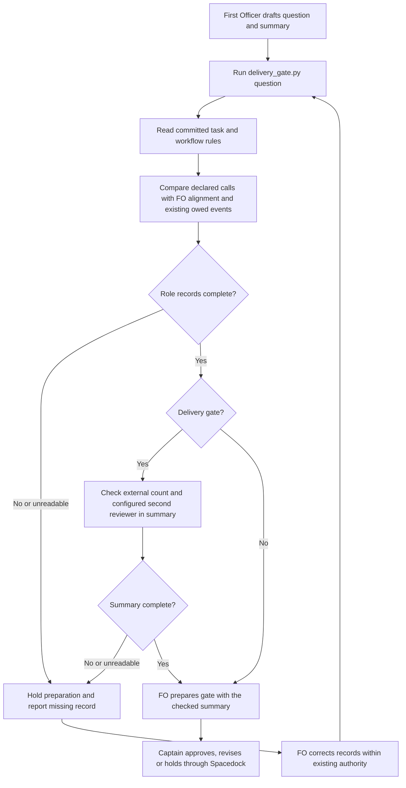

## Scope

- Source: the Captain 「那就a吧」 (chat, 2026-10-29), choosing FO's batch-10 theme "checks for FO's repeated mistakes", built from batch 9's observer violations.
- Bite: batch-reaches-each-gate-together (observer, 2026-10-28): the two chief-engineer batch reviews were not recorded as `Reviewer:` lines under ## FO alignment (FO saved them in a side folder); fo-interviews-extension (observer, 2026-10-29): the committed gate summary of the approved validation gate carried no external-review rounds and no second-reviewer outcome (they reached only the later merge-ask text checked by delivery_gate.py).
- Upstream first: README (Reviewer line under ## FO alignment, the second-reviewer and external-round lines), `scripts/delivery_gate.py` (checks the merge ask text, not the gate summary), `scripts/role_triggers.py`, Spacedock `gate prepare`.
Reviewer: kc-dev-flow-2:chief-engineer opus 2026-10-29 — batch-10 review before the joint ideation sitting: approve, revise or cut each task, the Captain's decisions, overlap and order

## Non-goals

- Deciding which reviews are owed (role_triggers.py and the README do that); checking review content.

## Budget

- One package PR inside an existing check; no new script.

## Stop condition

- Both bites replay as refused before gate preparation, and every current task that recorded its calls passes.

## FO alignment

Alignment: not needed before ideation: a check for rules the README already states.
Surfaces: none
Visible change: none
Release review: not needed: workflow maintenance, on no journey map.

## Design

### PRFAQ

**Proposition.** Before preparing a non-initial gate, the First Officer (FO) will run the existing `delivery_gate.py question` check against the task, the proposed question and the exact proposed summary. A missing canonical role-call record, an owed role call, or missing delivery-review fields holds preparation. The Captain sees the review history in the place the README requires, before granting delivery authority.

**Who benefits?** FO and the Captain of this bounded Pilot workflow. The observed failures are iamcxa/kc-claude-plugins#744 (two real chief-engineer calls kept outside `## FO alignment`) and #745 (delivery review facts absent from its bound summary). This is one package change to an existing checker, with no new executable, review service, background operation or adopter mutation.

**Why is running role_triggers.py earlier insufficient?** At #744's delivery artifact commit `3dc8105cc2e03853c7a4da498389b56a2cb9f6e7`, that released checker exits 0: one amendment event has its engineering-reviewer call. The optional chief-engineer calls do not correspond to another counted trigger. At #745's artifact commit `9948c3eb9aa0cb61959080da6f2776de9881fab4`, it also exits 0: two amendment events are cleared. Preserve those trigger decisions; do not infer mandatory calls from English words in a side report.

**How does the check know a call happened?** Proposed decision D1 requires one cumulative declaration in the proposed gate summary: `Role calls: chief-engineer=N; engineering-reviewer=N.` The integers count completed calls for this task through this gate, including a batch call that reviewed this member. They are FO's attestation, sourced from the review requests/results FO already has. The checker compares them with distinct valid `Reviewer: <agent> <model> <date> — <question>` records under `## FO alignment`, using the existing role parser. Existing dated waivers can clear owed events but are not completed calls. A declaration of two calls with zero canonical lines is refused. An omitted, duplicate, negative or malformed declaration is refused. An explicit false zero can still conceal an entirely unrecorded optional call; no local parser authenticates activity it never receives. The observer remains responsible for that truth boundary.

**Where do delivery facts go?** In the exact summary supplied to `gate prepare`, not only in the question, task report, another folder or a later merge ask. Require one `External rounds: N` line with a nonnegative integer and optional reviewer/evidence detail. Zero is an explicit claim that no external delivery verdict was read by this gate, not a clean review. Reuse the existing configured second-reviewer rules, outcomes, not-run reasons and Copilot saved-refusal checks on the summary alone. A workflow with no configured second reviewer owes no invented second-reviewer declaration. This neither selects reviewers nor judges findings, round truth or review quality. It does not count local self-review as an external verdict automatically.

**What happens next?** On exit 1 FO records the missing calls or summary fields and reruns; on exit 2 FO resolves the unreadable state/configuration and reruns. Exit 0 permits the existing Spacedock preparation sequence; it grants no approval, merge, retry or publication authority. The checked summary must be passed unchanged. This is an FO-run preflight, not a hook preventing a direct unchecked `spacedock gate prepare` call. A changed summary requires another preflight; a stale open binding follows Spacedock withdrawal and reprepare.



Prose/diagram audit: FO authors and runs; the script reads and refuses; Spacedock binds; the Captain rules. Both unreadable inputs and absent records stop before preparation, and delivery-only fields do not gate ideation. Surfaces remain `none`; no UI or schema artifact is owed. Native diagram rendering is not claimed by the text audit.

### Chain and existing-code evidence

1. **Spacedock first:** read the installed 0.27.3 `skills/fo-gate-lifecycle/SKILL.md`, particularly Prepare and Cold report candidate. It owns prepare/commit/read/present and report sufficiency, and documents no kc-dev-flow role-record or external-round predicate. Its initial gate reviews the seed with no worker report. This design does not modify Spacedock, reconstruct a binding or add an initial-stage report requirement.
2. **Package next:** fetched origin and pinned `origin/main` to `5725d495bb83a17ec13616bb5421bf5ffdc71f70`; `.claude-plugin/plugin.json` says released package version `0.33.0`. The installed Codex 0.33.0 workflow, delivery checker and role checker were byte-compared with those source files. `delivery_gate.py question` already runs before validation preparation and reuses text/reviewer checks; `check` calls `owed_role_calls` only before merge. `role_triggers.py` reads committed state, ignores fenced examples, recognizes the canonical alignment section and counts repair/amendment events. `design_surfaces.py` runs before design gates but has no delivery-summary input. Bounded searches: read these caller/function seams, then search the workflow/role parser for Reviewer, second-reviewer, gate-prepare and round rules. Conclusion: repair the existing question-check seam; no replacement engine. External chat and unrecorded/manual calls remain unknown.
3. **Historical sources:** #744's side-folder `batch-9-reviews/README.md` records one chief-engineer run before ideation and a second before delivery. Replay the ideation artifact at `b0055d05af5d2e75828f408e846e6f18c789f112` with one known call, and its delivery artifact at `3dc8105cc2e03853c7a4da498389b56a2cb9f6e7` with two; do not retroactively require the second run at the first gate. #745's approved delivery attempt is `review/validation/briefing-2/index.json`, whose artifact points to `9948c3eb9aa0cb61959080da6f2776de9881fab4`; its summary has neither external rounds nor a second-reviewer outcome. Both observer reports were read. Historical files stay unchanged.
4. **Adopters last, read only:** Relay `subspace-relay/dhaka/docs/dev2/README.md` at code HEAD `5c75e36b5b220c44911c4575286d24bd973d53f6` has the canonical role line but its declared `.spacedock-state` is absent locally: no Relay state replay is claimed. Web `subspace-web/dev2-fo/docs/dev2/README.md` at `485195ec9b30833a3b55e937d7598041932d312e` already runs delivery `question` and has an empty second-reviewer setting; state pin `2c3a6dcbfb3a8e178d65151237a0c234351612c0`. QNow `qnow-adopt-dev2/docs/dev2/README.md` at `278f79ca3eb03a8c1286817f542c4ec4b744bfed` declares Copilot; state pin `2b132074819d4eb6890f3bf731be321032a00442`. These local versions differ; no automatic sync or new remote read was done.
5. **Past decisions:** read accepted architecture decision records (ADRs) 0004 (external rounds), 0020 (word-budget changes), 0026 (counted role triggers and dated calls), 0027 (checks at existing FO writes), and 0043 (optional batch review). Searched state `Override:` records; the applicable precedent rejects guessing authority from prose. Keep the ADR 0026 exclusion of review-round drift from the merge hold; this task does not pass `--review-rounds` or introduce new role triggers. D1 proposes a new record-presence contract, not an exception to the trigger policy. Draft ADR title: `gate-preparation-checks-declared-reviews-in-their-required-homes`, no number reserved here.
6. **Provider limit:** `gh pr view 744 --repo iamcxa/kc-claude-plugins --json number,state,mergeCommit` exited 1, `error connecting to api.github.com`. No hosted PR state, provider review completion or merge was independently verified. The source Git fetch succeeded. Local archive references to #744/#745 identify the replay; they do not replace provider evidence.

### Proposed implementation boundary

Extend `delivery_gate.py question`, retaining the existing `check` merge command and its authority rules. New `--summary-file` is required for question; `--text-file` supplies the question. The task's committed status selects ideation versus validation, using the existing adopted stage mapping; unsupported or ambiguous state holds with exit 2. Initial/backlog gates retain the existing seed check. Five-stage ideation and POC/Pilot/Prod validation all run this same preflight; no additional worker stage is introduced.

Read task records from the actual Git state root at a pinned HEAD, resolving flat, folder and archived paths; do not assume an archived task's parent is the state root. Refuse an uncommitted difference in the target task, without requiring the whole shared state checkout to be clean. A sibling's pending edit must not block this task. Reuse `role_triggers` parsing/functions and owed-event semantics, with no new threshold or model policy. Compare exact distinct canonical call lines with the declared counts; match by role, not a question keyword. Stage reports, fenced examples and side-folder Reviewer lines are not canonical records. The declaration is cumulative through this gate; repeated identical lines cannot increase the count.

For validation, run the existing ordinary question checks over question plus summary, but run the second-reviewer/outcome and new round-count presence checks on the summary only. Preserve current refusal quotes, conditional retry, production/database trigger handling, sufficiency, necessity and merge hold-out behavior. For ideation, run the role-record checks only; do not require delivery sufficiency/necessity, external rounds, Copilot or merge clauses. The summary contains one integer external count; extra commentary/evidence remains free text. Parse these named lines outside fences; do not redesign unrelated decline or amendment parsing. The proposed prototype below isolates this predicate and does not implement these integration/error branches.

A legacy `question` call without `--summary-file` returns a configuration error with the exact command to use. Package source tests and the adopted workflow recipe change together. Independently adopted projects require their normal authorized workflow refresh; do not rewrite their READMEs in this task. No new hook, script, stored call ledger, role launch or historical rewrite. Future CI uses the existing package job; no trigger change or CI-cost claim is proposed.

### Replay already exercised

Disposable Python experiment, `/tmp/gate-review-ideation-probe.py`, run with installed 0.33.0 parsers and the committed snapshots above; source and results are preserved below so `/tmp` is not a durable dependency. Eleven expected outcomes passed:

| Case | Observed exit | What would falsify the claim |
| --- | --- | --- |
| #744 original ideation summary | 1, no declaration | Missing mandatory declaration accepted |
| #744 first known call declared, no canonical chief-engineer record | 1, 1 versus 0 | Side-folder activity counted as alignment |
| #744 first call inserted under alignment | 0 | Valid record still refused |
| #744 record instead under Side notes | 1 | Wrong heading accepted |
| #744 delivery declares both actual calls | 1, 2 versus 0 | One record or none clears two calls |
| #744 two distinct alignment lines inserted | 0 | Correct cumulative records refused |
| #745 original delivery summary | 1 | Missing delivery fields accepted |
| #745 role declaration added, delivery fields still absent | 1 | Ordinary role pass hides summary gap |
| #745 synthetic complete summary | 0 | Complete declared summary refused |
| #745 fields supplied only outside the summary | 1 | Question or later ask clears summary gap |
| #745 fields inside fenced example | 1 | Example counted as real record |

Baseline control: the unmodified 0.33.0 `question` CLI on #745's historical task and original combined question/summary exits 1 already (missing clauses, findings join and configured reviewer). A diagnostic question-only addition of those ordinary fields, reasoned fixture declines, `External rounds: 0` and a reasoned Copilot configuration-error outcome exits 0 (`gate text complete`) while the original summary remains unchanged. The new behavior is location enforcement and optional-call accounting, not claiming the entire original text escaped every current check. The controlled additions are synthetic; they do not repair or authenticate historical evidence.

The #745 synthetic correction uses an explicit zero and a reasoned not-run outcome to test the parser, not to claim those were the historical review facts or to grant delivery. Published archive state is not repaired. A no-configuration second-reviewer case remains an implementation criterion.

At plugin state `e751ef6409b6a7e7bf87f4d3661b1f0cb51a531d`, 31 committed task files have canonical calls; Web has 2, QNow has 0 under the pinned states above. All 33 passed the isolated count/location predicate with declarations frozen from their canonical lines; moving the alignment heading made all 33 fail. This tests compatibility of existing call syntax and removal sensitivity. It is not an independent census of actual calls, a full gate pass, or evidence that old summaries already contain the new mandatory declaration. Under D1, preparing a fresh gate needs that declaration even for a previously well-recorded task. Existing reports, closed gates and historical assertions are preserved.

### Words FO reads at each moment

Root `learning.md` requires a per-moment corpus, including instruction outputs, instead of a single README size. This change is not a reading-reduction claim. The exact proposed replacement is:

> Before every non-initial `gate prepare`, FO runs `python3 <package>/scripts/delivery_gate.py question <task> --text-file <question file> --summary-file <summary file>` and uses that summary unchanged. It declares cumulative `Role calls: chief-engineer=N; engineering-reviewer=N.`; a delivery summary also declares `External rounds: N` and the configured second-reviewer outcome. Nonzero holds preparation. Missing calls belong under `## FO alignment`; unreported activity remains unverifiable.

It replaces the existing sentence starting `Before the validation gate prepare` in Delivery authority. Count with `len(text.split())`, exact heading boundaries, unchanged base `5725d495bb83a17ec13616bb5421bf5ffdc71f70`. The temporary reading probe executes current `test_pr_watch.TasksTests` with provider fixtures and counts its real printed lines; it does not contact GitHub or prove native host reads. The new successful question output remains `gate text complete`; new mandatory gate-data lines are counted at their gate.

| Lifecycle moment | Base words | Proposed words | Difference |
| --- | ---: | ---: | ---: |
| Startup or full resume | 6959 | 7001 | +42 |
| Idle with an open pull request | 862 | 904 | +42 |
| Idle with a merged pull request | 833 | 875 | +42 |
| After archive | 333 | 333 | 0 |
| Merge ask | 2408 | 2450 | +42 |
| Ideation gate, clean check | 3303 | 3352 | +49 |
| Delivery gate, clean check | 3530 | 3579 | +49 |

Manifest: startup = whole workflow + dev skill + workflow mod + Spacedock pr-merge startup + printed watcher output; idle = mod + pr-merge idle + Delivery authority + Extensions + watcher output; archive = mod + learn extension + archive output; merge ask = Delivery authority + Extensions + Spacedock gate-lifecycle + present-gate + sitting output; ideation gate = Stages + Delivery authority + gate-lifecycle + question output + new Role calls line; delivery gate also includes Extensions and the new External rounds line. Whole workflow changes 5754 to 5796 (+42). The two gate examples include only newly required field data; normal task prose, existing reviewer results and role-specific extension loads are variable common data, not zero words. Unchanged global/host contracts are common to both arms and outside this bounded corpus. A listed fo-feedback startup read adds its unchanged 599 words to both arms. Each additional workflow reread adds the same +42. No claim of total model context or actual live FO attention.

Failure output must also be recounted at implementation from the real CLI, including existing owed-role `next:` lines and new defects, and compared with the same archived inputs. The experiment currently prints count/location defects; it does not measure final CLI diagnostics. Do not hide an added instruction in a diagnostic or ADR/help file outside the manifest. Existing role/reviewer rule passages remain authoritative; the new ADR is a decision record consulted for a governing change, not a second routine runtime instruction. D1 includes the +42 workflow increase because the new required invocation/declaration causes it; ADR 0020 still requires the Captain's actual quoted ruling in the eventual budget step.

### Unresolved Captain decision

**D1 — Require the summary declaration and broaden the existing question preflight? Recommendation: yes.** Require the two cumulative role counts at each non-initial gate, a separate summary input, delivery fields in that summary, and the measured +42 workflow words; land the unnumbered ADR draft described above. These are coupled: without a declared inventory, a parser cannot distinguish a genuinely uncalled optional reviewer from #744's omitted records without inventing a trigger or guessing prose. What gets worse: FO must tally two counts per gate, legacy question callers need a workflow refresh, and the bounded reading corpus grows as measured. A false declaration still needs observer review. Alternative: retain existing records with no new declaration; less writing, but #744's optional-call omission cannot be reliably refused, so the stated stop condition must be explicitly narrowed by the Captain. No such narrowing or word-budget grant is assumed here.

## Acceptance criteria

**AC-1** The question preflight refuses #744 at its historically correct gate boundaries for missing canonical call records, while preserving existing role triggers.
Verified by: replay the ideation artifact `b0055d05af5d2e75828f408e846e6f18c789f112` with the first witnessed call and delivery artifact `3dc8105cc2e03853c7a4da498389b56a2cb9f6e7` with both witnessed calls through the candidate CLI in a disposable independent Git clone; record exit/output. Both refuse; correct-place distinct records pass. Move records into another heading, a side file, a fence, or duplicate one record: refusal returns. Run existing role-trigger tests; removing the question-to-role invocation must make the CLI integration test fail. Do not supply review-round drift as a new trigger. Current evidence: isolated predicate replays pass; candidate CLI/wiring not built.

**AC-2** Delivery review fields must be in the exact proposed summary before gate preparation.
Verified by: replay #745's validation attempt 2 with its bound summary, then a diagnostic copy containing truthful test-fixture counts and a configured reviewer outcome. The original refuses and the corrected fixture passes; placing fields only in the question, later merge text, task report or a fence still refuses. Missing/duplicate/negative round counts and missing configured outcomes refuse. A workflow without a configured second reviewer needs no fabricated reviewer result. Existing Copilot refusal, prod/db, hold-out, sufficiency and necessity tests still pass. Current evidence: isolated summary cases pass; full reviewer configuration and CLI integration remain future proof.

**AC-3** Previously valid role-call syntax remains usable; a removed record is detected without rewriting history.
Verified by: run the pinned corpus of 31 package and 2 Web task files above with frozen declared counts and then with each canonical record removed or misplaced. The role-record predicate passes all original call records and refuses each deletion/move; capture per-task results. Do not label this full gate compatibility: old summaries require the new declaration only when preparing a new gate. QNow zero examples and locally unavailable Relay state are explicit limits. Unknown/malformed declarations, unfenced/fenced examples, valid waivers and duplicate exact call lines have focused CLI fixtures. Current evidence: all 33 count/location cases and all 33 heading-removal controls passed; other integration cases not yet verified.

**AC-4** The actual existing pre-gate entry routes both ideation and delivery correctly and stops before preparation on nonzero.
Verified by: execute the documented command in a fresh shell against a disposable state repository and record a prepare-call sentinel in the harness. Nonzero prevents invoking prepare; success supplies exactly the checked summary bytes. Cover POC validation without an ideation requirement, non-delivery without external-review fields, unsupported state, unreadable files/configuration, flat/folder/archive tasks, uncommitted target task versus an unrelated dirty sibling, and task changes between read and use. A direct unchecked Spacedock invocation remains outside enforcement. Mutating the command to omit summary input, bypass the return code, use working-copy call records or pass another summary fails the integration assertion. Current evidence: source seam traced; real integration/sandbox fixture not yet built.

**AC-5** The reading and change budget match the accepted design and introduce no hidden lifecycle load.
Verified by: rerun the preserved reading probe on the exact implementation base/candidate and independently recount the same manifest, real clean/refusal CLI outputs and added gate data. Record each lifecycle total, including any extra help/ADR/extension read; omissions fail the manifest comparison. Run existing lint, delivery, role-trigger and POC README tests, and the repository's required checks for touched files. Budget +42 is a proposal ceiling for this exact wording, not granted authority; if final prose adds more or another batch changes the base, return the difference to FO/Captain. Existing CI trigger stays unchanged; CI cost was not measured and no saving is claimed. Current evidence: exact proposed clean-path counts measured; final implementation and refusal-output totals unverified.

**AC-6** Independent validation preserves the declared authority and ownership boundary.
Verified by: diff exact candidate/base; only the files in Batch overlap change, ADR number reserved by FO at implementation dispatch, no Spacedock files or adopter copies touched, no new executable/hook, no role threshold/model/round-drift policy changed. Validate the new ADR and amended invocation docs; preserve reports and historical gate state. Remove the question-check call from the workflow recipe as a mutation: the wiring contract test must fail. A fresh live gate after adoption is the native evidence that FO follows the preflight; fixture checks alone must not be reported as that observation. Current evidence: ideation changed only this task body and disposable `/tmp` probes; adoption and native execution not run.

### Batch overlap

Proposed files: `kc-dev-flow-2/scripts/delivery_gate.py` (one existing question preflight, parser/error integration and help), `kc-dev-flow-2/scripts/test_delivery_gate.py` (behavioral replay and call-site tests), `kc-dev-flow-2/references/sd/workflow.md` (replace the existing invocation paragraph), `kc-dev-flow-2/scripts/lint-skills.py` (only the approved +42 budget step), `kc-dev-flow-2/scripts/test_poc_readme.py` (POC route preserves the preflight), `kc-dev-flow-2/VALIDATION.md` (evidence/limits), and `docs/adr/<reserved-at-dispatch>-gate-preparation-checks-declared-reviews-in-their-required-homes.md` if D1 is accepted. `role_triggers.py` is imported unchanged, no new script; no CI file or adopter README edits. The shared ADR directory is a number-allocation intersection even without a source conflict.

| Task read as it stands | Shared file/check or none | Implementation consequence |
| --- | --- | --- |
| seed-check-requires-alignment-result — missing alignment result | No direct file; seed gate and imports are adjacent | Keep initial seed behavior; run its suite after integration |
| captain-amendment-form-checked — amendment shape/history | `VALIDATION.md`; delivery consumes amended task records but does not own its parser | Merge the shared evidence document sequentially |
| adr-reserved-when-design-names-one — reserve before dispatch | Shared `docs/adr/` number allocation; its present Scope names dispatch_records/number_guards | Let its final reservation contract govern this task's new ADR |
| validation-rerun-waits-for-captain-ruling — prevent unruled reruns | Shared `docs/adr/` allocation; its current design explicitly leaves delivery_gate alone | Preserve separate pre-dispatch and pre-gate checks |
| gate-requires-recorded-reviews — this task | Owns only the proposed files listed above | No sibling writes during ideation |
| adoption-asks-which-extensions — event-time extension rules | No direct file; shared interpretation of the adopted README | Do not borrow today's extension list for historical truth claims |
| adr-required-statement — earlier ADR ledger proposal | Historical plan overlapped workflow/test_poc_readme and ADR allocation, but Captain closed it | Do not depend on its stale validation status or revive its ledger |
| adr-silent-undo-probe — ADR reversal experiment | No package edits in its current scenario scope | No ordering dependency |
| comment-check-reaches-delivery-gate — comment evidence at delivery | `delivery_gate.py`, `test_delivery_gate.py`, existing delivery entry | Integrate serially and rerun both predicates; do not silently absorb its scope |
| journey-canvas-hosted-poc — hosted canvas | No owned checker file | No ordering dependency |
| journey-server-host-pilot — private journey server | Shared ADR allocation only; checker consumer | No server or hosted-resource changes here |
| ops-inbox-r1-setup-and-isolation — isolated operations inbox | Shared ADR allocation only; kc-ops-inbox/CI otherwise separate | FO reserves noncolliding numbers; no other dependency |
| pr-review-lite-value-pilot — bounded review-value comparison | No shared checker; kc-pr-flow and its journey artifacts | No ordering dependency |

Recommended order: settle D1; coordinate `comment-check-reaches-delivery-gate` before editing the shared checker, whichever FO lands first becoming the other's tested base; land the seed/amendment/reservation work independently but serialize `VALIDATION.md` and ADR numbering. Re-read all completed sibling designs before dispatch because they were still changing during this read. Do not wait for unrelated journey/ops/review work. No peer was messaged and no other task was changed.

### Reproduction appendix

The following disposable probe is the exact executable experiment used above. It requires Python 3, the named installed package and local committed histories; those machine-specific inputs are explicit, not a clean-checkout claim. For another machine, substitute the package/repository/state roots only and keep the pinned snapshots. It does not call Spacedock prepare or GitHub. Its full output preserves per-task corpus rows and separates synthetic corrections from facts.

#### Predicate replay

```python
from pathlib import Path
import sys,re,json,subprocess,hashlib
PKG=Path('/Users/kent/.codex/plugins/cache/kc-claude-plugins/kc-dev-flow-2/0.33.0')
sys.path.insert(0,str(PKG/'scripts'))
sys.dont_write_bytecode=True
import role_triggers as roles
import delivery_gate as gate
ROOT=Path('/Users/kent/conductor/workspaces/kc-claude-plugins/colombo')
STATE=ROOT/'.context/dev2-adoption/worktree/docs/dev2/.spacedock-state'
def git(root,*args):return subprocess.check_output(['git','-C',str(root),*args],text=True)
def counts(text):
    kept=list(roles.alignment(list(roles.outside_fences(text))))
    return {a:len(roles.records(kept,a)[0]) for a in ('chief-engineer','engineering-reviewer')}
def manifest(c):return 'Role calls: '+ '; '.join(f'{a}={n}' for a,n in c.items())+'.'
def proposed(text,summary,delivery=False,second='copilot'):
    errors=[]
    clean='\n'.join(roles.outside_fences(summary))
    decl=re.findall(r'^Role calls: chief-engineer=(\d+); engineering-reviewer=(\d+)\.[ \t]*$',clean,re.M)
    if len(decl)!=1: errors.append('summary needs one Role calls declaration')
    else:
        for (a,n),required in zip(counts(text).items(),map(int,decl[0])):
            if n!=required:errors.append(f'{a}: summary records {required} calls, FO alignment records {n}')
    if delivery:
        rows=re.findall(r'^External rounds:[ \t]*(.+)$',clean,re.M)
        if len(rows)!=1 or not re.match(r'\d+(?:[ \t.;]|$)',rows[0]):errors.append('summary needs one External rounds count')
        if second:
            rows=re.findall(r'^Second reviewer:[ \t]*(.+)$',clean,re.M|re.I)
            if len(rows)!=1:errors.append('summary needs one Second reviewer outcome')
            elif rows[0].lower().startswith(second+' because'):
                if gate.unstated_second_reviewers(clean): errors.append('summary needs second reviewer result')
            elif not rows[0].lower().startswith('not triggered'):errors.append('summary has wrong Second reviewer')
    return errors
results={'scope':'disposable predicate experiment; not candidate CLI or native FO proof','source':'5725d495bb83a17ec13616bb5421bf5ffdc71f70','state':'e751ef6409b6a7e7bf87f4d3661b1f0cb51a531d','cases':[]}
def case(label,errors,want):
    assert bool(errors)==want,(label,errors,want)
    results['cases'].append({'case':label,'exit':int(bool(errors)),'errors':errors})
for slug,rev,stage,attempt in [('batch-reaches-each-gate-together','b0055d05af5d2e75828f408e846e6f18c789f112','ideation',1),('fo-interviews-extension','9948c3eb9aa0cb61959080da6f2776de9881fab4','validation',2)]:
    t=git(STATE,'show',f'{rev}:{slug}.md')
    j=json.loads((STATE/'_archive'/slug/'review'/stage/f'briefing-{attempt}'/'index.json').read_text())
    summary=j['artifacts'][0]['summary']; delivery=stage=='validation'
    case(slug+' original summary',proposed(t,summary,delivery),True)
    c=counts(t)
    if not delivery:
        c['chief-engineer']=1 # The first of the two documented calls preceded this ideation gate.
        declared=summary+'\n'+manifest(c)
        case(slug+' one historically due call declared',proposed(t,declared),True)
        fixed=t.replace('## FO alignment\n','## FO alignment\nReviewer: kc-dev-flow-2:chief-engineer opus 2026-10-28 — batch ideation review\n',1)
        case(slug+' correct-place record',proposed(fixed,declared),False)
        case(slug+' wrong-place record',proposed(t+'\n## Side notes\nReviewer: kc-dev-flow-2:chief-engineer opus 2026-10-28 — batch ideation review\n',declared),True)
    else:
        declared=summary+'\n'+manifest(c)
        case(slug+' calls declared but summary still lacks reviews',proposed(t,declared,True),True)
        fixed=declared+'\nExternal rounds: 0; no external verdict read before this gate.\nSecond reviewer: copilot because review rules; copilot not run: no result recorded before this gate.'
        # Synthetic correction, not a historical assertion that zero was true.
        case(slug+' synthetic complete summary',proposed(t,fixed,True),False)
        case(slug+' fields only in question',proposed(t,declared,True),True)
        case(slug+' fenced fields',proposed(t,declared+'\n```\n'+fixed+'\n```',True),True)
# Delivery #744: both batch calls occurred by this gate; one canonical engineering call already exists.
slug='batch-reaches-each-gate-together'; rev='3dc8105cc2e03853c7a4da498389b56a2cb9f6e7'
t=git(STATE,'show',f'{rev}:{slug}.md'); c=counts(t); c['chief-engineer']=2
case('#744 delivery two missing calls',proposed(t,manifest(c)),True)
fixed=t.replace('## FO alignment\n','## FO alignment\n'+''.join(f'Reviewer: kc-dev-flow-2:chief-engineer opus 2026-10-28 — batch {stage} review\n' for stage in ['ideation','delivery']),1)
case('#744 delivery two canonical records',proposed(fixed,manifest(c)),False)
roots=[STATE,Path('/Users/kent/conductor/workspaces/subspace-web/dev2-fo/docs/dev2/.spacedock-state'),Path('/Users/kent/conductor/repos/qnow-adopt-dev2/docs/dev2/.spacedock-state')]
results['corpus']=[]
for root in roots:
    rev={str(STATE):'e751ef6409b6a7e7bf87f4d3661b1f0cb51a531d',str(roots[1]):'2c3a6dcbfb3a8e178d65151237a0c234351612c0',str(roots[2]):'2b132074819d4eb6890f3bf731be321032a00442'}[str(root)]; passed=[]
    for n in git(root,'ls-tree','-r','--name-only',rev).splitlines():
        if not n.endswith('.md') or n.count('/')>2 or n.startswith('.'):continue
        t=git(root,'show',f'{rev}:{n}')
        if not re.match(r'---\n.*?\n(?:profile|status):',t,re.S):continue
        c=counts(t)
        if not sum(c.values()):continue
        declared=manifest(c); assert not proposed(t,declared)
        # Freeze declaration, then move all canonical calls outside their section.
        bad=t.replace('## FO alignment','## Misplaced alignment')
        assert proposed(bad,declared)
        passed.append({'task':n,'counts':c})
    results['corpus'].append({'root':str(root),'rev':rev,'passed':len(passed),'record_removal_fails':len(passed),'tasks':passed})
print(json.dumps(results,indent=2))
```

#### Per-moment reading probe

```python
from pathlib import Path
import importlib.util,json,sys,subprocess
sys.dont_write_bytecode=True
P=Path('/Users/kent/.codex/plugins/cache/kc-claude-plugins/kc-dev-flow-2/0.33.0')
SD=Path('/Users/kent/.codex/plugins/cache/spacedock/spacedock/0.27.3')
R=Path('/Users/kent/conductor/workspaces/kc-claude-plugins/colombo')
read=lambda x:(P/x).read_text(); words=lambda x:len(x.split())
def section(t,h):
 a=t.index('\n'+h+'\n')+1;b=t.find('\n## ',a+len(h));return t[a:b if b>=0 else None]
old='Before the validation `gate prepare`, FO runs `python3 <package>/scripts/delivery_gate.py question <task> --text-file <question-and-summary file>`.'
new='Before every non-initial `gate prepare`, FO runs `python3 <package>/scripts/delivery_gate.py question <task> --text-file <question file> --summary-file <summary file>` and uses that summary unchanged. It declares cumulative `Role calls: chief-engineer=N; engineering-reviewer=N.`; a delivery summary also declares `External rounds: N` and the configured second-reviewer outcome. Nonzero holds preparation. Missing calls belong under `## FO alignment`; unreported activity remains unverifiable.'
base=subprocess.check_output(['git','-C',str(R),'show','5725d495bb83a17ec13616bb5421bf5ffdc71f70:kc-dev-flow-2/references/sd/workflow.md'],text=True)
assert base==read('references/sd/workflow.md'); assert base.count(old)==1
candidate=base.replace(old,new)
for name in ['role_triggers.py','delivery_gate.py']:
 assert subprocess.check_output(['git','-C',str(R),'show','5725d495bb83a17ec13616bb5421bf5ffdc71f70:kc-dev-flow-2/scripts/'+name])==(P/'scripts'/name).read_bytes()
spec=importlib.util.spec_from_file_location('watchtests',P/'scripts/test_pr_watch.py');test=importlib.util.module_from_spec(spec);spec.loader.exec_module(test)
outputs={}
for moment in ['startup','idle open','idle merged','after archive']:
 c=test.TasksTests();c.setUp();c.readme('learn' if moment=='after archive' else '')
 try:
  if moment=='after archive':c.archive('task-0')
  else:c.task('task-0',pr='o/r#7')
  code,lines=c.tasks({'pr view 7':{'state':'MERGED'}} if moment=='after archive' else {},look=lambda *a,**k:test.snap(state='MERGED' if moment=='idle merged' else 'OPEN',checks='pending'))
  assert code==0; outputs[moment]='\n'.join(lines)
 finally:c.doCleanups()
outputs['merge ask']='\n'.join(test.watch.sittings([dict(slug=f'task-{i}',current='validation',readiness='awaiting-captain') for i in range(4)]))
mod=read('references/sd/mods/kc-dev-flow-2.md');pm=(SD/'mods/pr-merge.md').read_text();life=(SD/'skills/fo-gate-lifecycle/SKILL.md').read_text();present=(SD/'skills/present-gate/SKILL.md').read_text()
def corpus(w):
 a=section(w,'## Delivery authority');e=section(w,'## Extensions')
 return {'startup':w+read('skills/dev/SKILL.md')+mod+section(pm,'## Hook: startup'),'idle open':mod+section(pm,'## Hook: idle')+a+e,'idle merged':mod+section(pm,'## Hook: idle')+a+e,'after archive':mod+read('extensions/learn/EXTENSION.md'),'merge ask':a+e+life+present,'ideation gate':section(w,'## Stages')+a+life,'delivery gate':section(w,'## Stages')+a+e+life}
b=corpus(base);c=corpus(candidate);result={'old':old,'new':new,'workflow':{'base':words(base),'proposal':words(candidate),'delta':words(candidate)-words(base)},'moments':{}}
for m in b:
 out=outputs.get(m,'gate text complete' if m=='delivery gate' else '')
 newout=outputs.get(m,'gate text complete')
 # New mandatory attestation is also read as gate data: 4 words; include at gate moments.
 extra='Role calls: chief-engineer=0; engineering-reviewer=0.' if m in ['ideation gate','delivery gate'] else ''
 if m=='delivery gate':extra+=' External rounds: 0.'
 result['moments'][m]={'base':words(b[m])+words(out),'proposal':words(c[m])+words(newout)+words(extra),'output_base':out,'output_proposal':newout,'new_gate_data':extra}
print(json.dumps(result,indent=2))
```

#### Frozen corpus results

State e751ef6409b6a7e7bf87f4d3661b1f0cb51a531d: 31 originals pass, 31 record-removal controls refuse.

- `_archive/agent-reads-governing-adr.md`: chief-engineer 0, engineering-reviewer 1.
- `_archive/batch-reaches-each-gate-together.md`: chief-engineer 0, engineering-reviewer 1.
- `_archive/captain-question-load.md`: chief-engineer 1, engineering-reviewer 0.
- `_archive/codex-reader-reads-receipt-marker.md`: chief-engineer 0, engineering-reviewer 1.
- `_archive/copilot-not-run-line-carries-quote.md`: chief-engineer 1, engineering-reviewer 0.
- `_archive/delivery-gate-settles-skipped-checks.md`: chief-engineer 0, engineering-reviewer 1.
- `_archive/design-director-runs-ui-design-review.md`: chief-engineer 1, engineering-reviewer 2.
- `_archive/fo-interviews-extension.md`: chief-engineer 0, engineering-reviewer 1.
- `_archive/fo-write-rules-checked.md`: chief-engineer 1, engineering-reviewer 1.
- `_archive/fo-written-lines-checked-before-dispatch.md`: chief-engineer 1, engineering-reviewer 0.
- `_archive/idle-hook-names-merged-tasks-without-learn.md`: chief-engineer 1, engineering-reviewer 1.
- `_archive/journey-probe-finds-nested-maps.md`: chief-engineer 1, engineering-reviewer 0.
- `_archive/kc-adr-format-source.md`: chief-engineer 0, engineering-reviewer 1.
- `_archive/kc-adr-tools-with-dev2-copy.md`: chief-engineer 0, engineering-reviewer 1.
- `_archive/kc-decision-log-cli.md`: chief-engineer 0, engineering-reviewer 1.
- `_archive/merge-ask-holds-missing-clauses.md`: chief-engineer 0, engineering-reviewer 1.
- `_archive/merge-gatekeeper.md`: chief-engineer 1, engineering-reviewer 0.
- `_archive/new-work-starts-from-a-story-map.md`: chief-engineer 1, engineering-reviewer 1.
- `_archive/paseo-codex-dispatch-practice.md`: chief-engineer 0, engineering-reviewer 1.
- `_archive/peers-rules-name-each-host-binding.md`: chief-engineer 0, engineering-reviewer 1.
- `_archive/read-adr-honors-adr-folder.md`: chief-engineer 1, engineering-reviewer 1.
- `_archive/read-adr-reporting-rule-followup.md`: chief-engineer 0, engineering-reviewer 1.
- `_archive/release-acceptance/index.md`: chief-engineer 1, engineering-reviewer 1.
- `_archive/release-review-staleness-held-at-dispatch.md`: chief-engineer 1, engineering-reviewer 0.
- `_archive/release-walk-picky-reviewers-and-director.md`: chief-engineer 1, engineering-reviewer 1.
- `_archive/reused-worker-dispatch-leaves-a-record.md`: chief-engineer 0, engineering-reviewer 1.
- `_archive/seed-check-requires-schema-fields.md`: chief-engineer 1, engineering-reviewer 1.
- `_archive/ui-design-review-in-ideation.md`: chief-engineer 1, engineering-reviewer 0.
- `archive-waits-for-observer-report.md`: chief-engineer 1, engineering-reviewer 0.
- `dispatch-carries-reserved-adr-number.md`: chief-engineer 1, engineering-reviewer 0.
- `kc-decision-log-handoff-trial.md`: chief-engineer 0, engineering-reviewer 1.

State 2c3a6dcbfb3a8e178d65151237a0c234351612c0: 2 originals pass, 2 record-removal controls refuse.

- `_archive/others-highlights-in-author-colour.md`: chief-engineer 0, engineering-reviewer 2.
- `_archive/review-page-polish-on-the-real-page.md`: chief-engineer 0, engineering-reviewer 1.

State 2b132074819d4eb6890f3bf731be321032a00442: 0 originals pass, 0 record-removal controls refuse.


Prototype outputs: 11/11 expected case outcomes; the 33 positive records and 33 location-removal controls above. No candidate CLI, Spacedock gate mutation, hosted review or native FO action is established by this appendix. Pilot boundary remains the current task design, pending D1 and the normal gate.

## Stage Report: ideation

- DONE: A design for refusing gate preparation while a role call or review round the README requires is not recorded where it says (Reviewer: lines under ## FO alignment for role calls; external rounds and the second-reviewer outcome in the gate summary of a delivery gate), inside an existing check FO runs before gate prepare; the #744 (batch-reaches-each-gate-together) and #745 (fo-interviews-extension) archived records replayed as refused, and tasks that recorded their calls passing
  PRFAQ and matching Mermaid select delivery_gate.py question; both archived bites refuse in the disposable predicate, 33 canonical-call tasks pass and all 33 misplaced-record controls refuse. Baseline #745 already refuses other omissions; question-only review fields pass base, isolating the location gap. D1 is not yet approved.
- DONE: A `### Batch overlap` section naming each file the design would change and each other batch task (seed-check-requires-alignment-result, captain-amendment-form-checked, adr-reserved-when-design-names-one, validation-rerun-waits-for-captain-ruling, gate-requires-recorded-reviews) and live task of other sessions (adoption-asks-which-extensions, adr-required-statement, adr-silent-undo-probe, comment-check-reaches-delivery-gate, journey-canvas-hosted-poc, journey-server-host-pilot, ops-inbox-r1-setup-and-isolation, pr-review-lite-value-pilot (driven by other sessions; read only)) that changes the same file or check, so FO can order implementation
  Batch overlap names seven proposed files, every requested batch/live task, shared delivery checker and ADR allocation, and serial integration order; other task files remain unchanged.
- DONE: The words FO reads at each lifecycle moment, before and after, per root learning.md "Measure the words FO reads at each moment, not one file's size"
  Pinned 5725d495bb83a17ec13616bb5421bf5ffdc71f70 corpus measured startup 6959→7001, idle 862→904/833→875, archive 333→333, merge 2408→2450, ideation 3303→3352, delivery 3530→3579; actual final refusal diagnostics/native reads remain unverified.
- DONE: Acceptance criteria with reproducible evidence clauses and falsifiers, and unresolved decisions for the Captain, each with a recommendation and what gets worse under it
  AC-1 through AC-6 each carry reproducible evidence and falsifiers; one coupled decision D1 recommends explicit call counts and separate summary input, disclosing legacy-call updates, +42 workflow words and false-attestation limits.
- DONE: AC-1 current-stage evidence
  Historical role checker returns 0 on both bites; #744 one-call/two-call predicates refuse until correctly placed distinct records are added. Candidate CLI integration remains unverified; bypassing its role call must fail the future integration test.
- DONE: AC-2 current-stage evidence
  #745 missing-summary and question-only/fenced-field controls refuse in the experiment; complete synthetic summary passes. Full configuration/refusal handling remains unverified; accepting question-only fields falsifies the intended boundary.
- DONE: AC-3 current-stage evidence
  31 package plus 2 Web committed task call records pass frozen declarations; moving their alignment heading makes all 33 refuse. This is syntax/location compatibility, not a full legacy-gate pass or independent call census; Relay state is unavailable locally.
- DONE: AC-4 current-stage evidence
  Existing question and Spacedock prepare call sites traced; no candidate/native gate ran. Future fresh-shell sentinel test must fail if preparation executes after nonzero or uses different summary bytes.
- DONE: AC-5 current-stage evidence
  Exact proposed wording and per-moment corpus/output counts reproduced; final CLI diagnostics and actual native reads not measured. Omitting a new lifecycle passage or output invalidates the total; no CI trigger change or cost saving claimed.
- DONE: AC-6 current-stage evidence
  Original task prefix/frontmatter preserved; only this task body and disposable probes written. Future candidate diff, ADR lint and native adoption remain unverified; a new script, changed trigger or foreign/adopter edit violates the design.
- DONE: Required surface check
  Installed 0.33.0 design_surfaces.py check exits 0: gate-requires-recorded-reviews.md: design surfaces presentable. Surfaces none; prose/Mermaid actors and stop branches audited; no native rendering claim.

### Summary

Designed the bounded existing-check repair and preserved reproducible historical, positive-corpus and reading experiments in this task. D1 asks for the only new contract needed to expose optional-call omissions: declared cumulative calls and the exact gate summary, costing +42 workflow words; implementation, gate approval and native operation remain pending. GitHub API access failed, so the report claims pinned local evidence only; no product file, branch, PR or peer session was changed.
