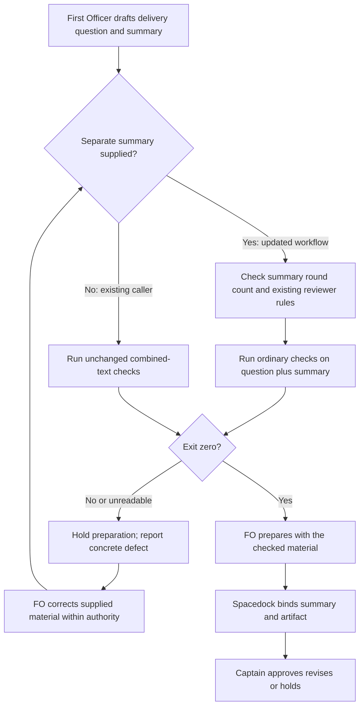

## Scope

- Source: the Captain 「那就a吧」 (chat, 2026-10-29), choosing FO's batch-10 theme "checks for FO's repeated mistakes", built from batch 9's observer violations.
- Bite: batch-reaches-each-gate-together (observer, 2026-10-28): the two chief-engineer batch reviews were not recorded as `Reviewer:` lines under ## FO alignment (FO saved them in a side folder); fo-interviews-extension (observer, 2026-10-29): the committed gate summary of the approved validation gate carried no external-review rounds and no second-reviewer outcome (they reached only the later merge-ask text checked by delivery_gate.py).
- Upstream first: README (Reviewer line under ## FO alignment, the second-reviewer and external-round lines), `scripts/delivery_gate.py` (checks the merge ask text, not the gate summary), `scripts/role_triggers.py`, Spacedock `gate prepare`.

## Non-goals

- Deciding which reviews are owed (role_triggers.py and the README do that); checking review content.

## Budget

- One package PR inside an existing check; no new script.

## Stop condition

- The opted-in existing delivery check refuses the #745 bound-summary omission before gate preparation, accepts complete summary fixtures, and preserves source verdicts/output for legacy calls without --summary-file. No #744 role-call attestation or refusal is required; unrecorded optional calls and truth of supplied review facts remain observer-owned under the Captain's 2026-10-29 decision C and batch ruling A. Complete the acceptance criteria below before claiming implementation acceptance; native adoption remains separately observed.

## FO alignment

Alignment: not needed before ideation: a check for rules the README already states.
Surfaces: none
Visible change: none
Release review: not needed: workflow maintenance, on no journey map.
Reviewer: kc-dev-flow-2:chief-engineer opus 2026-10-29 — batch-10 review before the joint ideation sitting: approve, revise or cut each task, the Captain's decisions, overlap and order

## Design

### Revision authority and boundary

This definition supersedes the first design and its AC-1 through AC-6; the earlier Stage Report remains an immutable historical report at the end. The first design is preserved in state commit `3be2d02545f4ffe7d6cd0af36efe9eef03fd4baf`. The Captain's ideation resolution on 2026-10-29 quotes 「照建議」 and accepts decision C in `gate-requires-recorded-reviews/review/ideation/briefing-1/index.json`: build only the #745 summary-location repair, drop the #744 `Role calls:` attestation, preserve existing callers, and remeasure the word increase. Batch ruling A means the check covers structurally observable omissions; the observer keeps what cannot be inferred from supplied records. The title and Scope retain the original problem provenance; they do not reintroduce the excluded half.

Profile: Pilot, one bounded existing-check repair. No new production, hosted-service, credential, background-job or support obligation. This dispatch changes only this task body/report and disposable experiments; implementation and the next gate remain with the normal workflow.

### PRFAQ

**Proposition.** Before preparing a delivery gate, the First Officer (FO) checks the exact proposed summary for its external-review round count and configured second-reviewer declaration/outcome, through the existing `delivery_gate.py question` command. Missing facts hold preparation instead of appearing only in a later merge ask. Existing callers that supply only combined question/summary text keep their current behavior.

**Which failure is repaired?** Pull request #745, the operator-interview extension, reached validation attempt 2 with neither fact in its bound summary. The raw old question/summary already fails today's ordinary text checks for other omissions; a diagnostic copy with those ordinary fields supplied only in the question passes. The new test isolates the location defect: that copy must fail when the unchanged summary is supplied separately. This is not a claim that every old check accepted the raw historical gate.

**What is deliberately excluded?** Pull request #744, the named-batch workflow change, had optional chief-engineer calls outside the required alignment section. No `Role calls:` line, call inventory, new role trigger, canonical-call census, question-to-role invocation or ideation-gate preflight is added. Role rules and their current enforcement remain unchanged. The observer keeps unrecorded optional activity; a summary parser cannot establish its occurrence.

**What exactly is checked?** When supplied, `--summary-file` identifies the proposed summary. Outside Markdown fences it needs one top-level `External rounds: N` line, where N is a nonnegative decimal integer; a trailing full stop or `; <detail>` / `. <detail>` is allowed. Empty, negative, fractional, nonnumeric and duplicate counts fail. Zero explicitly means no external delivery verdict has been read by this gate; it is neither a clean review nor proof of no unreported activity. Use the README's existing definition of a round, with no new review threshold or provider lookup.

The same summary supplies the configured `Second reviewer: <name> because <trigger>` and a recognized outcome, or `Second reviewer: not triggered` when existing rules permit it. Reuse `reviewer_config`, `reviewer_problems` and `unstated_second_reviewers`: preserve prod/db contradiction checks, recognized `review:<id>` / `comment:<id>` outcomes, not-run reasons, Copilot saved-refusal quote/id and conditional-retry rules, and configuration-error/unsupported-type handling. `answer=review:<id>` remains not a review. An empty second-reviewer configuration owes no invented declaration; an explicitly named reviewer still needs an outcome. Human/semantic trigger judgment remains with FO. No decision about review truth, completeness, quality or whether a missing external round really occurred is automated.

**How do old callers work?** `question <task> --text-file <combined-file>` without the new optional argument follows its current code path, with the same verdict/output and no round-count or location requirement. It does not prove where the eventual bound summary stores facts. This is the accepted compatibility limit, including Web's currently adopted invocation. The package workflow recipe opts into the new separate input; adopter refreshes use their own authorization. No adopter README is edited here.

**What authorizes the next action?** Exit 1 means missing/malformed content; exit 2 means unreadable input/configuration or the existing unsupported configuration. Both hold preparation. Exit 0 permits FO to continue the existing Spacedock lifecycle using the checked summary unchanged, but grants no approval or merge authority. Changing the summary requires another check; changing an already open binding requires Spacedock withdrawal/reprepare. A direct unchecked `gate prepare`, a dishonest count, or supplying different bytes afterwards remains outside this local check, with the observer responsible for those facts.



Diagram/prose audit: FO authors/runs/corrects; the script checks supplied data; Spacedock binds; the Captain rules. The legacy branch preserves combined-text behavior and has no summary-location guarantee. No initial or ideation gate gains a new command. `Surfaces: none` owes no UI/database artifact. Diagram syntax/native rendering is not claimed; actors, branch order and stops were compared with the prose.

### Chain and existing-code evidence

1. **Spacedock first:** read installed 0.27.3 `skills/fo-gate-lifecycle/SKILL.md`, Prepare and Cold report candidate. It owns prepare/commit/read/present and report sufficiency, but supplies no package-specific review-field preflight. Its initial gate reviews the seed without a report. This design changes no Spacedock code, binding, hook or stage graph.
2. **Package second:** `git fetch origin` succeeded; current `origin/main` is `5725d495bb83a17ec13616bb5421bf5ffdc71f70`, released package `0.33.0`. Installed Codex `delivery_gate.py`, `role_triggers.py` and `references/sd/workflow.md` match those source bytes. Traced `question` (lines 637-657), argparse (660-677), existing reviewer/text helpers and all package caller hits. The current question command already accepts a caller-supplied task, text and optional workflow directory and performs no remote action or gate write. Repair this seam; do not add a replacement checker or a committed-task/history subsystem. The existing `role_triggers.outside_fences` helper may be imported unchanged for summary filtering only; no role function is invoked.
3. **Historical replay:** #745's stored validation briefing-2 summary points to task commit `9948c3eb9aa0cb61959080da6f2776de9881fab4`. The original summary lacks both review fields. Existing CLI and isolated summary experiments below reproduce the location distinction. All corrections in the experiment are explicitly synthetic, not historical repairs or statements that the count was zero. GitHub read-only query succeeded in this revision: `gh pr view 745 --repo iamcxa/kc-claude-plugins --json number,state,mergeCommit` reported MERGED at `e9347c8e511d4dbfee49d59dc7e486f376b4fa0c`. This corrects only the earlier run's connectivity limit; it proves neither the historical reviews nor acceptance of their contents.
4. **Adopters last, read-only:** Relay code HEAD `5c75e36b5b220c44911c4575286d24bd973d53f6` declares `.spacedock-state`, absent locally, so no Relay state replay is claimed. Web code HEAD `485195ec9b30833a3b55e937d7598041932d312e`, state `2c3a6dcbfb3a8e178d65151237a0c234351612c0`, uses the legacy combined-file command and empty second-reviewer configuration. QNow code HEAD `278f79ca3eb03a8c1286817f542c4ec4b744bfed`, state `8d09186345940d7b92369157d8e05007541a2825`, configures Copilot. No adopter is mutated or silently upgraded; current configuration is a compatibility input, not proof of its historical configuration.
5. **Past rulings:** read accepted architecture decision records (ADRs) 0004 (external rounds), 0020 (word budget), 0023 (carried merge authority), 0026 (role-event policy), 0027 (checks at existing writes), and 0043 (named batches) at that source. Read state `Override:` records: unrelated reversals do not authorize a new role policy here. Preserve the explicit exclusion of review-round drift from the merge hold. The current Captain decision narrows the former proposal; it does not reopen those decisions.

### Proposed implementation boundary

- `question` gains optional `--summary-file`; omission preserves the released path. Supplying an unreadable summary exits 2; an empty summary exits 1. No requirement is added to `check`, no task-status selector is added, and initial/ideation commands stay unchanged.
- In the supplied-summary branch, keep ordinary text checks on question plus summary, but run configured-reviewer and outcome checks on the summary alone; a reviewer declaration or outcome present only in the question must not satisfy them. Use the existing fence iterator for these new summary checks. Do not change legacy parsing, ordinary decline/confirmation grammar, model thresholds, round drift, Copilot policy or merge checks.
- The summary count is a presence/form check, not a new ledger or history audit. No state snapshot pinning, dirty-task refusal, new history read, provider call, source-authentication claim or extra lifecycle read is introduced. Keep existing flat/folder task support and explicit `--workflow-dir` support for archived/split-root fixtures.
- Update the existing delivery command in the workflow and its POC-derived route test. Do not broaden it to ideation. Test the actual command and return-code handling with a disposable prepare-call recorder: failing preflight must not reach prepare, and a successful recipe must forward the same summary bytes. That is recipe proof, not a native Spacedock hook. A later observed adopted gate is required to claim FO followed it in real use.
- One package PR, existing tests and CI job; no new script, service or CI trigger. CI cost per PR was not measured; no cost reduction is claimed. Package release versioning stays with release-please.

### Experiments already exercised

The executable experiment is preserved below, using only Python 3, the declared 0.33.0 package and pinned local Git objects. It produced 17 expected results: historical summary refused; synthetic complete summary accepted; question-only/later-ask and fenced fields refused; duplicate, negative, decimal, word and empty counts refused; no configured reviewer accepted without a fabricated result; Pilot not-triggered accepted and Prod not-triggered refused; outcome-only-in-question and answer token refused; recognized review token accepted; released CLI raw historical text refused, while its question-only diagnostic correction passed. Removing the round predicate or allowing the question to satisfy summary fields causes the negative controls to pass, demonstrating the intended boundary's sensitivity. No candidate CLI exists yet.

The released CLI also ran without `--summary-file` on all 60 Web validation briefings at the pinned state, reading each artifact's original task revision and current Web configuration. All 60 exit 1 already: all lack the current Sufficiency/Necessity clauses, with some additional decline defects. These are baseline failures, not regressions introduced here. The first briefing (`ac9-feedback-phone-revision-drawer-note-time`, task revision `d430df1ba3d7b8f3973b306d400ccaadf96461c3`) passes after adding just synthetic Sufficiency/Necessity clauses. Candidate compatibility must preserve both the 60 original verdicts/messages and this positive control; “all archived gates pass” is not an acceptance claim.

### Words FO reads at each moment

Exact replacement for the existing sentence beginning `Before the validation gate prepare`:

> Before the validation `gate prepare`, FO runs `python3 <package>/scripts/delivery_gate.py question <task> --text-file <question file> --summary-file <summary file>`; nonzero holds preparation. The summary declares `External rounds: N` and the configured second-reviewer outcome. Use that summary unchanged; callers omitting `--summary-file` retain combined-text checks.

Counted with Python `len(text.split())` against source `5725d495bb83a17ec13616bb5421bf5ffdc71f70`. The whole workflow changes **5754 → 5781 (+27)**, replacing the prior +42 proposal. The probe runs the existing watcher fixture to capture actual printed output. A second implementation using line-based section extraction and regex word counting independently matched all 14 before/after lifecycle totals.

| Lifecycle moment | Before | Proposed | Change |
| --- | ---: | ---: | ---: |
| Startup/full resume | 6959 | 6986 | +27 |
| Idle, open PR | 862 | 889 | +27 |
| Idle, merged PR | 833 | 860 | +27 |
| After archive | 333 | 333 | 0 |
| Merge ask | 2408 | 2435 | +27 |
| Ideation gate, unchanged command | 3303 | 3330 | +27 |
| Delivery gate, clean separate-summary command | 3530 | 3560 | +30 |

Manifest: startup = whole workflow + dev skill + workflow mod + Spacedock pr-merge startup + watcher output; idle = mod + pr-merge idle + Delivery authority + Extensions + watcher output; archive = mod + learn extension + archive output; merge ask = Delivery authority + Extensions + Spacedock lifecycle + present-gate + sitting output; ideation = Stages + Delivery authority + lifecycle; delivery = Stages + Delivery authority + Extensions + lifecycle + unchanged `gate text complete` output, plus three words for the new canonical `External rounds: 0` line. Reviewer content was already required in the summary and remains variable common data; no role declaration or new ideation output is counted. Ideation grows only because this bounded corpus includes Delivery authority, not because its command changes.

Unchanged global/host instructions and full task prose are outside this bounded corpus, not asserted to be zero. Loading the optional fo-feedback startup extension adds the same 599 words to each arm; each extra workflow reread repeats +27. No reduction or total model-context claim is made. The existing command's failure output was exercised; candidate diagnostics and actual native FO reading remain unmeasured until implementation. Final acceptance recounts both clean and refusal output at the actual source/candidate, including help/ADR/extension reads if newly introduced. Do not hide recurring instructions in another file to satisfy the budget.

### Decision record and remaining Captain decision

Decision C and batch ruling A are settled. Land an unnumbered ADR draft titled `delivery-gate-summaries-carry-review-facts-with-legacy-call-compatibility`, recording the Captain's 「照建議」 with the exact gate question, the observable-summary boundary, excluded role attestation, legacy compatibility and observer responsibility. FO reserves the number at implementation dispatch; no existing ADR is edited. This is a durable record of the accepted direction, not an additional runtime instruction.

**Remaining decision: accept this exact +27 workflow-word raise with the revised design? Recommendation: yes.** It names the explicit summary operand, same-summary requirement and compatibility limit at the existing preflight. What gets worse: startup/resume and each listed Delivery-authority read grow by 27 words; old adopters retain a known location-check gap until their normal refresh. The old +42 proposal is withdrawn and is not treated as a grant. ADR 0020 requires the eventual positive budget step to quote the actual Captain ruling answering this measured proposal; return any changed total after sibling integration instead of assuming slack. No other material scope/interface decision remains unresolved.

## Acceptance criteria

These six criteria replace the first design's six criteria under the recorded ideation revise. Current evidence is design-stage evidence only; each future candidate check below is still required.

**AC-1** The opted-in delivery command refuses the #745 summary-location defect before preparation.
Verified by: extract the bound summary from `_archive/fo-interviews-extension/review/validation/briefing-2/index.json` and task revision `9948c3eb9aa0cb61959080da6f2776de9881fab4` into a disposable independent clone/temp fixture; use the recorded diagnostic question additions to make ordinary base checks pass, then run candidate `question --text-file <question> --summary-file <original-summary>`. It must exit 1 for absent summary facts. A synthetic complete summary must pass; moving the fields to the question, task report, later merge ask or a fence must restore refusal. Record exact inputs, base/candidate SHAs, exit and stdout. Removing summary enforcement must fail this test. Current: isolated predicate and released-CLI differential passed; candidate wiring not built.

**AC-2** The summary check reuses existing reviewer rules and checks a bounded round-count form.
Verified by: candidate CLI fixtures for zero/positive counts, missing/duplicate/negative/fractional/nonnumeric counts, valid optional detail, no configured reviewer, allowed not-triggered, Prod/db not-triggered refusal, wrong reviewer, missing outcome, review/comment versus answer tokens, saved Copilot refusal mismatch/missing file, retry offer, reasoned configuration error and unsupported PR type. Check exits 0/1/2 as applicable. Run existing delivery/reviewer suites unchanged. Mutate summary-only outcome lookup to combined text, or remove count checking: intended negatives must turn green and fail the suite. Current: 15 isolated summary cases and two sensitivity controls passed; full CLI/error/configuration integration remains unverified.

**AC-3** Omitting the new argument preserves legacy callers, including Web, without a new record requirement.
Verified by: run source and candidate `question` without `--summary-file` on the pinned 60 Web briefing/artifact pairs, and on package/QNow committed delivery inputs where readable, comparing exit and output per input. Preserve pre-existing failures and explain unavailable saved artifacts; do not synthesize “green history.” The Web positive diagnostic control and ordinary valid fixtures pass with no external-round or role-count declaration. Test flat/folder/archived task paths with the existing explicit workflow option. Making argparse require the new option or imposing its predicates on the omitted path must fail compatibility tests. Current: 60 Web base results and one synthetic positive measured; candidate/cross-adopter differential remains future proof; Relay state unavailable locally.

**AC-4** Only the existing delivery entry opts in, and the check precedes preparation using the same summary.
Verified by: render the normal workflow and generated POC README, run their documented command in a fresh shell with disposable inputs, and record whether the subsequent prepare step is called and the bytes it receives. Exit 1/2 must stop; exit 0 passes the same summary. Cover unreadable/empty summary, unreadable configuration and no summary. Remove the command, omit its summary option, ignore its exit or swap the forwarded summary: the recipe assertion fails. Initial/ideation routes remain unchanged. Native real-use observation remains separate and must not be inferred from this harness. Current: seams traced; candidate recipe/native run not performed.

**AC-5** Word counts and final changed files match the approved narrowed design.
Verified by: rerun the preserved per-moment probe plus independent recount at the exact implementation base/candidate, and count real success and refusal diagnostics. Whole-workflow delta is +27 only for the exact replacement above; any different final delta returns to FO/Captain under ADR 0020. Run lint-skills, delivery, POC README and applicable dispatch/ADR checks for the final touched files. Removing an added read/output from the manifest or inventing a Captain budget quote fails validation. Current: 14 totals independently agree; final runtime/CI cost not measured; CI triggers unchanged.

**AC-6** The task preserves role policy, history, authority and scope.
Verified by: independently compare candidate/base: no `Role calls:` requirement, no new role call/trigger or review-drift merge hold, no new executable/hook, no Spacedock/adopter edit, no historical gate/report rewrite. Only Batch overlap's files change; FO supplies the ADR number at implementation dispatch and its linter validates the draft's eventual file. Mutating the legacy call to invoke a role counter or changing the stage route must fail the regression checks. A native gate after separate authorized adoption is needed before claiming workflow compliance. Current: design scope only; the previous report is retained byte-for-byte; implementation/native evidence pending.

### Batch overlap

Proposed files: `kc-dev-flow-2/scripts/delivery_gate.py` (optional input and existing question branch), `kc-dev-flow-2/scripts/test_delivery_gate.py` (replays, compatibility, malformed/configuration cases), `kc-dev-flow-2/references/sd/workflow.md` (one delivery invocation replacement), `kc-dev-flow-2/scripts/lint-skills.py` (only the approved exact budget step), `kc-dev-flow-2/scripts/test_poc_readme.py` (derived invocation), `kc-dev-flow-2/VALIDATION.md` (evidence/limits), and `docs/adr/<reserved-at-dispatch>-delivery-gate-summaries-carry-review-facts-with-legacy-call-compatibility.md` (accepted boundary). The unmodified fence helper is reused; `role_triggers.py` is not changed. No new script, CI file, adopter README or shared ADR list file is proposed; ADR numbering is still a shared namespace.

| Task and meaning | Shared file/check or none; implementation consequence |
| --- | --- |
| seed-check-requires-alignment-result — seed alignment presence | No direct file; adjacent pre-gate entry, keep seed behavior and rerun its regression suite. |
| captain-amendment-form-checked — amendment form/history | `VALIDATION.md` only; serialize evidence edits, no gate-history dependency. |
| adr-reserved-when-design-names-one — reservation before dispatch | `VALIDATION.md` and consumption of its proposed reservation rule; FO reserves this design's ADR, no direct checker overlap. |
| validation-rerun-waits-for-captain-ruling — unresolved rerun hold | Shared ADR number namespace; its latest design leaves delivery_gate/workflow unchanged. |
| gate-requires-recorded-reviews — this summary-location repair | Owns only the seven proposed files; this stage writes only its entity body/report. |
| adoption-asks-which-extensions — event-time extension context | No direct file; preserve adopted README reviewer configuration, no historical-extension inference. |
| adr-required-statement — older product-ruling ledger | Explicitly closed 2026-10-20 despite stale validation status; old workflow/POC/ADR overlap is not live ownership. Do not revive it. |
| adr-silent-undo-probe — ADR reversal experiment | Moved to dev2-poc; this copy is not dispatched. No runtime overlap. |
| comment-check-reaches-delivery-gate — comment evidence at gate | Explicitly closed 2026-10-20; historical delivery_gate/test overlap is not an active dependency. This corrects the first report's ordering recommendation. |
| journey-canvas-hosted-poc — shared hosted canvas | kc-journey-map hosting scope; no shared runtime file/check. |
| journey-server-host-pilot — private hosted journey server | Folder task `journey-server-host-pilot/index.md`; no shared runtime file, coordinate any still-live ADR reservation. |
| ops-inbox-r1-setup-and-isolation — isolated operations intake | kc-ops-inbox and its CI are separate; shared ADR reservation namespace only. |
| pr-review-lite-value-pilot — bounded review comparison | kc-pr-flow/runtime and task-owned evidence; no shared checker file. |

Read-only local records were checked during concurrent batch revision (state tip observed `4e00304d3f901d13dc63c2c35d2e6ee427219d61`); they do not assert hosted PR liveness. Recommended order: FO settles the measured budget at the batch gate, reserves noncolliding ADR numbers, then implements this independent delivery-check slice; serialize `VALIDATION.md` with the amendment/reservation tasks and remeasure after any workflow-budget change. Do not wait on closed comment/ledger proposals or unrelated journey/ops/review tasks. Re-read sibling final designs at dispatch; no peer was messaged or other entity edited.

### Reproduction appendix

The following are disposable design experiments, not implementation. The package and local Git roots are declared machine-specific inputs; another machine substitutes roots but retains the exact source/task/state revisions. The summary fixture uses a reasoned configuration-error outcome and zero only as synthetic controls. It does not repair history, create a gate or contact a provider. The measurement uses released watcher fixtures, not a model run. Reproducing all candidate acceptance evidence still belongs to implementation/validation.

#### Isolated summary replay

```python
from pathlib import Path
import sys,re,json,subprocess,tempfile,contextlib,io
sys.dont_write_bytecode=True
P=Path('/Users/kent/.codex/plugins/cache/kc-claude-plugins/kc-dev-flow-2/0.33.0')
S=Path('/Users/kent/conductor/workspaces/kc-claude-plugins/colombo/.context/dev2-adoption/worktree/docs/dev2/.spacedock-state')
sys.path.insert(0,str(P/'scripts'))
import delivery_gate as g
from role_triggers import outside_fences

def git(root,*args):return subprocess.check_output(['git','-C',str(root),*args],text=True)
rev='9948c3eb9aa0cb61959080da6f2776de9881fab4'
t=git(S,'show',rev+':fo-interviews-extension.md')
j=json.loads((S/'_archive/fo-interviews-extension/review/validation/briefing-2/index.json').read_text())
s=j['artifacts'][0]['summary'];q=j['question']
# Isolated design predicate only, not a candidate CLI or Spacedock hook.
def summary_errors(task,task_text,summary,second='copilot',extensions={'codex','copilot'},round_check=True):
 clean='\n'.join(outside_fences(summary))
 rows=re.findall(r'^External rounds:[ \t]*(.*)$',clean,re.M)
 errors=[]
 if round_check and (len(rows)!=1 or not re.fullmatch(r'[0-9]+(?:[.;][ \t]+\S.*|[.]?)?[ \t]*',rows[0])):
  errors.append('summary needs one External rounds: N line')
 p,_=g.reviewer_problems(task,task_text,clean,second,extensions);errors+=p
 errors += [f'summary missing {name} outcome' for name in g.unstated_second_reviewers(clean)]
 return errors
results=[]
def case(name,errors,want):
 assert bool(errors)==want,(name,errors,want)
 results.append({'case':name,'exit':int(bool(errors)),'errors':errors})
with tempfile.TemporaryDirectory() as d:
 root=Path(d);task=root/'task.md';task.write_text(t)
 (root/'README.md').write_text('---\ntrunk: main\nsecond-reviewer: copilot\nextensions: [codex, copilot]\n---\n')
 rounds='External rounds: 0\n'
 outcome='Second reviewer: copilot because review rules.\nCopilot not run: configuration error: synthetic fixture has no provider.\n'
 good=s+'\n'+rounds+outcome
 case('historical summary',summary_errors(task,t,s),True)
 case('synthetic complete summary',summary_errors(task,t,good),False)
 case('fields only in question or later ask',summary_errors(task,t,s),True)
 case('fenced fields',summary_errors(task,t,s+'\n```text\n'+rounds+outcome+'```'),True)
 case('duplicate rounds',summary_errors(task,t,good+rounds),True)
 for value in ['-1','1.5','one','']:
  case('malformed rounds '+repr(value),summary_errors(task,t,good.replace(rounds,'External rounds: '+value+'\n')),True)
 case('no configured reviewer',summary_errors(task,t,s+'\n'+rounds,'',set()),False)
 case('pilot not triggered',summary_errors(task,t,s+'\n'+rounds+'Second reviewer: not triggered\n'),False)
 case('prod not triggered',summary_errors(task,t.replace('profile: pilot','profile: prod'),s+'\n'+rounds+'Second reviewer: not triggered\n'),True)
 case('outcome only in question',summary_errors(task,t,s+'\n'+rounds+'Second reviewer: copilot because review rules\n'),True)
 case('answer is not review',summary_errors(task,t,s+'\n'+rounds+'Second reviewer: copilot because review rules\nCopilot answer=review:17\n'),True)
 case('review token',summary_errors(task,t,s+'\n'+rounds+'Second reviewer: copilot because review rules\nCopilot review:17\n'),False)
 # Independently remove either new boundary: each broken variant must falsely accept.
 no_round=good.replace(rounds,'')
 assert summary_errors(task,t,no_round) and not summary_errors(task,t,no_round,round_check=False)
 assert summary_errors(task,t,s) and not summary_errors(task,t,s+'\n'+rounds+outcome)
 # Full released CLI isolates location gap, with diagnostic additions explicitly synthetic.
 owed=len(g.FINDING.findall((g.VALIDATION_SECTION.findall(t) or [''])[-1]))
 additions='\nSufficiency: synthetic preflight control.\nNecessity: isolate summary location.\nDeclined, with reasons: '+ '; '.join(f'Polish, fixture {i} (diagnostic control only)' for i in range(owed))+'\n\n'+rounds+outcome
 for label,text in [('historical combined',q+'\n'+s),('question-only diagnostic additions',q+additions+'\n'+s)]:
  f=root/'text.txt';f.write_text(text);out=io.StringIO()
  with contextlib.redirect_stdout(out): code=g.main(['question',str(task),'--text-file',str(f),'--workflow-dir',d])
  results.append({'case':label,'exit':code,'output':out.getvalue()})
  assert code==(1 if label=='historical combined' else 0),(label,code,out.getvalue())
print(json.dumps({'scope':'isolated summary predicate plus released CLI, no candidate implementation','cases':results,'mutations':'dropping round predicate or accepting fields outside summary falsely accepts'},indent=2))
```

#### Per-moment reading probe

```python
from pathlib import Path
import importlib.util,json,sys,subprocess
sys.dont_write_bytecode=True
P=Path('/Users/kent/.codex/plugins/cache/kc-claude-plugins/kc-dev-flow-2/0.33.0')
SD=Path('/Users/kent/.codex/plugins/cache/spacedock/spacedock/0.27.3')
R=Path('/Users/kent/conductor/workspaces/kc-claude-plugins/colombo')
read=lambda x:(P/x).read_text(); words=lambda x:len(x.split())
def section(t,h):
 a=t.index('\n'+h+'\n')+1;b=t.find('\n## ',a+len(h));return t[a:b if b>=0 else None]
old='Before the validation `gate prepare`, FO runs `python3 <package>/scripts/delivery_gate.py question <task> --text-file <question-and-summary file>`.'
new='Before the validation `gate prepare`, FO runs `python3 <package>/scripts/delivery_gate.py question <task> --text-file <question file> --summary-file <summary file>`; nonzero holds preparation. The summary declares `External rounds: N` and the configured second-reviewer outcome. Use that summary unchanged; callers omitting `--summary-file` retain combined-text checks.'
base=subprocess.check_output(['git','-C',str(R),'show','5725d495bb83a17ec13616bb5421bf5ffdc71f70:kc-dev-flow-2/references/sd/workflow.md'],text=True)
assert base==read('references/sd/workflow.md'); assert base.count(old)==1
candidate=base.replace(old,new)
for name in ['role_triggers.py','delivery_gate.py']:
 assert subprocess.check_output(['git','-C',str(R),'show','5725d495bb83a17ec13616bb5421bf5ffdc71f70:kc-dev-flow-2/scripts/'+name])==(P/'scripts'/name).read_bytes()
spec=importlib.util.spec_from_file_location('watchtests',P/'scripts/test_pr_watch.py');test=importlib.util.module_from_spec(spec);spec.loader.exec_module(test)
outputs={}
for moment in ['startup','idle open','idle merged','after archive']:
 c=test.TasksTests();c.setUp();c.readme('learn' if moment=='after archive' else '')
 try:
  if moment=='after archive':c.archive('task-0')
  else:c.task('task-0',pr='o/r#7')
  code,lines=c.tasks({'pr view 7':{'state':'MERGED'}} if moment=='after archive' else {},look=lambda *a,**k:test.snap(state='MERGED' if moment=='idle merged' else 'OPEN',checks='pending'))
  assert code==0; outputs[moment]='\n'.join(lines)
 finally:c.doCleanups()
outputs['merge ask']='\n'.join(test.watch.sittings([dict(slug=f'task-{i}',current='validation',readiness='awaiting-captain') for i in range(4)]))
mod=read('references/sd/mods/kc-dev-flow-2.md');pm=(SD/'mods/pr-merge.md').read_text();life=(SD/'skills/fo-gate-lifecycle/SKILL.md').read_text();present=(SD/'skills/present-gate/SKILL.md').read_text()
def corpus(w):
 a=section(w,'## Delivery authority');e=section(w,'## Extensions')
 return {'startup':w+read('skills/dev/SKILL.md')+mod+section(pm,'## Hook: startup'),'idle open':mod+section(pm,'## Hook: idle')+a+e,'idle merged':mod+section(pm,'## Hook: idle')+a+e,'after archive':mod+read('extensions/learn/EXTENSION.md'),'merge ask':a+e+life+present,'ideation gate':section(w,'## Stages')+a+life,'delivery gate':section(w,'## Stages')+a+e+life}
b=corpus(base);c=corpus(candidate);result={'old':old,'new':new,'workflow':{'base':words(base),'proposal':words(candidate),'delta':words(candidate)-words(base)},'moments':{}}
for m in b:
 out=outputs.get(m,'gate text complete' if m=='delivery gate' else '')
 newout=out
 extra='External rounds: 0' if m=='delivery gate' else ''
 result['moments'][m]={'base':words(b[m])+words(out),'proposal':words(c[m])+words(newout)+words(extra),'output_base':out,'output_proposal':newout,'new_gate_data':extra}
print(json.dumps(result,indent=2))
```

#### Released CLI baseline and compatibility evidence

Released `test_delivery_gate.py`: 113 tests passed in 79.606 seconds. These exercise ordinary reviewer/configuration, authority, role and merge behaviors; no candidate-specific test is claimed. Removing the existing reviewer checks would break their missing/invalid declaration cases. The new option still needs the candidate acceptance tests above.

To reproduce the Web baseline: at state `2c3a6dcbfb3a8e178d65151237a0c234351612c0`, enumerate `*/review/validation/briefing-*/index.json` with git ls-tree; for each of 60 entries read question and artifact summaries, resolve each `git-root://state/<commit>/<path>` artifact through git show, write task/text into a disposable directory, then invoke released `question --text-file` with `--workflow-dir /Users/kent/conductor/workspaces/subspace-web/dev2-fo/docs/dev2`. Do not add --summary-file. Store per-briefing exit/stdout, retaining existing failures; add only the two stated synthetic clauses for the positive control. Machine-local output is `/tmp/gate-reviews-revision/web-baseline.json`; this recipe and pins, not that temporary file, are the durable inputs.

#### Governing source digests

All below were read at source `5725d495bb83a17ec13616bb5421bf5ffdc71f70`, with Accepted status at that source; no branch pointer is offered as an exact citation.

- `docs/adr/0004-review-rounds-stop-by-rule-and-comments-are-counted.md` — sha256:`bcd880d81657e19e130833f6f41362b4107e1d767c335b7438a3c3ea1754f805`.
- `docs/adr/0020-a-rise-in-the-workflow-word-budget-needs-a-captain-ruling-recorded-with-it.md` — sha256:`a49b4da2665730f648334a0a8465bde6df3c779e9b0c42b3e61510cc96185afb`.
- `docs/adr/0023-a-delivery-gate-question-may-carry-the-merge-of-the-validated-head.md` — sha256:`d2a2d715e2fe1be91050210dc4751c0ab83175caf3376f7c3fe5b99830e20bc2`.
- `docs/adr/0026-role-calls-are-owed-on-counts-read-from-task-records-and-a-dated-call-clears-them.md` — sha256:`6c32bca5b080bdd916f1963a7b5036b24b17fefe5ccb30b4a78f6a4527c60820`.
- `docs/adr/0027-fo-write-rules-are-checked-by-the-script-fo-runs-at-the-write.md` — sha256:`3c4a5010f86bf4dd03725c458700bfe571694dcafff45233fb38823b62ce412c`.
- `docs/adr/0043-a-named-batch-waits-for-its-next-gate-before-one-sitting.md` — sha256:`6b43a90efa50404769627db45c012ce71b6ac5a97ef83c0320d047e026ed78ec`.

## Number guards

ADR: 0044

## Stage Report: ideation

- DONE: A design for refusing gate preparation while a role call or review round the README requires is not recorded where it says (Reviewer: lines under ## FO alignment for role calls; external rounds and the second-reviewer outcome in the gate summary of a delivery gate), inside an existing check FO runs before gate prepare; the #744 (batch-reaches-each-gate-together) and #745 (fo-interviews-extension) archived records replayed as refused, and tasks that recorded their calls passing
  PRFAQ and matching Mermaid select delivery_gate.py question; both archived bites refuse in the disposable predicate, 33 canonical-call tasks pass and all 33 misplaced-record controls refuse. Baseline #745 already refuses other omissions; question-only review fields pass base, isolating the location gap. D1 is not yet approved.
- DONE: A `### Batch overlap` section naming each file the design would change and each other batch task (seed-check-requires-alignment-result, captain-amendment-form-checked, adr-reserved-when-design-names-one, validation-rerun-waits-for-captain-ruling, gate-requires-recorded-reviews) and live task of other sessions (adoption-asks-which-extensions, adr-required-statement, adr-silent-undo-probe, comment-check-reaches-delivery-gate, journey-canvas-hosted-poc, journey-server-host-pilot, ops-inbox-r1-setup-and-isolation, pr-review-lite-value-pilot (driven by other sessions; read only)) that changes the same file or check, so FO can order implementation
  Batch overlap names seven proposed files, every requested batch/live task, shared delivery checker and ADR allocation, and serial integration order; other task files remain unchanged.
- DONE: The words FO reads at each lifecycle moment, before and after, per root learning.md "Measure the words FO reads at each moment, not one file's size"
  Pinned 5725d495bb83a17ec13616bb5421bf5ffdc71f70 corpus measured startup 6959→7001, idle 862→904/833→875, archive 333→333, merge 2408→2450, ideation 3303→3352, delivery 3530→3579; actual final refusal diagnostics/native reads remain unverified.
- DONE: Acceptance criteria with reproducible evidence clauses and falsifiers, and unresolved decisions for the Captain, each with a recommendation and what gets worse under it
  AC-1 through AC-6 each carry reproducible evidence and falsifiers; one coupled decision D1 recommends explicit call counts and separate summary input, disclosing legacy-call updates, +42 workflow words and false-attestation limits.
- DONE: AC-1 current-stage evidence
  Historical role checker returns 0 on both bites; #744 one-call/two-call predicates refuse until correctly placed distinct records are added. Candidate CLI integration remains unverified; bypassing its role call must fail the future integration test.
- DONE: AC-2 current-stage evidence
  #745 missing-summary and question-only/fenced-field controls refuse in the experiment; complete synthetic summary passes. Full configuration/refusal handling remains unverified; accepting question-only fields falsifies the intended boundary.
- DONE: AC-3 current-stage evidence
  31 package plus 2 Web committed task call records pass frozen declarations; moving their alignment heading makes all 33 refuse. This is syntax/location compatibility, not a full legacy-gate pass or independent call census; Relay state is unavailable locally.
- DONE: AC-4 current-stage evidence
  Existing question and Spacedock prepare call sites traced; no candidate/native gate ran. Future fresh-shell sentinel test must fail if preparation executes after nonzero or uses different summary bytes.
- DONE: AC-5 current-stage evidence
  Exact proposed wording and per-moment corpus/output counts reproduced; final CLI diagnostics and actual native reads not measured. Omitting a new lifecycle passage or output invalidates the total; no CI trigger change or cost saving claimed.
- DONE: AC-6 current-stage evidence
  Original task prefix/frontmatter preserved; only this task body and disposable probes written. Future candidate diff, ADR lint and native adoption remain unverified; a new script, changed trigger or foreign/adopter edit violates the design.
- DONE: Required surface check
  Installed 0.33.0 design_surfaces.py check exits 0: gate-requires-recorded-reviews.md: design surfaces presentable. Surfaces none; prose/Mermaid actors and stop branches audited; no native rendering claim.

### Summary

Designed the bounded existing-check repair and preserved reproducible historical, positive-corpus and reading experiments in this task. D1 asks for the only new contract needed to expose optional-call omissions: declared cumulative calls and the exact gate summary, costing +42 workflow words; implementation, gate approval and native operation remain pending. GitHub API access failed, so the report claims pinned local evidence only; no product file, branch, PR or peer session was changed.

## Stage Report: ideation (cycle 2)

- DONE: Revise the design under the Captain's ideation-gate revise of 2026-10-29 (「照建議」; the asks are in the gate question, decision C): build only the #745 half (a delivery gate's bound summary carries its external rounds and second-reviewer outcome, reusing existing checks, without making --summary-file required for existing callers such as Web); drop the Role calls: attestation for #744; re-measure the workflow word raise; batch ruling A applies; update criteria and the stop condition to match
  Current PRFAQ/Mermaid, six replacement criteria and stop condition follow recorded decision C/batch ruling A; only the #745 summary location is checked, optional --summary-file preserves legacy calls, and the withdrawn role-attestation contract is absent from the active design.
- DONE: A `### Batch overlap` section naming each file the design would change and each other batch task (seed-check-requires-alignment-result, captain-amendment-form-checked, adr-reserved-when-design-names-one, validation-rerun-waits-for-captain-ruling, gate-requires-recorded-reviews) and live task of other sessions (adoption-asks-which-extensions, adr-required-statement, adr-silent-undo-probe, comment-check-reaches-delivery-gate, journey-canvas-hosted-poc, journey-server-host-pilot, ops-inbox-r1-setup-and-isolation, pr-review-lite-value-pilot (driven by other sessions; read only)) that changes the same file or check, so FO can order implementation
  Batch overlap names seven proposed files and every listed task; shared evidence/ADR allocation is serialized, and the closed comment/ledger tasks are no longer treated as live dependencies. Other entities were read only.
- DONE: The words FO reads at each lifecycle moment, before and after, per root learning.md "Measure the words FO reads at each moment, not one file's size"
  Exact source 5725d495bb83a17ec13616bb5421bf5ffdc71f70: workflow 5754 to 5781 (+27); startup 6959 to 6986, idle 862 to 889 / 833 to 860, archive 333 unchanged, merge 2408 to 2435, ideation 3303 to 3330, delivery 3530 to 3560; independent recount agrees.
- DONE: Acceptance criteria with reproducible evidence clauses and falsifiers, and unresolved decisions for the Captain, each with a recommendation and what gets worse under it
  AC-1 through AC-6 each name candidate evidence and a falsifier; only the measured +27 budget raise remains for the Captain. Existing direction/compatibility rulings are settled; longer recurring reading and old-adopter location gaps are disclosed.
- DONE: AC-1 current-stage evidence
  Released CLI accepts diagnostic review facts only in the question while the isolated summary predicate refuses the unchanged historical summary; removing the location boundary breaks the negative control. Candidate CLI/prepare integration is not built.
- DONE: AC-2 current-stage evidence
  15 isolated summary cases plus two released-CLI outcomes match expectations; count-removal and cross-location sensitivity controls expose false acceptance. Full candidate configuration/I/O/refusal matrix remains unverified.
- DONE: AC-3 current-stage evidence
  All 60 pinned Web historical inputs already exit 1 on the released legacy call; one stated synthetic clause-only correction passes without a summary argument. Candidate comparison is pending; imposing the new option on this path must fail it. Relay state is locally absent.
- DONE: AC-4 current-stage evidence
  Spacedock and package preflight seams traced, including POC route and explicit workflow path; recipe and native execution are future checks. Ignoring nonzero or forwarding different summary bytes must fail the recipe assertion.
- DONE: AC-5 current-stage evidence
  Fourteen before/after lifecycle totals independently agree; released delivery suite passes 113 tests, whose malformed/missing-reviewer controls would fail if existing checks were removed. Final candidate diagnostics/CI cost/native reading are unmeasured.
- DONE: AC-6 current-stage evidence
  Only this entity body is edited; original frontmatter and prior report preserved byte-for-byte, no role policy/new script/peer/adopter changes. Candidate file/ADR/native-adoption checks remain future evidence; any role attestation violates the accepted scope.
- DONE: Required surface check
  Installed 0.33.0 design_surfaces.py check exits 0: gate-requires-recorded-reviews.md: design surfaces presentable; Surfaces none, prose/diagram actors and stops audited, native diagram rendering not claimed.

### Summary

Revised the design to the delivery-summary half only, preserving optional-input compatibility and explicitly leaving unobservable role-call omissions with the observer. Reproducible summary/location controls and legacy baselines support the direction; implementation and native operation remain unverified, and the exact +27 workflow-word raise returns to the Captain through FO. GitHub access succeeded this revision; the earlier API-failure statement is historical, and the earlier report is retained unchanged.
