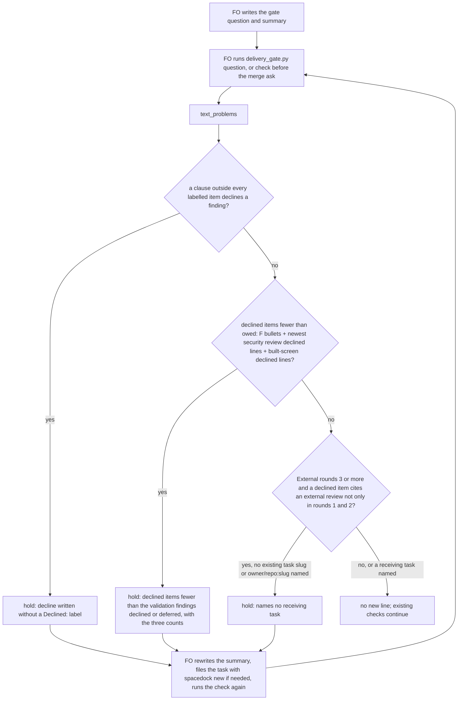

## Scope

- Source: the Captain 「同意開 1 到 5，第 6 項併進「GPT 夥伴」提案」 (chat, 2026-10-27), answering FO's list of package-issue candidates (items 2 to 5 relayed by the relay FO, Paseo 1671c3a9, from its pair-once and room-specs-follow-web-part-select observer reports; item 1 relayed by the kc-ops-inbox FO, Paseo 46c2ebdf).
- Bite: relay pair-once validation-1: the gate summary said 'security 2 LOW declined' without naming the findings or a reason; `gate prepare` accepted it, and `delivery_gate.py` checks only text starting with 'Declined:' (relay FO's reading).
- Upstream first: `scripts/delivery_gate.py` decline parsing, `scripts/design_surfaces.py`, the README's FO steps: review findings step 2.
- Added 2026-11-05 (FO read of origin/main `delivery_gate.py`): partly covered since 22534441e (2026-10-19): the merge check holds a `Declined...:` or `FO declines...:` item with no bracketed reason, and fewer declined items than the newest validation report's `Deferred risk:` / `Polish:` bullets. Not covered: a decline written without that label (the relay bite above), findings from a reviewer that writes no such bullets, and a decline that names no receiving backlog task (README FO steps: review findings, step 5; observer: 3 violations in batches 12 and 13, 9 across all archives, grep 2026-11-05). FO proposes all three as this task's scope at the batch 14 backlog gate.
- Non-goals: judging whether a bracketed reason is a good one; the check proves only that a reason is written.
- Batch 14: the Captain 「可以」 (chat, 2026-11-05), answering 「這 5 張當下一批，可以嗎？」, which named this task.

## Budget
- One package PR. Workflow word budget unchanged unless the design names a raise for the Captain.

## Stop condition
- A replay of the relay 'security 2 LOW declined' summary and of the batch 12 and 13 declines that name no receiving task is held; a decline that names the finding, a bracketed reason and its receiving task passes.

## FO alignment

Alignment: needed before ideation; where the check runs is a package design choice.
Result: aligned at backlog: Batch 14 backlog sitting, the Captain 「准」 (chat, 2026-11-05), answering 「決定：這批五張（派工交代句的檢查、退一步答案欄位、漏寫 Override、婉拒要寫明、閘門一次問一件事）都用 Pilot，照各自寫下的範圍、預算與停止條件進入構思嗎？其中「婉拒要寫明」照我提的三項範圍（沒寫 Declined 標籤的婉拒、沒有 F 條目的審查者、沒指明接手任務）。要改哪張直接說。」, approved the outcome and bounds in this file.
Surfaces: none
Visible change: none
Release review: not needed: workflow maintenance, on no journey map.

## Design

### PRFAQ

**Press release.** When First Officer (FO) asks the Captain to approve a validation gate or a merge, every finding it declines is now listed by name with its reason, and a finding declined from the third external-review round on names the backlog task that received it. `delivery_gate.py question` (run before `spacedock gate prepare`) and `delivery_gate.py check` (run before the merge ask) hold the text in three cases they pass today: a decline written in prose without the `Declined:` label (the relay summary "security 2 LOW declined"), fewer declined items than the findings the validation report declines or defers counting the security reviewer's and the design director's declined findings and not only the validator's F bullets, and a round-3-or-later external-review decline that names no receiving task (the three observer violations of batches 12 and 13). FO reads one hold line per case and rewrites the summary; a summary already in the labelled form prints nothing new.

**FAQ.**
- *Why these two scripts?* Both already call `text_problems`, which holds the two existing decline rules (bracketed reason, F-bullet count). The three new rules go into the same function, so FO runs no new command at either moment.
- *Why count, not match names?* The existing join counts (ADR 0025 and ADR 0027 D5 chose counting); the new owed sources extend that count. Matching each finding id would change verdicts the Captain already ruled on and is outside this scope.
- *Why a word rule after ADR 0027 D4?* See D1 below: D4 rejected a check that required FO to include a phrase; this rule finds a decline FO did write and asks for the form the reason and receiving-task rules can read. 30 of the 38 texts only this rule holds decline findings that have no structured record to join against.
- *What does it not prove?* That a reason is a good one, that a receiving task's body carries the finding and reason (the observer keeps reading that), or that a decline written without any decline word exists.

### Flow

All three conditions are evaluated on every run; the diagram's order is the print order, not a short circuit.

### Existing-code check

Upstream first, checked 2026-11-05. Spacedock 0.27.3 gate records store the question and summary and do not read declines. kc-dev-flow-2 at origin/main `d37c6dc653e0` (0.35.0): `delivery_gate.py` `text_problems` holds a labelled item without a bracketed reason (`unreasoned_items`) and fewer labelled items than the newest `## Stage Report: validation` `- F<N> Deferred risk:`/`Polish:` bullets (`findings_join`); `validation_security.py` already parses `Security review (validation): security/validation-<N>.yaml at <head>` and `Security finding (validation <N>) <n>: declined: ...`; `design_surfaces.py` already parses `Built screen finding <n>: declined: ...` (`BUILT_FINDING_LINE`). README FO steps: review findings, steps 2 and 5, already require naming the finding and filing the round-3 task, so the workflow text needs no change. Sibling adopters (relay, qnow, web) run the same package scripts and add no decline check. The design reuses all three parsers and adds no new command.

Observation that the change is needed (base package, gate-time replay, `ideation/replay.py`): the relay text with F30 written in the labelled form passes both existing decline rules although two declined security findings are named nowhere; the three batch 12 and 13 summaries pass although their round-3+ declines name no task.

### The three holds

1. **Unlabelled decline (form 1).** A clause (text between `;`, sentence ends and line breaks) outside every labelled item run holds when it has a decline word (`decline`, `declined`, `declines`, `declining`) and a finding reference (`F<N>`, `P0`..`P3`, a severity `LOW`..`CRITICAL`, `MINOR`, `MAJOR`, `Polish`, `Deferred risk`, `finding`, `item`), and no pointer (`below`, `above`, `as stated`, `in the summary`). Problem line: `decline written without a 'Declined:' label: '<clause>'`; next line is the existing unreasoned-item line, so FO reads no new next text.
2. **Owed findings (form 2).** The owed count is the newest validation report's F bullets (unchanged) plus the `Security finding (validation <N>) <n>: declined:` lines of the newest security review, newest meaning the last `Security review (validation):` line's `<N>` (not the highest `<N>` among finding lines: a newest review with no findings owes none), plus the newest report's `Built screen finding <n>: declined:` lines (D2). Problem line: `declined items (<got>) are fewer than the validation findings declined or deferred (<owed>: <a> Deferred risk and Polish, <b> security, <c> built screen): ...`.
3. **Receiving task (form 3).** With `External rounds: N` and N of 3 or more, a declined item that cites an external review (`review:`, `comment:`, `roborev:` or `summary:` id, `comment <6+ digits>`, `round <N>`, `evidence=`) holds unless every round it states is 1 or 2, or it names a receiving task: a slug of an existing task file (`<slug>.md` or `<slug>/index.md`) in the task's workflow directory or its `_archive/`, other than the task itself, or `<owner>/<repo>:<slug>` for a task in another workflow, not read (D3). The task must exist before the decline is written: FO runs `spacedock new` first. Problem line: `declined item from external review round 3 or later names no receiving task: '<item>'`; next line: `next: hold the ask; file it with spacedock new, its body carrying the finding and the reason, or name the task that holds it.`

`text_problems` gains a `task` keyword so rule 3 can find the workflow directory; `question` and `check` pass it. `declined_items` is split into `item_runs` (the item spans) and the existing item split, so rule 1 can skip text inside labelled items. Prototype, not the deliverable: `gate-summary-names-each-decline/ideation/prototype.diff` (against origin/main `d37c6dc653e0`, `delivery_gate.py` only, 78 insertions and 12 deletions; implementation re-derives it after the overlap order below).

### Replays and measurement

Scripts in `gate-summary-names-each-decline/ideation/`: `build_texts.py` reads each case's validation briefing-1 and the task file at the state commit the briefing binds, `replay.py` runs `text_problems` of the base and the candidate, `corpus.py` collects every validation briefing in four state checkouts with the task text at its bound commit, `corpus_measure.py` counts holds, `words.py` counts hold-line words. Reproduce: `git -C <kc-claude-plugins> archive origin/main kc-dev-flow-2 | tar -x -C <base>`; copy `<base>` to `<cand>` and run `patch -p1 -d <cand> < prototype.diff`; `python3 -B -I build_texts.py <out> <kc state> <relay state>`; `python3 -B -I replay.py <out> <base>/kc-dev-flow-2/scripts <cand>/kc-dev-flow-2/scripts`.

Stop-condition replays (2026-11-05, base origin/main `d37c6dc653e0`, candidate = prototype), decline rules only (the relay text also lacks Sufficiency/Necessity, which other checks hold):

| Replay | Base | Candidate |
| --- | --- | --- |
| relay pair-once briefing-1 summary, F30 labelled (bite) | pass | hold: unlabelled 'security 2 LOW declined.' and owed 3 (1 F, 2 security) vs 1 |
| same, "security 2 LOW declined" removed (silent) | pass | hold: owed 3 vs 1 |
| same, plus the two security findings as labelled items (conforming) | pass | pass |
| fo-tries-what-it-asks-the-captain (batch 13, External rounds 6) | pass | hold: Codex round 6 P2 names no receiving task |
| model-roster-question-needs-both-families (batch 12, External rounds 3) | pass | hold: review:5734678752 decline names no receiving task |
| rewritten-criteria-checked-against-captain-words (batch 13, External rounds 4) | pass | hold: Codex round 3 P2 names no receiving task |
| each of the three, with a receiving task named (conforming) | pass | pass |

At gate time today's check holds the unedited relay text only through the F30 bullet (0 labelled items vs 1 owed); the bite replay labels F30 so the base passes and only the new rules decide.

Corpus (`corpus.py`, 459 validation briefings: kc 126 at state `d41cd6c6a450`, relay 123 at `2d63013902f1`, qnow 137 at `c8a90107ab11`, web 73 at `31f900649a5d`; each task text at its bound commit; rerun at kc `72148d048301`, relay `0fe57ed866d6`, qnow `098fdc25c117`, web `38ec7984ec3f` gave the same counts): base decline rules hold 77 texts, candidate 131 (54 newly: kc 19, relay 14, qnow 18, web 3). Rule 3 holds exactly the three batch 12 and 13 texts. Rule 2 newly holds 23 texts (security declined lines in 20, built-screen in 3). Rule 1 holds 90 clauses in 75 texts; 5 clauses in 4 texts are not declines (three kc package tasks describing their own decline checks, one "first declined then fixed", one quoted check output). Of the 38 texts only rule 1 holds, 21 decline findings the validator wrote as no F bullet, 9 decline external-review findings with no record, 4 use an F form `FINDING` does not match, 4 are already counted.

Existing suite: base `test_delivery_gate.py` 149 tests OK; prototype 13 failures, each an intended change: 10 prod fixtures whose declined security findings are now owed a declined item, 2 assertions of the old join message, 1 mutation test's source anchor (`found, wanted = text_problems(task_text, gate_text)`).

### Limits

- Rule 1 matches words: a decline written as "not fixed" or "accepted" is not seen, and prose that is not a decline is held (4 of 459 texts: three describe a decline check, one a finding declined then fixed).
- Rule 2 counts, it does not match names: a declined item for the wrong finding passes.
- Rule 3 reads today's task files: a task filed after the gate passes a replay; `<owner>/<repo>:<slug>` is not read; an external finding whose item cites no id and no round is not seen.
- Built-screen declines are read only from the newest validation report, as `design_surfaces.py` reads them.

### Words FO reads at each moment

Counted with `words.py`: the decline problem lines and deduplicated `next:` lines `text_problems` prints, base and candidate.

| Moment | Base | Candidate |
| --- | --- | --- |
| startup, idle on an open or merged PR, after the archive | no decline output | unchanged |
| validation gate preparation (`question`), summary in labelled form | 0 | 0 |
| merge ask (`check`), summary in labelled form | 0 | 0 |
| either, relay bite / silent | 0 | 86 / 55 |
| either, each batch 12 or 13 replay | 0 | 43 |
| README `references/sd/workflow.md` | unchanged | unchanged (0 words) |

The module docstring grows by 87 words (1023 to 1110), read only through `--help` or the source, at no lifecycle moment. No workflow word budget change.

### Batch overlap

Files this design would change: `kc-dev-flow-2/scripts/delivery_gate.py` (`text_problems`, `declined_items` split into `item_runs`, `findings_join`, two new functions, `question` and `check` call lines, module docstring), `kc-dev-flow-2/scripts/test_delivery_gate.py` (new cases, the 13 fixture and assertion updates above), one ADR in `docs/adr/` (shared index; short title below, no number).

| Task | Shares | Kind |
| --- | --- | --- |
| fo-write-checks-parse-top-level (ideation) | `declined_items`, `DECLINE_END`, test_delivery_gate.py | Same function: this design splits `declined_items` |
| comment-check-reaches-delivery-gate (ideation) | delivery_gate.py (one function, a docstring paragraph, a `write_record` key), test file | Same file, other functions; docstring textual |
| gate-presentation-asks-one-thing-plainly (batch 14) | delivery_gate.py (`question`, `check`, docstring), test file | Same file; the `question`/`check` call lines and docstring are textual |
| step-back-answer-has-a-record-line (batch 14) | role_triggers.py; delivery_gate.py only forwards its `next:` lines | No shared function |
| adr-required-statement (validation), dispatch-carries-reserved-adr-number (ideation) | ADR list | Shared index: ADR number reserved at dispatch |
| captain-ruling-sources-checked, archive-waits-for-observer-report (exercise test_delivery_gate.py only) | none changed | none |
| extension-instruction-check-sees-every-listed-extension, override-recorded-when-captain-departs, adoption-asks-which-extensions, adr-silent-undo-probe, journey-canvas-hosted-poc, journey-server-host-pilot, picky-reviewers-may-run-on-gemini, seed-check-requires-alignment-result, ops-inbox-r1-setup-and-isolation, pr-review-lite-value-pilot | none (grep for delivery_gate, declined_items, External rounds, test_delivery_gate, 2026-11-05) | none |

Recommended order: fo-write-checks-parse-top-level first (it owns `declined_items`; this task rebases `item_runs` on its result), then comment-check-reaches-delivery-gate and gate-presentation-asks-one-thing-plainly in either order, then this task; step-back-answer-has-a-record-line in any order.

### ADR

The design lands one ADR recording the three holds and the rulings on D1 to D3: short title "A gate summary names each declined finding, counts every reviewer's declines and names the round-three task". No number; FO reserves it at implementation dispatch.

## Acceptance criteria

**AC-1**: `delivery_gate.py question` and `check` hold a gate text with a clause outside every labelled item that declines a finding, printing `decline written without a 'Declined:' label: '<clause>'`; a clause with `below`, `above`, `as stated` or `in the summary`, or with no finding reference, is not held. Evidence: `replay.py` on the relay bite text prints that line on the candidate and not on base origin/main; new unit cases for "two Polish declined." (held), "declined below" (not held), "the decline check upheld" (no finding reference, not held). Falsifier: removing the rule's loop from `text_problems` makes the held case pass.

**AC-2**: The owed count adds the newest security review's `declined:` finding lines (newest = the last `Security review (validation):` line's `<N>`) and the newest validation report's `Built screen finding <n>: declined:` lines to the F-bullet count, and the hold line states the three counts. Evidence: the relay silent replay holds with "(3: 1 Deferred risk and Polish, 2 security, 0 built screen)"; a unit case whose older review has two declined lines and whose newest review has none owes 0 security; a unit case with two built-screen declined lines and no labelled item holds. Falsifier: dropping the security term passes the relay silent replay; taking the highest finding-line `<N>` instead of the review line fails the older-review case.

**AC-3**: With `External rounds: N` of 3 or more, a declined item citing an external review, other than one citing only rounds 1 and 2, holds unless it names an existing task slug in the workflow directory or its `_archive/` (not the task itself) or an `<owner>/<repo>:<slug>`. Evidence: the three batch 12 and 13 replays each print one `names no receiving task` line on the candidate and none on base; unit cases: External rounds 2 (not held), an item citing "round 2" only (not held), an item naming the task's own slug (held), an item naming an existing slug (not held). Falsifier: removing the existence check passes the own-slug case.

**AC-4**: A summary in the conforming form passes every decline rule. Evidence: `replay.py` on the four conforming texts prints no decline line on base or candidate.

**AC-5**: The corpus bounds hold: over `corpus.py`'s 459 gate-time texts, rule 3 holds exactly the three batch 12 and 13 texts and rule 1 holds no more than the 5 named non-decline clauses beyond real declines. Evidence: `corpus_measure.py` output at the four pinned state heads, recorded in the validation report; not yet verified on the implementation.

**AC-6**: The suite stays green with only intended edits: `test_delivery_gate.py` passes, and its diff against origin/main changes only the 13 named cases (10 prod fixtures gain a declined item per declined security finding, 2 join-message assertions, 1 source anchor) besides new cases. Evidence: test run output and `git diff` of the test file.

**AC-7**: FO reads nothing new on a conforming summary: `question` and `check` print the same lines as base on the four conforming texts, and `references/sd/workflow.md` and the workflow word budget in `lint-skills.py` are unchanged. Evidence: `words.py` (0 added words) and `git diff origin/main -- kc-dev-flow-2/references/sd/workflow.md kc-dev-flow-2/scripts/lint-skills.py` empty.

**AC-8**: The ADR named above lands with the Captain's words for D1 to D3 and passes `adr_lint.py`. Evidence: the file at the PR head and the lint output.

## Decisions for the Captain

**D1. Hold a decline written without the `Declined:` label by matching its words?** Past ruling read: ADR 0027 D4, where the Captain chose no check over a phrase check "because there is one case and matching words cannot stop that class of error". Recommended: yes. Why it differs: D4 asked FO to include a phrase, which a check cannot make true; this rule finds a decline FO did write, 90 clauses in 75 of 459 texts, and asks for the form the reason and receiving-task rules read; 30 of the 38 texts only it holds decline findings with no record to join against. What gets worse: 4 of 459 texts would be held for prose that is not a decline (three describe a decline check, one a finding declined then fixed), and FO can dodge it by not using the word.

**D2. Must the summary list each built-screen MINOR the design director upheld as a declined item?** Recommended: yes, the bracket may cite the upheld ruling file (`design/validation-declines-<N>.yaml`). What gets worse: every ui task's summary gains one line per upheld MINOR (3 corpus texts newly held for this alone).

**D3. May a round-3 decline name a receiving task in another workflow as `<owner>/<repo>:<slug>`, unread?** Past ruling read: the Override on codex-reader-reads-receipt-marker (the Captain chose a backlog task in the package repository). Recommended: yes, presence only. What gets worse: a mistyped cross-repository slug passes.

## Stage Report: ideation

- DONE: Design the hold for the three uncovered decline forms (no Declined label, a reviewer that writes no F bullets, no receiving backlog task named) in a check FO already runs, with replays of the relay summary and the batch 12 and 13 declines
  Three rules in `delivery_gate.py` `text_problems` (run by `question` and `check`); prototype `ideation/prototype.diff` holds the relay bite and silent replays and the three batch 12/13 replays, base origin/main `d37c6dc653e0` passes all; conforming rewrites pass both.
- DONE: A `### Batch overlap` section naming each file the design would change and each other batch task and live task of other sessions that changes the same file or check, so FO can order implementation
  Files: delivery_gate.py, test_delivery_gate.py, one ADR; same function as fo-write-checks-parse-top-level (`declined_items`); same file as comment-check-reaches-delivery-gate and gate-presentation-asks-one-thing-plainly; ADR index shared; others none. Recommended order recorded.
- DONE: The words FO reads at each lifecycle moment, before and after, per root learning.md "Measure the words FO reads at each moment, not one file's size"
  `ideation/words.py`: 0 added words on a conforming summary at gate preparation and merge ask; holds add 43 (each batch 12/13 replay), 55 or 86 (relay); README unchanged; docstring +87, read at no moment.
- DONE: Acceptance criteria with reproducible evidence clauses and falsifiers, and unresolved decisions for the Captain, each with a recommendation and what gets worse under it
  AC-1..AC-8 under `## Acceptance criteria`; D1 (word rule, against ADR 0027 D4), D2 (built-screen upheld declines owed), D3 (cross-repository receiving task) with recommendations and costs.
- DONE: AC-1 (unlabelled decline held): prototype replay prints the line on the relay bite text, base does not; unit cases and falsifier not yet written (implementation).
- DONE: AC-2 (owed count adds security and built-screen declines): prototype relay silent replay holds with "(3: 1 ..., 2 security, 0 built screen)"; the older-review case was found as a prototype defect and fixed; unit cases not yet written.
- DONE: AC-3 (round-3 receiving task): prototype holds each of the three batch 12/13 replays with one line, base none; unit cases not yet written.
- DONE: AC-4 (conforming form passes): prototype and base print no decline line on the four conforming texts.
- DONE: AC-5 (corpus bounds): prototype over 459 gate-time texts: rule 3 holds exactly 3, rule 1 has 5 non-decline clauses in 4 texts; not yet verified on the implementation.
- DONE: AC-6 (suite with only intended edits): prototype fails 13 of 149 existing tests, all in the three named classes (10 prod fixtures, 2 join messages, 1 source anchor); base passes 149; the updated suite is not yet verified.
- DONE: AC-7 (nothing new on a conforming summary): `words.py` 0 added words on the four conforming texts; the README and budget diffs are not yet verified (implementation).
- DONE: AC-8 (ADR lands): not yet verified; short title named, no number.
- DONE: design_surfaces.py check
  `python3 <package>/scripts/design_surfaces.py check gate-summary-names-each-decline.md` (0.35.0 root): "design surfaces presentable", exit 0.

### Summary

The design adds three holds to the decline checks FO already runs before the validation gate and the merge ask: an unlabelled decline, fewer declined items than the validator, security and built-screen declines owed, and a round-3+ external-review decline with no receiving task. Replays read each task at the commit its briefing binds; across 459 gate texts in four adopters the round-3 rule holds exactly the three observer violations of batches 12 and 13. Three decisions go to the Captain; D1 recommends a word rule against the ADR 0027 D4 precedent, with the measured reason it differs. Implementation should follow fo-write-checks-parse-top-level, which owns `declined_items`.
