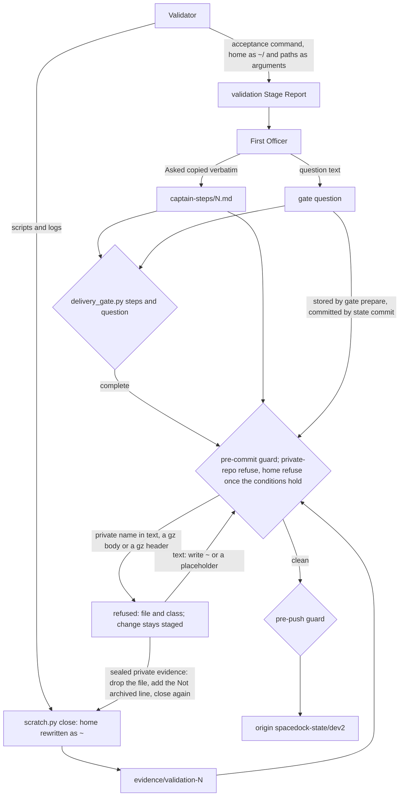

---
id:
title: Sealed evidence and the delivery gate's own text can be written without a home-directory path or a private repository name, so the state guard can refuse those two classes
status: implementation
variant: kc-dev-flow-2
profile: pilot
merge: pr
worktree: .worktrees/spacedock-ensign-gate-text-and-sealed-evidence-carry-no-home-path-or-private-repo
pr:
gates:
    version: 1
    records:
        - id: gate:gate-text-and-sealed-evidence-carry-no-home-path-or-private-repo:backlog
          stage: backlog
          attempts:
            - id: gate-attempt:gate-text-and-sealed-evidence-carry-no-home-path-or-private-repo-backlog-1
              briefing:
                id: briefing:gate-text-and-sealed-evidence-carry-no-home-path-or-private-repo:backlog:attempt-1:revision-1
                digest: sha256:033debd07b66ec73b2dbca7919aa0e3767696c9fd9a4fb1d623987970ee45479
                room-ref: ./gate-text-and-sealed-evidence-carry-no-home-path-or-private-repo/review/backlog/briefing-1
              resolution:
                type: Resolution
                id: resolution:spacedock:gate-text-and-sealed-evidence-carry-no-home-path-or-private-repo:backlog:1
                briefing: briefing:gate-text-and-sealed-evidence-carry-no-home-path-or-private-repo:backlog:attempt-1:revision-1
                by: agent:first-officer
                at: "2026-11-14T09:52:32.02113Z"
                decision: approve
                reason: Inside scope 2 given by the reform session under the Captain's grant (message fa01bfc1); profile pilot justified in the Scope; seed check exit 0; admission involves no public merge, outward action, outcome-definition change or suspected key.
                conn:
                    quote: 改革工作階段（Paseo 代理 26215d96，就是開你出來的那一個）可以替我給你工作範圍。它給的範圍內，進場、設計、預算、結案這些關卡你不必停下來等我，記為「依艦長授權」，一路做到它指定的終點。
                    source: the Captain, chat with the second dev2 FO, 2026-11-14; scope 2 item-3 from the reform session, Paseo message fa01bfc1-0e7d-4197-9636-a25f2818c562
              application:
                target-stage: ideation
                state: consumed
        - id: gate:gate-text-and-sealed-evidence-carry-no-home-path-or-private-repo:ideation
          stage: ideation
          attempts:
            - id: gate-attempt:gate-text-and-sealed-evidence-carry-no-home-path-or-private-repo-ideation-1
              briefing:
                id: briefing:gate-text-and-sealed-evidence-carry-no-home-path-or-private-repo:ideation:attempt-1:revision-1
                digest: sha256:ada38ecbe7b84eb3b3fac33923eff2307eac2534c444ff85a55ae7e2da247b8f
                room-ref: ./gate-text-and-sealed-evidence-carry-no-home-path-or-private-repo/review/ideation/briefing-1
              resolution:
                type: Resolution
                id: resolution:spacedock:gate-text-and-sealed-evidence-carry-no-home-path-or-private-repo:ideation:1
                briefing: briefing:gate-text-and-sealed-evidence-carry-no-home-path-or-private-repo:ideation:attempt-1:revision-1
                by: agent:first-officer
                at: "2026-11-14T10:22:30.536549Z"
                decision: approve
                reason: Design check exit 0; the design corrects the task's premise with evidence and is three files with no overlap; the reform session confirmed it and ruled D2; D1 stays the Captain's; nothing is installed or flipped by this gate.
                conn:
                    quote: 改革工作階段（Paseo 代理 26215d96，就是開你出來的那一個）可以替我給你工作範圍。它給的範圍內，進場、設計、預算、結案這些關卡你不必停下來等我，記為「依艦長授權」，一路做到它指定的終點。
                    source: the Captain, chat with the second dev2 FO, 2026-11-14; scope 2 item 3 from the reform session, Paseo messages fa01bfc1-0e7d-4197-9636-a25f2818c562 and 77b18f0b-34ca-4f2f-9607-d1ebcba63eca
              application:
                target-stage: implementation
                state: consumed
started: 2026-11-14T09:53:13Z
---

The state guard merged in pull request 871 is installed with private task slugs and tailnet hostnames refusing, and private repository names, the email and the home directory only warning. Two of the warning classes cannot move to refuse today, because a refusal there has no legitimate way forward: a home path or a private repository name can sit inside sealed worker evidence, and the delivery gate's own form demands an absolute acceptance command in the gate summary and in the Captain-steps record.

## Scope

- Source: the reform session's ruling under the Captain's standing grant (Paseo 26215d96, message bc65ce97, 2026-11-14), after the Captain referred the guard decision to it with 「你問一下改革者」 (chat with the second dev2 FO, 2026-11-14): option (a) is installed now on the condition that this follow-up is filed. Held at backlog for admission in the reform session's next scope message.
- Bite: the observer's report on the archived task state-branch-writes-carry-no-private-identifiers (observer.md, 2026-11-14) observed absolute home-directory paths in that task's validation briefing summary and in its `captain-steps/1.md`, written by FO because `kc-dev-flow-2/scripts/delivery_gate.py steps` requires the exact acceptance command, which was absolute. The design of that task measured the home class in 75 of the last 200 state commits and the private-repo class in 11.
- Outcome: a redaction path for sealed evidence, and for gate-summary and Captain-steps text, with the delivery-gate form no longer demanding an absolute command; then the guard's private-repo and home classes are set to refuse on the live state checkouts.
- consumer: both First Officers writing gate text and Captain-steps records; workers sealing evidence; the Captain, whose words were 「出現就不準推」.
- Open for the design: what a refused commit's way forward is for each class (rewrite, relative path, a "not archived (private)" line); whether Spacedock's verbatim storage of gate summaries needs an upstream change or is covered by FO writing clean text; how existing records stay valid.
Non-goals: changing anything already on the branch or in its history; the email in commit metadata (the Captain's separate decision); patching Spacedock or filing anything upstream without the Captain.
Budget: 2 cycles per stage
Stop condition: a writer of these classes turns out to be Spacedock's own with no clean-text route for FO; existing records cannot stay valid; a suspected key is found; or the design needs a decision only the Captain can make.

## Acceptance criteria

**AC-1**: A gate summary and a Captain-steps record that pass the delivery-gate checks can be written with no home-directory prefix and no private repository name.
Verified by: a real delivery-gate question and steps check on a throwaway task whose committed bytes are scanned for the two classes, with commands and exit codes.

**AC-2**: Sealed evidence holding a private repository name has a recorded way forward that is not a bypass, and the result commits under the guard with that class at refuse.
Verified by: one real refused commit and one real accepted commit on a throwaway state checkout with private-repo and home at refuse.

**AC-3**: With both classes at refuse on a throwaway copy of the live state branch, a replay of the commits written after the change shows no refusal that lacks a way forward.
Verified by: the replay's per-commit result, counts by class. Limit: a replay of a bounded window, stated in the report.

**AC-4** (added by this design): A gzip evidence file whose only private name sits in its gzip header (file name, comment or extra field) is refused at commit with that class at refuse.
Verified by: one real refused commit of such a file on a throwaway state checkout, and a scan of every `.gz` blob at the live state tip showing that scanning raw bytes adds no hit absent from the decompressed content.

**AC-5** (added by this design): The validation stage's acceptance-script rule tells the validator to write a home path as `~/…`, as an unquoted word of its own, to name no private repository, and to pass paths to a retained script as arguments; a script written that way still runs from a fresh shell after `scratch.py` seals it.
Verified by: the candidate's `skills/validation/principles.md` text, and a throwaway run in which an argument-taking script, sealed by the candidate's `scratch.py`, exits 0 from a fresh `zsh -f` shell while a script holding a literal home path exits nonzero.

## FO alignment

Alignment: not needed before ideation: the outcome and its bite are stated by the reform session's ruling and the observer's report; the open design points return at the ideation gate.
Surfaces: none
Visible change: none
Release review: not needed: workflow maintenance with no release.

## Design

### PRFAQ

**Proposition.** From the release that carries this change, a validator's acceptance command writes a home path as `~/…`, so the Captain-steps record, the delivery question and the validation report that copy it verbatim carry no home-directory prefix and still pass the delivery-gate checks. Sealed evidence holding a private repository name is dropped from `evidence/` and replaced by the existing `Not archived (private): <what>; reproduce: <command>` line, with a placeholder where the command would name the repository. The guard also reads a gzip file's header, so a private name hidden there is refused. Then `private-repo` moves to refuse on the live state checkouts at that release, and `home` moves to refuse once four conditions hold (under `### Order`).

- **Did the delivery-gate form demand an absolute command?** No. `delivery_gate.py steps` and the `question` path (`inspect_steps`, byte-identical on main and at PR 869's head) accept `~/…` and task-relative paths. A `~/` record passed both and committed clean under the guard with `home` at refuse (`evidence/ideation-1/runs/ac1-probe.json`). The absolute form comes from the validation rule that the command "runs unchanged in a fresh shell". The steps check then copies the validator's command verbatim.
- **What about the gate summary that Spacedock stores verbatim?** Every home hit in the three briefings of the window sits in `artifacts[0].summary`, which FO writes (`runs/briefing-fields.txt`). Under PR 869's record route, FO "writes no factual summary": the summary is the `delivery-facts/v1` JSON, whose allowlist holds no path except `captain_steps.path` (`^captain-steps/[1-9][0-9]*\.md$`). The question text is still FO's own, and the guard refuses it at the state commit like any FO text. No upstream change is needed.
- **Why not redact private names automatically in `scratch.py`?** ADR 0079 already says private repository evidence is never archived. A file that names a private repository is that evidence, so the rule is to drop it, not keep it with the name masked. No sealed evidence in the window carried one.
- **Do existing records stay valid?** Yes. No record format changes and nothing on the branch is rewritten. Absolute paths still pass every check. The guard reads only added or changed blobs, and an archive move is a rename with no added bytes.
- **Why can `home` not refuse at this task's merge?** The installed 0.41.0 tools still write absolute `Package root:` lines into dispatch records. Their record check also refuses a `~/` root in a hand-saved message record. Both stay true until a release carrying PR 871 is synced to the workflow README in both sessions.



### Before new work

- **This repository at origin/main c9b2c2400 (fetched 2026-11-14), with PR 869's nine files at a5657edd6 laid over it.** Main has changed since PR 869's base c2f035b66 only by PR 871's eight files. None of them overlaps PR 869's list. This design uses `state_guard.py`, `scratch.py`, `delivery_gate.py` and `dispatch_records.py` as they are, and changes only `state_guard.added_bytes` and one validation paragraph.
- **Spacedock 0.27.2.** `gate prepare` stores FO's `--question` and `--summary`. The briefing commits in the window are `state: update <slug>` commits, which run the hooks. No Spacedock writer outside FO text holds a home path in the window.
- **In-force ADRs.** These are all kept, and this design needs no new ADR:
  - ADR 0087: guard modes. Its gzip scan is extended to the header bytes, in line with "binary evidence is left to the guard, which scans its bytes".
  - ADR 0079: private evidence is never archived. It is the way forward for sealed evidence.
  - ADR 0054: `captain-steps/<N>.md` location.
  - ADR 0044 and ADR 0071: the legacy summary and the delivery check record.
  - PR 869's `references/delivery-record.md`: the record route.
- **Override lines.** I ran `git grep -n 'Override:'` on the state branch, filtered for path, home, private, guard, identifier, acceptance and redact. No line in this area matches.
- **Siblings.** Not read: adopters with private state branches are out of scope, and they keep the legacy text route under PR 869.

### Writers verified (main c9b2c2400; PR 869 a5657edd6)

| Writer | Where the class comes from | Demands an absolute or private form? |
|---|---|---|
| `skills/validation/principles.md`, acceptance paragraph (identical at both refs) | "an exact command or URL … FO runs it as written before the gate, so it runs unchanged in a fresh shell and names any checkout or install it needs" | In practice, yes: the one rule that leads to an absolute command. `~/` also runs unchanged in fresh bash and `zsh -f` (probe: exit 0 both). |
| `delivery_gate.inspect_steps` S1 and S5 | `Asked` must be in the question, validation report or linked cards, and every fenced command there must be in an `Asked` | No: it copies whatever form the validator wrote. A report with an absolute command forces an absolute `Asked` (probe `mixed`: `message S5: unrecorded command or link`). |
| `delivery_gate.absolute_paths` and `named_file` (S4) | `ABS_PATH` matches `~/` and `/`, then `expanduser()`; relative paths resolve against the task folder | No: `~/` passes S4 (probe `tilde`). |
| `delivery_gate.captain_step_problems` | `Captain steps:` resolved by `named_file` | No: `captain-steps/1.md` is the contract's own example (`delivery-record.md`, PR 869). |
| `workflow.md` Captain steps ("FO runs each step as written") and FO's `Observed:` paths | FO text | No: `Observed:` needs only non-empty text, so `captain-steps/1-output.log` serves. |
| `workflow.md` "carries that absolute path as a `Package root: <absolute path>` line" | Scope notes and hand-saved `-message-N.md` records | Yes for scope notes, which `dispatch_stage` rewrites since PR 871. For a hand-saved message record, `dispatch_records.PARTS` on main accepts `~/`, and the 0.41.0 copy does not. |
| `scratch.evidence` (main) | Rewrites home in new or changed text before sealing | Breaks scripts: all 18 home sites in the window's sealed `.sh`/`.py` files sit inside quotes or after `=`, where `~` does not expand (`runs/quoted-scripts.txt`). A sealed script holding a literal path exited 1 and an argument-taking one exited 0 (`runs/sealed-script.json`). |
| `state_guard.added_bytes` (main) | Decompresses gzip and scans the content only | Misses a private name held only in a gzip header: such a commit was accepted (`runs/ac2-probe.json`). This is the Codex P2 that FO declined on PR 871, and its trigger, "before any class is set to refuse on the live clone", was already met at install by `private-slug` and `tailnet-host`. |
| FO scope notes (`dispatch/*.md`) | FO text | The only `private-repo` hit in 200 commits, 157 commits before the state tip. |

No writer of either class is Spacedock's own: every remaining hit is text FO or a worker writes.

### Mechanism

**M1. Validation acceptance commands write home as `~/`.** One added sentence after "names any checkout or install it needs." in `skills/validation/principles.md`: "It writes a path under the home directory as `~/…`, an unquoted word of its own, and names no private repository; a retained script takes its paths as arguments rather than holding them, because sealing rewrites the home directory inside it." That is 43 words. The file sits outside the workflow word budget, which `lint-skills.py` `budget_errors` counts on `references/sd/workflow.md` only. `Asked`, the question and the report then all carry `~/`, so S1, S5 and S4 pass as they are.

**M2. The guard reads gzip headers.** In `state_guard.added_bytes`, a gzip blob returns its raw bytes as well as its decompressed content. The header's name, comment and extra field are stored uncompressed, so this covers every member of a multi-member file. Measured on all 110 `.gz` blobs at the live state tip: 92 carry a header name or comment, and the raw scan adds 0 hits absent from the decompressed content (`runs/gz-raw-scan.txt`). Limit: a broad `re:` entry in the owner's list could match random compressed bytes, a false refusal that the refusal message makes visible.

**M3. Sealed private evidence: the way forward, no new code.** On refusal, the worker drops the file from `evidence/<record>/` and writes `Not archived (private): <what>; reproduce: <command>`, with a placeholder such as `<adopter checkout>` where the command would name the repository. The worker then reruns `scratch.py close`, which rebuilds `SHA256SUMS` from the files present, and commits again. All of this was probed: refused, then accepted, and the matched text was never printed. Two limits:
- Editing a name out of an already sealed `.gz` makes `scratch.py` refuse with `evidence digest differs`. Dropping the `.gz`, or replacing it with the redacted plain file, re-seals cleanly (probed).
- A reproduce line that keeps the private name is refused (probed).

**M4. Text classes: the way forward is to rewrite.** This covers FO's question, Captain-steps record, message records and scope notes, and workers' reports and unsealed task-folder files. Writing the path as `~` removes every home hit in the window: 188 of 188 file changes were clean after `rewrite_home` (`runs/residual-200.txt`). A private name is replaced with a placeholder. The guard's refusal line on main already says both.

### Order

1. **This task's PR**, cut from main after PR 869 merges or the Captain holds it. M1 and M2 ship with their tests. Nothing is installed by the release.
2. **`private-repo` to refuse:** once the release carrying this change is synced to the workflow README, FO reinstalls the guard with `--refuse private-repo,private-slug,tailnet-host` on each live state checkout. `check` reports the old copy as `stale` until then.
3. **`home` to refuse**, when all four conditions hold:
   - (a) A release carrying PR 871 is synced to the README in both sessions (the `package_version.py` hold enforces this).
   - (b) Step 2's release, with M1, is synced the same way.
   - (c) No task between its validation report and its delivery gate holds a home path in that report. FO checks with a count-only scan; otherwise the `mixed` case stalls its Captain-steps record.
   - (d) A replay of the commits made after (a) shows no home hit from a dispatch or evidence writer.
4. **`email` (content)** stays at warn. The email in commit metadata stays the Captain's separate decision (Non-goal).

What cannot flip at this task's merge: `home`, because conditions (a) to (d) wait on releases and on in-flight tasks. `private-repo` waits only for the release that carries M2.

### Files this design changes

- `kc-dev-flow-2/scripts/state_guard.py` (M2, `added_bytes`): not in PR 869's list.
- `kc-dev-flow-2/scripts/test_state_guard.py` (M2: a header-only name is refused, and a clean gzip is accepted): not in PR 869's list.
- `kc-dev-flow-2/skills/validation/principles.md` (M1, one sentence): not in PR 869's list.

No change to `references/sd/workflow.md`, `delivery_gate.py`, `scratch.py`, `dispatch_records.py`, `dispatch_stage.py` or any other file in PR 869's list. The workflow text and its word budget are unchanged, and no ADR is added.

### Worth questions

- **M1.** Serves 「出現就不準推」 and the scope's "delivery-gate form no longer demanding an absolute command". Without it, two things break: the first validation after PR 871's release seals scripts whose literal home paths become quoted `~`, which fails FO's run (probed: exit 1), and `home` cannot refuse without stalling every Captain-steps record. Premise that makes it unneeded: validators already pass paths as arguments. Cheap test, run: 11 `.sh`/`.py` files added in the window hold literal home paths, and 18 of 18 sites would be quoted.
- **M2.** Serves the same words. Without it, a header-only name passes at refuse (probed). Premise: no gzip header carries a listed name. Checked: 0 do today, but 92 of 110 carry a name field, so the hole is live for any future file name.
- **M3 and M4.** Serve the same words. They need no code. Premise that would make this task unneeded: the guard's refusal line alone is enough. That premise held for text and failed for the two cases M1 and M2 cover.
- No part serves no Captain words.

### Replay evidence

Evidence paths in this design are under `evidence/ideation-1/`.

`runs/replay-200.txt` replays the last 200 commits of `spacedock-state/dev2`, from 43893a5e9 to 50f66677c (2026-11-14), through main's guard with the live list. It records counts and path kinds only:

| Class | Commits | Where | Fixed by |
|---|---|---|---|
| home | 67 | message records 26, dispatch records 24, evidence 12, task-file reports 5, briefings 3, Captain steps 3, other task-folder files 2 | dispatch records and evidence: the release carrying PR 871; everything else: FO or the worker writing `~`, with residual 0 of 188 |
| private-repo | 1 | FO scope notes in a dispatch record | FO rewrites; 0 in the last 157 commits |
| email | 1 | evidence (a pasted log) | out of scope |
| private-slug, tailnet-host | 0 | | already refuse |

### Acceptance status now

- **AC-1:** probed at the overlay (main plus PR 869) on a throwaway with a scratch HOME, every class but email at refuse (`runs/ac1-probe.json`).
  - `tilde`: steps CLI exit 0; question path with the report has no problems; bash and zsh fresh shells exit 0; commit exit 0; 0 home bytes at HEAD.
  - `absolute`: checks pass, but the commit is refused on the task file, the Captain-steps record and the stored question.
  - `mixed`: S5 fails.
  - Not provable now: the candidate, and a real `question` run with dispatched candidates and `gate prepare`.
- **AC-2:** probed with main's `scratch.evidence` (`runs/ac2-probe.json`). A sealed private name is refused at commit and the name is not printed. After the drop, the Not archived line and a re-seal, the commit is accepted. Not provable now: on the candidate (unchanged code, same route).
- **AC-3:** a counterfactual over the window. Every hit has a way forward once the four conditions in `### Order` hold (`runs/replay-200.txt`, `runs/residual-200.txt`). Not provable now: a replay of commits written after the change.
- **AC-4:** before the fix, a header-only name is accepted (`runs/ac2-probe.json`, `gzip header name only`, exit 0); the false-hit scan shows 0 (`runs/gz-raw-scan.txt`). Not provable now: the candidate's refusal.
- **AC-5:** before the fix, the literal-path script exits 1 after sealing and the argument script exits 0 (`runs/sealed-script.json`). Not provable now: the candidate's text.

### Decisions for the Captain

- **D1. Release order.** Release PR 865 (kc-dev-flow-2 0.42.0, open) carries PR 871. Merging it before M1 lands means each validation whose acceptance script holds a literal home path fails FO's run after sealing. Recommend: merge 865 now anyway, and add an FO scope-notes line to each validation dispatch telling the worker to pass paths as arguments, until M1 ships. What gets worse: it is one more line in each validation dispatch for a release or two. The alternative, holding 865 for this task, delays PR 871's record rewrite, which removes 24 of the 67 home commits.
- **D2. Who flips.** Recommend that FO runs steps 2 and 3 of `### Order` under the reform session's ruling (option (a) "on the condition that this follow-up is filed"), reporting each reinstall's `check` line. What gets worse: a mis-timed `home` flip stops in-flight dispatches until FO reinstalls at warn.

### Batch overlap

- PR 869 (open, the other FO): no shared file.
- `validation-reads-pr-review-comments` (implementation) and `comment-check-reaches-delivery-gate` (ideation) both change `skills/validation/principles.md`, in other paragraphs: a textual overlap only.
- `adoption-asks-which-extensions`, `design-director-runs-where-it-pays` and `ideation-checks-external-prior-art` only name that file.
- No live task names `state_guard.py` or `test_state_guard.py`.
- No shared numbered record: this design adds no ADR.

Recommended order: after PR 869 merges and after `validation-reads-pr-review-comments` merges (the same file).

## Stage Report: ideation

- DONE: The writers verified against the code: where a gate summary, a Captain-steps record and sealed evidence get a home-directory path or a private repository name today, read at the head of open pull request 869 (a5657edd6) and not only at main, because that pull request reshapes the steps and question checks and moves their forms into a contract document; say which lines demand an absolute command
  `### Writers verified (main c9b2c2400; PR 869 a5657edd6)`: `inspect_steps` is byte-identical at both refs and accepts `~/` (probe `tilde`, steps exit 0). The absolute form comes from the validation acceptance paragraph ("runs unchanged in a fresh shell"), copied verbatim by S1 and S5, and from workflow.md's `Package root: <absolute path>`. Briefing home hits are FO's `summary` only (`runs/briefing-fields.txt`). PR 869's record route leaves no FO summary. No writer is Spacedock's own.
- DONE: A design that lets a gate summary and a Captain-steps record pass the delivery-gate checks with no home-directory prefix and no private repository name, gives sealed evidence holding a private repository name a way forward that is not a bypass, keeps existing records valid, names every file it changes and whether the workflow text or its word budget changes, and says by a replay of recent state commits which guard classes could really be set to refuse after it and which still could not, and why
  `### Mechanism`: M1, one validation sentence; M2, the guard reads raw gzip bytes; M3, the ADR 0079 drop-and-record route; M4, rewrite. `### Files this design changes`: three files, none in PR 869's list; workflow text, word budget and ADRs unchanged. `### Order` and `### Replay evidence` (200 commits): `private-repo` can refuse at this task's release; `home` cannot refuse until conditions (a) to (d) hold.
- DONE: Each acceptance criterion with its proof run once now where it can be or listed under `Not provable now` with the reason; the decisions only the Captain can make named; kc-dev-flow-2/scripts/design_surfaces.py check on the task exits 0
  AC-1: probed at main plus PR 869 on a throwaway with every class but email at refuse (`runs/ac1-probe.json`). `tilde`: steps 0, question path clean, fresh bash and zsh 0, commit 0. `absolute`: commit refused on three files. `mixed`: S5 fails. Not provable now: the candidate, and a real `question` run plus `gate prepare` with dispatched candidates.
  AC-2: refused at commit with the name not printed; accepted after drop, Not archived line and re-seal; a reproduce line naming the repository is refused (`runs/ac2-probe.json`). Not provable now: on the candidate.
  AC-3: counterfactual replay of 200 commits; residual 0 of 188 after writing `~` (`runs/replay-200.txt`, `runs/residual-200.txt`). Not provable now: commits written after the change do not exist yet.
  AC-4: a header-only name is accepted today (exit 0); scanning raw bytes adds 0 hits over 110 live `.gz` blobs (`runs/gz-raw-scan.txt`). Not provable now: the candidate's refusal.
  AC-5: after sealing, the literal-path script exits 1 and the argument script exits 0 (`runs/sealed-script.json`). Not provable now: the candidate's text.
  Captain: D1 (release PR 865 order) and D2 (who flips). `design_surfaces.py check` exit 0 (`runs/design-surfaces.txt`). Evidence scanned with the live list: 0 files hit (`runs/evidence-scan.txt`).

### Stop conditions and points for FO

- One stop condition is touched: the design needs Captain decisions D1 and D2. FO decides whether the standing grant covers them. The other stop conditions are not touched: no writer is Spacedock's own, existing records stay valid, and no suspected key was found.
- The Codex P2 that FO declined on PR 871 had the trigger "before any class is set to refuse on the live clone". That trigger was already met when the guard was installed with `private-slug` and `tailnet-host` at refuse, so the gzip-header gap is live today. M2 closes it.
- Release PR 865 ships PR 871's evidence rewrite. All 18 home sites in the window's scripts would become a quoted `~` that does not expand (`runs/quoted-scripts.txt`). Until M1 ships, validation dispatches need a scope-notes line telling the worker to pass paths as arguments (D1).
- Evidence scripts use invented names only, and the probes ran against an invented list with a scratch HOME. The live list was used only for count-only scans.

### Scratch close

```
Scratch removed: /private/tmp/dev2/kc-claude-plugins-3042bb224e995ded/gate-text-and-sealed-evidence-carry-no-home-path-or-private-repo/ideation-1 (9115092 bytes)
Evidence: evidence/ideation-1/ (20 files, 25.4 KiB)
```

### Summary

The delivery-gate checks never demanded an absolute path: they accept `~/`. The absolute form came from the validation acceptance rule and the steps check's verbatim copying, and PR 869's record route removes FO's gate summary. The design adds one validation sentence and makes the guard read gzip headers (three files, no workflow text, no ADR); sealed private evidence uses ADR 0079's existing route. A 200-commit replay shows `private-repo` can refuse at this task's release, while `home` waits on the releases carrying PR 871 and this change, plus a clean in-flight check; the release order and who flips are Captain decisions D1 and D2.
