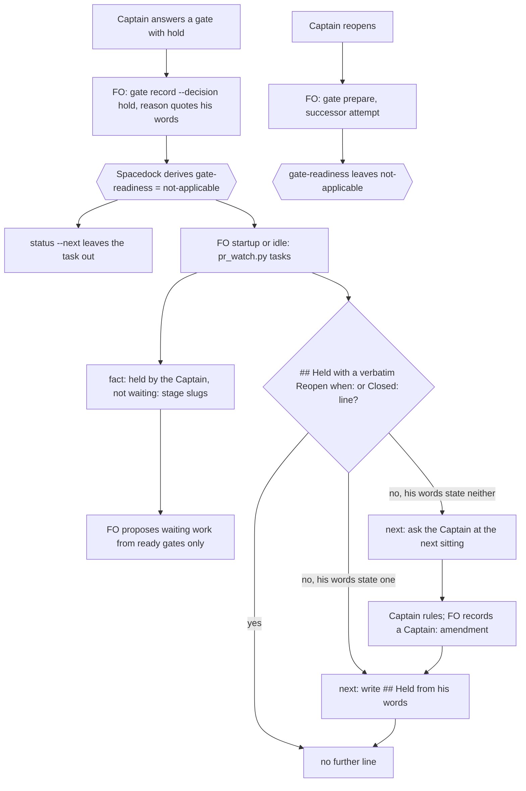

## Scope

- Source: FO's own miss, filed by FO with no Captain ruling yet; the backlog gate confirms it.
- Bite (FO read 2026-11-12 from gate records in this workflow's state): of 12 tasks with `status: ideation`, 10 carry a Captain `hold` or close ruling dated 2026-10-20 to 2026-11-05 and are not waiting for anything. FO offered five of them to the Captain as tasks waiting in design and he approved redispatching them before FO read the rulings; no dispatch was made. The two-week measurement of 2026-11-12 counted them as open tasks.
- Outcome: a held or closed task is told apart from a waiting one by a reader of `spacedock status` and by FO before it proposes work, and a held task states what would reopen it.
- Open for the design: whether Spacedock's own verdicts, archive or an existing field already express this (read its README and source first); whether closed tasks are archived as rejected, as two were; what happens to the 10 tasks named above.
- Non-goals: reopening or rebuilding any held task; changing what a hold ruling means.

## Budget
1 cycle per stage, in one package PR or none if the design finds an existing mechanism and only state changes are owed.

## Stop condition
- The 10 tasks are no longer listed as waiting in ideation by the command FO uses to choose work, each with its Captain ruling intact. Return to the Captain if any of the 10 needs a new ruling.

## FO alignment

Alignment: not needed: one observed defect with one outcome; the mechanism is compared in the design and ruled at the ideation gate.
Reviewer: kc-dev-flow-2:engineering-reviewer not run 2026-11-12: amendment 2 replaces only the added-words bound of the held-task line (30 words fixed, to 3 words for each held task plus a fixed 6), in the option the Captain chose after the count of 14 held tasks and 32 words was put to him; the line's content, the program and every acceptance criterion stand, and the validator is asked to judge the new bound.
Reviewer: kc-dev-flow-2:engineering-reviewer not run 2026-11-12: amendment 4 replaces only the numbers of the added-words bound with the counts the independent validator measured in validation-1 (17 words with one held task, 32 with fourteen); the line, the program and every acceptance criterion stand, and the second validation judges the bound at one, fourteen and more held tasks.
Surfaces: none
Visible change: none
Release review: not needed: workflow maintenance, on no journey map.

## Captain amendments

### Amendment 1 — 2026-11-12, host question dialog
Captain: 「四張都允許（建議）」 (host question dialog, 2026-11-12)
Asked: 「要不要允許實驗裡這四張任務的實作各多寫一份決策紀錄檔，記下你在設計關卡裁的決定？我建議允許。四張是：收尾清理（已經停下來等這個答案）、計時紀錄、擱置的任務、問題裡的事實。這是修改你已核准的設計範圍，會記成各張任務的一筆修正案；決策紀錄只寫你在關卡上核准的內容，不加新的決定。收尾清理那張我用追加訊息讓原本的工人接著做，不算新的一次派工。變差的是：四張任務各多一個檔，而且實驗要記上「設計核准後改範圍」四筆，其中三筆是我預先處理、還沒真的發生。」
Supersedes: none

### Amendment 2 — 2026-11-12, host question dialog
Captain: 「照列名稱，上限隨張數算（建議）」 (host question dialog, 2026-11-12); before it he asked 「解釋一下機制」 and 「提醒層是spacedock 做的，還是dev2？這一層如果是dev2 我預期應該是整合sd tool？」 (same dialog), and FO answered both.
Asked: 「「擱置的任務」那一行要怎麼印？我建議照列名稱、上限改成隨張數算：把設計的「最多多 30 個字」改成「每張擱置的任務最多多 3 個字，另加固定 6 個字」。這張任務的目的就是讓我開工時直接看到哪幾張被擱置，只印數字會讓今天那種錯仍可能發生。這會記成你的一筆修正案，程式不用改，只改驗收的上限。變差的是：擱置的越多，我每次開工讀的這一行越長，目前 14 張是 32 個字。」
Supersedes: none
Design: Every moment rises by one line (about 26 words for ten held tasks). This task adds a line rather than cutting text, so the learning's "each moment below its base" test does not apply. The bound is ≤ 30 words.

### Amendment 3 — 2026-11-12, host question dialog
Captain: 「一次授權，跑完（建議）」 (host question dialog, 2026-11-12)
Asked: 「實驗裡還沒過驗證的三張任務（收尾清理、問題裡的事實、擱置的任務）要怎麼走完？我建議一次給足授權讓它們跑完：一、這三張的預算都改成「1 implementation and 2 validation cycles」，退回後用追加訊息修正、再驗一次；第二次驗證再被退回就停下來回到你這裡。二、收尾清理那條「收尾後整個 repo 的暫存工作目錄是零」的驗收條件，改成只看這次派工自己的暫存資料夾，不為了湊到零去刪別的派工的資料夾。三、問題裡的事實那條要拿「擱置的任務」成品重播的條件不改，等那張的成品出來後補跑。這些會記成三張任務各一筆修正案。變差的是：三張各多一輪驗證（每輪約 15 到 20 分鐘），今天會跑到晚上；而且這段期間我不會再為「程式缺陷修完重驗」回來問你。」
Supersedes: none
Budget: 1 implementation and 2 validation cycles

### Amendment 4 — 2026-11-12, host question dialog
Captain: 「可以，照列名稱（建議）」 (host question dialog, 2026-11-12); before it he answered the same question with 「比較第一跟第二方案」, and FO compared the two.
Asked: 「「擱置的任務」那一行的字數上限，可以改成「每張擱置的任務最多多 1 個字，另加固定 20 個字」嗎？我建議可以。這取代我上一題請你同意的「每張 3 個字加固定 6 個字」，那組數字是我沒數過就寫的，只有 1 張擱置時做不到。新的數字我實際數過那一行：固定的字 15 個、每個階段名稱 1 個、每張任務名稱 1 個；驗證者量到 1 張時是 17 個字、14 張時是 32 個字，新上限分別是 21 和 34。程式不改，這一行照樣列出每張的名稱。變差的是：擱置的越多這一行越長，這點不變。」
Supersedes: none

### Feedback Cycles

- Cycle 1 (FO, 2026-11-12): validation-1 on #856 head 455846c6d recommended REJECTED with one finding, Needs decision (kind design): the added-words bound of amendment 2 (3 for each held task plus a fixed 6) fails at small counts, 17 words against 9 with one held task, while 14 tasks pass at 32 against 48. The numbers in amendment 2's question were FO's and had not been counted. Settled by Captain amendment 4 (1 word for each held task plus a fixed 20); the program does not change.

## Design

Ideation evidence folder: `held-and-closed-tasks-leave-the-design-queue/ideation/` in this state checkout (state pinned at `eae5ea47cec926f35d164f8a88d31579196d7634`, package at origin/main `8ce0eb6050c889b21baccf50fec35231bc888d66`, kc-dev-flow-2 0.39.1, `spacedock 0.27.2`). The exact commands for every criterion, and the origin-less scratch recipe, are in `ideation/commands.md`.

### PRFAQ

**Proposition.** When the Captain holds or closes a task at a gate, the First Officer (FO) stops seeing it as work waiting in that stage. Every time FO runs `pr_watch.py tasks` at startup and at idle, one line names the held tasks by stage, so FO does not offer them as waiting work. Each held task carries a short `## Held` section. It quotes the Captain's own words for what reopens the task (`Reopen when:`) or that the task is closed (`Closed:`). If his words say neither, the same output tells FO to ask him. Spacedock already computes the held state, so this adds no new state field and no new stage.

**FAQ**

- *Does Spacedock already have this?* Mostly. `spacedock status` derives a `gate-readiness` value from the gate record, and a `hold` resolution reads as `not-applicable` (AC-1). The scheduler view `status --next` already leaves held tasks out (AC-2). Two things are missing. The stage listing FO used, `status --where status=ideation`, shows held tasks as plain `ideation` with no readiness column. FO's startup and idle output does not mention them at all (AC-3).
- *Why not archive the closed ones as REJECTED?* Spacedock 0.27.2 refuses every unforced close of a task whose current gate is held: `merge guard --verdict rejected`, a terminal `status --set` and `status --archive` each exit 1, and the first two name condition `not-applicable` (AC-5). No REJECTED archive in this workflow carries a hold resolution. The only two archives with a hold (`fo-interviews-extension`, `paseo-codex-dispatch-practice`) were reopened and closed PASSED. Closing a held task would therefore need `--force` (D2).
- *Does anything stop FO dispatching a held task?* No. `spacedock dispatch build` builds an ideation dispatch for a held task (AC-4). This design adds no dispatch guard. The harm on 2026-11-12 was what FO told the Captain, not a dispatch, and a guard would also stand in front of the reopen route (AC-6).
- *How is a held task reopened?* The Captain's reopen words go into a new gate attempt at the same stage. Spacedock appends a successor attempt after a hold, as `fo-interviews-extension` did at validation (AC-6). No new mechanism is needed.
- *What about a person reading `spacedock status`?* `--fields slug,status,gate-readiness` tells held from waiting today (`ideation/ac1-status-with-readiness.txt`). The default table without that flag cannot change in this package, because Spacedock is upstream (`spacedock-dev/spacedock`, not the Captain's repository).

### Facts checked (chain order)

1. **Spacedock** (binary 0.27.2; source read from the plugin cache 0.27.3). `internal/gates` `CurrentStageReadiness` and `EvaluateEligibility` map a closed attempt whose resolution is `hold` to `not-applicable`. `internal/status` `materializeGateReadiness` fills `gate-readiness` when a query names the field. `internal/gates/prepare.go` appends a successor attempt after a closed one. The field is missing from the known-field list in `status --help`, but a query naming it exits 0 (AC-1). The FO skill's canonical "entities in a stage" view (`fo-status-viewer`) is `--where status=<stage>`, which has no readiness column. `fo-dispatch-core.md` lists `not-applicable` and `hold` among states that are never routed as gate candidates.
2. **kc-dev-flow-2** (origin/main 8ce0eb60). `git grep 'gate-readiness\|not-applicable' origin/main -- kc-dev-flow-2` returns no hits. `pr_watch.py` `ready_rows` reads only `status --next --json` `ready_gates`, which leaves held tasks out, so its output never names them. The adopted mod `_mods/kc-dev-flow-2.md` (48 words, the same as the package's `references/sd/mods/kc-dev-flow-2.md`) runs `pr_watch.py tasks` at both startup and idle. `references/sd/workflow.md` has no rule that tells held tasks apart from waiting ones.
3. **Sibling adopters** (read-only `status --limit 0 --fields slug,status,gate-readiness`). subspace-relay dev2 has 65 tasks, one held at ideation, and that one also lists as plain `ideation` in a stage listing. subspace-web dev2 has 15 tasks, none held (`ideation/adopter-*.txt`, counts only). Neither has a held-task convention to borrow. The package change reaches relay's held task the same way.
4. **Past rulings.** `git grep -n 'Override:'` over this state finds two in this area. On `fo-write-checks-parse-top-level` the Captain chose closing over building two fixes. On `gate-summary-names-each-decline` he chose a hold plus a replacement task over approving D1-D3. The replacement, `_archive/decline-becomes-task-only-with-a-bite.md` (PASSED 2026-11-07), was approved with 「…擱置中的 gate-summary-names-each-decline 恢復時拿掉它的第 3 條」. That ruling expects the held task to resume, so this design does not recommend closing it. ADR 0062 (a gate approval grants what its quoted question says) means D2 must be written into the gate question if a plain approval is to accept it.

### Existing-code check

The capability exists in Spacedock (`gate-readiness`), and the package does not use it. The smallest working change repairs `pr_watch.py tasks`, which FO already runs at startup and idle, rather than adding a status field, a stage or README text. Proportional observation: the base `pr_watch.py tasks` output on the full state copy runs 157 lines and 1353 words and names none of the ten (AC-3). The base stage listing shows 17 `ideation` rows with no readiness column (`ideation/base-status-where-ideation.txt`).

### Change (one package PR)

1. `kc-dev-flow-2/scripts/pr_watch.py` `tasks` makes one extra call: `spacedock status --workflow-dir <wf> --where gate-readiness=not-applicable --fields slug,status --json --limit 0`. When any row comes back, it prints one line: `fact: held by the Captain, not waiting: <stage> <slug>, <slug>; <stage> …; each ## Held section says what reopens it.` If the call exits nonzero or its JSON cannot be read, it prints `next: report held-task query failure to the Captain: …` and exits 2, so a field renamed in a future Spacedock fails loudly.
2. Same function, for each held task. FO must have written a `## Held` section holding one `Reopen when: <text>` or `Closed: <text>` line. `<text>` must appear verbatim in the newest hold resolution reason, or in a `Captain:` line under the task's `## Captain amendments`, which covers a new ruling given without a new gate attempt. Otherwise the function prints one `next:` line naming those slugs: `next: write ## Held in <slugs>: copy Reopen when: <his words> or Closed: <his words> verbatim from the hold reason or a Captain amendment; where neither states one, ask him at the next sitting.`
3. `kc-dev-flow-2/scripts/test_pr_watch.py` covers five cases:
   - no held task prints no line;
   - a held task with a valid `## Held` prints only the fact line;
   - a held task with no `## Held` is named on the next line;
   - a quote not found in the reason or an amendment is named on the next line;
   - a status query failure exits 2.
4. Docstring lines for the two outputs. No change to `references/sd/workflow.md`, the mod text, `lint-skills.py`'s word budget, or any ADR.

**State change after the PR merges (FO, path-scoped state commits, no frontmatter edit):** FO writes `## Held` into the seven tasks whose hold reason already states a reopen condition or a close. It uses the quotes AC-7 checked (`ideation/ac7-proposed-held-lines.tsv`), after the Captain confirms the labels (D1). For the other three, FO records his D1 ruling as a `Captain:` amendment and then writes `## Held`. Every gate record stays byte-identical.

### The ten held tasks

The labels are this worker's reading of each hold reason, for the Captain to confirm at the gate. AC-7 proves only that each quote is verbatim.

| Task | Hold date | Proposed line (verbatim from the hold reason) |
| --- | --- | --- |
| adoption-asks-which-extensions | 2026-10-25 | Reopen when: reopen when a late listing flags a live record |
| captain-ruling-sources-checked | 2026-10-28 | Reopen when: nothing is built until the peers rule of 2026-10-27 fails in an adopter that has it |
| picky-reviewers-may-run-on-gemini | 2026-11-02 | Reopen when: until Paseo offers an Antigravity mode a test shows refusing a write |
| step-back-answer-has-a-record-line | 2026-11-05 | Reopen when: after that batch, a direction change keeps the task, none deletes it (FO checks whether that trial batch has run; if it has, a ruling is owed) |
| comment-check-reaches-delivery-gate | 2026-10-20 | Closed: The task is closed with the measurement as the reason. |
| fo-write-checks-parse-top-level | 2026-10-21 | Closed: 「關掉」 |
| adr-silent-undo-probe | 2026-10-23 | Closed: this copy stays at ideation and is not dispatched again (a reading: the work moved to dev2-poc; the ruling never says "closed") |
| seed-check-requires-alignment-result | 2026-10-29 | no line: the reason says "hold and build nothing" and names no reopen condition (D1) |
| gate-summary-names-each-decline | 2026-11-05 | no line in its own reason; a 2026-11-07 ruling on its replacement expects it to resume without its point 3 (D1) |
| journey-canvas-hosted-poc | 2026-10-11 | no line: "Design not taken; direction open" (D1) |

This dispatch listed four of the ten (adoption-asks-which-extensions, adr-silent-undo-probe, comment-check-reaches-delivery-gate, journey-canvas-hosted-poc) as live tasks of other sessions. In this state checkout, each carries a hold resolution and has had no state commit since 2026-10-13 to 2026-10-25. Whether another session drives them elsewhere was not checked.

### Flow



### Words FO reads at each moment (base → candidate)

Counted with `wc -w`. The base was measured now. The candidate is projected from the line shapes above and is not provable now (NP-3). The mod runs `pr_watch.py tasks` at startup and at idle, so its output counts at both moments.

| Moment | Base (measured) | Candidate (projected) | Source |
| --- | --- | --- | --- |
| Startup: `workflow.md` 6008 + mod 48 + `pr_watch.py tasks` output 1353 | 7409 | ≤ 7439 once all ten have `## Held`; about +30 more while the `next:` line stands | `ideation/base-words-per-moment.txt`, `ideation/base-pr-watch-tasks.txt` |
| Idle, open or merged PR: mod 48 + `pr_watch.py tasks` output 1353 | 1401 | ≤ 1431 under the same condition | same |
| Proposing work or showing stage state | `status --where status=ideation`: 17 rows, no readiness | the fact line already in startup and idle output; no new command | `ideation/base-status-where-ideation.txt` |
| Gate record, merge ask, after archive | unchanged | unchanged | no file read at these moments changes |

Every moment rises by one line (about 26 words for ten held tasks). This task adds a line rather than cutting text, so the learning's "each moment below its base" test does not apply. The bound is ≤ 30 words.

### Worth questions

- **Part 1, the held fact line.** Serves 「a held or closed task is told apart from a waiting one … by FO before it proposes work」 (Scope Outcome, confirmed at the backlog gate). Without it, FO's startup and idle output never names held tasks (AC-3), the stage listing shows them as `ideation`, and the 2026-11-12 miss repeats. The premise that would make it unneeded is that FO proposes work only from the scheduler, which already hides held tasks. AC-2 checks the scheduler half, and it holds. The bite shows the other half fails: FO proposed from a listing.
- **Part 2, `## Held` with a verbatim reopen or close line.** Serves 「a held task states what would reopen it」. The premise that would make it unneeded is that hold reasons already state reopen conditions. AC-7 shows seven of ten carry a verbatim phrase this worker reads as a reopen condition or a close. In the other three, this worker found none. Without Part 2, nothing makes FO ask about those three.
- **Part 3, the state change for the ten.** Serves the Stop condition. Without it, the next line stands on every one of the ten. The premise is that none of the ten needs a new ruling. By this reading three do (D1).
- **Reader of `spacedock status`.** Served by the existing `--fields slug,status,gate-readiness` and changed by nothing here. The default table without the flag is upstream (NP-5). Every part serves the Captain's words; none is offered for cutting.

### Decisions for the Captain

- **D1 (needs his ruling, per the Stop condition).** By this worker's reading, three holds state neither a reopen condition nor a close. Recommendation per task:
  - *seed-check-requires-alignment-result:* **Closed**. Its reason says the check has existed since 0.31.0 and nothing is built.
  - *gate-summary-names-each-decline:* **keep held**, and he names what reopens it. His 2026-11-07 approval of the replacement expects it to resume without its point 3.
  - *journey-canvas-hosted-poc:* he says whether `journey-server-host-pilot` carries it. That pilot, authorized 2026-10-13 two days after this hold, is a shared kc-jmap server on Node and Cloudflare for one private journey. This worker did not confirm it covers share-by-link with edit limited to people he allows. If it does, record **Closed**; if not, he names the reopen condition.
  
  The gate also asks him to confirm the seven labels in the table. What gets worse: closing seed-check means reviving it needs a new task, and the journey-canvas answer costs him one more read.
- **D2 (recommendation stated in the gate question, so a plain approval accepts it).** Closed tasks stay at their stage with a `## Held` `Closed:` line and are not archived. Spacedock 0.27.2 refuses every unforced close of a held gate (AC-5), and this design does not use `--force` to bypass that guard. What gets worse: the plain stage listing keeps showing closed tasks at `ideation`. Only the readiness column and the startup and idle fact line tell them apart. Alternatives: archive with `--force` and verdict `REJECTED`, or ask Spacedock upstream for a supported close of a held gate. The upstream ask is an outward action only he can approve.

### Batch overlap

Re-grepped for `pr_watch` across the four batch task files and their folders at the end of this pass. Files this design changes: `kc-dev-flow-2/scripts/pr_watch.py` (`tasks`) and `kc-dev-flow-2/scripts/test_pr_watch.py`. After merge, FO also adds state-only `## Held` body sections, and for D1 `Captain:` amendments, in the ten held task files. No change to `workflow.md`, the mod, the `lint-skills.py` budget, the ADR list or a migration.

- merge-ask-tests-the-merge-result: its design states no `pr_watch.py` change and lists this task as "none" shared; none.
- held-and-closed-tasks-leave-the-design-queue: this task.
- each-task-records-stage-time-revises-and-interruptions: no shared file found in its task file or `poc/`. Its helper counts waiting time, and its two-week measurement counted these ten as open. It should read `gate-readiness` and count `not-applicable` as held, not waiting. That is a shared check, not a shared file.
- dispatch-close-out-archives-evidence-and-removes-scratch: **shared file `pr_watch.py` `tasks`** (and `test_pr_watch.py`). Its design adds an independent block there that sweeps scratch roots. Each block adds its own lines, so the later one rebases. Its design recommends landing first, and this design agrees.
- gate-question-facts-are-checked-before-the-captain-reads-them: no shared file. Its D2 recommends that this task owns its case 3 (a held task offered as waiting work), and its implementation replays case 3 against this task's listing. The listing it should replay is the fact line in NP-1, or the AC-1 query. Shared check: this task lands first.
- adoption-asks-which-extensions, adr-silent-undo-probe, comment-check-reaches-delivery-gate, journey-canvas-hosted-poc: each is one of the ten held tasks and gets a `## Held` body section (state only). adoption-asks-which-extensions and comment-check-reaches-delivery-gate name `pr_watch.py` in their held designs, so if either reopens it overlaps on that file.
- adr-required-statement: changes `workflow.md` and `lint-skills.py`; none shared.
- journey-server-host-pilot, ops-inbox-r1-setup-and-isolation, pr-review-lite-value-pilot: none by file. journey-server-host-pilot is named in D1.

Recommended order: dispatch-close-out-archives-evidence-and-removes-scratch, then this task (rebasing its `pr_watch.py` `tasks` block), then gate-question-facts-are-checked-before-the-captain-reads-them and each-task-records-stage-time-revises-and-interruptions. merge-ask-tests-the-merge-result can land in any order. Any reopened held task that edits `pr_watch.py` goes after this one.

## Acceptance criteria

All seven criteria below pass at base: they prove the existing mechanism and the gap. Nothing here defines done for implementation; the implementation's acceptance is NP-1 to NP-4 under `## Not provable now`, each written for FO to promote unchanged. Evidence paths are relative to `held-and-closed-tasks-leave-the-design-queue/` in this state checkout. The exact command for each criterion is under its heading in `ideation/commands.md`. Each was run once on 2026-11-12.

**AC-1** Spacedock's existing `gate-readiness` field selects exactly the ten held tasks among the ideation tasks, and no waiting one. Evidence: `$SB status --workflow-dir $WD --where status=ideation --where gate-readiness=not-applicable --fields slug --json`, compared as a sorted set with `ideation/held-ten.txt` (`commands.md` § AC-1). Run: query exit 0, compare exit 0 ("got 10 want 10 equal True"). Saved: `ideation/ac1-held-query.json`, `ideation/ac1-status-with-readiness.txt`. Falsifier: a held task missing or a waiting task listed makes the compare exit 1. A Spacedock without the field makes the query exit nonzero (unknown field).

**AC-2** The scheduler view already leaves every held task out. Evidence: `$SB status --workflow-dir $WD --next --json`, then a check that no slug in `ready_gates` or `dispatchable` is in `ideation/held-ten.txt` (§ AC-2). Run: exit 0, 56 rows, none held. Saved: `ideation/ac2-next.json`. Falsifier: any held slug in either list exits 1.

**AC-3** Base FO startup and idle output names none of the held tasks, which is the gap this design closes. Evidence: origin/main 8ce0eb60 `pr_watch.py --state <scratch file> tasks <scratch>/docs/dev2`, run on an origin-less copy of state eae5ea47, then a check that no held slug occurs (§ AC-3; GitHub calls are reads only). Run: pr_watch exit 0, check exit 0 (1353 words, 0 held named). Saved: `ideation/base-pr-watch-tasks.txt`. Falsifier: a held slug in the output exits 1, which would show the gap already closed.

**AC-4** Spacedock 0.27.2 `dispatch build` does not refuse a held task (a bounded claim for this version and this command). Evidence: `dispatch build` for held `adoption-asks-which-extensions` at ideation in the origin-less scratch (§ AC-4). Run: exit 0, envelope printed; the dispatch file it wrote was removed. Saved: `ideation/scratch-dispatch-build-held.txt`. Falsifier: a nonzero exit or a refusal.

**AC-5** Spacedock 0.27.2 has no unforced route to close a held task. Evidence: `merge guard … --verdict rejected`, `status --set … status=done verdict=REJECTED` and `status --archive …` on held `fo-write-checks-parse-top-level` in the scratch (§ AC-5). Run: each exits 1. The first two cite `condition "not-applicable"`; the third cites the unrun `pr-merge` hook and offers `--force`. No `_archive/` was created. Saved: `ideation/scratch-merge-guard-rejected-from-held.txt`, `ideation/scratch-close-held-task.txt`, `ideation/scratch-archive-held-task.txt`. A control on a non-held task was inconclusive: it was refused for a missing-history reason (`ideation/scratch-close-non-held-control.txt`). Falsifier: any of the three exiting 0.

**AC-6** A held gate can be reopened by a successor attempt, as a real record shows. Evidence: a YAML read of `_archive/fo-interviews-extension.md` gate records that exits 0 only when a `hold` attempt is followed by another attempt in the same record (§ AC-6). Run: exit 0, `validation-1 hold` then `validation-2 approve consumed`. Saved: `ideation/ac6-reopen-after-hold.txt`. Falsifier: no successor after a hold exits 1.

**AC-7** Each of the seven proposed `Reopen when:` or `Closed:` texts appears verbatim in its task's newest hold reason. Evidence: a check of `ideation/ac7-proposed-held-lines.tsv` against each task's gate records that exits 1 on any quote not found (§ AC-7). Run: exit 0, `mismatches 0`, seven verbatim, three with no line proposed. Saved: `ideation/ac7-held-lines-quote-check.txt`, `ideation/ac7-hold-reasons.txt`. Falsifier: changing any quote by one character exits 1. This proves verbatim quoting only. The labels, and the reading that the other three state neither, are for the Captain to confirm (D1).

## Not provable now

These need the candidate. Each is written with its planned command and falsifier so FO can promote it to an acceptance criterion unchanged. They are for the Captain to see at the design gate.

- **NP-1** At the candidate, `pr_watch.py tasks` prints exactly one `fact: held by the Captain, not waiting:` line naming exactly the held tasks by stage, and none when none is held. Planned evidence: `SPACEDOCK_BIN=$SB python3 -B <candidate>/kc-dev-flow-2/scripts/pr_watch.py --state <tmp> tasks <origin-less copy>/docs/dev2`, then a check that the fact line's slugs equal the AC-1 query's slugs; plus a unit case with no held task. Falsifier: a missing, extra or duplicated slug, or a line printed with no held task.
- **NP-2** At the candidate, a held task with no `## Held` section, or whose quoted text is in neither its hold reason nor a `Captain:` amendment, is named on the `next:` line, and one with a valid line is not. A failed status query exits 2. Planned evidence: `python3 -B -m pytest kc-dev-flow-2/scripts/test_pr_watch.py -k held` with the five cases in Change item 3. Falsifier: deleting the verbatim comparison, or the exit-2 branch, makes a case fail.
- **NP-3** Amended by Captain, amendment 4. Captain: 「可以，照列名稱（建議）」, answering the bound question 「每張擱置的任務最多多 1 個字，另加固定 20 個字」. This replaces the earlier added-words numbers; the program and task-name listing do not change. The bound applies to the added fact line at both startup and idle, with all held sections present on scratch copies.
  - One held task: `cd '/Users/kent/conductor/workspaces/kc-claude-plugins/colombo/.context/dev2-adoption/worktree/.worktrees/spacedock-ensign-held-and-closed-tasks-leave-the-design-queue' && python3 -B '/Users/kent/conductor/workspaces/kc-claude-plugins/colombo/.context/dev2-adoption/worktree/docs/dev2/.spacedock-state/held-and-closed-tasks-leave-the-design-queue/implementation/amendment-4/count-held-words.py' --candidate '/Users/kent/conductor/workspaces/kc-claude-plugins/colombo/.context/dev2-adoption/worktree/.worktrees/spacedock-ensign-held-and-closed-tasks-leave-the-design-queue' --state '/Users/kent/conductor/workspaces/kc-claude-plugins/colombo/.context/dev2-adoption/worktree/docs/dev2/.spacedock-state' --scratch '/tmp/impl-held-amendment4-893fysil' --output '/Users/kent/conductor/workspaces/kc-claude-plugins/colombo/.context/dev2-adoption/worktree/docs/dev2/.spacedock-state/held-and-closed-tasks-leave-the-design-queue/implementation/amendment-4' --spacedock /Users/kent/.local/bin/spacedock --case one > '/Users/kent/conductor/workspaces/kc-claude-plugins/colombo/.context/dev2-adoption/worktree/docs/dev2/.spacedock-state/held-and-closed-tasks-leave-the-design-queue/implementation/amendment-4/one.log' 2>&1`; exit 0, 17 words against maximum 21; saved output `held-and-closed-tasks-leave-the-design-queue/implementation/amendment-4/one.log`, fact text `implementation/amendment-4/one-fact.txt`.
  - Current fourteen held tasks: `cd '/Users/kent/conductor/workspaces/kc-claude-plugins/colombo/.context/dev2-adoption/worktree/.worktrees/spacedock-ensign-held-and-closed-tasks-leave-the-design-queue' && python3 -B '/Users/kent/conductor/workspaces/kc-claude-plugins/colombo/.context/dev2-adoption/worktree/docs/dev2/.spacedock-state/held-and-closed-tasks-leave-the-design-queue/implementation/amendment-4/count-held-words.py' --candidate '/Users/kent/conductor/workspaces/kc-claude-plugins/colombo/.context/dev2-adoption/worktree/.worktrees/spacedock-ensign-held-and-closed-tasks-leave-the-design-queue' --state '/Users/kent/conductor/workspaces/kc-claude-plugins/colombo/.context/dev2-adoption/worktree/docs/dev2/.spacedock-state' --scratch '/tmp/impl-held-amendment4-893fysil' --output '/Users/kent/conductor/workspaces/kc-claude-plugins/colombo/.context/dev2-adoption/worktree/docs/dev2/.spacedock-state/held-and-closed-tasks-leave-the-design-queue/implementation/amendment-4' --spacedock /Users/kent/.local/bin/spacedock --case current > '/Users/kent/conductor/workspaces/kc-claude-plugins/colombo/.context/dev2-adoption/worktree/docs/dev2/.spacedock-state/held-and-closed-tasks-leave-the-design-queue/implementation/amendment-4/current.log' 2>&1`; exit 0, 32 words against maximum 34; saved output `held-and-closed-tasks-leave-the-design-queue/implementation/amendment-4/current.log`, fact text `implementation/amendment-4/current-fact.txt`.
  - Larger fabricated input covering every configured stage: `cd '/Users/kent/conductor/workspaces/kc-claude-plugins/colombo/.context/dev2-adoption/worktree/.worktrees/spacedock-ensign-held-and-closed-tasks-leave-the-design-queue' && python3 -B '/Users/kent/conductor/workspaces/kc-claude-plugins/colombo/.context/dev2-adoption/worktree/docs/dev2/.spacedock-state/held-and-closed-tasks-leave-the-design-queue/implementation/amendment-4/count-held-words.py' --candidate '/Users/kent/conductor/workspaces/kc-claude-plugins/colombo/.context/dev2-adoption/worktree/.worktrees/spacedock-ensign-held-and-closed-tasks-leave-the-design-queue' --state '/Users/kent/conductor/workspaces/kc-claude-plugins/colombo/.context/dev2-adoption/worktree/docs/dev2/.spacedock-state' --scratch '/tmp/impl-held-amendment4-893fysil' --output '/Users/kent/conductor/workspaces/kc-claude-plugins/colombo/.context/dev2-adoption/worktree/docs/dev2/.spacedock-state/held-and-closed-tasks-leave-the-design-queue/implementation/amendment-4' --spacedock /Users/kent/.local/bin/spacedock --case larger > '/Users/kent/conductor/workspaces/kc-claude-plugins/colombo/.context/dev2-adoption/worktree/docs/dev2/.spacedock-state/held-and-closed-tasks-leave-the-design-queue/implementation/amendment-4/larger.log' 2>&1`; exit 0, 120 words against maximum 120; saved output `held-and-closed-tasks-leave-the-design-queue/implementation/amendment-4/larger.log`, fact text `implementation/amendment-4/larger-fact.txt`.
  - Falsifier: append enough words to exceed that case's bound by one; `python3 -B implementation/amendment-4/check-bound.py <case>-over-bound.txt <held-task-count>` exits 1 for all three. Exact commands and exits: `implementation/amendment-4/falsifiers.json`. The larger case is 100 fabricated formatter rows across the workflow's five stage names, including terminal done as a formatter input only; it is not a claim that a terminal task can natively be held.
- **NP-4** After the state change, each of the ten carries a `## Held` line passing the NP-2 rule, and each task's frontmatter is byte-identical to state eae5ea47. Planned evidence: `git -C <state> diff eae5ea47 -- <ten files>` shows body-only hunks, and the NP-1 command prints no `next: write ## Held` line. Falsifier: any frontmatter hunk, or a remaining `next:` line. This needs D1's ruling for three tasks.
- **NP-5** A reader of plain `spacedock status`, without `--fields`, telling held tasks from waiting ones. This needs an upstream Spacedock change outside this package (D2), so no planned command.

## Number guards

ADR: 0081

## Stage Report: ideation

- DONE: The Captain's experiment for this task (his words are in the task's backlog gate record): this task is in the arm without a proof of concept. For every acceptance criterion, run its evidence command or procedure once now and write beside the criterion the exact command, its exit and the path of its saved output in the task folder; a criterion whose proof cannot be run now is not written under Acceptance criteria but under a 'Not provable now' list with the reason, for the Captain to see at the design gate
  AC-1..7 each give their command, exit and saved file; the exact commands are in `ideation/commands.md`. All seven pass at base. NP-1..5 carry planned commands and falsifiers.
- DONE: AC-1 existing `gate-readiness` selects exactly the ten held tasks
  Query and compare both exit 0 ("got 10 want 10 equal True"); `ideation/ac1-held-query.json`.
- DONE: AC-2 `status --next` leaves every held task out
  exit 0, 56 rows, none held; `ideation/ac2-next.json`.
- DONE: AC-3 base `pr_watch.py tasks` names no held task
  exit 0, 1353 words, 0 named; `ideation/base-pr-watch-tasks.txt`; its GitHub calls are reads only.
- DONE: AC-4 `dispatch build` builds a held task's dispatch (bounded claim)
  exit 0 in the origin-less scratch; `ideation/scratch-dispatch-build-held.txt`.
- DONE: AC-5 no unforced close of a held gate in Spacedock 0.27.2
  merge guard, terminal `status --set` and `--archive` each exit 1, with the non-held control inconclusive; four `ideation/scratch-*.txt` files.
- DONE: AC-6 a successor attempt after a hold exists in a real record
  exit 0 on `_archive/fo-interviews-extension.md`; `ideation/ac6-reopen-after-hold.txt`.
- DONE: AC-7 seven proposed held lines quote their hold reasons verbatim
  exit 0, `mismatches 0`; `ideation/ac7-held-lines-quote-check.txt`. The labels are for the Captain to confirm (D1).
- DONE: A `### Batch overlap` section naming each file the design would change and each other batch task (merge-ask-tests-the-merge-result, held-and-closed-tasks-leave-the-design-queue, each-task-records-stage-time-revises-and-interruptions, dispatch-close-out-archives-evidence-and-removes-scratch, gate-question-facts-are-checked-before-the-captain-reads-them) and live task of other sessions (adoption-asks-which-extensions, adr-required-statement, adr-silent-undo-probe, comment-check-reaches-delivery-gate, journey-canvas-hosted-poc, journey-server-host-pilot, ops-inbox-r1-setup-and-isolation, pr-review-lite-value-pilot (driven by other sessions; read only)) that changes the same file or check, so FO can order implementation
  Shared `pr_watch.py` `tasks` with dispatch-close-out (lands first) and the shared case-3 check with gate-question-facts; `Recommended order:` given. Four of the "live" tasks are among the held ten.
- DONE: The words FO reads at each lifecycle moment, before and after, per root learning.md "Measure the words FO reads at each moment, not one file's size"
  Base: startup 7409 (workflow.md 6008 + mod 48 + pr_watch output 1353), idle 1401. Candidate: at most +30 per moment, projected (NP-3).
- DONE: Acceptance criteria with reproducible evidence clauses and falsifiers, and unresolved decisions for the Captain, each with a recommendation and what gets worse under it
  Every AC carries a falsifier. D1 rules on three holds per task (seed-check Closed, gate-summary kept held, journey-canvas his call) and confirms the seven labels. D2: no `--force` archive, stated in the gate question.
- DONE: Design surfaces and criteria grammar checked
  `design_surfaces.py check` exit 0, "design surfaces presentable"; `status --read --ac-scan` exit 0, AC-1..AC-7 each `unevidenced=false`.

### Summary

Spacedock already tells a held task from a waiting one: a hold reads as `gate-readiness=not-applicable`, and `status --next` leaves it out. The miss came from FO proposing work from a plain stage listing, while its startup and idle output never names held tasks. The design is one package PR. `pr_watch.py tasks` prints a held-tasks fact line, and asks for a `## Held` section that quotes the Captain's reopen or close words verbatim. FO then writes that section for seven of the ten. Three go to the Captain (D1), and gate-summary stays held because a later ruling expects it to resume. Spacedock 0.27.2 cannot close a held gate without `--force`, so closed tasks stay unarchived (D2). All seven ACs prove the base and the gap; the candidate's acceptance is NP-1..4.

## Stage Report: implementation

- SKIPPED: One Draft PR (Conventional Commit title scoped to the plugin) from a branch off origin/spacedock-ensign/dispatch-close-out-archives-evidence-and-removes-scratch (77e240d46ced4980ec1f6f2dc61a692f27857af1) implementing the approved design and acceptance criteria in the task file; decisions D1 and D2 as the design recommends and the Captain approved at the ideation gate, plus Captain amendment 1 (one decision-record file, ADR 0081, recording only what he approved at the ideation gate); this branch is stacked on the branch of the close-out task's PR #854, which changes the same idle check in kc-dev-flow-2/scripts/pr_watch.py: build on top of it and do not redo its change; the state edits the design names for the held tasks (a Held section quoting the Captain's words) are the First Officer's to make, not yours; the items under 'Not provable now' become checks you run and report; only the files the design names
  No PR opened: no push grant. Product branch spacedock-ensign/held-and-closed-tasks-leave-the-design-queue is local at 455846c6d30d4ab650c1c4503bc591722231586d, based on 77e240d46ced4980ec1f6f2dc61a692f27857af1; only the two named Python files and ADR 0081 changed. PR title/body: /tmp/impl-held-and-closed-tasks-leave-the-design-queue-pr.md; publication is FO-owned and NP-3 needs a decision.
- DONE: ADR 0081 records the ruling the design names, quoting the Captain's words from the task file and its gate records
  docs/adr/0081-held-and-closed-tasks-are-named-at-startup-and-idle.md records only the approved held-task passage and three task dispositions; implementation/adr-quote-check.json verifies the quotation against the ideation gate; amendment 1 permits the file.
- FAILED: Every acceptance criterion green with the evidence each names; each falsifier shown failing by a mutation you run (python3 -B, caches cleared)
  NP-3 adds 32 words for 14 held tasks across three stages, exceeding the approved 30-word increase bound (implementation/held-fact-word-count.json). No wording or budget repair was made. AC and NP evidence and falsifiers are below; no claim of all-green acceptance.
- SKIPPED: kc-dev-flow-2/scripts/lint-skills.py (the repository copy CI runs), /Users/kent/.claude/plugins/cache/kc-claude-plugins/kc-dev-flow-2/0.39.1/scripts/adr_lint.py docs/adr --since <base> --require 0081 exit 0; /Users/kent/.claude/plugins/cache/kc-claude-plugins/kc-dev-flow-2/0.39.1/scripts/number_guards.py check exit 0; /Users/kent/.claude/plugins/cache/kc-claude-plugins/kc-dev-flow-2/0.39.1/scripts/comment_ratio.py within its maximum; commit locally, no push; PR text written for FO; FO pushes, opens the Draft PR, runs RoboRev and reads CI; CI cost measured or stated as not measured
  Local skill lint, ADR lint --since 77e240d4 --require 0081, refreshed number guards, design-surfaces and comment_ratio all exit 0; comment ratio 0.7% <= 5%. Product committed locally and PR text prepared; product push, Draft PR, RoboRev and hosted CI not run: delegated to FO. CI cost not measured; no CI configuration changed.
- DONE: Related tests after the final source edit
  implementation/unit-tests.log: 164 pytest items passed; unit-tests.xml has 250 cases including subtests, zero failures/errors. Scope is test_pr_watch.py plus test_scratch.py, not the whole package suite.
- DONE: AC-1 and AC-2 native held query and scheduler exclusion
  Frozen state eae5ea47: exactly ten ideation holds, none of 56 scheduler rows held; ac1-query.log/ac2-next.log. Removing a query row or injecting a held scheduler row exits 1 in falsifiers.json.
- SKIPPED: AC-3 clean origin-less base command exit
  ac3-legacy.log proves zero of the ten names at the legacy base, but its full command exits 2 on sandbox GitHub connectivity. The failed command is retained; adding a held name makes the separate acceptance predicate exit 1. It is not reported as a clean full replay.
- DONE: AC-4 through AC-7 bounded native observations
  ac4-dispatch.log exits 0; the three ac5 logs exit 1; AC-6-real.json holds the real same-stage successor; seven AC-7 quotes match. falsifiers.json records exit-1 rejections after changing exit observations, removing successors or changing one quote character; these do not mutate the upstream binary.
- DONE: NP-1 and NP-2 held behavior through the real entrance
  real-workflow-tasks.log is the normal-workflow tasks command with public GitHub access, exit 0: exactly one fact naming all 14 native held rows. Held tests cover empty results, valid/missing/false/amendment/stale quotes and failed/partial queries; a missing or duplicated slug fails the evidence predicate.
- DONE: Candidate behavior falsifiers with python3 -B and bytecode caches cleared
  mutation-tests.json: removing quote comparison, exit 2, the empty-result branch, newest-hold selection or held-list wiring each makes the held tests exit 1; replacing the candidate with the stacked base also exits 1. Every source mutation runs only in scratch.
- SKIPPED: NP-4 actual Held sections and NP-5 plain upstream status
  actual-state-counts.json: 0 of 14 Held sections valid, including the ten ideation tasks; their body edits remain FO-owned, and journey-canvas stays untouched. The all-Held scratch projection accepts quotes with unchanged frontmatter, and a frontmatter mutation exits 1; this is not actual state acceptance. NP-5 is outside this package under the approved no-force-archive decision.
- DONE: Affected-document dispositions and source identity
  doc-impact.json lists only docs/adr/0081-held-and-closed-tasks-are-named-at-startup-and-idle.md: updated. identity.json pins all three source hashes, base and candidate; adr-lint.log, lint.log, number-guards-fresh.log and comment-ratio.log retain actual checks.
- DONE: Evidence committed before exact-path scratch removal
  Evidence commit 3f8c49c5db45d9c9407477d493791d8fb99b992c is synced. cleanup.json verifies /tmp/impl-held-closed-fwzgjmij and /tmp/spacedock-dispatch/spacedock-ensign-adoption-asks-which-extensions-ideation.md absent; the requested /tmp/impl-held-and-closed-tasks-leave-the-design-queue-pr.md is retained for FO.

### Summary

Implemented the approved listing and quote checks, stacked on PR #854 without redoing its scratch changes, plus amendment 1's ADR 0081. The one-cycle budget stops here: the exact approved line adds 32 words instead of at most 30, so FO must route that wording/bound decision; the candidate is not fully accepted. Origin-less replay failures remain recorded (inherited scratch-origin requirement and sandbox GitHub access); the normal real workflow entrance separately exits 0, and state body edits, product publication, RoboRev and hosted CI remain FO-owned.

## Stage Report: implementation

- FAILED: One Draft PR (Conventional Commit title scoped to the plugin) from a branch off origin/spacedock-ensign/dispatch-close-out-archives-evidence-and-removes-scratch (77e240d46ced4980ec1f6f2dc61a692f27857af1) implementing the approved design and acceptance criteria in the task file; decisions D1 and D2 as the design recommends and the Captain approved at the ideation gate, plus Captain amendment 1 (one decision-record file, ADR 0081, recording only what he approved at the ideation gate); this branch is stacked on the branch of the close-out task's PR #854, which changes the same idle check in kc-dev-flow-2/scripts/pr_watch.py: build on top of it and do not redo its change; the state edits the design names for the held tasks (a Held section quoting the Captain's words) are the First Officer's to make, not yours; the items under 'Not provable now' become checks you run and report; only the files the design names
  held: special-role call owed
- FAILED: ADR 0081 records the ruling the design names, quoting the Captain's words from the task file and its gate records
  held: special-role call owed
- FAILED: Every acceptance criterion green with the evidence each names; each falsifier shown failing by a mutation you run (python3 -B, caches cleared)
  held: special-role call owed
- FAILED: kc-dev-flow-2/scripts/lint-skills.py (the repository copy CI runs), /Users/kent/.claude/plugins/cache/kc-claude-plugins/kc-dev-flow-2/0.39.1/scripts/adr_lint.py docs/adr --since <base> --require 0081 exit 0; /Users/kent/.claude/plugins/cache/kc-claude-plugins/kc-dev-flow-2/0.39.1/scripts/number_guards.py check exit 0; /Users/kent/.claude/plugins/cache/kc-claude-plugins/kc-dev-flow-2/0.39.1/scripts/comment_ratio.py within its maximum; commit locally, no push; PR text written for FO; FO pushes, opens the Draft PR, runs RoboRev and reads CI; CI cost measured or stated as not measured
  held: special-role call owed
- FAILED: Captain amendment 2 of this task (2026-11-12, in the task file under Captain amendments) replaces the 30-word bound: the line keeps naming every held task, and the bound becomes at most 3 added words for each held task plus a fixed 6 words; the program does not change
  held: special-role call owed
- FAILED: Rerun the word count for the current 14 held tasks against that bound and report it under the item it belongs to (the 'Not provable now' item about added words), using only the Captain's words for the new bound; if the candidate's line exceeds the new bound, say so and stop
  held: special-role call owed
- FAILED: Append a complete new stage report that supersedes the earlier one; run the package checks the first record names that you skipped; commit locally, do not push
  held: special-role call owed

### Summary

This complete report supersedes the earlier implementation report for this continuation. The product remains unchanged at 455846c6d30d4ab650c1c4503bc591722231586d; amendment 2 is read, but no new word count or package check ran after the entry guard returned 1. Package /Users/kent/.claude/plugins/cache/kc-claude-plugins/kc-dev-flow-2/0.39.1 is version 0.39.1; FO must record the engineering-reviewer call or decline under FO alignment before resuming.

role_triggers.py output:
```text
next: held-and-closed-tasks-leave-the-design-queue has replacing amendment 2; dispatch kc-dev-flow-2:engineering-reviewer on opus or gpt-6-astra with the question "do these amendments withdraw what the Captain approved, and what changes in the build?" and record `Reviewer: kc-dev-flow-2:engineering-reviewer <model> <date> — <question>` under ## FO alignment; or, to decline, record `Reviewer: kc-dev-flow-2:engineering-reviewer not run <date>: <reason>` instead.
budget: Budget: 1 cycle per stage, in one package PR or none if the design finds an existing mechanism and only state changes are owed.; spent implementation 1, validation 0
```

Evidence: implementation/continuation-1/role-triggers.log and preflight.json. No /tmp scratch was created this round; the PR text file is not changed. State report committed locally only, with no push under the follow-up instruction.

## Stage Report: implementation

- SKIPPED: One Draft PR (Conventional Commit title scoped to the plugin) from a branch off origin/spacedock-ensign/dispatch-close-out-archives-evidence-and-removes-scratch (77e240d46ced4980ec1f6f2dc61a692f27857af1) implementing the approved design and acceptance criteria in the task file; decisions D1 and D2 as the design recommends and the Captain approved at the ideation gate, plus Captain amendment 1 (one decision-record file, ADR 0081, recording only what he approved at the ideation gate); this branch is stacked on the branch of the close-out task's PR #854, which changes the same idle check in kc-dev-flow-2/scripts/pr_watch.py: build on top of it and do not redo its change; the state edits the design names for the held tasks (a Held section quoting the Captain's words) are the First Officer's to make, not yours; the items under 'Not provable now' become checks you run and report; only the files the design names
  No PR opened: no product push grant. Branch spacedock-ensign/held-and-closed-tasks-leave-the-design-queue remains local at 455846c6d30d4ab650c1c4503bc591722231586d, stacked on 77e240d46ced4980ec1f6f2dc61a692f27857af1; only the original three candidate files changed. Updated PR title/body retained at /tmp/impl-held-and-closed-tasks-leave-the-design-queue-pr.md; publication is FO-owned.
- DONE: ADR 0081 records the ruling the design names, quoting the Captain's words from the task file and its gate records
  ADR 0081 and its original quote proof remain unchanged; continuation-2/source-identity.json verifies the same source hashes as the first round, and continuation-2/adr-lint.log requires 0081 and exits 0.
- DONE: Every acceptance criterion green with the evidence each names; each falsifier shown failing by a mutation you run (python3 -B, caches cleared)
  AC-1 through AC-7 and worker-owned NP-1 through NP-3 pass at the unchanged candidate under amendment 2. Clean native AC-3 is now proved; current unit tests and the new bound falsifier pass. Prior behavior mutations remain applicable to the identical source bytes; NP-4 live state and NP-5 are explicitly skipped below.
- SKIPPED: kc-dev-flow-2/scripts/lint-skills.py (the repository copy CI runs), /Users/kent/.claude/plugins/cache/kc-claude-plugins/kc-dev-flow-2/0.39.1/scripts/adr_lint.py docs/adr --since <base> --require 0081 exit 0; /Users/kent/.claude/plugins/cache/kc-claude-plugins/kc-dev-flow-2/0.39.1/scripts/number_guards.py check exit 0; /Users/kent/.claude/plugins/cache/kc-claude-plugins/kc-dev-flow-2/0.39.1/scripts/comment_ratio.py within its maximum; commit locally, no push; PR text written for FO; FO pushes, opens the Draft PR, runs RoboRev and reads CI; CI cost measured or stated as not measured
  All named local checks rerun and exit 0: repository lint-skills, ADR lint since 77e240d4 requiring 0081, refreshed number guards and comment ratio (0.7% <= 5%); design-surfaces and doc-impact also exit 0. PR text is prepared; product push, Draft PR, RoboRev and hosted CI remain delegated/not run. CI cost not measured; no CI configuration changed.
- DONE: Captain amendment 2 of this task (2026-11-12, in the task file under Captain amendments) replaces the 30-word bound: the line keeps naming every held task, and the bound becomes at most 3 added words for each held task plus a fixed 6 words; the program does not change
  Captain amendment 2 was read with its bound question and recorded FO reviewer decline. Product identity is unchanged at 455846c6d30d4ab650c1c4503bc591722231586d; no program or ADR edit was made.
- DONE: Rerun the word count for the current 14 held tasks against that bound and report it under the item it belongs to (the 'Not provable now' item about added words), using only the Captain's words for the new bound; if the candidate's line exceeds the new bound, say so and stop
  NP-3 evidence is reported below under its own item; 14 tasks give 32 measured words, within the amended 48-word bound, so no over-bound stop is owed.
- DONE: Append a complete new stage report that supersedes the earlier one; run the package checks the first record names that you skipped; commit locally, do not push
  This complete report supersedes both earlier implementation reports. Named local package checks and the previously blocked native base replay now pass; evidence and this report are committed path-scoped locally only, with no push by this worker.
- DONE: AC-1 and AC-2 native status checks
  continuation-2/acceptance-results.json: ten ideation holds, exactly matching the original set; none of 56 scheduler rows is held. Original row-removal and held-row injection falsifiers remain retained in implementation/falsifiers.json.
- DONE: AC-3 previously skipped clean base entrance
  continuation-2/ac3-legacy-tasks.log: original 8ce0eb60 on origin-less state eae5ea47 exits 0, 1353 words, zero of ten held names. GitHub access was public/read-only. Adding a held name makes the original evidence predicate exit 1; the earlier connectivity failure remains history.
- DONE: AC-4 through AC-7 and original falsifiers
  Original native evidence remains: held dispatch builds (0), all three unforced closes refuse (1), the real archive has a same-stage successor, seven quotes match. implementation/falsifiers.json retains rejected mutations of exit observations, removed successors and one-character quote changes; these are evidence-oracle mutations, not upstream binary changes.
- DONE: NP-1 and NP-2 current native candidate and related tests
  continuation-2/real-workflow-tasks.log exits 0 with one fact naming exactly all 14 query rows; its fact equals the all-Held scratch projection. 164 pytest items pass (250 JUnit cases with subtests). Original five source mutations and candidate removal each exit 1 in implementation/mutation-tests.json; identical source hashes preserve their applicability.
- DONE: NP-3 added words, Amended by Captain, amendment 2
  Captain: 「照列名稱，上限隨張數算（建議）」; the bound in his approved Asked is 「每張擱置的任務最多多 3 個字，另加固定 6 個字」. continuation-2/amended-word-count.json and wc-words.log measure 32 words for 14 held tasks, maximum 48 at startup and idle. word-mutated.json records the 49-word counterexample exiting 1; actual 32 words exits 0.
- SKIPPED: NP-4 actual Held task-body edits
  FO-owned live state work remains: 0 of 14 held tasks have valid sections at this read; this worker edits none of them. continuation-2/projection.json proves all 14 synthetic scratch sections are accepted with byte-identical frontmatter; it is not claimed as live-state acceptance. Journey-canvas stays unchanged under its own ruling.
- SKIPPED: NP-5 plain upstream status display
  The approved D2 retains closed tasks at their current stage without force-archiving. Changing Spacedock's plain status table is outside this package scope; no upstream change or archive is performed.
- DONE: Latest scope, affected documents and cleanup
  Amendment 3 records Budget: 1 implementation and 2 validation cycles; the latest role guard exits 0 and names no owed next line, and design-surfaces passes. doc-impact.json lists only ADR 0081: updated. Evidence commit 74b87d410 precedes exact-path removal of /tmp/impl-held-amendment2-jdjv483t; cleanup.json verifies absence and retention of the requested PR text.

### Summary

This report supersedes all earlier implementation reports, including the held continuation: the unchanged candidate now passes the amended 32-of-48 word bound and the previously skipped clean base replay, with all named local checks green. Captain amendment 2 changes only acceptance, amendment 3 changes the task budget, and the program remains at 455846c6d30d4ab650c1c4503bc591722231586d; actual Held body edits, publication, RoboRev and hosted CI remain FO-owned and are not claimed complete.


## Stage Report: validation

- DONE: Independent verdict on PR #856 head 455846c6 against every acceptance criterion in the task file, re-running each evidence command and at least one falsifier per criterion yourself, and judging each limit the implementation report states
  REJECTED pending the design disposition F1 below; exact head 455846c6d30d4ab650c1c4503bc591722231586d, stacked base 77e240d46ced4980ec1f6f2dc61a692f27857af1. Evidence: validation/summary.json, recheck-results.json and native-summary.json.
- DONE: This PR is stacked on PR #854's branch: judge only this task's own change on top of it. Captain amendments 1 to 3 are in scope: amendment 1 (ADR 0081 records only what he approved), amendment 2 (the added-words bound is 3 words for each held task plus a fixed 6; judge the bound and the count yourself), amendment 3 (budget). The Held sections on the held tasks are the First Officer's state step after delivery and are not in the candidate: judge the candidate's behaviour with and without them on a copy. Judge each item under 'Not provable now'
  Three product paths only; ADR ruling quote matches; current fourteen-task bound passes, small-count bound needs F1 disposition; the entry role guard allows this first validation cycle under the amended 1 implementation / 2 validation budget. NP limits are below.
- DONE: A minimal acceptance script the Captain can run (three to six steps, exact commands, expected output), run by you exactly as written in a fresh bash shell, with its observed output; /Users/kent/.claude/plugins/cache/kc-claude-plugins/kc-dev-flow-2/0.39.1/scripts/adr_lint.py docs/adr --since <base> with its exit code; your verdict naming the head, with findings classified by the workflow's Review-finding disposition
  validation/captain-steps.md gives four exact steps in captain-acceptance.sh, run by /bin/bash --noprofile --norc; observed exit 1 reproduces F1 after 11 held tests pass. adr-lint-dispatch-path.log exits 0 with --since 77e240d46ced4980ec1f6f2dc61a692f27857af1 --require 0081.
- DONE: AC-1 and AC-2 native selection and scheduler exclusion
  validation/ac1-query.log and ac2-next.log select exactly the original ten ideation holds and no held task among 56 scheduler rows; deleting a query row or injecting a held scheduler row is rejected in recheck-results.json.
- DONE: AC-3 legacy gap
  validation/legacy-native.log runs the unchanged 8ce0eb60 export against state eae5ea47, exit 0, 1353 words and zero of ten held names; adding one held name falsifies the gap predicate (native-summary.json).
- DONE: AC-4 and AC-5 native dispatch and close limits
  validation/ac4-dispatch.log builds a held dispatch (0); archive refuses (1). Initial close probes lacked historical objects; rerunning with the declared read-only Git object alternate reaches the required not-applicable refusal (both 1, ac5-*-history.log). Exit mutations are oracle checks, not upstream binary mutations.
- DONE: AC-6 and AC-7 historical reopen and exact quotes
  validation/recheck-results.json independently finds the same-stage successor and seven verbatim quotes; removing the successor or changing a quote character falsifies each assertion. This proves recorded history and quote membership, not semantic correctness of every Held label.
- DONE: NP-1 and NP-2 real entrance, copy behavior and negative cases
  validation/candidate-live.log exits 0, with one fact naming each of fourteen native held rows once. copy-without-held.log prompts all missing sections; copy-with-held.log accepts all copied sections. Six source removals/mutations fail the held tests (recheck-results.json), and candidate bytes were restored and hash-verified.
- DONE: Related tests and package checks
  validation/unit-tests.xml and scratch-tests.xml record 155 + 9 = 164 passed items, zero failures/errors; these are the two related files, not the full package suite. lint, ADR, fresh number guards, comment ratio (0.7% <= 5%), dispatch records and design surfaces exit 0; doc-impact.log names only ADR 0081, updated.
- DONE: NP-3 current dataset under amendment 2
  validation/wc-word-count.log and word-measurement.json measure 32 added words for fourteen held tasks, within 48 at startup and idle; a 49-word counterexample fails. The generic small-count bound is not established and is F1.
- FAILED: Amendment 2's bound across supported held-task counts
  validation/captain-acceptance.log reproduces one native held task, 17 words against maximum 9; current fourteen tasks pass 32/48. F1 is Needs decision, kind design: the fixed approved wording and a general 3N+6 bound conflict; validation cannot silently narrow the bound or change the program.
- SKIPPED: NP-4 live state edits and NP-5 upstream plain status
  FO-owned post-delivery edits remain outstanding: zero of fourteen live Held sections valid (recheck-results.json). The copy projection validates all fourteen with byte-identical frontmatter and a rejected frontmatter mutation. The approved default-status limitation remains upstream; no actual held task was edited.
- DONE: Origin-less replay limit and proof of necessity
  Both stacked-base and candidate full origin-less copy commands exit 2 because the inherited scratch scan requires origin; their held-output difference is 32 words (word-measurement.json). The normal real-workflow candidate exits 0. Removing this task's change fails held tests; substring validation is intentional provenance checking, not semantic approval.
- DONE: Evidence publication, exact-path cleanup and unchanged candidate
  Evidence commit 33730484329fe78f43f249c202829e8fcb5081d1 preceded removal of /tmp/validate-held-closed-c1vpl62a and the generated /tmp/spacedock-dispatch/spacedock-ensign-adoption-asks-which-extensions-ideation.md. validation/cleanup.json verifies absence and zero retained /tmp evidence copies; no worktree was created/removed and no product bytes changed.

### Summary

At 455846c6d30d4ab650c1c4503bc591722231586d the named current-data checks pass, but the amended word formula needs a scope/design disposition before a general pass can be claimed; this is not a demonstrated failure to distinguish held tasks. The actual Held body edits, gate decision and delivery remain FO/Captain work. Remote checks observed in validation/pr-final.json have six successes and one deploy skip; CI configuration was unchanged and CI cost was not measured.

### Findings

- F1 Needs decision — kind: design. Released user/workflow: FO reads the startup/idle line, including an adopter with one held task (already considered by the accepted design). Observable harm: 17 added words exceed the nine-word bound. Protected boundary: captain-ruling[2026-11-12] amendment 2, three words per held task plus six fixed words. Trigger: validation/captain-acceptance.log uses the native Spacedock query on an isolated copy of an existing public held task; see findings.json. FO must dispose whether the bound governs only the measured fourteen-task case or all supported counts; any wording/bound change requires the existing feedback/amendment route. No repair was made.
