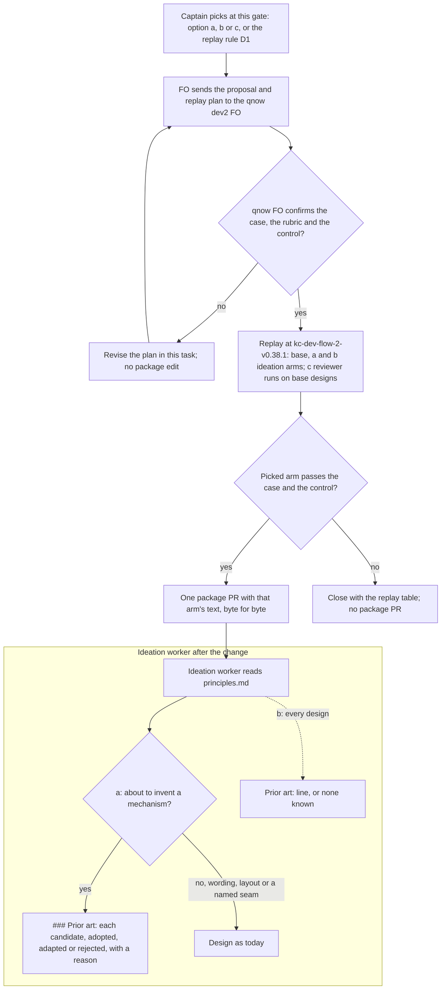

## Scope

- Source: the Captain 「是否可以讓 dev2 在構思階段時，傾向先找 RFC 有沒有類似解決方案？避免發明很接近但考慮沒那麼全的方案？」 (chat with the qnow dev2 FO, 2026-11-10), relayed by Paseo 519ab4c8 with his 「把這個想法和案例送給開發流程負責人」 (relayed, not a ruling here; the backlog gate confirms it).
- Bite (the qnow FO's report, not re-run here): on qnow task booking-attempt-identity (ideation 2026-11-10; first dispatch record dispatch/ideation-2.md, pinned base 706b01fdb04b5d0b17b213562296dc95eaa60368, state branch spacedock-state/dev2 of iamcxa/qnow) the ideation worker designed a client-side attempt-ownership mechanism and duplicate-send key handling from scratch; asked afterwards, the qnow FO found the WHATWG AbortController/AbortSignal primitive and the IETF Idempotency-Key header draft unmentioned, and on sibling task owner-cancels-booking the design director's MAJOR race finding has RFC 9110 conditional requests as the standard answer.
- Package fact (FO read 2026-11-10, kc-dev-flow-2 0.37.0 `skills/ideation/principles.md`): it asks for the bounded existing-code check and for research when missing facts can change the decision; it does not ask for standards or known library patterns, nor for adopt, adapt or reject.
- Suggested direction (qnow FO, not a ruling): one ideation principle line, perhaps a short prior-art part of the design (standards, drafts, library patterns considered; adopt, adapt or reject with a reason), bounded so ideation is not a literature survey; shown by a Behaviour replay of that ideation dispatch at the release tag versus the change, plus a control task with no relevant standard.
- Process asked by the qnow FO: send it the proposal and the replay plan, and get its confirmation against the case, before any package edit.
- Non-goals: changing qnow's designs; a mandatory survey on every task.

## Budget
- One package PR to the ideation skill text and its tests; workflow word budget unchanged unless the design names a raise for the Captain.

## Stop condition
- The replay's changed arm names the relevant standards for the qnow case and the control stays short and cites none, or the design shows why not and says what was learned.

## FO alignment

Alignment: needed at ideation; how far ideation looks outside the repository, and what it costs each task, are the Captain's call.
Result: the Captain chose 「交給設計比較」 (host question dialog, 2026-11-11), answering 「「設計階段先查現成的標準與做法」這張任務的設計方向要怎麼定？我建議：只在設計工人正要發明一套新機制時才查，查完寫一小段「查了什麼、採用或改用或不用與理由」，其他任務不用查、不加必填欄位。這是設計的方向，細節與證明仍在設計關卡由你核准。」. FO's recommendation was not taken: the design compares the choices and he picks at the ideation gate.
Surfaces: none
Visible change: none
Release review: not needed: workflow maintenance, on no journey map.

## Design

### PRFAQ

When an ideation worker is about to design a mechanism that the wider field has already solved, the design names that standard, draft or platform API and says whether it adopts, adapts or rejects it, with a reason, before it builds its own. In the qnow case the approved design for one booking-attempt identity named neither the WHATWG AbortController/AbortSignal primitive nor the IETF Idempotency-Key draft, although the qnow API code at the same base already uses AbortController in nine files. Three ways to get there are compared below, and the Captain picks one at this gate. No package text changes until the qnow dev2 FO has confirmed the replay plan and the replay has run.

FAQ

- **What are the three options?** (a) Ideation checks for prior art only when the design is about to invent a mechanism, and writes a `### Prior art` section when it does. (b) Every design carries one `Prior art:` line. (c) Ideation does not change; the engineering reviewer is asked whether the design reinvents a standard or known pattern.
- **Who reads the new text?** Under (a) and (b), the ideation worker, from `skills/ideation/principles.md`. Under (c), the engineering reviewer, from `skills/engineering-reviewer/SKILL.md`. FO loads neither file at any lifecycle moment (see "Words read at each moment").
- **Does the worker search the web?** Not under any option as written. Codex's live web search is the top-level `--search` flag ("Enable live web search", `codex --help`, codex-cli 0.162.1, read 2026-11-11), and `~/.codex/config.toml` has no search key, so a Codex ideation worker is not shown to have search. The wording asks for what the worker knows and what the repository already uses. Whether ideation may look further is decision D2.
- **Is (c) enough on its own?** Not for this bite. ADR 0026 owes an engineering-reviewer call only for a Captain amendment that replaces a criterion or the design, and counts records rather than matching phrases. At the qnow ideation approval (state commit f4d6df37c) booking-attempt-identity had no `Reviewer:` line and no amendment, so no reviewer was owed before the design was approved. The first call came on 2026-11-11, after that gate. A reviewer question reaches a first design only with a new trigger, and this task does not propose one.
- **What if no option beats the current text?** The task closes with the replay table and no package PR, per the Stop condition.

### Flow

Under (c) the subgraph does not change: the engineering reviewer's step 4 carries the question when, and only when, a reviewer is called.

### Bounded existing-code check

Checked in chain order on 2026-11-11:
- **Spacedock 0.27.3** (installed cache): `grep -rniE 'prior art|\bRFC\b|known pattern|standards?'` over `skills` and `agents` finds only commission's variant cue "PRD / RFC / design doc" and a code comment. There is no stage or ensign text asking for prior art. The refinement template's prd-authoring snippet is "problem / proposal / open questions / decision", with no prior-art part.
- **kc-dev-flow-2 0.38.1 at origin/main e8664a72b:** `git grep -niE 'prior art|\bRFCs?\b|known pattern|library pattern|reinvent|IETF|WHATWG'` over `kc-dev-flow-2` finds no hit. `skills/ideation/principles.md` asks for "research when missing facts can change the decision" and the bounded existing-code check, which looks inside the repository. The engineering reviewer's step 4 asks for the "cheapest credible alternative" and says nothing about standards. The ideation text is unchanged from 0.37.0 to 0.38.1 (`git diff --stat` on `skills/ideation`, `references/profiles` and `skills/engineering-reviewer`: empty).
- **kc-dev-flow (v1)** at origin/main: no hit for the same search.
- **Sibling adopters** (subspace-relay, subspace-web, qnow; `git grep` over AGENTS.md, CLAUDE.md, learning.md, docs/dev2 and .claude at each origin HEAD): no hit.
- **Outside practice** (read from the source on 2026-11-11): the Rust RFC template (`rust-lang/rfcs` `0000-template.md`) carries a "Prior art" section between "Rationale and alternatives" and "Unresolved questions". It says that having no prior art is acceptable and that precedent elsewhere does not by itself justify a proposal. Option (a)'s adopt, adapt or reject form follows that shape. The IETF draft named by the bite is `draft-ietf-httpapi-idempotency-key-header`, revision 08 (2026-10-22), an active Internet-Draft (datatracker).
- **The bite, checked:** `git grep -iE 'abort|idempoten|rfc ?[0-9]|whatwg|ietf'` over qnow `booking-attempt-identity.md` and its folder at f4d6df37c (the ideation approve commit) finds only two lines. Both are about the API's own `idempotencyKey` field; neither names a standard, draft or AbortController. At the dispatch's code base 706b01fd, `AbortController|AbortSignal` appears in 9 files under `apps/qnow-api` and in none under `apps/qnow-app`. `Idempotency-Key` appears in no file.

Conclusion: no package text asks ideation to look outside the repository for an existing solution, so one sentence in the stage principles is the smallest change. No script or check is built.

### Options side by side

Words were counted with `wc -w` on a scratch export of origin/main with each candidate applied (`ideation-1/arm-*.diff`). `lint-skills.py` exits 0 on base and on every arm, and reports `references/sd/workflow.md: 5939 of 5939 words` (`ideation-1/lint-*.txt`). Time per task and words a design adds are not measured yet; the replay fills them in.

| | (a) only when inventing a mechanism | (b) one line in every design | (c) engineering-reviewer question |
| --- | --- | --- | --- |
| Text | `ideation-1/arm-a.diff`: 59 words after the existing-code check sentence in `skills/ideation/principles.md` | `ideation-1/arm-b.diff`: 26 words, same place | `ideation-1/arm-c.diff`: 11 words appended to step 4 of `skills/engineering-reviewer/SKILL.md` |
| Who pays, when | the ideation worker, only on a design that invents a mechanism | every ideation design, the control task included | only a task whose reviewer is called (ADR 0026: a replacing amendment, or by judgment) |
| Worker reading, pilot without ui (SKILL, profile, principles, pilot stage: 1253 words) | 1312 (+59) | 1279 (+26) | 1253; the reviewer reads 574 → 585 (+11) |
| Design words added per task | replay measures (`### Prior art` words on case and control) | replay measures (one line: expected short; control W) | 0 in the design; the reviewer report gains entries |
| Wall time per task | replay measures (seconds per run versus base) | replay measures | one reviewer run where one is already called; 0 elsewhere |
| What enforces it | the worker's judgment of "new mechanism"; no check | the worker; `design_surfaces.py` could refuse a design without the line, but that shares the file with budget-overrun-holds-and-findings-meet-non-goals and is not proposed | the reviewer, only when called; ADR 0026 rules out a phrase-matched trigger |
| Reaches the qnow bite? | if the worker reads the identity design as inventing (the replay's second case tests where that call fails) | yes, by construction | no: no reviewer was owed before the ideation approval at f4d6df37c |
| What gets worse | a worker that frames an invention as "repairing nine checks" skips it; the trigger list (identity, ordering, retry, cancel, cache, lock, message format) was written knowing this case | a line on every task, close to the "mandatory survey on every task" the Scope rules out; it risks `none known` filler or padded citations | the first design ships without the question; adding a reviewer to every ideation would cost one reviewer run per task |

Precedent for D1: in this workflow's gate records the Captain has more than once chosen a deterministic check over an advisory rule (`Override: recommended no FO rule (design D-2); Captain chose the checker printing preview paths`; `_archive/agent-reads-governing-adr.md`, `Captain chose refusing branch refs`). That lean favours (b) with a check. The Scope's non-goal "a mandatory survey on every task" and the budget task's own `design_surfaces.py` change weigh against it now; the recommendation below keeps that variant out.

### Proposal and replay plan for the qnow dev2 FO

This block is meant to be forwarded as it stands. It cites qnow by commit and path only.

> **Ask:** confirm, against booking-attempt-identity, that this proposal and replay plan test what you saw, before any kc-dev-flow-2 edit. Name any change to the cases, the rubric or the control.
>
> **Proposal.** The three candidate texts are in kc-claude-plugins `spacedock-state/dev2`, `ideation-checks-external-prior-art/ideation-1/arm-a.diff`, `arm-b.diff` and `arm-c.diff`. (a) and (b) add one passage to `skills/ideation/principles.md`; (c) adds a question to the engineering reviewer's step 4. The Captain picks at the dev2 ideation gate; the replay decides whether the pick ships.
>
> **Builds**, with `kc-dev-flow-2/scripts/replay_dispatch.py build` at package tag `kc-dev-flow-2-v0.38.1` (base) or that tag plus one arm diff. `--readme-base-ref kc-dev-flow-2-v0.35.0` (the qnow README marker at both code bases below). A `git merge-file` pre-flight of the README onto 0.38.1 and onto 0.37.0 exited 0 for both READMEs on 2026-11-11. If the build still conflicts, use 0.37.0, whose ideation text is identical.
> - Case 1, booking-attempt-identity ideation-2: state 798bab50f1a97acfff13b6327e5576bf5b3769f5 (no `## Design` yet), code 706b01fdb04b5d0b17b213562296dc95eaa60368, README from 429b4673e0cff4088adf5ee75db64830de441917, checklist = that dispatch's four items.
> - Case 2, owner-cancels-booking ideation-2: state dace599efb123fd6383f49de2a61c67ba6f1bc2e, the same code and README, checklist = that dispatch's items. It tests whether (a) fires on a race that the worker may not frame as a new mechanism.
> - Control, agents-md-rules-refresh ideation-1: state 1aea91e915b1715b438e92b21cc6a4fae9dea705, code and README 1ceda103c0633ea721b4db213dad4b45c9c56dba, checklist = its four items. It is a rule-text refresh with no relevant standard.
> - Scope notes for every run: text only; no pictures, preview, design review or agents; no commit. Checked 2026-11-11: none of the three checklists, the three task files at those state commits, or the arm texts contain a rubric term (`abort|idempoten|rfc|whatwg|ietf|if-match|etag|precondition|standard|prior art`: 0).
>
> **Runs.** Codex gpt-6-astra, xhigh, the original host and model. A fresh `codex exec` per run, without `--search`, unless D2 rules otherwise.
> - Arms base, a and b: case 1 three runs each, case 2 two each, control two each, for 21 runs.
> - Arm c: the engineering reviewer on the base arm's designs, 3 + 2 + 2 = 7 runs, on the model `role_triggers.py` would require (opus; fable or astra where `Surfaces:` lists db, so case 2).
>
> **Scoring.** The fixed rubric is `ideation-1/rubric.md`: P1 AbortController/AbortSignal, P2 the Idempotency-Key draft, P3 adopt/adapt/reject with a reason, P4 RFC 9110 preconditions, and for the control N (items adopted or adapted) and W (prior-art words). H1 counts a nonexistent citation and H2 an irrelevant one. A fresh Claude Sonnet scores each text blind, quoting verbatim, in two passes.
>
> **Pass rule, fixed before the first run.** An arm passes when all four hold:
> - in case 1, P1 and P2 each hit in at least 2 of 3 runs, and every named item has P3;
> - in the control, N = 0 and W ≤ 30 in every run;
> - H1 = 0 in all of the arm's runs;
> - the base arm hits P1 and P2 each in at most 1 of 3.
>
> If base already hits them in 2 of 3, the bite does not reproduce at 0.38.1, and the task closes saying so. For (a) to be preferred over (b), case 2 must also show P4 in at least 1 of 2 runs.
>
> **Measured for the cost column:** seconds per run, design words versus the base mean, prior-art words, and the tokens Codex prints, if it prints them. The same host and model took 615 to 975 s per ideation run in the kept-data replay (2026-11-09, a different task), so the 21 Codex runs are hours of host time even in parallel. No money figure is claimed.
>
> **Evidence location.** qnow-derived text stays on the machine at `~/.local/state/kc-dev-flow-2-replays/ideation-checks-external-prior-art`, because this state branch is published with a public repository. The kit (rubric, arm diffs, build and score commands) lives in the dev2 task folder.

### Words read at each moment

Counted with `wc -w` at origin/main e8664a72b and on the scratch arms, 2026-11-11.

| Reader and moment | Before | After (a / b / c) |
| --- | --- | --- |
| FO at startup, resume, idle on an open PR, idle on a merged PR, after the archive, the merge ask | unchanged. `references/sd/workflow.md` 5939; `git grep 'ideation/principles\|engineering-reviewer/SKILL'` over `scripts`, `references/sd`, `skills/dev` and `agents` hits only `lint-skills.py`'s required-phrase list, which FO does not read. No `role_triggers.py` event or output changes. | same / same / same |
| FO at ideation dispatch (Dispatch facts via show-stage-def) | unchanged | same / same / same |
| FO and the Captain at ideation gate preparation | the design as today | (a) plus a `### Prior art` section on mechanism tasks, words measured by the replay; (b) plus one line on every task, measured; (c) plus nothing unless a reviewer was called, then the report's added entries |
| Ideation worker, pilot without ui (with ui, add `design-review.md`'s 531) | 1253 | 1312 / 1279 / 1253 |
| Engineering reviewer (SKILL 395 + agent 179) | 574 | 574 / 574 / 585 |

### Batch overlap

This design changes `kc-dev-flow-2/skills/ideation/principles.md` under (a) or (b), or `kc-dev-flow-2/skills/engineering-reviewer/SKILL.md` under (c). No script, test, README, ADR or numbered record changes, and no budget step is added.
- **budget-overrun-holds-and-findings-meet-non-goals** (batch 21, ideation; it now holds the folded first-principles-check-in-dev2-principles): its design adds a `### Worth questions` duty to `skills/ideation/principles.md` and a refusal to `scripts/design_surfaces.py`. Under (a) or (b) the two tasks share `principles.md` (neighbouring sentences); under a checked (b) they would also share `design_surfaces.py`. Under (c), nothing is shared.
- **first-principles-check-in-dev2-principles** (backlog, read only): folded into the task above; same overlap through it.
- **worker-push-words-match-state-commit** (batch 21): `skills/implementation/principles.md`, `skills/validation/principles.md` and `lint-skills.py`'s required phrases. None shared; this design adds no required phrase.
- **denied-command-denies-only-that-command** (batch 21): `references/sd/workflow.md` Dispatch facts and a `WORKFLOW_BUDGET_STEPS` raise. None shared.
- **release-rollout-reaches-adopters-and-laws-pin** (batch 21): `package_version.py`, its test, `skills/maintain-flow/SKILL.md`, `references/sd/adoption.md`, root CLAUDE.md and one ADR. None shared.
- **story-done-reports-release-remaining** (batch 21): kc-journey-map files. None shared.
- **adr-required-statement, dispatch-carries-reserved-adr-number, journey-server-host-pilot, merge-guard-stops-unasked-merges, ops-inbox-r1-setup-and-isolation, pr-review-lite-value-pilot** (other sessions, read only): no mention of either file in their task text (`grep -c`: 0 each). None shared. This design takes no ADR number.

Recommended order: land budget-overrun-holds-and-findings-meet-non-goals's `principles.md` edit first, because its design is larger and carries a check; this task's single sentence then rebases onto it. The replay does not wait for it, because it runs at the released tag.

## Acceptance criteria

**AC-1**: Before any package edit, the qnow dev2 FO has confirmed the proposal and replay plan, or its requested changes are folded into this task and confirmed.
Verified by: a dated line under `## FO alignment` quoting the qnow FO's confirmation and naming any change it asked for, written before the package PR's first commit (compare the line's date with `git log --format=%ci` of the PR's first commit). Falsifier: a package commit dated before the confirmation line, or no line at all.

**AC-2**: The replay runs as the plan states, and the rubric is fixed before the first run.
Verified by: `ideation-1/rubric.md` in this state checkout has a commit date earlier than the first run's start time recorded in the results table. The run count per arm and task matches the plan (21 Codex runs, 7 reviewer runs), and every build used the state, code and README commits named above. Falsifier: a rubric edit after the first run without a re-run, or a missing or extra arm.

**AC-3**: Only an arm that passes the pre-registered rule ships, and it ships the replayed text unchanged.
Verified by: `git diff --name-only origin/main...<PR head> -- kc-dev-flow-2` lists only the picked arm's file. Its added lines equal the `+` lines of `ideation-1/arm-<x>.diff`. The results table shows that arm passing case 1 and the control by the rule. Falsifier: a reworded line, a second package file, or a PR for an arm that failed. If no arm passes, there is no PR, and the task closes with the table and what was learned (Stop condition).

**AC-4**: The control stays short and cites nothing.
Verified by: the results table's control rows for the picked arm show N = 0 and W ≤ 30 in every run, in both scorer passes. Falsifier: any control run naming a standard as adopted or adapted, or a prior-art part over 30 words.

**AC-5**: No passage or script output FO reads at startup, resume, idle on an open or merged PR, after the archive or at the merge ask changes.
Verified by: at the PR head, `python3 kc-dev-flow-2/scripts/lint-skills.py` exits 0 and prints `references/sd/workflow.md: 5939 of 5939 words` (or the then-current base count, unchanged by this PR). `git grep -n 'ideation/principles\|engineering-reviewer/SKILL' <PR head> -- kc-dev-flow-2/scripts kc-dev-flow-2/references/sd kc-dev-flow-2/skills/dev kc-dev-flow-2/agents` returns nothing beyond `lint-skills.py`'s existing required-phrase line. Falsifier: any change to `references/sd/workflow.md`, or a new hit in those paths. Current evidence: lint exit 0 on the scratch base and on all three arms (`ideation-1/lint-*.txt`, 2026-11-11).

## Unresolved decisions

**D1 — which option, and does the replay decide?** Recommended: approve the pre-registered rule with (a) preferred. Ship (a) if it passes case 1, the control and case 2's P4. Otherwise ship (b) if it passes case 1 and the control. Otherwise close with no PR. (c) is replayed for information only.
- Why: (a) costs nothing on tasks that invent nothing; (b) charges every task, near the Scope's non-goal; (c) cannot reach a first design without a new trigger that ADR 0026 would have to allow.
- What gets worse: the Captain's pick waits on evidence; the replay costs 21 Codex and 7 reviewer runs (hours of host time); and (a) relies on the worker's judgment with no check, against the Captain's recorded lean toward checks.
- If the Captain picks one option outright instead, the replay runs base against that arm only (case 1 three runs each, the control two each: 10 runs, plus case 2 for (a)).

**D2 — how far does ideation look outside the repository?** Recommended: what the worker knows plus the repository's own dependencies, with no web search, which is how every arm is replayed.
- Why: no ideation host is shown to have search; and in this case, AbortController is already in qnow's API code, so a "library already in use" reading finds it.
- What gets worse: a standard the model does not know, or one newer than its training, is missed. Allowing search would mean a `--search` launch for Codex ideation workers, a per-task cost not yet measured, and a second replay run with search on.

## Stage Report: ideation

- DONE: Per the Captain's Result line, compare side by side for him to pick at the gate, each with what gets worse and its cost per task: (a) a prior-art check only when the design is about to invent a mechanism, (b) one line in every design, (c) no ideation change and a question the engineering-reviewer asks. Design the replay of the qnow ideation dispatch the seed names at the released tag versus each option, with a control task that has no relevant standard, and write the proposal and replay plan so FO can send them to the qnow dev2 FO before any package edit
  `### Options side by side`. Measured cost: worker-read words +59 / +26 / +11 (reviewer). Time and design words are left for the replay. The plan is under `### Proposal and replay plan for the qnow dev2 FO`, ready to forward. It covers case 1 booking-attempt-identity ideation-2 at state 798bab50f, case 2 owner-cancels-booking ideation-2, and the control agents-md-rules-refresh ideation-1. The README merge pre-flight exited 0 at both bases; the rubric is in `ideation-1/rubric.md`. The replay was designed, not run.
- DONE: A `### Batch overlap` section naming each file the design would change and each other batch task (story-done-reports-release-remaining, release-rollout-reaches-adopters-and-laws-pin, budget-overrun-holds-and-findings-meet-non-goals, worker-push-words-match-state-commit, denied-command-denies-only-that-command, ideation-checks-external-prior-art) and live task of other sessions (first-principles-check-in-dev2-principles (backlog, folded into the budget task; read only), adr-required-statement, dispatch-carries-reserved-adr-number, journey-server-host-pilot, merge-guard-stops-unasked-merges, ops-inbox-r1-setup-and-isolation, pr-review-lite-value-pilot (driven by other sessions or held; read only)) that changes the same file or check, so FO can order implementation
  The only shared file is `skills/ideation/principles.md`, with budget-overrun-holds-and-findings-meet-non-goals (and the folded first-principles task). A checked (b) would also share `design_surfaces.py`. Recommended order: the budget task first.
- DONE: The words FO reads at each lifecycle moment, before and after, per root learning.md "Measure the words FO reads at each moment, not one file's size"
  `### Words read at each moment`. FO's six lifecycle moments are unchanged under every option: workflow.md stays at 5939, and the `git grep` finds no FO-loaded hit. Only the ideation gate's design text grows, by an amount the replay measures.
- DONE: Acceptance criteria with reproducible evidence clauses and falsifiers, and unresolved decisions for the Captain, each with a recommendation and what gets worse under it
  Per-criterion evidence follows. D1 recommends the pre-registered rule with (a) preferred. D2 recommends no web search.
  - AC-1, qnow FO confirmation before any package edit: not yet verified (future).
  - AC-2, replay as planned with the rubric fixed first: not yet verified; the rubric is committed with this report.
  - AC-3, only a passing arm ships, byte for byte: not yet verified.
  - AC-4, the control stays short: not yet verified.
  - AC-5, FO's reading is unchanged: current evidence is `lint-skills.py` exit 0 with 5939 of 5939 on scratch base and arms a, b and c (`ideation-1/lint-*.txt`); the PR-head run is future.

### Summary

The chain check found no prior-art duty in Spacedock, kc-dev-flow-2, v1 or the adopters. The qnow bite checks out: the approved design at f4d6df37c names no standard, although qnow's API already uses AbortController.
- Recommended: option (a), gated by a pre-registered replay rule. Option (b) charges every task; option (c) cannot reach a first design, because ADR 0026 owes no reviewer before the ideation approval.
- Checks run: `design_surfaces.py check` exits 0 ("design surfaces presentable"; log in `ideation-1/design-surfaces.log`).
- Side effects: ran `git fetch` in the qnow clone `/Users/kent/conductor/repos/qnow` (read-only otherwise). Scratch files are in `/tmp/prior-art-preflight` and `/tmp/prior-art-lint`. No repository file, branch or commit was made.
