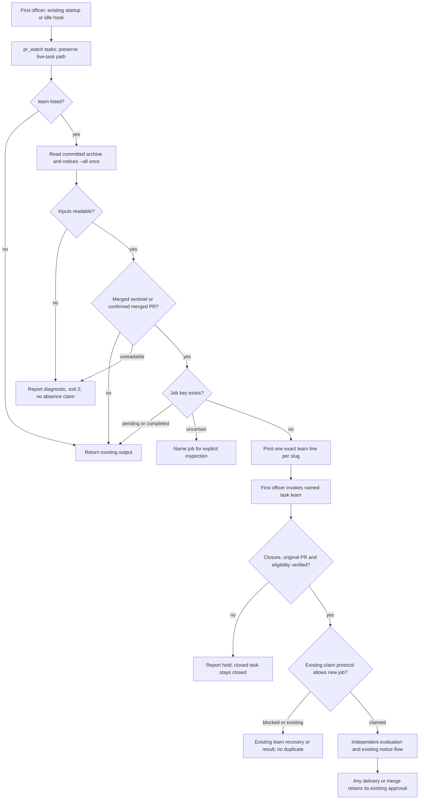

## Scope

- Source: the Captain 「可以，開 A-D」 (chat, 2026-10-26), answering 「需要你決定：下面 5 個套件缺口候選，要開哪幾張待辦？我建議開 A 到 D，E 先不開。」 after the learn backfill of 11 archived tasks (Captain 「補跑」, 2026-10-26).
- Bite: 11 archived tasks with merged PRs (#708, #709, #711, #713, #714, #716, #719, #720, #721, #722, #724; 2026-10-23 to 10-26) had observer reports but no learn job in `learning.py notices --all`; FO backfilled them on 2026-10-26. `observer_check.py` already prints `next: run kc-dev-flow-2:learn for <slug>` for an archived task, and `pr_watch.py` reacts to a watched PR turning MERGED, but FO merged these PRs directly and did not run `observer_check.py`, so nothing reminded it.
- Upstream first: `scripts/pr_watch.py` (`tasks`, the idle hook), `scripts/observer_check.py`, `extensions/learn/EXTENSION.md`, `scripts/learning.py notices --all`.

## FO alignment

Alignment: needed before ideation; where the check runs is a package design choice.
Surfaces: none
Visible change: none
Release review: not needed: workflow maintenance, on no journey map.
Result: aligned 2026-10-27 on the outcome by the Captain's 「全准」 answering this task's backlog briefing-1 question, which named the idle hook naming every archived task with a merged PR and no learn job; the hook's exact output is put to him at the ideation gate.
Reviewer: kc-dev-flow-2:chief-engineer opus 2026-10-27 — batch 8 review at the ideation gate (the Captain's batch ruling 2026-10-27): per-task disposition, the Captain's decisions, order and batch risk.

## Design

### Basis and boundary

Pilot; `Surfaces: none`. This stage proposes a repair to the existing startup/idle task scan. It changes no code, workflow frontmatter, adopter, branch, gate, PR or learning record. This entity's body and its path-scoped state commit are the dispatched artifact, the split-root exception to “no repository file, branch or commit.”

Source: refreshed `origin/main` at `8bf4f3582411e8e4238f19fbadda8ddeca6767be`, package version 0.32.0. The installed Codex package's pr_watch.py, learning.py, observer_check.py, test_pr_watch.py, learn extension and package mod compare byte-for-byte with that commit. Package used: `/Users/kent/.codex/plugins/cache/kc-claude-plugins/kc-dev-flow-2/0.32.0`. State read through `fab2eb7f52ea8300ba9f52248f093337b5c326ae`; concurrent other-task commits are expected.

Chain checked in order:

1. **Spacedock (workflow orchestrator), 0.27.3:** its own `mods/pr-merge.md` explicitly scans only live entities, excludes `_archive/`, and calls a `pr-merge:N` sentinel durable proof of MERGED; `skills/first-officer/references/fo-merge-core.md` says it is retained through archive. `fo-dispatch-core.md` already runs the idle hook once after the first empty scheduler read. Neither owns the package's learning store. Repair the package consumer; no Spacedock change or new hook.
2. **kc-dev-flow-2:** `references/sd/mods/kc-dev-flow-2.md` already invokes `pr_watch.py tasks` at startup/idle. `entities()` excludes `_archive`; `tasks()` only learns through a live merged PR's later `observer_check.py` call. `observer_check.py` can name learning for a known archived slug but discovers no slugs. `learning.py notices --all` is already the supported read-only job list, includes acknowledged jobs and uncertain directories, and creates no missing store. Two bounded searches: `git grep -n 'pr_watch.py.*tasks' <source> -- kc-dev-flow-2` for callers; `git grep -n 'notices.*--all' <source> -- kc-dev-flow-2` plus the archive exclusion/test for discovery. Only the mod consumes `tasks` as instructions; no machine parser of its individual lines was found. Manual learn, the live merged path, and existing pending-job recovery remain consumers; host invocations outside the package were not audited. Classification: existing journey with a broken archive-discovery seam, not a missing scheduler.
3. **Sibling adopters, read only:** relay `beirut-dev2` at `ab570dbe4125db7a57b27160a8d1c9e39591b3b9` has 62 flat archived dev2 tasks, including `pair-once` with `pr-merge:442`; web `dev2-fo` at `88d127699e027e6dd27a500ead190619431fa800` has 32 flat archives and merged sentinels; qnow `qnow-adopt-dev2` at `278f79ca3eb03a8c1286817f542c4ec4b744bfed` has 56 flat and one folder archive, including `closure-guard-restore` with `pr-merge:1214`. All three list learn and split-root state. Their code heads identify inspected checkouts, not immutable state snapshots or evidence of missing jobs there. No adopter workaround is used as Spacedock's contract.

ADRs (architecture decision records) read: 0009, manual package improvement; 0011, learning at archive and retained authority; 0035, learn listed by default. The `Override:` search found no contrary ruling on archived learning reminders. The archived `fo-lifecycle-mod` Amendment 6 keeps every-idle tasks and removes script-authored merge asks; this design retains that boundary. Root learning.md's per-moment word count and new-output caller checks apply. No new ADR ruling is proposed.

### PRFAQ

**Proposition.** After this repair, a first officer sees the name of each archived task with a merged PR and no learning job on the next startup or idle scan, including when the PR was merged directly and the usual post-archive step was missed. A job already recorded, even acknowledged or still pending, prevents a duplicate missing-job reminder.

**Who acts?** The hook prints; the first officer invokes the existing named-task learn skill. That skill still verifies closure, the original repository-qualified merged PR and eligibility, then claims at most one job. The hook does not run evaluators, repair records, acknowledge results, merge, or decide findings.

**What counts as merged?** A committed `pr-merge:N` sentinel is enough to remind, under Spacedock's own contract; it is not enough for learn's original-PR verification. An archived `owner/repo#N`, `#N` or `N` without a sentinel requires a successful state-only provider read returning MERGED. Preserve an explicit repository qualifier; resolve a bare number through the workflow's code root, never the state checkout or launch cwd. A missing or ambiguous origin is a diagnostic, not a guessed merge. OPEN/CLOSED and `local-merge:SHA` do not qualify. Do not route archive checks through the full review/checks reader.

**Why all notices?** All 11 backfilled jobs are now acknowledged. The unread-only list would falsely name all 11 again. Pending and completed jobs both count; delivery status, no-change, acknowledgement and release do not make a job absent.

**What if the job cannot be identified?** Use the existing pure `learning.job_key` helper on `{workflow: project-relative POSIX definition directory, task_id: resolved slug}`; match the returned `job` field from `notices --all`. This also matches an uncertain record that lacks `input`. Never match only a PR number, title, frontmatter `id`, or slug across workflows; never inspect private store files directly. A known uncertain key suppresses a new-job instruction and prints an inspection diagnostic. A malformed/unreadable job list cannot be treated as empty.

### Mechanism and exact output

Within `tasks`, keep the live scan unchanged. If `learn` is listed, pin the state HEAD once, enumerate its committed `_archive/<slug>.md` and `_archive/<slug>/index.md` task files, and prefer the folder index on a duplicate slug as the existing live enumerator does. Ignore sidecars, hidden entries and `_mods`; missing archive means empty. Read through Git at that revision rather than a half-written archive move. Untracked/uncommitted archive files are not closure evidence. Failure to read an expected tracked file is reported.

Obtain the code root from the resolved workflow, derive its relative workflow key and run exactly once per nonempty archive scan:

```text
python3 <package>/scripts/learning.py --repo <absolute-code-root> notices --all
```

Both split-root and inline workflows use the code repository's common learning store. A symlink/definition outside the code root or malformed job data is an error, not an alternate key. Confirm the `notices` array and job-key shape before subtraction. Existing keyed pending/completed/uncertain jobs are not re-created. No completion-state filter and no acknowledgement filter. No date, profile or variant cutoff is imposed on discovery; learn owns eligibility and reports a hold for an ineligible old archive.

Append one line per qualifying missing slug in lexical order, after existing hold/seed lines and before the existing watch wait lines:

```text
next: run kc-dev-flow-2:learn for <slug>.
```

This is the existing observer check's exact learning instruction, five whitespace-separated words with a real slug. It refers to the workflow supplied to `tasks`. The next scan prints it again while no job exists; once a pending claim appears it disappears. Printing every missing name does not bypass learn's store-wide one-job-at-a-time claim lock. FO handles blockers under the current learn extension. The after-pr-merge path remains unchanged; a task archived during that hook is eligible for recovery on the next tasks pass, not a second scan in the same pass.

For an unreadable notice command or malformed list, emit `next: report missing learn jobs to the Captain: <reason>.` and exit 2, with no absence-derived learn lines. Continue independent live-task output. For an archived bare PR read failure, emit the existing-style `next: report <slug> to the Captain: <reason>.`, exit 2, and retain independent confirmed reminders. A keyed uncertain record emits `next: inspect learn job <job> for <slug>; its record is uncertain.` instead of an instruction to create it. Diagnostics are informational instructions to FO, never record recovery or fresh authority.

Replace only the learn extension's FO-step bullet with:

- **FO step:** the package mod runs `python3 <package>/scripts/pr_watch.py tasks <workflow dir>` at startup and idle. It runs `<package>/scripts/observer_check.py` before a merged task's sentinel and names archived merged tasks without a learn job.

No package README/workflow/mod expansion, no archive refusal, new persistent reminder marker, date watermark, background polling or CI trigger change. The observer extension's remaining steps, delivery constraints and limits stay intact.



### Archive replay and limits

Archive revision `1158adc584637bdbf1b2f347b91a4c63844d6c00` is the final listed task's archive commit, 2026-10-26T01:19:26Z, before the requested backfill. Exporting its task files gives 88 archive entities. The released `tasks` function, exercised on an isolated archive-only workflow with the scheduler returning no ready gates, exits 0 and prints zero lines. No provider call occurs in that baseline.

The read-only decision model uses those committed archive bytes and the actual 53-job `notices --all` output observed on 2026-10-27. Removing the 11 named backfill keys reconstructs their known pre-backfill absence (42 remaining keys). This is a reconstruction, not a recovered historical snapshot of the unversioned learning store; other historical jobs are not claimed exact. It yields 29 missing-name candidates, including all 11 below. Restoring the current job list suppresses all 11 and leaves 18 older candidates; eligibility and original-PR verification for those 18 were not performed.

| Original PR | Archived task | Form | Model before / after backfill |
| --- | --- | --- | --- |
| iamcxa/kc-claude-plugins#708 | `design-director-runs-ui-design-review` | flat | named / suppressed |
| iamcxa/kc-claude-plugins#709 | `release-acceptance` | folder index | named / suppressed |
| iamcxa/kc-claude-plugins#711 | `release-review-staleness-held-at-dispatch` | flat | named / suppressed |
| iamcxa/kc-claude-plugins#713 | `kc-adr-tools-with-dev2-copy` | flat | named / suppressed |
| iamcxa/kc-claude-plugins#714 | `release-walk-picky-reviewers-and-director` | flat | named / suppressed |
| iamcxa/kc-claude-plugins#716 | `extension-defaults-and-install-choice` | flat | named / suppressed |
| iamcxa/kc-claude-plugins#719 | `role-triggers-owe-ce-on-review-drift` | flat | named / suppressed |
| iamcxa/kc-claude-plugins#720 | `delivery-gate-reads-folder-tasks` | flat | named / suppressed |
| iamcxa/kc-claude-plugins#721 | `stage-report-correction-path` | flat | named / suppressed |
| iamcxa/kc-claude-plugins#722 | `codex-review-hang-detected` | flat | named / suppressed |
| iamcxa/kc-claude-plugins#724 | `fo-written-lines-checked-before-dispatch` | flat | named / suppressed |

The model emits the exact line above once for each of these slugs. Counterexamples exercised: dropping folder indexes loses `release-acceptance`; using only unread jobs falsely names all 11; a keyed uncertain job suppresses its missing-job line even without `input`. These demonstrate the design distinction, not an implemented hook fix.

Provider limit: a direct `gh pr view 708 --repo iamcxa/kc-claude-plugins --json state,mergeCommit` succeeded (MERGED, `0701aa8debd45b3fe7eab7e930141319d52f3aa2`). A subsequent batch of all 11 failed with `error connecting to api.github.com`. Thus the full replay's merge evidence is the committed Spacedock sentinels and recorded backfill evidence; it is not 11 fresh GitHub confirmations.

Reproduction, using a local checkout that contains the named state revision and the installed 0.32.0 package: the following is the frozen job-key version of the exercised design model. Run `python3 -B replay.py <installed-package-root> <state-checkout>`; both paths are explicit arguments. It stores only the notice job keys needed for subtraction, and marks them acknowledged in the counterexample fixture; it does not depend on the original machine learning store. It writes only disposable fixtures and `/tmp/idle-learn-ideation/replay-result.json`; create that temporary directory first. Current-store counts may change; the invariant is all 11 missing with their keys removed and none missing with their keys present. A future permanent test must freeze notice fixtures, not depend on the author's machine store.

```python
import contextlib, importlib.util, io, json, os, re, subprocess, sys, tempfile
from pathlib import Path
PKG=Path(sys.argv[1])
STATE=Path(sys.argv[2])
REV='1158adc584637bdbf1b2f347b91a4c63844d6c00'
TARGET={708,709,711,713,714,716,719,720,721,722,724}
def git(*args): return subprocess.check_output(['git',*map(str,args)],text=True).strip()
def module(name):
 spec=importlib.util.spec_from_file_location(name,PKG/'scripts'/f'{name}.py'); m=importlib.util.module_from_spec(spec); spec.loader.exec_module(m); return m
watch=module('pr_watch'); learn=module('learning')
# Frozen job-key projection of the successful notices --all read; no tokens or raw store reads.
JOB_KEYS='''
03768d7afea14ec480f55b049e7a8c5807dfcca54ee980adb4b58b1f62607247
0519f142d8ce26351f82de8f6a1737e435f6f6833a2240d0f433227d1cf33c15
08fcffef857b105eb2ce9a84e87250cfea604636f0a9764672fd2faeee12d3dc
119eb47ef655b2d418c3968fecb24b73233d064e9b14062d6309a02fb43ff71a
12af920036eed5d6d577773b877b42c697cef3b64de387346da66673f9f0b556
197d9c21df78b3027a569e1bf660d539da864df18b0b7f22ed98764673cc04ce
1c25da09e5c89306d382f4648ae49679102d5e36d816eed57b4d84800e821a24
1dff94d268e11724aeb16a55beeac230dd77b29c93e92141207377e92966a0b8
1fecd3653070ada6ea9f5128e6896334ca3d903f4d9479fc35926c42d09241ad
229f31f6bcedba12c9b6dc9b4383239b154afcf292f33714d0715ac074fbc6a8
25e51433345d9189e4443a8d8a66c8803e8e3f5e75f60aae4eb082dd0ed8b865
275120f832382be70c21ab848312ce86d7d43226bbbeded67126ec44fd6e12b0
28c47203d5ddc515c985658b9af36e93a618b07ab798a94975ec3e7f888d92b1
294809442c66bb39baba36ad475526b2935671f0462766d26b74c5b9c1974fe7
3d6a684bb18106c8add21026e71c2be3769be66feeafec598e39ed350d18b255
3ddcc1a3f15a9da51b0b2596e6dce3a4f5cc10da0b47a317dafe2f95832cfdbb
441fe280d07513b3bfa7c1cd29444490994538c6e7fe6202b76d177129a67303
49a91123986e0bc6d7d4c1e20e88df598cb3d2c2719b191a514977d0617e8865
4a1a751ff2ca64298bd17643e6d4f003ceddfd88a3d1477e11999a91a2588371
525727f4a28a21f439db6aa14dd2b4569fe39680ed1c0254f962ae7d1d968a9e
590050db5006bb295881d588f99c54f8dbdd75088d8a526414f73b2dc395cfaa
5d9d53163b93e2a21c7054e7ec97a58334e8c72e393d1c70a8e921b087fa07b9
5df3940db9be34289535af9ebd3b14e7a2fc7257e326f110cf842770ab81e96e
7c9058e89ee59439423e240748c24e5693773de309e8015e374ef9a25074277c
863804ad3c7ab702bb7c4b3eae3ac86ff6a063628dbfcf0419350863a8ad569f
8b56b9c500211d3bfd7337f335944d2cb86e2424c44af42de3f37df4622fe4fc
8bc3d55097b0142bdc4fe9ec22ac7765b187d60bcf167d50aa7d360ec7dd9322
90dba82771bcf1ea1e635b503b6a2cff0afd575f2e3cd005e6885985c837a63d
91a95ca9ead7f5feb1fbd33ff3cf883e77d5079e8e92a235a567489d4984d4bc
92da235be7f7d7e06554be0903fd9c2fc9dd5708588c69c4820a82d112293937
a22107a3d634a30e0fe25ab8bd82409f7d943841be697417087197caa3d23c5d
a23d0a84798616cf1dc2a2b3ee4276eda6563f6222eb2e7774585a5795beee79
ad929ab91b38657a02102a12f2c5c14f75e36934d8f83631ae5a94d9e65f04d5
b183ebfaf87286e43c4c31b22611f8745450393f3315d28905609ec8c1338514
b513bb7c0c5448c1a42943f81a3ce46ca0361ac482f258eee68da2c00c911115
be495105d8e52dd6ff08e4c35a71d278934536d89f72533184b77ca86b123c19
be609ffc0af1f8d10ce78f5404078db17304c867faa1337876800078e382b24f
c0eba66706da2852f069b26704d2d06de62bf00fe3db04c7497251a4764b2939
caa9b488ed7dcf10cd3f54d5f9268967102963d97e8cb5173bc0f416e96d338b
cb9bfddbc8c1e236ad39ca3f27ca0d3df807c6910e3bd8b73673a8be687d2259
cf7529a150be092197ebc6c22725a03faf94a8d5cb6ae317249ffcb41f85dd70
d208c1e1e7801df668a41fa13f48bc83d6537d9964d7826eb831e553fded820e
d761c4cc077d5ff46081cecb8b902443443a07f90040bdbc6fc5b402eafc4704
d829872c2ba7e3e7ee8d4959f55d1447fe80038165a88731d5566dc460bf84b9
dbe9895e1982889ac0e9781e3685df11aff26318e56b57273d36bee0be162bf9
dc30682c6438230fc9667d7f20de96f0d7a528fc10a4479fc89def41917a0767
e3f45b766abad5658438796705b45886afc2359d727024e92677b0c472ed8b68
ea9e586dcefd513f3ffe44c1a357dfb2db603e75eae19278781b1f2adb348aa7
ecce2c7e736707dfa1206327c6c783a42b6f79f1a1f83021aa072dcf40ccaf0a
ed2d3ee114280792035b9f231a95202d61ce3360dddf3bc31a84955474b1d28e
efee0619799d0c728a8fd9bd41ecc5fdcd97fbbfb4c8df6b326efa5c53c2b78a
f365864cf47f1aaa6e3af779acbdb23f03795067ca45de283a4a362b19072b77
f37c7420ecbbfbc662148641dc11f86d1df4abc1930c6a0c19288207e6840fbd
'''.split()
TARGET_MAP={'release-review-staleness-held-at-dispatch': 'iamcxa/kc-claude-plugins#711', 'release-acceptance': 'iamcxa/kc-claude-plugins#709', 'kc-adr-tools-with-dev2-copy': 'iamcxa/kc-claude-plugins#713', 'release-walk-picky-reviewers-and-director': 'iamcxa/kc-claude-plugins#714', 'role-triggers-owe-ce-on-review-drift': 'iamcxa/kc-claude-plugins#719', 'stage-report-correction-path': 'iamcxa/kc-claude-plugins#721', 'fo-written-lines-checked-before-dispatch': 'iamcxa/kc-claude-plugins#724', 'extension-defaults-and-install-choice': 'iamcxa/kc-claude-plugins#716', 'design-director-runs-ui-design-review': 'iamcxa/kc-claude-plugins#708', 'codex-review-hang-detected': 'iamcxa/kc-claude-plugins#722', 'delivery-gate-reads-folder-tasks': 'iamcxa/kc-claude-plugins#720'}
notices=[{'job':k,'state':'completed','unread':False} for k in JOB_KEYS]
targets={slug:{'job':learn.job_key({'workflow':'docs/dev2','task_id':slug}),'input':{'pr':pr,'task_id':slug},'unread':False} for slug,pr in TARGET_MAP.items()}
assert len(targets)==11
target_keys={n['job'] for n in targets.values()}
pre=[n for n in notices if n['job'] not in target_keys]
with tempfile.TemporaryDirectory(prefix='idle-learn-replay-') as td:
 root=Path(td); flow=root/'docs/dev2'; state=flow/'.spacedock-state'; state.mkdir(parents=True)
 subprocess.run(['git','init','-q',str(root)],check=True)
 (flow/'README.md').write_text('---\nstate: .spacedock-state\nextensions: [learn]\n---\n')
 paths=git('-C',STATE,'ls-tree','-r','--name-only',REV,'--','_archive').splitlines()
 for p in paths:
  if re.fullmatch(r'_archive/[^/]+\.md|_archive/[^/]+/index\.md',p):
   out=state/p; out.parent.mkdir(parents=True,exist_ok=True); out.write_text(git('-C',STATE,'show',f'{REV}:{p}')+'\n')
 watch.ready_rows=lambda workflow: []
 buf=io.StringIO()
 with contextlib.redirect_stdout(buf):
  rc=watch.main(['--state',str(root/'watch.json'),'tasks',str(flow)],ask=lambda *a: (_ for _ in ()).throw(AssertionError(a)))
 baseline=buf.getvalue().splitlines(); assert rc==0 and not baseline
 archive=watch.entities(state/'_archive')
 def absent(items, source=archive):
  keys={n['job'] for n in items}; out=[]
  for slug,path in source:
   m=watch.front(path)
   if not re.fullmatch(r'pr-merge:[1-9][0-9]*',m.get('pr','')): continue
   if learn.job_key({'workflow':'docs/dev2','task_id':slug}) not in keys: out.append(slug)
  return out
 predicted=absent(pre); after=absent(notices)
 assert all(s in predicted and s not in after for s in targets)
 print('archive revision',REV,'entities',len(archive),'baseline exit/lines',rc,len(baseline))
 print('Current notices',len(notices),'reconstructed pre-backfill notices',len(pre))
 print('All missing at cutoff with reconstructed notices',len(predicted),'after-backfill at same cutoff',len(after))
 for slug,n in sorted(targets.items()):
  print(n['input']['pr'],slug,'flat' if (state/'_archive'/f'{slug}.md').exists() else 'folder')
  print(f'next: run kc-dev-flow-2:learn for {slug}.')
 # Counterexamples exercise the model, not candidate implementation.
 without_folder=[x for x in archive if x[1].name!='index.md']
 assert 'release-acceptance' not in absent(pre,without_folder)
 assert all(s not in absent(notices) for s in targets)
 unread=[n for n in notices if n.get('unread')]
 print('acknowledged target jobs',sum(not n.get('unread') for n in targets.values()))
 print('unread-only false positives',sum(s in absent(unread) for s in targets))
 expected=learn.job_key({'workflow':'docs/dev2','task_id':next(iter(targets))})
 assert next(iter(targets)) not in absent(pre+[{'job':expected,'state':'uncertain'}])
 result={'revision':REV,'baseline':baseline,'predicted_missing':predicted,'current_missing':after,'targets':{s:n['input']['pr'] for s,n in targets.items()},'full_archive_count':len(archive),'notices_count':len(notices),'pre_count':len(pre)}
 Path('/tmp/idle-learn-ideation/replay-result.json').write_text(json.dumps(result,indent=2)+'\n')
```

### Words FO reads at each moment

Count rule: `len(text.split())`, same passage set and fixture for both sides. This is a package reading ledger, not a claim that the FO has read every passage on each actual invocation. Common Spacedock orchestration, task body/gate text and unrelated reviewer output are unchanged, so add their identical count to each side. No claim that the whole session becomes smaller: the point is to expose previously missed work.

Included passages: full `skills/dev/SKILL.md` 763 words; full package mod 48; full learn extension 282 before, 280 proposed; workflow `Delivery authority` 458; workflow `Extensions` 222. Full files include headings/metadata. The FO-step bullet alone is 35 -> 33. Actual released fixture outputs: ready OPEN PR 29 words (fact and wait lines), MERGED with committed observer 20, ordinary post-archive observer check 28. Paths and slugs in the fixture have no whitespace. Replay was run through `test_pr_watch.TasksTests` fixtures in fresh temporary repositories; counts are over emitted output, not source strings.

| Moment and included package passages | Before | Proposed with no missed archive | Additional missing-task words |
| --- | ---: | ---: | ---: |
| Startup: dev + mod + learn extension + Extensions + OPEN output | 1344 | 1342 | 5 per missing task |
| Idle OPEN: mod + learn extension + Extensions + Delivery authority + OPEN output | 1039 | 1037 | 5 per missing task |
| Idle MERGED: mod + learn extension + Extensions + MERGED output | 572 | 570 | 5 per already archived missing task |
| After archive in the same pass: mod + learn extension + observer output | 358 | 356 | 0; existing post-archive instruction remains |
| Merge ask: Delivery authority + Extensions | 680 | 680 | 0; add identical actual gate output to both |

A recovery idle pass with no live task has 552 package words before and 550 + 5N proposed (mod + learn extension + Extensions; N is missing-task count). The isolated 11-task problem therefore adds 55 output words, net +53 including the smaller bullet; the full reconstructed 29-candidate scan adds 145, net +143; the current 18-candidate scan adds 90, net +88. Repeated unresolved passes repeat that cost. These are deliberately disclosed increases, not word-budget savings. A learning invocation also loads the existing learn skill (2918 words) and its required framework (3067) if absent from context: up to 5985 additional FO words for newly recovered work, plus task/provider evidence and resulting notices. The successful original after-archive path already owes that same work; the missed path had silently omitted it. No byte/word count claims to measure model tokens, elapsed time or CI cost.

Recount inputs: derive each full-file count above with Python split; extract `## Delivery authority` and `## Extensions` through the next level-two heading; replace only the exact FO-step line above; run the existing test fixture for `o/r#7` OPEN and MERGED with learn listed and a committed observer; move that fixture into `_archive`, commit in the disposable repository and invoke observer_check for the 28-word output. Recount independently at implementation, including any added diagnostics/docs, and retain the full stdout. The draft removes no observer instruction: its script pointer is retained, and `test_observer_check.py` still requires it.

### Needs decision

**One gate decision: accept the exact reminder with full-history repetition until a job exists?** Recommend yes: it satisfies “every archived task,” uses the existing job ledger to stop repeats, and adds no new persistent suppression state. Worse: old or ineligible archives and unsettled store blockers can keep producing reminders; 18 older candidates remain beyond the 11 backfilled cases, and recovering work has the reading cost above. A date cutoff or silent one-shot suppression would miss an accepted case after a crash; either would need an explicit scope amendment. This approval authorizes the design, not learning backfills or delivery of learning proposals. No other material interface or authority decision is unresolved.

### Batch overlap

Files this design would change, and only these: `kc-dev-flow-2/scripts/pr_watch.py` (archive discovery, notice subtraction and output); `kc-dev-flow-2/scripts/test_pr_watch.py` (fixtures and behavior checks); `kc-dev-flow-2/extensions/learn/EXTENSION.md` (the FO-step bullet). Checks reused without changes: `test_learning.py`, `test_observer_check.py`, `test_sd_dispatch.py`, `lint-skills.py` and the existing package test lane. No workflow budget, schema, ADR number/index or CI trigger is changed.

| Task (slug is its recorded filename) | Shared file or check and ordering consequence |
| --- | --- |
| archive-waits-for-observer-report | May change pr_watch.py, its tests and learn EXTENSION.md; shares observer/archive lifecycle and test_observer_check.py. Read its eventual approved enforcement choice first; keep this recovery scan independent of whether archive was correctly blocked. |
| idle-hook-names-merged-tasks-without-learn | This task; owns only the three paths above and missing-job behavior. |
| copilot-not-run-line-carries-quote | Current seed names delivery_gate.py, Copilot extension and reader; no planned same-file edit here. Shared package tests only. |
| dispatch-carries-reserved-adr-number | dispatch_records.py and number_guards.py are named; pr_watch consumes --newest. Coordinate any changed diagnostic grammar and rerun pr_watch tests; no direct shared edit is currently specified. |
| seed-check-requires-schema-fields | design_surfaces.py check --seed is consumed by tasks; shares tasks integration tests/exit handling, no direct shared edit yet specified. |
| journey-probe-finds-nested-maps | adoption.md/map discovery, no shared file or behavior check beyond package suite. |
| read-adr-honors-adr-folder | kc-adr read skill and synced dev2 copy, no shared file or behavior check. |
| adr-required-statement | Current validation task, ADR reporting/validation surfaces; no three-path overlap found in its recorded design. Shared package lint/dispatch suite only. |
| journey-server-host-pilot | Folder task read at journey-server-host-pilot/index.md; kc-journey-map server/host files, no shared file or check. |
| ops-inbox-r1-setup-and-isolation | kc-ops-inbox protocol/setup and its reserved ADR; no shared file or check, no number reservation here. |
| pr-review-lite-value-pilot | kc-pr-flow review experiment, no shared file or check. |
| adr-silent-undo-probe | kc-adr behavior experiment; no shared file or check. |
| comment-check-reaches-delivery-gate | Recorded design changes delivery_gate.py, its tests and validation principles; no shared file here. Shared package suite only. |
| journey-canvas-hosted-poc | kc-journey-map hosted canvas proof; no shared file or check. |
| batch-reaches-each-gate-together | Existing sitting output in tasks and test_pr_watch is adjacent; preserve output order and list semantics. Rebase/rerun if its owner changes that same function. |

Recommended order: FO settles archive-waits-for-observer-report's enforcement location first, then sequences any edits to pr_watch.py/test_pr_watch.py/learn EXTENSION.md; land this recovery scan after that overlapping change or rebase and replay it. Seed/dispatch changes may proceed independently, but their final combined head must pass tasks integration tests. All other rows are read-only coordination facts, not permission to edit or message those sessions.

## Acceptance criteria

- **AC-1** With learn listed, `pr_watch.py tasks <workflow>` names every committed archived task whose PR is proven merged and whose workflow/slug job key is absent, in lexical order with the exact five-word line; it names none when learn is unlisted. Evidence: run the CLI on flat, folder, both-form duplicate and sidecar fixtures; compare exact lines and exit codes. Falsifier: keep the current archive exclusion, omit folder indexes, duplicate a flat-plus-folder slug, or remove the extension guard.
- **AC-2** The existing `learning.py --repo <code-root> notices --all` is the sole job-list source, once per archive pass. Pending, completed, acknowledged, no-change and released records suppress absence; uncertain matching keys produce the explicit inspection line, never a new claim. Equal slugs in different workflows do not suppress one another; a frontmatter id does not replace the slug. Evidence: real recorder CLI in disposable repositories for normal/acknowledged states, controlled malformed/uncertain fixtures for failure states, and subprocess call assertions. Falsifier: omit --all, key by slug alone, use state root for --repo, filter to completed/unread records, or treat missing input as missing job.
- **AC-3** Replay the 88 entities at state revision 1158adc584637bdbf1b2f347b91a4c63844d6c00 with the 11 named backfill keys absent: all 11 exact lines appear, including release-acceptance/index.md. Restore those keys: all 11 disappear. Evidence: freeze sanitized notice fixtures and the task manifests from that revision into test_pr_watch.py data and run the candidate CLI; state the reconstructed-history limit. Falsifier: an implementation that only handles today's store, a live PR becoming MERGED, or only flat archives fails this replay. Current evidence is the released baseline and design-model replay, not a candidate pass.
- **AC-4** Committed pr-merge sentinels need no provider call for a reminder; plain qualified/bare PRs get state-only reads; OPEN, CLOSED and local-merge are not merged-PR candidates. Provider failure names the task and exits 2 without inventing a merge; missing/malformed notices exit 2 with no absence-derived learning instructions while preserving independent live output. Evidence: injected provider failures and recorded call arguments, committed/uncommitted archive controls and a missing-archive case. Falsifier: use the full review reader for each old PR, treat errors as empty/success, infer a merge from done/filename alone, or query a qualified PR in another repository.
- **AC-5** The new path writes no task/state, watch-cache entry for an archived PR, learning claim/result, acknowledgement or suppression marker; repeated scans repeat missing reminders, and a real pending claim suppresses the next one. Evidence: hash state tree and common learning-store bytes before/after archive-only runs; instrument mutating commands; run twice, then create a fixture claim and rerun. Existing live PR cache writes remain permitted and unchanged. Falsifier: acknowledge while scanning, auto-claim, update a task, create a missing store, or add an archive PR to the watch cache.
- **AC-6** Existing startup/idle hook order, observer-before-sentinel and after-archive output, ready-gate/seed/hold behavior and live PR watching remain intact. Evidence: test_pr_watch.py, test_observer_check.py, test_learning.py and test_sd_dispatch.py at the combined candidate; lint the retained extension pointer. Falsifier: route archived tasks through live role/dispatch checks, insert a new hook, drop the observer script pointer, or alter the after-pr-merge instructions. No implementation or hosted CI pass is claimed at ideation.
- **AC-7** Recount each lifecycle row with identical fixtures/passages before/after; normal-path counts are no greater than the proposed values, each missing reminder is exactly five words, and recovery work/diagnostic growth is separately disclosed. Evidence: retain emitted stdout plus independent whitespace-word recount and the exact extension diff. Falsifier: only count workflow.md, omit generated output or new instructions, hide old-task repetition, or claim the 5985-word possible learning load is a five-word total. This task changes no CI trigger; CI cost per PR has not been measured.

- **AC-9** Amended by Captain, amendment 2: the committed archive scan skips every task whose frontmatter variant or profile learning.py eligibility rejects, including missing values, before querying its PR. It names eligible merged missing-job tasks as AC-1 specifies, writes no record and changes only the three approved code files. Evidence: a 35-case variant/profile matrix compares actual tasks output with learning.py eligibility, repeats the read-only scan, and exercises a real legacy-profile ineligible claim with empty notices and no next-idle reminder. Other ineligibility reasons may still repeat, as the Captain accepted. Falsifier: remove either field check, let either check drift from learning.py, remind a legacy-profile task, suppress an otherwise eligible task held only for its verdict, or create a record.

### Feedback Cycles

- Cycle 1 (FO, 2026-10-28): validation-1 on #737 207c0a7e, F1: AC-8 as implemented names a task learn held ineligible again on every idle pass, while the recommendation the Captain accepted in Amendment 1 says such a task is not named on every pass (「不會每次都被重複點名」). The accepted recommendation governs; AC-8 and the implementation change to it. To fix; investigation first, then FO fix authorization, then validation.
- Cycle 1 phase 1 result (FO, 2026-10-28): not repeating an ineligible task needs a record the scan can read; the worker's smallest proposal appends a bound `learn not run: <reason>` result to the archived task, which also changes skills/learn/SKILL.md (it forbids changing a closed task). That widens scope beyond the approved files, so FO holds the fix for the Captain at the batch sitting (step 4); no fix authorized yet.

## Captain amendments

### Amendment 1 — 2026-10-27, chat
Captain: 「其他全照建議」 (chat, 2026-10-27)
Asked: 「需要你決定：第 8 批的設計，照首席工程師的建議一起處理，可以嗎？6 張進入實作，1 張直接關掉，再送一份 issue 給 Spacedock。我和首席工程師都建議照這樣做。」, with this task's row 「閒置檢查提醒還沒跑的 learn ｜ 照設計做，加一條驗收 ｜ 要確認 learn 判為「不適用」的任務，不會每次都被重複點名」
Supersedes: none (adds a criterion: a task learn holds as ineligible shows what the next idle pass prints for it)

### Amendment 2 — 2026-10-28, chat
Captain: 「全准」 (chat, 2026-10-28)
Asked: FO's batch-8 merge sitting, item 「**三、#737 閒置檢查：照首席工程師的方案修** - **怎麼修：** learn 判為「不適用」的任務，閒置檢查直接跳過，判斷依據是任務檔開頭的類型和規格欄位，只改原本那三個檔案，不另外存紀錄。 - **變差的地方：** 判斷規則是複製 learn 的，沒有共用；因為其他原因被判不適用的任務，仍然會重複出現。 - 修好、驗證過後，再拿合併詢問給你。」
Supersedes: AC-8 as written (the implementation worker restates it: an archived task whose variant or profile learn rejects is skipped by the scan, with a parity test against learning.py's eligibility, in the three approved files and with no new record)

Superseded text:
- **AC-8** Amended by Captain, amendment 1: when learn holds a committed archived merged task as ineligible, exercise the next idle pass and show its exact output. Evidence: a real recorder claim with profile `legacy` returns `{"state": "ineligible", "reasons": ["profile"]}`, notices --all stays empty, and the next idle pass repeats `next: run kc-dev-flow-2:learn for old-profile.`. This is the approved full-history repetition: no job means no suppression; the task remains closed. Falsifier: silently suppress an ineligible archive without a job or create a job for the hold.

## Stage Report: ideation

- DONE: A design for /Users/kent/.claude/plugins/cache/kc-claude-plugins/kc-dev-flow-2/0.32.0/scripts/pr_watch.py tasks to name every archived task with a merged PR and no learn job, using /Users/kent/.claude/plugins/cache/kc-claude-plugins/kc-dev-flow-2/0.32.0/scripts/learning.py notices --all as the job list, with its exact output line and a replay over this workflow's archive (the 11 tasks backfilled on 2026-10-26 must all appear on the state before the backfill)
  0.32.0 baseline exits 0 with no archive lines; the frozen 88-entity replay names all 11 before reconstructed backfill and none after. Folder omission and unread-only controls falsify the result; full historical job-store bytes were unavailable.
- DONE: A `### Batch overlap` section naming each file the design would change and each other batch task (archive-waits-for-observer-report, idle-hook-names-merged-tasks-without-learn, copilot-not-run-line-carries-quote, dispatch-carries-reserved-adr-number, seed-check-requires-schema-fields, journey-probe-finds-nested-maps, read-adr-honors-adr-folder) and live task of other sessions (adr-required-statement, journey-server-host-pilot, ops-inbox-r1-setup-and-isolation, pr-review-lite-value-pilot, adr-silent-undo-probe, comment-check-reaches-delivery-gate, journey-canvas-hosted-poc (driven by other sessions; read only)) that changes the same file or check, so FO can order implementation
  Batch overlap lists the three proposed files, all seven batch tasks, all seven named other-session tasks and the adjacent batch-sitting task; observer/archive changes require sequencing.
- DONE: The words FO reads at each lifecycle moment, before and after, per root learning.md "Measure the words FO reads at each moment, not one file's size"
  Per-moment ledger counts passages plus actual fixture output: each missing slug adds five words; 29 reconstructed candidates add 145 output words. Existing learning loads up to 5985 further words when newly needed.
- DONE: Acceptance criteria with reproducible evidence clauses and falsifiers, and unresolved decisions for the Captain, each with a recommendation and what gets worse under it
  AC-1 through AC-7 each have a reproducible evidence clause and falsifier; one gate decision recommends full-history repetition and discloses old-task noise. No implementation verdict is claimed.
- DONE: AC-1 current evidence and limits recorded
  Design fixed; baseline archive exclusion exercised. Candidate CLI behavior unverified until implementation.
- DONE: AC-2 current evidence and limits recorded
  All 11 jobs observed acknowledged; unread-only model wrongly names all 11. Candidate real-CLI and cross-workflow fixtures remain unverified.
- DONE: AC-3 current evidence and limits recorded
  Pinned archive replay passes the 11-name inclusion/suppression assertions; a frozen key projection is embedded for reproduction. This proves the model, not the candidate hook.
- DONE: AC-4 current evidence and limits recorded
  Spacedock sentinel contract read. One direct GitHub read succeeded; all 11 later batch reads failed connecting to api.github.com. Candidate provider-error controls remain unverified.
- DONE: AC-5 current evidence and limits recorded
  Design leaves the new scan read-only and uses the existing claim lock. Candidate hash/side-effect and interleaving checks remain unverified.
- DONE: AC-6 current evidence and limits recorded
  Existing OPEN/MERGED/after-archive fixture outputs exercised for the reading ledger; full candidate regression suite and hosted CI are not run at ideation.
- DONE: AC-7 current evidence and limits recorded
  Whitespace-word recount completed with the exact 35-to-33-word extension replacement; future independent candidate recount and CI cost remain unmeasured.
- DONE: Required design surface check
  design_surfaces.py check exits 0: "idle-hook-names-merged-tasks-without-learn.md: design surfaces presentable"; PRFAQ and Mermaid carry the same actors, branches, holds and approval boundary.

### Summary

Proposed a read-only archive scan in the existing tasks hook, using notices --all and the existing learning job key; the model recovers all 11 missed names and avoids acknowledged-job duplicates. The full-history repetition decision and reading cost go to the Captain; overlap with observer/archive enforcement goes to FO. Implementation, candidate regression evidence and learning execution remain outside this stage.

## Stage Report: implementation

- DONE: Implement the approved pilot design in only its three named code paths.
  Candidate 207c0a7eb51d08c00e68dbe52e9b364793750484, based on refreshed origin/main 8bf4f3582411e8e4238f19fbadda8ddeca6767be; no version, ADR, scaffold, adopter or CI-trigger change. Ownership/prior ideation and archive-waits-for-observer-report's upstream enforcement design checked; the recovery scan remains independent.
- SKIPPED: One Draft PR (Conventional Commit title scoped to the plugin) from a branch off origin/main (8bf4f3582411e8e4238f19fbadda8ddeca6767be) implementing the approved design and acceptance criteria in the task file; the kc-dev-flow-2/scripts/pr_watch.py tasks change and tests the design names, with Captain amendment 1 applied: add the criterion that a task learn holds as ineligible shows what the next idle pass prints for it, marked 'Amended by Captain, amendment 1'; only the files the design names
  Implementation and Captain amendment 1 are complete; the branch is pushed without force or -u. This dispatch assigns Draft PR creation to FO; title/body ready at /tmp/impl-idle-hook-names-merged-tasks-without-learn-pr.md; no GitHub gh command run.
- DONE: Every acceptance criterion green with the evidence each names; each falsifier shown failing by a mutation you run (python3 -B, caches cleared)
  AC-1 through AC-8 pass; 14 deliberately broken copies each exit 1 under targeted assertions, python3 -B with caches cleared and PYTHONDONTWRITEBYTECODE=1. Baseline fails archive discovery and the ineligible next-idle assertion.
- DONE: AC-1 committed archive discovery and exact guarded output.
  Flat/folder/duplicate/sidecar/hidden/uncommitted fixtures and an external CLI pass; archive exclusion, folder omission and extension-guard removal each fail the exact-line checks.
- DONE: AC-2 one supported all-notices read and workflow-qualified job identity.
  Real recorder pending/completed/no-change/acknowledged/released states suppress repeats; other workflow and frontmatter-id controls pass. Omitting --all, using the state root, dropping workflow identity or requiring uncertain input each fails its test.
- DONE: AC-3 frozen historical archive replay.
  The 88 path/PR manifests and 53 sanitized keys are frozen in test_pr_watch.py: all 11 backfilled names appear with their keys removed and all disappear with keys restored, including release-acceptance/index.md. A live-only scan fails; this reconstructs absence, not historical store bytes or fresh provider confirmations.
- DONE: AC-4 state-only provider reads and diagnostic holds.
  Sentinels need no provider; qualified repo and bare code-root resolution, OPEN/CLOSED/local controls, failed provider, malformed notices, missing archive, pinned committed bytes and unreadable blob controls pass. Full review fields or treating malformed notices as empty each fails.
- DONE: AC-5 archive scan is read-only and repeatable.
  State-file SHA-256 and common learning-store bytes remain equal across scans; no watch/store is created when absent. A real pending claim suppresses the next reminder; injecting an archived watch-cache write fails the no-cache assertion.
- DONE: AC-6 existing live-task and orchestration behavior.
  test_pr_watch.py 122/122, test_observer_check.py 19/19, test_learning.py 47/47; test_sd_dispatch.py passes with CLI 0.27.2 and plugin root 0.27.3, including hook order. Removing the observer pointer fails; the extension retains python3 so the documented non-executable script invocation stays valid.
- DONE: AC-7 independent per-moment reading recount with full stdout retained.
  Startup 1344->1342, idle OPEN 1039->1037, idle MERGED 572->570, after archive 358->356, merge ask 680->680; empty recovery 552->550. Each repeated missing name adds 5 words; uncertain/malformed fixtures add 11 each. A longer reminder fails; newly loaded learn/framework may add 5985 words plus evidence.
- DONE: AC-8 Amended by Captain, amendment 1.
  Real claim with legacy profile returns ineligible/profile; notices --all remains empty; next idle prints exactly `next: run kc-dev-flow-2:learn for old-profile.` again. Suppressing that no-job archive fails. No eligibility cutoff or suppression record was authorized; a hold leaves the closed task and absence unchanged.
- SKIPPED: kc-dev-flow-2/scripts/lint-skills.py (the repository copy CI runs), /Users/kent/.claude/plugins/cache/kc-claude-plugins/kc-dev-flow-2/0.32.0/scripts/adr_lint.py docs/adr --since <base> exit 0; /Users/kent/.claude/plugins/cache/kc-claude-plugins/kc-dev-flow-2/0.32.0/scripts/number_guards.py check exit 0; /Users/kent/.claude/plugins/cache/kc-claude-plugins/kc-dev-flow-2/0.32.0/scripts/comment_ratio.py within its maximum; roborev evidence= line; push without force and without -u; PR body written for FO; FO reads CI on the PR head; CI cost measured or stated as not measured
  Local checks below pass; RoboRev not run because this sandbox cannot reach its daemon, per dispatch override, so no evidence= line is claimed. FO opens the Draft PR, runs RoboRev and reads CI on the pushed head; CI cost per PR not measured.
- DONE: Repository lint and required installed-package checks.
  Repository lint-skills.py exits 0, workflow 5565/5565 words; installed Codex 0.32.0 adr_lint.py docs/adr --since <base> exits 0 (39 records); number_guards.py check --base <base> exits 0 (no findings, no migration path); comment_ratio.py <base> HEAD --workflow-dir <workflow> exits 0 (0.2%, maximum 5%).
- DONE: Design/document checks, scope review and evidence retention.
  design_surfaces.py check exits 0 with AC-8; doc_impact.py <base> HEAD reports 0 additional documents; EXTENSION.md updated in its existing home only. git diff --check passes; every retained addition maps to an AC, its fixture or read-only/error boundary.
- DONE: Evidence artifacts and branch delivery.
  Full stdout and 14 mutation logs retained under the code worktree's .context/idle-evidence/ (recount.json, mutations.json); suite logs /tmp/idle-hook-{pr-watch,learning,observer,dispatch}.log. Branch push succeeded; named-file code commit and path-scoped state commit keep code and shared state separate.

### Summary

Implemented committed archive discovery and one supported all-notices subtraction without changing the live-task path; candidate 207c0a7eb51d08c00e68dbe52e9b364793750484 is pushed. All local acceptance checks and 14 falsifiers pass, with reconstructed-history and repeated ineligible/no-job reminders disclosed. Draft PR, RoboRev and hosted CI remain FO's assigned delivery steps; this report is not a validation gate approval.

## Stage Report: validation

- DONE: Independent verdict on PR #737 head 207c0a7e against every acceptance criterion in the task file, re-running each evidence command and at least one falsifier per criterion yourself, and judging each limit the implementation report states
  REJECTED pending F1 disposition at candidate 207c0a7eb51d08c00e68dbe52e9b364793750484, base 8bf4f3582411e8e4238f19fbadda8ddeca6767be; AC-1–AC-7 pass and AC-8's mechanics pass, but its acceptance wording conflicts with Amendment 1. [Primary evidence](idle-hook-names-merged-tasks-without-learn/validation/evidence.md).
- DONE: RoboRev on this head (FO, 2026-10-28): clean on 207c0a7eb, evidence=roborev:1264; CI on this head read by FO: 4 of 4 pass; check Captain amendment 1's added criterion (a task learn holds as ineligible) directly
  RoboRev and CI are FO-supplied evidence, not independently queried; real recorder plus watcher subprocess reproduce ineligible/profile, empty notices, then the identical next-idle line; F1 remains.
- DONE: A minimal acceptance script the Captain can run (three to six steps, exact commands, expected output), run by you exactly as written in a fresh bash shell, with its observed output; /Users/kent/.claude/plugins/cache/kc-claude-plugins/kc-dev-flow-2/0.32.0/scripts/adr_lint.py docs/adr --since <base> with its exit code; your verdict naming the head, with findings classified by the workflow's Review-finding disposition
  Run `bash --noprofile --norc /Users/kent/conductor/workspaces/kc-claude-plugins/colombo/.context/dev2-adoption/worktree/docs/dev2/.spacedock-state/idle-hook-names-merged-tasks-without-learn/validation/acceptance.sh`: five exact steps/expected outputs, fresh disposable candidate, 5 tests OK, F1 reproduced, ADR lint exit 0 (39 records), cleanup complete; [observed output](idle-hook-names-merged-tasks-without-learn/validation/acceptance.log). Installed Codex package substituted as dispatched; no live provider/FO/merge proof.
- DONE: AC-1 committed archive discovery and extension guard.
  Exact sorted flat/folder/dedup/sidecar/uncommitted behavior passes; archive exclusion, folder omission and removing the learn guard each produce assertion failure (mutation subprocess exit 1).
- DONE: AC-2 supported job source and workflow identity.
  Real pending/completed/acknowledged/no-change/released jobs suppress; one code-root notices --all read asserted; unread-only, wrong workflow, state-root and uncertain-input mutations each fail.
- DONE: AC-3 historical replay and limit.
  Independently matched all 88 frozen path/PR pairs to committed state 1158adc584637bdbf1b2f347b91a4c63844d6c00; all 11 removed keys appear and restored keys disappear, including release-acceptance; live-only mutation fails. The 53 keys reconstruct absence, not original historical store bytes or fresh GitHub confirmations.
- DONE: AC-4 provider and read-failure boundary.
  Sentinel no-provider, qualified state-only reads, OPEN/CLOSED/local exclusions, pinned blobs and exit-2 failures pass while preserving live output; full-review-query and malformed-as-empty mutations fail.
- DONE: AC-5 read-only repetition and pending suppression.
  State hashes/store bytes match before/after; absent store/watch stay absent; repeated reminders stop after a real pending claim; injected archive-cache write fails.
- DONE: AC-6 existing lifecycle behavior.
  Candidate test_pr_watch.py 122/122, test_observer_check.py 19/19, test_learning.py 47/47 and test_sd_dispatch.py exit 0 (CLI 0.27.2/plugin 0.27.3); removed observer-pointer mutation fails. Native FO execution and remote delivery remain unproven.
- DONE: AC-7 reading cost.
  Independent recount: startup 1344→1342; idle OPEN 1039→1037; idle MERGED 572→570; after archive 358→356; merge ask 680→680; empty recovery 552→550. Each missing name adds 5 words each pass, uncertainty/malformed fixtures 11; learn/framework may add 5985 plus evidence; longer-line mutation fails. No CI-trigger change; CI cost per PR not measured.
- FAILED: AC-8 and Captain amendment 1 acceptance consistency.
  Current test passes repeated `next: run kc-dev-flow-2:learn for old-profile.` after `{"state": "ineligible", "reasons": ["profile"]}` and `{"notices": []}`; silent-suppression mutation fails that test. Amendment 1's accepted Asked row instead says 「不會每次都被重複點名」; a green repetition test cannot settle the conflict.
- DONE: Required checks, dispatch provenance and retained documents.
  [checks.json](idle-hook-names-merged-tasks-without-learn/validation/checks.json): installed adr_lint/number_guards/comment_ratio/doc_impact/design_surfaces/dispatch_records and repository lint all exit 0; 3 dispatch records complete, comments 0.2%≤5%, 0 additional impacted documents, workflow 5565/5565 words; git diff --check clean. Extension pointer updated in place; added provenance comment reviewed.
- DONE: Goal sufficiency, minimal necessity and implementation limits.
  Three-path change is sufficient for archive discovery and each retained change serves recovery, falsification or the existing reader pointer; full approved outcome remains unsettled by F1. Implementation's reconstructed-history, repeated-work cost and host/provider limits stand; its claimed approval of repetition is not verified.
- DONE: Evidence preservation and candidate isolation.
  All suites, 14 freshly run falsifiers, recount, five-step script and exact stdout retained under this task's validation/; detached validation checkout and acceptance checkout removed, candidate/source worktree remains clean at 207c0a7e. No code, frontmatter, PR or approval changed.
- SKIPPED: Independent RoboRev/GitHub/hosted CI rerun.
  Dispatch supplies FO's head-bound RoboRev and 4/4 CI results; no network read, PR mutation, review request, merge or delivery claim made.

### Findings

- F1 Needs decision: Amendment 1's quoted Asked requires no repeated naming after ineligibility, whereas AC-8 and the full-history design require repetition. Released user/workflow: FO idle scan after a legacy-profile learn hold; observed harm: every idle pass repeats an unactionable instruction; affected boundary: captain-ruling[2026-10-27] no-repeat words conflict with value-ac[AC-8] explicit repeat; trigger: acceptance.sh step 3, real recorder and watcher CLI, unchanged archived task. FO must reconcile the governing requirement before repair authorization or delivery; the validator has made neither choice.

### Summary

Validation of PR #737 head 207c0a7eb51d08c00e68dbe52e9b364793750484 is complete with recommendation REJECTED pending F1 (Needs decision); no demonstrated implementation failure against AC-1–AC-7 or AC-8's written repeat expectation. All local checks and 14 falsifiers pass, but the real next-idle behavior conflicts with the Captain wording preserved in Amendment 1, so green tests do not establish the accepted outcome. FO owns disposition and any subsequent feedback or Captain decision; merge/adoption remain unapproved.

## Stage Report: implementation

- DONE: Apply Captain amendment 2: in kc-dev-flow-2/scripts/pr_watch.py the archived-task scan skips a task whose frontmatter variant or profile learn rejects, in the three approved files only, with no new record and no change to kc-dev-flow-2/skills/learn/SKILL.md or kc-dev-flow-2/scripts/learning.py; add a parity test in kc-dev-flow-2/scripts/test_pr_watch.py against kc-dev-flow-2/scripts/learning.py's eligibility for those two fields; restate AC-8 marked 'Amended by Captain, amendment 2', with its falsifier
  Candidate aa0f280f8e94f8b5549b4a8cd26fe30560a9842c adds only the two-field filter, parity/regression fixtures and extension wording in the three approved code paths; learning.py and skills/learn/SKILL.md are unchanged. AC-8's exact old text moved under Amendment 2; its replacement is AC-9, marked Amended by Captain, amendment 2, following the fresh-ID rule.
- DONE: Run every kc-dev-flow-2 test file; commit (named files only), push with an explicit remote and branch, no force, no -u; append a complete new `## Stage Report: implementation` ending in a superseding `### Summary`, committed with `spacedock state commit idle-hook-names-merged-tasks-without-learn --workflow-dir /Users/kent/conductor/workspaces/kc-claude-plugins/colombo/.context/dev2-adoption/worktree/docs/dev2`; FO runs RoboRev and reads CI
  All 25 discovered package test files exit 0: 894 unittest cases plus native dispatch/recovery checks; 124 watcher tests pass. Code committed with named staging and pushed to origin spacedock-ensign/idle-hook-names-merged-tasks-without-learn without force or -u; state report uses the dispatched spacedock state commit command.
- DONE: AC-1 committed archive enumeration and guarded exact output.
  Flat/folder/dedup/sidecar/hidden/uncommitted cases pass with frontmatter-qualified fixtures; archive exclusion, folder omission and extension-guard mutations fail. Amendment 2 excludes unsupported variant/profile values before any archived PR lookup.
- DONE: AC-2 supported all-notices lookup and workflow identity.
  Real pending/completed/acknowledged/no-change/released records suppress; keyed uncertainty without input is inspected. Omitting --all, using the state root, dropping workflow identity or requiring uncertain input each causes assertion failure.
- DONE: AC-3 frozen 88-entity recovery replay.
  Frozen manifests now retain variant/profile from state revision 1158adc584637bdbf1b2f347b91a4c63844d6c00. All 11 backfilled names appear with keys removed and disappear when restored; reconstructed total remains 29 before/18 after. Live-only mutation fails; historical store bytes and fresh provider checks are not claimed.
- DONE: AC-4 state-only provider reads and failure boundaries.
  Sentinel/no-provider, qualified/bare repository binding, OPEN/CLOSED/local exclusions, committed snapshot and error controls pass. Full-provider-fields and malformed-notices-as-empty mutations fail; rejected frontmatter never reaches its deliberately unavailable provider fixture.
- DONE: AC-5 read-only archive scan.
  Repeated parity scans preserve state bytes and create no watch or learning store. Existing archive-only state/store hash and real-claim suppression checks pass; injecting an archived watch-cache write fails.
- DONE: AC-6 existing lifecycle and every package test file.
  all-tests.json lists all 25 exit codes, including native test_sd_dispatch.py and test_observer_recovery.py with CLI 0.27.2/plugin 0.27.3. Observer-pointer removal fails; no hook or observer/after-archive behavior changed.
- DONE: AC-7 complete per-moment reading recount.
  Startup 1344->1342, idle OPEN 1039->1037, idle MERGED 572->570, after archive 358->356, merge ask 680->680, empty recovery 552->550. Full stdout retained; missing reminders remain 5 words, uncertainty/malformed fixtures 11; a longer reminder fails. A newly loaded learn/framework may add 5985 words plus evidence.
- DONE: AC-9 replaces superseded AC-8 under Captain amendment 2.
  The 35-case matrix agrees with learning.py eligibility for variant/profile, including missing/empty values and all three accepted profiles. Legacy-profile learn returns ineligible with empty notices and no idle line; verdict-only ineligibility still repeats as accepted. Removing either filter or changing learning.py to accept legacy makes parity assertions fail.
- DONE: All 16 falsifiers fail by assertion, not fixture/import errors.
  python3 -B with caches cleared and PYTHONDONTWRITEBYTECODE=1 ran isolated copies; cycle1/mutations.json and AC-*.log retain each exit 1. The previous candidate also fails the new parity and legacy-profile tests before the repair.
- DONE: Required repository and installed-package checks.
  Repository lint-skills.py exits 0 (workflow 5565/5565 words); installed Codex 0.32.0 adr_lint.py docs/adr --since 8bf4f3582411e8e4238f19fbadda8ddeca6767be exits 0 (39 records); number_guards.py check exits 0; comment_ratio.py <base> HEAD exits 0 (0.2%, maximum 5%); design_surfaces.py check and git diff --check exit 0.
- DONE: Retained documents, evidence and bounded scope.
  EXTENSION.md updated without reading growth; doc_impact.py <base> HEAD lists 0 additional documents. Evidence is in the code worktree's .context/idle-evidence/cycle1/ (all-tests.json, per-file logs, mutations.json, recount.json, replay-counts.json); no new record, version, ADR, schema, CI trigger or persistent reminder marker.
- SKIPPED: RoboRev and hosted CI on the repaired head.
  Dispatch reserves both to FO because this sandbox cannot reach GitHub API or the RoboRev daemon. Prior clean review/CI at 207c0a7e does not prove aa0f280f; no gh/PR mutation/review request/ready/merge action run. CI cost per PR not measured.

### Summary

This complete report supersedes the earlier implementation report and its AC-8 repetition claim: Captain amendment 2 is implemented at aa0f280f8e94f8b5549b4a8cd26fe30560a9842c, with the replacement recorded as AC-9 and the old text preserved. All 25 package test files and 16 falsifiers pass; unsupported variant/profile tasks are skipped without a record, while other ineligible holds may still repeat as the Captain accepted. The repaired branch is pushed; FO owns independent revalidation, RoboRev, current-head CI and the later merge ask.

## Stage Report: validation

- DONE: Independent verdict on PR #737 head aa0f280f against every acceptance criterion in the task file, re-running each evidence command and at least one falsifier per criterion yourself, and judging each limit the implementation report states
  PASSED at aa0f280f8e94f8b5549b4a8cd26fe30560a9842c against AC-1–AC-7 and AC-9 under Captain amendment 2; comparison base 8bf4f3582411e8e4238f19fbadda8ddeca6767be. [Primary evidence and limits](idle-hook-names-merged-tasks-without-learn/validation-cycle1/evidence.md).
- DONE: Recheck the Cycle 1 repair under Captain amendment 2: an archived task whose variant or profile learn rejects is skipped by the scan, with a parity test against kc-dev-flow-2/scripts/learning.py eligibility for those fields; the three approved files only; validation-1 F1 resolved; RoboRev on this head (FO, 2026-10-28): clean on aa0f280f8, evidence=roborev:1271; CI on this head read by FO: 4 of 4 pass
  The 35-case parity test, real legacy-profile claim and watcher CLI pass; rejected fields skip PR lookup without records. Only three approved files changed; learning.py/learn skill unchanged. F1 resolved by Amendment 2 plus repaired behavior; RoboRev/CI are head-bound FO-supplied evidence.
- DONE: A minimal acceptance script the Captain can run (three to six steps, exact commands, expected output), run by you exactly as written in a fresh bash shell, with its observed output; /Users/kent/.claude/plugins/cache/kc-claude-plugins/kc-dev-flow-2/0.32.0/scripts/adr_lint.py docs/adr --since <base> with its exit code; your verdict naming the head, with findings classified by the workflow's Review-finding disposition
  Run `bash --noprofile --norc /Users/kent/conductor/workspaces/kc-claude-plugins/colombo/.context/dev2-adoption/worktree/docs/dev2/.spacedock-state/idle-hook-names-merged-tasks-without-learn/validation-cycle1/acceptance.sh`: five exact steps/expected outputs; exit 0, six tests in 25.002s, empty idle before/after legacy hold, eligible reminder, ADR lint 39 records/exit 0, cleanup complete. [Observed output](idle-hook-names-merged-tasks-without-learn/validation-cycle1/acceptance.log); dispatched Codex package used, no live-provider/FO/merge proof.
- DONE: AC-1 committed archive discovery within Amendment 2's field boundary.
  Exact sorted flat/folder/dedup/sidecar/hidden/uncommitted output and learn guard pass; archive exclusion, folder omission and removed extension guard each fail by assertion.
- DONE: AC-2 sole supported job source and workflow-qualified identity.
  Real pending/completed/acknowledged/no-change/released states suppress; one code-root notices --all call and uncertainty handling pass; unread-only, wrong workflow, state-root and requiring uncertain input each fail.
- DONE: AC-3 frozen historical recovery replay.
  Independently compared all 88 path/PR/variant/profile rows with state 1158adc584637bdbf1b2f347b91a4c63844d6c00: exact match; 29 reminders include all 11 targets before restoration, 18 include none after, including folder release-acceptance. Live-only mutation fails; 53 keys reconstruct absence, not original store bytes or fresh provider confirmations.
- DONE: AC-4 provider calls and diagnostic boundary.
  Sentinel/no-provider, state-only qualified/bare repository binding, OPEN/CLOSED/local exclusions, pinned committed bytes and exit-2 failures preserve live output; full-review query and malformed-as-empty mutations fail. Rejected variant/profile fixtures never query their unavailable provider.
- DONE: AC-5 read-only scans, repeatability and real pending suppression.
  Repeated archive/parity scans preserve state/store bytes and create no watch/store; real pending claim suppresses the next eligible reminder; injected archive-cache write fails.
- DONE: AC-6 existing lifecycle and all package test files.
  All 25 test files pass: 894 unittest cases including 124 watcher cases, plus native dispatch/recovery checks (CLI 0.27.2/plugin 0.27.3); removed observer pointer fails. [all-tests.json](idle-hook-names-merged-tasks-without-learn/validation-cycle1/all-tests.json) retains exact commands and the corrected observer-recovery invocation after a validator-only unsupported-flag error.
- DONE: AC-7 complete per-moment reading recount.
  Independently recounted startup 1344→1342, idle OPEN 1039→1037, idle MERGED 572→570, after archive 358→356, merge ask 680→680, empty recovery 552→550; missing reminders add 5 words/pass, uncertainty/malformed fixtures 11, learn/framework up to 5985 plus evidence. Longer-reminder mutation fails; no CI trigger changed and CI cost per PR is not measured.
- DONE: AC-9, Amended by Captain, amendment 2.
  35 variant/profile pairs agree with real learning.py eligibility, including missing/empty fields and all accepted profiles; real legacy hold yields ineligible/profile, empty notices, and no next-idle line. Verdict-only holds still repeat as accepted. Removing either filter or drifting learning eligibility fails; prior-head watcher fails both new repair tests.
- DONE: Superseded criterion and prior finding disposition.
  AC-8's old text is preserved under Amendment 2, replaced by fresh AC-9 as ADR 0005/0016 require; this explicit accepted field-only rule resolves validation-1 F1 (Needs decision). No new Material, Deferred risk, Polish or Needs decision finding.
- DONE: Required checks, retained documents and comments.
  [checks.json](idle-hook-names-merged-tasks-without-learn/validation-cycle1/checks.json): repository lint and installed ADR/number-guard/comment/doc-impact/design/dispatch checks all exit 0; 39 ADRs, six dispatch records, comment ratio 0.2%≤5%, workflow 5565/5565, zero additional impacted documents, clean diff. Extension pointer retained and field restriction explained without word growth; added provenance comment reviewed.
- DONE: Goal sufficiency, minimal necessity and implementation limits.
  Eligible missing jobs are recovered and accepted field exclusions are silent/read-only; the two-line filter, parity fixtures, historical field data and extension wording each serve that outcome. Duplicated eligibility logic, other-reason repeats, reconstructed notices, controlled provider seams and unproved native FO/adoption behavior remain disclosed limits, not expanded promises.
- DONE: Fresh evidence, source preservation and checkout cleanup.
  All 16 mutants fail by assertion without import/fixture errors; raw logs, all-suite results, recounts, history comparison and the fresh-shell script are retained in validation-cycle1/. Both detached checkouts removed; assigned code worktree remains clean at aa0f280f. No product, frontmatter, PR or approval changes.
- SKIPPED: Independent hosted RoboRev/GitHub/CI rerun.
  Dispatch assigns those reads to FO and supplies evidence=roborev:1271 plus 4/4 CI on this head; no external rerun, code push, review request, PR mutation, merge or adoption claimed.

### Summary

This complete Cycle 1 revalidation report supersedes the earlier validation report and its REJECTED recommendation: PR #737 head aa0f280f8e94f8b5549b4a8cd26fe30560a9842c is PASSED against the active criteria under Captain amendment 2, with validation-1 F1 resolved and no new findings. All 25 package test files, 16 falsifiers and the five-step fresh-shell acceptance script pass; unsupported variant/profile tasks are skipped without records, while other ineligible holds may still repeat as accepted. FO retains the gate presentation and later merge ask; this verdict does not approve merge or adoption.
