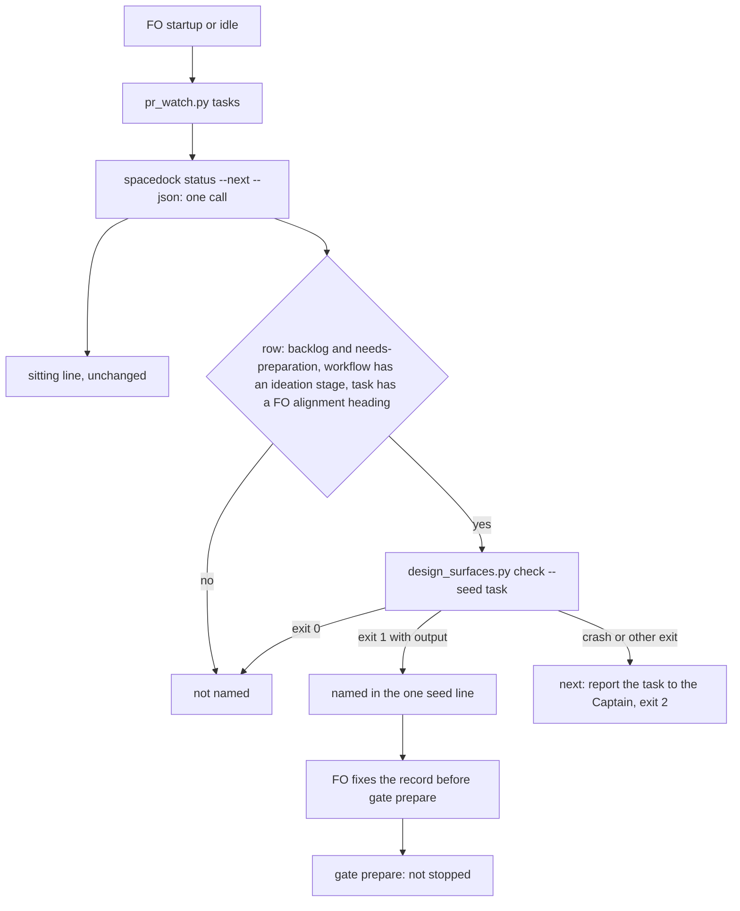

## Scope

- Source: the Captain's 「開」 (chat, 2026-10-21) to FO's batch-4 close question 「D 要不要開成任務？」, on FO's proposal 「讓 FO 每次例行檢查時跑的 `pr_watch.py tasks`，順便列出種子檢查沒過的待辦任務，FO 開閘門前就會看到」.
- Bite: the README's Seed check ("before `gate prepare`, FO runs `design_surfaces.py check --seed <task>` and holds the gate until it exits 0") was skipped three times in batch 4: observer findings on commissioned-by-names-spacedock and fo-batch-sittings (replay exit 1, "'Visible change:' is not 'none' but 'Surfaces:' has no 'ui'"), and the dev2-poc task interrogation-replay-on-batch-3-poc.
- Shape asked for: `pr_watch.py tasks` prints one `next:` line naming each backlog task whose seed check fails; no new script. It reminds and does not stop `spacedock gate prepare`, which this package cannot change.
- Upstream first: Spacedock `gate prepare` (no hook for an adopter check), `design_surfaces.py check --seed`, the `pr_watch.py tasks` sitting line from fo-batch-sittings (ADR 0028).
- Non-goals: blocking `gate prepare`; candidates E and F of the same list.

## FO alignment

Alignment: not needed before ideation; the Captain chose the shape.
Surfaces: none
Visible change: none
Release review: not needed: workflow maintenance, on no journey map.

## Design

Base read: origin/main `c27e7659` (kc-dev-flow-2 0.27.0; the 0.27.0 cache `scripts/` is byte-identical to it, `cmp` over every `.py` file in it, 2026-10-21), Spacedock 0.27.2. Measurements ran 2026-10-21 on scratch copies outside the repository; adopter state was read only (`spacedock status --next --json`, `git show`, file reads, and `pr_watch.py tasks` with `--state` in a scratch directory).

Skill note: `Skill(kc-dev-flow-2:ideation)` resolved to the orphaned 0.26.0 cache; this design follows the dispatch's 0.27.0 root and read 0.27.0's `principles.md` and pilot references.

### PRFAQ

**Press release (future).** When FO starts or goes idle, the line it already runs (`pr_watch.py tasks`) also says which backlog tasks have a started `## FO alignment` record that the seed check refuses, with the command to rerun. FO sees the name before it prepares that task's gate, not from an observer after the merge. The line reminds; `spacedock gate prepare` is unchanged and still not stopped.

**FAQ.**

- *What exists already?* Spacedock reports each backlog task as `readiness: needs-preparation` in `spacedock status --next --json` (`RouteNeedsPreparation`, `internal/gates/model.go`, a gated stage with no gate record); `pr_watch.py tasks` already calls that command and reads `ready_gates` in `sittings()`; `design_surfaces.py check --seed <task>` is the check the README names. `spacedock gate prepare --help` (0.27.2) lists `--question --artifact --summary --reference` and no precondition input. Sibling adopters hold no copy of either script (`find` for `pr_watch*` and `design_surfaces*` under the qnow, relay and web `docs/dev2`, 2026-10-21: 0). So nothing is built; two existing outputs are joined.
- *Why not name every failing backlog task?* 70 backlog tasks fail the seed check today, 55 of them parked qnow tasks that FO has not touched; one line would carry 82 words at every startup and idle in qnow. See D1.
- *Why README-based route test and not the task's `profile:`?* The task records `profile:` when FO prepares the gate: `fo-batch-sittings` got `profile: pilot` at state commit `cfb23238` (2026-10-20 12:56:18), 49 seconds before its backlog gate record, while its failing `Visible change:` record had been committed since 00:15:38. A profile test would have kept the line silent until 49 seconds before the gate.
- *What does it not prove?* That FO runs the idle hook between the seed commit and `gate prepare`. In `commissioned-by-names-spacedock` the file's first commit (12:46:20) and the backlog gate record (12:46:26) are 6 seconds apart, so a line could not have fired; the task's earlier uncommitted window cannot be read from git.

### Bounded existing-code check

Capability: a way for FO to see failing seeds before the gate. Consumers searched: `git grep -n pr_watch origin/main -- kc-dev-flow-2` finds the mod (`references/sd/mods/kc-dev-flow-2.md` step 1), `extensions/learn/EXTENSION.md` (describes the run), `test_sd_dispatch.py` pin `pr-watch` (the mod's three steps), `test_learning.py` and `test_observer_check.py` (other modes), none parse `tasks` output. `laws_check.py` and `role_triggers.py` do not read it. So the new line has no parser to update (learning "Update every parser of a script mode"). Observed need: the README Seed check was skipped in `commissioned-by-names-spacedock`, `fo-batch-sittings` (both exit 1 with "'Visible change:' is not 'none' but 'Surfaces:' has no 'ui'") and the dev2-poc task named in Scope. Decision: reuse both outputs, add one function and one call site in `pr_watch.py`; no new script, README or mod text.

### Design

`pr_watch.py` changes, nothing else:

1. `sittings(workflow)` splits into `ready_rows(workflow)` (the one `status --next --json` call, same error text) and `sittings(rows)`; the seed code reads the same rows, so the idle step still makes one call.
2. `seeds(rows, found, readme)` returns zero or one line. A row is a candidate when its stage is `backlog`, readiness `needs-preparation`, the README has a `- name: ideation` stage line, its task file (from `entities(state)`) exists and holds a `## FO alignment` line. For each candidate it runs `design_surfaces.py check --seed <file>` as a subprocess (the command the README tells FO to run). Exit 1 with output on stdout names the slug. Exit 1 with empty stdout (a crash prints a traceback on stderr and exits 1) or any other exit is an error line `next: report <slug> to the Captain: <reason>.` and exit 2, appended to `errors` like the `dispatch_records.py` case; the sitting line and the other lines still print.
3. The line, printed after the sitting lines and before the wait lines: `next: the seed check fails for these backlog tasks (a, b); before preparing the gate of one, fix its ## FO alignment and run `python3 <package scripts>/design_surfaces.py check --seed <task>`.` It is 27 fixed words plus one per slug, like the sitting line (`test_the_line_grows_by_one_word_per_slug`), not capped, printed only while a candidate fails, and it writes no file.
4. Docstring of `pr_watch.py` gains one clause; `test_pr_watch.py` gains the cases in AC-1 to AC-7. `references/sd/workflow.md`, the mod and `test_sd_dispatch.py` are untouched.

### Measured on the backlog of the four state checkouts

Pins: scripts at `c27e7659`; Spacedock 0.27.2; state heads when measured (they move, validation re-measures): kc-claude-plugins `de21381e`, qnow `93a3d8447`, subspace-relay `55e447aa`, subspace-web `4a51160`; the fifth checkout, the POC workflow `414e58ace`, is the zero-name control.

| Checkout | backlog rows (needs-preparation) | seed check fails | fails with a `## FO alignment` heading | named by the recommended rule | words of that line |
| --- | --- | --- | --- | --- | --- |
| kc-claude-plugins | 21 (20) | 9 | 0 | none | 0 |
| qnow | 62 (62) | 55 | 6 | booking-multi-service, office-staff-management-next, rls-census-covers-bypasses, technician-progress-report, vehicle-catalog-upkeep, vehicle-service-history | 33 |
| subspace-relay | 13 (13) | 4 | 2 | agent-front-door-publish, author-handle | 29 |
| subspace-web | 5 (5) | 2 | 0 | none | 0 |
| POC workflow (no ideation stage) | 3 (3) | 3 | 0 | none (route test) | 0 |

Reading: 8 names against 70 failing tasks. The 62 not named hold no `## FO alignment` heading (9, 49, 2 and 2 by checkout); relay `author-handle` is the bite itself ("'Visible change:' is not 'none' ..."). Independent oracle: a second script that ran `design_surfaces.py check --seed` on every `needs-preparation` backlog task and filtered by heading gave the same 6 and 2 names. Control: in the POC checkout 10 of 10 task files with a `## FO alignment` heading fail the seed check (they carry no `Surfaces:` line by design), so without the README route test any POC backlog task with a record would be a false name. Cost: `seeds()` took 0.00 to 0.62 s on these checkouts (`status --next` itself takes 0.15 to 2.7 s and is already paid). Bite replay with the prototype: `fo-batch-sittings` at `20c0e85d`, `37b5540a` and `355dc920` (before its gate) and `commissioned-by-names-spacedock` at `8cd642eb` are each named.

### Words FO reads at each lifecycle moment

Rule: `len(text.split())` of the output of `pr_watch.py tasks`, run on each checkout with `--state` in a scratch directory, base (`c27e7659`) against the prototype; every other passage FO reads at a moment (README 5374 words, mod 48, `pr-merge` hooks, `observer_check`, `delivery_gate` output) is unchanged by construction (AC-8 diffs the files). Margins in the archived `fo-lifecycle-mod` AC-12 (23 words idle, 27 merge ask) belong to that closed task, whose goal was cutting words; this task adds a reminder, so the "each moment below base" test of root `learning.md` is answered by the table and D2, not met.

| Moment | Reads `tasks` output? | kc-claude-plugins | qnow | subspace-relay | subspace-web |
| --- | --- | --- | --- | --- | --- |
| Startup | yes, via the idle hook | 322 to 322 | 0 to 33 | 308 to 337 | 0 to 0 |
| Idle on an open PR | yes | same output as startup plus the unchanged wait lines | +33 | +29 | +0 |
| Idle on a merged PR | yes | +0 | +33 | +29 | +0 |
| After the archive | no (`after pr-merge:` lines, `observer_check`) | unchanged | unchanged | unchanged | unchanged |
| The merge ask | no (`delivery_gate.py`) | unchanged | unchanged | unchanged | unchanged |

Worst case today: 33 words added at the three moments that run `tasks`, in the one checkout with six names; 0 when nothing is named. Under the literal rule (D1 option B) the same moments would add 36, 82, 31 and 29 words.

## Acceptance criteria

All run from the candidate worktree with the 0.27.0-or-later package; "fixture" means a scratch repository built in the test, as `TasksTests` does. Counts in AC-1 and AC-6 are readings at the pinned heads above; the invariant is the oracle in each clause.

- **AC-1: names are exactly the oracle.** For each of the four checkouts, `python3 kc-dev-flow-2/scripts/pr_watch.py --state <scratch> tasks <workflow dir>` names exactly the slugs for which all hold: `spacedock status --workflow-dir <dir> --next --json` lists the row at `backlog` / `needs-preparation`, the README has a `- name: ideation` stage line, the task file has a `## FO alignment` line, and `python3 <package>/scripts/design_surfaces.py check --seed <file>` exits 1 with output. At the pinned heads that is 0, 6, 2 and 0 names. Falsifier: one named slug whose seed command exits 0, or one oracle slug not named, fails it.
- **AC-2: no false name from another stage, readiness or route.** Fixtures with a failing, heading-bearing record are not named when the row is `approved-awaiting-advance`, when the row's stage is `ideation`, when the README has no ideation stage, and when the slug has no task file (the existing 15-ghost-row test keeps passing). On the POC checkout `tasks` prints no seed line. Falsifier: deleting the readiness test, the stage test or the README test turns its own fixture into a named slug (one mutation per test).
- **AC-3: an unseeded task is not named and runs no check.** A failing task with no `## FO alignment` line is not named, and a stub of `design_surfaces.py` records zero runs for it. Falsifier: deleting the heading test names it. This criterion is replaced if the Captain picks D1 option B.
- **AC-4: one status call, and a crash is isolated.** A stub `spacedock` counts calls: `tasks` makes exactly one (`status --next --json`). A candidate task file holding an invalid UTF-8 byte (`design_surfaces.py check --seed` exits 1 with empty stdout and a traceback; measured 2026-10-21) prints `next: report <slug> to the Captain: ...` and `tasks` exits 2, while the sitting line for two awaiting gates is still printed. The existing failed-status test (one error line, exit 2) still passes. Falsifier: counting exit 1 alone as "named" names the crash; raising instead of appending to `errors` drops the sitting line.
- **AC-5: the line's form.** With 1 and with 6 named slugs the line has 27 words plus one per slug (`len(line.split())` is 28 and 33), starts with `next: the seed check fails for these backlog tasks (`, comes after the sitting lines and before `next: run ... wait`, appears once however many tasks are named, is absent when none is named, and `tasks` writes no file apart from the watch state (the tree-equality check of `test_the_sitting_line_writes_no_file`). Falsifier: changing the fixed text or printing one line per slug changes the count.
- **AC-6: the bite replays are named.** With a README fixture holding `- name: ideation` and the committed files from `git -C <state> show 20c0e85d:fo-batch-sittings.md`, `37b5540a:`, `355dc920:` and `8cd642eb:commissioned-by-names-spacedock.md` as backlog / needs-preparation rows, each is named (they carry no `profile:` at `20c0e85d` and `37b5540a`). Falsifier: adding a `profile` in (`pilot`, `prod`) condition leaves `20c0e85d` unnamed and fails it.
- **AC-7: the seed command's verdicts decide, not this script.** A heading-bearing fixture the seed command accepts (`Surfaces: none`, `Visible change: none`) is not named; a fixture whose only defect is "'Visible change:' is not 'none' but 'Surfaces:' has no 'ui'" is. Falsifier: a re-implementation of the record check inside `pr_watch.py` would diverge on a task edited later; the test runs the real script, not a stub, for these two.
- **AC-8: no other FO-read text changes.** `git diff --stat origin/main...HEAD` lists only `kc-dev-flow-2/scripts/pr_watch.py` and `kc-dev-flow-2/scripts/test_pr_watch.py`; `references/sd/workflow.md`, `references/sd/mods/kc-dev-flow-2.md`, `lint-skills.py` and the `pr-watch` pin in `test_sd_dispatch.py` are byte-identical; `python3 -B -m unittest` over the package's scripts passes. A recount with the stated rule and checkouts reproduces the table above within the head movement. Falsifier: any other file in the diff, or a recount where a moment outside `tasks` differs, fails it.

## Unresolved decisions for the Captain

- **D1: which failing backlog tasks does the line name?** Recommend A: only tasks that already hold a `## FO alignment` section (FO started the record and the seed check refuses it). Options: A (8 names today: 6 qnow, 2 relay); B, every failing backlog task as in the Scope wording (70 names today, 55 of them in qnow, so 82 words at every startup and idle there until FO writes records for tasks it has not picked); C, A plus a fixed clause counting the unseeded ones (constant in qnow while it has 49). Worse under A: a task with no record at all is never named, so an FO that writes no record and runs no check gets no reminder (the gate content must still show the record, but nothing is read before that); 62 failing tasks stay unnamed. Why not B: the line becomes a standing 82 words in the one adopter with a large parked backlog, the kind of repeating line the accepted ADR 0028 consequences and `names-check-before-dispatch` D1 already flagged. `git grep 'Override:'` over the state checkout, and ADRs 0026 and 0028, name no ruling against this shape.
- **D2: offset the added words?** Recommend no offset. The line costs 0 words when nothing is named and 27 plus one per slug otherwise; the only nearby passage to cut, the README Seed-check sentence "An FO that skips this step still dispatches; the worker's own check is the backstop", states why a skip is survivable, and `learning.md` "Compare a shrunk rule with what its script rejects before cutting it" asks for a pin I would have to add. Worse under no offset: startup and both idles read up to 33 words more in qnow today, past the 23-word idle margin the closed `fo-lifecycle-mod` recorded.

Limits, not decisions: the line fires only if FO runs the idle hook between the seed commit and `gate prepare` (AC-6 shows a 12.7-hour window for one of the two committed bites and none for the other); it reminds and cannot stop `gate prepare`; the README stage test reads `- name: ideation` as a block-style line, so a flow-style `stages:` list gives no names; the heading test copies `design_surfaces.py`'s `FO_HEADING` pattern and drifts if that changes (the seed command's verdict still decides every name).

### Batch overlap

Files this design changes: `kc-dev-flow-2/scripts/pr_watch.py` (`sittings()` split, one new function, the `tasks()` call site, the docstring) and `kc-dev-flow-2/scripts/test_pr_watch.py`. Checks run, not changed: `design_surfaces.py check --seed`. Read from the task files on 2026-10-21 (`grep` for `pr_watch`, `design_surfaces`, `workflow.md`, `ready_gates`, `Seed check`, then the named sections).

| Task | Overlap with this design |
| --- | --- |
| new-work-starts-from-a-story-map (ideation, held before design) | Same function. Its Amendment 1 moves fo-batch-sittings' Cut 2 into it; the archived form (AC-7 there) printed list-then-ask lines under the sitting line in `pr_watch.py` and `test_pr_watch.py`, so the line order and the `sittings()` code this design splits would both change. `design_surfaces.py` appears there only in a version note. |
| pr-watch-tasks-foreign-worktree (backlog, not in the lists given) | Same `tasks()` function and `test_pr_watch.py`; it turns the record-PR `next:` lines into fact lines. Different lines, no shared code path with the seed line. |
| codex-reader-reads-receipt-marker (ideation) | `pr_watch.py` is its bite only; it changes `extensions/codex/codex_review.py` and its tests. None. |
| merge-ask-holds-missing-clauses (ideation) | `delivery_gate.py`, `role_triggers.py`: not changed here. None. |
| fo-write-checks-parse-top-level (ideation) | `design_surfaces.py` Scope search and `delivery_gate.py` `declined_items()`; the seed command is unchanged by its Scope, but re-measure AC-1 after it lands. |
| agent-reads-governing-adr (ideation) | Proposes an ADR-title hook at session start or dispatch; if it edits the mod, startup reads its words on top of this line. No shared file here. |
| design-surfaces-task-dir-crash (backlog) | `design_surfaces.py check <task>`; `seeds()` always passes a file path, so unaffected. |
| names-check-newest-followups (backlog) | `dispatch_records.py --newest` and its `next:` line in `tasks()`; different line, same function. |
| release-acceptance (ideation) | Edits `references/sd/workflow.md` near the Seed-check bullet and adds `release_review.py`; names no `pr_watch.py`. This design edits no README text, so no conflict; if it later adds a `tasks` line, orders with this one by line placement. |
| kc-decision-log-p1, kc-decision-log-cli, kc-decision-log-handoff-trial, pr-review-lite-value-pilot, journey-canvas-hosted-poc, journey-server-host-pilot (driven by other sessions; read only) | None of the files or checks above; the only hits are runs of `design_surfaces.py check` on their own task files. |

Recommended order: this task before new-work-starts-from-a-story-map's implementation (it will add lines beside `sittings()`, so it should build on the split), and together with pr-watch-tasks-foreign-worktree in one reviewed sequence if both are admitted (same function, disjoint lines); the rest in any order.

### Past rulings

ADR 0028 (the sitting line, one line naming every slug, repeats each pass) and ADR 0026 (read counts from task records, not phrases) are the area; the first is followed (one line, one word per slug), the second is followed (the heading test reads the record's structure and the seed command decides the verdict). `git -C <state> grep -n 'Override:'` read 2026-10-21 hits only archived prose and observer reports, none on an idle-line or seed-check question. The same repeat-each-pass cost was accepted for `names-check-before-dispatch` D1(a).

## Stage Report: ideation

- DONE: Design the kc-dev-flow-2/scripts/pr_watch.py tasks line and measure it on the backlog of the four state checkouts as they stand: which tasks it would name today, with zero false names
  `## Design` and `### Measured on the backlog of the four state checkouts`: 8 names today (qnow 6, relay 2, this workflow and web 0) out of 70 failing; a second oracle script gave the same set; the POC checkout (10 of 10 heading-bearing files fail the seed check) names 0 through the README route test; prototype outside the repository, no repository file written.
- DONE: A `### Batch overlap` section naming each file the design would change and each other batch task and live task of other sessions that changes the same file or check, so FO can order implementation
  `### Batch overlap`: files `pr_watch.py` and `test_pr_watch.py`; same-function overlap with new-work-starts-from-a-story-map (Cut 2 lines beside `sittings()`) and with pr-watch-tasks-foreign-worktree; none with the other listed tasks; a `Recommended order:` line.
- DONE: The words FO reads at each lifecycle moment, before and after, per root learning.md "Measure the words FO reads at each moment, not one file's size"
  `### Words FO reads at each lifecycle moment`: `tasks` output 0 to 33 (qnow) and 308 to 337 (relay) at startup and both idles, 0 elsewhere, after-archive and merge-ask unchanged; the learning's "each moment below base" test is not met by design and is put to the Captain as D2.
- DONE: Acceptance criteria with reproducible evidence clauses and falsifiers, and unresolved decisions for the Captain, each with a recommendation and what gets worse under it
  `## Acceptance criteria` AC-1 to AC-8 and `## Unresolved decisions for the Captain` D1 (which tasks are named) and D2 (word offset). Current evidence per criterion: AC-1 and AC-6 measured on the prototype at the pinned heads; AC-2, AC-3 and AC-4 crash fixture checked by hand on the prototype (poc, approved-awaiting-advance, ideation-stage, ghost slug not named; invalid UTF-8 file exits 1 with empty stdout); AC-5 word counts 28/33 measured on the prototype; AC-7 and AC-8 not yet verified (implementation). `design_surfaces.py check` (0.27.0 cache) prints "design surfaces presentable", exit 0.

### Summary

The design joins two outputs the package already has: the `needs-preparation` rows of `spacedock status --next --json` that `pr_watch.py tasks` already reads, and `design_surfaces.py check --seed`. A profile test would have missed the recorded bite because the profile is written 49 seconds before the gate, so the route test reads the README for an ideation stage. Held for the Captain: D1 whether the line names only tasks with a started `## FO alignment` (recommended, 8 names) or every failing backlog task (70 names, 82 words in qnow), and D2 whether to offset the added words (recommended no). Limit: the line helps only if FO runs the idle hook between the seed commit and `gate prepare` (12.7 hours in one bite, none in the other).

## Stage Report: implementation

- DONE: One Draft PR (feat(kc-dev-flow-2): ...) from a branch off origin/main (c27e76590c1d2dc910e7fa2d332242a7534df0b0) implementing the approved design: kc-dev-flow-2/scripts/pr_watch.py tasks names each backlog, needs-preparation task that carries a FO alignment section and fails kc-dev-flow-2/scripts/design_surfaces.py check --seed (D1 option A), a crash in that check becomes a report-to-Captain line with exit 2, no word offset elsewhere (D2), with kc-dev-flow-2/scripts/test_pr_watch.py; only those two files
  Draft PR https://github.com/iamcxa/kc-claude-plugins/pull/694, branch spacedock-ensign/idle-names-failing-seeds, one commit 1c57c156; `git diff --stat origin/main...HEAD` lists only pr_watch.py and test_pr_watch.py (AC-8).
- DONE: Every acceptance criterion green with the evidence each names, each falsifier shown failing by a mutation you run (python3 -B, caches cleared), including the re-measure on the four state checkouts as they stand at your run (heads move) with zero false names
  Re-measure 2026-10-22 (heads kcp ba44ac0b3, qnow a5617e33c, relay 44369c616, web db29d98aa, POC 414e58ace): candidate names equal an independent oracle script: 0, 6 (same six slugs), 2 (same two), 0, POC 0; seed line is 33 words with six slugs (AC-1, AC-5).
  Mutations (8 new tests in TasksTests), each killed: readiness test, stage test, README route test deleted (the not-named-elsewhere test); heading test deleted (no-alignment test, also asserts zero seed-check runs); exit 1 alone counts as named, crash raised instead of appended, and second status call (the crash/one-call test); profile condition added and one-line-per-slug break (the line-form and bite tests). AC-6 replays on state commits 20c0e85d, 37b5540a, 355dc920 (fo-batch-sittings) and 8cd642eb (commissioned-by-names-spacedock): all four named, with and without `profile:`. AC-7 runs the real design_surfaces.py in the first test (accepted record not named, "'Visible change:' is not 'none'..." record named).
  Words: base vs candidate `tasks` output qnow 0 to 33, relay 375 to 403 (head moved; the line itself is 29), kcp and web unchanged.
- DONE: kc-dev-flow-2/scripts/lint-skills.py exits 0; roborev evidence= line; push without force and without -u; CI green on the PR head; CI cost measured or stated as not measured
  lint-skills.py exit 0; `python3 -B -m unittest discover` over the package scripts: 626 tests OK; roborev_gate.py exit 0 `clean on 1c57c156d; evidence=roborev:992`; plain `git push origin <branch>`; CI on head 1c57c156 all pass: kc-dev-flow-2 tests 1m32s, marketplace version parity 59s, kc-dev-flow release gate 6s (sum of job durations 2m37s, measured from `gh pr checks`; billed minutes not measured).
- DONE: Implementation exit checks (comment_ratio, doc_impact, design_surfaces check)
  comment_ratio.py origin/main HEAD: 151 code lines, 0 comment lines, 0.0%, within the 5% maximum; doc_impact.py: 0 documents listed; design_surfaces.py check on this task: presentable; no `## Number guards` section; no ADR added.

### Summary

pr_watch.py gains `ready_rows()` (the one `status --next --json` call, shared with `sittings(rows)`) and `seeds()`, which runs the real `design_surfaces.py check --seed` only for backlog needs-preparation rows holding a `## FO alignment` heading when the README has an ideation stage; exit 1 with output names the slug, any other failure is a `report <slug> to the Captain` line with exit 2. Limits: the line reminds only; it helps only if FO runs the idle hook before `gate prepare`; PR #693 edits other functions of the same two files, so a textual rebase may be needed after it merges. No files outside the design were needed.
